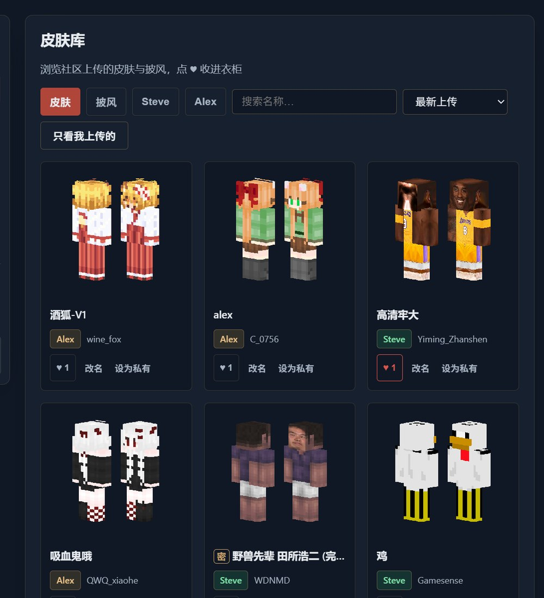
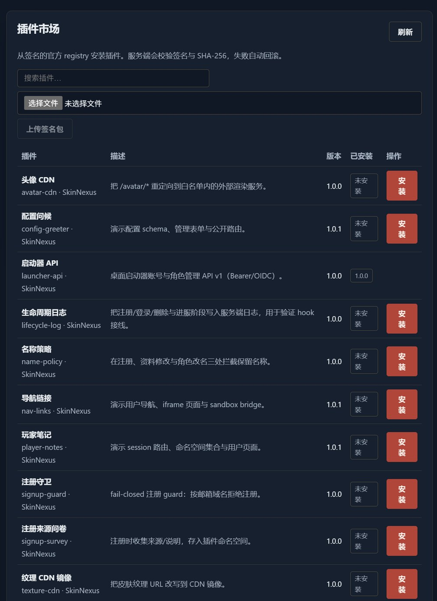
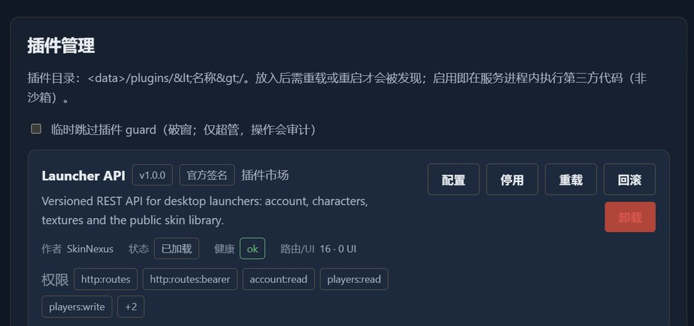

# SkinNexus

<p align="center"></p>

<p align="center">
  <a href="https://github.com/YimingZhanshen/skin-nexus/actions/workflows/ci.yml"></a>
  <a href="https://github.com/YimingZhanshen/skin-nexus/releases/tag/v0.4.0"></a>
  <a href="LICENSE"></a>
</p>

> Self-hosted Minecraft skin server: full Yggdrasil compatibility, lossless migration from blessing-skin-server.

[中文文档](README.md) | **English**

**SkinNexus** is a skin server for Minecraft servers and communities. Players upload and manage skins and capes in the browser, then join game servers through launcher passwordless login. Operators self-host everything — accounts, textures and the signing key stay on their own machine.

It is a modern rewrite of [blessing-skin-server](https://github.com/bs-community/blessing-skin-server) in **Go + Vue 3**, already proven in a real production migration: **67 users / 61 textures with zero row loss and zero player-UUID drift**.

- **Release**: v0.4.0 (2026-10-28) · iteration history in [`docs/CHANGELOG.md`](docs/CHANGELOG.md) (Chinese)
- **License**: AGPL-3.0 · **Author / copyright holder**: YMZS

## Deploy in 10 minutes (Docker Compose)

The image is public on GHCR (anonymous pull, no `docker login`); the commands
below pull it directly, no source checkout required:

```bash
mkdir skin-nexus && cd skin-nexus
curl -fsSLO https://raw.githubusercontent.com/YimingZhanshen/skin-nexus/main/docker-compose.quickstart.yml
cat > .env <<EOF
# your public URL, set before first start
SKIN_BASE_URL=https://skin.example.com
SKIN_DB_PASSWORD=$(openssl rand -hex 16)
SKIN_DB_ROOT_PASSWORD=$(openssl rand -hex 16)
SKIN_ADMIN_TOKEN=$(openssl rand -hex 32)
EOF
docker compose -f docker-compose.quickstart.yml up -d
```

Open `http://<host>:8080/setup` and finish the site name, admin account and
skin-domain wizard.

<details>
<summary><b>Already have MySQL? Pull the image and run it directly</b></summary>

```bash
docker pull ghcr.io/yimingzhanshen/skin-nexus:latest
docker run -d --name skin-nexus --restart unless-stopped -p 8080:8080 \
  -v skin-data:/data \
  -e SKIN_DATA_DIR=/data \
  -e SKIN_BASE_URL=https://skin.example.com \
  -e SKIN_DATABASE_DSN='skin:PASS@tcp(your-mysql:3306)/skin_nexus?parseTime=true&charset=utf8mb4' \
  -e SKIN_ADMIN_TOKEN=$(openssl rand -hex 32) \
  -e SKIN_AUTO_MIGRATE=true \
  ghcr.io/yimingzhanshen/skin-nexus:latest
```

</details>

**Lossless migration from blessing-skin-server**: run `preflight → dry-run →
import` from [`docs/migration.md`](docs/migration.md); small sites usually
finish in about 10 minutes, fully rollback-able. External MySQL, reverse proxy,
upgrades and backups: [`docs/deploy.md`](docs/deploy.md).

## Screenshots

<p align="center"></p>

<p align="center">
  
  
</p>

<p align="center"></p>

> Taken from a real production instance. The site name and sensitive settings are
> replaced; skins and nicknames come from the public skin library.

## Why SkinNexus

- **Migration keeps your data** — primary keys preserved, UUIDs never drift, all password algorithms still verify (12 legacy schemes + argon2id lazy rehash). `preflight → dry-run → import`, fully rollback-able.
- **Modern login path** — built-in OIDC passwordless login (device code + refresh-token rotation), no Janus sidecar. The passwordless flow for community launchers such as SJMCL is implemented; real-device acceptance is in progress.
- **Observable operations** — login and federation traffic logs (90 days), audit trail, auth rate limiting, three-layer bans (login / authenticate / `hasJoined`), in-panel self-diagnostics.
- **Content that gets indexed** — server-rendered landing and skin detail pages, `sitemap.xml`, `robots.txt`, per-page meta/OG/JSON-LD. None of the three mainstream competitors ships the full set.
- **Simple deployment and upgrades** — single Go binary or Docker Compose; CI publishes an image to GHCR on every push to `main`, deploy hosts only pull.

Measured on a 2-core / 3.5 GB production VPS: ~600 RPS landing, 5182 RPS texture delivery, 2365 RPS Yggdrasil metadata, zero errors (see CHANGELOG).

<details>
<summary><b>Capability comparison with blessing-skin-server / element-skin / vSkin (source-verified)</b></summary>

> Every cell was checked against the opponents' source code (route tables / grep, 2026-10-25–26); method and per-item evidence in [`docs/competitor-analysis.md`](docs/competitor-analysis.md) (Chinese). We credit rivals where they lead and never guess a ❌ — errata are corrected in place and logged in the CHANGELOG.

| Capability | SkinNexus | blessing | element-skin | vSkin |
|---|---|---|---|---|
| SEO (sitemap / robots / per-page meta·OG·JSON-LD) | ✅ complete | ⚠️ per-page title + one site-wide description | ❌ | ❌ |
| Server-rendered, indexable content pages | ✅ landing + skin detail | ⚠️ Twig shell, body client-rendered | ❌ SPA shell | ❌ SPA shell |
| Shareable per-skin URLs | ✅ `/skinlib/{tid}` | ✅ `/skinlib/show/{tid}` | ❌ list + modal | ❌ list only |
| Launcher deep links | ✅ `/user/closet`·`/user/profile` | ✅ origin of the convention | ❌ | ❌ |
| Mojang official fallback | ✅ hardened outbound + hot switch | ❌ | ✅ | ✅ |
| Password reset + SMTP | ✅ enumeration-proof, single-use | ✅ | ✅ | ✅ |
| OIDC passwordless login | ✅ built in, device-code flow + refresh rotation | ⚠️ needs Janus sidecar | ⚠️ discovery under-announces | ⚠️ weak OAuth details |
| MUA Union federation | ✅ built-in opt-in + outbound sync | ✅ via plugin | ❌ | ⚠️ config shell only |
| blessing migration (ID-preserving / zero UUID drift) | ✅ preflight→dry-run→import | — (source) | ❌ | ❌ |
| Ban enforcement | ✅ login / authenticate / hasJoined | ✅ permission-level | ✅ | ❌ hasJoined only |
| Ops observability (login + traffic logs + audit) | ✅ full-chain in panel | ❌ | ⚠️ permission audit only | ❌ |
| Deployment shape | Go binary / Docker, CI-published images | PHP 8.1 + Laravel 10 (PHP 8.1 EOL) | Go + PostgreSQL + Redis | FastAPI + SQLite |

</details>

## Features

**For players**
- Sign up / sign in (optional invite-code gate), profile and password management
- Upload skins and capes (drag & drop, live 3D preview, HD skins keep native resolution)
- Closet and character management, set avatar
- Skin library with three visibility levels, filters, sorting and likes; shareable detail pages
- Authorized apps, device management, Union binding, account deletion

**For operators**
- Admin panel: stats, users / characters / textures, invite codes, grouped site settings, Union operations, self-diagnostics
- Announcements (Markdown with dual sanitization), custom CSS/JS, theme packs
- Three-layer ban enforcement, auth rate limiting and lockout, SMTP password reset
- Login and server/federation traffic logs (90 days), audit trail

**Compatibility & integrations**
- Full Yggdrasil API: authlib-injector works with zero config changes, UUIDs never drift
- OIDC passwordless login (device-code flow + refresh rotation, authorization code also supported); MUA Union member module (off by default = zero surface)
- CustomSkinAPI / USM / legacy bare PNG / public read-only API
- Mojang official fallback: on a local miss, query the official sessionserver (hardened outbound + panel hot switch)
- Server-side avatar and preview rendering: `/avatar/...`, `/preview/...` output PNG

**Appearance & content**
- Theme packs (zero build: `theme.json` + CSS + optional JS) with an [AI prompt template](docs/theme-spec.md)
- Plugin platform v2 (goja): single hookApi 2 with config/secrets, namespaced data, tiered routes, events/guards, sandboxed iframe UI; P2 adds signed bundle install/upgrade/rollback, a single-source signed market and the `skin-plugin` publishing CLI; official plugin sources and market live in [skin-nexus-plugins](https://github.com/YimingZhanshen/skin-nexus-plugins) with PR contributions signed by CI; the `launcher-api` plugin exposes a Bearer character API for desktop launchers ([spec](docs/launcher-api.md)); see [docs/plugin-spec.md](docs/plugin-spec.md)
- zh-CN / en built in, language packs extensible
- SEO: SSR landing and skin detail pages, sitemap, robots, optional site-wide noindex for staging

## Quick start

**Requirements**: Docker 20+ / Compose v2; MySQL 5.7 or 8.0 (compose bundles 8.0, external DB supported).

```bash
git clone https://github.com/YimingZhanshen/skin-nexus.git
cd skin-nexus

# Edit docker-compose.yml — at minimum:
#   SKIN_BASE_URL      your public URL (set BEFORE first start; baked into texture URLs and the OIDC issuer)
#   SKIN_DATABASE_DSN  DSN (password must match MYSQL_PASSWORD below)
#   SKIN_ADMIN_TOKEN   machine/API admin token (openssl rand -hex 32)

docker compose up -d
```

Open `http://<host>:8080/setup` (on an empty database, visiting any page enters the wizard automatically), then fill in site name, admin account and skin domains.

- **Upgrade**: `docker compose pull && docker compose up -d` (volumes untouched)
- **Migrate from blessing-skin-server**: see [`docs/migration.md`](docs/migration.md) (`preflight → dry-run → import`, rollback-able)
- **Source build / no Docker**: see [`docs/build.md`](docs/build.md) and [`docs/deploy.md`](docs/deploy.md) §5

**Before going live**

1. Your reverse proxy must forward `X-Forwarded-Proto` and `X-Forwarded-For` (otherwise the protocol header is wrong and all users share one rate-limit bucket).
2. Back up the signing key (`/data/sign-key.pem` in the `skin-data` volume for Docker; `data/sign-key.pem` by default for source builds) — losing it invalidates every skin signature.

Full env-var tables, reverse-proxy examples, backup/restore and troubleshooting: [`docs/deploy.md`](docs/deploy.md).

## Documentation

| Document | Contents |
|---|---|
| [`docs/deploy.md`](docs/deploy.md) | Deployment: compose DB modes, env vars, Nginx, operations |
| [`docs/build.md`](docs/build.md) | Build guide: requirements, source build, Docker image, CI artifacts |
| [`docs/migration.md`](docs/migration.md) | Full migration from blessing-skin-server: CLI, reconciliation, cutover |
| [`docs/compat-matrix.md`](docs/compat-matrix.md) | Compatibility matrix: per-endpoint measured baseline |
| [`docs/theme-spec.md`](docs/theme-spec.md) | Theme pack spec and AI prompt template |
| [`docs/plugin-spec.md`](docs/plugin-spec.md) | Plugin authoring spec (goja host v2: config/data/routes/events/guards/UI) |
| [`docs/plugin-publishing.md`](docs/plugin-publishing.md) | Signed bundles, registry, GitHub Pages publishing and key custody |
| [`docs/launcher-api.md`](docs/launcher-api.md) | Launcher API v1 (Bearer/OIDC, characters/textures/library) |
| [`docs/competitor-analysis.md`](docs/competitor-analysis.md) | Source evidence behind the comparison table |
| [`docs/CHANGELOG.md`](docs/CHANGELOG.md) | Iteration history |
| [`CONTRIBUTING.md`](CONTRIBUTING.md) | Contributing: translations / themes / code and docs |
| [`AGENTS.md`](AGENTS.md) | Repository map, iron rules, collaboration discipline |
| [`GOVERNANCE.md`](GOVERNANCE.md) · [`CITATION.cff`](CITATION.cff) | Governance (BDFL) and citation |

Most detailed docs are currently in Chinese.

## Roadmap

| Status | Item |
|---|---|
| ✅ Done | Phases 1–3: full Yggdrasil, OIDC passwordless, Union module, i18n / SEO / theme packs, migration toolchain, admin panel; production migration and cutover; v0.2.0 (password reset / Mojang fallback / ops logs / SEO); v0.3.0 (signed plugin install/market/rollback + publishing CLI); v0.4.0 (all slots wired, plugin form fields, avatar CDN, profile/rename guards, capability introspection, local bundle trust levels) |
| 🔶 In progress | Plugin platform v2 (config/data/routes/events/UI) + P2 signed install/market; real-device launcher acceptance (SJMCL and community launchers: OAuth → character select → join) |
| ⬜ Planned | Official-account binding (second Auth Source), email verification, plugin marketplace operations / sidecar isolation / first-party native plugins |

## Frozen compatibility contracts

Read [`AGENTS.md`](AGENTS.md) and run the contract tests before changing any of these:

1. `/api/yggdrasil/**` semantics (204 lists, `{error,errorMessage}` bodies, millisecond timestamps, strict PEM format)
2. Player UUID stability (`OfflinePlayer:` md5 variant; renames never recompute)
3. Persistence layout stays directly migratable from blessing-skin-server storage conventions
4. `internal/union` wire contract and `internal/plugin` hook contract are frozen

## Contributing

Translations, theme packs, code and docs are all welcome — see [`CONTRIBUTING.md`](CONTRIBUTING.md). The project is BDFL-governed; everyday changes go through PRs. AI-assisted contributions are welcome, but the human submitter is responsible for verifying the output.

## License

AGPL-3.0 — see [`LICENSE`](LICENSE). Copyright line: `Copyright (c) 2026 YMZS (YimingZhanshen) and SkinNexus contributors`.
