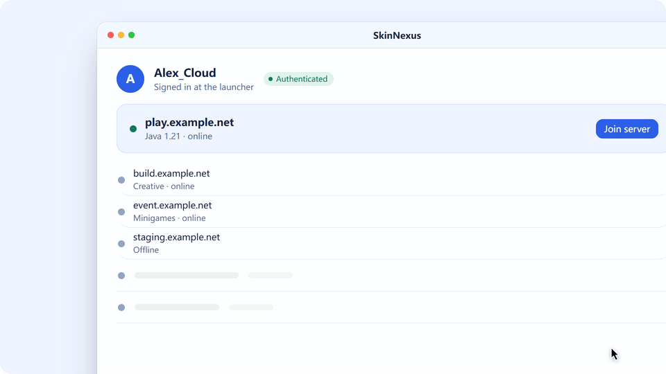
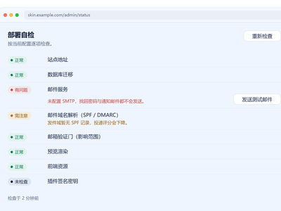
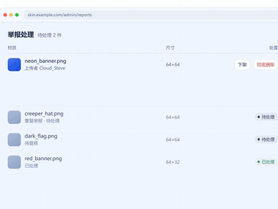
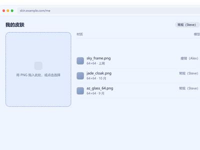

<div align="center">

# SkinNexus / 肤枢

[中文](README.zh.md)


> The self-hosted external-login and player-management site for Minecraft: players sign in at the launcher and join straight away — identities, skins and management all stay in your hands.

[](https://github.com/YimingZhanshen/skin-nexus/actions/workflows/ci.yml) [](https://github.com/YimingZhanshen/skin-nexus/releases/tag/v0.6.0) [](LICENSE)

[What is this](#what-is-this) · [Why switch](#why-switch) · [Deploy](#deploy) · [Features](#features) · [Docs](https://docs.skin.yimingzhanshen.cn/) · [License](#license)

</div>

---

<p align="center">
  <picture>
    <source media="(prefers-reduced-motion: reduce)" srcset="docs/assets/hero-join-flow.png">
    
  </picture>
</p>

<p align="center">
  
  
  
  
</p>

## What is this

**SkinNexus is an external-login and player-management site for Minecraft servers, in one place.** Most community servers run without premium verification — players are mostly on offline launchers and the server can't tell who is who. The traditional fix is an **in-game password-lock** plugin like AuthMe (players type `/login password` on every join), with skins left to fiddly mods — and even premium players get no skins on such servers.

**What bs + Yggdrasil do is move that lock to the launcher.** Players sign in to their site account once; every game start joins the server straight away — **just like premium, no retyping credentials**. Skins and capes load with the login, and the owner manages player profiles, bans and invite codes in one console — identity, skins, management in one place. This setup was made popular by **blessing-skin-server (short: bs — the oldest and most widely used program of this kind)** with its Yggdrasil plugins; most skin sites out there run that combination.

**SkinNexus is the modern replacement for that combination.** Already on bs? [The table below](#why-switch) is the whole difference. New to this? In one line: external login works out of the box (bs assembles it from plugins), we fix and ship security holes ourselves, and moving in from blessing loses nothing.

## Why switch

| Pain you may know | blessing-skin-server (bs) | SkinNexus |
|---|---|---|
| Typing `/login` after joining (AuthMe in-game password lock) | Solvable via Yggdrasil plugins, but assemble-it-yourself | External login built in — works right after setup |
| Aging tech, nobody fixes holes | A decade of PHP, fixes come when upstream ships | Modern rewrite — we fix and ship ourselves |
| Fear of losing data on migration | — | Accounts / skins / identities / old passwords preserved |
| Passwordless login is a chore | Needs an extra login add-on | Built in — works right after setup |
| One bad skin hurts everyone | Report takedowns skip ref-counts, closets break too | Reference count first, evidence kept, then delete |
| Players can't find your site | Default pages unreadable to search engines | Readable by search engines and AI assistants |
| Deploy and maintenance are heavy | A pile of PHP plumbing | Two commands to run, upgrades never touch data |
| Bans that die when the player renames | Bare site refuses at the website only; the join path needs a Yggdrasil plugin | Account-level ban: refused on site and at Yggdrasil join; renaming does not revive it |
| Premium players whose skin turns to Steve | — | Mojang fallback on by default: a local miss queries Mojang's official sessionserver |
| Nothing tells you the site is half-broken | No built-in panel check | Deployment self-check in the admin panel: eight items, each with a plain-language fix |

Measured on a small 2-core / 3.5 GB server: skin images answered 5,182 requests per second, the landing page 600 per second, zero errors. Per-cell comparison evidence: [competitor analysis](https://docs.skin.yimingzhanshen.cn/competitor-analysis).

**Just want to try it?** [Jump to Deploy](#deploy) — the commands only stand up a fresh site and never touch your existing blessing-skin-server data. Still evaluating? Read the "rehearsal" part of the [migration guide](https://docs.skin.yimingzhanshen.cn/migration) first — read-only, zero risk.

## Deploy

Images are on GHCR (public, no `docker login` needed), no source checkout required — and the process never touches your existing blessing-skin-server data (moving over is a separate later step, read-only against the old site):

```bash
mkdir skin-nexus && cd skin-nexus
curl -fsSLO https://raw.githubusercontent.com/YimingZhanshen/skin-nexus/main/docker-compose.quickstart.yml
cat > .env <<EOF
SKIN_BASE_URL=https://skin.example.com
SKIN_DB_PASSWORD=$(openssl rand -hex 16)
SKIN_DB_ROOT_PASSWORD=$(openssl rand -hex 16)
SKIN_ADMIN_TOKEN=$(openssl rand -hex 32)
SKIN_SETUP_TOKEN=$(openssl rand -hex 16)
EOF
docker compose -f docker-compose.quickstart.yml up -d
```

Open `http://<host>:8080/setup` and fill in the site name, admin account, skin domains and the `SKIN_SETUP_TOKEN` above — on an empty database whoever submits that form becomes the super admin, so the step asks for a value only you have. Upgrades are `docker compose pull && docker compose up -d`; data is never touched.

Two things before going live:

1. If you use a reverse proxy (Nginx, BaoTa, …), forward `X-Forwarded-Proto` and `X-Forwarded-For` (copy the config from the [deploy docs](https://docs.skin.yimingzhanshen.cn/deploy)) — otherwise address detection and login protection misbehave.
2. Back up the signing key (`/data/sign-key.pem` inside the `skin-data` volume). Lose it and every skin image players have downloaded fails verification.

More options (external databases, bare-metal, migrating your existing site) live at [docs.skin.yimingzhanshen.cn](https://docs.skin.yimingzhanshen.cn/deploy). Coming from blessing-skin-server? See the [migration guide](https://docs.skin.yimingzhanshen.cn/migration) — check first, rehearse, then switch, with rollback.

## Features

- **Players** — upload skins/capes (drag-and-drop, 3D preview), dress up characters, browse the skin library, report and favourite.
- **Owners** — manage players and content, bans and brute-force protection, invite codes, announcements, one-click theming, password reset / email verification, activity trail. Login credentials are stored as fingerprints only — stealing the database does not hand over usable logins.
- **Game servers** — works out of the box with mainstream launchers, passwordless login built in, MUA Union interop, premium-account fallback, batch skin import.
- **Extensions** — Chinese/English, build-free theming (theme packs), plugin platform, search-engine and AI visibility.

<p align="center">
  <picture>
    <source media="(prefers-reduced-motion: reduce)" srcset="docs/assets/card-diag-check.png">
    
  </picture>
  <picture>
    <source media="(prefers-reduced-motion: reduce)" srcset="docs/assets/card-refcount-block.png">
    
  </picture>
  <picture>
    <source media="(prefers-reduced-motion: reduce)" srcset="docs/assets/card-upload-skin.png">
    
  </picture>
</p>

Full feature list: [docs site](https://docs.skin.yimingzhanshen.cn/). Under the hood: one Go binary + Vue 3, with a choice of MySQL / MariaDB / PostgreSQL / SQLite.

## Documentation

| I want to… | Go to |
|---|---|
| Deploy, env vars, reverse proxy, backup | [docs.skin.yimingzhanshen.cn/deploy](https://docs.skin.yimingzhanshen.cn/deploy) |
| Migrate from blessing-skin-server | [docs.skin.yimingzhanshen.cn/migration](https://docs.skin.yimingzhanshen.cn/migration) |
| Build from source / understand CI | [docs.skin.yimingzhanshen.cn/build](https://docs.skin.yimingzhanshen.cn/build) |
| Check protocol compatibility | [docs.skin.yimingzhanshen.cn/compat-matrix](https://docs.skin.yimingzhanshen.cn/compat-matrix) |
| Write a plugin / theme | [plugin-spec](https://docs.skin.yimingzhanshen.cn/plugin-spec) · [theme-spec](https://docs.skin.yimingzhanshen.cn/theme-spec) |
| Publish & sign extensions | [docs.skin.yimingzhanshen.cn/plugin-publishing](https://docs.skin.yimingzhanshen.cn/plugin-publishing) |
| Integrate a launcher | [docs.skin.yimingzhanshen.cn/launcher-api](https://docs.skin.yimingzhanshen.cn/launcher-api) |
| Browse the knowledge handbook | [docs.skin.yimingzhanshen.cn/handbook](https://docs.skin.yimingzhanshen.cn/handbook/) |

Current release v0.6.0; iteration history in [`docs/CHANGELOG.md`](docs/CHANGELOG.md). Most detailed documentation is Chinese-first.

## Compatibility promise

"Moving over loses nothing" is backed by four long-frozen contracts: the original semantics of `/api/yggdrasil/**`, zero player-UUID drift, persisted data isomorphic to blessing-skin-server conventions (directly migratable), and the frozen `internal/union` / `internal/plugin` contracts. Before touching any of these, read the iron rules in [`AGENTS.md`](AGENTS.md) and run the matching contract tests.

## License

AGPL-3.0 (see [`LICENSE`](LICENSE)). `Copyright (c) 2026 YMZS (YimingZhanshen) and SkinNexus contributors`.
Translations, theme packs, code and documentation contributions are welcome — see [`CONTRIBUTING.md`](CONTRIBUTING.md). Governance is BDFL and changes go through PRs.
