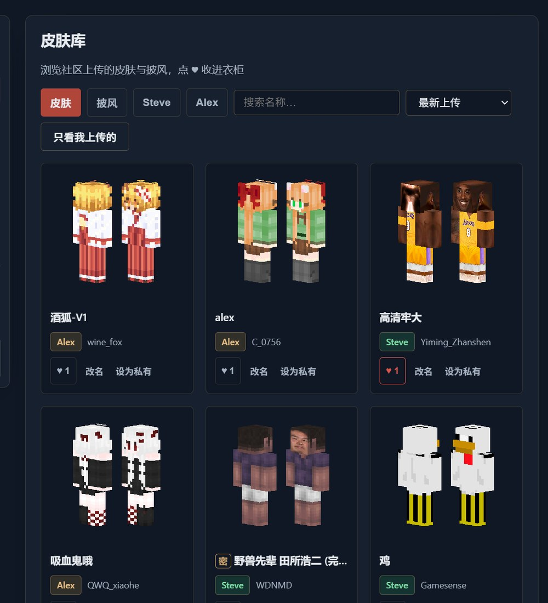
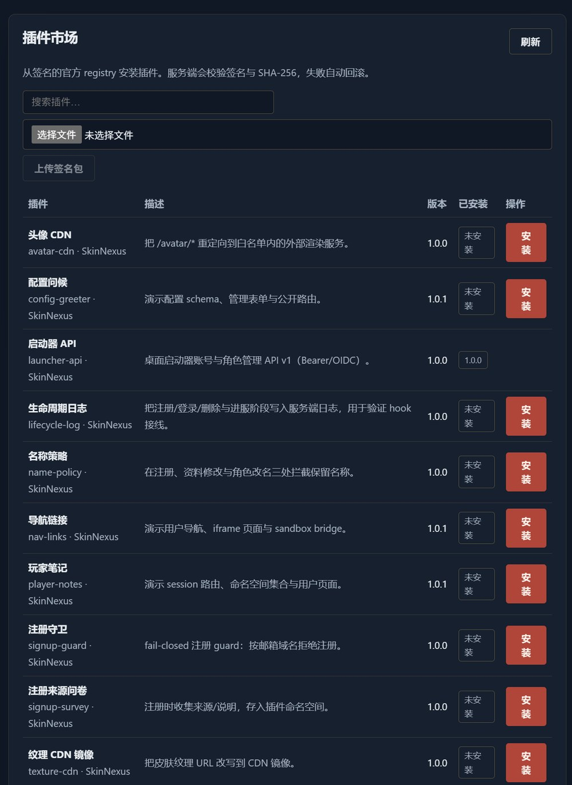

# SkinNexus / 肤枢

<p align="center"></p>

<p align="center">
  <a href="https://github.com/YimingZhanshen/skin-nexus/actions/workflows/ci.yml"></a>
  <a href="https://github.com/YimingZhanshen/skin-nexus/releases/tag/v0.6.0"></a>
  <a href="LICENSE"></a>
</p>

自托管的 Minecraft 皮肤站。玩家在网页上传管理皮肤与披风，用启动器免密登录直接进服；站长自己跑，账号、纹理文件和签名密钥都在自己机器上。

Go 单二进制 + Vue 3，数据库可选 MySQL / MariaDB / PostgreSQL / SQLite，AGPL-3.0。协议层兼容 [blessing-skin-server](https://github.com/bs-community/blessing-skin-server) 及其插件生态，可以从老站无损迁移：主键保留、玩家 UUID 不变、旧密码算式继续可用。已在一套真实生产环境完成迁移与切流，67 用户 / 61 纹理零丢行。

当前版本 v0.6.0（2026-11-12 发布）；`main` 在其之后仍在推进，逐片 commit + push，
迭代历史见 [`docs/CHANGELOG.md`](docs/CHANGELOG.md)。

## 部署

镜像在 GHCR（public，不需要 `docker login`），下面这段不用克隆源码：

```bash
mkdir skin-nexus && cd skin-nexus
curl -fsSLO https://raw.githubusercontent.com/YimingZhanshen/skin-nexus/main/docker-compose.quickstart.yml
cat > .env <<EOF
SKIN_BASE_URL=https://skin.example.com
SKIN_DB_PASSWORD=$(openssl rand -hex 16)
SKIN_DB_ROOT_PASSWORD=$(openssl rand -hex 16)
SKIN_ADMIN_TOKEN=$(openssl rand -hex 32)
SKIN_SETUP_TOKEN=$(openssl rand -hex 16)
EOF
docker compose -f docker-compose.quickstart.yml up -d
```

打开 `http://<主机>:8080/setup`，填站点名、管理员账号、皮肤域，以及上面那个 `SKIN_SETUP_TOKEN`
（空库时谁先提交这张表单谁就是超管，所以先要一个只有你拿得到的值；没设的话它会每次启动随机生成，
在 `docker compose logs skin-nexus` 那行 install token 里）。以后升级就是
`docker compose pull && docker compose up -d`，数据卷不动。

已有外部数据库（MySQL / MariaDB / PostgreSQL）、或想跑一个文件库（SQLite）、裸二进制与源码构建：见 [`docs/deploy.md`](docs/deploy.md) 与 [`docs/build.md`](docs/build.md)。
从老站迁数据：[`docs/migration.md`](docs/migration.md)（`preflight → dry-run → import`，小站通常 10 分钟，可回滚）。

上线前有两件事必须做：

1. 反向代理透传 `X-Forwarded-Proto` 与 `X-Forwarded-For`，否则协议判断错误、全站共用一个限流桶。
2. 备份签名密钥（Docker 在 `skin-data` 卷的 `/data/sign-key.pem`）。丢了它，已下发皮肤的签名全部失效。

## 功能

**玩家**：注册登录（可开邀请码准入）、上传皮肤与披风（拖放、进度、3D 预览、高清皮保留原生分辨率）、材质名称与来源标注（原创/二创/转载，后两者必须填原始发布地址）、Markdown 描述、私密上传、衣柜与角色管理、设为头像、皮肤库筛选排序与单品详情页、点赞入柜、举报、站内通知、授权应用与设备管理、账号注销。

**站长**：管理面板（概览、用户/角色/材质、邀请码、站点设置、运行状态、自助诊断）、公告与自定义 CSS/JS、主题包与主题市场（Ed25519 验签，安装卸载热生效）、本地主题包上传、自定义页脚、封禁（登录 / 认证 / `hasJoined` 三层）、认证限流与失败锁定、SMTP 找回密码与邮箱验证（单次链接令牌 + 可设宽限期的验证门禁，宽限一过进服与网页的身份操作一起拦下、公开浏览照常；验证落地页点击才消费令牌，防邮件客户端预取烧令牌；信件双语 + HTML/纯文本双份、色带跟主题、发信显示名缺省站点名；发信失败落审计并进运行状态计数，瞬断自动重试一次）、站内通知（举报处置、材质下架与解禁、封禁与解禁）、登录与服务器通信日志（保留 90 天；超管可临时开 ≤24h 的诊断窗口，把同一次请求的状态码/耗时/白名单请求头/正文节选与令牌原文多写一行明细）、操作审计；会话与启动器令牌在库内只存摘要，读到库不等于读到还能用的登录态——诊断明细里的令牌原文是这条的唯一例外，且按固定的 24h 短时钟抹掉，不跟 90 天的日志保留期走。

**协议与集成**：Yggdrasil 全端点（authlib-injector 零改配置）、OIDC 免密登录（设备码 + refresh 轮换，不需要外挂 Janus）、MUA Union 成员站模块（三头验签入站、角色生命周期同步、跨站绑定与 UUID 修正、成员站名与安全级别徽章、按两条腿分区的自助诊断——本站出站的 TLS/证书/时钟差与 hub 回探本站的证据各自成段；默认关闭 = 零暴露面）、CustomSkinAPI / USM / legacy 裸 PNG / 公开只读 API、Mojang 正版兜底（本地未命中时回源官方，出站地址防护 + 面板热开关）、服务端头像与预览渲染、启动器 Bearer API（`launcher-api` 插件）、皮肤导入（`skin-importer` 插件，支持 Mojang 与老站单条/批量导入）。

**内容与扩展**：中英双语（语言包可扩展）、主题包体系（零构建：`theme.json` + CSS + 可选 JS）、签名插件平台（goja 宿主：配置/密钥、命名空间数据、三档路由、事件与 guard、iframe UI）、SEO（落地页与皮肤详情页服务端渲染、`sitemap.xml`、`robots.txt`、`llms.txt`、逐页 meta/OG 与 JSON-LD）。

## 截图

<p align="center">
  
</p>

<p align="center">
  
  
</p>

> 截图来自真实生产实例，站名与敏感配置已替换，皮肤与昵称取自公开皮肤库。

## 与同类项目的差异

服务端渲染的 SEO 体系、皮肤详情页 URL、材质生命周期闭环、带机器门禁的错误契约——对照的四个项目这四项都没有全部做到。逐格证据（对方仓库的 `文件:行`，2026-11-01 快照）在 [`docs/competitor-analysis.md`](docs/competitor-analysis.md)，这里只放结论：

<details>
<summary><b>对照 blessing-skin-server / element-skin / vSkin</b></summary>

| 能力 | SkinNexus | blessing | element-skin | vSkin |
|---|---|---|---|---|
| SEO（sitemap / robots / 逐页 meta·OG·JSON-LD） | ✅ | ⚠️ 仅逐页 title | ❌ | ❌ |
| 服务端渲染内容页（免 JS 可收录） | ✅ 首页 + 详情页 | ⚠️ Twig 壳 | ❌ SPA | ❌ SPA |
| 皮肤库单品页（可分享 URL） | ✅ | ✅ | ❌ 弹窗 | ❌ |
| OIDC 免密登录 | ✅ 内置 | ⚠️ 需 Janus 外挂 | ⚠️ discovery 不全 | ⚠️ 细节弱 |
| 材质生命周期（像素定模型 / 违规禁公开 / 删除留证） | ✅ | ⚠️ 举报删文件跳过引用计数 | ❌ 删除后文件永久留盘 | ❌ 删除不计数 |
| 错误契约（稳定 code + 构建门禁） | ✅ | ❌ 粗粒度整数 code | ⚠️ 有码无门禁 | ❌ 只有人话 |
| CI 质量闸（覆盖率 / 多引擎集成矩阵） | ⚠️ 地板 45% + MySQL/MariaDB/PG/SQLite 六组合 | ⚠️ 传 Codecov 不设阈值 | ✅ 硬阈值 90% | ❌ 无 CI |
| 部署形态 | Go 单二进制 / Docker | PHP 8.1（已 EOL）+ Laravel 10 | Go + PostgreSQL + Redis | FastAPI + SQLite |

</details>

同一台 2 核 / 3.5 GB 生产 VPS 的实测：落地页约 600 RPS、纹理分发 5182 RPS、Yggdrasil 元数据 2365 RPS，零错误。

## 文档

- 部署运维 [`docs/deploy.md`](docs/deploy.md) · 构建与 CI [`docs/build.md`](docs/build.md) · 迁移 [`docs/migration.md`](docs/migration.md)
- 兼容基线 [`docs/compat-matrix.md`](docs/compat-matrix.md) · 启动器 API [`docs/launcher-api.md`](docs/launcher-api.md)
- 主题包 [`docs/theme-spec.md`](docs/theme-spec.md) · 插件 [`docs/plugin-spec.md`](docs/plugin-spec.md) · 发布与签名 [`docs/plugin-publishing.md`](docs/plugin-publishing.md)
- 竞品取证 [`docs/competitor-analysis.md`](docs/competitor-analysis.md) · 迭代历史 [`docs/CHANGELOG.md`](docs/CHANGELOG.md)
- 在线 Wiki（仓库内生成文档的对外镜像，含架构与协议详解）[YimingZhanshen/skin-nexus/wiki](https://github.com/YimingZhanshen/skin-nexus/wiki)
- 贡献 [`CONTRIBUTING.md`](CONTRIBUTING.md) · 治理 [`GOVERNANCE.md`](GOVERNANCE.md) · 漏洞报告 [`SECURITY.md`](SECURITY.md) · 行为准则 [`CODE_OF_CONDUCT.md`](CODE_OF_CONDUCT.md) · 无障碍 [`ACCESSIBILITY.md`](ACCESSIBILITY.md) · 仓库协作说明 [`AGENTS.md`](AGENTS.md)

## 兼容契约

改动以下任一项之前，先读 [`AGENTS.md`](AGENTS.md) 的铁律并跑对应契约测试：

1. `/api/yggdrasil/**` 的原语义（204 清单、错误体 `{error,errorMessage}`、毫秒时间戳、PEM 格式）
2. 玩家 UUID 零漂移（`OfflinePlayer:` md5 变体，改名不重算）
3. 持久化数据与 blessing-skin-server 存储约定同构、可直迁
4. `internal/union` 的 wire 契约与 `internal/plugin` 的 hook 合约冻结

## 许可

AGPL-3.0（见 [`LICENSE`](LICENSE)）。`Copyright (c) 2026 YMZS (YimingZhanshen) and SkinNexus contributors`。
翻译、主题包、代码与文档贡献都欢迎；治理为 BDFL，日常改动走 PR。
