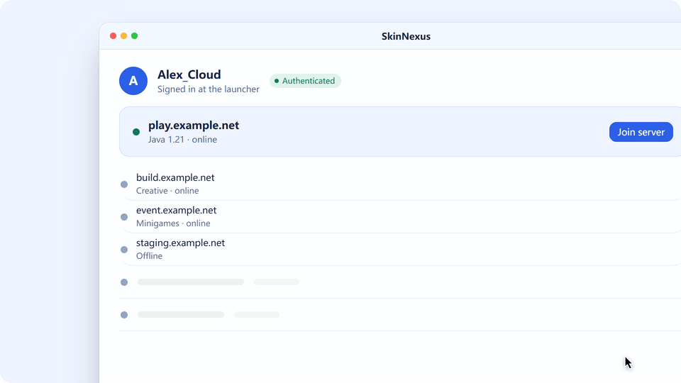
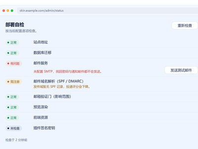
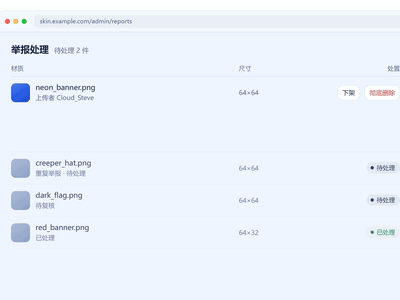
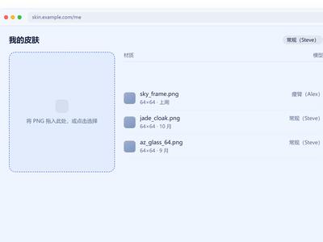

<div align="center">

# SkinNexus / 肤枢

[English](README.md)


> 自托管的 Minecraft 我的世界皮肤站与外置登录（Yggdrasil）服务：启动器登录一次直接进服，免游戏内 /login 密码，皮肤披风随登录生效；身份、皮肤、管理都在你自己手里，从 blessing-skin-server 迁移不丢数据。

[](https://github.com/YimingZhanshen/skin-nexus/actions/workflows/ci.yml) [](https://github.com/YimingZhanshen/skin-nexus/releases/tag/v0.6.0) [](LICENSE)

[它是什么](#它是什么) · [比 blessing 好在哪](#比-blessing-好在哪) · [部署](#部署) · [功能](#功能) · [文档](https://docs.skin.yimingzhanshen.cn/) · [许可](#许可)

</div>

---

<p align="center">
  <picture>
    <source media="(prefers-reduced-motion: reduce)" srcset="docs/assets/hero-join-flow.png">
    
  </picture>
</p>

<p align="center">
  
  
  
  
</p>

## 它是什么

**SkinNexus 是给 Minecraft 服务器的「外置登录 + 玩家管理」一体的站点。** 国内开服大多不开正版验证——玩家多是离线版，服务器认不出谁是谁。过去要么装 AuthMe 这类**游戏内密码锁**防冒名（玩家每次进服都要敲 `/login 密码`），要么让玩家自己折腾皮肤 Mod——连正版玩家进这类服务器都加载不了皮肤。

**bs + Yggdrasil 干的事，就是把这道锁挪到启动器。** 玩家在启动器登录一次站点账号，以后每次启动游戏直接进服——**像正版一样，不用重复输入账号密码**；皮肤和披风随登录自动生效，服主在后台管玩家档案、封禁、邀请码，身份 / 皮肤 / 管理收拢一处。这套玩法由 **blessing-skin-server（简称 bs，最老牌、用得最广的同类程序）**+ Yggdrasil 插件带起来，市面上大多数皮肤站都是这个组合。

**SkinNexus 是这个组合的现代替代。** 已经在用 bs？[下表](#比-blessing-好在哪)就是全部区别。还没搭站？一句话：外置登录开箱即用（bs 那边要拼插件）、漏洞自己修当天发、以后要搬家从 blessing 迁入什么都不丢。

## 比 blessing 好在哪

| 你可能遇到过的坑 | blessing-skin-server（bs） | SkinNexus |
|---|---|---|
| 技术太老，出漏洞没人修 | 十来年的 PHP 底子，修漏洞只能等上游 | 新技术重写，漏洞自己修、当天发新版 |
| 进服还要敲 `/login`（AuthMe 游戏内密码锁） | 能靠 Yggdrasil 插件解决，但要自己拼装 | 外置登录内置，装好即用 |
| 换站怕丢数据 | — | 账号 / 皮肤 / 游戏身份 / 旧密码全保留 |
| 免密登录要折腾 | 得额外装登录组件拼起来 | 内置，装好即用 |
| 一件皮肤出问题连累大家 | 举报处置跳过引用清点，收藏跟着遭殃 | 先清点引用、留证，再删 |
| 玩家搜不到你的站 | 默认形态对搜索引擎不友好 | 搜索引擎、AI 助手都读得懂 |
| 部署运维费劲 | PHP 环境一堆讲究 | 两条命令起站，升级不动数据 |
| 封禁换个名字就复活 | 裸站只在站内登录拒绝；进服面要靠 Yggdrasil 插件补 | 账号级封禁：站内与 Yggdrasil 进服都拒，改名也复活不了 |
| 正版玩家进服皮肤变 Steve | — | Mojang 兜底默认开：本地未命中就查 Mojang 官方 sessionserver |
| 站半坏不坏，没人告诉你 | 无内置面板自检 | 面板内置部署自检：八项逐条检查，每一项直接给人话修复步骤 |

一台 2 核 / 3.5GB 的小服务器实测：皮肤图片每秒响应 5182 次、首页每秒 600 次访问，全程零错误。逐格对比证据见 [竞品分析](https://docs.skin.yimingzhanshen.cn/competitor-analysis)。

**想直接动手？**[跳到部署](#部署)——命令只起新站，不会碰你现有的 blessing-skin-server 数据；还在评估？先读[迁移指南](https://docs.skin.yimingzhanshen.cn/migration)的「预演」部分，全程只读、零风险。

## 部署

镜像在 GHCR（公开，不需要 `docker login`），不用克隆源码；整个过程不会碰你现有的 blessing-skin-server 数据（搬家是后面的独立步骤，且对老站只读）：

```bash
mkdir skin-nexus && cd skin-nexus
curl -fsSLO https://raw.githubusercontent.com/YimingZhanshen/skin-nexus/main/docker-compose.quickstart.yml
cat > .env <<EOF
SKIN_BASE_URL=https://skin.example.com
SKIN_DB_PASSWORD=$(openssl rand -hex 16)
SKIN_DB_ROOT_PASSWORD=$(openssl rand -hex 16)
SKIN_ADMIN_TOKEN=$(openssl rand -hex 32)
SKIN_SETUP_TOKEN=$(openssl rand -hex 16)
EOF
docker compose -f docker-compose.quickstart.yml up -d
```

打开 `http://<主机>:8080/setup`，填站点名、管理员账号、皮肤域名，以及上面那个 `SKIN_SETUP_TOKEN`——空库时谁先提交这张表单谁就是超级管理员，所以这一步要的正是只有你拿得到的值。以后升级就是 `docker compose pull && docker compose up -d`，数据永远不动。

上线前两件事：

1. 用了 Nginx / 宝塔这类反向代理的话，记得转发 `X-Forwarded-Proto` 和 `X-Forwarded-For` 两个请求头（照抄[部署文档](https://docs.skin.yimingzhanshen.cn/deploy)即可），否则网址识别和登录保护会出问题。
2. 备份签名密钥：数据卷里的 `/data/sign-key.pem`。丢了它，玩家已下载的皮肤图会全部验签失败。

更多姿势（外部数据库、裸机部署、旧站迁移）都在 [docs.skin.yimingzhanshen.cn](https://docs.skin.yimingzhanshen.cn/deploy)；从 blessing-skin-server 搬家看[迁移指南](https://docs.skin.yimingzhanshen.cn/migration)（先预检、再预演、后搬家，可回滚）。

## 功能

- **玩家**——上传皮肤/披风（拖进去、3D 预览）、给角色换装、逛皮肤库、举报与收藏。
- **站长**——玩家与内容管理、封禁与防撞库、邀请码、公告、一键换主题、找回密码 / 邮箱验证、操作记录；登录凭证只存「指纹」，拖走数据库也拿不到能用的登录态。
- **接游戏**——主流启动器开箱即用、免密登录内置、MUA 联盟互通、正版账号兜底、皮肤批量导入。
- **扩展**——中英双语、免构建换肤（主题包）、插件平台、搜索引擎与 AI 可见性。

<p align="center">
  <picture>
    <source media="(prefers-reduced-motion: reduce)" srcset="docs/assets/card-diag-check.png">
    
  </picture>
  <picture>
    <source media="(prefers-reduced-motion: reduce)" srcset="docs/assets/card-refcount-block.png">
    
  </picture>
  <picture>
    <source media="(prefers-reduced-motion: reduce)" srcset="docs/assets/card-upload-skin.png">
    
  </picture>
</p>

完整功能清单见[文档站](https://docs.skin.yimingzhanshen.cn/)。技术上：Go 单二进制 + Vue 3，数据库 MySQL / MariaDB / PostgreSQL / SQLite 四选一。

## 文档

| 我想…… | 去这里 |
|---|---|
| 部署、环境变量、反代、备份 | [docs.skin.yimingzhanshen.cn/deploy](https://docs.skin.yimingzhanshen.cn/deploy) |
| 从 blessing-skin-server 迁移 | [docs.skin.yimingzhanshen.cn/migration](https://docs.skin.yimingzhanshen.cn/migration) |
| 从源码构建 / 看懂 CI | [docs.skin.yimingzhanshen.cn/build](https://docs.skin.yimingzhanshen.cn/build) |
| 查协议兼容情况 | [docs.skin.yimingzhanshen.cn/compat-matrix](https://docs.skin.yimingzhanshen.cn/compat-matrix) |
| 写插件 / 写主题 | [插件规范](https://docs.skin.yimingzhanshen.cn/plugin-spec) · [主题规范](https://docs.skin.yimingzhanshen.cn/theme-spec) |
| 发布与签名扩展 | [docs.skin.yimingzhanshen.cn/plugin-publishing](https://docs.skin.yimingzhanshen.cn/plugin-publishing) |
| 启动器对接 | [docs.skin.yimingzhanshen.cn/launcher-api](https://docs.skin.yimingzhanshen.cn/launcher-api) |
| 翻知识手册 | [docs.skin.yimingzhanshen.cn/handbook](https://docs.skin.yimingzhanshen.cn/handbook/) |

当前版本 v0.6.0；迭代历史见 [`docs/CHANGELOG.md`](docs/CHANGELOG.md)。可选的服务器接入模块已在默认关闭的面板开关后实现：`/servers` 服主门户覆盖租户、服务器、凭证、策略、白名单、封禁与进服事件，超管可管理状态、配额并执行紧急控制；URL secret 与 Bearer Header 可信验证链也已实现。验证代理二进制、导出/注销流程与公测运维暂未包含。详细文档以中文为主。

## 兼容承诺

「搬家不丢东西」有四条契约兜底，长期冻结：`/api/yggdrasil/**` 原语义、玩家 UUID 零漂移、数据与 blessing-skin-server 存储约定同构可直迁、union/plugin 契约不变。贡献代码前先读 [`AGENTS.md`](AGENTS.md) 的铁律并跑对应契约测试。

## 许可

AGPL-3.0（见 [`LICENSE`](LICENSE)）。`Copyright (c) 2026 YMZS (YimingZhanshen) and SkinNexus contributors`。
欢迎翻译、主题包、代码与文档贡献——见 [`CONTRIBUTING.md`](CONTRIBUTING.md)。治理模式 BDFL，变更走 PR。
