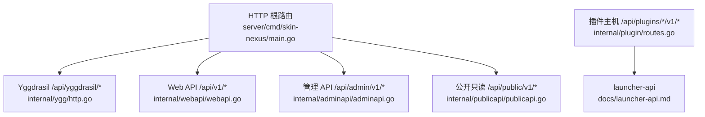
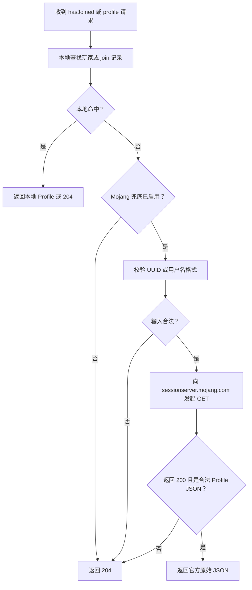
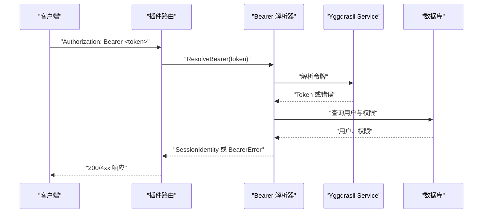
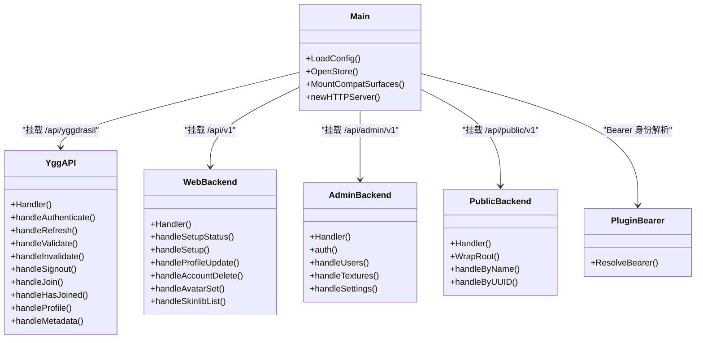

# API 参考

**本文引用的文件**
- [main.go](https://github.com/YimingZhanshen/skin-nexus/blob/797ae1a/server/cmd/skin-nexus/main.go)
- [server.go](https://github.com/YimingZhanshen/skin-nexus/blob/797ae1a/server/cmd/skin-nexus/server.go)
- [mount_compat.go](https://github.com/YimingZhanshen/skin-nexus/blob/797ae1a/server/cmd/skin-nexus/mount_compat.go)
- [pluginbearer.go](https://github.com/YimingZhanshen/skin-nexus/blob/797ae1a/server/cmd/skin-nexus/pluginbearer.go)
- [http.go](https://github.com/YimingZhanshen/skin-nexus/blob/797ae1a/server/internal/ygg/http.go)
- [service.go](https://github.com/YimingZhanshen/skin-nexus/blob/797ae1a/server/internal/ygg/service.go)
- [models.go](https://github.com/YimingZhanshen/skin-nexus/blob/797ae1a/server/internal/ygg/models.go)
- [fallback.go](https://github.com/YimingZhanshen/skin-nexus/blob/797ae1a/server/internal/ygg/fallback.go)
- [webapi.go](https://github.com/YimingZhanshen/skin-nexus/blob/797ae1a/server/internal/webapi/webapi.go)
- [setup.go](https://github.com/YimingZhanshen/skin-nexus/blob/797ae1a/server/internal/webapi/setup.go)
- [profile.go](https://github.com/YimingZhanshen/skin-nexus/blob/797ae1a/server/internal/webapi/profile.go)
- [skinlib.go](https://github.com/YimingZhanshen/skin-nexus/blob/797ae1a/server/internal/webapi/skinlib.go)
- [adminapi.go](https://github.com/YimingZhanshen/skin-nexus/blob/797ae1a/server/internal/adminapi/adminapi.go)
- [publicapi.go](https://github.com/YimingZhanshen/skin-nexus/blob/797ae1a/server/internal/publicapi/publicapi.go)
- [launcher-api.md](https://github.com/YimingZhanshen/skin-nexus/blob/797ae1a/docs/launcher-api.md)

## 目录
1. [引言](#引言)
2. [项目结构与协议分组](#项目结构与协议分组)
3. [认证与通用错误模型](#认证与通用错误模型)
4. [Yggdrasil 协议端点](#yggdrasil-协议端点)
5. [Web API（玩家侧）](#web-api玩家侧)
6. [管理 API](#管理-api)
7. [公开只读 API](#公开只读-api)
8. [启动器 Bearer API](#启动器-bearer-api)
9. [插件 API](#插件-api)
10. [依赖关系与路由装配](#依赖关系与路由装配)
11. [性能与速率限制](#性能与速率限制)
12. [调试指南](#调试指南)
13. [兼容与迁移](#兼容与迁移)
14. [结论](#结论)

## 引言
SkinNexus 是一个自托管的 Minecraft 皮肤站，提供 Yggdrasil 兼容接口、网页玩家操作后端、管理员面板、公开只读皮肤库查询、以及通过签名插件平台暴露的插件 API。其公开协议入口在 `main.go` 中声明为：

- `/api/yggdrasil/*`：Yggdrasil 协议端点
- `/api/v1/*`：SPA 玩家侧 Web API
- `/api/public/v1/*`：公开只读 API
- `/textures/{hash}`：纹理文件分发
- `/skin/{player}.png` 等：旧版兼容路径
- `/*`：前端静态资源与 SPA 回退

服务端监听使用带读写超时保护的 `http.Server`，避免慢客户端耗尽连接。

**章节来源**
- [main.go:1-40](https://github.com/YimingZhanshen/skin-nexus/blob/797ae1a/server/cmd/skin-nexus/main.go#L1-L40)
- [server.go:1-24](https://github.com/YimingZhanshen/skin-nexus/blob/797ae1a/server/cmd/skin-nexus/server.go#L1-L24)

## 项目结构与协议分组
SkinNexus 按“协议族 + 职责”组织路由：

| 分组 | 路由前缀 | 实现包 | 主要用途 |
|---|---|---|---|
| Yggdrasil | `/api/yggdrasil/*` | `internal/ygg` | authlib-injector、游戏服务器账号验证、头像/纹理元数据 |
| Web API | `/api/v1/*` | `internal/webapi` | 注册登录、角色、上传、衣柜、通知、设置向导 |
| 管理 API | `/api/admin/v1/*` | `internal/adminapi` | 用户/角色/材质/审计/设置/OIDC/插件/Union 运维 |
| 公开只读 | `/api/public/v1/*` | `internal/publicapi` | 按名称或 UUID 查询公开玩家资料 |
| 启动器 Bearer | `/api/plugins/launcher-api/v1/*` | 插件 `launcher-api` | 桌面启动器账号、角色、外观、纹理库 |
| 插件 API | `/api/plugins/*/v1/*` | `internal/plugin` | 各签名插件对外暴露的 REST 子集 |



**图示来源**
- [main.go:1-40](https://github.com/YimingZhanshen/skin-nexus/blob/797ae1a/server/cmd/skin-nexus/main.go#L1-L40)
- [http.go:1-120](https://github.com/YimingZhanshen/skin-nexus/blob/797ae1a/server/internal/ygg/http.go#L1-L120)
- [webapi.go:1-60](https://github.com/YimingZhanshen/skin-nexus/blob/797ae1a/server/internal/webapi/webapi.go#L1-L60)
- [adminapi.go:1-60](https://github.com/YimingZhanshen/skin-nexus/blob/797ae1a/server/internal/adminapi/adminapi.go#L1-L60)
- [publicapi.go:1-40](https://github.com/YimingZhanshen/skin-nexus/blob/797ae1a/server/internal/publicapi/publicapi.go#L1-L40)
- [launcher-api.md:1-43](https://github.com/YimingZhanshen/skin-nexus/blob/797ae1a/docs/launcher-api.md#L1-L43)

**章节来源**
- [main.go:1-40](https://github.com/YimingZhanshen/skin-nexus/blob/797ae1a/server/cmd/skin-nexus/main.go#L1-L40)
- [mount_compat.go:1-27](https://github.com/YimingZhanshen/skin-nexus/blob/797ae1a/server/cmd/skin-nexus/mount_compat.go#L1-L27)

## 认证与通用错误模型

### 认证方式汇总

| 接口族 | 认证要求 | 说明 |
|---|---|---|
| Yggdrasil | 无 HTTP 头认证；凭据由请求体中的用户名/密码或 accessToken 表达 | 符合 legacy Yggdrasil 语义；成功时返回 token 或 204 |
| Web API | Cookie 会话 | 登录后由站点设置 SameSite/Lax/Secure；注册/登录/修改资料/上传均需要 |
| 管理 API | 已登录且权限 > 0 的管理员；或无非空会话 Cookie 的机器客户端使用 `X-Admin-Token` | 浏览器面板只用会话；机器/API 场景从运行环境注入 `SKIN_ADMIN_TOKEN` |
| 公开只读 | 无需认证 | 匿名浏览公开纹理；按会话可见性过滤私有项 |
| 启动器 Bearer | `Authorization: Bearer <token>` | 支持 OIDC access_token 与 Yggdrasil accessToken |
| 插件 API | 由插件声明；宿主统一解析 Bearer 身份 | 无效/过期 token 返回 401，禁用账户返回 403 |

### 通用错误格式

Web API、管理 API、插件 API 的错误体遵循稳定契约：

```json
{
  "error": "稳定错误码",
  "message": "面向用户的英文句子",
  "code": "同 error"
}
```

Yggdrasil 使用独立 legacy 错误形状：

```json
{
  "error": "错误码",
  "errorMessage": "人类可读消息"
}
```

常见状态码语义：

| 状态码 | 含义 | 典型场景 |
|---|---|---|
| 200 | 成功 | JSON 响应 |
| 204 | 成功但无内容 | Yggdrasil 验证、失效、登出、本地未找到 join |
| 400 | 参数非法 | JSON 解码失败、字段校验失败 |
| 401 | 未认证 | 未登录、Bearer token 无效或过期 |
| 403 | 权限不足 | 非所有者、账户禁用、Yggdrasil 凭证错误 |
| 404 | 资源不存在 | 安装向导已完成、玩家不存在 |
| 409 | 冲突 | 昵称/邮箱重复、公共纹理去重命中 |
| 422 | 不可处理 | 把披风设为头像 |
| 429 | 限流 | 登录/Yggdrasil 认证尝试过多 |
| 503 | 服务不可用 | 数据库表尚未创建时的安装 |

**章节来源**
- [webapi.go:1-40](https://github.com/YimingZhanshen/skin-nexus/blob/797ae1a/server/internal/webapi/webapi.go#L1-L40)
- [http.go:120-180](https://github.com/YimingZhanshen/skin-nexus/blob/797ae1a/server/internal/ygg/http.go#L120-L180)
- [pluginbearer.go:1-39](https://github.com/YimingZhanshen/skin-nexus/blob/797ae1a/server/cmd/skin-nexus/pluginbearer.go#L1-L39)

## Yggdrasil 协议端点

所有端点挂载于 `/api/yggdrasil`，并额外注册裸路径 `/api/yggdrasil` 以兼容跨域发现。

### 元数据与兼容性

| 方法 | URL | 认证 | 说明 |
|---|---|---|---|
| GET | `/api/yggdrasil` | 无 | 返回站点名、实现版本、皮肤域名、签名公钥、feature 标志；附带 `X-Authlib-Injector-API-Location` 和 `Access-Control-Allow-Origin: *` |
| GET | `/api/yggdrasil/` | 无 | 同上，带尾斜杠 |

响应体关键结构：

```json
{
  "meta": {
    "serverName": "站点名",
    "implementationName": "SkinNexus",
    "implementationVersion": "版本号",
    "links": {
      "homepage": "首页地址",
      "register": "注册地址"
    },
    "feature.non_email_login": true,
    "feature.openid_configuration_url": "可选 OIDC 发现地址"
  },
  "skinDomains": ["皮肤域名列表"],
  "signaturePublickey": "PEM 公钥字符串"
}
```

注意：`feature.openid_configuration_url` 仅在配置了 OIDC 设备码发现时出现。

**章节来源**
- [http.go:1-120](https://github.com/YimingZhanshen/skin-nexus/blob/797ae1a/server/internal/ygg/http.go#L1-L120)
- [mount_compat.go:1-27](https://github.com/YimingZhanshen/skin-nexus/blob/797ae1a/server/cmd/skin-nexus/mount_compat.go#L1-L27)

### 认证服务器端点

#### POST `/api/yggdrasil/authserver/authenticate`

| 项目 | 说明 |
|---|---|
| 认证 | 无；凭据在请求体中 |
| Content-Type | 必须为 `application/json`，否则返回 200 + `{error:"UnsupportedMediaType"}` |
| 速率限制 | IP 滑动窗口 + 用户名失败锁定 + 同用户名最小间隔；超限返回 429 并带 `Retry-After` |
| 成功 | 200 + token 响应体 |
| 失败 | 403 + `ForbiddenOperationException`，或 400 + `IllegalArgumentException` |

请求体字段：

| 字段 | 类型 | 必填 | 说明 |
|---|---|---|---|
| username | string | 是 | 玩家昵称或邮箱 |
| password | string | 是 | 明文密码 |
| clientToken | string | 否 | 客户端令牌 |
| requestUser | boolean | 否 | 是否在响应中包含用户信息 |

成功响应体：

```json
{
  "accessToken": "令牌",
  "clientToken": "客户端令牌",
  "expiresAt": 毫秒时间戳,
  "availableProfiles": [
    {
      "id": "32位小写十六进制UUID",
      "name": "玩家昵称"
    }
  ],
  "selectedProfile": {
    "id": "UUID",
    "name": "昵称"
  },
  "user": {
    "id": "数字UID",
    "properties": [],
    "name": "昵称"
  }
}
```

其中 `selectedProfile` 可能为空对象。

#### POST `/api/yggdrasil/authserver/refresh`

| 项目 | 说明 |
|---|---|
| 认证 | accessToken |
| 速率限制 | IP 滑动窗口 |
| 成功 | 200 + token 响应体 |
| 失败 | 403 + `ForbiddenOperationException` 或 400 + `IllegalArgumentException` |

请求体字段：

| 字段 | 类型 | 必填 | 说明 |
|---|---|---|---|
| accessToken | string | 是 | 要续期的访问令牌 |
| clientToken | string | 否 | 客户端令牌 |
| requestUser | boolean | 否 | 是否包含 user |
| selectedProfile | string 或 object | 否 | 目标角色引用；兼容 `"uuid"` 与 `{"id":"uuid"}` |

#### POST `/api/yggdrasil/authserver/validate`

| 项目 | 说明 |
|---|---|
| 认证 | accessToken |
| 成功 | 204 No Content |
| 失败 | 403 + `ForbiddenOperationException` |

请求体：

```json
{
  "accessToken": "令牌",
  "clientToken": "可选客户端令牌"
}
```

#### POST `/api/yggdrasil/authserver/invalidate`

| 项目 | 说明 |
|---|---|
| 认证 | accessToken |
| 行为 | 标记令牌失效；总是返回 204 |
| 成功 | 204 No Content |

请求体：

```json
{
  "accessToken": "令牌"
}
```

#### POST `/api/yggdrasil/authserver/signout`

| 项目 | 说明 |
|---|---|
| 认证 | 用户名/密码；但速率限制命中时跳过密码检查仍返回 204 |
| 成功 | 204 No Content |
| 失败 | 不返回业务错误；仅受速率限制保护 |

请求体：

```json
{
  "username": "用户名",
  "password": "密码"
}
```

### 会话服务器端点

#### POST `/api/yggdrasil/sessionserver/session/minecraft/join`

| 项目 | 说明 |
|---|---|
| 认证 | accessToken |
| 成功 | 204 No Content |
| 失败 | 403 + `ForbiddenOperationException`，或 400 + `IllegalArgumentException` |

请求体字段：

| 字段 | 类型 | 必填 | 说明 |
|---|---|---|---|
| accessToken | string | 是 | 访问令牌 |
| selectedProfile | string 或 object | 是 | 目标角色 UUID |
| serverId | string | 是 | 服务器 ID |

错误语义：

| 条件 | 错误 |
|---|---|
| 邮箱未验证且启用验证门禁 | `ForbiddenOperationException: Email not verified.` |
| UUID 与 accessToken 持有者不匹配 | `ForbiddenOperationException: the selected profile is not owned by this access token` |
| 插件 JoinGuard 拒绝 | `ForbiddenOperationException` + 插件消息 |
| 令牌无效 | `ForbiddenOperationException: Invalid token.` |
| selectedProfile 无法解析 | `IllegalArgumentException: invalid arguments` |

#### GET `/api/yggdrasil/sessionserver/session/minecraft/hasJoined`

| 项目 | 说明 |
|---|---|
| 认证 | 无；查询参数携带身份 |
| 成功 | 200 + Profile JSON，或 204 |
| 本地未命中 | 若启用 Mojang 兜底且对方确认，则转发官方 Profile JSON；否则 204 |

查询参数：

| 参数 | 说明 |
|---|---|
| username | 玩家昵称 |
| serverId | 服务器 ID |
| ip | 可选客户端 IP；仅当可解析时才转发给官方 |

成功响应体（本地或官方兜底）：

```json
{
  "id": "32位小写十六进制UUID",
  "name": "玩家昵称",
  "properties": [
    {
      "name": "textures",
      "value": "Base64 编码的 textures JSON",
      "signature": "可选签名值"
    },
    {
      "name": "uploadableTextures",
      "value": "skin,cape"
    }
  ]
}
```

#### GET `/api/yggdrasil/sessionserver/session/minecraft/profile/\{uuid\}`

| 项目 | 说明 |
|---|---|
| 认证 | 无 |
| 成功 | 200 + Profile JSON，或 204 |
| 本地未命中 | 若启用兜底且 UUID 合法，则尝试官方 sessionserver |

查询参数：

| 参数 | 类型 | 默认 | 说明 |
|---|---|---|---|
| unsigned | string | false | `unsigned=false` 保留 signature；`unsigned=true` 清空 signature |

UUID 语义：

- 返回的 `id` 为 32 位小写十六进制，不含连字符。
- `properties[0].value` 是 Base64 编码的 textures JSON。
- 空 textures 序列化为 `{}`，而非 null 或数组。
- 时间戳单位为毫秒。
- 当 `unsigned=true` 时，服务端会移除 signature 字段。

**章节来源**
- [http.go:120-579](https://github.com/YimingZhanshen/skin-nexus/blob/797ae1a/server/internal/ygg/http.go#L120-L579)
- [models.go:1-105](https://github.com/YimingZhanshen/skin-nexus/blob/797ae1a/server/internal/ygg/models.go#L1-L105)
- [service.go:1-120](https://github.com/YimingZhanshen/skin-nexus/blob/797ae1a/server/internal/ygg/service.go#L1-L120)

### Mojang 正版兜底逻辑

当本地没有该玩家记录或 join 记录时，如果开关启用，服务端会向官方 `https://sessionserver.mojang.com` 发起受限出站请求：



**图示来源**
- [fallback.go:1-200](https://github.com/YimingZhanshen/skin-nexus/blob/797ae1a/server/internal/ygg/fallback.go#L1-L200)
- [http.go:430-579](https://github.com/YimingZhanshen/skin-nexus/blob/797ae1a/server/internal/ygg/http.go#L430-L579)

安全约束：

- 出站目标固定为 `https://sessionserver.mojang.com`。
- 不跟随重定向。
- 使用仅允许公网地址的拨号器。
- 响应体最大 1 MiB。
- 必须解析为含 `id` 与 `name` 的 JSON。
- 任何失败都降级为“无兜底”，而不是返回错误数据。

**章节来源**
- [fallback.go:1-200](https://github.com/YimingZhanshen/skin-nexus/blob/797ae1a/server/internal/ygg/fallback.go#L1-L200)

### OIDC 设备码流程

OIDC 设备码流程用于启动器和不支持 SPA 的授权页面：

1. 客户端向 OIDC 设备端点申请 device code。
2. 浏览器打开设备授权页，显示用户代码、授权客户端名、权限范围。
3. 用户在设备上点击同意或拒绝。
4. 启动器轮询获取 access_token。
5. 后续调用 launcher-api 或 Yggdrasil 时使用该 token。

设备授权页面的文案支持中文与英文，错误使用可翻译错误码，例如 `device.code_invalid`、`device.code_expired`、`device.approve_failed`。

**章节来源**
- [launcher-api.md:1-43](https://github.com/YimingZhanshen/skin-nexus/blob/797ae1a/docs/launcher-api.md#L1-L43)
- [device_form_test.go:1-111](https://github.com/YimingZhanshen/skin-nexus/blob/797ae1a/server/internal/oidc/device_form_test.go#L1-L111)

## Web API（玩家侧）

Web API 面向浏览器 SPA，使用 Cookie 会话认证。除纹理文件外，所有响应均为 JSON。

### 安装向导

#### GET `/api/v1/setup/status`

| 项目 | 说明 |
|---|---|
| 认证 | 无 |
| 成功 | 200 + `needs_setup`、`token_required` |
| 失败 | 内部错误 |

响应体：

```json
{
  "needs_setup": true,
  "token_required": false
}
```

#### POST `/api/v1/setup`

| 项目 | 说明 |
|---|---|
| 认证 | 无；受一次性安装门控保护 |
| 成功 | 200 + 初始化结果 |
| 已安装 | 404 + “setup already completed” |
| 数据库无表 | 503 + 提示运行 migrate |
| 令牌不匹配 | 403 |
| 参数非法 | 400 |

请求体字段：

| 字段 | 类型 | 必填 | 说明 |
|---|---|---|---|
| site_name | string | 否 | 站点名 |
| site_url | string | 否 | 绝对 http(s) 地址 |
| nickname | string | 是 | 超管昵称 |
| email | string | 否 | 邮箱 |
| password | string | 是 | 至少 8 字符 |
| player_limit | number | 否 | 角色上限，默认 3，范围 1-16 |
| skin_domains | string[] | 否 | 皮肤域名 |
| setup_token | string | 视配置 | 若配置 `SKIN_SETUP_TOKEN` 则必填 |

成功响应体：

```json
{
  "ok": true,
  "uid": 数字,
  "site_url": "站点URL",
  "env_base_url": "环境变量推导出的 base URL",
  "mismatch": false
}
```

**章节来源**
- [setup.go:1-173](https://github.com/YimingZhanshen/skin-nexus/blob/797ae1a/server/internal/webapi/setup.go#L1-L173)

### 个人资料与账户

#### PUT `/api/v1/me/profile`

| 项目 | 说明 |
|---|---|
| 认证 | 已登录 |
| 成功 | 200 + `{ok:true}` |
| 未登录 | 401 |
| 参数非法 | 400 |
| 昵称/邮箱冲突 | 409 |
| 守卫拒绝 | 403 |

请求体字段：

| 字段 | 类型 | 必填 | 说明 |
|---|---|---|---|
| nickname | string | 否 | 2-24 字符，字母数字下划线或中文 |
| email | string | 否 | 标准邮箱格式 |

修改邮箱会重置邮箱验证状态。

#### DELETE `/api/v1/me`

| 项目 | 说明 |
|---|---|
| 认证 | 已登录 |
| 成功 | 200 + `{ok:true}` |
| 未登录 | 401 |
| 管理员自我删除 | 403 |
| 密码错误 | 401 |

请求体：

```json
{
  "password": "当前密码"
}
```

#### PUT `/api/v1/me/avatar`

| 项目 | 说明 |
|---|---|
| 认证 | 已登录 |
| 成功 | 200 + `{ok:true}` |
| 未登录 | 401 |
| textureId 无效 | 400 |
| 不是自己的纹理 | 403 |
| 不是皮肤 | 422 |

请求体：

```json
{
  "textureId": 正整数
}
```

#### DELETE `/api/v1/me/avatar`

| 项目 | 说明 |
|---|---|
| 认证 | 已登录 |
| 成功 | 200 + `{ok:true}` |
| 未登录 | 401 |

### 皮肤库

#### GET `/api/v1/skinlib`

| 项目 | 说明 |
|---|---|
| 认证 | 可选；匿名查看公开纹理 |
| 成功 | 200 + 分页结果 |

查询参数：

| 参数 | 类型 | 默认 | 说明 |
|---|---|---|---|
| filter | string | 空 | 按类型过滤 |
| keyword | string | 空 | 关键词搜索 |
| uploader | number | 0 | 上传者 UID |
| sort | string | 空 | 排序方式 |
| page | number | 1 | 页码 |

响应体：

```json
{
  "items": [
    {
      "tid": 数字,
      "name": "名称",
      "type": "skin 或 cape",
      "model": "default 或 slim",
      "hash": "哈希",
      "public": true,
      "uploader": 数字,
      "nickname": "上传者昵称",
      "likes": 数字,
      "liked": false,
      "uploadAt": "ISO8601 UTC 或 null",
      "source": "original/derivative/repost 或空",
      "sourceUrl": "可选来源链接",
      "textureURL": "纹理 URL",
      "previewURL": "皮肤预览缩略图 URL"
    }
  ],
  "total": 总数,
  "page": 当前页,
  "perPage": 20
}
```

#### POST `/api/v1/skinlib/\{tid\}/like`

| 项目 | 说明 |
|---|---|
| 认证 | 已登录 |
| 成功 | 200 + `{ok:true, created:boolean, likes:number}` |
| 未登录 | 401 |
| tid 无效 | 400 |
| 纹理不存在 | 404 |

#### DELETE `/api/v1/skinlib/\{tid\}/like`

| 项目 | 说明 |
|---|---|
| 认证 | 已登录 |
| 成功 | 200 + `{ok:true, likes:number}` |
| 未登录 | 401 |
| 未收藏过 | 404 |

#### PATCH `/api/v1/skinlib/\{tid\}`

| 项目 | 说明 |
|---|---|
| 认证 | 已登录，且必须是纹理所有者 |
| 成功 | 200 + `{ok:true}` |
| 未登录 | 401 |
| tid 无效 | 400 |
| 名称过长 | 400 |
| 描述过长 | 400 |
| 不符合命名规则 | 400 |

可选字段：`name`、`detail`、`source`、`sourceUrl`、`public`、`model`。

**章节来源**
- [skinlib.go:1-200](https://github.com/YimingZhanshen/skin-nexus/blob/797ae1a/server/internal/webapi/skinlib.go#L1-L200)
- [profile.go:1-200](https://github.com/YimingZhanshen/skin-nexus/blob/797ae1a/server/internal/webapi/profile.go#L1-L200)

## 管理 API

管理 API 要求管理员权限。浏览器面板与机器客户端使用不同通道：

- 浏览器面板：通过 Web API 登录后，账户权限 > 0，只发送同源会话 Cookie。
- 无 Cookie 机器/API 客户端：通过 `X-Admin-Token` 请求头传入 `SKIN_ADMIN_TOKEN`。请求带非空会话 Cookie 时只按会话判定，机器令牌不能回退坏会话。

常用端点：

| 方法 | URL | 认证 | 说明 |
|---|---|---|---|
| GET | `/api/admin/v1/overview` | 管理员 | 站点概览 |
| GET | `/api/admin/v1/status` | 管理员 | 运行时状态 |
| GET | `/api/admin/v1/diagnostics` | 管理员 | 部署自检 |
| POST | `/api/admin/v1/mail-test` | Web 会话管理员 | 向当前管理员自身发送邮件测试 |
| GET | `/api/admin/v1/users` | 管理员 | 用户列表 |
| POST | `/api/admin/v1/users/{id}/password` | 管理员 | 重置密码 |
| PUT | `/api/admin/v1/users/{id}/email` | 管理员 | 修改邮箱 |
| PUT | `/api/admin/v1/users/{id}/nickname` | 管理员 | 修改昵称 |
| PUT | `/api/admin/v1/users/{id}/verification` | 管理员 | 强制邮箱验证状态 |
| PUT | `/api/admin/v1/users/{id}/permission` | Web 会话管理员 | 修改权限 |
| DELETE | `/api/admin/v1/users/{id}` | 管理员 | 删除账户 |
| GET | `/api/admin/v1/players` | 管理员 | 角色列表 |
| PUT | `/api/admin/v1/players/{pid}/name` | 管理员 | 改名 |
| PUT | `/api/admin/v1/players/{pid}/owner` | 管理员 | 转移拥有者 |
| PUT | `/api/admin/v1/players/{pid}/textures` | 管理员 | 批量设置纹理 |
| DELETE | `/api/admin/v1/players/{pid}` | 管理员 | 删除角色 |
| GET | `/api/admin/v1/textures` | 管理员 | 纹理列表 |
| PUT | `/api/admin/v1/textures/{tid}/moderation` | 管理员 | 审核状态 |
| POST | `/api/admin/v1/textures/{tid}/strike` | 管理员 | 标记违规 |
| DELETE | `/api/admin/v1/textures/{tid}` | 管理员 | 删除纹理 |
| GET | `/api/admin/v1/audit` | 管理员 | 操作审计 |
| GET | `/api/admin/v1/reports` | 管理员 | 举报列表 |
| POST | `/api/admin/v1/reports/{id}/resolve` | 管理员 | 处置举报 |
| GET | `/api/admin/v1/settings` | 管理员 | 读取站点设置 |
| PUT | `/api/admin/v1/settings` | 管理员 | 写入站点设置 |
| GET | `/api/admin/v1/access-logs` | 管理员 | 访问日志 |
| GET | `/api/admin/v1/invitation-codes` | 管理员 | 邀请码列表 |
| POST | `/api/admin/v1/invitation-codes` | 管理员 | 生成邀请码 |
| PUT | `/api/admin/v1/invitation-codes` | 管理员 | 编辑邀请码 |
| GET | `/api/admin/v1/oidc/clients` | 管理员 | OIDC 客户端列表 |
| POST | `/api/admin/v1/oidc/clients` | 管理员 | 创建 OIDC 客户端 |
| DELETE | `/api/admin/v1/oidc/clients/{id}` | 管理员 | 删除 OIDC 客户端 |

其他端点如 Union、SEO、Appearance、Theme Market、Plugin Host、Jobs 等会根据功能依赖是否启用而动态挂载。

**章节来源**
- [adminapi.go:1-200](https://github.com/YimingZhanshen/skin-nexus/blob/797ae1a/server/internal/adminapi/adminapi.go#L1-L200)

## 公开只读 API

公开只读 API 开放 CORS，适合社团官网、服务器官网直接读取皮肤站数据。

### SkinNexus 公开 API

#### GET `/api/public/v1/players/byname/\{name\}`

| 项目 | 说明 |
|---|---|
| 认证 | 无 |
| 成功 | 200 + Player 资料 |
| 玩家不存在 | 404 |

响应体：

```json
{
  "id": "UUID",
  "name": "昵称",
  "skins": {
    "default": "纹理 URL",
    "slim": "Slim 手臂纹理 URL"
  },
  "cape": "披风 URL"
}
```

`skins.default` 与 `skins.slim` 根据模型字段选择其一；`cape` 存在时才返回。

#### GET `/api/public/v1/players/byuuid/\{uuid\}`

| 项目 | 说明 |
|---|---|
| 认证 | 无 |
| 成功 | 200 + Player 资料 |
| 玩家不存在或查询失败 | 404 |

### 兼容只读端点

| 方法 | URL | 说明 |
|---|---|---|
| GET / HEAD | `/{player}.json` | CustomSkinAPI R1，返回 hash 形式纹理 |
| GET | `/usm/{player}.json` | USM 兼容 |
| GET | `/skin/{player}.png` | 原始 PNG |
| GET | `/cape/{player}.png` | 原始 PNG |

CustomSkinAPI R1 的 `skins` 值是 hash 字符串，而不是 URL；这与 `/api/public/v1/players/byname/{name}` 不同。

**章节来源**
- [publicapi.go:1-200](https://github.com/YimingZhanshen/skin-nexus/blob/797ae1a/server/internal/publicapi/publicapi.go#L1-L200)

## 启动器 Bearer API

启动器 Bearer API 由官方插件 `launcher-api` 提供，基址为：

```
https://<站点>/api/plugins/launcher-api/v1
```

核心特性：

- `GET /meta` 公开，用于探测插件是否安装并启用。
- 其余端点需要 `Authorization: Bearer <token>`。
- 不使用 Cookie 或 CSRF。
- 401 时刷新或重新认证；改名或删除角色后旧 game token 可能失效。
- 错误体格式为 `{"error":"stable.code","message":"..."}`。
- 限流返回 429 并带 `Retry-After`。
- 独立上传遇到公共库相同 `(type,hash)` 时返回 409 `texture.duplicate_public`，并附 `textureId/url`。

登录流程推荐复用 Yggdrasil Connect OIDC 设备码流程，scope 包含 `openid offline_access Yggdrasil.PlayerProfiles.Select Yggdrasil.Server.Join`。

服务端要求：

- 宿主版本 ≥ 0.4.0。
- 公共纹理去重错误码需宿主 ≥ 0.5.0。
- 安装并启用签名插件 `launcher-api`。
- 角色所有权、名称规则、数量上限、guard、事件与审计由宿主账号服务执行，插件只做请求/响应映射。

完整端点、字段与 OpenAPI 见插件规范仓库。

**章节来源**
- [launcher-api.md:1-43](https://github.com/YimingZhanshen/skin-nexus/blob/797ae1a/docs/launcher-api.md#L1-L43)

## 插件 API

所有插件共享统一的 Bearer 身份解析层。插件可通过 `/api/plugins/{name}/v1/*` 暴露 REST 接口，由宿主进行身份解析、路由隔离、表单校验、配额与安全控制。

Bearer 解析流程：



**图示来源**
- [pluginbearer.go:1-39](https://github.com/YimingZhanshen/skin-nexus/blob/797ae1a/server/cmd/skin-nexus/pluginbearer.go#L1-L39)

身份解析结果：

| 条件 | 返回 |
|---|---|
| 令牌无效或过期 | 401 `auth.invalid_token` |
| 用户不存在 | 401 `auth.invalid_token` |
| 账户被禁用 | 403 `auth.account_disabled` |
| 正常 | 返回用户 ID、昵称、权限级别 |

**章节来源**
- [pluginbearer.go:1-39](https://github.com/YimingZhanshen/skin-nexus/blob/797ae1a/server/cmd/skin-nexus/pluginbearer.go#L1-L39)

## 依赖关系与路由装配



**图示来源**
- [main.go:1-40](https://github.com/YimingZhanshen/skin-nexus/blob/797ae1a/server/cmd/skin-nexus/main.go#L1-L40)
- [http.go:1-120](https://github.com/YimingZhanshen/skin-nexus/blob/797ae1a/server/internal/ygg/http.go#L1-L120)
- [webapi.go:1-60](https://github.com/YimingZhanshen/skin-nexus/blob/797ae1a/server/internal/webapi/webapi.go#L1-L60)
- [adminapi.go:1-60](https://github.com/YimingZhanshen/skin-nexus/blob/797ae1a/server/internal/adminapi/adminapi.go#L1-L60)
- [publicapi.go:1-40](https://github.com/YimingZhanshen/skin-nexus/blob/797ae1a/server/internal/publicapi/publicapi.go#L1-L40)
- [pluginbearer.go:1-39](https://github.com/YimingZhanshen/skin-nexus/blob/797ae1a/server/cmd/skin-nexus/pluginbearer.go#L1-L39)

**章节来源**
- [main.go:1-40](https://github.com/YimingZhanshen/skin-nexus/blob/797ae1a/server/cmd/skin-nexus/main.go#L1-L40)
- [mount_compat.go:1-27](https://github.com/YimingZhanshen/skin-nexus/blob/797ae1a/server/cmd/skin-nexus/mount_compat.go#L1-L27)

## 性能与速率限制

### HTTP 服务器超时

| 配置 | 值 | 目的 |
|---|---|---|
| ReadHeaderTimeout | 10 秒 | 防慢请求头攻击 |
| ReadTimeout | 120 秒 | 允许大文件上传 |
| WriteTimeout | 300 秒 | 允许纹理下载 |
| IdleTimeout | 120 秒 | 空闲连接回收 |
| MaxHeaderBytes | 1 MiB | 防止超大请求头 |

### Yggdrasil 速率限制

- 同用户名最小间隔：`ygg_rate_limit`。
- IP 滑动窗口：防止暴力猜测。
- 每用户名失败锁定：连续失败后暂时锁定该用户名。
- 最大批量 profile 查询：默认 5，最多 100。
- 最大并发 token：`ygg_tokens_limit`。

### Web API 速率限制

- 登录与注册受 IP 滑动窗口与标识符失败锁定保护。
- 错误不会泄露具体哪个字段失败，而是返回稳定错误码。

### Mojang 兜底超时

- 出站请求硬超时 4 秒。
- 响应体限制 1 MiB。
- 失败不阻塞本地正常响应。

**章节来源**
- [server.go:1-24](https://github.com/YimingZhanshen/skin-nexus/blob/797ae1a/server/cmd/skin-nexus/server.go#L1-L24)
- [service.go:120-200](https://github.com/YimingZhanshen/skin-nexus/blob/797ae1a/server/internal/ygg/service.go#L120-L200)
- [fallback.go:1-80](https://github.com/YimingZhanshen/skin-nexus/blob/797ae1a/server/internal/ygg/fallback.go#L1-L80)

## 调试指南

### curl 示例

#### Yggdrasil authenticate

```bash
curl -sS -X POST \
  -H "Content-Type: application/json" \
  -d '{"username":"玩家","password":"密码","clientToken":"随机字符串","requestUser":true}' \
  "https://skin.example.com/api/yggdrasil/authserver/authenticate"
```

#### hasJoined

```bash
curl -sS \
  "https://skin.example.com/api/yggdrasil/sessionserver/session/minecraft/hasJoined?username=玩家&serverId=服务器ID"
```

#### 公开玩家查询

```bash
curl -sS "https://skin.example.com/api/public/v1/players/byname/玩家"
```

#### 管理 API（无 Cookie 机器客户端）

```bash
# 仅脚本/外部工具使用：不要发送 skin_session Cookie。
curl -sS -H "X-Admin-Token: $SKIN_ADMIN_TOKEN" \
  "https://skin.example.com/api/admin/v1/status"
```

#### 启动器 Bearer API

```bash
curl -sS -H "Authorization: Bearer $ACCESS_TOKEN" \
  "https://skin.example.com/api/plugins/launcher-api/v1/meta"
```

### 常见问题排查

| 问题 | 原因 | 解决方法 |
|---|---|---|
| 返回 200 + `UnsupportedMediaType` | Yggdrasil 请求未设置 `Content-Type: application/json` | 添加正确 Content-Type |
| 皮肤加载失败但账号能进服 | `skinDomains` 不包含带端口的主机 | 确保反向代理透传 Host，并检查站点皮肤域名配置 |
| 跨域发现失败 | `/api/yggdrasil` 裸路径被 307 重定向但未设置 CORS | 本实现已同时注册裸路径与带斜杠路径 |
| hasJoined 返回 204 | 本地无 join 记录且未启用 Mojang 兜底 | 检查面板中 ygg_mojang_fallback 开关 |
| 401 启动器报错 | token 过期或被吊销 | 重新走 OIDC 设备码流程 |
| 403 插件 API | 账户被禁用 | 管理面板检查用户权限 |
| 429 限流 | 登录或认证尝试过多 | 等待 Retry-After，降低重试频率 |
| 延迟定位困难 | 诊断明细默认关闭 | 超管开启访问日志诊断窗口，查看状态码、耗时、白名单头与正文节选 |

### 跨域问题

- `/api/yggdrasil` 元数据返回 `Access-Control-Allow-Origin: *`，供 MUA hub 从浏览器填充成员站名。
- `/api/public/v1/*` 开放 GET/OPTIONS 跨域。
- 其他接口通常不走浏览器跨域，应由后端或反向代理处理。

### 延迟定位技巧

1. 先用公开 API 确认玩家是否存在。
2. 用 authenticate 确认能否拿到 accessToken。
3. 用 validate 确认 token 是否有效。
4. 用 hasJoined 确认本地是否有 join 记录。
5. 若本地无记录且启用兜底，观察是否命中官方 sessionserver。
6. 打开管理面板访问日志，查看同一请求的状态码、耗时与细节。
7. 对插件 API，先查 `/api/plugins/launcher-api/v1/meta`，再查 Bearer 身份是否解析成功。

**章节来源**
- [http.go:120-579](https://github.com/YimingZhanshen/skin-nexus/blob/797ae1a/server/internal/ygg/http.go#L120-L579)
- [publicapi.go:1-200](https://github.com/YimingZhanshen/skin-nexus/blob/797ae1a/server/internal/publicapi/publicapi.go#L1-L200)
- [launcher-api.md:1-43](https://github.com/YimingZhanshen/skin-nexus/blob/797ae1a/docs/launcher-api.md#L1-L43)

## 兼容与迁移

### 已废弃或兼容端点

| 旧路径 | 新路径或行为 | 迁移建议 |
|---|---|---|
| `/{player}.json` | CustomSkinAPI R1，仍在 publicapi 兼容层 | 外部集成继续可用；如需 URL 而非 hash，改用 `/api/public/v1/players/byname/{name}` |
| `/skin/{player}.png` | 公开只读 PNG | 仅用于直接图片消费；程序应优先使用纹理 URL 字段 |
| `/cape/{player}.png` | 公开只读 PNG | 同上 |
| `/usm/{player}.json` | USM 兼容 | 保持兼容，但建议迁移到 SkinNexus 公开 API |
| `/api/yggdrasil` 裸路径 | 同时注册 `/api/yggdrasil` 与 `/api/yggdrasil/` | 不要依赖 307 重定向，直接使用规范路径 |
| Yggdrasil textures null | 始终序列化为 `{}` | 客户端不应把空 textures 当作 null |
| 启动器直接对接宿主页 | 改为 `https://<站点>/api/plugins/launcher-api/v1` | 使用插件规范中的 meta 探测与 Bearer 认证 |

### 弃用策略

- Yggdrasil 协议面冻结：错误体、204 语义、毫秒时间戳、PEM 签名、UUID 零漂移必须保持兼容。
- Web API 使用稳定错误码，但新增端点仍应保持向后兼容。
- 管理 API 新增端点不影响现有脚本，除非明确标注破坏性变更。
- 插件 API 由插件契约与宿主能力声明共同约束，升级前应先查插件市场与规范。

**章节来源**
- [publicapi.go:1-200](https://github.com/YimingZhanshen/skin-nexus/blob/797ae1a/server/internal/publicapi/publicapi.go#L1-L200)
- [models.go:1-105](https://github.com/YimingZhanshen/skin-nexus/blob/797ae1a/server/internal/ygg/models.go#L1-L105)
- [launcher-api.md:1-43](https://github.com/YimingZhanshen/skin-nexus/blob/797ae1a/docs/launcher-api.md#L1-L43)

## 结论

SkinNexus 的公开接口分为六个层次：Yggdrasil 协议、Web API、管理 API、公开只读 API、启动器 Bearer API 与插件 API。它们共享账号与纹理数据，但认证、错误格式、速率限制和安全边界各不相同。

开发者和运维人员应优先使用：

- Yggdrasil 端点接入游戏服务器与 authlib-injector。
- `/api/public/v1/players/byname/{name}` 做公开皮肤库查询。
- `/api/v1/*` 作为网站后端。
- `/api/admin/v1/*` 作为站长运维面。
- `/api/plugins/launcher-api/v1/*` 作为桌面启动器接口。
- 插件 API 通过宿主统一解析 Bearer 身份，避免绕过权限。

调试时应结合公开端点、Yggdrasil 验证链、管理访问日志与 Mojang 兜底开关逐步缩小问题范围。
