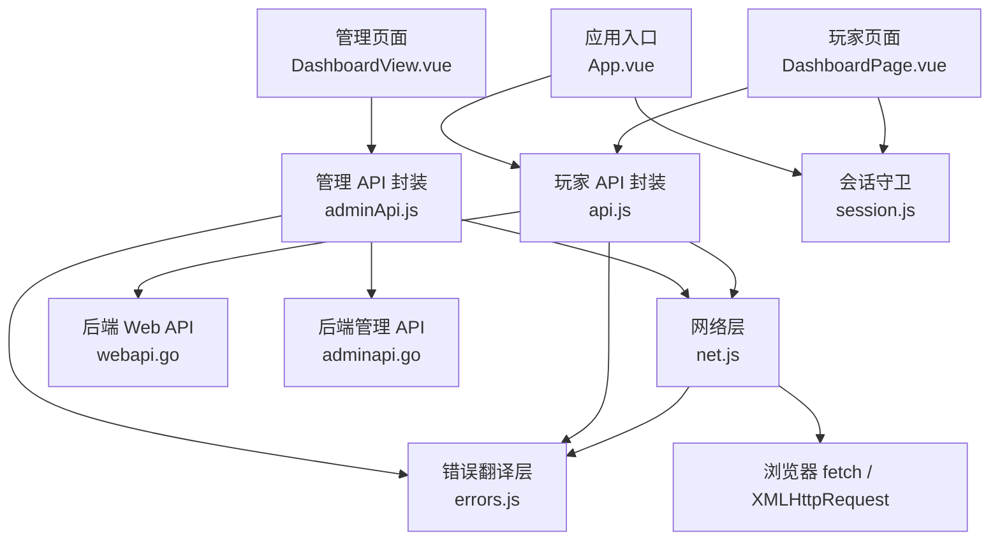
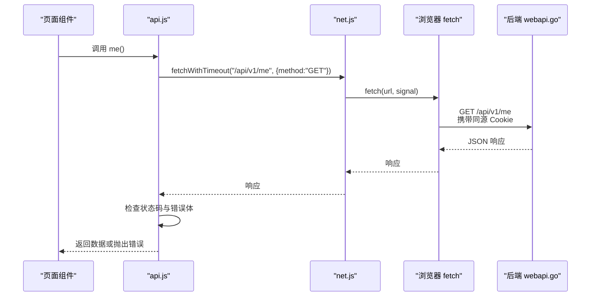
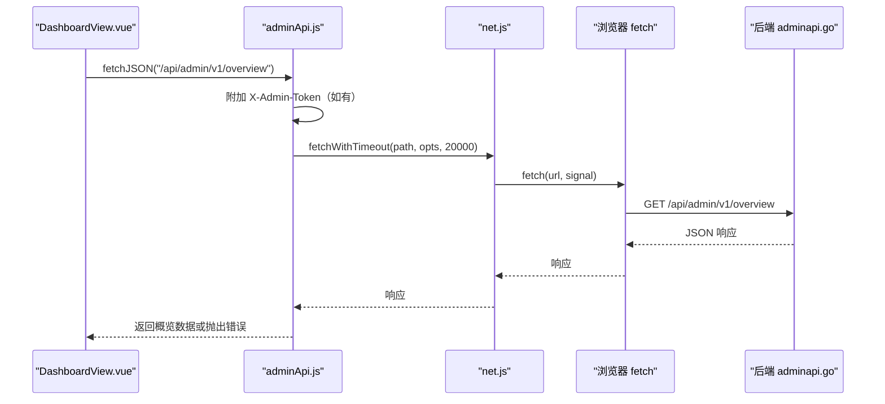
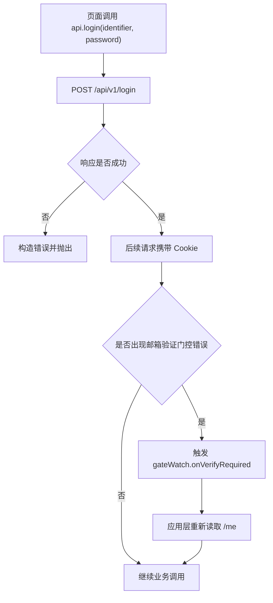
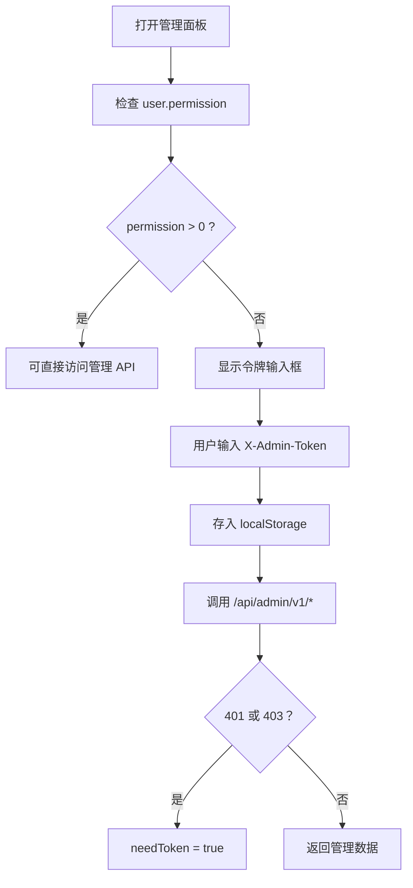
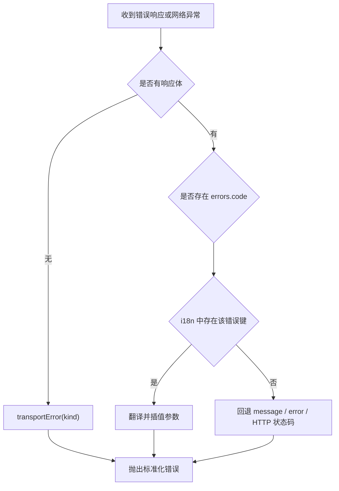
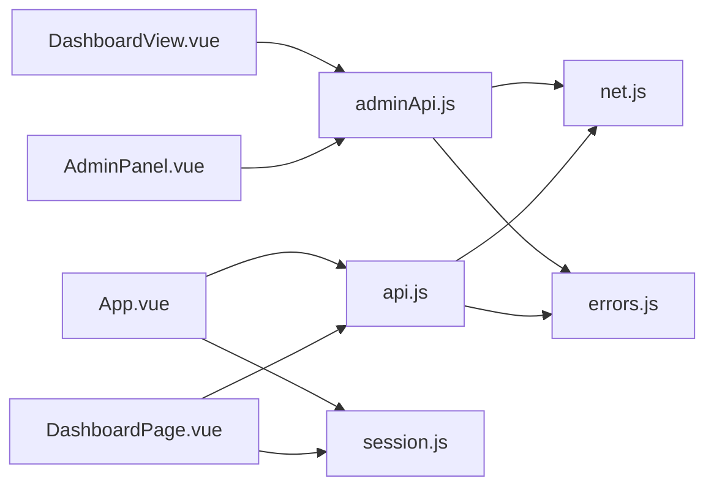

# API 客户端封装

**本文引用的文件**
- [web/src/api.js](https://github.com/YimingZhanshen/skin-nexus/blob/797ae1a/web/src/api.js)
- [web/src/adminApi.js](https://github.com/YimingZhanshen/skin-nexus/blob/797ae1a/web/src/adminApi.js)
- [web/src/net.js](https://github.com/YimingZhanshen/skin-nexus/blob/797ae1a/web/src/net.js)
- [web/src/errors.js](https://github.com/YimingZhanshen/skin-nexus/blob/797ae1a/web/src/errors.js)
- [web/src/session.js](https://github.com/YimingZhanshen/skin-nexus/blob/797ae1a/web/src/session.js)
- [web/src/App.vue](https://github.com/YimingZhanshen/skin-nexus/blob/797ae1a/web/src/App.vue)
- [web/src/pages/DashboardPage.vue](https://github.com/YimingZhanshen/skin-nexus/blob/797ae1a/web/src/pages/DashboardPage.vue)
- [web/src/components/AdminPanel.vue](https://github.com/YimingZhanshen/skin-nexus/blob/797ae1a/web/src/components/AdminPanel.vue)
- [web/src/components/admin/DashboardView.vue](https://github.com/YimingZhanshen/skin-nexus/blob/797ae1a/web/src/components/admin/DashboardView.vue)
- [server/internal/webapi/webapi.go](https://github.com/YimingZhanshen/skin-nexus/blob/797ae1a/server/internal/webapi/webapi.go)
- [server/internal/adminapi/adminapi.go](https://github.com/YimingZhanshen/skin-nexus/blob/797ae1a/server/internal/adminapi/adminapi.go)

## 目录

1. [引言](#引言)
2. [项目结构](#项目结构)
3. [核心组件](#核心组件)
4. [架构总览](#架构总览)
5. [详细组件分析](#详细组件分析)
6. [依赖关系分析](#依赖关系分析)
7. [性能建议](#性能建议)
8. [故障排查指南](#故障排查指南)
9. [结论](#结论)

## 引言

本仓库的前端基于 Vue 单页应用，通过一组轻量 JavaScript 模块封装后端接口。其设计目标是：

- 为普通玩家提供 `/api/v1/*` Web API 的友好封装；
- 为管理员提供 `/api/admin/v1/*` 管理 API 的共享请求能力；
- 将 HTTP 超时、Cookie、跨域凭据、错误翻译、认证守卫等横切逻辑集中到少数文件中；
- 让页面组件只关心“调用哪个业务方法”，而不重复处理网络失败、语言化错误和会话失效。

后端采用 Go 实现，Web API 与管理 API 分别由 `webapi` 与 `adminapi` 包注册路由，并统一返回 `{error, message, code}` 形状的错误体。前端 `errors.js` 根据 `code` 查找国际化字典，否则回退到服务端消息或 `HTTP 状态码`。

## 项目结构

前端 API 相关代码集中在 `web/src` 下，其中与本次目标直接相关的文件如下：

| 文件 | 职责 |
| --- | --- |
| `net.js` | 提供带超时的 `fetchWithTimeout`，把浏览器原生 `AbortError` 转为可翻译的网络错误。 |
| `errors.js` | 把后端错误体翻译成用户可读句子，并提供网络级错误描述。 |
| `api.js` | 封装 `/api/v1/*` 玩家侧 API，包括 JSON 请求、表单上传、OIDC 设备流程、Union 成员接口。 |
| `adminApi.js` | 封装 `/api/admin/v1/*` 管理 API，附带可选的 `X-Admin-Token` 头和管理员令牌持久化。 |
| `session.js` | 暴露 401 未授权通知和通用 401 守卫函数。 |
| `App.vue` | 启动时加载站点配置、插件 UI、当前用户，并把邮箱验证门控回调注入 `api.js`。 |
| `DashboardPage.vue` | 玩家仪表盘，演示获取自身信息、纹理列表和上传纹理。 |
| `AdminPanel.vue` | 管理面板外壳，负责管理员权限判断、侧边栏和机器令牌输入。 |
| `components/admin/DashboardView.vue` | 管理仪表盘视图，调用 `/api/admin/v1/overview` 展示统计卡片。 |
| `server/internal/webapi/webapi.go` | 后端玩家侧 API 路由与错误体约定。 |
| `server/internal/adminapi/adminapi.go` | 后端管理 API 路由及双通道认证（会话或机器令牌）。 |

**图表来源**
- [web/src/api.js:1-161](https://github.com/YimingZhanshen/skin-nexus/blob/797ae1a/web/src/api.js#L1-L161)
- [web/src/adminApi.js:1-32](https://github.com/YimingZhanshen/skin-nexus/blob/797ae1a/web/src/adminApi.js#L1-L32)
- [web/src/net.js:1-23](https://github.com/YimingZhanshen/skin-nexus/blob/797ae1a/web/src/net.js#L1-L23)
- [web/src/errors.js:1-35](https://github.com/YimingZhanshen/skin-nexus/blob/797ae1a/web/src/errors.js#L1-L35)
- [web/src/session.js:1-13](https://github.com/YimingZhanshen/skin-nexus/blob/797ae1a/web/src/session.js#L1-L13)
- [web/src/pages/DashboardPage.vue:1-200](https://github.com/YimingZhanshen/skin-nexus/blob/797ae1a/web/src/pages/DashboardPage.vue#L1-L200)
- [web/src/components/admin/DashboardView.vue:1-71](https://github.com/YimingZhanshen/skin-nexus/blob/797ae1a/web/src/components/admin/DashboardView.vue#L1-L71)
- [server/internal/webapi/webapi.go:1-200](https://github.com/YimingZhanshen/skin-nexus/blob/797ae1a/server/internal/webapi/webapi.go#L1-L200)
- [server/internal/adminapi/adminapi.go:1-200](https://github.com/YimingZhanshen/skin-nexus/blob/797ae1a/server/internal/adminapi/adminapi.go#L1-L200)

**章节来源**
- [web/src/api.js:1-161](https://github.com/YimingZhanshen/skin-nexus/blob/797ae1a/web/src/api.js#L1-L161)
- [web/src/adminApi.js:1-32](https://github.com/YimingZhanshen/skin-nexus/blob/797ae1a/web/src/adminApi.js#L1-L32)
- [web/src/net.js:1-23](https://github.com/YimingZhanshen/skin-nexus/blob/797ae1a/web/src/net.js#L1-L23)
- [web/src/errors.js:1-35](https://github.com/YimingZhanshen/skin-nexus/blob/797ae1a/web/src/errors.js#L1-L35)
- [web/src/pages/DashboardPage.vue:1-200](https://github.com/YimingZhanshen/skin-nexus/blob/797ae1a/web/src/pages/DashboardPage.vue#L1-L200)
- [web/src/components/admin/DashboardView.vue:1-71](https://github.com/YimingZhanshen/skin-nexus/blob/797ae1a/web/src/components/admin/DashboardView.vue#L1-L71)

## 核心组件

### `net.js`：统一网络超时

`net.js` 只暴露一个导出函数 `fetchWithTimeout(url, opts, timeoutMS)`。它使用 `AbortController` 包装浏览器 `fetch`：

- 默认超时时间为 15000 毫秒；
- 如果触发超时，捕获 `AbortError`，构造带有 `networkTimeout` 语义的错误；
- 非超时异常原样抛出，交给上层决定如何转换为用户错误；
- 无论成功或失败，最终都会清除定时器。

这个模块没有直接处理 Cookie、CSRF、Authorization 或重试。它的职责是保证“慢速 CDN 边缘节点不会让页面永久等待”。

**章节来源**
- [web/src/net.js:1-23](https://github.com/YimingZhanshen/skin-nexus/blob/797ae1a/web/src/net.js#L1-L23)

### `errors.js`：标准化错误对象

`errors.js` 提供两个关键工具：

| 函数 | 作用 |
| --- | --- |
| `describe(data, status)` | 从后端响应体中提取 `code`，若存在对应国际化键则格式化输出；否则回退到 `message`、`error` 或 `HTTP 状态码`。 |
| `transportError(kind)` | 为从未产生响应体的网络错误生成国际化消息，如 `network`、`networkTimeout`。 |

错误体保留三个保留字段：`error`、`message`、`code`。其他字段会被当作插值参数传入 i18n。对数组参数会先转为逗号分隔字符串，避免 vue-i18n 直接渲染 JSON。

后端要求所有错误统一为包含 `error`、`message`、`code` 的形状，这样前端新增错误码只需添加一条本地化条目，不需要修改 ~90 处调用点。

**章节来源**
- [web/src/errors.js:1-35](https://github.com/YimingZhanshen/skin-nexus/blob/797ae1a/web/src/errors.js#L1-L35)
- [server/internal/webapi/webapi.go:1-200](https://github.com/YimingZhanshen/skin-nexus/blob/797ae1a/server/internal/webapi/webapi.go#L1-L200)

### `session.js`：401 会话失效通知

`session.js` 不发起请求，而是提供跨组件的未授权通知机制：

- `setUnauthorizedHandler(fn)`：注册全局 401 处理器；
- `notifyUnauthorized()`：由任意页面在检测到 401 时调用；
- `guard401(e)`：通用守卫函数，若错误对象带有 `status === 401`，则通知全局处理器并返回 `true`。

应用入口 `App.vue` 在启动时设置该处理器，使登录态失效后能够回到登录界面。

**章节来源**
- [web/src/session.js:1-13](https://github.com/YimingZhanshen/skin-nexus/blob/797ae1a/web/src/session.js#L1-L13)
- [web/src/App.vue:1-200](https://github.com/YimingZhanshen/skin-nexus/blob/797ae1a/web/src/App.vue#L1-L200)

### `api.js`：玩家侧 Web API 封装

`api.js` 定义了一个内部 `req(method, path, body, timeoutMS)` 函数，作为 `/api/v1/*` JSON 接口的统一入口：

| 行为 | 说明 |
| --- | --- |
| 请求体 | 当 `body` 不为 `undefined` 时，设置 `Content-Type: application/json` 并序列化。 |
| 超时 | 默认 15000 毫秒，可由调用方覆盖。 |
| 204 响应 | 直接返回 `null`，不尝试解析 JSON。 |
| 非 2xx | 用 `describe` 构造错误对象，附加 `status` 和 `data`，然后抛出。 |
| 邮箱验证门控 | 当错误码为 `auth.email_verify_required` 且存在监听器时，触发 `gateWatch.onVerifyRequired`。 |
| 凭据 | 使用同源的 `fetch`，自动携带 Cookie。 |

此外还定义了 `uploadTexture(type, file, description, pluginData, meta)`，用于上传纹理。它不走 `fetch`，而是使用 `XMLHttpRequest`，因为需要支持进度条和 `FormData`。

**章节来源**
- [web/src/api.js:1-161](https://github.com/YimingZhanshen/skin-nexus/blob/797ae1a/web/src/api.js#L1-L161)

### `adminApi.js`：管理 API 封装

`adminApi.js` 提供 `fetchJSON(path, opts)`，专门面向 `/api/admin/v1/*`：

- 如果存在 `token.value`，自动添加 `X-Admin-Token` 请求头；
- 超时时间默认为 20000 毫秒；
- 401 或 403 响应会将 `needToken` 标记设为 `true`，提示 UI 显示令牌输入框；
- 所有非 2xx 响应都会构造带 `status` 和 `data` 的错误对象；
- `token` 是 Vue 响应式变量，初始值来自 `localStorage`；
- `persistToken()` 把当前令牌写入本地存储。

注释明确说明：管理员可以通过“正常 Web 会话”访问管理接口，也可以通过 `X-Admin-Token` 作为机器回退路径。

**章节来源**
- [web/src/adminApi.js:1-32](https://github.com/YimingZhanshen/skin-nexus/blob/797ae1a/web/src/adminApi.js#L1-L32)

## 架构总览

下图展示一次典型玩家侧请求的完整链路。

**图表来源**
- [web/src/api.js:1-60](https://github.com/YimingZhanshen/skin-nexus/blob/797ae1a/web/src/api.js#L1-L60)
- [web/src/net.js:1-23](https://github.com/YimingZhanshen/skin-nexus/blob/797ae1a/web/src/net.js#L1-L23)
- [server/internal/webapi/webapi.go:1-200](https://github.com/YimingZhanshen/skin-nexus/blob/797ae1a/server/internal/webapi/webapi.go#L1-L200)

管理面板的统计查询链路类似，但走 `adminApi.js`，并可能附加 `X-Admin-Token`。

**图表来源**
- [web/src/components/admin/DashboardView.vue:1-71](https://github.com/YimingZhanshen/skin-nexus/blob/797ae1a/web/src/components/admin/DashboardView.vue#L1-L71)
- [web/src/adminApi.js:1-32](https://github.com/YimingZhanshen/skin-nexus/blob/797ae1a/web/src/adminApi.js#L1-L32)
- [server/internal/adminapi/adminapi.go:1-200](https://github.com/YimingZhanshen/skin-nexus/blob/797ae1a/server/internal/adminapi/adminapi.go#L1-L200)

## 详细组件分析

### 认证流程

#### 玩家侧会话

玩家登录后，服务器设置 Web 会话 Cookie。此后 `api.js` 调用 `/api/v1/*` 时，浏览器会自动在同源请求中携带 Cookie。

关键行为如下：

1. 应用启动时读取当前用户；
2. `api.me()` 返回用户信息，其中包括 `permission`；
3. `App.vue` 根据 `user.permission > 0` 决定是否显示管理入口；
4. 邮箱验证门控开启时，服务器可能在请求过程中关闭会话或改变验证状态；
5. `api.js` 遇到 `auth.email_verify_required` 错误时，会触发 `gateWatch.onVerifyRequired`，由应用层重新拉取 `/me`。

**图表来源**
- [web/src/api.js:1-60](https://github.com/YimingZhanshen/skin-nexus/blob/797ae1a/web/src/api.js#L1-L60)
- [web/src/App.vue:1-200](https://github.com/YimingZhanshen/skin-nexus/blob/797ae1a/web/src/App.vue#L1-L200)

**章节来源**
- [web/src/api.js:1-60](https://github.com/YimingZhanshen/skin-nexus/blob/797ae1a/web/src/api.js#L1-L60)
- [web/src/App.vue:1-200](https://github.com/YimingZhanshen/skin-nexus/blob/797ae1a/web/src/App.vue#L1-L200)

#### 管理员权限校验

管理员访问 `/api/admin/v1/*` 有两种方式：

| 方式 | 条件 | 凭证 |
| --- | --- | --- |
| Web 会话 | 账号 `permission > 0` | Cookie |
| 机器令牌 | 环境变量 `SKIN_ADMIN_TOKEN` 已配置 | `X-Admin-Token` 请求头 |

前端 `AdminPanel.vue` 会根据当前用户的 `permission` 决定是否仍需输入令牌。如果会话本身已经是管理员，则隐藏令牌输入区域。如果 401 或 403 返回，`adminApi.js` 会把 `needToken` 设为 `true`，让用户有机会粘贴机器令牌。

后端 `adminapi.go` 也明确声明：管理门控等价于“Web 会话权限大于 0，或者共享管理员令牌”。

**图表来源**
- [web/src/components/AdminPanel.vue:1-200](https://github.com/YimingZhanshen/skin-nexus/blob/797ae1a/web/src/components/AdminPanel.vue#L1-L200)
- [web/src/adminApi.js:1-32](https://github.com/YimingZhanshen/skin-nexus/blob/797ae1a/web/src/adminApi.js#L1-L32)
- [server/internal/adminapi/adminapi.go:1-200](https://github.com/YimingZhanshen/skin-nexus/blob/797ae1a/server/internal/adminapi/adminapi.go#L1-L200)

**章节来源**
- [web/src/components/AdminPanel.vue:1-200](https://github.com/YimingZhanshen/skin-nexus/blob/797ae1a/web/src/components/AdminPanel.vue#L1-L200)
- [web/src/adminApi.js:1-32](https://github.com/YimingZhanshen/skin-nexus/blob/797ae1a/web/src/adminApi.js#L1-L32)
- [server/internal/adminapi/adminapi.go:1-200](https://github.com/YimingZhanshen/skin-nexus/blob/797ae1a/server/internal/adminapi/adminapi.go#L1-L200)

#### 插件 Bearer API 的调用位置

在当前前端代码中，插件能力发现、插件页面、插槽、表单、标签和资源 URL 都通过 `pluginUI.js` 管理。插件 UI 清单通过 `/api/v1/plugins/ui` 获取，但该调用不使用 `Bearer` 认证，也没有自定义 Authorization 头。

仓库中与插件 Bearer 认证相关的路由位于后端 `server/internal/plugin/routes_bearer_test.go` 等测试文件，以及 `server/internal/plugin/routes.go` 等路由注册位置。这些属于后端插件桥接协议，不是本次前端 API 客户端封装的主要调用路径。因此，前端玩家侧和管理侧封装均未直接实现插件 Bearer API 的独立封装。

如果需要在前端调用插件 Bearer API，应在现有 `api.js` 或 `adminApi.js` 基础上扩展，并确保：

- 明确是否需要携带插件密钥；
- 避免把敏感 Bearer 令牌混入普通 JSON 请求；
- 复用 `errors.js` 的错误翻译；
- 复用 `net.js` 的超时控制。

**章节来源**
- [web/src/pluginUI.js:1-90](https://github.com/YimingZhanshen/skin-nexus/blob/797ae1a/web/src/pluginUI.js#L1-L90)

### 请求拦截与错误映射

#### 请求拦截

前端没有全局拦截器，而是按用途分层：

| 层次 | 拦截内容 |
| --- | --- |
| `net.js` | 超时中止，把 `AbortError` 转成 `networkTimeout` 错误。 |
| `api.js` | JSON 请求体序列化、204 特殊处理、邮箱验证门控回调。 |
| `adminApi.js` | 附加 `X-Admin-Token`、401/403 切换令牌提示。 |
| `errors.js` | 后端错误码翻译。 |
| `session.js` | 401 会话失效通知。 |

#### 错误码映射

错误映射分两层：

1. 后端返回结构化错误体；
2. 前端 `errors.js` 根据 `code` 查找 `errors.<code>` 国际化键。

如果没有匹配的国际化键，则回退顺序为：

- `data.message`
- `data.error`
- `HTTP 状态码`

对于纯网络失败，`transportError('network')` 或 `transportError('networkTimeout')` 会查找对应国际化键。

**图表来源**
- [web/src/errors.js:1-35](https://github.com/YimingZhanshen/skin-nexus/blob/797ae1a/web/src/errors.js#L1-L35)

**章节来源**
- [web/src/api.js:1-60](https://github.com/YimingZhanshen/skin-nexus/blob/797ae1a/web/src/api.js#L1-L60)
- [web/src/adminApi.js:1-32](https://github.com/YimingZhanshen/skin-nexus/blob/797ae1a/web/src/adminApi.js#L1-L32)

### 网络失败降级

当前实现没有显式的重试逻辑。主要降级策略是：

| 场景 | 行为 |
| --- | --- |
| 超时 | 抛出 `networkTimeout` 错误，由调用方决定是否重试或提示用户。 |
| 无响应体 | 使用 `transportError` 给出网络级错误。 |
| 非 2xx | 返回结构化错误，包含 `status` 和 `data`。 |
| 204 | 直接返回 `null`，避免空响应体解析失败。 |
| 插件 UI 加载失败 | 忽略错误，保持最佳努力模式。 |
| 邮箱验证门控变化 | 触发应用层回调，而不是每个组件各自判断。 |

注意：`api.js` 中的 `uploadTexture` 是独立实现的 `XMLHttpRequest` 路径，没有经过 `fetchWithTimeout`。它有自己的 60000 毫秒超时和错误分支。

**章节来源**
- [web/src/net.js:1-23](https://github.com/YimingZhanshen/skin-nexus/blob/797ae1a/web/src/net.js#L1-L23)
- [web/src/api.js:100-161](https://github.com/YimingZhanshen/skin-nexus/blob/797ae1a/web/src/api.js#L100-L161)
- [web/src/pluginUI.js:1-90](https://github.com/YimingZhanshen/skin-nexus/blob/797ae1a/web/src/pluginUI.js#L1-L90)

### 调试日志

当前 API 客户端没有统一的调试日志出口。错误会通过 `errors.js` 翻译为用户可见消息，并在组件中被捕获后显示为页面级错误或上传错误。`App.vue` 和 `DashboardPage.vue` 中可以看到多处 `catch` 分支，它们通常把错误消息赋给响应式变量，再由模板渲染。

如需调试，可在以下位置增加日志：

- `api.js` 的 `req` 函数；
- `adminApi.js` 的 `fetchJSON` 函数；
- `net.js` 的 `fetchWithTimeout` 函数；
- 具体页面组件的错误分支。

应避免在生产环境打印敏感字段，尤其是密码、令牌和插件数据。

**章节来源**
- [web/src/pages/DashboardPage.vue:1-200](https://github.com/YimingZhanshen/skin-nexus/blob/797ae1a/web/src/pages/DashboardPage.vue#L1-L200)
- [web/src/App.vue:1-200](https://github.com/YimingZhanshen/skin-nexus/blob/797ae1a/web/src/App.vue#L1-L200)

### 典型调用示例

#### 上传纹理

调用 `api.uploadTexture(type, file, description, pluginData, meta)`：

- 构建 `FormData`；
- 使用 `XMLHttpRequest` 发送 POST 到 `/api/me/textures`；
- 启用 `withCredentials`，携带 Cookie；
- 支持上传进度回调；
- 解析 JSON 响应或非 JSON 错误页；
- 网络错误和超时分别拒绝 Promise。

适合上传皮肤、披风或头像材质。

**章节来源**
- [web/src/api.js:112-161](https://github.com/YimingZhanshen/skin-nexus/blob/797ae1a/web/src/api.js#L112-L161)

#### 获取皮肤库

调用 `api.skinlib(params)`：

- 过滤空值和空字符串参数；
- 使用 `URLSearchParams` 拼接查询串；
- 发起 GET `/api/v1/skinlib`。

适合列出公开皮肤资源。

**章节来源**
- [web/src/api.js:61-99](https://github.com/YimingZhanshen/skin-nexus/blob/797ae1a/web/src/api.js#L61-L99)

#### 注册用户

调用 `api.register(email, nickname, password, invitationCode, pluginData)`：

- 发起 POST `/api/v1/register`；
- 请求体包含邮箱、昵称、密码、邀请码和插件数据；
- 后端可能要求邀请码，也可能仅校验；
- 错误体由 `errors.js` 翻译。

**章节来源**
- [web/src/api.js:20-60](https://github.com/YimingZhanshen/skin-nexus/blob/797ae1a/web/src/api.js#L20-L60)
- [server/internal/webapi/webapi.go:1-200](https://github.com/YimingZhanshen/skin-nexus/blob/797ae1a/server/internal/webapi/webapi.go#L1-L200)

#### 查看仪表盘统计

玩家侧仪表盘调用 `api.me()` 和 `api.textures(page, pageSize, q, type)`，展示：

- 角色数量与限制；
- 存储字节；
- 纹理分页列表；
- 搜索和类型筛选。

管理侧仪表盘调用 `fetchJSON('/api/admin/v1/overview')`，展示：

- 用户数；
- 玩家数；
- 纹理数；
- 存储大小；
- 弱哈希用户数和签名指纹。

**章节来源**
- [web/src/pages/DashboardPage.vue:1-200](https://github.com/YimingZhanshen/skin-nexus/blob/797ae1a/web/src/pages/DashboardPage.vue#L1-L200)
- [web/src/components/admin/DashboardView.vue:1-71](https://github.com/YimingZhanshen/skin-nexus/blob/797ae1a/web/src/components/admin/DashboardView.vue#L1-L71)

#### 发送测试邮件

测试邮件属于管理功能。后端 `adminapi.go` 注册了 `POST /api/admin/v1/mail-test`，并由 `b.auth` 包裹，说明需要管理员认证。前端管理面板的邮件诊断视图应通过 `adminApi.js` 的 `fetchJSON` 调用该接口。

当前 `DashboardView.vue` 仅调用 `/api/admin/v1/overview`，并未直接发送测试邮件，但管理 API 封装已经具备所需能力。

**章节来源**
- [server/internal/adminapi/adminapi.go:1-200](https://github.com/YimingZhanshen/skin-nexus/blob/797ae1a/server/internal/adminapi/adminapi.go#L1-L200)
- [web/src/adminApi.js:1-32](https://github.com/YimingZhanshen/skin-nexus/blob/797ae1a/web/src/adminApi.js#L1-L32)

## 依赖关系分析

**图表来源**
- [web/src/pages/DashboardPage.vue:1-200](https://github.com/YimingZhanshen/skin-nexus/blob/797ae1a/web/src/pages/DashboardPage.vue#L1-L200)
- [web/src/components/AdminPanel.vue:1-200](https://github.com/YimingZhanshen/skin-nexus/blob/797ae1a/web/src/components/AdminPanel.vue#L1-L200)
- [web/src/components/admin/DashboardView.vue:1-71](https://github.com/YimingZhanshen/skin-nexus/blob/797ae1a/web/src/components/admin/DashboardView.vue#L1-L71)
- [web/src/api.js:1-161](https://github.com/YimingZhanshen/skin-nexus/blob/797ae1a/web/src/api.js#L1-L161)
- [web/src/adminApi.js:1-32](https://github.com/YimingZhanshen/skin-nexus/blob/797ae1a/web/src/adminApi.js#L1-L32)
- [web/src/net.js:1-23](https://github.com/YimingZhanshen/skin-nexus/blob/797ae1a/web/src/net.js#L1-L23)
- [web/src/errors.js:1-35](https://github.com/YimingZhanshen/skin-nexus/blob/797ae1a/web/src/errors.js#L1-L35)
- [web/src/session.js:1-13](https://github.com/YimingZhanshen/skin-nexus/blob/797ae1a/web/src/session.js#L1-L13)
- [web/src/App.vue:1-200](https://github.com/YimingZhanshen/skin-nexus/blob/797ae1a/web/src/App.vue#L1-L200)

耦合关系说明：

- `api.js` 与 `adminApi.js` 都依赖 `net.js` 和 `errors.js`，形成稳定的底层契约；
- `api.js` 通过 `gateWatch` 与 `App.vue` 松耦合地通信邮箱验证门控事件；
- `AdminPanel.vue` 通过 `adminApi.js` 的响应式 `token` 和 `needToken` 控制 UI；
- 页面组件不应直接操作 Cookie、CSRF Token 或 Authorization 头，而应调用封装后的方法。

**章节来源**
- [web/src/api.js:1-161](https://github.com/YimingZhanshen/skin-nexus/blob/797ae1a/web/src/api.js#L1-L161)
- [web/src/adminApi.js:1-32](https://github.com/YimingZhanshen/skin-nexus/blob/797ae1a/web/src/adminApi.js#L1-L32)
- [web/src/App.vue:1-200](https://github.com/YimingZhanshen/skin-nexus/blob/797ae1a/web/src/App.vue#L1-L200)
- [web/src/components/AdminPanel.vue:1-200](https://github.com/YimingZhanshen/skin-nexus/blob/797ae1a/web/src/components/AdminPanel.vue#L1-L200)

## 性能建议

### 避免重复请求

- 不要在多个组件中并行重复调用相同只读接口；
- 把用户信息、站点配置、插件 UI 等数据放在应用层或页面级响应式状态中；
- `DashboardPage.vue` 已经对纹理搜索做了防抖，避免连续输入触发多次请求；
- 搜索结果使用 `texSeq` 防止旧响应覆盖新响应。

### 合理缓存只读数据

- 站点配置、插件 UI、当前用户等数据适合短期内存缓存；
- 对于高频只读数据，可以考虑加入简单缓存层，例如基于 key 的结果缓存和 TTL；
- 管理员令牌可以继续使用 `localStorage`，但应避免在日志中输出；
- 皮肤库等公开资源若服务端支持缓存头，可依赖浏览器缓存。

### 避免在循环中串行调用 API

- 不要对大量纹理或用户逐个发起写请求；
- 批量操作应尽量使用后端提供的批量接口；
- 如果必须逐个调用，应先做本地去重、并发度限制和失败聚合；
- 当前纹理删除和衣柜操作都是单行级别，适合小量交互，不适合大规模自动化脚本。

### 上传优化

- 上传前在客户端校验文件大小，避免浪费带宽；
- 使用 `uploadTexture` 的进度回调提升用户体验；
- 大文件上传失败时允许重试，但不要无限重试；
- 避免同时上传多个大文件，除非后端明确支持并发。

### 超时与重试策略

当前实现没有自动重试，这是保守设计。建议补充策略：

| 错误类型 | 建议 |
| --- | --- |
| 网络超时 | 最多重试一次，间隔短延迟； |
| 网络断开 | 不重试或仅在用户主动重试时重试； |
| 401 | 清理会话，跳转登录，不重试； |
| 403 | 提示权限不足，不重试； |
| 429 | 遵循服务端锁定时长，不盲目重试； |
| 5xx | 可重试有限次数； |
| 4xx 业务错误 | 不重试，直接展示错误消息。 |

### 减少首屏阻塞

- 插件 UI 加载失败被忽略，避免阻塞应用启动；
- 页面级异步组件按需加载，避免一次性下载全部管理表格和 3D 预览；
- 邮箱验证门控变化通过回调处理，避免每处调用都复制判断逻辑。

[本节为通用性能指导，不直接分析具体代码片段]

## 故障排查指南

### 常见错误现象

| 现象 | 可能原因 | 处理方式 |
| --- | --- | --- |
| 请求一直等待 | 后端或 CDN 未返回响应，触发自定义超时 | 检查网络、CDN、后端健康状态 |
| 显示“网络超时” | `AbortController` 超时 | 调整 `timeoutMS` 或检查后端响应时间 |
| 登录后仍无法访问管理页面 | 会话权限不足或 `X-Admin-Token` 无效 | 确认 `permission > 0` 或更换令牌 |
| 管理面板反复弹出令牌输入框 | 后端返回 401 或 403 | 检查会话、令牌和服务端配置 |
| 错误消息显示英文 | 后端返回未知 `code`，前端回退到原始消息 | 在后端新增稳定错误码，前端补充 i18n |
| 上传失败但看不到 JSON | 服务器返回 HTML 错误页 | 检查上传限制、权限和后端错误响应 |
| 邮箱验证突然不可用 | 验证门控在服务端切换 | 依赖 `gateWatch.onVerifyRequired` 刷新用户状态 |

### 定位步骤

1. 打开浏览器开发者工具的 Network 面板；
2. 找到失败的请求，确认路径是 `/api/v1/*` 还是 `/api/admin/v1/*`；
3. 检查请求头是否包含 Cookie 或 `X-Admin-Token`；
4. 查看响应状态码和响应体；
5. 确认响应体中是否存在 `code`；
6. 检查 i18n 是否包含对应 `errors.<code>`；
7. 如果是 401，检查 `session.js` 的未授权处理是否被调用；
8. 如果是上传问题，检查 `XMLHttpRequest` 的状态码和文本响应。

### 调试增强建议

- 在非生产环境记录请求方法、路径、状态码和耗时；
- 避免记录密码、令牌、插件数据和敏感个人信息；
- 对频繁失败接口增加限流和用户提示；
- 对上传失败区分“网络错误”“服务器错误”“业务校验错误”。

**章节来源**
- [web/src/errors.js:1-35](https://github.com/YimingZhanshen/skin-nexus/blob/797ae1a/web/src/errors.js#L1-L35)
- [web/src/session.js:1-13](https://github.com/YimingZhanshen/skin-nexus/blob/797ae1a/web/src/session.js#L1-L13)
- [web/src/api.js:1-161](https://github.com/YimingZhanshen/skin-nexus/blob/797ae1a/web/src/api.js#L1-L161)
- [web/src/adminApi.js:1-32](https://github.com/YimingZhanshen/skin-nexus/blob/797ae1a/web/src/adminApi.js#L1-L32)

## 结论

前端 API 客户端封装以极简原则组织：

- `net.js` 负责超时；
- `errors.js` 负责错误翻译；
- `api.js` 封装玩家侧 JSON 接口和纹理上传；
- `adminApi.js` 封装管理侧接口和机器令牌；
- `session.js` 提供 401 会话失效通知；
- `App.vue` 和页面组件负责业务状态和用户体验。

这种设计避免了在每个页面重复处理 Cookie、错误体和国际化。管理员通过 Web 会话或机器令牌两种方式访问管理接口，符合“人类管理员 + 机器回退”的双重语义。未来如需扩展插件 Bearer API，应保持同样的分层原则：网络层、错误层、业务封装层、页面层清晰分离。
