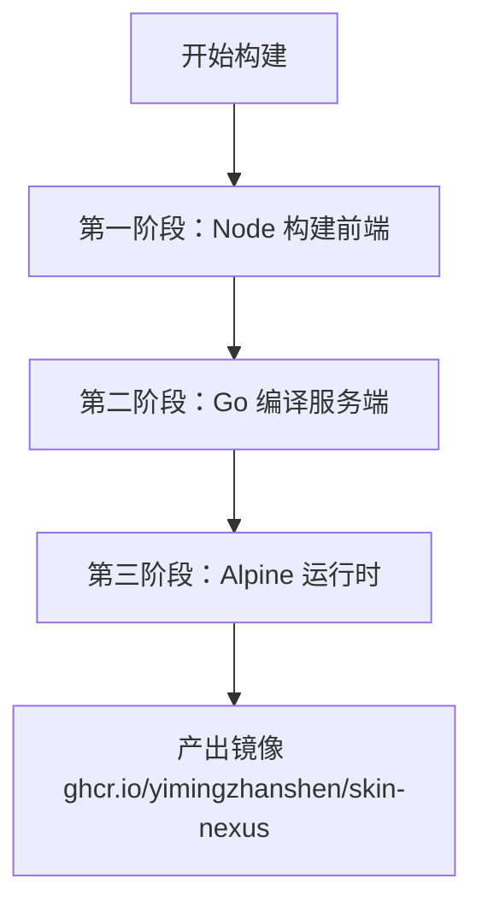
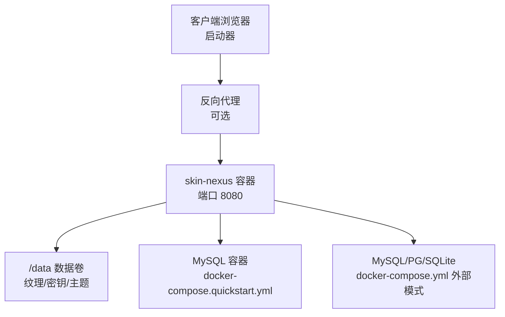
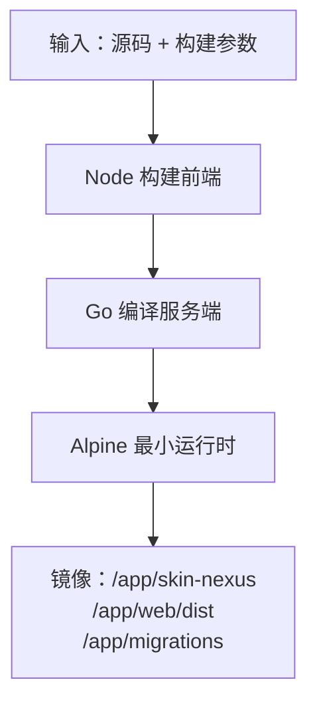
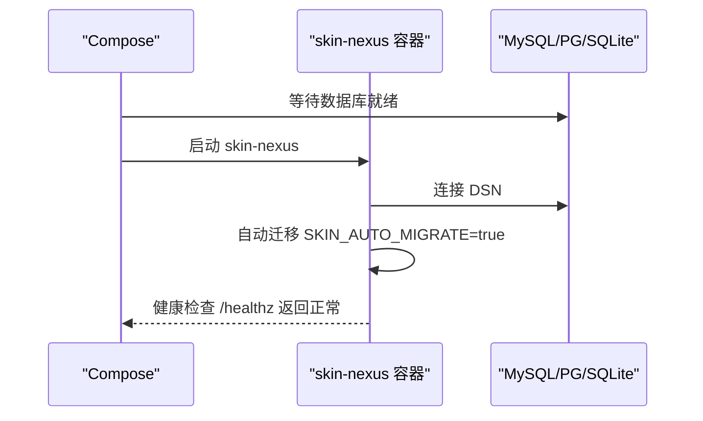
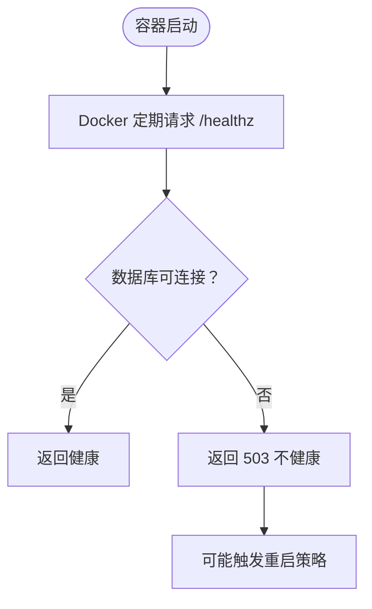
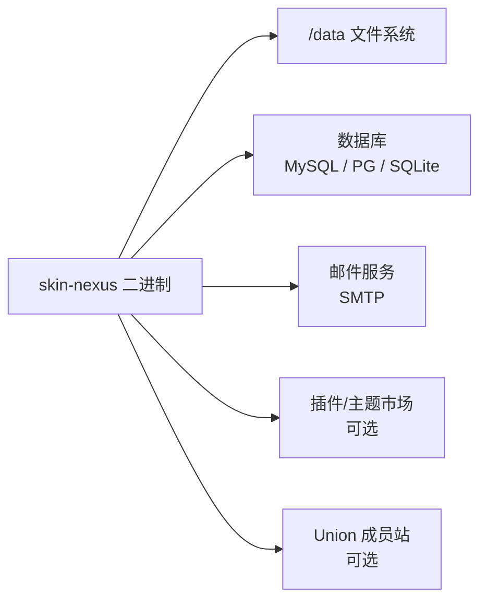

# Docker 部署

**本文引用的文件**
- [Dockerfile](https://github.com/YimingZhanshen/skin-nexus/blob/797ae1a/Dockerfile)
- [docker-compose.quickstart.yml](https://github.com/YimingZhanshen/skin-nexus/blob/797ae1a/docker-compose.quickstart.yml)
- [docker-compose.yml](https://github.com/YimingZhanshen/skin-nexus/blob/797ae1a/docker-compose.yml)
- [.dockerignore](https://github.com/YimingZhanshen/skin-nexus/blob/797ae1a/.dockerignore)
- [main.go](https://github.com/YimingZhanshen/skin-nexus/blob/797ae1a/server/cmd/skin-nexus/main.go)
- [config.go](https://github.com/YimingZhanshen/skin-nexus/blob/797ae1a/server/internal/config/config.go)
- [env.go](https://github.com/YimingZhanshen/skin-nexus/blob/797ae1a/server/internal/config/env.go)
- [README.md](https://github.com/YimingZhanshen/skin-nexus/blob/797ae1a/README.md)

## 目录
1. [简介](#简介)
2. [项目结构](#项目结构)
3. [核心组件](#核心组件)
4. [架构总览](#架构总览)
5. [详细组件分析](#详细组件分析)
6. [依赖关系分析](#依赖关系分析)
7. [性能与资源建议](#性能与资源建议)
8. [故障排查指南](#故障排查指南)
9. [结论](#结论)
10. [附录：环境变量速查](#附录环境变量速查)

## 简介
本文面向通过容器运行 SkinNexus 的运维人员，说明官方镜像 `ghcr.io/yimingzhanshen/skin-nexus` 的构建产物、运行时入口、工作目录和持久化约定，并对比两个编排文件：

- `docker-compose.quickstart.yml`：一键快速启动，使用内置 MySQL，适合本地测试或最小可用环境。
- `docker-compose.yml`：推荐生产路径，默认也包含内置 MySQL，但文档明确支持注释掉数据库服务后对接外部 MySQL/PostgreSQL/SQLite。

注意：仓库中的镜像地址是 `ghcr.io/yimingzhanshen/skin-nexus`，而不是 `ghcr.io/skin-nexus/skin-nexus`；若目标仓库不同，请自行替换镜像名。

**章节来源**
- [README.md:24-48](https://github.com/YimingZhanshen/skin-nexus/blob/797ae1a/README.md#L24-L48)
- [docker-compose.quickstart.yml:1-71](https://github.com/YimingZhanshen/skin-nexus/blob/797ae1a/docker-compose.quickstart.yml#L1-L71)
- [docker-compose.yml:1-86](https://github.com/YimingZhanshen/skin-nexus/blob/797ae1a/docker-compose.yml#L1-L86)

## 项目结构
SkinNexus 的容器镜像由三个阶段构建而成：前端静态资源、Go 服务端二进制、以及最终最小运行时镜像。

**图表来源**
- [Dockerfile:1-68](https://github.com/YimingZhanshen/skin-nexus/blob/797ae1a/Dockerfile#L1-L68)

### 多阶段构建产物
| 阶段 | 基础镜像 | 主要动作 | 输出产物 |
|---|---|---|---|
| web | `node:22-alpine` | 安装依赖并执行前端构建 | `/build/web/dist` |
| server | `golang:1.27-alpine` | 下载 Go 模块、编译 `cmd/skin-nexus` | `/out/skin-nexus` |
| runtime | `alpine:3.24` | 合并二进制、前端静态资源、迁移 SQL | `/app/skin-nexus`、`/app/web/dist`、`/app/migrations` |

### 运行时目录与工作目录
| 路径 | 用途 | 是否持久化 |
|---|---|---|
| `/app` | 镜像内应用根目录 | 否（只读镜像层） |
| `/app/skin-nexus` | 可执行服务端二进制 | 否 |
| `/app/web/dist` | 嵌入的前端静态资源 | 否 |
| `/app/migrations` | 内置数据库迁移 SQL | 否 |
| `/data` | 纹理、签名密钥、主题、插件状态等数据 | **是**，通过卷挂载 |
| `/var/lib/mysql` | 内置 MySQL 数据目录 | 是，通过 compose 卷挂载 |

`/data` 在 `Dockerfile` 中声明为 Docker 卷，升级镜像不会覆盖该目录；皮肤纹理、`sign-key.pem`、OIDC 密钥、主题包和插件状态都保存在这里。

**章节来源**
- [Dockerfile:1-68](https://github.com/YimingZhanshen/skin-nexus/blob/797ae1a/Dockerfile#L1-L68)
- [docker-compose.yml:1-86](https://github.com/YimingZhanshen/skin-nexus/blob/797ae1a/docker-compose.yml#L1-L86)

## 核心组件
容器入口是 `/app/skin-nexus`，也就是 Go 单二进制。它负责：

- 加载配置和环境变量。
- 打开数据库连接。
- 根据 `SKIN_AUTO_MIGRATE` 自动应用迁移。
- 初始化会话令牌摘要、公开纹理去重、超管账户。
- 启动 HTTP 监听器。
- 暴露 `/healthz` 健康检查端点。

运行时用户未显式切换为非 root，因此容器以镜像默认用户运行；如果宿主机挂载了 `/data`，需要确保该目录对容器可写。

**章节来源**
- [Dockerfile:60-68](https://github.com/YimingZhanshen/skin-nexus/blob/797ae1a/Dockerfile#L60-L68)
- [main.go:1-200](https://github.com/YimingZhanshen/skin-nexus/blob/797ae1a/server/cmd/skin-nexus/main.go#L1-L200)
- [main.go:959-960](https://github.com/YimingZhanshen/skin-nexus/blob/797ae1a/server/cmd/skin-nexus/main.go#L959-L960)
- [main.go:1329-1333](https://github.com/YimingZhanshen/skin-nexus/blob/797ae1a/server/cmd/skin-nexus/main.go#L1329-L1333)

## 架构总览
下图展示两种典型部署形态：快速启动模式和生产编排模式。

**图表来源**
- [docker-compose.quickstart.yml:1-71](https://github.com/YimingZhanshen/skin-nexus/blob/797ae1a/docker-compose.quickstart.yml#L1-L71)
- [docker-compose.yml:1-86](https://github.com/YimingZhanshen/skin-nexus/blob/797ae1a/docker-compose.yml#L1-L86)
- [Dockerfile:60-68](https://github.com/YimingZhanshen/skin-nexus/blob/797ae1a/Dockerfile#L60-L68)

## 详细组件分析

### 官方镜像构建过程
镜像构建分为三个阶段：

1. **前端构建**
   使用 Node 22 Alpine 镜像，安装前端依赖，并将 `web/package.json`、`web/package-lock.json`、`web/` 以及 `server/cmd/skin-nexus/theme-base.css` 复制到构建上下文，最后执行前端构建。

2. **服务端构建**
   使用 Go 1.27 Alpine 镜像，设置 Go 模块代理，下载模块，复制 `server/` 源码，使用 `CGO_ENABLED=0` 编译 `cmd/skin-nexus`，并通过 `-ldflags` 注入版本、提交、构建时间和分支信息。

3. **运行时镜像**
   基于 Alpine 3.24，仅安装 CA 证书和时区数据；把前端的 `/build/web/dist`、Go 二进制的 `/out/skin-nexus`、以及 `server/migrations` 复制到 `/app/web/dist`、`/app/skin-nexus`、`/app/migrations`。

构建参数包括：

| 参数 | 默认值 | 作用 |
|---|---:|---|
| `GOPROXY` | `https://goproxy.cn,direct` | Go 模块下载代理 |
| `BUILD_VERSION` | `0.6.0` | 版本号 |
| `BUILD_COMMIT` | 空 | Git 提交哈希 |
| `BUILD_TIME` | 空 | 构建时间 |
| `BUILD_BRANCH` | 空 | Git 分支 |

`.dockerignore` 会排除 `web/node_modules`、`web/dist`、`data/`、`*.pem`、`.git/`、`docs/`、`*.md` 等敏感或不必要内容，减小构建上下文体积。

**图表来源**
- [Dockerfile:1-68](https://github.com/YimingZhanshen/skin-nexus/blob/797ae1a/Dockerfile#L1-L68)
- [.dockerignore:1-11](https://github.com/YimingZhanshen/skin-nexus/blob/797ae1a/.dockerignore#L1-L11)

**章节来源**
- [Dockerfile:1-68](https://github.com/YimingZhanshen/skin-nexus/blob/797ae1a/Dockerfile#L1-L68)
- [.dockerignore:1-11](https://github.com/YimingZhanshen/skin-nexus/blob/797ae1a/.dockerignore#L1-L11)

### 运行时用户、端口与目录
| 项目 | 行为 |
|---|---|
| 入口命令 | `/app/skin-nexus` |
| 监听地址 | `SKIN_LISTEN`，默认 `:8080` |
| 数据目录 | `SKIN_DATA_DIR=/data` |
| 迁移目录 | `SKIN_MIGRATIONS_DIR=/app/migrations` |
| 自动迁移 | `SKIN_AUTO_MIGRATE=true` |
| 健康检查 | `wget -q -O /dev/null http://127.0.0.1:8080/healthz` |
| 暴露端口 | `8080` |
| 运行时用户 | 未显式切换到非 root 用户 |

健康检查端点在服务器启动过程中注册，用于让 Docker 判断进程是否真正可用。

**章节来源**
- [Dockerfile:60-68](https://github.com/YimingZhanshen/skin-nexus/blob/797ae1a/Dockerfile#L60-L68)
- [main.go:959-960](https://github.com/YimingZhanshen/skin-nexus/blob/797ae1a/server/cmd/skin-nexus/main.go#L959-L960)
- [main.go:1329-1333](https://github.com/YimingZhanshen/skin-nexus/blob/797ae1a/server/cmd/skin-nexus/main.go#L1329-L1333)

### 快速启动编排：`docker-compose.quickstart.yml`
该文件的目标是“零编辑”启动：所有必填项来自 `.env` 或 Shell 插值。

| 项目 | 值 |
|---|---|
| 镜像 | `ghcr.io/yimingzhanshen/skin-nexus:${SKIN_IMAGE_TAG:-latest}` |
| 拉取策略 | `pull_policy: always` |
| 重启策略 | `restart: unless-stopped` |
| 端口映射 | `${SKIN_PORT:-8080}:8080` |
| 数据卷 | `skin-data:/data` |
| 数据库 | 内置 `mysql:8.0`，数据库名 `skin_nexus` |
| 数据库卷 | `skin-db:/var/lib/mysql` |
| 数据库健康检查 | `mysqladmin ping` |
| 依赖条件 | `db` 健康后再启动 skin-nexus |

关键环境变量：

| 变量 | 必填或默认 | 说明 |
|---|---:|---|
| `SKIN_BASE_URL` | 必填 | 站点公网地址 |
| `SKIN_DB_PASSWORD` | 必填 | MySQL 用户密码 |
| `SKIN_DB_ROOT_PASSWORD` | 必填 | MySQL root 密码 |
| `SKIN_ADMIN_TOKEN` | 必填 | 无 Cookie 机器/API 客户端的管理令牌；面板本身使用管理员账号会话 |
| `SKIN_SETUP_TOKEN` | 可选 | 安装向导令牌，为空则每次启动随机生成 |
| `SKIN_DATABASE_DSN` | 自动生成 | 指向内部 `db:3306` |
| `SKIN_ENV` | 可选，默认 `production` | 运行环境标签 |
| `SKIN_CSP_SCRIPT_EXTRA_SOURCES` | 可选 | 第三方脚本来源白名单 |
| `SKIN_CSP_CONNECT_EXTRA_SOURCES` | 可选 | 第三方连接来源白名单 |
| `SKIN_PLUGIN_MARKET_URL` | 可选 | 插件市场注册表地址 |
| `SKIN_PLUGIN_TRUST_KEYS` | 可选 | 插件信任公钥 |
| `SKIN_THEME_MARKET_URL` | 可选 | 主题市场注册表地址 |
| `SKIN_THEME_TRUST_KEYS` | 可选 | 主题信任公钥 |

**章节来源**
- [docker-compose.quickstart.yml:1-71](https://github.com/YimingZhanshen/skin-nexus/blob/797ae1a/docker-compose.quickstart.yml#L1-L71)

### 生产编排：`docker-compose.yml`
这是推荐路径。默认仍包含内置 MySQL，但文档明确指出可以注释掉 `db` 服务和 `depends_on`，将 `SKIN_DATABASE_DSN` 指向外部数据库。

| 项目 | 快速启动版 | 生产编排版 |
|---|---|---|
| 数据库 | 内置 MySQL | 默认内置 MySQL，也可外部 MySQL/PG/SQLite |
| 数据库连接 | 直接拼接 `tcp(db:3306)` | 示例中也是 `db:3306`，但需改为真实外部地址 |
| 数据库密码 | 从 `.env` 插值 | 示例中要求手动修改 `CHANGE_ME` |
| 端口映射 | `${SKIN_PORT:-8080}:8080` | `8080:8080` |
| 反向代理建议 | 未强调 | 建议使用 `127.0.0.1:8080:8080` 绑定回环地址 |
| 卷命名 | `skin-data`、`skin-db` | `skin-data`、`skin-db` |
| 文档说明 | 简短注释 | 更详细的部署、网络、备份说明 |

#### 与外部数据库通信的网络方式
当使用外部 MySQL/PG/SQLite 时，compose 文件给出两种常见方式：

1. **使用 `network_mode: host`**
   删除 `ports:` 块，DSN 中直接指向本机端口，例如宿主机上的 `3306`。

2. **使用 Docker bridge 网络的宿主 IP**
   DSN 中使用 `172.17.0.1` 访问同一宿主机上的数据库。

这种方式适用于数据库不在同一个 compose 项目中，而是宿主机或其他容器网络外的实例。

**图表来源**
- [docker-compose.yml:1-86](https://github.com/YimingZhanshen/skin-nexus/blob/797ae1a/docker-compose.yml#L1-L86)
- [main.go:1-200](https://github.com/YimingZhanshen/skin-nexus/blob/797ae1a/server/cmd/skin-nexus/main.go#L1-L200)

**章节来源**
- [docker-compose.yml:1-86](https://github.com/YimingZhanshen/skin-nexus/blob/797ae1a/docker-compose.yml#L1-L86)

### 最小可用启动命令
以下是最小可用的命令行方式，对应 `docker-compose.quickstart.yml` 的逻辑：

- 准备 `.env`，至少包含 `SKIN_BASE_URL`、`SKIN_DB_PASSWORD`、`SKIN_DB_ROOT_PASSWORD`、`SKIN_ADMIN_TOKEN`、`SKIN_SETUP_TOKEN`。
- 执行 `docker compose -f docker-compose.quickstart.yml up -d`。
- 访问 `<主机>:8080/setup` 完成安装向导。
- 升级时使用 `docker compose pull && docker compose up -d`，数据卷保持不变。

如果使用裸 Docker，最小命令形式等价于：

- 创建卷 `docker volume create skin-data`。
- 运行 `ghcr.io/yimingzhanshen/skin-nexus`，挂载 `/data`，映射 `8080`，并传入必要的环境变量。
- 对外部数据库场景，将 `SKIN_DATABASE_DSN` 指向实际地址，并根据需要启用 `--network=host` 或使用 bridge 宿主 IP。

**章节来源**
- [README.md:24-48](https://github.com/YimingZhanshen/skin-nexus/blob/797ae1a/README.md#L24-L48)
- [docker-compose.quickstart.yml:1-71](https://github.com/YimingZhanshen/skin-nexus/blob/797ae1a/docker-compose.quickstart.yml#L1-L71)
- [docker-compose.yml:1-86](https://github.com/YimingZhanshen/skin-nexus/blob/797ae1a/docker-compose.yml#L1-L86)

### 容器卷挂载点
| 容器路径 | 宿主机挂载方式 | 说明 |
|---|---|---|
| `/data` | 宿主机路径或命名卷 | 纹理、签名密钥、主题、插件状态、OIDC 密钥等 |
| `/var/lib/mysql` | 仅内置 MySQL 时需要 | 数据库文件；生产推荐外部数据库 |
| `/app/migrations` | 通常不挂载 | 镜像内自带迁移 SQL |
| `/app/web/dist` | 通常不挂载 | 镜像内前端静态资源 |

重要提醒：`sign-key.pem` 位于 `skin-data` 卷中。丢失该文件会导致已下发皮肤的签名失效，必须纳入备份范围。

**章节来源**
- [docker-compose.yml:1-86](https://github.com/YimingZhanshen/skin-nexus/blob/797ae1a/docker-compose.yml#L1-L86)
- [README.md:40-48](https://github.com/YimingZhanshen/skin-nexus/blob/797ae1a/README.md#L40-L48)

### 环境变量注入方式
SkinNexus 读取 `SKIN_*` 环境变量，并通过配置文件加载逻辑解析为内部配置对象。部分变量仅在 compose 的 `environment` 块中出现才会进入容器，即使写在 `.env` 文件中也不会生效。

常用环境变量分类如下：

| 类别 | 变量 | 说明 |
|---|---|---|
| 网络 | `SKIN_LISTEN` | 监听地址，默认 `:8080` |
| 站点 | `SKIN_BASE_URL` | 站点公网地址，影响纹理 URL 和 OIDC issuer |
| 环境标签 | `SKIN_ENV` | 显示在运行状态页的自由标签 |
| 数据库 | `SKIN_DATABASE_DSN` | 数据库连接串 |
| 数据目录 | `SKIN_DATA_DIR` | 默认 `/data` |
| 迁移 | `SKIN_MIGRATIONS_DIR`、`SKIN_AUTO_MIGRATE` | 迁移目录和自动迁移开关 |
| 管理员 | `SKIN_ADMIN_TOKEN`、`SKIN_SETUP_TOKEN` | 无 Cookie 机器 API 管理令牌和安装向导令牌；面板使用账号会话 |
| CSP | `SKIN_CSP_SCRIPT_EXTRA_SOURCES`、`SKIN_CSP_CONNECT_EXTRA_SOURCES` | 第三方脚本和连接来源白名单 |
| 插件市场 | `SKIN_PLUGIN_MARKET_URL`、`SKIN_PLUGIN_TRUST_KEYS`、`SKIN_PLUGIN_STATE_DIR`、`SKIN_PLUGIN_UPLOAD_MAX` | 插件市场、信任密钥、状态目录、上传大小 |
| 主题市场 | `SKIN_THEME_MARKET_URL`、`SKIN_THEME_TRUST_KEYS` | 主题市场和信任密钥 |
| 功能开关 | `SKIN_OIDC_ENABLED`、`SKIN_UNION_ENABLED`、`SKIN_INVITE_REQUIRED` | OIDC、Union、邀请码准入 |
| Compose 专用 | `SKIN_DB_PASSWORD`、`SKIN_DB_ROOT_PASSWORD` | 仅传给内置 MySQL 服务 |

**章节来源**
- [env.go:31-70](https://github.com/YimingZhanshen/skin-nexus/blob/797ae1a/server/internal/config/env.go#L31-L70)
- [config.go:14-102](https://github.com/YimingZhanshen/skin-nexus/blob/797ae1a/server/internal/config/config.go#L14-L102)
- [config.go:168-221](https://github.com/YimingZhanshen/skin-nexus/blob/797ae1a/server/internal/config/config.go#L168-L221)
- [docker-compose.quickstart.yml:24-57](https://github.com/YimingZhanshen/skin-nexus/blob/797ae1a/docker-compose.quickstart.yml#L24-L57)
- [docker-compose.yml:24-61](https://github.com/YimingZhanshen/skin-nexus/blob/797ae1a/docker-compose.yml#L24-L61)

### 端口映射与网络配置
| 场景 | 端口 | 网络建议 |
|---|---:|---|
| 直接暴露 | `8080` | 本地开发或简单部署 |
| 反向代理 | 建议 `127.0.0.1:8080:8080` | 仅监听回环，由 Nginx/Caddy 等反代转发 |
| 外部数据库同宿主机 | 无额外端口 | 使用 `--network=host` 或 DSN 中的 `172.17.0.1` |
| 自定义 bridge 网络 | `8080` | 与其他容器通过 compose 服务名通信 |

注意：反向代理需要透传 `X-Forwarded-Proto` 与 `X-Forwarded-For`，否则协议判断错误、全站共用一个限流桶。

**章节来源**
- [docker-compose.quickstart.yml:18-28](https://github.com/YimingZhanshen/skin-nexus/blob/797ae1a/docker-compose.quickstart.yml#L18-L28)
- [docker-compose.yml:14-25](https://github.com/YimingZhanshen/skin-nexus/blob/797ae1a/docker-compose.yml#L14-L25)
- [README.md:44-48](https://github.com/YimingZhanshen/skin-nexus/blob/797ae1a/README.md#L44-L48)

### 健康检查、重启策略和资源限制
| 项目 | 建议 |
|---|---|
| 健康检查 | 使用 `GET /healthz`，Docker 默认每 30 秒探测一次，超时 3 秒，重试 3 次 |
| 重启策略 | `restart: unless-stopped`，避免意外退出后自动恢复 |
| 镜像拉取策略 | `pull_policy: always`，便于 CI/CD 控制版本 |
| CPU 限制 | 根据负载调整，例如 `cpus: "1"` 到 `cpus: "2"` |
| 内存限制 | 建议 `mem_limit: "1G"` 或更高，视纹理数量和并发而定 |
| 磁盘限制 | 重点保护 `/data` 卷，不要只限制容器根文件系统 |

健康检查探针由 `Dockerfile` 定义，并在 `main.go` 中实现 `/healthz`；数据库不可用时返回 503。

**图表来源**
- [Dockerfile:60-68](https://github.com/YimingZhanshen/skin-nexus/blob/797ae1a/Dockerfile#L60-L68)
- [main.go:1329-1333](https://github.com/YimingZhanshen/skin-nexus/blob/797ae1a/server/cmd/skin-nexus/main.go#L1329-L1333)

**章节来源**
- [Dockerfile:60-68](https://github.com/YimingZhanshen/skin-nexus/blob/797ae1a/Dockerfile#L60-L68)
- [docker-compose.quickstart.yml:14-18](https://github.com/YimingZhanshen/skin-nexus/blob/797ae1a/docker-compose.quickstart.yml#L14-L18)
- [docker-compose.yml:14-20](https://github.com/YimingZhanshen/skin-nexus/blob/797ae1a/docker-compose.yml#L14-L20)
- [main.go:1329-1333](https://github.com/YimingZhanshen/skin-nexus/blob/797ae1a/server/cmd/skin-nexus/main.go#L1329-L1333)

## 依赖关系分析
SkinNexus 容器本身是一个单二进制进程，其运行时依赖如下：

- 文件系统依赖 `/data`，必须持久化。
- 数据库依赖由 `SKIN_DATABASE_DSN` 决定；默认内置 MySQL，也可外部数据库。
- 邮件服务通过 SMTP 配置驱动，不在本文件的 compose 模板中硬编码。
- 插件市场和主题市场默认指向仓库提供的注册表，可通过环境变量关闭或替换。
- Union 模块默认关闭，可减少暴露面。

**图表来源**
- [config.go:14-102](https://github.com/YimingZhanshen/skin-nexus/blob/797ae1a/server/internal/config/config.go#L14-L102)
- [docker-compose.quickstart.yml:24-57](https://github.com/YimingZhanshen/skin-nexus/blob/797ae1a/docker-compose.quickstart.yml#L24-L57)
- [docker-compose.yml:24-61](https://github.com/YimingZhanshen/skin-nexus/blob/797ae1a/docker-compose.yml#L24-L61)

**章节来源**
- [config.go:14-102](https://github.com/YimingZhanshen/skin-nexus/blob/797ae1a/server/internal/config/config.go#L14-L102)
- [env.go:31-70](https://github.com/YimingZhanshen/skin-nexus/blob/797ae1a/server/internal/config/env.go#L31-L70)

## 性能与资源建议
- **反向代理缓存**：静态资源、落地页等可放在 Nginx/Caddy/Cloudflare 等边缘层缓存，减少后端压力。
- **数据库选择**：小规模站点可使用 SQLite；中等规模使用 MySQL/MariaDB；高并发或复杂查询场景考虑 PostgreSQL。
- **纹理存储**：`/data` 所在磁盘建议使用高性能 SSD；纹理分发量大时可在反向代理层做缓存。
- **日志保留**：访问日志默认保留 90 天，诊断明细有 24 小时短时钟抹除策略，注意磁盘容量规划。
- **限流与认证失败锁定**：开启登录和认证限流，防止暴力破解占用资源。
- **插件上传大小**：通过 `SKIN_PLUGIN_UPLOAD_MAX` 控制，默认约 64 MiB，可按需求调低。
- **资源限制**：在生产环境中为容器设置 CPU 和内存上限，避免单个实例耗尽宿主机资源。

[本节为通用指导，不直接分析具体代码文件]

## 故障排查指南

### 权限不足
**现象**：容器启动后无法写入 `/data`，或纹理上传失败。
**原因**：宿主机挂载目录权限不对，或容器以默认用户写入但目录属于其他用户。
**处理**：
- 确保宿主机挂载路径对容器可写。
- 先以普通用户运行一次，再修正宿主机目录所有者。
- 如果使用 root 运行容器，应评估安全风险。

**章节来源**
- [Dockerfile:60-68](https://github.com/YimingZhanshen/skin-nexus/blob/797ae1a/Dockerfile#L60-L68)
- [docker-compose.yml:63-86](https://github.com/YimingZhanshen/skin-nexus/blob/797ae1a/docker-compose.yml#L63-L86)

### 端口冲突
**现象**：容器无法启动，报错端口已被占用。
**原因**：宿主机 8080 端口被其他进程占用。
**处理**：
- 修改 `SKIN_PORT` 或直接修改 compose 的端口映射，例如 `8081:8080`。
- 如果走反向代理，优先绑定 `127.0.0.1:8080:8080`。

**章节来源**
- [docker-compose.quickstart.yml:18-28](https://github.com/YimingZhanshen/skin-nexus/blob/797ae1a/docker-compose.quickstart.yml#L18-L28)
- [docker-compose.yml:14-25](https://github.com/YimingZhanshen/skin-nexus/blob/797ae1a/docker-compose.yml#L14-L25)

### 存储卷未挂载或丢失
**现象**：重启后纹理消失、签名密钥丢失、主题或插件状态重置。
**原因**：没有正确挂载 `/data`，或删除了命名卷。
**处理**：
- 确认 `skin-data` 卷存在且挂载到 `/data`。
- 立即备份 `sign-key.pem`，因为密钥丢失会导致已下发皮肤签名失效。
- 如果是临时测试，重新初始化站点；生产环境严禁随意删除卷。

**章节来源**
- [docker-compose.yml:63-86](https://github.com/YimingZhanshen/skin-nexus/blob/797ae1a/docker-compose.yml#L63-L86)
- [README.md:40-48](https://github.com/YimingZhanshen/skin-nexus/blob/797ae1a/README.md#L40-L48)

### 数据库容器未就绪
**现象**：skin-nexus 启动后反复连接数据库失败，或迁移失败。
**原因**：MySQL 尚未完全启动，但 skin-nexus 已开始连接。
**处理**：
- 使用 compose 的 `depends_on` 与 `condition: service_healthy`。
- 确认 MySQL 的 `MYSQL_DATABASE`、`MYSQL_USER`、`MYSQL_PASSWORD`、`MYSQL_ROOT_PASSWORD` 一致。
- 检查 `SKIN_DATABASE_DSN` 是否与数据库服务名、用户名和密码匹配。
- 查看 `docker compose logs db` 和 `docker compose logs skin-nexus`。

**章节来源**
- [docker-compose.quickstart.yml:29-71](https://github.com/YimingZhanshen/skin-nexus/blob/797ae1a/docker-compose.quickstart.yml#L29-L71)
- [docker-compose.yml:63-86](https://github.com/YimingZhanshen/skin-nexus/blob/797ae1a/docker-compose.yml#L63-L86)
- [main.go:1-200](https://github.com/YimingZhanshen/skin-nexus/blob/797ae1a/server/cmd/skin-nexus/main.go#L1-L200)

### 外部数据库无法连接
**现象**：DSN 指向外部数据库时报错连接失败。
**原因**：容器网络无法访问外部数据库地址。
**处理**：
- 使用 `network_mode: host` 并移除 `ports:` 块。
- 或在 DSN 中使用 `172.17.0.1` 访问同宿主机数据库。
- 确认防火墙放行数据库端口。

**章节来源**
- [docker-compose.yml:1-20](https://github.com/YimingZhanshen/skin-nexus/blob/797ae1a/docker-compose.yml#L1-L20)

### 安装向导令牌问题
**现象**：`/setup` 页面提示令牌错误或每次启动令牌变化。
**原因**：未设置 `SKIN_SETUP_TOKEN`，或设置不一致。
**处理**：
- 固定 `SKIN_SETUP_TOKEN`，并将其写入 `.env`。
- 首次安装完成后，后续升级不需要再使用该令牌。

**章节来源**
- [docker-compose.quickstart.yml:10-23](https://github.com/YimingZhanshen/skin-nexus/blob/797ae1a/docker-compose.quickstart.yml#L10-L23)
- [docker-compose.yml:24-45](https://github.com/YimingZhanshen/skin-nexus/blob/797ae1a/docker-compose.yml#L24-L45)

### 反向代理协议错误
**现象**：登录态异常、限流桶混乱、协议判断错误。
**原因**：反向代理没有透传 `X-Forwarded-Proto` 和 `X-Forwarded-For`。
**处理**：
- 在反向代理配置中转发这两个请求头。
- 如确需自定义可信代理，可结合 `SKIN_TRUSTED_PROXIES`。

**章节来源**
- [README.md:44-48](https://github.com/YimingZhanshen/skin-nexus/blob/797ae1a/README.md#L44-L48)
- [env.go:31-70](https://github.com/YimingZhanshen/skin-nexus/blob/797ae1a/server/internal/config/env.go#L31-L70)

## 结论
SkinNexus 的 Docker 部署以单二进制为核心，通过三阶段构建提供最小运行时镜像。`/data` 是唯一需要持久化的核心目录；数据库可通过内置 MySQL 或外部数据库接入；快速启动编排适合测试，生产编排提供更清晰的注释和扩展空间。部署时应重点关注：

- 固定 `SKIN_BASE_URL`、`SKIN_ADMIN_TOKEN`、`SKIN_SETUP_TOKEN`。
- 持久化 `/data` 和数据库卷。
- 使用反向代理并透传转发头。
- 配置健康检查、重启策略和资源限制。
- 备份签名密钥，防止皮肤签名失效。

**章节来源**
- [Dockerfile:1-68](https://github.com/YimingZhanshen/skin-nexus/blob/797ae1a/Dockerfile#L1-L68)
- [docker-compose.quickstart.yml:1-71](https://github.com/YimingZhanshen/skin-nexus/blob/797ae1a/docker-compose.quickstart.yml#L1-L71)
- [docker-compose.yml:1-86](https://github.com/YimingZhanshen/skin-nexus/blob/797ae1a/docker-compose.yml#L1-L86)
- [README.md:24-48](https://github.com/YimingZhanshen/skin-nexus/blob/797ae1a/README.md#L24-L48)

## 附录：环境变量速查
以下列出与 Docker 部署密切相关的核心环境变量。

| 变量 | 默认值 | 用途 |
|---|---:|---|
| `SKIN_LISTEN` | `:8080` | 容器监听地址 |
| `SKIN_BASE_URL` | `http://localhost:8080` | 站点公网地址 |
| `SKIN_ENV` | `production` | 运行环境标签 |
| `SKIN_DATABASE_DSN` | 空 | 数据库连接串 |
| `SKIN_DATA_DIR` | `/data` | 数据目录 |
| `SKIN_MIGRATIONS_DIR` | `./migrations` | 迁移 SQL 目录 |
| `SKIN_AUTO_MIGRATE` | `false` | 启动时自动迁移 |
| `SKIN_ADMIN_TOKEN` | 空 | 无 Cookie 机器/API 客户端的管理令牌；浏览器面板不使用 |
| `SKIN_SETUP_TOKEN` | 空 | 安装向导令牌 |
| `SKIN_CSP_SCRIPT_EXTRA_SOURCES` | 空 | 第三方脚本来源 |
| `SKIN_CSP_CONNECT_EXTRA_SOURCES` | 空 | 第三方连接来源 |
| `SKIN_PLUGIN_MARKET_URL` | 官方注册表 | 插件市场地址 |
| `SKIN_PLUGIN_TRUST_KEYS` | 官方密钥 | 插件信任密钥 |
| `SKIN_PLUGIN_STATE_DIR` | 空 | 插件状态目录 |
| `SKIN_PLUGIN_UPLOAD_MAX` | `67108864` | 插件上传大小限制 |
| `SKIN_THEME_MARKET_URL` | 官方主题注册表 | 主题市场地址 |
| `SKIN_THEME_TRUST_KEYS` | 官方主题密钥 | 主题信任密钥 |
| `SKIN_OIDC_ENABLED` | `false` | 是否启用 OIDC |
| `SKIN_UNION_ENABLED` | `false` | 是否启用 Union |
| `SKIN_INVITE_REQUIRED` | `false` | 是否要求邀请码注册 |

**章节来源**
- [env.go:31-70](https://github.com/YimingZhanshen/skin-nexus/blob/797ae1a/server/internal/config/env.go#L31-L70)
- [config.go:14-102](https://github.com/YimingZhanshen/skin-nexus/blob/797ae1a/server/internal/config/config.go#L14-L102)
- [config.go:168-221](https://github.com/YimingZhanshen/skin-nexus/blob/797ae1a/server/internal/config/config.go#L168-L221)
