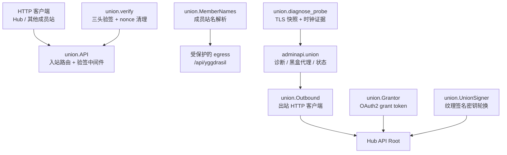
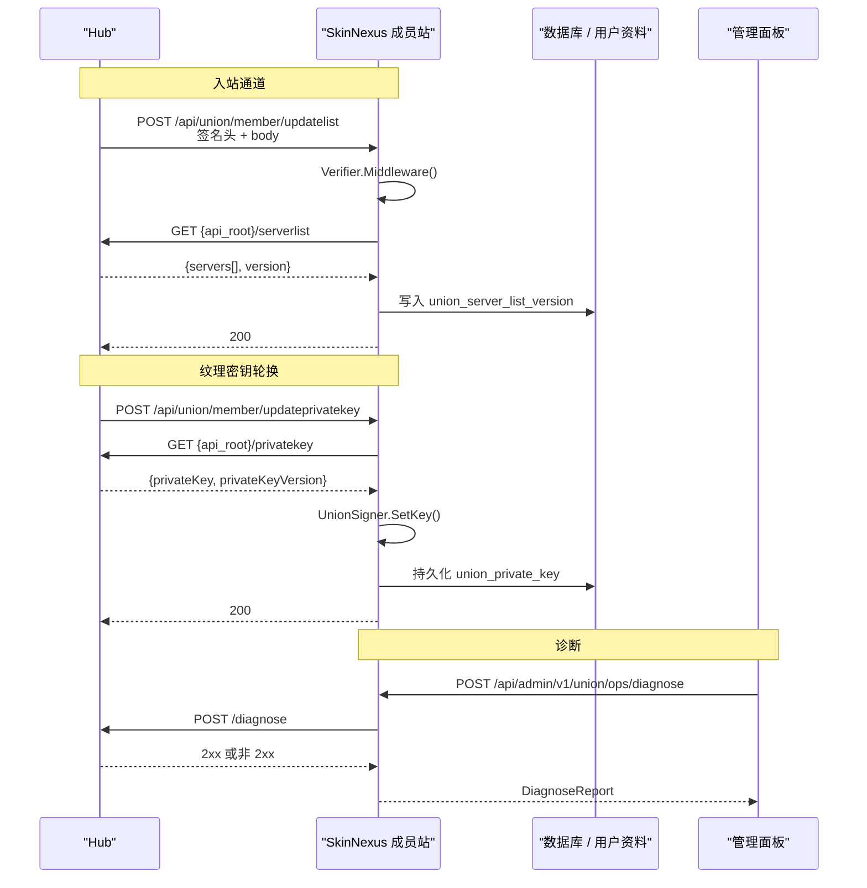
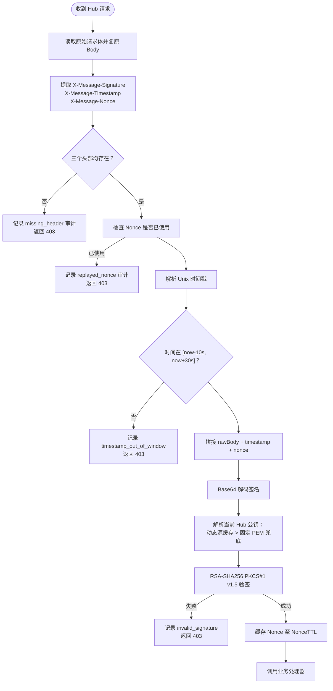
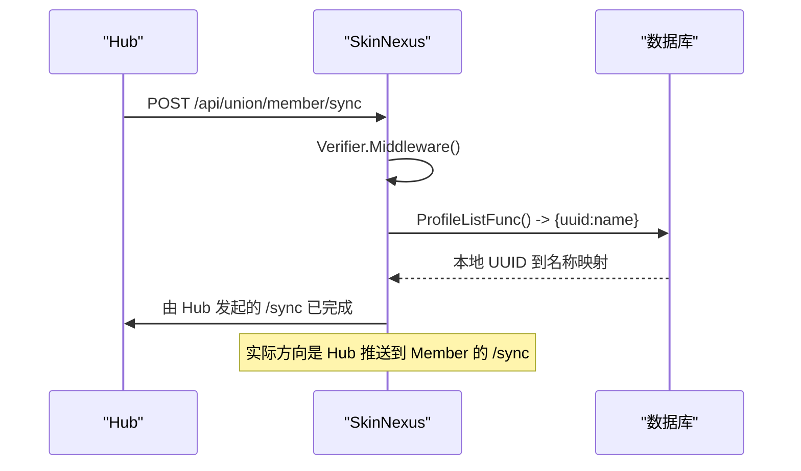
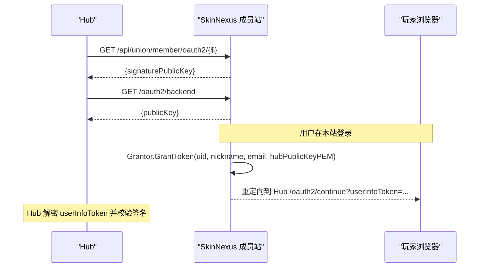
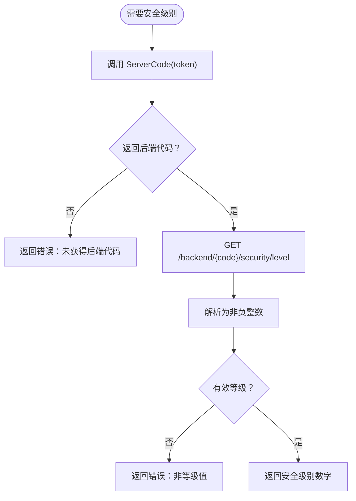
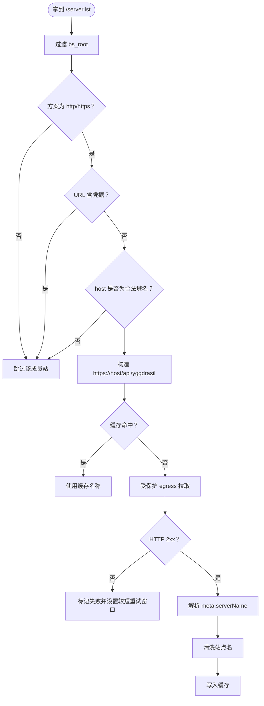
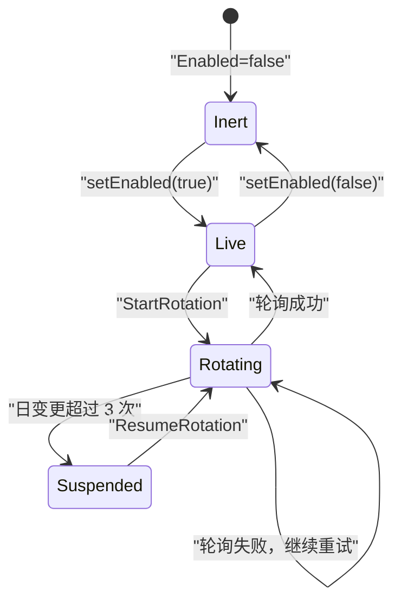
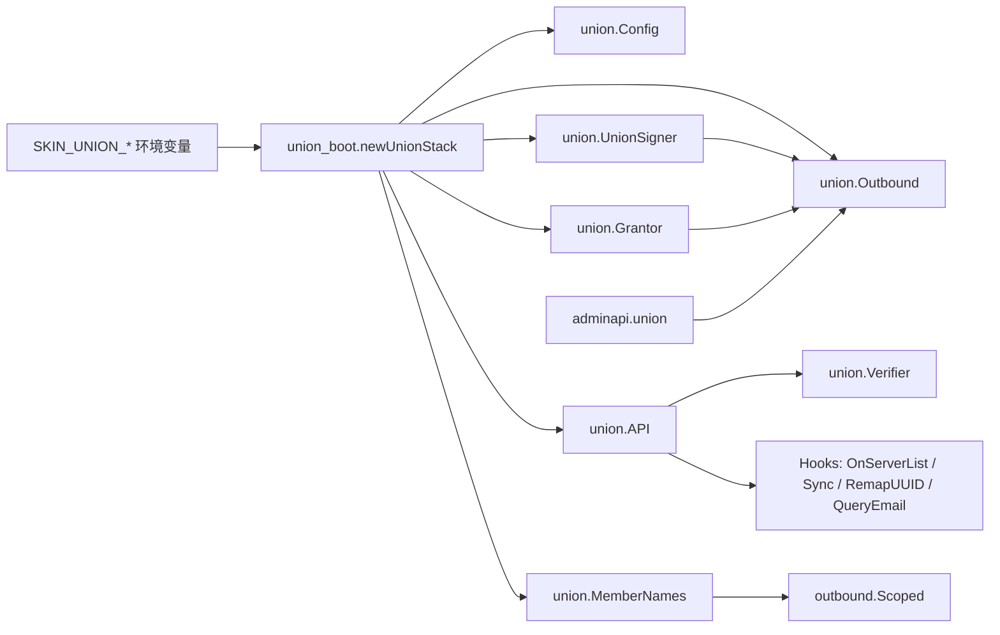

# MUA Union 成员站集成

**本文引用的文件**
- [config.go](https://github.com/YimingZhanshen/skin-nexus/blob/797ae1a/server/internal/union/config.go)
- [inbound.go](https://github.com/YimingZhanshen/skin-nexus/blob/797ae1a/server/internal/union/inbound.go)
- [outbound.go](https://github.com/YimingZhanshen/skin-nexus/blob/797ae1a/server/internal/union/outbound.go)
- [membernames.go](https://github.com/YimingZhanshen/skin-nexus/blob/797ae1a/server/internal/union/membernames.go)
- [oauth2grant.go](https://github.com/YimingZhanshen/skin-nexus/blob/797ae1a/server/internal/union/oauth2grant.go)
- [diagnose_probe.go](https://github.com/YimingZhanshen/skin-nexus/blob/797ae1a/server/internal/union/diagnose_probe.go)
- [signer.go](https://github.com/YimingZhanshen/skin-nexus/blob/797ae1a/server/internal/union/signer.go)
- [verify.go](https://github.com/YimingZhanshen/skin-nexus/blob/797ae1a/server/internal/union/verify.go)
- [env.go](https://github.com/YimingZhanshen/skin-nexus/blob/797ae1a/server/internal/config/env.go)
- [union_boot.go](https://github.com/YimingZhanshen/skin-nexus/blob/797ae1a/server/cmd/skin-nexus/union_boot.go)
- [union.go](https://github.com/YimingZhanshen/skin-nexus/blob/797ae1a/server/internal/adminapi/union.go)

## 目录
1. [引言](#引言)
2. [项目结构](#项目结构)
3. [核心组件](#核心组件)
4. [架构总览](#架构总览)
5. [详细组件分析](#详细组件分析)
6. [依赖关系分析](#依赖关系分析)
7. [性能与可扩展性](#性能与可扩展性)
8. [联调示例](#联调示例)
9. [故障排查指南](#故障排查指南)
10. [结论](#结论)

## 引言
本文件面向 SkinNexus 作为 MUA Union Hub 或成员站的集成人员，系统化说明联盟入站、出站、安全校验、OAuth2 grant、成员站名解析、热更新与非攻击面保障。重点包括：

- 入站请求经 `union.Inbound`（即 `API`）接收，通过三头验签确认来源合法性。
- 出站请求通过 `Outbound` 封装白名单域名、超时、响应大小等限制。
- 安全级别徽章由成员密钥换取后端代码后查询。
- 成员站名从 Hub 的 `/serverlist` 获取，缺失时异步向各成员站 `/api/yggdrasil` 拉取并缓存。
- Hub 签名公钥支持“每次现取 + 短缓存 + 固定公钥兜底”，Nonce 有清理协程。
- OAuth2 grant token 使用 HMAC-SHA256、RSA-SHA256 签名和 RSA-PKCS#1 v1.5 分块加密。
- 诊断探针返回兼容旧版 `triggerDiagnose` 结构，并附带 TLS 快照与时钟证据。

## 项目结构
Union 相关逻辑集中在 `server/internal/union`，启动装配在 `server/cmd/skin-nexus/union_boot.go`，环境变量清单在 `server/internal/config/env.go`，管理面板入口在 `server/internal/adminapi/union.go`。



**图表来源**
- [inbound.go:60-120](https://github.com/YimingZhanshen/skin-nexus/blob/797ae1a/server/internal/union/inbound.go#L60-L120)
- [outbound.go:20-120](https://github.com/YimingZhanshen/skin-nexus/blob/797ae1a/server/internal/union/outbound.go#L20-L120)
- [oauth2grant.go:20-60](https://github.com/YimingZhanshen/skin-nexus/blob/797ae1a/server/internal/union/oauth2grant.go#L20-L60)
- [signer.go:20-60](https://github.com/YimingZhanshen/skin-nexus/blob/797ae1a/server/internal/union/signer.go#L20-L60)
- [membernames.go:1-40](https://github.com/YimingZhanshen/skin-nexus/blob/797ae1a/server/internal/union/membernames.go#L1-L40)
- [verify.go:200-280](https://github.com/YimingZhanshen/skin-nexus/blob/797ae1a/server/internal/union/verify.go#L200-L280)
- [diagnose_probe.go:1-40](https://github.com/YimingZhanshen/skin-nexus/blob/797ae1a/server/internal/union/diagnose_probe.go#L1-L40)
- [union_boot.go:240-392](https://github.com/YimingZhanshen/skin-nexus/blob/797ae1a/server/cmd/skin-nexus/union_boot.go#L240-L392)
- [union.go:1-80](https://github.com/YimingZhanshen/skin-nexus/blob/797ae1a/server/internal/adminapi/union.go#L1-L80)

**章节来源**
- [union_boot.go:1-60](https://github.com/YimingZhanshen/skin-nexus/blob/797ae1a/server/cmd/skin-nexus/union_boot.go#L1-L60)
- [env.go:40-90](https://github.com/YimingZhanshen/skin-nexus/blob/797ae1a/server/internal/config/env.go#L40-L90)

## 核心组件
| 组件 | 职责 | 关键行为 |
|---|---|---|
| `Config` | Union 模块配置对象 | 校验 `ApiRoot`、`QueryEmailMode`；暴露 `requestTimeout()`、`hubOrigin()` |
| `API` | Hub→成员站入站路由 | 提供签名保护端点、自描述、OAuth2 签名密钥文档、中间件 |
| `Verifier` | 三头验签中间件 | 校验 `X-Message-Signature`、`X-Message-Timestamp`、`X-Message-Nonce` |
| `Outbound` | 成员站→Hub 出站客户端 | 携带 `X-Union-Member-Key`、超时、错误包装、诊断、安全级别、绑定流程 |
| `Grantor` | Union OAuth2 grant token 构建器 | HMAC+RSA 签名、分块 RSA 加密、CORS 受限的签名密钥端点 |
| `UnionSigner` | 纹理签名密钥管理器 | Hub 轮询、指纹比较、日变更预算、热切换本地/Hub 密钥 |
| `MemberNames` | 成员站名解析缓存 | 背景并发读取、TTL/FailTTL、端口与路径严格约束 |
| `DiagnoseReport` | 诊断结果 | 兼容旧版 `{status,data}`，新增 `cause`、`probe` |
| `unionStack` | SkinNexus 启动装配 | 选项优先、热开关、键对生成、审计写入、名称解析策略 |

**章节来源**
- [config.go:20-120](https://github.com/YimingZhanshen/skin-nexus/blob/797ae1a/server/internal/union/config.go#L20-L120)
- [inbound.go:20-120](https://github.com/YimingZhanshen/skin-nexus/blob/797ae1a/server/internal/union/inbound.go#L20-L120)
- [verify.go:20-120](https://github.com/YimingZhanshen/skin-nexus/blob/797ae1a/server/internal/union/verify.go#L20-L120)
- [outbound.go:20-120](https://github.com/YimingZhanshen/skin-nexus/blob/797ae1a/server/internal/union/outbound.go#L20-L120)
- [oauth2grant.go:20-120](https://github.com/YimingZhanshen/skin-nexus/blob/797ae1a/server/internal/union/oauth2grant.go#L20-L120)
- [signer.go:20-120](https://github.com/YimingZhanshen/skin-nexus/blob/797ae1a/server/internal/union/signer.go#L20-L120)
- [membernames.go:40-120](https://github.com/YimingZhanshen/skin-nexus/blob/797ae1a/server/internal/union/membernames.go#L40-L120)
- [diagnose_probe.go:20-60](https://github.com/YimingZhanshen/skin-nexus/blob/797ae1a/server/internal/union/diagnose_probe.go#L20-L60)
- [union_boot.go:60-120](https://github.com/YimingZhanshen/skin-nexus/blob/797ae1a/server/cmd/skin-nexus/union_boot.go#L60-L120)

## 架构总览
SkinNexus 同时承担两类角色：

- **成员站**：接收 Hub 的签名请求，执行同步、UUID 重映射、诊断、邮箱查询；主动调用 Hub 的 `/serverlist`、`/privatekey`、`/sync`、`/profile/*`、`/code`、`/backend/*/security/level`、`/oauth2/backend`、`/diagnose`。
- **Hub 侧服务提供方**：暴露 `/api/union/member/{self-description,oauth2}`，供 Hub 拉取签名密钥文档与跨站授权信息。



**图表来源**
- [inbound.go:120-200](https://github.com/YimingZhanshen/skin-nexus/blob/797ae1a/server/internal/union/inbound.go#L120-L200)
- [outbound.go:240-420](https://github.com/YimingZhanshen/skin-nexus/blob/797ae1a/server/internal/union/outbound.go#L240-L420)
- [signer.go:260-360](https://github.com/YimingZhanshen/skin-nexus/blob/797ae1a/server/internal/union/signer.go#L260-L360)
- [union_boot.go:280-360](https://github.com/YimingZhanshen/skin-nexus/blob/797ae1a/server/cmd/skin-nexus/union_boot.go#L280-L360)
- [union.go:120-180](https://github.com/YimingZhanshen/skin-nexus/blob/797ae1a/server/internal/adminapi/union.go#L120-L180)

## 详细组件分析

### 入站验签与安全边界
`API.Handler()` 将 Hub→成员的受保护端点全部挂到 `Verifier.Middleware` 上，未启用模块时返回全局 404，实现零攻击面。受保护端点包括：

- `POST /api/union/member/updatelist`
- `POST /api/union/member/updateprivatekey`
- `POST /api/union/member/updatebackendkey`
- `POST /api/union/member/sync`
- `POST /api/union/member/remapuuid`
- `POST /api/union/member/diagnose`
- `GET /api/union/member/queryemail`
- `POST /api/union/member/updateplugin`（保留占位）

公开端点无需签名：

- `GET /api/union/member` 与 `GET /api/union/member/{$}`：自描述
- `GET /api/union/member/oauth2/{$}`：成员站 OAuth2 签名公钥文档

验签过程如下：



**图表来源**
- [verify.go:200-381](https://github.com/YimingZhanshen/skin-nexus/blob/797ae1a/server/internal/union/verify.go#L200-L381)
- [inbound.go:60-120](https://github.com/YimingZhanshen/skin-nexus/blob/797ae1a/server/internal/union/inbound.go#L60-L120)

#### 三头参数与时间窗口
| 字段 | 值域或语义 | 失败后果 |
|---|---|---|
| `X-Message-Signature` | Hub 私钥对 `SHA256(rawBody + timestamp + nonce)` 的 RSA-SHA256 签名 Base64 | 缺少 → `missing_header`；无效 → `invalid_signature` |
| `X-Message-Timestamp` | Unix 秒 | 格式错误 → `malformed_timestamp`；越界 → `timestamp_out_of_window` |
| `X-Message-Nonce` | 单次随机数，进程内缓存 60 秒 | 重复 → `replayed_nonce` |

时间窗口常量：过去允许 10 秒偏差，未来允许 30 秒偏差；Nonce 生命周期为 60 秒。

#### Hub 公钥来源
默认实现采用“每次现取”语义：通过 `Outbound.HostPublicKey` 从 Hub 根地址获取 `union_host_signature_public_key`，并在 5 分钟内缓存；若动态获取失败且未配置固定 PEM，则验签失败；若存在上次成功缓存或固定 PEM，则回退使用，避免传输被劫持导致整个信任链崩溃。

**章节来源**
- [verify.go:20-120](https://github.com/YimingZhanshen/skin-nexus/blob/797ae1a/server/internal/union/verify.go#L20-L120)
- [verify.go:200-381](https://github.com/YimingZhanshen/skin-nexus/blob/797ae1a/server/internal/union/verify.go#L200-L381)
- [outbound.go:300-360](https://github.com/YimingZhanshen/skin-nexus/blob/797ae1a/server/internal/union/outbound.go#L300-L360)
- [union_boot.go:320-360](https://github.com/YimingZhanshen/skin-nexus/blob/797ae1a/server/cmd/skin-nexus/union_boot.go#L320-L360)

### 成员站注册与 Hub 数据同步
成员站注册不是单步动作，而是由 Hub 驱动、成员站被动接受的数据流：

1. Hub 调用 `POST /api/union/member/updatelist`，成员站拉取 `/serverlist`，回调 `OnServerList` 持久化版本并计算 `union_skin_domains`。
2. Hub 调用 `POST /api/union/member/updateprivatekey`，成员站拉取 `/privatekey`，通过 `UnionSigner.SetKey` 激活新纹理签名密钥。
3. Hub 可调用 `POST /api/union/member/updatebackendkey` 推送新的成员密钥，但默认拒绝远程改写，需要显式开启 `AllowUpdateBackendKey`。
4. Hub 调用 `POST /api/union/member/sync` 上传 `{uuid:name}` 列表，成员站通过 `ProfileListFunc` 提供本地资料映射。
5. Hub 调用 `POST /api/union/member/remapuuid` 批量迁移 UUID，成员站通过 `OnRemapUUID` 应用并重写内部 ID。



**图表来源**
- [inbound.go:120-200](https://github.com/YimingZhanshen/skin-nexus/blob/797ae1a/server/internal/union/inbound.go#L120-L200)
- [union_boot.go:300-340](https://github.com/YimingZhanshen/skin-nexus/blob/797ae1a/server/cmd/skin-nexus/union_boot.go#L300-L340)

**章节来源**
- [inbound.go:120-200](https://github.com/YimingZhanshen/skin-nexus/blob/797ae1a/server/internal/union/inbound.go#L120-L200)
- [union_boot.go:280-340](https://github.com/YimingZhanshen/skin-nexus/blob/797ae1a/server/cmd/skin-nexus/union_boot.go#L280-L340)

### 出站安全限制与典型操作
`Outbound` 是成员站访问 Hub 的唯一出站封装，所有方法都遵循相同模式：

- 启用检查：模块关闭时直接返回 `ErrDisabled`。
- 成员密钥：每个请求携带 `X-Union-Member-Key`。
- 超时：默认 5 秒，可通过 `RequestTimeout` 覆盖；诊断专用 10 秒。
- 非 2xx：包装为 `APIError`，包含方法、路径、状态码、响应头与原始体。
- 访问日志：可选输出 `union_out` 行，区分传输错误、上游失败与成功。
- 响应大小：最大缓冲 8 MiB，超过长度继续读一次字节后截断判断。

典型出站操作：

| 场景 | 方法 | 路径 | 输入 | 输出 |
|---|---|---|---|---|
| 拉取成员站列表 | `GET` | `/serverlist` | 无 | `ServerList{servers[], version}` |
| 拉取纹理私钥 | `GET` | `/privatekey` | 无 | `PrivateKeyDoc{privateKey, privateKeyVersion}` |
| 同步资料 | `POST` | `/sync` | `{profileList:{uuid:name}}` | 空 2xx |
| 创建/改名/删除资料 | `POST/PUT/DELETE` | `/profile` 及资源路径 | uuid/name | 空 2xx |
| 开始绑定 | `POST` | `/profile/bind` | `{uuid}` | `{token}` |
| 完成绑定 | `POST` | `/profile/bindto` | `{uuid,token}` | 空 2xx |
| 解绑 | `POST` | `/profile/unbind` | `{uuid}` | 空 2xx |
| UUID 重映射 | `POST` | `/profile/remapuuid` | `{me,target}` | 空 2xx |
| 查询冲突用户名 | `GET` | `/profile/unmapped/byname/{name}` | name | `[]UnmappedProfile` |
| 查询绑定详情 | `GET` | `/profile/detail/{uuid}` | uuid | `ProfileDetail` |
| 交换安全级别代码 | `POST` | `/code` | `{token}` | `{code}` |
| 查询安全级别 | `GET` | `/backend/{code}/security/level` | code | 数字 |
| 获取 OAuth2 后端公钥 | `GET` | `/oauth2/backend` | 无 | `{publicKey}` |
| 诊断连通性 | `POST` | `/diagnose` | 空 JSON | `DiagnoseReport` |
| 黑名单代理 | `GET/PUT/DELETE` | `/blacklist/*` | 透传 | 透传状态码与正文 |

**章节来源**
- [outbound.go:20-120](https://github.com/YimingZhanshen/skin-nexus/blob/797ae1a/server/internal/union/outbound.go#L20-L120)
- [outbound.go:240-620](https://github.com/YimingZhanshen/skin-nexus/blob/797ae1a/server/internal/union/outbound.go#L240-L620)

### OAuth2 Grant Token 交互时序
Union OAuth2 grant token 由成员站为已登录用户构造，再交给 Hub 解密与验证。流程如下：

1. Hub 先调用 `GET /api/union/member/oauth2/{$}` 获取成员站 RSA 签名公钥，CORS 限制到 Hub origin。
2. Hub 调用 `GET /oauth2/backend` 获取 Hub 自身 RSA 加密公钥。
3. 成员站使用自己的签名私钥和成员密钥计算 HMAC，再对 userInfo 文档做 RSA-SHA256 签名。
4. 将 `{userInfo, mac, signature}` 用 Hub 公钥进行 PKCS#1 v1.5 分块加密，得到 `userInfoToken`。
5. 将用户重定向到 Hub 的 continue URL，第一个参数必须是 `userInfoToken`。



**图表来源**
- [oauth2grant.go:20-120](https://github.com/YimingZhanshen/skin-nexus/blob/797ae1a/server/internal/union/oauth2grant.go#L20-L120)
- [oauth2grant.go:200-304](https://github.com/YimingZhanshen/skin-nexus/blob/797ae1a/server/internal/union/oauth2grant.go#L200-L304)

#### Grant Token 组成
| 步骤 | 内容 | 目的 |
|---|---|---|
| userInfo | Base64 编码的 `{uid, nickname, email, expires_at}` | 传递用户身份，有效期 600 秒 |
| mac | `hex(HMAC-SHA256(member_key, userInfoBase64))` | 绑定成员密钥，防止伪造 userInfo |
| signature | Base64(RSA-SHA256 签名 userInfoBase64 + "." + mac) | 证明签名来自成员站自有私钥 |
| token | RSA-PKCS#1 v1.5 分块加密后的整体 JSON | 仅 Hub 可用其私钥解密 |

**章节来源**
- [oauth2grant.go:20-200](https://github.com/YimingZhanshen/skin-nexus/blob/797ae1a/server/internal/union/oauth2grant.go#L20-L200)
- [oauth2grant.go:200-304](https://github.com/YimingZhanshen/skin-nexus/blob/797ae1a/server/internal/union/oauth2grant.go#L200-L304)

### 安全级别徽章计算
安全级别不是本地静态值，而是两步查询：

1. 使用当前成员密钥调用 `POST /code`，换取后端短代码。
2. 调用 `GET /backend/{code}/security/level`，返回一个非负整数。

如果 Hub 返回空代码或无法解析为数字，函数返回错误而不是默认为 0，因为 0 是合法等级（不在黑名单）。前端据此显示徽章。



**图表来源**
- [outbound.go:420-520](https://github.com/YimingZhanshen/skin-nexus/blob/797ae1a/server/internal/union/outbound.go#L420-L520)

**章节来源**
- [outbound.go:420-520](https://github.com/YimingZhanshen/skin-nexus/blob/797ae1a/server/internal/union/outbound.go#L420-L520)

### 成员站名解析规则
Hub 的 `/serverlist` 中 `name` 字段在当前实现下为空，因此成员站名需要 SkinNexus 主动从各成员站拉取。

解析规则：

- 只读取 Hub 提供的 `bs_root`。
- 只允许 `http` 或 `https` 方案。
- 不允许 URL 中包含用户名密码。
- 不允许 IP 字面量。
- 目标路径固定为 `/api/yggdrasil`。
- 从返回体中读取 `meta.serverName`。
- 对站点名进行清洗：移除控制字符、合并连续空格、最多 120 个可见字符。
- 结果按主机缓存，默认 TTL 24 小时，失败重试窗口 30 分钟。
- 并发 worker 默认 6 个，整体 sweep 超时默认 90 秒。
- 通过 `outbound.Scoped` 访问第三方站点，禁止重定向、限制端口 80/443、限制响应体、限制每主机速率。



**图表来源**
- [membernames.go:40-120](https://github.com/YimingZhanshen/skin-nexus/blob/797ae1a/server/internal/union/membernames.go#L40-L120)
- [membernames.go:200-351](https://github.com/YimingZhanshen/skin-nexus/blob/797ae1a/server/internal/union/membernames.go#L200-L351)

**章节来源**
- [membernames.go:1-40](https://github.com/YimingZhanshen/skin-nexus/blob/797ae1a/server/internal/union/membernames.go#L1-L40)
- [membernames.go:40-120](https://github.com/YimingZhanshen/skin-nexus/blob/797ae1a/server/internal/union/membernames.go#L40-L120)
- [membernames.go:200-351](https://github.com/YimingZhanshen/skin-nexus/blob/797ae1a/server/internal/union/membernames.go#L200-L351)
- [union_boot.go:360-392](https://github.com/YimingZhanshen/skin-nexus/blob/797ae1a/server/cmd/skin-nexus/union_boot.go#L360-L392)

### Hot-mode 热更新与 Nonce 清理协程
SkinNexus 的 Union 模块在启动时就构造出完整对象栈，真正的“禁用”表现为每请求 404 与快速失败：

- `setEnabled(true/false)` 同时修改：
  - `unionStack.on`
  - `Outbound.SetEnabled`
  - `UnionSigner.SetHubMode`
- 开启时启动签名密钥轮询协程。
- 关闭时不再拉取 Hub 密钥，也不再用 Hub 密钥签名。
- `updatebackendkey` 旋转成员密钥时，`Outbound` 与 `Grantor` 同步原子替换。
- Nonce 清理协程以 30 秒间隔运行，直到启动上下文结束；同时写入时也懒清理，避免长驻进程内存无限增长。



**图表来源**
- [union_boot.go:80-120](https://github.com/YimingZhanshen/skin-nexus/blob/797ae1a/server/cmd/skin-nexus/union_boot.go#L80-L120)
- [signer.go:260-444](https://github.com/YimingZhanshen/skin-nexus/blob/797ae1a/server/internal/union/signer.go#L260-L444)
- [verify.go:280-381](https://github.com/YimingZhanshen/skin-nexus/blob/797ae1a/server/internal/union/verify.go#L280-L381)

**章节来源**
- [union_boot.go:80-120](https://github.com/YimingZhanshen/skin-nexus/blob/797ae1a/server/cmd/skin-nexus/union_boot.go#L80-L120)
- [signer.go:260-444](https://github.com/YimingZhanshen/skin-nexus/blob/797ae1a/server/internal/union/signer.go#L260-L444)
- [verify.go:280-381](https://github.com/YimingZhanshen/skin-nexus/blob/797ae1a/server/internal/union/verify.go#L280-L381)

### 诊断探针返回结构
诊断端点返回兼容旧版 `triggerDiagnose` 的结构：

| 字段 | 类型 | 含义 |
|---|---|---|
| `status` | `"ok"` 或 `"error"` | 连接与 Hub 响应的总体状态 |
| `data` | JSON 原文或错误体 | 成功时为 Hub 返回体；失败时为 `{status_code, headers, body}` 或 `{exception}` |
| `cause` | 字符串 | 稳定原因词，例如传输错误、Hub 非 2xx、模块禁用 |
| `probe.tls` | 对象或空 | 成员站到 Hub 的实际 TLS 握手信息 |
| `probe.clock` | 对象或空 | Hub `Date` 头与本地时间的偏移 |

TLS 快照包含：

- `version`：TLS 协议版本名称
- `cipher`：密码套件名称
- `cert_subject`：证书主题
- `cert_issuer`：证书颁发者
- `cert_not_after`：过期时间 RFC3339
- `cert_days_left`：剩余天数

时钟证据包含：

- `hub_clock`：Hub `Date` 头原始值
- `offset_seconds`：Hub 时间减本地时间
- `within_window`：是否在 `[−10s, +30s]` 范围内

**章节来源**
- [outbound.go:420-520](https://github.com/YimingZhanshen/skin-nexus/blob/797ae1a/server/internal/union/outbound.go#L420-L520)
- [diagnose_probe.go:1-99](https://github.com/YimingZhanshen/skin-nexus/blob/797ae1a/server/internal/union/diagnose_probe.go#L1-L99)
- [union.go:140-180](https://github.com/YimingZhanshen/skin-nexus/blob/797ae1a/server/internal/adminapi/union.go#L140-L180)

### 典型使用场景

#### 多站共享账号
- 通过 Hub 的 `/profile/bind` 和 `/profile/bindto` 建立主账户与子站账户关联。
- 通过 `/profile/remapuuid` 迁移 UUID，确保联盟内同一玩家在不同站点的 ID 一致。
- 通过 `/sync` 同步 `uuid:name` 列表，使 Hub 掌握成员站的用户映射。

#### 跨站皮肤引用
- Hub 推送 `/serverlist`，成员站将 `bs_root` 中的主机加入 `union_skin_domains`。
- Hub 推送 `/privatekey`，成员站使用 `UnionSigner` 签发纹理属性值。
- 管理员可在管理面板刷新服务器列表、触发密钥轮换、查看指纹与版本。

#### 联盟治理
- 通过黑名单代理接口查询、添加、释放或删除黑名单条目。
- 通过诊断端点观察 Hub 连通性、TLS 证书状态、时钟偏差。
- 通过安全级别查询决定是否允许跨站绑定、角色同步、头像共享等敏感操作。

[本节为概念性总结，不直接分析具体源码行]

## 依赖关系分析



**图表来源**
- [env.go:60-90](https://github.com/YimingZhanshen/skin-nexus/blob/797ae1a/server/internal/config/env.go#L60-L90)
- [union_boot.go:240-392](https://github.com/YimingZhanshen/skin-nexus/blob/797ae1a/server/cmd/skin-nexus/union_boot.go#L240-L392)
- [inbound.go:20-120](https://github.com/YimingZhanshen/skin-nexus/blob/797ae1a/server/internal/union/inbound.go#L20-L120)
- [membernames.go:1-40](https://github.com/YimingZhanshen/skin-nexus/blob/797ae1a/server/internal/union/membernames.go#L1-L40)
- [union.go:1-80](https://github.com/YimingZhanshen/skin-nexus/blob/797ae1a/server/internal/adminapi/union.go#L1-L80)

**章节来源**
- [union_boot.go:240-392](https://github.com/YimingZhanshen/skin-nexus/blob/797ae1a/server/cmd/skin-nexus/union_boot.go#L240-L392)
- [env.go:60-90](https://github.com/YimingZhanshen/skin-nexus/blob/797ae1a/server/internal/config/env.go#L60-L90)

## 性能与可扩展性

| 维度 | 实现特征 | 影响与建议 |
|---|---|---|
| 入站验签 | 先读体、再查 nonce、再查时间窗口、最后 RSA 验签 | 与旧实现顺序一致；避免重复解密和额外复制 |
| Nonce 缓存 | 进程内 map，TTL 60 秒，懒清理 + 定时清理 | 长期空闲站点可能积累非活跃项，建议保持 30 秒调度器运行 |
| Hub 公钥缓存 | 5 分钟缓存，失败回退固定 PEM | 适合 Hub 密钥低频轮换；频繁轮换需关注缓存失效成本 |
| 纹理密钥轮换 | 10-15 分钟基础间隔 + 抖动，指纹变化才切换 | 减少不必要重启和签名不一致风险 |
| 成员站名解析 | 默认 6 worker，24 小时 TTL，失败 30 分钟 | 大量成员站时注意 Hub 列表大小；可关闭名称解析降低外部出站 |
| 诊断请求 | 10 秒专用超时，8 MiB 响应上限 | 前端 15 秒 fetch 留出余量；过大响应会触发上限而非死读 |
| 出站客户端 | 原子 key/root、超时、AccessLog | 高并发安全；生产环境建议接入统一 accesslog |

[本节为通用性能讨论，不直接分析具体源码行]

## 联调示例

### 模拟成员站签名请求
要模拟 Hub 向成员站发送受保护请求，需构造以下请求头：

- `X-Message-Signature`：Hub 私钥对 `rawBody + timestamp + nonce` 的 RSA-SHA256 签名 Base64。
- `X-Message-Timestamp`：当前 Unix 秒，误差需在 −10 到 +30 秒之间。
- `X-Message-Nonce`：本次请求唯一随机串。
- `Content-Type`：根据实际端点设置，通常为 `application/json`。

调试要点：

- 若返回 403 且错误消息为联盟主机校验失败，应优先检查签名算法、拼接顺序、时间戳和 Nonce。
- 检查 audit 日志中 `union.verify.*` 事件，区分 `missing_header`、`replayed_nonce`、`timestamp_out_of_window`、`invalid_signature`。
- 若成员站启用了动态 Hub 公钥源，还需确认 Hub 根地址能返回 `union_host_signature_public_key`。

**章节来源**
- [verify.go:200-381](https://github.com/YimingZhanshen/skin-nexus/blob/797ae1a/server/internal/union/verify.go#L200-L381)
- [union_boot.go:320-360](https://github.com/YimingZhanshen/skin-nexus/blob/797ae1a/server/cmd/skin-nexus/union_boot.go#L320-L360)

### curl 调用诊断端点
浏览器管理面板使用管理员会话调用该诊断接口。无 Cookie 机器/API 客户端也可调用同一端点：

```bash
# 仅脚本/外部工具使用：不要发送 skin_session Cookie。
curl -H "X-Admin-Token: $SKIN_ADMIN_TOKEN" \
     -H "Content-Type: application/json" \
     -X POST "<SkinNexus 地址>/api/admin/v1/union/ops/diagnose"
```

预期响应包含：

- `status`：`ok` 或 `error`
- `data`：Hub 原始返回或错误体
- `cause`：原因标签
- `probe.tls`：TLS 版本、密码套件、证书信息
- `probe.clock`：Hub 时间与本地时间偏移
- `key_fingerprint`：当前纹理签名密钥指纹
- `private_key_version`：Hub 私有密钥版本
- `server_list_version`：成员站列表版本

**章节来源**
- [union.go:140-180](https://github.com/YimingZhanshen/skin-nexus/blob/797ae1a/server/internal/adminapi/union.go#L140-L180)
- [outbound.go:420-520](https://github.com/YimingZhanshen/skin-nexus/blob/797ae1a/server/internal/union/outbound.go#L420-L520)
- [diagnose_probe.go:20-99](https://github.com/YimingZhanshen/skin-nexus/blob/797ae1a/server/internal/union/diagnose_probe.go#L20-L99)

### 观察 audit 日志
SkinNexus 将 Union 安全事件写入两个位置：

1. 标准日志：`union audit: <event> <detail>`。
2. 审计表：通过 `InsertAudit` 写入 `union.<event>` 分类。

常见审计事件：

- `union.verify.missing_header`
- `union.verify.replayed_nonce`
- `union.verify.timestamp_out_of_window`
- `union.verify.invalid_signature`
- `union.updatelist.updated`
- `union.updateprivatekey.updated`
- `union.updateprivatekey.rejected`
- `union.signer.rotation.switched`
- `union.signer.rotation.suspended`
- `union_remapuuid_detail`

**章节来源**
- [union_boot.go:300-360](https://github.com/YimingZhanshen/skin-nexus/blob/797ae1a/server/cmd/skin-nexus/union_boot.go#L300-L360)
- [verify.go:200-320](https://github.com/YimingZhanshen/skin-nexus/blob/797ae1a/server/internal/union/verify.go#L200-L320)
- [signer.go:300-444](https://github.com/YimingZhanshen/skin-nexus/blob/797ae1a/server/internal/union/signer.go#L300-L444)

## 故障排查指南

| 故障现象 | 可能原因 | 排查步骤 |
|---|---|---|
| 验签失败 | 签名头缺失、Nonce 重复、时间戳越界、Hub 公钥错误、签名算法不匹配 | 检查三个签名头；核对时间；确认 Hub 根地址与固定 PEM；查看 `union.verify.*` 审计事件 |
| `memberNames` 为空 | Hub 返回 `name` 为空；成员站 `/api/yggdrasil` 不可达；名称解析被关闭 | 检查 `/serverlist`；确认成员站 discovery 文档返回 `meta.serverName`；检查 `union_resolve_names` |
| 安全级别不匹配 | 成员密钥无效、Hub 返回空 code、Hub 返回非数字等级 | 调用诊断端点；检查 `/code` 返回值；确认 Hub 安全级别接口返回非负整数 |
| 出站 TLS 错误 | Hub 证书过期、TLS 版本不兼容、DNS 解析异常、证书链不完整 | 查看诊断响应中 `probe.tls.cert_not_after` 与 `cert_days_left`；检查系统证书库 |
| Hub 不可达 | DNS、网络、防火墙、超时配置不当 | 检查 `SKIN_UNION_API_ROOT`；确认诊断 `cause`；查看 `union_out` 访问日志 |
| Hub 签名公钥不可用 | Hub 根地址无 `union_host_signature_public_key`；动态获取失败；固定 PEM 缺失 | 确认 Hub 根端点；检查固定 PEM 文件路径；查看 `union.verify` 中 hub key unavailable 类错误 |
| OAuth2 按钮不可用 | `UnionOAuth2` 关闭；模块整体关闭；签名密钥对缺失 | 检查 `union_enable_oauth2`；检查 `union_enabled`；检查 `union_oauth2_sig_private_key/public_key` |
| 纹理签名密钥未生效 | 轮换被暂停；模块关闭；Hub 未推送新密钥 | 检查 `RotationSuspended`；调用强制轮换；查看 `union.signer.rotation.suspended` |
| 成员密钥旋转被拒绝 | `AllowUpdateBackendKey` 未开启 | 确认配置 `union_enable_updatebackendkey`；谨慎评估安全风险 |

**章节来源**
- [verify.go:200-381](https://github.com/YimingZhanshen/skin-nexus/blob/797ae1a/server/internal/union/verify.go#L200-L381)
- [outbound.go:420-620](https://github.com/YimingZhanshen/skin-nexus/blob/797ae1a/server/internal/union/outbound.go#L420-L620)
- [oauth2grant.go:200-304](https://github.com/YimingZhanshen/skin-nexus/blob/797ae1a/server/internal/union/oauth2grant.go#L200-L304)
- [signer.go:260-444](https://github.com/YimingZhanshen/skin-nexus/blob/797ae1a/server/internal/union/signer.go#L260-L444)
- [union_boot.go:240-392](https://github.com/YimingZhanshen/skin-nexus/blob/797ae1a/server/cmd/skin-nexus/union_boot.go#L240-L392)

## 结论
SkinNexus 的 Union 集成通过清晰分离的入站验签、出站封装、OAuth2 grant、纹理密钥轮换和成员站名解析，实现了 Hub 与成员站之间的可信联邦。安全决策围绕三个层面展开：

- 入站：三头验签、Nonce 防重放、时间窗口、Hub 公钥动态源加固定 PEM 兜底。
- 出站：成员密钥、超时、响应大小、白名单域名与端口限制。
- 治理：安全级别、黑名单代理、诊断探针、审计日志与热开关。

集成时应优先确保 Hub 根地址、成员密钥、OAuth2 签名密钥对、Hub 签名公钥源与 `SKIN_UNION_*` 配置正确，再通过诊断端点和 audit 日志验证端到端连通性与安全性。对于高风险操作，如成员密钥远程旋转、黑名单释放与删除，应配合管理面板二次确认与审计记录。
