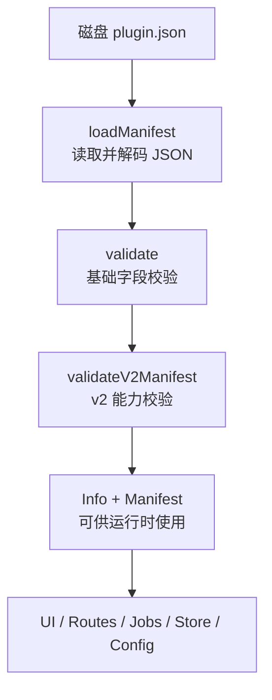
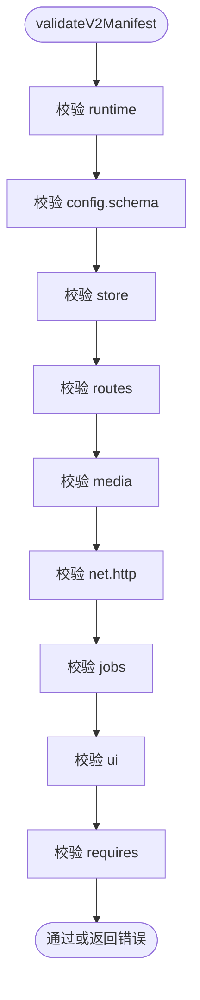
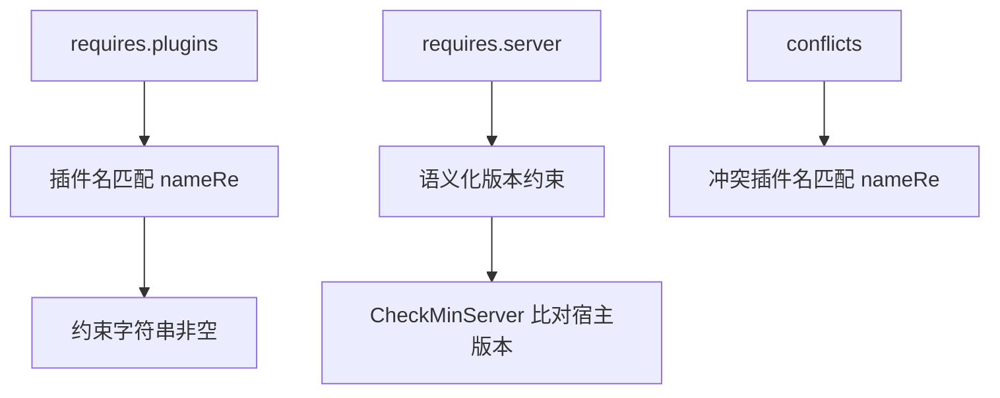
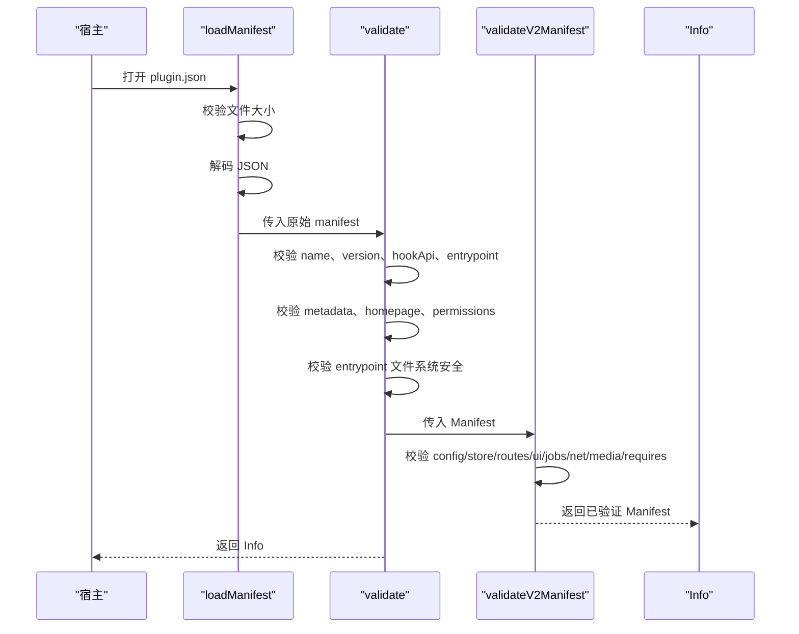
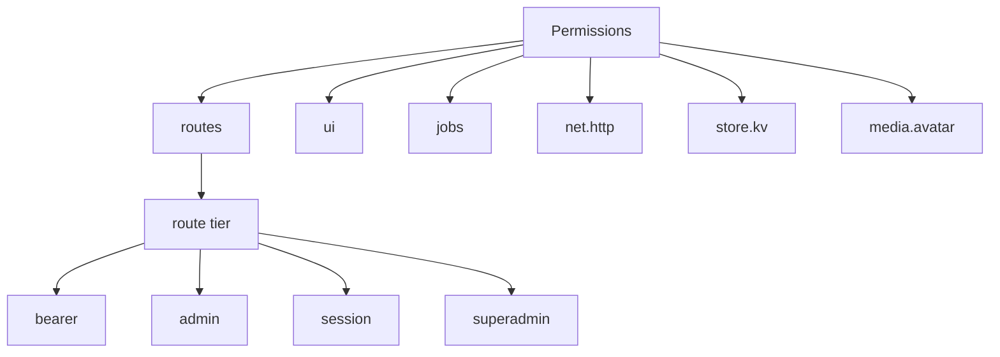

# Manifest v2 规范

**本文引用的文件**
- [manifest.go](https://github.com/YimingZhanshen/skin-nexus/blob/797ae1a/server/internal/plugin/manifest.go)
- [spec.go](https://github.com/YimingZhanshen/skin-nexus/blob/797ae1a/server/internal/plugin/spec.go)
- [hello-world plugin.json](https://github.com/YimingZhanshen/skin-nexus/blob/797ae1a/examples/plugins/hello-world/plugin.json)
- [hello-ui plugin.json](https://github.com/YimingZhanshen/skin-nexus/blob/797ae1a/examples/plugins/hello-ui/plugin.json)
- [jobs-fixture plugin.json](https://github.com/YimingZhanshen/skin-nexus/blob/797ae1a/examples/plugins/jobs-fixture/plugin.json)

## 目录

1. [引言](#引言)
2. [项目结构定位](#项目结构定位)
3. [核心数据结构与解析入口](#核心数据结构与解析入口)
4. [字段规范总览](#字段规范总览)
5. [三个示例插件对比](#三个示例插件对比)
6. [版本语义化与 require 兼容范围](#版本语义化与-require-兼容范围)
7. [向后兼容策略](#向后兼容策略)
8. [Manifest 校验失败的常见原因](#manifest-校验失败的常见原因)
9. [架构与数据流](#架构与数据流)
10. [结论](#结论)

## 引言

本文面向插件开发者，说明 SkinNexus 的 Manifest v2 规范。Manifest v2 通过 `plugin.json` 声明插件元信息、权限、路由、用户界面、后台任务、配置模式、外部依赖和冲突关系；服务器在加载插件时解析该文件并执行严格校验，再决定是否允许安装或启用。

本规范基于以下事实：

- 根级 manifest 类型定义在 `server/internal/plugin/manifest.go` 中。
- 字段级类型、常量、校验逻辑集中在 `server/internal/plugin/spec.go` 中。
- 三个官方示例位于 `examples/plugins/`，分别演示最小可用插件、带 UI 插槽插件、带后台任务和路由的插件。

## 项目结构定位

Manifest v2 相关代码主要位于 `server/internal/plugin` 目录：

| 文件 | 职责 |
|---|---|
| `manifest.go` | 读取磁盘上的 `plugin.json`，校验大小、名称、目录名、入口脚本等基础约束，并将原始结构转为内部 `Info` 与 `Manifest`。 |
| `spec.go` | 定义所有 v2 manifest 子结构（如 `RouteSpec`、`UISpec`、`JobSpec`、`ConfigSpec`、`RequiresSpec`），并实现详细校验函数。 |
| `examples/plugins/*/plugin.json` | 展示不同能力的 manifest 写法。 |

**图示来源**
- [manifest.go:74-118](https://github.com/YimingZhanshen/skin-nexus/blob/797ae1a/server/internal/plugin/manifest.go#L74-L118)
- [manifest.go:201-233](https://github.com/YimingZhanshen/skin-nexus/blob/797ae1a/server/internal/plugin/manifest.go#L201-L233)
- [spec.go:200-218](https://github.com/YimingZhanshen/skin-nexus/blob/797ae1a/server/internal/plugin/spec.go#L200-L218)

**章节来源**
- [manifest.go:1-118](https://github.com/YimingZhanshen/skin-nexus/blob/797ae1a/server/internal/plugin/manifest.go#L1-L118)
- [spec.go:1-218](https://github.com/YimingZhanshen/skin-nexus/blob/797ae1a/server/internal/plugin/spec.go#L1-L218)

## 核心数据结构与解析入口

### 根级 manifestFile 与 Info

`manifestFile` 是磁盘上 `plugin.json` 的直接映射，包含 name、version、hookApi、entrypoint、permissions、minServer、runtime、config、store、routes、ui、net、jobs、media、requires、conflicts，以及可选的 title、author、homepage、description。

`Info` 是加载成功后的结果对象，既包含已验证的 `Manifest`，也包含 host 启动运行时所需的目录、脚本路径和脚本大小。

关键字段解析行为如下：

| 字段 | 必填性 | 默认值 | 约束与行为 |
|---|---:|---|---|
| `name` | 必填 | 无 | 必须等于插件所在目录名；匹配 `^[a-z0-9][a-z0-9_-]{1,63}$`。 |
| `version` | 必填 | 无 | 非空字符串，长度不超过 64。 |
| `hookApi` | 必填 | 无 | 当前只接受 `HookAPIVersion`，即 v2；不匹配会报错。 |
| `entrypoint` | 必填 | 无 | 必须以 `.js` 结尾，匹配 `^[A-Za-z0-9._-]+\.js$`；必须是插件目录内的普通文件，不能是符号链接，且不能超过 1 MiB。 |
| `title` | 可选 | 空字符串 | 可选元数据，最大 128 字符。 |
| `author` | 可选 | 空字符串 | 可选元数据，最大 64 字符。 |
| `homepage` | 可选 | 空字符串 | 若提供，必须是 `http://` 或 `https://` 开头的 URL，最大 256 字符。 |
| `description` | 可选 | 空字符串 | 可选元数据，最大 512 字符。 |
| `permissions` | 可选 | 空数组 | 白名单权限；重复项会被去重，未知权限直接拒绝。 |
| `runtime` | 可选 | `goja` | 当前仅支持 `goja`。 |
| `minServer` | 可选 | 空字符串 | 由 `CheckMinServer` 用语义化版本约束判断是否满足宿主版本。 |
| `config` | 可选 | 无 | 需为 `object` 类型的 JSON Schema。 |
| `store` | 可选 | 无 | 可声明 KV 与集合上限。 |
| `routes` | 可选 | 空数组 | 最多 32 条；每条有方法、路径、tier、限速、体限制、CSRF、编码、超时校验。 |
| `ui` | 可选 | 无 | 最多 32 个页面、32 个插槽；iframe 需要 `ui.assets`。 |
| `net` | 可选 | 无 | 声明出站 HTTP 白名单。 |
| `jobs` | 可选 | 空数组 | 最多 8 个；声明持久化任务处理器。 |
| `media` | 可选 | 无 | 声明头像重定向主机。 |
| `requires` | 可选 | 无 | 声明所需插件与服务端版本。 |
| `conflicts` | 可选 | 空数组 | 声明冲突插件。 |

**章节来源**
- [manifest.go:23-45](https://github.com/YimingZhanshen/skin-nexus/blob/797ae1a/server/internal/plugin/manifest.go#L23-L45)
- [manifest.go:52-63](https://github.com/YimingZhanshen/skin-nexus/blob/797ae1a/server/internal/plugin/manifest.go#L52-L63)
- [manifest.go:74-118](https://github.com/YimingZhanshen/skin-nexus/blob/797ae1a/server/internal/plugin/manifest.go#L74-L118)
- [manifest.go:120-200](https://github.com/YimingZhanshen/skin-nexus/blob/797ae1a/server/internal/plugin/manifest.go#L120-L200)
- [manifest.go:201-233](https://github.com/YimingZhanshen/skin-nexus/blob/797ae1a/server/internal/plugin/manifest.go#L201-L233)

### v2 主校验入口

`validateV2Manifest` 是 v2 manifest 的主校验入口，它依次校验 runtime、config、store、routes、media、net、jobs、ui、requires。只有全部通过后，插件才能被视作合法 manifest。

**图示来源**
- [spec.go:200-218](https://github.com/YimingZhanshen/skin-nexus/blob/797ae1a/server/internal/plugin/spec.go#L200-L218)

**章节来源**
- [spec.go:200-218](https://github.com/YimingZhanshen/skin-nexus/blob/797ae1a/server/internal/plugin/spec.go#L200-L218)

## 字段规范总览

### name

- **含义**：插件标识符。
- **必填**：是。
- **默认值**：无。
- **约束**：
  - 必须与插件目录名一致。
  - 匹配正则 `^[a-z0-9][a-z0-9_-]{1,63}$`。
  - 同时用于 required plugins 与 conflicts 的名称校验。

**章节来源**
- [manifest.go:120-133](https://github.com/YimingZhanshen/skin-nexus/blob/797ae1a/server/internal/plugin/manifest.go#L120-L133)
- [spec.go:636-651](https://github.com/YimingZhanshen/skin-nexus/blob/797ae1a/server/internal/plugin/spec.go#L636-L651)

### version

- **含义**：插件自身版本。
- **必填**：是。
- **默认值**：无。
- **约束**：非空字符串，长度不超过 64。
- **语义化建议**：虽然 manifest 本身未强制解析语义化版本，但 `minServer` 与 `requires.server` 通过 `checkMinServer` 处理语义化版本；因此插件版本也应遵循语义化约定，避免把补丁号写成字母或其他非法形式。

**章节来源**
- [manifest.go:128-133](https://github.com/YimingZhanshen/skin-nexus/blob/797ae1a/server/internal/plugin/manifest.go#L128-L133)

### description

- **含义**：插件描述文本，供管理面板或市场展示。
- **必填**：否。
- **默认值**：空字符串。
- **约束**：最大 512 字符。

**章节来源**
- [manifest.go:38-45](https://github.com/YimingZhanshen/skin-nexus/blob/797ae1a/server/internal/plugin/manifest.go#L38-L45)
- [manifest.go:139-145](https://github.com/YimingZhanshen/skin-nexus/blob/797ae1a/server/internal/plugin/manifest.go#L139-L145)

### author

- **含义**：插件作者，供管理面板或市场展示。
- **必填**：否。
- **默认值**：空字符串。
- **约束**：最大 64 字符。

**章节来源**
- [manifest.go:38-45](https://github.com/YimingZhanshen/skin-nexus/blob/797ae1a/server/internal/plugin/manifest.go#L38-L45)
- [manifest.go:139-145](https://github.com/YimingZhanshen/skin-nexus/blob/797ae1a/server/internal/plugin/manifest.go#L139-L145)

### license

- **含义**：许可证信息。
- **必填**：否。
- **默认值**：无。
- **说明**：当前 `manifestFile` 类型中没有 `license` 字段。若需要表达许可证，应放在 `description` 中；未来扩展可通过新增字段增加显式字段。

**章节来源**
- [manifest.go:23-45](https://github.com/YimingZhanshen/skin-nexus/blob/797ae1a/server/internal/plugin/manifest.go#L23-L45)

### ui.name

- **含义**：当前 manifest 类型中没有 `ui.name`。
- **实际对应字段**：
  - 页面使用 `ui.pages[].id` 作为页面标识。
  - 插槽使用 `ui.slots[].id` 作为插槽标识。
  - 页面标题可由 `nav.label` 提供。
- **必填**：不适用。
- **默认值**：不适用。
- **修复建议**：如果希望显示页面标题，应在页面中使用 `nav.label`；如果希望标识页面，请使用 `id`。

**章节来源**
- [spec.go:97-115](https://github.com/YimingZhanshen/skin-nexus/blob/797ae1a/server/internal/plugin/spec.go#L97-L115)
- [spec.go:264-337](https://github.com/YimingZhanshen/skin-nexus/blob/797ae1a/server/internal/plugin/spec.go#L264-L337)

### ui.path

- **含义**：当前 manifest 类型中没有 `ui.path`。
- **实际对应字段**：
  - 页面路径使用 `ui.pages[].path`。
  - 路径必须以 `/ext/<plugin-name>/` 开头，且不能重复。
- **必填**：每个页面都有 `path`。
- **默认值**：无。
- **约束**：路径清洗后不能是 `/`，不能包含 `..`，不能与同插件其他页面路径重复。

**章节来源**
- [spec.go:264-337](https://github.com/YimingZhanshen/skin-nexus/blob/797ae1a/server/internal/plugin/spec.go#L264-L337)

### http.routes

- **含义**：插件暴露的 HTTP 路由列表。
- **必填**：否。
- **默认值**：空数组。
- **约束**：
  - 每个路由必须有 `method` 与 `path`。
  - 允许的方法包括 GET、HEAD、POST、PUT、DELETE、PATCH。
  - `path` 经清洗后不能是 `/`，不能包含 `..`，不能使用保留路径 `/_csrf`。
  - 路径参数必须符合 `paramNameRe`，catch-all 参数必须在末尾。
  - `tier` 默认 `public`，可选 `session`、`admin`、`superadmin`、`bearer`。
  - 非 GET/HEAD 的 session/admin/superadmin 路由必须启用 CSRF。
  - 每条路由必须声明对应 tier 的权限。
  - 单个插件最多 32 条路由，方法加路径组合不能重复。
  - `bodyLimit` 默认上限 1 MiB，`base64` 编码下上限 4 MiB。
  - `timeoutMS` 若提供，必须在 100 到 10000 毫秒之间。

注意：文档中提到的“`http.routes.bearer`”“`http.routes.form`”并不是独立的顶层字段，而是通过 `routes.tier=bearer` 和 `ui.forms` 表达。

**章节来源**
- [spec.go:53-64](https://github.com/YimingZhanshen/skin-nexus/blob/797ae1a/server/internal/plugin/spec.go#L53-L64)
- [spec.go:339-433](https://github.com/YimingZhanshen/skin-nexus/blob/797ae1a/server/internal/plugin/spec.go#L339-L433)

### http.routes.bearer

- **含义**：Bearer 认证路由通过 `routes.tier` 设置为 `bearer` 表示。
- **必填**：否。
- **默认值**：无。
- **权限要求**：需要 `http:routes:bearer` 权限。
- **用途**：适合服务端对服务端调用、令牌校验、凭证交换等非浏览器表单场景。

**章节来源**
- [spec.go:339-433](https://github.com/YimingZhanshen/skin-nexus/blob/797ae1a/server/internal/plugin/spec.go#L339-L433)

### http.routes.form

- **含义**：HTTP 路由本身没有 `form` 字段；表单能力由 `ui.forms` 提供。
- **关联字段**：
  - `ui.forms`：最多 2 个表单，目前只允许 `auth.register` 与 `texture.upload`。
  - 每个表单需要 `schema`，类型为 JSON Schema 子集。
  - 表单字段数最多 20，表单 schema 最大 16 KiB。
  - 表单不得声明 secret 字段。
- **权限要求**：需要 `ui:forms` 权限。

**章节来源**
- [spec.go:72-80](https://github.com/YimingZhanshen/skin-nexus/blob/797ae1a/server/internal/plugin/spec.go#L72-L80)
- [spec.go:393-432](https://github.com/YimingZhanshen/skin-nexus/blob/797ae1a/server/internal/plugin/spec.go#L393-L432)

### events

- **含义**：当前 manifest 类型中没有 `events` 字段。
- **相关能力**：存在 `PermEventsSubscribe` 权限常量，表明事件订阅可能是运行时能力或更高层契约的一部分，但不在当前 manifest 根结构中声明。
- **建议**：若插件需要订阅事件，应先确认宿主版本是否提供该能力，并通过现有权限模型与运行时 API 使用；不要随意添加未定义的 manifest 字段。

**章节来源**
- [manifest.go:65-93](https://github.com/YimingZhanshen/skin-nexus/blob/797ae1a/server/internal/plugin/manifest.go#L65-L93)

### ui.slots

- **含义**：插件注入宿主固定 UI 表面的插槽列表。
- **必填**：否。
- **默认值**：空数组。
- **约束**：
  - 最多 32 个插槽。
  - 插槽 ID 必须是固定白名单中的 ID，例如 `app.topbar.after`、`dashboard.cards`、`footer.before` 等。
  - 每个插槽只能出现一次。
  - `height` 必须在 0 到 2000 之间。
  - 如果插槽使用 iframe，则必须声明 `ui.assets`。

**章节来源**
- [spec.go:116-124](https://github.com/YimingZhanshen/skin-nexus/blob/797ae1a/server/internal/plugin/spec.go#L116-L124)
- [spec.go:137-165](https://github.com/YimingZhanshen/skin-nexus/blob/797ae1a/server/internal/plugin/spec.go#L137-L165)
- [spec.go:264-337](https://github.com/YimingZhanshen/skin-nexus/blob/797ae1a/server/internal/plugin/spec.go#L264-L337)

### config

- **含义**：声明宿主渲染的配置表单 schema。
- **必填**：否。
- **默认值**：无。
- **约束**：
  - `config.schema` 必须是非空 JSON 对象。
  - 对象必须有 `type="object"`。
  - schema 必须能被配置 schema 解析器解析。
  - schema 大小不超过 manifest 文件大小上限。

**章节来源**
- [spec.go:11-17](https://github.com/YimingZhanshen/skin-nexus/blob/797ae1a/server/internal/plugin/spec.go#L11-L17)
- [spec.go:248-262](https://github.com/YimingZhanshen/skin-nexus/blob/797ae1a/server/internal/plugin/spec.go#L248-L262)

### secrets

- **含义**：当前 manifest 根类型中没有 `secrets` 字段。
- **相关能力**：存在 secrets 相关文件，说明宿主可能通过其他方式注入密钥；但 manifest 本身不直接声明 secrets。
- **注意事项**：host-rendered form 明确禁止声明 secret 字段，因此不应尝试在 `ui.forms` 或 `config.schema` 中以敏感方式暴露密钥。

**章节来源**
- [manifest.go:23-45](https://github.com/YimingZhanshen/skin-nexus/blob/797ae1a/server/internal/plugin/manifest.go#L23-L45)
- [spec.go:417-432](https://github.com/YimingZhanshen/skin-nexus/blob/797ae1a/server/internal/plugin/spec.go#L417-L432)

### require

- **含义**：声明插件运行所依赖的外部条件，包括其他插件和服务端版本。
- **必填**：否。
- **默认值**：无。
- **结构**：
  - `requires.plugins`：键为插件名，值为版本约束字符串。
  - `requires.server`：服务端版本约束。
- **约束**：
  - 插件名必须匹配 `nameRe`。
  - 依赖插件的约束不能为空字符串。
  - 冲突插件名也必须匹配 `nameRe`。
- **兼容性**：具体版本解析由 `checkMinServer` 处理，通常基于语义化版本。

**章节来源**
- [spec.go:126-134](https://github.com/YimingZhanshen/skin-nexus/blob/797ae1a/server/internal/plugin/spec.go#L126-L134)
- [spec.go:636-651](https://github.com/YimingZhanshen/skin-nexus/blob/797ae1a/server/internal/plugin/spec.go#L636-L651)
- [manifest.go:235-246](https://github.com/YimingZhanshen/skin-nexus/blob/797ae1a/server/internal/plugin/manifest.go#L235-L246)

## 三个示例插件对比

### hello-world：最小可用插件

`hello-world` 展示了最简 manifest：

| 字段 | 值 | 说明 |
|---|---|---|
| `name` | `hello-world` | 与目录名一致。 |
| `version` | `1.0.0` | 语义化版本。 |
| `hookApi` | `2` | 使用 v2 钩子接口。 |
| `entrypoint` | `index.js` | 指向插件入口脚本。 |
| `title` | `Hello World` | 可选标题。 |
| `description` | 简短描述 | 说明这是零权限插件。 |

该插件没有声明任何权限，也没有 routes、ui、jobs、store、config、net、media、requires、conflicts。它是“最小可用插件”的典型形态。

**章节来源**
- [hello-world plugin.json:1-8](https://github.com/YimingZhanshen/skin-nexus/blob/797ae1a/examples/plugins/hello-world/plugin.json#L1-L8)

### hello-ui：带 UI 插槽的插件

`hello-ui` 展示了带用户界面与插槽的 manifest：

| 字段 | 值 | 说明 |
|---|---|---|
| `permissions` | `ui:page`、`ui:slot`、`ui:assets` | 声明页面、插槽和静态资源能力。 |
| `ui.pages` | 一个 iframe 页面 | 路径为 `/ext/hello-ui/hello`，区域为 `user`，导航标签为 `Hello`。 |
| `ui.slots` | 一个插槽 | 插入到 `app.topbar.after`，高度 120。 |
| `ui.i18n` | `zh-CN` 与 `en` | 提供多语言标题。 |

关键差异：

- 相比 `hello-world`，它增加了 `permissions`。
- 使用 `ui.pages` 提供独立页面。
- 使用 `ui.slots` 将内容注入宿主固定位置。
- 使用 `ui.assets` 提供 iframe 静态资源。
- 使用 `ui.i18n` 提供国际化。

**章节来源**
- [hello-ui plugin.json:1-29](https://github.com/YimingZhanshen/skin-nexus/blob/797ae1a/examples/plugins/hello-ui/plugin.json#L1-L29)
- [spec.go:264-337](https://github.com/YimingZhanshen/skin-nexus/blob/797ae1a/server/internal/plugin/spec.go#L264-L337)

### jobs-fixture：带后台任务的插件

`jobs-fixture` 展示了带 HTTP 路由和后台任务的 manifest：

| 字段 | 值 | 说明 |
|---|---|---|
| `permissions` | `http:routes:admin`、`schedule:jobs` | 声明管理员路由与调度任务能力。 |
| `routes` | 两条 admin 路由 | 一条 POST `/admin/start`，一条 GET `/admin/jobs`。 |
| `jobs` | 一个名为 `tick` 的任务 | 超时 30 秒，最多重试 3 次。 |
| `minServer` | `>=0.5.0` | 要求宿主至少 0.5.0。 |
| `requires` | `plugins: {}`、`server: >=0.5.0` | 声明服务端版本依赖。 |

关键差异：

- 相比 `hello-ui`，它不再强调 UI，而是强调后端能力。
- 使用 `routes.tier=admin` 暴露管理员接口。
- 使用 `jobs` 声明持久化任务。
- 使用 `minServer` 与 `requires.server` 双重表达最低宿主版本。

**章节来源**
- [jobs-fixture plugin.json:1-40](https://github.com/YimingZhanshen/skin-nexus/blob/797ae1a/examples/plugins/jobs-fixture/plugin.json#L1-L40)
- [spec.go:339-433](https://github.com/YimingZhanshen/skin-nexus/blob/797ae1a/server/internal/plugin/spec.go#L339-L433)
- [spec.go:235-246](https://github.com/YimingZhanshen/skin-nexus/blob/797ae1a/server/internal/plugin/spec.go#L235-L246)

### 三者结构对照表

| 维度 | hello-world | hello-ui | jobs-fixture |
|---|---|---|---|
| 目标 | 最小可用插件 | 带 UI 插槽插件 | 带后台任务插件 |
| 权限 | 无 | `ui:page`、`ui:slot`、`ui:assets` | `http:routes:admin`、`schedule:jobs` |
| 路由 | 无 | 无 | 两条 admin 路由 |
| UI | 无 | 页面 + 插槽 + i18n | 无 |
| 后台任务 | 无 | 无 | 一个 `tick` 任务 |
| 最低宿主版本 | 无 | 无 | `>=0.5.0` |
| 依赖声明 | 无 | 无 | `requires.server` |

## 版本语义化与 require 兼容范围

### 版本语义化约束

- `version` 是字符串，最大 64 字符，不能为空。
- `minServer` 通过 `checkMinServer` 判断宿主版本是否满足插件需求。
- `requires.server` 同样通过语义化版本约束解析。
- 虽然 manifest 根 `version` 的校验只检查非空和长度，但 `minServer` 与 `requires.server` 的版本解析通常期望语义化版本格式。因此插件应使用 `MAJOR.MINOR.PATCH` 形式，例如 `1.0.0`。

### require 兼容范围

`requires` 分为两部分：

1. `requires.plugins`：声明依赖的其他插件。
   - 键是插件名，必须匹配 `nameRe`。
   - 值是版本约束字符串，不能为空。
2. `requires.server`：声明最低宿主服务端版本。
   - 由 `CheckMinServer` 在加载后进一步校验。

此外，manifest 还有 `conflicts` 字段，用于声明与其他插件的冲突关系。冲突插件名也必须匹配 `nameRe`。

**图示来源**
- [spec.go:636-651](https://github.com/YimingZhanshen/skin-nexus/blob/797ae1a/server/internal/plugin/spec.go#L636-L651)
- [manifest.go:235-246](https://github.com/YimingZhanshen/skin-nexus/blob/797ae1a/server/internal/plugin/manifest.go#L235-L246)

**章节来源**
- [spec.go:636-651](https://github.com/YimingZhanshen/skin-nexus/blob/797ae1a/server/internal/plugin/spec.go#L636-L651)
- [manifest.go:235-246](https://github.com/YimingZhanshen/skin-nexus/blob/797ae1a/server/internal/plugin/manifest.go#L235-L246)

## 向后兼容策略

从 manifest 设计看，系统采用“渐进扩展 + 硬校验”的策略：

1. **可选元数据字段向后兼容**：title、author、homepage、description 都是可选字段。旧插件可以省略它们，仍能加载。
2. **权限白名单机制**：未知权限直接拒绝，防止旧 manifest 误写新权限。
3. **HookAPI 版本锁**：当前只接受 `HookAPIVersion`，避免旧或不兼容的钩子接口。
4. **UI 插槽白名单**：插槽 ID 是固定集合，不允许任意插槽注入，降低安全与兼容性风险。
5. **表单白名单**：`ui.forms` 只允许 `auth.register` 与 `texture.upload`，避免任意表单注入。
6. **路由 tier 与权限绑定**：不同 tier 必须声明对应权限，避免低权限插件伪装高权限路由。
7. **语义化版本约束**：`minServer` 与 `requires.server` 让插件主动声明最低宿主版本，而不是被动探测。

这意味着：**新增能力通常通过新增可选字段或新增白名单项实现，而不会破坏已有 manifest。**

**章节来源**
- [manifest.go:139-145](https://github.com/YimingZhanshen/skin-nexus/blob/797ae1a/server/internal/plugin/manifest.go#L139-L145)
- [manifest.go:147-166](https://github.com/YimingZhanshen/skin-nexus/blob/797ae1a/server/internal/plugin/manifest.go#L147-L166)
- [spec.go:137-165](https://github.com/YimingZhanshen/skin-nexus/blob/797ae1a/server/internal/plugin/spec.go#L137-L165)
- [spec.go:393-433](https://github.com/YimingZhanshen/skin-nexus/blob/797ae1a/server/internal/plugin/spec.go#L393-L433)

## Manifest 校验失败的常见原因

### 1. name 与目录名不一致

- **现象**：manifest 中 `name` 不等于插件目录名。
- **原因**：`loadManifest` 比较 raw.Name 与 dirName。
- **修复**：确保 `plugin.json` 中的 `name` 与插件文件夹名称完全一致。

**章节来源**
- [manifest.go:120-126](https://github.com/YimingZhanshen/skin-nexus/blob/797ae1a/server/internal/plugin/manifest.go#L120-L126)

### 2. name 不符合命名规则

- **现象**：name 包含大写、非法字符或长度超限。
- **原因**：未匹配 `^[a-z0-9][a-z0-9_-]{1,63}$`。
- **修复**：只使用小写字母、数字、下划线和连字符，首字符必须是字母或数字。

**章节来源**
- [manifest.go:18-21](https://github.com/YimingZhanshen/skin-nexus/blob/797ae1a/server/internal/plugin/manifest.go#L18-L21)
- [manifest.go:126-131](https://github.com/YimingZhanshen/skin-nexus/blob/797ae1a/server/internal/plugin/manifest.go#L126-L131)

### 3. version 为空或过长

- **现象**：缺少 version 或超过 64 字符。
- **原因**：manifest 要求非空且长度受限。
- **修复**：使用语义化版本，如 `1.0.0`。

**章节来源**
- [manifest.go:128-133](https://github.com/YimingZhanshen/skin-nexus/blob/797ae1a/server/internal/plugin/manifest.go#L128-L133)

### 4. hookApi 不是 2

- **现象**：填写了 1 或其他值。
- **原因**：当前只支持 `HookAPIVersion`。
- **修复**：使用 `2`。

**章节来源**
- [manifest.go:134-139](https://github.com/YimingZhanshen/skin-nexus/blob/797ae1a/server/internal/plugin/manifest.go#L134-L139)

### 5. entrypoint 无效或逃逸目录

- **现象**：入口脚本路径不是 `.js`、不存在、是符号链接、超出插件目录、或脚本过大。
- **原因**：manifest 对 entrypoint 做严格安全检查。
- **修复**：
  - 使用合法的 JS 文件名。
  - 确保文件存在于插件目录内。
  - 不要使用符号链接。
  - 脚本大小不超过 1 MiB。

**章节来源**
- [manifest.go:18-21](https://github.com/YimingZhanshen/skin-nexus/blob/797ae1a/server/internal/plugin/manifest.go#L18-L21)
- [manifest.go:166-200](https://github.com/YimingZhanshen/skin-nexus/blob/797ae1a/server/internal/plugin/manifest.go#L166-L200)

### 6. homepage 不是有效 URL

- **现象**：homepage 不以 `http://` 或 `https://` 开头。
- **原因**：manifest 要求 homepage 是 http(s) URL。
- **修复**：补全协议前缀，或删除该字段。

**章节来源**
- [manifest.go:147-155](https://github.com/YimingZhanshen/skin-nexus/blob/797ae1a/server/internal/plugin/manifest.go#L147-L155)

### 7. permissions 使用了未知权限

- **现象**：声明了系统未识别的权限字符串。
- **原因**：权限走白名单校验。
- **修复**：使用已知权限，例如 `ui:page`、`ui:slot`、`http:routes:admin`、`schedule:jobs`。

**章节来源**
- [manifest.go:65-93](https://github.com/YimingZhanshen/skin-nexus/blob/797ae1a/server/internal/plugin/manifest.go#L65-L93)
- [manifest.go:147-166](https://github.com/YimingZhanshen/skin-nexus/blob/797ae1a/server/internal/plugin/manifest.go#L147-L166)

### 8. routes 缺少必要权限或 CSRF

- **现象**：admin/session/superadmin 路由使用非 GET/HEAD 方法但未开启 CSRF；或未声明对应 tier 的权限。
- **原因**：host 对敏感路由强制 CSRF 与权限校验。
- **修复**：
  - 为非 GET/HEAD 的管理员类路由设置 `csrf: true`。
  - 为 bearer 路由声明 `http:routes:bearer` 权限。
  - 为 admin 路由声明 `http:routes:admin` 权限。

**章节来源**
- [spec.go:339-433](https://github.com/YimingZhanshen/skin-nexus/blob/797ae1a/server/internal/plugin/spec.go#L339-L433)

### 9. ui.slots 使用了未知插槽 ID

- **现象**：插槽 ID 不在固定白名单中。
- **原因**：系统只允许受审定的宿主锚点。
- **修复**：使用 `app.topbar.after`、`dashboard.cards`、`footer.before` 等已知插槽 ID。

**章节来源**
- [spec.go:137-165](https://github.com/YimingZhanshen/skin-nexus/blob/797ae1a/server/internal/plugin/spec.go#L137-L165)
- [spec.go:264-337](https://github.com/YimingZhanshen/skin-nexus/blob/797ae1a/server/internal/plugin/spec.go#L264-L337)

### 10. iframe 未声明 ui.assets

- **现象**：页面或插槽使用 `render.type=iframe`，但没有 `ui.assets`。
- **原因**：iframe 需要静态资源基路径。
- **修复**：添加 `ui.assets`，并确保 iframe src 是相对路径，不以 `/` 开头，不包含 `..`。

**章节来源**
- [spec.go:264-337](https://github.com/YimingZhanshen/skin-nexus/blob/797ae1a/server/internal/plugin/spec.go#L264-L337)
- [spec.go:369-391](https://github.com/YimingZhanshen/skin-nexus/blob/797ae1a/server/internal/plugin/spec.go#L369-L391)

### 11. ui.forms 使用了不允许的表单 ID

- **现象**：声明了除 `auth.register` 与 `texture.upload` 之外的表单。
- **原因**：host-rendered forms 是白名单机制。
- **修复**：只使用允许的表单 ID，并确保拥有 `ui:forms` 权限。

**章节来源**
- [spec.go:417-432](https://github.com/YimingZhanshen/skin-nexus/blob/797ae1a/server/internal/plugin/spec.go#L417-L432)

### 12. jobs 缺少权限或数量超限

- **现象**：声明了 jobs 但没有 `schedule:jobs` 权限，或 jobs 数量超过 8。
- **原因**：jobs 是受控能力。
- **修复**：
  - 添加 `schedule:jobs` 权限。
  - 保持 jobs 数量不超过 8。
  - job 名称必须唯一且匹配页面 ID 正则。
  - `timeoutMS` 在 100 到 30000 之间，`maxAttempts` 在 0 到 10 之间。

**章节来源**
- [spec.go:219-246](https://github.com/YimingZhanshen/skin-nexus/blob/797ae1a/server/internal/plugin/spec.go#L219-L246)

### 13. minServer 不满足宿主版本

- **现象**：插件声明 `minServer: ">=0.5.0"`，但宿主版本低于 0.5.0。
- **原因**：`CheckMinServer` 拒绝不满足的版本约束。
- **修复**：升级宿主版本，或降低插件的最低版本要求。

**章节来源**
- [manifest.go:235-246](https://github.com/YimingZhanshen/skin-nexus/blob/797ae1a/server/internal/plugin/manifest.go#L235-L246)

### 14. requires.plugins 或 conflicts 的插件名无效

- **现象**：required plugin 或 conflict plugin 名称不符合命名规则。
- **原因**：插件名必须匹配 `nameRe`。
- **修复**：使用与 `name` 相同的命名规则。

**章节来源**
- [spec.go:636-651](https://github.com/YimingZhanshen/skin-nexus/blob/797ae1a/server/internal/plugin/spec.go#L636-L651)

## 架构与数据流

### 插件清单加载序列

**图示来源**
- [manifest.go:74-118](https://github.com/YimingZhanshen/skin-nexus/blob/797ae1a/server/internal/plugin/manifest.go#L74-L118)
- [manifest.go:120-200](https://github.com/YimingZhanshen/skin-nexus/blob/797ae1a/server/internal/plugin/manifest.go#L120-L200)
- [manifest.go:201-233](https://github.com/YimingZhanshen/skin-nexus/blob/797ae1a/server/internal/plugin/manifest.go#L201-L233)
- [spec.go:200-218](https://github.com/YimingZhanshen/skin-nexus/blob/797ae1a/server/internal/plugin/spec.go#L200-L218)

### 权限与能力关系

**图示来源**
- [manifest.go:65-93](https://github.com/YimingZhanshen/skin-nexus/blob/797ae1a/server/internal/plugin/manifest.go#L65-L93)
- [spec.go:339-433](https://github.com/YimingZhanshen/skin-nexus/blob/797ae1a/server/internal/plugin/spec.go#L339-L433)

## 结论

Manifest v2 是一个以安全、可审计、可扩展为目标的结构化插件声明格式。其核心原则是：

- 基本字段严格校验：name、version、hookApi、entrypoint 是安装必要条件。
- 可选能力逐步增强：routes、ui、jobs、config、store、net、media、requires 都是可选能力块。
- 权限驱动能力：大多数高级能力都需要显式 permission。
- 白名单保护安全：slots、forms、methods、tiers、hosts、collections 都有限制。
- 版本约束清晰：minServer 与 requires.server 使用语义化版本约束宿主兼容性。
- 示例覆盖典型场景：hello-world、hello-ui、jobs-fixture 分别代表最小插件、带 UI 插件、带后台任务插件。

对于插件开发者，建议：

1. 先从 hello-world 起步，确保 name、version、hookApi、entrypoint 正确。
2. 需要页面时再添加 ui.pages、ui.assets、ui.slots 和对应权限。
3. 需要后台任务时添加 jobs 和 `schedule:jobs` 权限。
4. 需要 HTTP 路由时声明 tier 与对应权限，并为非 GET/HEAD 的管理员路由启用 CSRF。
5. 使用 `minServer` 和 `requires.server` 明确最低宿主版本。
6. 遇到校验失败时，优先对照本文列出的常见原因与对应源码位置排查。
