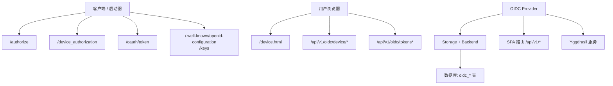
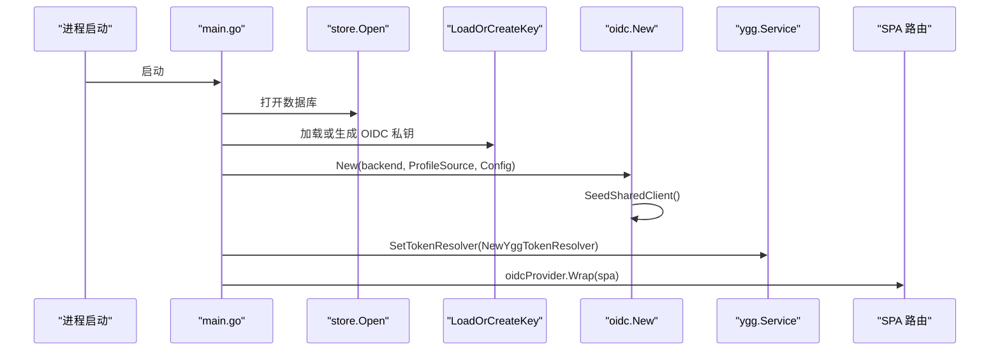
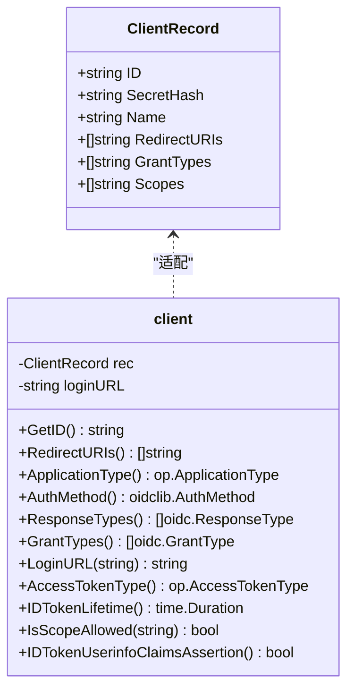
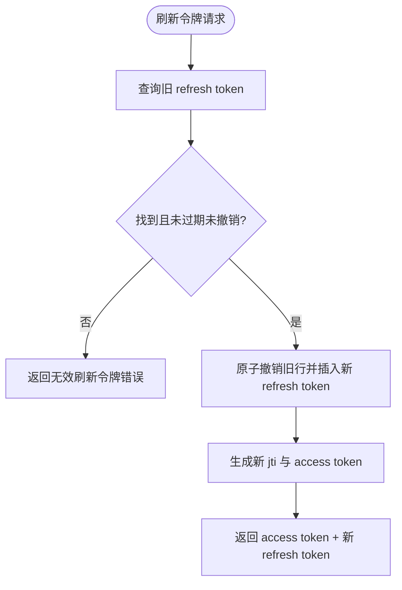
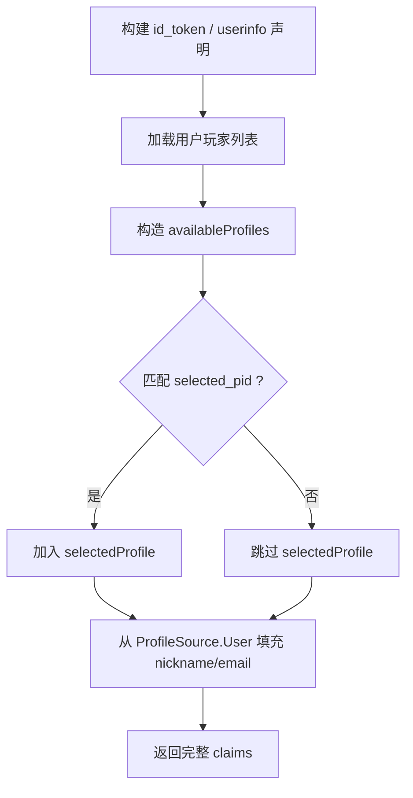
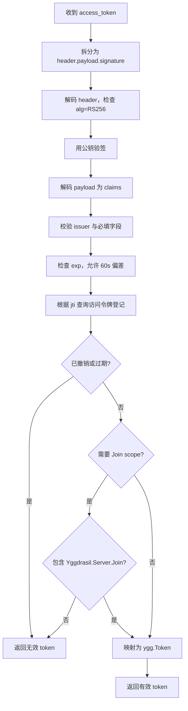
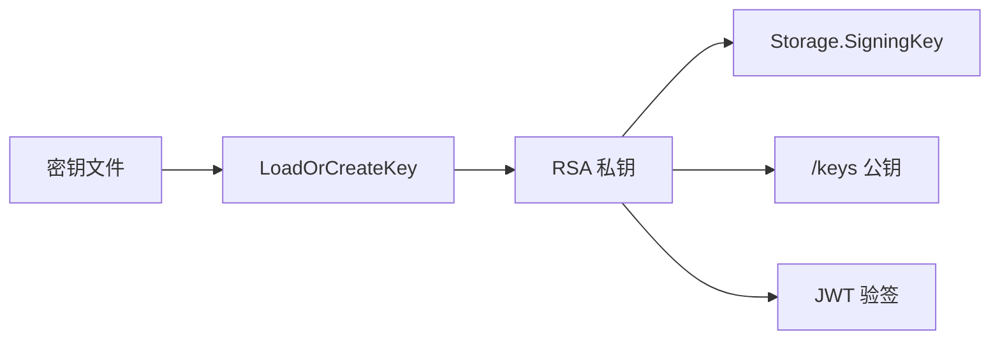
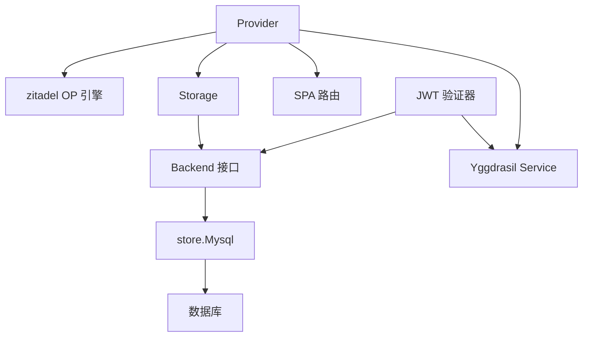
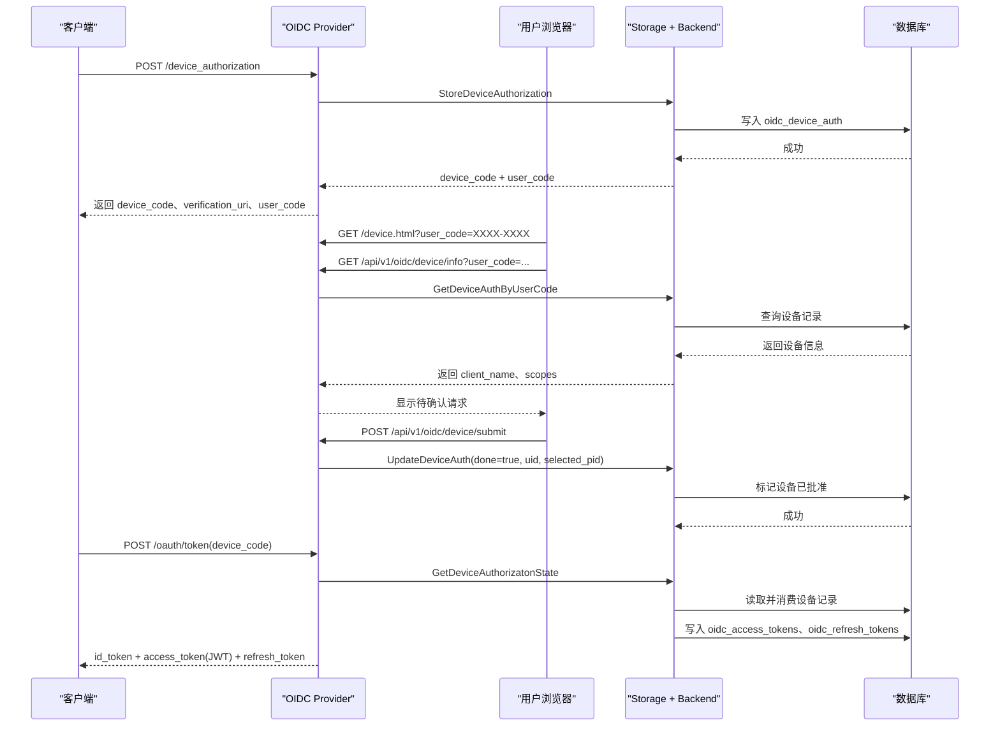

# OIDC 提供者模块

**本文引用的文件**
- [provider.go](https://github.com/YimingZhanshen/skin-nexus/blob/797ae1a/server/internal/oidc/provider.go)
- [client.go](https://github.com/YimingZhanshen/skin-nexus/blob/797ae1a/server/internal/oidc/client.go)
- [userapi.go](https://github.com/YimingZhanshen/skin-nexus/blob/797ae1a/server/internal/oidc/userapi.go)
- [jwt.go](https://github.com/YimingZhanshen/skin-nexus/blob/797ae1a/server/internal/oidc/jwt.go)
- [keyfile.go](https://github.com/YimingZhanshen/skin-nexus/blob/797ae1a/server/internal/oidc/keyfile.go)
- [storage.go](https://github.com/YimingZhanshen/skin-nexus/blob/797ae1a/server/internal/oidc/storage.go)
- [backend.go](https://github.com/YimingZhanshen/skin-nexus/blob/797ae1a/server/internal/oidc/backend.go)
- [oidc.go](https://github.com/YimingZhanshen/skin-nexus/blob/797ae1a/server/internal/store/oidc.go)
- [0003_oidc.sql](https://github.com/YimingZhanshen/skin-nexus/blob/797ae1a/server/migrations/sqlite/0003_oidc.sql)
- [main.go](https://github.com/YimingZhanshen/skin-nexus/blob/797ae1a/server/cmd/skin-nexus/main.go)
- [DevicePage.vue](https://github.com/YimingZhanshen/skin-nexus/blob/797ae1a/web/src/pages/DevicePage.vue)
- [api.js](https://github.com/YimingZhanshen/skin-nexus/blob/797ae1a/web/src/api.js)

## 目录
1. [引言](#引言)
2. [项目结构](#项目结构)
3. [核心组件](#核心组件)
4. [架构总览](#架构总览)
5. [详细组件分析](#详细组件分析)
6. [依赖关系分析](#依赖关系分析)
7. [性能与并发特性](#性能与并发特性)
8. [关键配置、密钥与端点](#关键配置密钥与端点)
9. [典型授权流程](#典型授权流程)
10. [调试指南](#调试指南)
11. [故障排查](#故障排查)
12. [结论](#结论)

## 引言
本模块实现皮肤站内置的 OIDC 提供者，替代旧的 Janus 旁路服务。它基于 zitadel/oidc v3，提供设备码流程、授权码流程、refresh token 轮换、RS256 JWT access_token/id_token 签发与 JWKS 公开，并通过后端 storage 接口持久化授权请求、授权码、access token（jti）、refresh token、设备码与客户端配置。同时，它将 OIDC access_token 作为 Yggdrasil 游戏会话令牌使用，使 launcher 可直接携带 access_token 调用 `/authserver/validate` 和 `/sessionserver/join`。

## 项目结构
OIDC 模块位于 `server/internal/oidc`，主要职责如下：

| 文件 | 职责 |
|---|---|
| `provider.go` | 启动 Provider、注册 HTTP 路由、Discovery、JWKS、设备表单与 API 挂载 |
| `client.go` | 将数据库中的 `ClientRecord` 适配为 zitadel `op.Client` |
| `storage.go` | 实现 `op.Storage`、`op.DeviceAuthorizationStorage`、签名键、JWT 声明构建、设备态映射 |
| `backend.go` | 定义存储契约，集中所有 OIDC 记录模型 |
| `jwt.go` | 解析并验证 RS256 JWT access_token，桥接至 Yggdrasil token 体系 |
| `keyfile.go` | 加载或生成 RSA-4096 签名私钥 |
| `userapi.go` | 用户已登录后的“已授权应用”列表与撤销接口 |
| `store/oidc.go` | MySQL 实现 `oidc.Backend`，读写 JSON TEXT 列 |
| `migrations/sqlite/0003_oidc.sql` | SQLite 版本 DDL，描述五张 OIDC 表 |
| `cmd/skin-nexus/main.go` | 启动时加载密钥、构造 Provider、注入 ProfileSource、挂载路由、设置 Yggdrasil TokenResolver |
| `web/src/pages/DevicePage.vue` | SPA 设备确认页，轮询设备信息并提交 approve/deny |
| `web/src/api.js` | 前端 OIDC 管理接口封装 |

**图示来源**
- [provider.go:105-150](https://github.com/YimingZhanshen/skin-nexus/blob/797ae1a/server/internal/oidc/provider.go#L105-L150)
- [main.go:398-447](https://github.com/YimingZhanshen/skin-nexus/blob/797ae1a/server/cmd/skin-nexus/main.go#L398-L447)
- [0003_oidc.sql:1-75](https://github.com/YimingZhanshen/skin-nexus/blob/797ae1a/server/migrations/sqlite/0003_oidc.sql#L1-L75)

**章节来源**
- [provider.go:1-200](https://github.com/YimingZhanshen/skin-nexus/blob/797ae1a/server/internal/oidc/provider.go#L1-L200)
- [backend.go:1-152](https://github.com/YimingZhanshen/skin-nexus/blob/797ae1a/server/internal/oidc/backend.go#L1-L152)

## 核心组件
- **Provider**：持有配置、Storage、zitadel engine、Backend、SessionResolver 与审计回调；负责路由分发、Discovery 增强与共享客户端初始化。
- **Storage**：实现 zitadel 的存储接口，把授权请求、token、设备态、客户端行为落到 `Backend`，并把用户/玩家数据填充到 id_token 和 userinfo。
- **Backend**：OIDC 持久化契约，由 `internal/store` 实现，测试中也使用内存 double。
- **client**：适配器，决定客户端是公共还是机密、支持的 grant/response 类型、scope 校验以及是否把 userinfo claims 合并进 id_token。
- **JWT 验证器**：独立于 zitadel，直接验证 RS256 access_token，用于 Yggdrasil 双态 token 解析。
- **Keyfile**：加载 PKCS#1/PKCS#8 PEM 私钥，不存在则生成 RSA-4096。
- **UserAPI**：已登录用户查看自己的活跃 access_token 并撤销单个 jti 或全部。

**章节来源**
- [provider.go:15-90](https://github.com/YimingZhanshen/skin-nexus/blob/797ae1a/server/internal/oidc/provider.go#L15-L90)
- [storage.go:20-120](https://github.com/YimingZhanshen/skin-nexus/blob/797ae1a/server/internal/oidc/storage.go#L20-L120)
- [backend.go:15-152](https://github.com/YimingZhanshen/skin-nexus/blob/797ae1a/server/internal/oidc/backend.go#L15-L152)
- [client.go:1-101](https://github.com/YimingZhanshen/skin-nexus/blob/797ae1a/server/internal/oidc/client.go#L1-L101)
- [jwt.go:1-154](https://github.com/YimingZhanshen/skin-nexus/blob/797ae1a/server/internal/oidc/jwt.go#L1-L154)
- [keyfile.go:1-48](https://github.com/YimingZhanshen/skin-nexus/blob/797ae1a/server/internal/oidc/keyfile.go#L1-L48)
- [userapi.go:1-124](https://github.com/YimingZhanshen/skin-nexus/blob/797ae1a/server/internal/oidc/userapi.go#L1-L124)

## 架构总览
OIDC 模块在启动阶段完成三件事：加载签名密钥、创建 Provider 并注入 ProfileSource、将 Provider 的路由包装到 SPA 主处理器前。Yggdrasil 服务通过 `SetTokenResolver` 接收 OIDC access_token，并用同一份 jti ledger 判断是否有效。

**图示来源**
- [main.go:398-447](https://github.com/YimingZhanshen/skin-nexus/blob/797ae1a/server/cmd/skin-nexus/main.go#L398-L447)
- [provider.go:70-105](https://github.com/YimingZhanshen/skin-nexus/blob/797ae1a/server/internal/oidc/provider.go#L70-L105)
- [jwt.go:25-46](https://github.com/YimingZhanshen/skin-nexus/blob/797ae1a/server/internal/oidc/jwt.go#L25-L46)

**章节来源**
- [main.go:398-447](https://github.com/YimingZhanshen/skin-nexus/blob/797ae1a/server/cmd/skin-nexus/main.go#L398-L447)

## 详细组件分析

### 1. Provider 与路由
Provider 通过 `Wrap` 接管以下路径：
- `/.well-known/openid-configuration`：Discovery，补充 `shared_client_id`、scopes、claims、token_endpoint_auth_methods 等。
- `/authorize`、`/authorize/callback`：授权码入口。
- `/oauth/token`：统一 token 端点，包含 device_code、authorization_code、refresh_token。
- `/device_authorization`：RFC 8628 设备码申请。
- `/device.html`：无 JS 设备确认页。
- `/api/v1/oidc/`：设备信息提交、已授权应用管理。
- `/keys`：JWKS 公钥。
- `/userinfo`、`/yggc/userinfo`：用户信息。
- `/revoke`、`/end_session`、`/oauth/introspect`：标准端点。

Discovery 响应还强制写入 RS256 签名算法、支持 scopes、claims 及 authorization_response_iss_parameter_supported。

**章节来源**
- [provider.go:70-150](https://github.com/YimingZhanshen/skin-nexus/blob/797ae1a/server/internal/oidc/provider.go#L70-L150)
- [provider.go:150-200](https://github.com/YimingZhanshen/skin-nexus/blob/797ae1a/server/internal/oidc/provider.go#L150-L200)

### 2. Client 适配与 scope 控制
`client` 把 `ClientRecord` 暴露给 zitadel：
- 没有 `SecretHash` 视为公共客户端，使用 `AuthMethodNone`，适合 launcher 的设备码流程。
- 有 secret 时使用 `client_secret_post` 兼容旧客户端。
- 只允许 `response_type=code`，隐式授权被有意禁用。
- access_token 类型为 JWT。
- 如果客户端未限制 scopes，则放行所有 supported scopes；否则按 allow-list 检查。
- `IDTokenUserinfoClaimsAssertion` 返回 true，使 selectedProfile、availableProfiles 等自定义 claim 进入 id_token。

**图示来源**
- [client.go:1-101](https://github.com/YimingZhanshen/skin-nexus/blob/797ae1a/server/internal/oidc/client.go#L1-L101)
- [backend.go:25-45](https://github.com/YimingZhanshen/skin-nexus/blob/797ae1a/server/internal/oidc/backend.go#L25-L45)

**章节来源**
- [client.go:1-101](https://github.com/YimingZhanshen/skin-nexus/blob/797ae1a/server/internal/oidc/client.go#L1-L101)

### 3. Storage：授权码、刷新轮换、设备态与声明填充
Storage 承担三类职责：

#### 3.1 授权码流程
- `CreateAuthRequest`：保存授权请求，包括 nonce、state、PKCE challenge、scopes、redirect_uri。
- `SaveAuthCode`：授权成功后写入授权码，有效期约 60 秒。
- `AuthRequestByCode`：换取 token 时读取并校验过期。

#### 3.2 Access token 与 Refresh token
- `CreateAccessToken`：生成 jti，保存 `AccessTokenRecord`，默认 1 小时过期。
- `CreateAccessAndRefreshTokens`：若传入现有 refresh token，则执行旋转：先查询旧 token，再原子替换为新 token；未知 refresh token 会拒绝签发新 pair。
- `TokenRequestByRefreshToken`：校验未撤销且未过期后返回 `refreshTokenRequest`。
- `TerminateSession`：登出时同时撤销 access 与 refresh token，避免 30 天 refresh token 自动续期。

**图示来源**
- [storage.go:300-380](https://github.com/YimingZhanshen/skin-nexus/blob/797ae1a/server/internal/oidc/storage.go#L300-L380)

#### 3.3 设备码流程
- `StoreDeviceAuthorization`：持久化设备码、用户码、client_id、scopes、过期时间。
- `GetDeviceAuthorizatonState`：读取设备态；如果已批准，则首次成功读取时消费该设备记录，防止重复兑换。
- 内部维护 `devPID` 映射，把 approved 设备的 `selected_pid` 缓存到当前 token 发放上下文。

#### 3.4 声明与 userinfo
- `SetUserinfoFromRequest` 与 `GetPrivateClaimsFromRequest`：根据 uid、selected_pid 与 scopes 填充 selectedProfile、availableProfiles、nickname、email 等。
- `fillUserinfo`：从 `ProfileSource.User` 取用户信息，从 `Players` 取玩家列表。

**图示来源**
- [storage.go:420-520](https://github.com/YimingZhanshen/skin-nexus/blob/797ae1a/server/internal/oidc/storage.go#L420-L520)

**章节来源**
- [storage.go:201-578](https://github.com/YimingZhanshen/skin-nexus/blob/797ae1a/server/internal/oidc/storage.go#L201-L578)

### 4. JWT 签发与 Yggdrasil 集成
OIDC access_token 是 RS256 JWT，字段包含 iss、sub、exp、iat、jti、scope。Yggdrasil 侧通过 `NewYggTokenResolver` 接收原始 token，执行：
1. 三段 base64url 解码。
2. 检查 alg 为 RS256。
3. 用 provider 公钥做 RSA-PKCS1v15 SHA-256 验签。
4. 校验 issuer、jti 非空、subject 非空。
5. exp 允许 60 秒时钟偏差。
6. 查 jti ledger：存在、未撤销、未过期。
7. 如果是游戏 join 场景，要求 scope 中包含 `Yggdrasil.Server.Join`。
8. 返回 ygg.Token，其中 AccessToken 规范化为 `jti:<jti>`。

**图示来源**
- [jwt.go:25-154](https://github.com/YimingZhanshen/skin-nexus/blob/797ae1a/server/internal/oidc/jwt.go#L25-L154)
- [main.go:434-447](https://github.com/YimingZhanshen/skin-nexus/blob/797ae1a/server/cmd/skin-nexus/main.go#L434-L447)

**章节来源**
- [jwt.go:1-154](https://github.com/YimingZhanshen/skin-nexus/blob/797ae1a/server/internal/oidc/jwt.go#L1-L154)
- [main.go:434-447](https://github.com/YimingZhanshen/skin-nexus/blob/797ae1a/server/cmd/skin-nexus/main.go#L434-L447)

### 5. 密钥管理与 JWKS
- 私钥通过 `LoadOrCreateKey` 加载，支持 PKCS#1 与 PKCS#8 PEM；不存在则生成 RSA-4096 并写回文件。
- Storage 向 zitadel 暴露 SigningKey、SignatureAlgorithms、KeySet。
- JWKS 端点 `/keys` 输出 kid、alg=RS256、use=sig、pub key。
- Discovery 中声明 `id_token_signing_alg_values_supported` 为 RS256。
- Launchers 使用 kid 匹配公钥，因此 KID 变更会导致旧 token 无法被正确识别。

**图示来源**
- [keyfile.go:1-48](https://github.com/YimingZhanshen/skin-nexus/blob/797ae1a/server/internal/oidc/keyfile.go#L1-L48)
- [storage.go:120-170](https://github.com/YimingZhanshen/skin-nexus/blob/797ae1a/server/internal/oidc/storage.go#L120-L170)
- [provider.go:150-200](https://github.com/YimingZhanshen/skin-nexus/blob/797ae1a/server/internal/oidc/provider.go#L150-L200)

**章节来源**
- [keyfile.go:1-48](https://github.com/YimingZhanshen/skin-nexus/blob/797ae1a/server/internal/oidc/keyfile.go#L1-L48)
- [storage.go:120-170](https://github.com/YimingZhanshen/skin-nexus/blob/797ae1a/server/internal/oidc/storage.go#L120-L170)

### 6. 后端 Storage 持久化
后端契约集中在 `backend.go`，数据库实现位于 `store/oidc.go`。SQLite DDL 定义五张表：

| 表名 | 用途 | 关键字段 |
|---|---|---|
| `oidc_clients` | OAuth 客户端注册 | `client_id`、`secret_hash`、`grant_types`、`scopes`、`redirect_uris` |
| `oidc_auth_requests` | 授权码流程中间状态 | `id`、`nonce`、`code_challenge`、`state`、`selected_pid`、`code` |
| `oidc_access_tokens` | access token 登记 | `jti`、`uid`、`client_id`、`scopes`、`expires_at`、`revoked_at` |
| `oidc_refresh_tokens` | refresh token 登记 | `token`、`uid`、`client_id`、`scopes`、`expires_at`、`revoked` |
| `oidc_device_auth` | 设备码流程 | `device_code`、`user_code`、`done`、`denied`、`uid`、`selected_pid` |

JSON 数组列以 TEXT 存储，Go 层 marshal/unmarshal，不依赖数据库原生 JSON 操作。

**章节来源**
- [backend.go:45-152](https://github.com/YimingZhanshen/skin-nexus/blob/797ae1a/server/internal/oidc/backend.go#L45-L152)
- [oidc.go:1-200](https://github.com/YimingZhanshen/skin-nexus/blob/797ae1a/server/internal/store/oidc.go#L1-L200)
- [0003_oidc.sql:1-75](https://github.com/YimingZhanshen/skin-nexus/blob/797ae1a/server/migrations/sqlite/0003_oidc.sql#L1-L75)

### 7. 与外部 OIDC 提供方与企业微信、飞书登录的关系
`client.go` 与 `userapi.go` 本身不是企业微信、飞书的 OIDC 接入层。它们分别解决：
- `client.go`：让本机 Zitadel OP 如何解释注册的 OIDC client，尤其是公共 launcher 与机密客户端的区别。
- `userapi.go`：为已登录用户提供“已授权应用”管理能力，列出 jti、client_id、scopes、selected_pid、创建与过期时间，并支持按 jti 或全部撤销。

若皮肤站自身作为第三方 OIDC 提供方供企业微信、飞书等系统回调，则应关注 `provider.go` 中挂载的 `/authorize`、`/oauth/token`、`/userinfo`、`/keys` 与 Discovery；这些端点会被外部系统当作 OIDC 提供方使用。而“外部 OIDC 提供方登录本皮肤站”通常由 union/outbound/OIDC 客户端逻辑处理，不在本模块内。

因此，`client.go` 与 `userapi.go` 的配合对象是 zitadel OP 引擎和本机存储，而不是企业微信、飞书；但它们共同保证：当外部系统以 OIDC 方式访问皮肤站时，访问令牌能稳定落地、可审计、可撤销。

**章节来源**
- [client.go:1-101](https://github.com/YimingZhanshen/skin-nexus/blob/797ae1a/server/internal/oidc/client.go#L1-L101)
- [userapi.go:1-124](https://github.com/YimingZhanshen/skin-nexus/blob/797ae1a/server/internal/oidc/userapi.go#L1-L124)
- [provider.go:105-200](https://github.com/YimingZhanshen/skin-nexus/blob/797ae1a/server/internal/oidc/provider.go#L105-L200)

## 依赖关系分析

**图示来源**
- [provider.go:15-200](https://github.com/YimingZhanshen/skin-nexus/blob/797ae1a/server/internal/oidc/provider.go#L15-L200)
- [storage.go:20-120](https://github.com/YimingZhanshen/skin-nexus/blob/797ae1a/server/internal/oidc/storage.go#L20-L120)
- [oidc.go:1-60](https://github.com/YimingZhanshen/skin-nexus/blob/797ae1a/server/internal/store/oidc.go#L1-L60)
- [jwt.go:25-46](https://github.com/YimingZhanshen/skin-nexus/blob/797ae1a/server/internal/oidc/jwt.go#L25-L46)

**章节来源**
- [provider.go:15-200](https://github.com/YimingZhanshen/skin-nexus/blob/797ae1a/server/internal/oidc/provider.go#L15-L200)
- [storage.go:20-120](https://github.com/YimingZhanshen/skin-nexus/blob/797ae1a/server/internal/oidc/storage.go#L20-L120)
- [oidc.go:1-60](https://github.com/YimingZhanshen/skin-nexus/blob/797ae1a/server/internal/store/oidc.go#L1-L60)
- [jwt.go:25-46](https://github.com/YimingZhanshen/skin-nexus/blob/797ae1a/server/internal/oidc/jwt.go#L25-L46)

## 性能与并发特性
- 设备态 PID 缓存使用互斥锁保护，并在超过 64 项或超过 15 分钟时清理，避免长期增长。
- Refresh token 旋转要求旧 token 存在且未撤销，否则拒绝签发新 pair，避免未知 token 被放大为新的长期 grant。
- Authorization code 有效期很短，降低授权码重放风险。
- access_token 默认 1 小时过期，refresh_token 默认 30 天过期，适合 launcher 长驻场景。
- 撤销时尽量同时撤销 access 与 refresh token，减少“已登出但 refresh token 仍可续期”的窗口。

[本节为通用性能说明，不直接分析具体代码片段]

## 关键配置、密钥与端点

### 关键配置项
| 配置项 | 含义 | 默认或行为 |
|---|---|---|
| `SKIN_OIDC_ENABLED` | 是否启用 OIDC 提供者 | 由 main 判断 |
| `SKIN_OIDC_ISSUER` | OIDC issuer URL | 必须与站点根地址一致 |
| `SKIN_OIDC_SIGN_KEY` | RS256 私钥文件路径 | 不存在则自动生成 RSA-4096 |
| `SKIN_SHARED_CLIENT_ID` | discovery shared_client_id | 默认值为 `"2"` |
| `SKIN_DEVICE_FORM_PATH` | 设备确认页路径 | 默认 `/device` |
| `SKIN_DEVICE_LIFETIME` | 设备码有效期 | 默认 10 分钟 |
| `SKIN_DEVICE_POLL_SECS` | 设备轮询间隔 | 默认 5 秒 |

上述配置在启动时被读取并传给 `oidc.Config`，随后构造 Provider。

**章节来源**
- [provider.go:15-45](https://github.com/YimingZhanshen/skin-nexus/blob/797ae1a/server/internal/oidc/provider.go#L15-L45)
- [main.go:398-447](https://github.com/YimingZhanshen/skin-nexus/blob/797ae1a/server/cmd/skin-nexus/main.go#L398-L447)

### 密钥文件位置
私钥路径来自 `cfg.OIDCSignKey`，由 `LoadOrCreateKey` 加载或生成。生成的密钥文件权限为 `0600`，类型是 PKCS#8 PEM，类型为 `PRIVATE KEY`。

**章节来源**
- [keyfile.go:1-48](https://github.com/YimingZhanshen/skin-nexus/blob/797ae1a/server/internal/oidc/keyfile.go#L1-L48)
- [main.go:398-403](https://github.com/YimingZhanshen/skin-nexus/blob/797ae1a/server/cmd/skin-nexus/main.go#L398-L403)

### JWKS 与 Discovery 端点
| 端点 | 作用 |
|---|---|
| `/.well-known/openid-configuration` | Discovery，含 issuer、token_endpoint、scopes、claims、shared_client_id |
| `/keys` | JWKS，输出 RS256 公钥 |
| `/authorize` | 授权码和设备码入口 |
| `/device_authorization` | RFC 8628 设备码申请 |
| `/oauth/token` | 发放 access_token、refresh_token |
| `/userinfo`、`/yggc/userinfo` | 用户信息 |
| `/api/v1/oidc/tokens` | 列出用户活跃 access_token |
| `/api/v1/oidc/tokens/revoke` | 撤销单个 jti 或全部 |
| `/device.html` | 设备确认页 |
| `/api/v1/oidc/device/info` | 查询设备码信息 |
| `/api/v1/oidc/device/submit` | 提交 approve/deny 与 selected_pid |

**章节来源**
- [provider.go:105-200](https://github.com/YimingZhanshen/skin-nexus/blob/797ae1a/server/internal/oidc/provider.go#L105-L200)
- [userapi.go:1-124](https://github.com/YimingZhanshen/skin-nexus/blob/797ae1a/server/internal/oidc/userapi.go#L1-L124)
- [DevicePage.vue:103-107](https://github.com/YimingZhanshen/skin-nexus/blob/797ae1a/web/src/pages/DevicePage.vue#L103-L107)

## 典型授权流程

### 客户端发起 /authorize → provider 生成设备码 → 用户扫码确认 → 签发 id_token/access_token

**图示来源**
- [provider.go:105-150](https://github.com/YimingZhanshen/skin-nexus/blob/797ae1a/server/internal/oidc/provider.go#L105-L150)
- [storage.go:520-578](https://github.com/YimingZhanshen/skin-nexus/blob/797ae1a/server/internal/oidc/storage.go#L520-L578)
- [storage.go:300-380](https://github.com/YimingZhanshen/skin-nexus/blob/797ae1a/server/internal/oidc/storage.go#L300-L380)
- [DevicePage.vue:27-107](https://github.com/YimingZhanshen/skin-nexus/blob/797ae1a/web/src/pages/DevicePage.vue#L27-L107)

### 关键注意事项
- 设备码首次成功兑换后会消费该记录，后续轮询会报 not found，从而防止重复 mint token。
- selected_pid 通过 `devPID` 映射进入 token 的 private claims，最终影响 selectedProfile。
- refresh token 旋转失败时必须拒绝签发新 token，避免旧 stale token 继续生效。
- access_token 是 JWT，其 jti 必须存在于 `oidc_access_tokens` 且未被撤销。

**章节来源**
- [storage.go:300-380](https://github.com/YimingZhanshen/skin-nexus/blob/797ae1a/server/internal/oidc/storage.go#L300-L380)
- [storage.go:520-578](https://github.com/YimingZhanshen/skin-nexus/blob/797ae1a/server/internal/oidc/storage.go#L520-L578)
- [jwt.go:60-154](https://github.com/YimingZhanshen/skin-nexus/blob/797ae1a/server/internal/oidc/jwt.go#L60-L154)

## 调试指南

### 日志中的关键字段
| 字段 | 含义 | 调试建议 |
|---|---|---|
| `nonce` | 授权请求中的随机数，用于绑定 id_token，防重放 | 若 id_token 校验失败，检查授权请求是否携带 nonce，且客户端是否正确传递 |
| `jti` | access_token 的唯一标识，也是 ledger 主键 | 若 token 被拒绝，查 `oidc_access_tokens.jti` 是否存在、是否已撤销或过期 |
| `exp` | JWT 过期时间戳 | 若验签成功但 token 仍无效，检查服务器时间与客户端时间差异是否超过 60 秒 |
| `kid` | JWK key id | 若公钥更换导致旧 token 失效，核对 launcher 使用的 kid 是否与当前 JWKS 一致 |
| `selected_pid` | 用户在设备确认页选择的玩家 ID | 若 selectedProfile 为空，检查设备提交是否选择了玩家，或玩家列表是否为空 |
| `client_id` | 客户端标识，公共 launcher 通常为 shared_client_id | 若 scope 或 redirect_uri 校验失败，检查 `oidc_clients` 中对应 client 的配置 |

### JWT 签名失败的排查步骤
1. 确认 `/keys` 返回的公钥与 `SKIN_OIDC_SIGN_KEY` 对应的私钥配对。
2. 确认 JWT header 的 `alg` 为 RS256。
3. 确认 issuer 与配置的 `SKIN_OIDC_ISSUER` 一致。
4. 确认 `exp` 未超过当前时间加 60 秒容忍值。
5. 确认 `jti` 在 `oidc_access_tokens` 中存在且 `revoked_at` 为空。
6. 确认 access_token 的 scope 包含 `Yggdrasil.Server.Join`（游戏 join 场景）。
7. 若刚更换密钥文件，确认 launcher 已重新获取 JWKS，且 kid 未改变。
8. 若密码修改或管理员凭证变更后 token 失效，确认 `TerminateSession` 或撤销逻辑已运行，因为该逻辑会同时撤销 access 与 refresh token。

**章节来源**
- [jwt.go:60-154](https://github.com/YimingZhanshen/skin-nexus/blob/797ae1a/server/internal/oidc/jwt.go#L60-L154)
- [storage.go:380-420](https://github.com/YimingZhanshen/skin-nexus/blob/797ae1a/server/internal/oidc/storage.go#L380-L420)
- [keyfile.go:1-48](https://github.com/YimingZhanshen/skin-nexus/blob/797ae1a/server/internal/oidc/keyfile.go#L1-L48)

## 故障排查

### 常见问题
| 现象 | 可能原因 | 处理 |
|---|---|---|
| `/authorize` 报 public client takes no secret | 公共客户端传了 client_secret | 移除 secret，使用 device_code 或 none 认证 |
| 设备码一直提示未确认 | 用户未在 `/device.html` 提交 approve | 检查设备记录 done/denied 状态 |
| 设备码重复兑换出多个 token | 设备记录未被消费 | 检查 `ConsumeDeviceAuth` 与 `GetDeviceAuthorizatonState` 交互逻辑 |
| refresh token 换出的新 token 不可用 | 旧 refresh token 不存在或被并发轮换覆盖 | 检查 `RotateRefreshToken` 返回值与并发竞争 |
| access_token 验签失败 | 私钥变更、kid 不一致、alg 不是 RS256 | 核对密钥文件与 JWKS |
| access_token 验签成功但游戏 join 失败 | 缺少 `Yggdrasil.Server.Join` scope | 检查客户端请求 scope 与后端 allow-list |
| 撤销一个 token 后还能刷新 | 只撤销了 access token，未撤销对应 client 的 refresh token | 使用 `/api/v1/oidc/tokens/revoke` 的 all 模式或确保刷新表同步撤销 |
| JWKS 端点不可用 | 路由未挂载或 Provider 未启用 | 检查 `OIDCEnabled`、`Wrap`、`/keys` 是否可达 |

**章节来源**
- [client.go:40-101](https://github.com/YimingZhanshen/skin-nexus/blob/797ae1a/server/internal/oidc/client.go#L40-L101)
- [storage.go:300-380](https://github.com/YimingZhanshen/skin-nexus/blob/797ae1a/server/internal/oidc/storage.go#L300-L380)
- [storage.go:520-578](https://github.com/YimingZhanshen/skin-nexus/blob/797ae1a/server/internal/oidc/storage.go#L520-L578)
- [jwt.go:60-154](https://github.com/YimingZhanshen/skin-nexus/blob/797ae1a/server/internal/oidc/jwt.go#L60-L154)
- [userapi.go:1-124](https://github.com/YimingZhanshen/skin-nexus/blob/797ae1a/server/internal/oidc/userapi.go#L1-L124)

## 结论
OIDC 提供者模块在本项目中承担两个核心角色：一是作为标准 OIDC 提供方，实现设备码、授权码、refresh token 轮换、JWT 签发与 JWKS 公开；二是作为 Yggdrasil 的双态 token 验证后端，使 launcher 可以直接复用 access_token 进行游戏连接。其安全性依赖于 RS256 签名、jti ledger、refresh token 旋转、scope 控制与统一的撤销机制。运维时应重点关注密钥文件、issuer、shared_client_id、JWKS 端点与数据库中的五张 OIDC 表。
