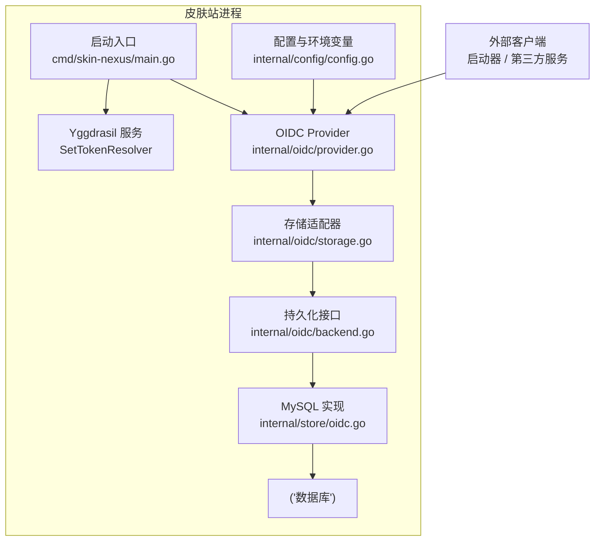
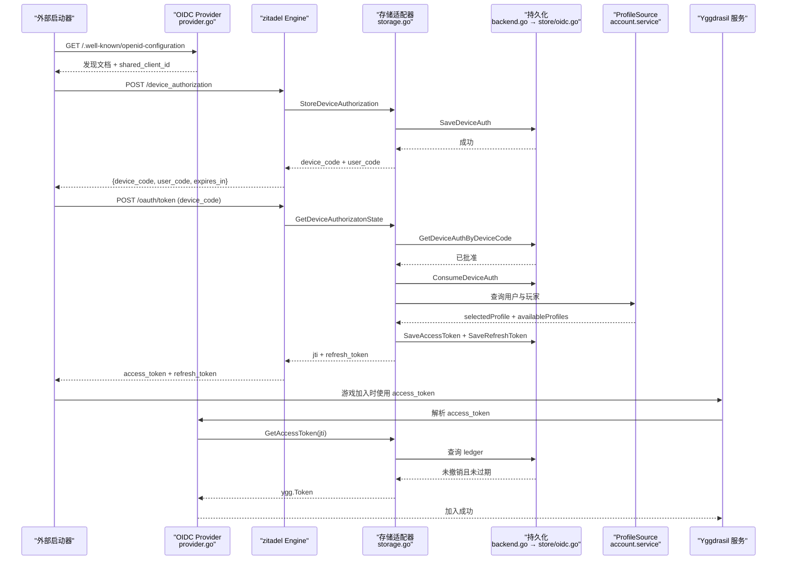
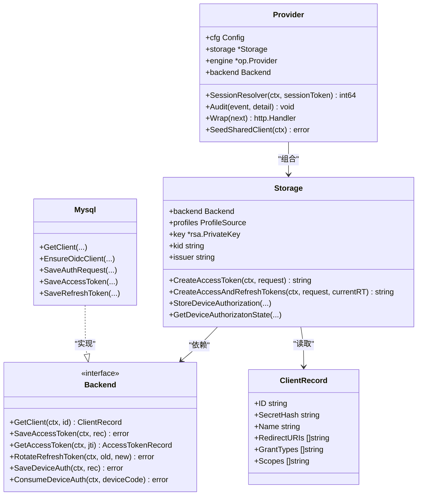

# OIDC 第三方登录集成

**本文引用的文件**
- [provider.go](https://github.com/YimingZhanshen/skin-nexus/blob/797ae1a/server/internal/oidc/provider.go)
- [jwt.go](https://github.com/YimingZhanshen/skin-nexus/blob/797ae1a/server/internal/oidc/jwt.go)
- [storage.go](https://github.com/YimingZhanshen/skin-nexus/blob/797ae1a/server/internal/oidc/storage.go)
- [client.go](https://github.com/YimingZhanshen/skin-nexus/blob/797ae1a/server/internal/oidc/client.go)
- [backend.go](https://github.com/YimingZhanshen/skin-nexus/blob/797ae1a/server/internal/oidc/backend.go)
- [keyfile.go](https://github.com/YimingZhanshen/skin-nexus/blob/797ae1a/server/internal/oidc/keyfile.go)
- [userapi.go](https://github.com/YimingZhanshen/skin-nexus/blob/797ae1a/server/internal/oidc/userapi.go)
- [oidc.go（持久层）](https://github.com/YimingZhanshen/skin-nexus/blob/797ae1a/server/internal/store/oidc.go)
- [config.go（配置）](https://github.com/YimingZhanshen/skin-nexus/blob/797ae1a/server/internal/config/config.go)
- [env.go（环境变量清单）](https://github.com/YimingZhanshen/skin-nexus/blob/797ae1a/server/internal/config/env.go)
- [main.go（启动器）](https://github.com/YimingZhanshen/skin-nexus/blob/797ae1a/server/cmd/skin-nexus/main.go)
- [DevicePage.vue](https://github.com/YimingZhanshen/skin-nexus/blob/797ae1a/web/src/pages/DevicePage.vue)

## 目录
1. [引言](#引言)
2. [项目结构与定位](#项目结构与定位)
3. [核心组件](#核心组件)
4. [架构总览](#架构总览)
5. [详细组件分析](#详细组件分析)
6. [依赖关系分析](#依赖关系分析)
7. [性能与可用性特征](#性能与可用性特征)
8. [运维与安全建议](#运维与安全建议)
9. [故障排查指南](#故障排查指南)
10. [结论](#结论)

## 引言
本文说明 SkinNexus 内置的 OIDC provider 如何为外部启动器、应用或第三方服务提供标准认证能力。该实现基于 zitadel/oidc v3，并通过 `internal/oidc` 包暴露以下关键能力：

- **设备码流程（RFC 8628）**：适用于无浏览器环境，客户端先获取 `device_code` 和 `user_code`，在 `/device` 页面完成授权后轮询换取 access token 与 refresh token。
- **传统授权码流程**：支持 PKCE `S256`、授权码换取 token、refresh token 轮换。
- **标准 OIDC 端点**：发现文档、用户信息、JWK、令牌撤销、会话结束等。
- **双态 Yggdrasil 接入**：OIDC 签发的 RS256 JWT access token 可直接作为游戏加入凭证；非 JWT 凭证回退到内部 opaque token 查询。
- **企业微信、飞书、自建 Keycloak 等外部身份提供方**：可作为 OIDC client 注册到 SkinNexus，通过 `SKIN_OIDC_*` 环境变量配置。

注意：SkinNexus 在此处是 **OIDC provider**；当它作为外部身份提供方（如企业微信、Keycloak）的 OIDC client 时，使用的是同一 `oidc.Backend` 存储中的 `oidc_clients` 表，但走的是 zitadel 的 client 校验路径。

## 项目结构与定位
`server/internal/oidc` 是独立于 web 路由层的 OIDC provider 模块，由 `cmd/skin-nexus/main.go` 在启动时装配：

| 文件 | 职责 |
|---|---|
| `provider.go` | 构造 zitadel engine、挂载 OIDC 路径、提供 discovery 与 `/device` 相关 API |
| `storage.go` | 实现 `op.Storage`、`op.DeviceAuthorizationStorage`、token 签发、userinfo 填充、设备流状态 |
| `client.go` | 将 `ClientRecord` 适配成 zitadel `op.Client`，决定授权方法、grant type、scope 限制 |
| `jwt.go` | 解析并验证 RS256 JWT，映射为 ygg.Token，实现 JTI ledger 校验 |
| `backend.go` | 定义持久化接口，供数据库实现与测试 double 使用 |
| `keyfile.go` | 加载或生成 RSA-4096 OIDC 签名密钥 |
| `userapi.go` | 管理“已授权应用”列表与撤销接口 |
| `store/oidc.go` | MySQL 实现，把记录落到 `oidc_clients`、`oidc_auth_requests`、`oidc_access_tokens`、`oidc_refresh_tokens`、`oidc_device_authorizations` 等表 |
| `config/config.go` | 读取 `SKIN_OIDC_*` 环境变量并生成 Provider 配置 |
| `cmd/skin-nexus/main.go` | 启动 OIDC provider、注入 session resolver、seed shared client、注册 Yggdrasil token resolver |
| `web/src/pages/DevicePage.vue` | 设备码授权确认页，处理 user code 查询、批准/拒绝与角色选择 |



**图示来源**
- [provider.go:54-123](https://github.com/YimingZhanshen/skin-nexus/blob/797ae1a/server/internal/oidc/provider.go#L54-L123)
- [storage.go:105-156](https://github.com/YimingZhanshen/skin-nexus/blob/797ae1a/server/internal/oidc/storage.go#L105-L156)
- [backend.go:89-152](https://github.com/YimingZhanshen/skin-nexus/blob/797ae1a/server/internal/oidc/backend.go#L89-L152)
- [oidc.go（持久层）:1-120](https://github.com/YimingZhanshen/skin-nexus/blob/797ae1a/server/internal/store/oidc.go#L1-L120)
- [config.go（配置）:184-191](https://github.com/YimingZhanshen/skin-nexus/blob/797ae1a/server/internal/config/config.go#L184-L191)
- [main.go（启动器）:438-449](https://github.com/YimingZhanshen/skin-nexus/blob/797ae1a/server/cmd/skin-nexus/main.go#L438-L449)

**章节来源**
- [provider.go:24-123](https://github.com/YimingZhanshen/skin-nexus/blob/797ae1a/server/internal/oidc/provider.go#L24-L123)
- [main.go（启动器）:420-449](https://github.com/YimingZhanshen/skin-nexus/blob/797ae1a/server/cmd/skin-nexus/main.go#L420-L449)
- [config.go（配置）:184-191](https://github.com/YimingZhanshen/skin-nexus/blob/797ae1a/server/internal/config/config.go#L184-L191)

## 核心组件

### OIDC Provider 与端点挂载
`Provider.New` 构建 zitadel 引擎，启用：

- `CodeMethodS256`：强制 PKCE `S256`，不接受 plain。
- `AuthMethodPost`：兼容旧式 `client_secret_post`。
- `GrantTypeRefreshToken`：支持 refresh token。
- `SupportedScopes`：包含 `openid`、`profile`、`email`、`offline_access`，以及 `Yggdrasil.PlayerProfiles.Read`、`Yggdrasil.PlayerProfiles.Select`、`Yggdrasil.Server.Join`。
- `DeviceAuthorization`：默认 10 分钟有效期、5 秒轮询间隔、Base20 格式 `user_code`（形如 `XXXX-XXXX`）。

`Provider.Wrap` 挂载的核心端点如下：

| 路径 | 行为 |
|---|---|
| `/.well-known/openid-configuration` | Discovery 文档，补充 `shared_client_id`、支持的算法与 scopes |
| `/authorize` | 授权请求入口 |
| `/authorize/callback` | 授权回调 |
| `/oauth/token` | 授权码、设备码、refresh token 交换 |
| `/oauth/introspect` | token 自省 |
| `/revoke` | 撤销 access token 或 refresh token |
| `/end_session` | 会话结束 |
| `/keys` | JWKS 公钥集合 |
| `/userinfo` | 用户信息 |
| `/yggc/userinfo` | 与 Yggdrasil 兼容的用户信息入口 |
| `/device.html` | 无 JS 设备授权表单 |
| `/api/v1/oidc/*` | 设备信息、提交决策、访问令牌管理 |

Discovery 文档会覆盖以下字段：

- `shared_client_id`：启动器共享公共客户端 ID，默认 `"2"`。
- `id_token_signing_alg_values_supported`：仅 `RS256`。
- `scopes_supported`：与引擎一致。
- `claims_supported`：包含 `email`、`email_verified`、`nickname`、`picture`、`selectedProfile`、`availableProfiles`、`sub`、`sid`、`auth_time`、`iss`。
- `authorization_response_iss_parameter_supported`：允许授权响应携带 issuer。
- `token_endpoint_auth_methods_supported`：`client_secret_post` 与 `none`。
- `response_modes_supported`：`form_post`、`fragment`、`query`。

**章节来源**
- [provider.go:54-123](https://github.com/YimingZhanshen/skin-nexus/blob/797ae1a/server/internal/oidc/provider.go#L54-L123)
- [provider.go:124-188](https://github.com/YimingZhanshen/skin-nexus/blob/797ae1a/server/internal/oidc/provider.go#L124-L188)

### Storage 与 Token 生命周期
`Storage` 同时实现 `op.Storage` 与 `op.DeviceAuthorizationStorage`，承担：

1. **客户端查找**：从 `Backend.GetClient` 加载 `ClientRecord`。
2. **客户端认证**：对带 secret 的 confidential client 执行哈希比对；public client（secret 为空）不允许 secret。
3. **授权请求**：保存 PKCE challenge、nonce、state、selected profile。
4. **access token**：签发 RS256 JWT，jti 写入 `AccessTokenRecord`，默认 1 小时过期。
5. **refresh token**：生成不透明字符串，默认 30 天过期；每次刷新执行轮换。
6. **userinfo 与 id_token 声明**：按 scope 注入 `nickname`、`email`、`email_verified`，并合并 selected/available profiles。
7. **设备流**：持久化 device code、user code、approved/denied 状态，并在首次成功兑换后原子消耗。

**章节来源**
- [storage.go:105-156](https://github.com/YimingZhanshen/skin-nexus/blob/797ae1a/server/internal/oidc/storage.go#L105-L156)
- [storage.go:201-273](https://github.com/YimingZhanshen/skin-nexus/blob/797ae1a/server/internal/oidc/storage.go#L201-L273)
- [storage.go:274-352](https://github.com/YimingZhanshen/skin-nexus/blob/797ae1a/server/internal/oidc/storage.go#L274-L352)
- [storage.go:353-428](https://github.com/YimingZhanshen/skin-nexus/blob/797ae1a/server/internal/oidc/storage.go#L353-L428)
- [storage.go:429-578](https://github.com/YimingZhanshen/skin-nexus/blob/797ae1a/server/internal/oidc/storage.go#L429-L578)

### Client 适配与 Scope 控制
`client` 结构把 `ClientRecord` 适配成 zitadel 的 `op.Client`：

- Public client（`SecretHash` 为空）使用 `AuthMethodNone` 和 native application 类型。
- Confidential client 使用 `AuthMethodPost`。
- 仅支持 `authorization_code` response type。
- grant types 直接透传 `ClientRecord.GrantTypes`。
- access token 类型为 JWT。
- id_token lifetime 为 1 小时。
- 若 client 未设置允许 scope 白名单，则允许所有 supported scopes；否则只允许白名单中的 scope。
- 开启 `IDTokenUserinfoClaimsAssertion`，把 selected profile 等私有声明合并进 id_token。

**章节来源**
- [client.go:1-101](https://github.com/YimingZhanshen/skin-nexus/blob/797ae1a/server/internal/oidc/client.go#L1-L101)

### JWT 与 Yggdrasil 双态接入
`NewYggTokenResolver` 返回一个函数，被 `ygg.Service.SetTokenResolver` 注册为游戏加入时的 access token 解析器。其规则是：

1. 尝试把传入 token 当作三段式 JWT。
2. 验证 header 中 `alg == RS256`。
3. 用 provider 公钥验证签名。
4. 校验 `iss` 等于配置的 issuer。
5. 检查 `exp`，允许 60 秒时钟偏差。
6. 根据 `jti` 查 `AccessTokenRecord`，判断是否已撤销或过期。
7. 对游戏加入场景要求 scope 包含 `Yggdrasil.Server.Join`。
8. 若不是 JWT，返回 `ErrNotJOSE`，由 main.go 回退到内部 opaque token 查询。

因此，**不存在跳过签名验证的 jwt_fallback 降级**。所谓 fallback 是指：非 JWT 的旧版 opaque token 仍可继续使用；而任何 JWT 形状的 token 如果签名失败，不会降级为其他信任源。

JWT 解析返回的 `ygg.Token` 使用短键 `jti:<jti>` 作为 `AccessToken`，使 join session 行保持短 key。

**章节来源**
- [jwt.go:1-154](https://github.com/YimingZhanshen/skin-nexus/blob/797ae1a/server/internal/oidc/jwt.go#L1-L154)
- [main.go（启动器）:438-449](https://github.com/YimingZhanshen/skin-nexus/blob/797ae1a/server/cmd/skin-nexus/main.go#L438-L449)

### Refresh Token 轮换与撤销
refresh token 策略如下：

| 操作 | 行为 |
|---|---|
| 首次换发 | 生成 64 位十六进制风格的不透明 token，30 天过期 |
| 刷新 | 先校验原 refresh token 存在且未撤销、未过期；然后调用 `RotateRefreshToken` 原子撤销旧 token 并插入新 token |
| 未知 refresh token | 返回 `op.ErrInvalidRefreshToken`，不再继续 mint 新 pair |
| 用户登出 | 同时撤销所有 access token 和 refresh token |
| 单个 access token 撤销 | 撤销 jti，并撤销该 uid + client 下的所有 refresh tokens |
| 全部撤销 | 撤销用户下所有 access token 和 refresh token |

**章节来源**
- [storage.go:274-352](https://github.com/YimingZhanshen/skin-nexus/blob/797ae1a/server/internal/oidc/storage.go#L274-L352)
- [storage.go:353-428](https://github.com/YimingZhanshen/skin-nexus/blob/797ae1a/server/internal/oidc/storage.go#L353-L428)
- [userapi.go:24-124](https://github.com/YimingZhanshen/skin-nexus/blob/797ae1a/server/internal/oidc/userapi.go#L24-L124)

### 设备码流程
设备码流程用于无浏览器环境：

1. 客户端向 `/device_authorization` 请求，获得 `device_code`、`user_code`、`verification_uri`、`verification_uri_complete`、`expires_in`、`interval`。
2. 用户在浏览器打开 verification page，输入 `user_code`。
3. SPA `DevicePage.vue` 调用 `/api/v1/oidc/device/info` 拉取待授权信息，展示客户端名、scopes、可选玩家列表。
4. 用户点击“批准”或“拒绝”，并提交选择的 `selected_pid`。
5. 后端更新 `DeviceAuthRecord.Done/Denied/UserID/SelectedPID`。
6. 客户端轮询 `/oauth/token`，首次成功读取后会原子消费该 device 记录，避免重复兑换。
7. 成功后返回 access token 和 refresh token。

设备授权记录的默认有效期为 10 分钟，轮询间隔默认 5 秒；SPA 侧没有自动选中首个角色的逻辑，必须由用户显式选择。

**章节来源**
- [provider.go:54-123](https://github.com/YimingZhanshen/skin-nexus/blob/797ae1a/server/internal/oidc/provider.go#L54-L123)
- [storage.go:429-578](https://github.com/YimingZhanshen/skin-nexus/blob/797ae1a/server/internal/oidc/storage.go#L429-L578)
- [DevicePage.vue:1-123](https://github.com/YimingZhanshen/skin-nexus/blob/797ae1a/web/src/pages/DevicePage.vue#L1-L123)

### 密钥管理与 JWK 轮转
OIDC 签名密钥由 `LoadOrCreateKey` 管理：

- 优先读取指定 PEM 文件。
- 支持 PKCS#1 与 PKCS#8 格式的 RSA 私钥。
- 首次启动不存在时生成 RSA-4096 私钥，并以 `PRIVATE KEY` PEM 形式写回数据目录。
- 文件权限设置为 `0600`。
- 该密钥与 texture signing key 分离，避免纹理签名与 OIDC token 绑定到同一密钥。

当前实现只暴露当前私钥对应的公钥到 `/keys`，没有多 key 并行轮转逻辑。若要轮转，应替换 PEM 文件并重启实例；新旧客户端需要重新获取 JWKS。

**章节来源**
- [keyfile.go:1-48](https://github.com/YimingZhanshen/skin-nexus/blob/797ae1a/server/internal/oidc/keyfile.go#L1-L48)
- [storage.go:157-186](https://github.com/YimingZhanshen/skin-nexus/blob/797ae1a/server/internal/oidc/storage.go#L157-L186)

## 架构总览



**图示来源**
- [provider.go:54-123](https://github.com/YimingZhanshen/skin-nexus/blob/797ae1a/server/internal/oidc/provider.go#L54-L123)
- [storage.go:429-578](https://github.com/YimingZhanshen/skin-nexus/blob/797ae1a/server/internal/oidc/storage.go#L429-L578)
- [jwt.go:25-65](https://github.com/YimingZhanshen/skin-nexus/blob/797ae1a/server/internal/oidc/jwt.go#L25-L65)
- [main.go（启动器）:438-449](https://github.com/YimingZhanshen/skin-nexus/blob/797ae1a/server/cmd/skin-nexus/main.go#L438-L449)

## 详细组件分析

### 端点行为矩阵

| 端点 | 方法 | 用途 | 重要行为 |
|---|---|---|---|
| `GET /.well-known/openid-configuration` | GET | 发现端点 | 返回 issuer、supported_scopes、token_endpoint_auth_methods_supported、shared_client_id |
| `POST /authorize` | GET/POST | 授权请求 | 支持 PKCE S256；public client 无需 secret |
| `GET /authorize/callback` | GET | 授权回调 | 携带 code/state |
| `POST /oauth/token` | POST | 令牌交换 | 支持 authorization_code、device_code、refresh_token |
| `GET /oauth/introspect` | POST | token 自省 | 根据 access token jti 判断 active |
| `POST /revoke` | POST | 撤销 | 支持 jti 或 refresh token |
| `GET /end_session` | GET | 会话结束 | 终止用户所有 access 与 refresh token |
| `GET /keys` | GET | JWKS | 返回 RS256 公钥 |
| `GET /userinfo` | GET | 用户信息 | 需要 Bearer access token；按 scope 返回 email、nickname、profiles |
| `GET /yggc/userinfo` | GET | Yggdrasil 兼容 userinfo | 同 userinfo |
| `GET /device.html` | GET | 无 JS 设备授权页 | 最小化表单 |
| `GET /api/v1/oidc/device/info` | GET | 设备信息 | 根据 user_code 返回 client、scopes、players |
| `POST /api/v1/oidc/device/submit` | POST | 批准/拒绝 | 需要站点登录会话 |
| `GET /api/v1/oidc/tokens` | GET | 已授权应用列表 | 列出当前用户的活跃 access token |
| `POST /api/v1/oidc/tokens/revoke` | POST | 撤销授权 | 支持单个 jti 或全部撤销 |

**章节来源**
- [provider.go:124-188](https://github.com/YimingZhanshen/skin-nexus/blob/797ae1a/server/internal/oidc/provider.go#L124-L188)
- [userapi.go:24-124](https://github.com/YimingZhanshen/skin-nexus/blob/797ae1a/server/internal/oidc/userapi.go#L24-L124)

### 授权码流程与 PKCE
授权码流程使用 PKCE `S256`：

1. 客户端生成 `code_verifier` 与 `code_challenge = SHA256(code_verifier)`。
2. 发起 `/authorize`，携带 `code_challenge` 与 `code_challenge_method=S256`。
3. 用户登录后，服务端保存 `AuthRequestRecord`。
4. 回调返回 `code`。
5. 客户端用 `code` 和 `code_verifier` 换 token。
6. 服务端校验 code 有效期（默认 60 秒）后签发 access token 与 refresh token。

**章节来源**
- [storage.go:201-273](https://github.com/YimingZhanshen/skin-nexus/blob/797ae1a/server/internal/oidc/storage.go#L201-L273)
- [client.go:47-101](https://github.com/YimingZhanshen/skin-nexus/blob/797ae1a/server/internal/oidc/client.go#L47-L101)

### 用户信息与声明映射
`fillUserinfo` 根据 scope 填充 userinfo：

- `profile`：返回 `nickname`。
- `email`：返回 `email` 与 `email_verified`。
- 额外声明：`selectedProfile`、`availableProfiles`，来源于 `ProfileSource.Players`。
- 如果 selected pid 匹配某个 player，则 `selectedProfile` 为该玩家的 UUID 与 name。

id_token 也通过 `GetPrivateClaimsFromRequest` 合并相同 profiles 声明，满足 SJMCL 对 selected profile 的要求。

**章节来源**
- [storage.go:353-428](https://github.com/YimingZhanshen/skin-nexus/blob/797ae1a/server/internal/oidc/storage.go#L353-L428)

### 外部身份提供方作为 OIDC Client
SkinNexus 可配置外部身份提供方（企业微信、飞书、Keycloak 等）作为 OIDC client。这些 client 的配置保存在 `oidc_clients` 表中，并通过 `ClientRecord` 暴露给 zitadel：

| 字段 | 含义 |
|---|---|
| `client_id` | 客户端唯一 ID |
| `secret_hash` | 机密客户端密钥的哈希；空值表示 public client |
| `name` | 客户端名称 |
| `redirect_uris` | 精确匹配的回调地址数组 |
| `grant_types` | 允许的 grant，例如 `authorization_code`、`refresh_token`、`urn:ietf:params:oauth:grant-type:device_code` |
| `scopes` | 允许 scope 白名单；空表示允许所有 supported scopes |

对于外部身份提供方，通常需要：

- 在提供方控制台创建 OIDC app。
- 将 SkinNexus 的 issuer 填入 `issuer`。
- 将 `/.well-known/openoidc-configuration` 或 SkinNexus 暴露的发现 URL 填入 discovery URL。
- 回调地址配置为 SkinNexus 的回调路径。
- 申请 `openid`、`profile`、`email` 等必要 scope。
- 在 SkinNexus 侧注册该 client，填写 `client_id`、`client_secret`、`redirect_uris`、`grant_types`、`scopes`。

由于代码中没有独立的 `SKIN_OIDC_CLIENT_*` 环境变量清单，外部身份提供方通常通过管理员 API 或初始化脚本写入 `oidc_clients` 表；`SKIN_OIDC_SHARED_CLIENT_ID` 则用于启动器的共享公共 client。

**章节来源**
- [backend.go:24-47](https://github.com/YimingZhanshen/skin-nexus/blob/797ae1a/server/internal/oidc/backend.go#L24-L47)
- [oidc.go（持久层）:61-120](https://github.com/YimingZhanshen/skin-nexus/blob/797ae1a/server/internal/store/oidc.go#L61-L120)
- [client.go:1-46](https://github.com/YimingZhanshen/skin-nexus/blob/797ae1a/server/internal/oidc/client.go#L1-L46)
- [env.go（环境变量清单）:39-41](https://github.com/YimingZhanshen/skin-nexus/blob/797ae1a/server/internal/config/env.go#L39-L41)

### 配置项与 SKIN_OIDC_* 环境变量

| 环境变量 | 默认值 | 作用 |
|---|---:|---|
| `SKIN_OIDC_ENABLED` | `false` | 是否启用 OIDC provider |
| `SKIN_OIDC_ISSUER` | 取自 `SKIN_BASE_URL` | 发行者基础 URL，例如 `https://skin.example.com` |
| `SKIN_OIDC_SIGN_KEY` | `<data_dir>/oidc-key.pem` | RSASigning PEM 私钥路径 |
| `SKIN_OIDC_SHARED_CLIENT_ID` | `2` | 启动器共享 public client 的 `client_id` |
| `SKIN_REQUIRE_VERIFICATION` | `false` | 是否要求账号验证 |
| `SKIN_INVITE_REQUIRED` | `false` | 是否要求邀请码 |

这些变量由 `config/config.go` 读取，并由 `env.go` 中的 `KnownEnv` 清单约束；未使用的 `SKIN_*` 变量会在启动时告警。

**章节来源**
- [config.go（配置）:184-191](https://github.com/YimingZhanshen/skin-nexus/blob/797ae1a/server/internal/config/config.go#L184-L191)
- [env.go（环境变量清单）:39-41](https://github.com/YimingZhanshen/skin-nexus/blob/797ae1a/server/internal/config/env.go#L39-L41)

### curl 示例

#### 获取设备码
```bash
curl -s -X POST "https://skin.example.com/device_authorization" \
  -H "Content-Type: application/x-www-form-urlencoded" \
  -d "client_id=2&scope=openid offline_access Yggdrasil.Server.Join"
```

#### 在浏览器中打开验证链接
```text
https://skin.example.com/device?user_code=XXXX-XXXX
```

#### 轮询换取 token
```bash
curl -s -X POST "https://skin.example.com/oauth/token" \
  -H "Content-Type: application/x-www-form-urlencoded" \
  -d "grant_type=urn:ietf:params:oauth:grant-type:device_code" \
  -d "client_id=2" \
  -d "device_code=DEVICE_CODE"
```

#### 用授权码换 token
```bash
curl -s -X POST "https://skin.example.com/oauth/token" \
  -H "Content-Type: application/x-www-form-urlencoded" \
  -d "grant_type=authorization_code" \
  -d "client_id=CLIENT_ID" \
  -d "client_secret=CLIENT_SECRET" \
  -d "code=AUTH_CODE" \
  -d "redirect_uri=YOUR_REDIRECT_URI" \
  -d "code_verifier=CODE_VERIFIER"
```

#### 刷新 token
```bash
curl -s -X POST "https://skin.example.com/oauth/token" \
  -H "Content-Type: application/x-www-form-urlencoded" \
  -d "grant_type=refresh_token" \
  -d "client_id=CLIENT_ID" \
  -d "client_secret=CLIENT_SECRET" \
  -d "refresh_token=REFRESH_TOKEN"
```

#### 拉取 userinfo
```bash
curl -s "https://skin.example.com/userinfo" \
  -H "Authorization: Bearer ACCESS_TOKEN"
```

#### 查看已授权应用
```bash
curl -s "https://skin.example.com/api/v1/oidc/tokens" \
  -H "Cookie: SESSION_COOKIE"
```

#### 撤销授权
```bash
curl -s -X POST "https://skin.example.com/api/v1/oidc/tokens/revoke" \
  -H "Content-Type: application/json" \
  -H "Cookie: SESSION_COOKIE" \
  -d '{"jti":"JTI"}'
```

**章节来源**
- [provider.go:124-188](https://github.com/YimingZhanshen/skin-nexus/blob/797ae1a/server/internal/oidc/provider.go#L124-L188)
- [userapi.go:24-124](https://github.com/YimingZhanshen/skin-nexus/blob/797ae1a/server/internal/oidc/userapi.go#L24-L124)

## 依赖关系分析



**图示来源**
- [provider.go:24-53](https://github.com/YimingZhanshen/skin-nexus/blob/797ae1a/server/internal/oidc/provider.go#L24-L53)
- [storage.go:105-156](https://github.com/YimingZhanshen/skin-nexus/blob/797ae1a/server/internal/oidc/storage.go#L105-L156)
- [backend.go:89-152](https://github.com/YimingZhanshen/skin-nexus/blob/797ae1a/server/internal/oidc/backend.go#L89-L152)
- [oidc.go（持久层）:61-120](https://github.com/YimingZhanshen/skin-nexus/blob/797ae1a/server/internal/store/oidc.go#L61-L120)

耦合与内聚方面：

- `oidc` 包通过 `Backend` 接口解耦数据库实现。
- `ProfileSource` 让 claim 构建不直接依赖 `account.service` 的具体类型。
- `client` 适配层集中处理 public/confidential、native/web、scope 白名单等差异。
- JWT 解析与 ygg 集成集中在 `jwt.go`，避免业务 handler 直接处理签名逻辑。
- 主要风险在于 zitadel engine 的生命周期与 HTTP 路由集中在 `provider.go`，修改端点需同步考虑 SPA、admin、ygg 三方消费方。

**章节来源**
- [backend.go:89-152](https://github.com/YimingZhanshen/skin-nexus/blob/797ae1a/server/internal/oidc/backend.go#L89-L152)
- [client.go:1-101](https://github.com/YimingZhanshen/skin-nexus/blob/797ae1a/server/internal/oidc/client.go#L1-L101)
- [jwt.go:1-154](https://github.com/YimingZhanshen/skin-nexus/blob/797ae1a/server/internal/oidc/jwt.go#L1-L154)

## 性能与可用性特征

- **HTTP 服务器超时**：由 `newHTTPServer` 设置读头、读、写、空闲超时，防止慢客户端耗尽连接。
- **设备流内存保护**：设备授权 state 到 selected pid 的映射表有 64 项上限，并按最近访问时间清理。
- **refresh token 轮换原子性**：通过 `RotateRefreshToken` 保证旧 token 撤销与新 token 写入的一致性。
- **token 过期与撤销双重校验**：JWT 解析既检查 `exp`，也检查 `AccessTokenRecord.RevokedAt`。
- **错误响应稳定**：`userapi.go` 的错误 envelope 统一为 `{error, code, message}`，避免旧客户端误把 200 当成成功。

潜在优化点：

- JWKS 轮转目前是单 key 模型，不支持并行多 key；高可用部署应考虑滚动重启与客户端缓存策略。
- device PID 映射表使用 mutex，并发极高时可评估是否引入 LRU 或分片 map。
- userinfo 与 private claims 每次都会查询 player list，可考虑短期缓存，但要考虑玩家列表变更后的失效策略。

**章节来源**
- [server.go（HTTP Server）:1-24](https://github.com/YimingZhanshen/skin-nexus/blob/797ae1a/server/cmd/skin-nexus/server.go#L1-L24)
- [storage.go:493-520](https://github.com/YimingZhanshen/skin-nexus/blob/797ae1a/server/internal/oidc/storage.go#L493-L520)
- [storage.go:353-428](https://github.com/YimingZhanshen/skin-nexus/blob/797ae1a/server/internal/oidc/storage.go#L353-L428)
- [userapi.go:1-23](https://github.com/YimingZhanshen/skin-nexus/blob/797ae1a/server/internal/oidc/userapi.go#L1-L23)

## 运维与安全建议

### 部署边界
- OIDC 端点应仅在内网或通过反向代理暴露，不要直接把 zitadel 原生监听端口暴露在公网。
- 必须启用 HTTPS，避免 `issuer`、`client_secret`、`code_verifier`、refresh token 被中间人窃听。
- 使用可信代理头解析真实 IP，避免伪造来源绕过审计与限流。

### 密钥管理
- `SKIN_OIDC_SIGN_KEY` 指向的 PEM 私钥应严格限制文件权限。
- 不要与 texture signing key 共用同一密钥。
- 轮换密钥时需要重启服务；客户端需重新获取 `/keys`。

### Scope 限制
- 对外部 OIDC client 尽量缩小 `scopes` 白名单。
- 只有需要游戏加入能力的 client 才授予 `Yggdrasil.Server.Join`。
- 对只读 client 仅开放 `openid`、`profile`、`email`。

### 客户端配置
- public client（启动器）使用 `client_id` 且不提供 `client_secret`。
- confidential client 使用 `client_secret_post`，并确保回调地址精确匹配。
- 外部身份提供方回调地址必须与 `redirect_uris` 完全一致。

### 审计与会话
- 设备批准、拒绝、token 撤销都会触发 audit event。
- 登出会同时撤销 access token 与 refresh token，防止 30 天 refresh token 静默续期。

**章节来源**
- [keyfile.go:1-48](https://github.com/YimingZhanshen/skin-nexus/blob/797ae1a/server/internal/oidc/keyfile.go#L1-L48)
- [client.go:1-101](https://github.com/YimingZhanshen/skin-nexus/blob/797ae1a/server/internal/oidc/client.go#L1-L101)
- [storage.go:353-428](https://github.com/YimingZhanshen/skin-nexus/blob/797ae1a/server/internal/oidc/storage.go#L353-L428)
- [userapi.go:24-124](https://github.com/YimingZhanshen/skin-nexus/blob/797ae1a/server/internal/oidc/userapi.go#L24-L124)

## 故障排查指南

### invalid_client
**可能原因：**
- `client_id` 未在 `oidc_clients` 表中注册。
- external OIDC client 的 `client_id` 与服务端不一致。
- public client 传入了不应存在的 `client_secret`。
- 共享公共 client 的 `client_id` 与 `SKIN_OIDC_SHARED_CLIENT_ID` 不一致。

**排查步骤：**
1. 检查 `/.well-known/openid-configuration` 返回的 `shared_client_id`。
2. 在数据库中查询对应 `client_id` 是否存在。
3. 对 public client 确认不传 `client_secret`。
4. 对 confidential client 确认 `client_secret_post` 能正确验证哈希。

**章节来源**
- [client.go:33-46](https://github.com/YimingZhanshen/skin-nexus/blob/797ae1a/server/internal/oidc/client.go#L33-L46)
- [storage.go:187-200](https://github.com/YimingZhanshen/skin-nexus/blob/797ae1a/server/internal/oidc/storage.go#L187-L200)
- [provider.go:124-188](https://github.com/YimingZhanshen/skin-nexus/blob/797ae1a/server/internal/oidc/provider.go#L124-L188)

### expired_token
**可能原因：**
- access token 超过 1 小时。
- refresh token 超过 30 天。
- refresh token 已被撤销或轮换。
- JWT `exp` 超出当前时间加 60 秒偏差。
- access token jti 已撤销。

**排查步骤：**
1. 检查 JWT `exp` 与服务器时间差。
2. 使用 `/oauth/introspect` 或 `/api/v1/oidc/tokens` 查看 token 状态。
3. 如果是 refresh token 失败，确认没有被重复使用或被全部撤销。
4. 如果是游戏加入失败，确认 scope 包含 `Yggdrasil.Server.Join`。

**章节来源**
- [jwt.go:66-154](https://github.com/YimingZhanshen/skin-nexus/blob/797ae1a/server/internal/oidc/jwt.go#L66-L154)
- [storage.go:274-352](https://github.com/YimingZhanshen/skin-nexus/blob/797ae1a/server/internal/oidc/storage.go#L274-L352)

### nonce 不匹配
**可能原因：**
- 前端或 client 没有正确保存 `nonce`。
- 授权请求与回调之间丢失了 `state` 或 `nonce`。
- 多个 tab 或并发请求覆盖了同一个 session nonce。

**排查步骤：**
1. 检查授权请求是否携带 `nonce`。
2. 检查回调返回的 id_token 中 `nonce` 是否与请求一致。
3. 确保 client 在本地安全存储 `nonce`，不在日志中打印。

**章节来源**
- [storage.go:201-273](https://github.com/YimingZhanshen/skin-nexus/blob/797ae1a/server/internal/oidc/storage.go#L201-L273)

### issuer 不一致
**可能原因：**
- `SKIN_OIDC_ISSUER` 与实际访问域名不一致。
- 反向代理改写 host 后 issuer 仍指向旧域名。
- 客户端配置的 issuer 与服务端不一致。

**排查步骤：**
1. 检查 `SKIN_OIDC_ISSUER` 与 `SKIN_BASE_URL`。
2. 访问 `/.well-known/openid-configuration`，确认返回的 issuer。
3. 检查客户端配置中的 issuer 是否与服务端一致。
4. 如果使用反向代理，确保协议、host、base path 正确转发。

**章节来源**
- [config.go（配置）:189-191](https://github.com/YimingZhanshen/skin-nexus/blob/797ae1a/server/internal/config/config.go#L189-L191)
- [jwt.go:96-120](https://github.com/YimingZhanshen/skin-nexus/blob/797ae1a/server/internal/oidc/jwt.go#L96-L120)

### 设备流程无法批准
**可能原因：**
- 用户未登录站点。
- `user_code` 已过期。
- 账号没有可选择的玩家。
- 用户未选择 `selected_pid` 就点击批准。

**排查步骤：**
1. 确认 `/api/v1/oidc/device/submit` 返回 401 时是未登录。
2. 检查设备记录是否已过期。
3. 确认账号至少有一个玩家。
4. 确保用户显式选择玩家后再批准。

**章节来源**
- [DevicePage.vue:1-123](https://github.com/YimingZhanshen/skin-nexus/blob/797ae1a/web/src/pages/DevicePage.vue#L1-L123)
- [storage.go:493-578](https://github.com/YimingZhanshen/skin-nexus/blob/797ae1a/server/internal/oidc/storage.go#L493-L578)

## 结论
SkinNexus 的 OIDC provider 以 zitadel 为基础，结合自定义 storage、client 适配、JWT 解析与设备流实现，为无浏览器环境和传统 Web 流程提供统一的第三方登录能力。其关键设计包括：

- 明确区分 public client 与 confidential client。
- 使用 RS256 JWT 作为 access token，并与 Yggdrasil 游戏加入流程对接。
- refresh token 采用 30 天过期与逐次轮换策略。
- 设备码流程通过 SPA 授权页与后端 ledger 配合，完成无浏览器环境的授权。
- 通过 `SKIN_OIDC_*` 环境变量控制 issuer、密钥路径、共享 client ID 等关键参数。
- 外部身份提供方可以作为 OIDC client 注册，通过 `oidc_clients` 表管理。

生产部署时应重点注意 HTTPS、issuer 一致性、scope 最小化、密钥权限与轮换策略，并结合审计日志与“已授权应用”管理界面进行持续监控。
