# UGC 文本过滤与审核举报

**本文引用的文件**
- [ugctext.go](https://github.com/YimingZhanshen/skin-nexus/blob/797ae1a/server/internal/ugctext/ugctext.go)
- [texturemd.go](https://github.com/YimingZhanshen/skin-nexus/blob/797ae1a/server/internal/texturemd/texturemd.go)
- [skinlib.go](https://github.com/YimingZhanshen/skin-nexus/blob/797ae1a/server/internal/webapi/skinlib.go)
- [reports.go](https://github.com/YimingZhanshen/skin-nexus/blob/797ae1a/server/internal/adminapi/reports.go)
- [reports.go](https://github.com/YimingZhanshen/skin-nexus/blob/797ae1a/server/internal/store/reports.go)
- [skinlib.go](https://github.com/YimingZhanshen/skin-nexus/blob/797ae1a/server/internal/store/skinlib.go)
- [texturepage.go](https://github.com/YimingZhanshen/skin-nexus/blob/797ae1a/server/cmd/skin-nexus/texturepage.go)
- [0017_texture_metadata_reports.sql](https://github.com/YimingZhanshen/skin-nexus/blob/797ae1a/server/migrations/sqlite/0017_texture_metadata_reports.sql)
- [0018_texture_moderation.sql](https://github.com/YimingZhanshen/skin-nexus/blob/797ae1a/server/migrations/sqlite/0018_texture_moderation.sql)
- [SkinlibPage.vue](https://github.com/YimingZhanshen/skin-nexus/blob/797ae1a/web/src/pages/SkinlibPage.vue)
- [TexturesView.vue](https://github.com/YimingZhanshen/skin-nexus/blob/797ae1a/web/src/components/admin/TexturesView.vue)
- [api.js](https://github.com/YimingZhanshen/skin-nexus/blob/797ae1a/web/src/api.js)

## 目录
1. [简介](#简介)
2. [项目结构](#项目结构)
3. [核心组件](#核心组件)
4. [架构总览](#架构总览)
5. [详细组件分析](#详细组件分析)
6. [依赖关系分析](#依赖关系分析)
7. [性能与安全性考虑](#性能与安全性考虑)
8. [故障排查指南](#故障排查指南)
9. [运营建议](#运营建议)
10. [结论](#结论)

## 简介
本文说明皮肤库用户生成内容（UGC）在写入数据库前如何被清洗，以及 Markdown 描述、敏感格式字符、举报和审核流程如何协作，防止 XSS、不当内容和滥用行为进入系统。重点包括：

- `ugctext` 对用户提交的名称、描述等文本进行 Unicode 控制字符白名单清理。
- `texturemd` 使用 blumia/goldmark + bluemonday 对 Markdown 描述进行严格 HTML 白名单渲染。
- 举报接口创建 `texture_reports` 记录，并实施用户与材质维度的限流。
- 管理员通过后台面板执行“下架（标记违规）”和“解除违规”操作，更新纹理的 `moderation` 字段。
- 皮肤库详情页提供举报入口；管理员 `TexturesView.vue` 提供列表筛选与审核操作。
- 当前实现中并未维护独立的 `report_count` 或 `moderation_flag` 列，而是通过 `texture_reports` 表计数与 `textures.moderation` 状态表达。

## 项目结构
与本主题相关的代码分布在服务端 Go 包、迁移脚本、前端 Vue 页面及 API 客户端中：

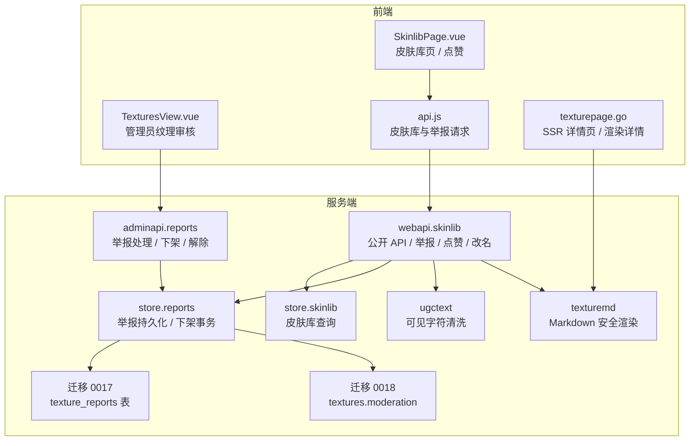

**图表来源**
- [ugctext.go:1-33](https://github.com/YimingZhanshen/skin-nexus/blob/797ae1a/server/internal/ugctext/ugctext.go#L1-L33)
- [texturemd.go:1-66](https://github.com/YimingZhanshen/skin-nexus/blob/797ae1a/server/internal/texturemd/texturemd.go#L1-L66)
- [skinlib.go:1-200](https://github.com/YimingZhanshen/skin-nexus/blob/797ae1a/server/internal/webapi/skinlib.go#L1-L200)
- [skinlib.go:200-388](https://github.com/YimingZhanshen/skin-nexus/blob/797ae1a/server/internal/webapi/skinlib.go#L200-L388)
- [reports.go:1-200](https://github.com/YimingZhanshen/skin-nexus/blob/797ae1a/server/internal/adminapi/reports.go#L1-L200)
- [reports.go:1-200](https://github.com/YimingZhanshen/skin-nexus/blob/797ae1a/server/internal/store/reports.go#L1-L200)
- [skinlib.go:1-200](https://github.com/YimingZhanshen/skin-nexus/blob/797ae1a/server/internal/store/skinlib.go#L1-L200)
- [0017_texture_metadata_reports.sql:1-20](https://github.com/YimingZhanshen/skin-nexus/blob/797ae1a/server/migrations/sqlite/0017_texture_metadata_reports.sql#L1-L20)
- [0018_texture_moderation.sql:1-5](https://github.com/YimingZhanshen/skin-nexus/blob/797ae1a/server/migrations/sqlite/0018_texture_moderation.sql#L1-L5)
- [SkinlibPage.vue:1-200](https://github.com/YimingZhanshen/skin-nexus/blob/797ae1a/web/src/pages/SkinlibPage.vue#L1-L200)
- [TexturesView.vue:1-200](https://github.com/YimingZhanshen/skin-nexus/blob/797ae1a/web/src/components/admin/TexturesView.vue#L1-L200)
- [api.js:1-161](https://github.com/YimingZhanshen/skin-nexus/blob/797ae1a/web/src/api.js#L1-L161)
- [texturepage.go:1-200](https://github.com/YimingZhanshen/skin-nexus/blob/797ae1a/server/cmd/skin-nexus/texturepage.go#L1-L200)

**章节来源**
- [ugctext.go:1-33](https://github.com/YimingZhanshen/skin-nexus/blob/797ae1a/server/internal/ugctext/ugctext.go#L1-L33)
- [texturemd.go:1-66](https://github.com/YimingZhanshen/skin-nexus/blob/797ae1a/server/internal/texturemd/texturemd.go#L1-L66)
- [skinlib.go:1-200](https://github.com/YimingZhanshen/skin-nexus/blob/797ae1a/server/internal/webapi/skinlib.go#L1-L200)
- [skinlib.go:200-388](https://github.com/YimingZhanshen/skin-nexus/blob/797ae1a/server/internal/webapi/skinlib.go#L200-L388)
- [reports.go:1-200](https://github.com/YimingZhanshen/skin-nexus/blob/797ae1a/server/internal/adminapi/reports.go#L1-L200)
- [reports.go:1-200](https://github.com/YimingZhanshen/skin-nexus/blob/797ae1a/server/internal/store/reports.go#L1-L200)
- [skinlib.go:1-200](https://github.com/YimingZhanshen/skin-nexus/blob/797ae1a/server/internal/store/skinlib.go#L1-L200)
- [0017_texture_metadata_reports.sql:1-20](https://github.com/YimingZhanshen/skin-nexus/blob/797ae1a/server/migrations/sqlite/0017_texture_metadata_reports.sql#L1-L20)
- [0018_texture_moderation.sql:1-5](https://github.com/YimingZhanshen/skin-nexus/blob/797ae1a/server/migrations/sqlite/0018_texture_moderation.sql#L1-L5)
- [SkinlibPage.vue:1-200](https://github.com/YimingZhanshen/skin-nexus/blob/797ae1a/web/src/pages/SkinlibPage.vue#L1-L200)
- [TexturesView.vue:1-200](https://github.com/YimingZhanshen/skin-nexus/blob/797ae1a/web/src/components/admin/TexturesView.vue#L1-L200)
- [api.js:1-161](https://github.com/YimingZhanshen/skin-nexus/blob/797ae1a/web/src/api.js#L1-L161)
- [texturepage.go:1-200](https://github.com/YimingZhanshen/skin-nexus/blob/797ae1a/server/cmd/skin-nexus/texturepage.go#L1-L200)

## 核心组件
- **ugctext**：负责去除危险但视觉不可见的 Unicode 控制字符，保留 emoji 序列和合法连字符，避免反向书写、零宽空格等干扰显示或欺骗比对的内容进入存储层。
- **texturemd**：将用户 Markdown 描述转换为安全 HTML，仅允许标题、段落、加粗、斜体、列表、代码块、表格和 http(s) 链接；拒绝 script、img、iframe、style、javascript 协议等危险内容。
- **webapi.skinlib**：暴露皮肤库列表、点赞、改名、公开性切换、来源元数据更新和举报接口；对名称、描述、来源 URL 做长度、白名单和可见字符清洗。
- **adminapi.reports**：管理端举报处理、纹理下架、违规解除、审计日志写入与通知。
- **store.reports**：举报插入、按用户/材质限流计数、举报列表查询、举报解决、纹理下架事务、违规解除。
- **store.skinlib**：皮肤库列表与单条查询，应用访问者权限、公开性、类型和关键词过滤。
- **迁移 0017/0018**：新增 `detail_md`、`source`、`source_url`、`texture_reports` 表，以及 `textures.moderation` 列。
- **前端 SkinlibPage.vue**：公开皮肤库页面，负责点赞、收藏语义、错误提示。
- **前端 TexturesView.vue**：管理员纹理审核视图，支持搜索、筛选、下架、解除、删除等操作。
- **前端 api.js**：封装皮肤库列表、点赞、举报等请求。
- **texturepage.go**：服务端渲染的皮肤库详情页，消费 `texturemd.Render` 输出安全 HTML。

**章节来源**
- [ugctext.go:1-33](https://github.com/YimingZhanshen/skin-nexus/blob/797ae1a/server/internal/ugctext/ugctext.go#L1-L33)
- [texturemd.go:1-66](https://github.com/YimingZhanshen/skin-nexus/blob/797ae1a/server/internal/texturemd/texturemd.go#L1-L66)
- [skinlib.go:1-200](https://github.com/YimingZhanshen/skin-nexus/blob/797ae1a/server/internal/webapi/skinlib.go#L1-L200)
- [skinlib.go:200-388](https://github.com/YimingZhanshen/skin-nexus/blob/797ae1a/server/internal/webapi/skinlib.go#L200-L388)
- [reports.go:1-200](https://github.com/YimingZhanshen/skin-nexus/blob/797ae1a/server/internal/adminapi/reports.go#L1-L200)
- [reports.go:1-200](https://github.com/YimingZhanshen/skin-nexus/blob/797ae1a/server/internal/store/reports.go#L1-L200)
- [skinlib.go:1-200](https://github.com/YimingZhanshen/skin-nexus/blob/797ae1a/server/internal/store/skinlib.go#L1-L200)
- [0017_texture_metadata_reports.sql:1-20](https://github.com/YimingZhanshen/skin-nexus/blob/797ae1a/server/migrations/sqlite/0017_texture_metadata_reports.sql#L1-L20)
- [0018_texture_moderation.sql:1-5](https://github.com/YimingZhanshen/skin-nexus/blob/797ae1a/server/migrations/sqlite/0018_texture_moderation.sql#L1-L5)
- [SkinlibPage.vue:1-200](https://github.com/YimingZhanshen/skin-nexus/blob/797ae1a/web/src/pages/SkinlibPage.vue#L1-L200)
- [TexturesView.vue:1-200](https://github.com/YimingZhanshen/skin-nexus/blob/797ae1a/web/src/components/admin/TexturesView.vue#L1-L200)
- [api.js:1-161](https://github.com/YimingZhanshen/skin-nexus/blob/797ae1a/web/src/api.js#L1-L161)
- [texturepage.go:1-200](https://github.com/YimingZhanshen/skin-nexus/blob/797ae1a/server/cmd/skin-nexus/texturepage.go#L1-L200)

## 架构总览
下图展示从用户提交到渲染、举报、审核的关键调用链：

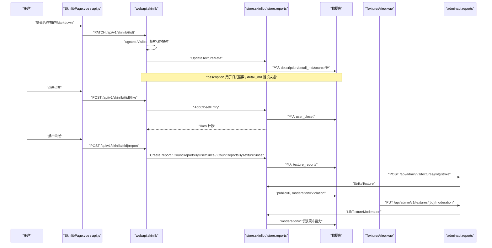

**图表来源**
- [skinlib.go:1-200](https://github.com/YimingZhanshen/skin-nexus/blob/797ae1a/server/internal/webapi/skinlib.go#L1-L200)
- [skinlib.go:200-388](https://github.com/YimingZhanshen/skin-nexus/blob/797ae1a/server/internal/webapi/skinlib.go#L200-L388)
- [reports.go:1-200](https://github.com/YimingZhanshen/skin-nexus/blob/797ae1a/server/internal/adminapi/reports.go#L1-L200)
- [reports.go:1-200](https://github.com/YimingZhanshen/skin-nexus/blob/797ae1a/server/internal/store/reports.go#L1-L200)
- [skinlib.go:1-200](https://github.com/YimingZhanshen/skin-nexus/blob/797ae1a/server/internal/store/skinlib.go#L1-L200)
- [api.js:1-161](https://github.com/YimingZhanshen/skin-nexus/blob/797ae1a/web/src/api.js#L1-L161)
- [TexturesView.vue:1-200](https://github.com/YimingZhanshen/skin-nexus/blob/797ae1a/web/src/components/admin/TexturesView.vue#L1-L200)

## 详细组件分析

### ugctext 可见字符清洗
ugctext 的目标不是通用敏感词检测，而是防御 Unicode 控制字符带来的显示欺骗和注入风险。它扫描输入中的 Unicode Cf 类字符，除少数连接符外全部移除。测试覆盖了方向控制、隔离符和连字场景，确保正常多语言表情和文字不被破坏。

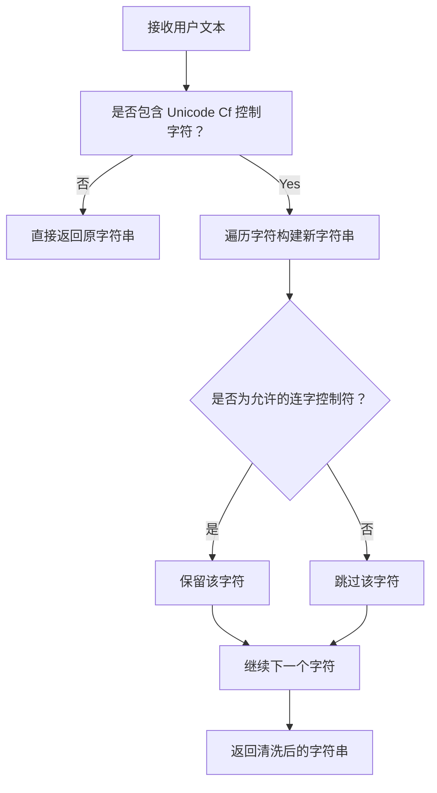

**图表来源**
- [ugctext.go:1-33](https://github.com/YimingZhanshen/skin-nexus/blob/797ae1a/server/internal/ugctext/ugctext.go#L1-L33)
- [ugctext_test.go:1-25](https://github.com/YimingZhanshen/skin-nexus/blob/797ae1a/server/internal/ugctext/ugctext_test.go#L1-L25)

**章节来源**
- [ugctext.go:1-33](https://github.com/YimingZhanshen/skin-nexus/blob/797ae1a/server/internal/ugctext/ugctext.go#L1-L33)
- [ugctext_test.go:1-25](https://github.com/YimingZhanshen/skin-nexus/blob/797ae1a/server/internal/ugctext/ugctext_test.go#L1-L25)

### texturemd Markdown 安全渲染
texturemd 使用 goldmark 解析 GFM Markdown，再通过 bluemonday 策略只放行安全的 HTML 元素和 http(s) 链接。图片、iframe、表单、内联样式、javascript 协议均被拒绝；链接会附加 nofollow 与 no-referrer，降低外链追踪风险。Excerpt 还会对渲染结果再次走严格策略提取纯文本摘要。

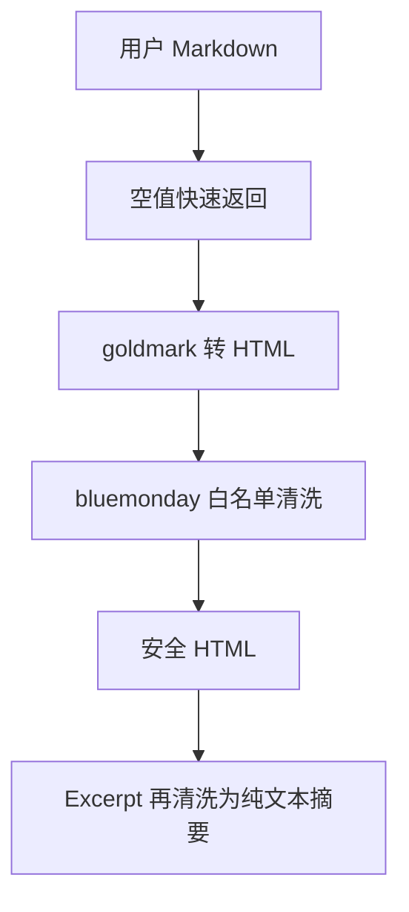

**图表来源**
- [texturemd.go:1-66](https://github.com/YimingZhanshen/skin-nexus/blob/797ae1a/server/internal/texturemd/texturemd.go#L1-L66)
- [texturemd_test.go:1-40](https://github.com/YimingZhanshen/skin-nexus/blob/797ae1a/server/internal/texturemd/texturemd_test.go#L1-L40)

**章节来源**
- [texturemd.go:1-66](https://github.com/YimingZhanshen/skin-nexus/blob/797ae1a/server/internal/texturemd/texturemd.go#L1-L66)
- [texturemd_test.go:1-40](https://github.com/YimingZhanshen/skin-nexus/blob/797ae1a/server/internal/texturemd/texturemd_test.go#L1-L40)

### 名称与描述写入流程
公开皮肤库 PATCH 接口允许上传者修改名称、描述、来源、来源 URL 和公开性。名称和描述先经 `ugctext.Visible` 清洗，再做长度限制；来源 URL 必须为合法的 http(s) 地址；derivative 与 repost 必须附带原始 URL。若材质已被标记违规，则禁止改为公开。

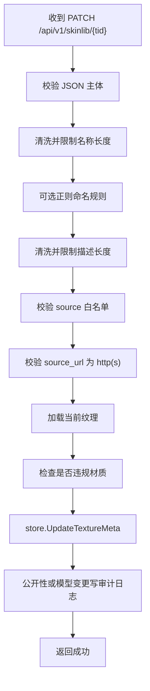

**图表来源**
- [skinlib.go:200-388](https://github.com/YimingZhanshen/skin-nexus/blob/797ae1a/server/internal/webapi/skinlib.go#L200-L388)

**章节来源**
- [skinlib.go:200-388](https://github.com/YimingZhanshen/skin-nexus/blob/797ae1a/server/internal/webapi/skinlib.go#L200-L388)

### 点赞与收藏语义
公开皮肤库的“点赞”实际上复用收藏语义：`skinlibLike` 调用 `AddClosetEntry`，失败时返回未找到或内部错误；成功后返回新的 likes 计数。取消点赞则调用 `RemoveClosetEntryByTID`，同样返回新的 likes 计数。皮肤库列表通过 `user_closet` 聚合 likes，而不是依赖 `textures.likes` 冗余字段。

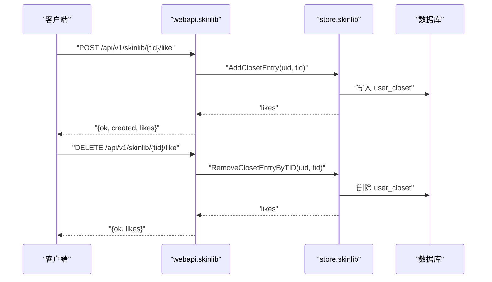

**图表来源**
- [skinlib.go:1-200](https://github.com/YimingZhanshen/skin-nexus/blob/797ae1a/server/internal/webapi/skinlib.go#L1-L200)
- [skinlib.go:1-200](https://github.com/YimingZhanshen/skin-nexus/blob/797ae1a/server/internal/store/skinlib.go#L1-L200)

**章节来源**
- [skinlib.go:1-200](https://github.com/YimingZhanshen/skin-nexus/blob/797ae1a/server/internal/webapi/skinlib.go#L1-L200)
- [skinlib.go:1-200](https://github.com/YimingZhanshen/skin-nexus/blob/797ae1a/server/internal/store/skinlib.go#L1-L200)

### 举报流程与限流
举报接口要求登录用户，不允许举报自己的材质。允许的原因有版权、色情、暴力、仇恨、垃圾、其他六类；备注最多 500 字符。限流策略为：

- 同一用户 24 小时内最多 10 次举报。
- 同一材质 24 小时内最多 50 次举报。
- 同一用户对同一材质重复举报返回冲突。

举报写入 `texture_reports` 表，状态为 open，由管理员后续处理。

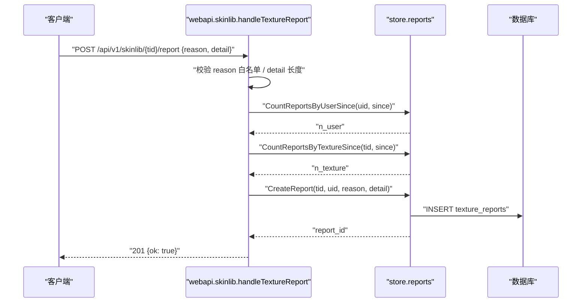

**图表来源**
- [skinlib.go:200-388](https://github.com/YimingZhanshen/skin-nexus/blob/797ae1a/server/internal/webapi/skinlib.go#L200-L388)
- [reports.go:1-200](https://github.com/YimingZhanshen/skin-nexus/blob/797ae1a/server/internal/store/reports.go#L1-L200)

**章节来源**
- [skinlib.go:200-388](https://github.com/YimingZhanshen/skin-nexus/blob/797ae1a/server/internal/webapi/skinlib.go#L200-L388)
- [reports.go:1-200](https://github.com/YimingZhanshen/skin-nexus/blob/797ae1a/server/internal/store/reports.go#L1-L200)

### 管理员审核：下架与解除
管理员有两个关键动作：

1. **下架（标记违规）**：通过 `/api/admin/v1/textures/{tid}/strike` 或举报处理中的 hide 动作，调用 `StrikeTexture`。该函数在事务中将 `public` 置为 0，清空 `public_dedupe`，并将 `moderation` 设为 `violation`。同时关闭相关举报、写审计日志并通知上传者。
2. **解除违规**：通过 `/api/admin/v1/textures/{tid}/moderation` PUT 空值，调用 `LiftTextureModeration`，将 `moderation` 恢复为空字符串。注意：这解除的是“禁止重新公开”的限制，并不自动把材质设为公开。

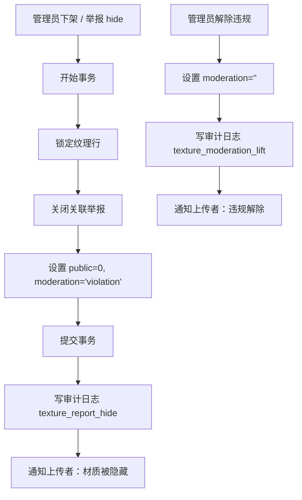

**图表来源**
- [reports.go:1-200](https://github.com/YimingZhanshen/skin-nexus/blob/797ae1a/server/internal/adminapi/reports.go#L1-L200)
- [reports.go:1-200](https://github.com/YimingZhanshen/skin-nexus/blob/797ae1a/server/internal/store/reports.go#L1-L200)

**章节来源**
- [reports.go:1-200](https://github.com/YimingZhanshen/skin-nexus/blob/797ae1a/server/internal/adminapi/reports.go#L1-L200)
- [reports.go:1-200](https://github.com/YimingZhanshen/skin-nexus/blob/797ae1a/server/internal/store/reports.go#L1-L200)

### 数据库模型与字段约定
当前仓库并未在 `textures` 表中维护名为 `report_count` 或 `moderation_flag` 的列。相关语义如下：

- `textures.description`：短描述，仍用于历史兼容和搜索。
- `textures.detail_md`：长 Markdown 描述。
- `textures.source`、`textures.source_url`：来源与原始链接。
- `textures.public`：是否公开。
- `textures.moderation`：违规状态，空字符串表示干净，`violation` 表示被下架。
- `texture_reports`：举报记录表，含 `texture_id`、`reporter_uid`、`reason`、`detail`、`status`、`handled_by`、`created_at`、`handled_at`。

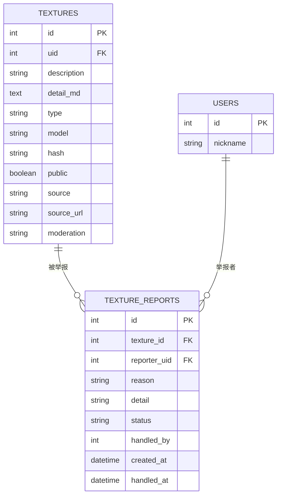

**图表来源**
- [0017_texture_metadata_reports.sql:1-20](https://github.com/YimingZhanshen/skin-nexus/blob/797ae1a/server/migrations/sqlite/0017_texture_metadata_reports.sql#L1-L20)
- [0018_texture_moderation.sql:1-5](https://github.com/YimingZhanshen/skin-nexus/blob/797ae1a/server/migrations/sqlite/0018_texture_moderation.sql#L1-L5)

**章节来源**
- [0017_texture_metadata_reports.sql:1-20](https://github.com/YimingZhanshen/skin-nexus/blob/797ae1a/server/migrations/sqlite/0017_texture_metadata_reports.sql#L1-L20)
- [0018_texture_moderation.sql:1-5](https://github.com/YimingZhanshen/skin-nexus/blob/797ae1a/server/migrations/sqlite/0018_texture_moderation.sql#L1-L5)

### 皮肤库详情页举报按钮与 Markdown 渲染
皮肤库详情页由 `texturepage.go` 服务端渲染，使用 `texturemd.Render` 将 `detail_md` 转为安全 HTML。详情页模板中包含举报对话框 UI；前端公开皮肤库页面主要负责列表、点赞和编辑操作，而详情页的举报交互通常由服务端模板与静态资源共同完成。

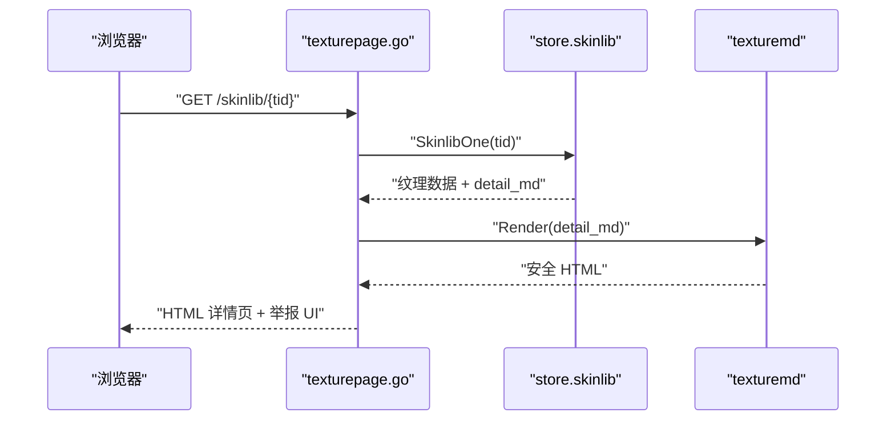

**图表来源**
- [texturepage.go:1-200](https://github.com/YimingZhanshen/skin-nexus/blob/797ae1a/server/cmd/skin-nexus/texturepage.go#L1-L200)
- [texturemd.go:1-66](https://github.com/YimingZhanshen/skin-nexus/blob/797ae1a/server/internal/texturemd/texturemd.go#L1-L66)

**章节来源**
- [texturepage.go:1-200](https://github.com/YimingZhanshen/skin-nexus/blob/797ae1a/server/cmd/skin-nexus/texturepage.go#L1-L200)
- [texturemd.go:1-66](https://github.com/YimingZhanshen/skin-nexus/blob/797ae1a/server/internal/texturemd/texturemd.go#L1-L66)

### 管理员 TexturesView.vue 审核操作
`TexturesView.vue` 提供管理员纹理列表，支持按关键词、类型、状态筛选，并提供以下操作：

- **下架**：调用 `POST /api/admin/v1/textures/{id}/strike`。
- **解除违规**：调用 `PUT /api/admin/v1/textures/{id}/moderation`，body 为 `{moderation: ""}`。
- **删除**：调用 `DELETE /api/admin/v1/textures/{id}`，必要时带 `force=1`。

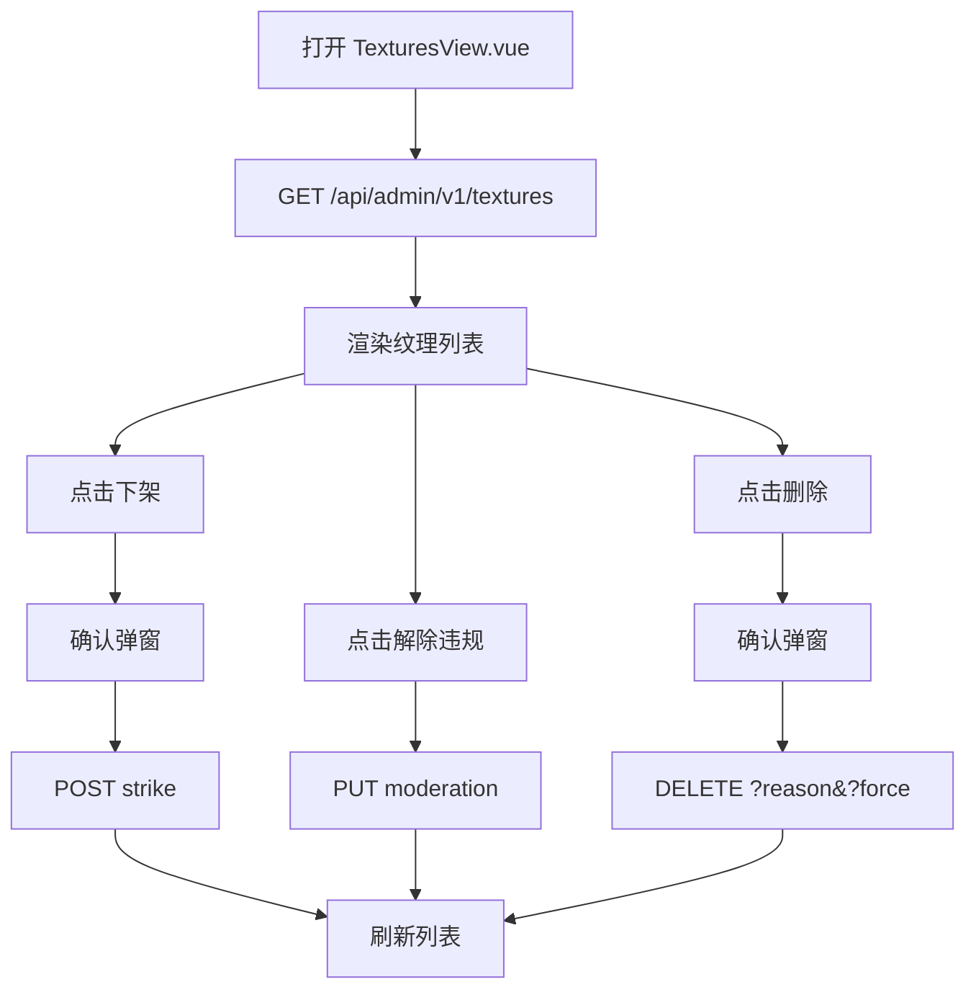

**图表来源**
- [TexturesView.vue:1-200](https://github.com/YimingZhanshen/skin-nexus/blob/797ae1a/web/src/components/admin/TexturesView.vue#L1-L200)
- [reports.go:1-200](https://github.com/YimingZhanshen/skin-nexus/blob/797ae1a/server/internal/adminapi/reports.go#L1-L200)

**章节来源**
- [TexturesView.vue:1-200](https://github.com/YimingZhanshen/skin-nexus/blob/797ae1a/web/src/components/admin/TexturesView.vue#L1-L200)
- [reports.go:1-200](https://github.com/YimingZhanshen/skin-nexus/blob/797ae1a/server/internal/adminapi/reports.go#L1-L200)

## 依赖关系分析
ugctext 与 texturemd 是低耦合工具包，分别承担“输入文本可见性清洗”和“Markdown 输出安全化”。webapi.skinlib 是主要业务编排点，组合 ugctext、store 层与外部鉴权。store.reports 集中了举报与违规状态的事务逻辑。迁移脚本定义最终持久化形态。

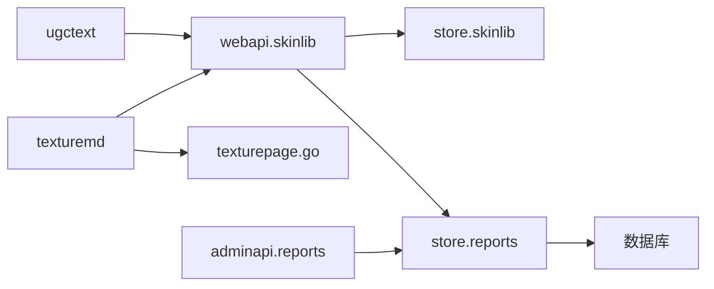

**图表来源**
- [ugctext.go:1-33](https://github.com/YimingZhanshen/skin-nexus/blob/797ae1a/server/internal/ugctext/ugctext.go#L1-L33)
- [texturemd.go:1-66](https://github.com/YimingZhanshen/skin-nexus/blob/797ae1a/server/internal/texturemd/texturemd.go#L1-L66)
- [skinlib.go:1-200](https://github.com/YimingZhanshen/skin-nexus/blob/797ae1a/server/internal/webapi/skinlib.go#L1-L200)
- [skinlib.go:200-388](https://github.com/YimingZhanshen/skin-nexus/blob/797ae1a/server/internal/webapi/skinlib.go#L200-L388)
- [reports.go:1-200](https://github.com/YimingZhanshen/skin-nexus/blob/797ae1a/server/internal/adminapi/reports.go#L1-L200)
- [reports.go:1-200](https://github.com/YimingZhanshen/skin-nexus/blob/797ae1a/server/internal/store/reports.go#L1-L200)

**章节来源**
- [ugctext.go:1-33](https://github.com/YimingZhanshen/skin-nexus/blob/797ae1a/server/internal/ugctext/ugctext.go#L1-L33)
- [texturemd.go:1-66](https://github.com/YimingZhanshen/skin-nexus/blob/797ae1a/server/internal/texturemd/texturemd.go#L1-L66)
- [skinlib.go:1-200](https://github.com/YimingZhanshen/skin-nexus/blob/797ae1a/server/internal/webapi/skinlib.go#L1-L200)
- [skinlib.go:200-388](https://github.com/YimingZhanshen/skin-nexus/blob/797ae1a/server/internal/webapi/skinlib.go#L200-L388)
- [reports.go:1-200](https://github.com/YimingZhanshen/skin-nexus/blob/797ae1a/server/internal/adminapi/reports.go#L1-L200)
- [reports.go:1-200](https://github.com/YimingZhanshen/skin-nexus/blob/797ae1a/server/internal/store/reports.go#L1-L200)

## 性能与安全性考虑

### 性能特性
- Markdown 渲染路径在空输入时直接返回空串，避免无意义转换。
- 皮肤库列表不依赖冗余 likes 列，而是实时统计 `user_closet`，保证一致性但增加一次子查询。
- 举报计数查询按时间窗口聚合，适合高频举报防护，但不作为公开计数器暴露给前端。
- 详情页使用服务器端渲染，便于爬虫抓取真实内容，也减少 SPA 首屏 JavaScript 负担。

### 安全风险与缓解
- **XSS**：通过 bluemonday 白名单阻止 script、img、iframe、style、javascript 协议等危险标签。
- **外链追踪与 NSFW**：远程图片和非 http(s) 链接被拒绝，链接附加 nofollow/no-referrer。
- **Unicode 欺骗**：ugctext 清除 Cf 控制字符，防止反向书写和零宽字符绕过。
- **重复举报与刷举报**：用户维度 24 小时 10 次、材质维度 24 小时 50 次，重复举报返回冲突。
- **违规材质重发布**：`moderation='violation'` 阻止上传者将材质改回公开，解除后仍需手动公开。

[本节为通用指导，不直接分析具体源码片段]

## 故障排查指南

### 常见异常与定位
- **举报原因无效**：检查 reason 是否属于允许集合。
- **举报备注过长**：detail 超过 500 字符会被拒绝。
- **重复举报**：同一用户对同一材质已举报过，返回冲突。
- **举报频率过高**：用户或材质 24 小时内超过阈值，返回过多请求。
- **无法举报私有材质**：目标材质不存在或为私有。
- **违规材质不能公开**：PATCH 时将返回违规禁止公开错误。
- **管理员解除违规后仍不公开**：解除只是去掉违规标记，不代表自动设为公开。

**章节来源**
- [skinlib.go:200-388](https://github.com/YimingZhanshen/skin-nexus/blob/797ae1a/server/internal/webapi/skinlib.go#L200-L388)
- [reports.go:1-200](https://github.com/YimingZhanshen/skin-nexus/blob/797ae1a/server/internal/adminapi/reports.go#L1-L200)
- [reports.go:1-200](https://github.com/YimingZhanshen/skin-nexus/blob/797ae1a/server/internal/store/reports.go#L1-L200)

## 运营建议

### 定期清理低质量材质
- 利用管理员纹理视图按状态筛选，优先处理长期无人互动、频繁举报且未处理的材质。
- 结合删除流程与 tombstone 机制，确保删除后仍有审核历史可查。

### 对高频举报用户限流
- 当前已实现用户 24 小时 10 次、材质 24 小时 50 次上限；可根据运营数据调整阈值。
- 对连续触发限流的用户，可配合账户封禁或限制上传/评论功能。

### 审计日志记录审核操作
- 下架、解除违规、公开性变更、模型修正均已写入审计日志。
- 建议定期导出审计日志，核对管理员操作、举报处理和通知发送情况。
- 对于高风险操作，应启用更严格的权限校验与双人复核流程。

### 持续改进敏感词检测
- 当前 ugctext 侧重 Unicode 控制字符，未实现完整敏感词匹配。
- 建议在 ugctext 层增加可扩展的词表匹配模块，并对匹配结果打标签，供举报与审核界面参考。
- 对高频举报原因分类（版权、色情、暴力、仇恨、垃圾、其他）建立统计看板，辅助词表迭代。

[本节为运营实践建议，不直接分析具体源码片段]

## 结论
本系统的 UGC 文本安全采用“写入前清洗 + 渲染时白名单 + 举报与审核闭环”的分层设计：ugctext 防御 Unicode 控制字符，texturemd 用 goldmark 与 bluemonday 确保 Markdown 输出安全，webapi.skinlib 编排上传、点赞、改名与举报，store.reports 集中处理举报与违规状态，adminapi.reports 提供管理员审核能力。当前实现没有 `report_count` 或 `moderation_flag` 字段，而是通过 `texture_reports` 表和 `textures.moderation` 表达审核语义。未来可在敏感词检测、举报计数可视化、高频举报治理和审计报表方面进一步扩展。
