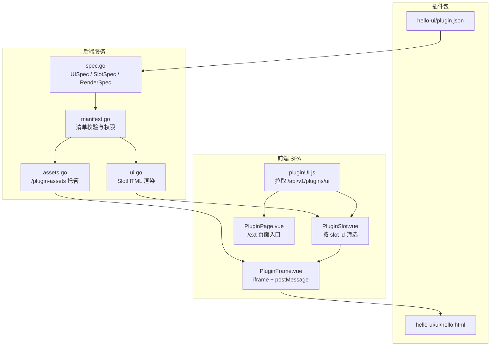
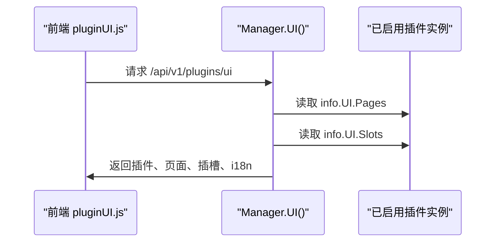
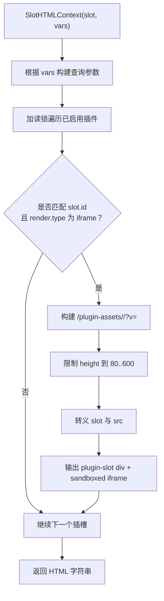
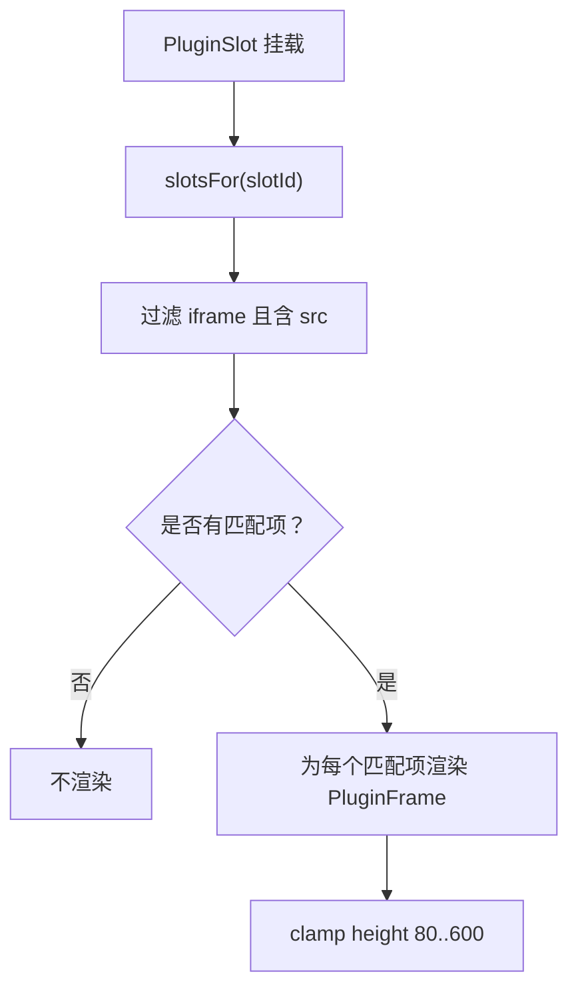
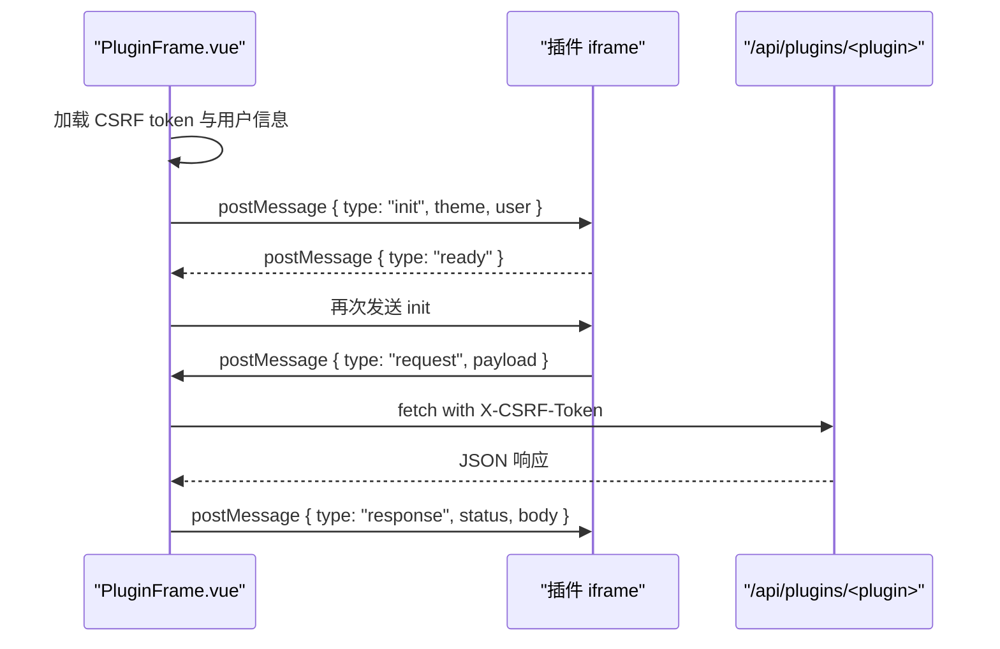
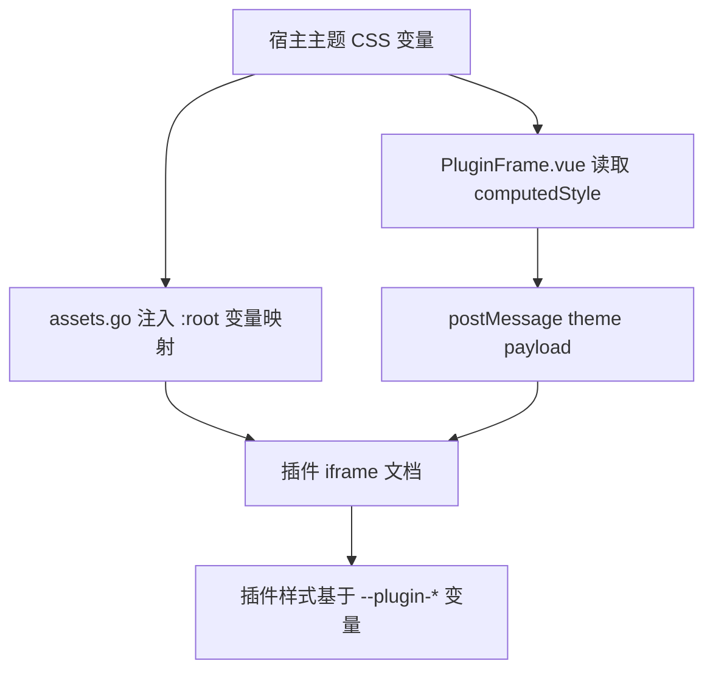
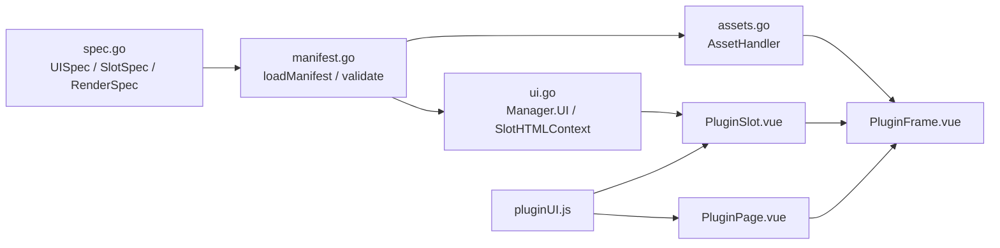

# UI 插槽与 iframe 集成

**本文引用的文件**
- [server/internal/plugin/ui.go](https://github.com/YimingZhanshen/skin-nexus/blob/797ae1a/server/internal/plugin/ui.go)
- [server/internal/plugin/assets.go](https://github.com/YimingZhanshen/skin-nexus/blob/797ae1a/server/internal/plugin/assets.go)
- [server/internal/plugin/spec.go](https://github.com/YimingZhanshen/skin-nexus/blob/797ae1a/server/internal/plugin/spec.go)
- [server/internal/plugin/manifest.go](https://github.com/YimingZhanshen/skin-nexus/blob/797ae1a/server/internal/plugin/manifest.go)
- [web/src/components/plugin/PluginFrame.vue](https://github.com/YimingZhanshen/skin-nexus/blob/797ae1a/web/src/components/plugin/PluginFrame.vue)
- [web/src/components/plugin/PluginSlot.vue](https://github.com/YimingZhanshen/skin-nexus/blob/797ae1a/web/src/components/plugin/PluginSlot.vue)
- [web/src/components/plugin/PluginPage.vue](https://github.com/YimingZhanshen/skin-nexus/blob/797ae1a/web/src/components/plugin/PluginPage.vue)
- [web/src/pluginUI.js](https://github.com/YimingZhanshen/skin-nexus/blob/797ae1a/web/src/pluginUI.js)
- [examples/plugins/hello-ui/plugin.json](https://github.com/YimingZhanshen/skin-nexus/blob/797ae1a/examples/plugins/hello-ui/plugin.json)
- [examples/plugins/hello-ui/ui/hello.html](https://github.com/YimingZhanshen/skin-nexus/blob/797ae1a/examples/plugins/hello-ui/ui/hello.html)

## 目录

1. [引言](#引言)
2. [项目结构与定位](#项目结构与定位)
3. [核心概念：ui、页面、插槽、资源路径](#核心概念ui页面插槽资源路径)
4. [服务端渲染流程](#服务端渲染流程)
5. [前端插件框架组件](#前端插件框架组件)
6. [hello-ui 示例解析](#hello-ui-示例解析)
7. [管理面板插槽与玩家页面插槽的区别](#管理面板插槽与玩家页面插槽的区别)
8. [安全边界与样式隔离](#安全边界与样式隔离)
9. [依赖关系分析](#依赖关系分析)
10. [开发指南](#开发指南)
11. [故障排查](#故障排查)
12. [总结](#总结)

## 引言

本文面向插件开发者与维护者，说明 SkinNexus 中“插件用户界面”这一子系统的工作方式。它回答以下问题：

- 在 `plugin.json` 的 `ui` 块中如何声明页面和插槽。
- 插槽 `id` 如何与宿主页面的挂载点匹配。
- `ui.assets` 指向的资源由哪个 HTTP 端点托管，以及如何注入主题与安全头。
- 后端如何把 slot 渲染成带沙箱的 `<iframe>`。
- 前端 `PluginFrame.vue` 与 `PluginSlot.vue` 如何加载远程页面并处理消息。
- 如何通过 hello-ui 示例理解跨域通信模式。
- 管理面板插槽与玩家页面插槽的差异、安全策略和样式隔离方案。
- 如何在本地预览插件 UI、处理登录态、适配暗色主题以及调试 iframe 控制台错误。

本系统的设计目标是：**零构建插件 UI**。插件只需提供 HTML/CSS/JS 文件，宿主通过 iframe 沙箱加载，并通过受控的消息协议完成主题、用户信息和 API 调用。

## 项目结构与定位

UI 插槽与 iframe 集成横跨三个层次：

| 层次 | 主要文件 | 职责 |
|---|---|---|
| 插件清单层 | `server/internal/plugin/spec.go`、`server/internal/plugin/manifest.go`、`examples/plugins/hello-ui/plugin.json` | 定义 `UISpec`、`SlotSpec`、`RenderSpec`，校验权限，暴露 `pages`、`slots`、`i18n` |
| 服务端运行层 | `server/internal/plugin/ui.go`、`server/internal/plugin/assets.go` | 将 slot 渲染为 iframe HTML；托管 `/plugin-assets/<name>/<path>` |
| 前端视图层 | `web/src/components/plugin/PluginFrame.vue`、`PluginSlot.vue`、`PluginPage.vue`、`web/src/pluginUI.js` | 拉取插件元数据、渲染 iframe、建立消息桥接 |

**图表来源**
- [server/internal/plugin/spec.go:57-125](https://github.com/YimingZhanshen/skin-nexus/blob/797ae1a/server/internal/plugin/spec.go#L57-L125)
- [server/internal/plugin/manifest.go:1-60](https://github.com/YimingZhanshen/skin-nexus/blob/797ae1a/server/internal/plugin/manifest.go#L1-L60)
- [server/internal/plugin/ui.go:1-138](https://github.com/YimingZhanshen/skin-nexus/blob/797ae1a/server/internal/plugin/ui.go#L1-L138)
- [server/internal/plugin/assets.go:1-185](https://github.com/YimingZhanshen/skin-nexus/blob/797ae1a/server/internal/plugin/assets.go#L1-L185)
- [web/src/pluginUI.js:1-90](https://github.com/YimingZhanshen/skin-nexus/blob/797ae1a/web/src/pluginUI.js#L1-L90)
- [web/src/components/plugin/PluginSlot.vue:1-24](https://github.com/YimingZhanshen/skin-nexus/blob/797ae1a/web/src/components/plugin/PluginSlot.vue#L1-L24)
- [web/src/components/plugin/PluginFrame.vue:1-200](https://github.com/YimingZhanshen/skin-nexus/blob/797ae1a/web/src/components/plugin/PluginFrame.vue#L1-L200)
- [web/src/components/plugin/PluginPage.vue:1-39](https://github.com/YimingZhanshen/skin-nexus/blob/797ae1a/web/src/components/plugin/PluginPage.vue#L1-L39)
- [examples/plugins/hello-ui/plugin.json:1-29](https://github.com/YimingZhanshen/skin-nexus/blob/797ae1a/examples/plugins/hello-ui/plugin.json#L1-L29)
- [examples/plugins/hello-ui/ui/hello.html:1-20](https://github.com/YimingZhanshen/skin-nexus/blob/797ae1a/examples/plugins/hello-ui/ui/hello.html#L1-L20)

**章节来源**
- [server/internal/plugin/spec.go:57-125](https://github.com/YimingZhanshen/skin-nexus/blob/797ae1a/server/internal/plugin/spec.go#L57-L125)
- [server/internal/plugin/ui.go:1-138](https://github.com/YimingZhanshen/skin-nexus/blob/797ae1a/server/internal/plugin/ui.go#L1-L138)
- [server/internal/plugin/assets.go:1-185](https://github.com/YimingZhanshen/skin-nexus/blob/797ae1a/server/internal/plugin/assets.go#L1-L185)
- [web/src/components/plugin/PluginFrame.vue:1-200](https://github.com/YimingZhanshen/skin-nexus/blob/797ae1a/web/src/components/plugin/PluginFrame.vue#L1-L200)
- [web/src/components/plugin/PluginSlot.vue:1-24](https://github.com/YimingZhanshen/skin-nexus/blob/797ae1a/web/src/components/plugin/PluginSlot.vue#L1-L24)
- [web/src/components/plugin/PluginPage.vue:1-39](https://github.com/YimingZhanshen/skin-nexus/blob/797ae1a/web/src/components/plugin/PluginPage.vue#L1-L39)
- [web/src/pluginUI.js:1-90](https://github.com/YimingZhanshen/skin-nexus/blob/797ae1a/web/src/pluginUI.js#L1-L90)
- [examples/plugins/hello-ui/plugin.json:1-29](https://github.com/YimingZhanshen/skin-nexus/blob/797ae1a/examples/plugins/hello-ui/plugin.json#L1-L29)
- [examples/plugins/hello-ui/ui/hello.html:1-20](https://github.com/YimingZhanshen/skin-nexus/blob/797ae1a/examples/plugins/hello-ui/ui/hello.html#L1-L20)

## 核心概念：ui、页面、插槽、资源路径

### ui 结构体

后端导出的 `UI` 是供前端 SPA 与服务器端皮肤库使用的只读元数据。它包含：

| 字段 | 含义 |
|---|---|
| `plugin` | 插件名称，由运行时填充 |
| `version` | 插件版本，用于资源缓存失效 |
| `title` | 插件标题 |
| `pages` | 声明式页面列表 |
| `slots` | 插槽列表 |
| `forms` | 可选的主机渲染表单定义 |
| `i18n` | 插件级国际化键值 |

注意：`UI` 明确不包含密钥，仅暴露非敏感元数据。

**章节来源**
- [server/internal/plugin/ui.go:1-25](https://github.com/YimingZhanshen/skin-nexus/blob/797ae1a/server/internal/plugin/ui.go#L1-L25)

### 清单中的 ui 声明

`UISpec` 是 `plugin.json` 中 `ui` 块的内部表示：

| 字段 | 类型 | 说明 |
|---|---|---|
| `pages` | 数组 | 页面声明，每个页面有 `id`、`path`、`area`、`render.type`、`render.src` |
| `slots` | 数组 | 插槽声明，每个插槽有 `id`、`render.type`、`render.src`、可选 `height` |
| `forms` | 对象 | 主机渲染表单的 schema 映射 |
| `assets` | 字符串 | 插件静态资源根目录，例如 `ui/` |
| `i18n` | 嵌套对象 | 按语言代码映射到键值表 |

**章节来源**
- [server/internal/plugin/spec.go:57-70](https://github.com/YimingZhanshen/skin-nexus/blob/797ae1a/server/internal/plugin/spec.go#L57-L70)

### 页面与插槽的数据结构

`PageSpec`、`SlotSpec`、`RenderSpec` 共同描述 UI 渲染契约：

| 结构 | 关键字段 | 作用 |
|---|---|---|
| `PageSpec` | `id`、`path`、`area`、`nav`、`render`、`perm` | 描述 `/ext/*` 下的插件页面 |
| `SlotSpec` | `id`、`render`、`height` | 描述可插入宿主页面的片段 |
| `RenderSpec` | `type`、`src`、`schema` | 当前支持 `iframe` 与 `schema` 两种渲染方式 |

其中 `type=iframe` 对应零构建 HTML 页面；`type=schema` 留给未来主机渲染表单，第一阶段不会由宿主直接渲染。

**章节来源**
- [server/internal/plugin/spec.go:92-125](https://github.com/YimingZhanshen/skin-nexus/blob/797ae1a/server/internal/plugin/spec.go#L92-L125)

### 允许的插槽白名单

插槽不是任意字符串。系统维护一个固定 `fixedSlotIDs` 白名单，包括：

- `app.topbar.after`
- `auth.login.after`
- `auth.register.after`
- `dashboard.cards`
- `texture.upload.after`
- `skinlib.list.toolbar`
- `skinlib.detail.sidebar`
- `profile.card.footer`
- `player.card.footer`
- `footer.before`

这意味着插件不能把内容注入宿主未审查过的页面区域。

**章节来源**
- [server/internal/plugin/spec.go:126-156](https://github.com/YimingZhanshen/skin-nexus/blob/797ae1a/server/internal/plugin/spec.go#L126-L156)

### hello-ui 的实际声明

hello-ui 的 `plugin.json` 展示了最小可用 UI 插件：

| 配置项 | 值 | 解释 |
|---|---|---|
| `permissions` | `["ui:page", "ui:slot", "ui:assets"]` | 需要页面、插槽和资源权限 |
| `ui.assets` | `"ui/"` | 静态资源根目录 |
| `ui.pages[0].path` | `"/ext/hello-ui/hello"` | 完整访问路径 |
| `ui.pages[0].area` | `"user"` | 玩家侧页面 |
| `ui.pages[0].render` | `{"type":"iframe","src":"hello.html"}` | 使用 iframe 渲染 |
| `ui.slots[0].id` | `"app.topbar.after"` | 挂在顶部工具栏之后 |
| `ui.slots[0].height` | `120` | iframe 默认高度 |
| `ui.i18n` | 多语言标题 | 前端 i18n 合并时使用 |

**章节来源**
- [examples/plugins/hello-ui/plugin.json:1-29](https://github.com/YimingZhanshen/skin-nexus/blob/797ae1a/examples/plugins/hello-ui/plugin.json#L1-L29)

## 服务端渲染流程

### 元数据聚合

`Manager.UI()` 遍历已启用插件，收集 `pages` 和 `slots`，并为每个条目填充 `plugin` 名称。该接口被前端用于 `/api/v1/plugins/ui`。

**图表来源**
- [server/internal/plugin/ui.go:26-53](https://github.com/YimingZhanshen/skin-nexus/blob/797ae1a/server/internal/plugin/ui.go#L26-L53)
- [web/src/pluginUI.js:7-23](https://github.com/YimingZhanshen/skin-nexus/blob/797ae1a/web/src/pluginUI.js#L7-L23)

**章节来源**
- [server/internal/plugin/ui.go:26-53](https://github.com/YimingZhanshen/skin-nexus/blob/797ae1a/server/internal/plugin/ui.go#L26-L53)

### 插槽 HTML 渲染

`SlotHTMLContext` 负责把 slot 渲染为安全的 iframe HTML。关键行为如下：

1. 只处理 `s.render.type === "iframe"` 的插槽。
2. 从 `s.Render.Src` 构造 `/plugin-assets/<plugin>/<src>` URL。
3. 如果存在额外变量，拼接查询参数。
4. 追加 `?v=<plugin.version>` 以支持版本化缓存失效。
5. 对 `height` 做上下界限制：最小 80，最大 600，默认 180。
6. 输出 `
<iframe ...></iframe>
`。
7. iframe 使用 `loading="lazy"`、`sandbox="allow-scripts allow-forms"`。

**图表来源**
- [server/internal/plugin/ui.go:55-110](https://github.com/YimingZhanshen/skin-nexus/blob/797ae1a/server/internal/plugin/ui.go#L55-L110)

**章节来源**
- [server/internal/plugin/ui.go:55-110](https://github.com/YimingZhanshen/skin-nexus/blob/797ae1a/server/internal/plugin/ui.go#L55-L110)

### 资源托管

`AssetHandler` 托管 `/plugin-assets/<name>/<rel>`，只对启用了 `ui.assets` 的插件开放。其安全检查包括：

| 检查项 | 处理方式 |
|---|---|
| 方法必须是 GET 或 HEAD | 其他方法返回 405 |
| 路径必须包含插件名和资源相对路径 | 否则返回 404 |
| 清理路径后禁止 `..`、反斜杠、控制字符 | 返回 404 |
| 符号链接必须落在 assets 根内 | 返回 404 |
| 目标必须是普通文件 | 返回 404 |
| 文件大小超过 8MB | 返回 404 |
| HTML 文档注入主题 head | 先缓冲再写入 |
| 非 HTML 直接 `http.ServeContent` | 保持原始响应 |

HTML 文档会获得额外的安全响应头：

| 响应头 | 值 | 目的 |
|---|---|---|
| `Sandbox` | `allow-scripts allow-forms` | iframe 二次加固，即使被直接访问也不继承父页面权限 |
| `X-Content-Type-Options` | `nosniff` | 防止 MIME 嗅探 |
| `Cache-Control` | `public, max-age=0, must-revalidate` | 允许公共缓存但强制重新验证 |

**章节来源**
- [server/internal/plugin/assets.go:60-185](https://github.com/YimingZhanshen/skin-nexus/blob/797ae1a/server/internal/plugin/assets.go#L60-L185)

### CSP 与安全头的位置

需要注意：`server/internal/plugin/assets.go` 本身没有设置 `Content-Security-Policy`。CSP 通常由更上层的 Web 服务器、中间件或站点全局安全头处理。插件 iframe 的安全主要依赖：

1. `sandbox="allow-scripts allow-forms"`，不授予 `allow-same-origin`。
2. `Sandbox` 响应头。
3. 资源路径白名单。
4. 前端消息桥接中对 `origin` 和 `nonce` 的校验。
5. 所有 API 调用走 `/api/plugins/<plugin>/...`，而不是插件直接持有认证凭据。

**章节来源**
- [server/internal/plugin/ui.go:85-110](https://github.com/YimingZhanshen/skin-nexus/blob/797ae1a/server/internal/plugin/ui.go#L85-L110)
- [server/internal/plugin/assets.go:130-170](https://github.com/YimingZhanshen/skin-nexus/blob/797ae1a/server/internal/plugin/assets.go#L130-L170)
- [web/src/components/plugin/PluginFrame.vue:100-170](https://github.com/YimingZhanshen/skin-nexus/blob/797ae1a/web/src/components/plugin/PluginFrame.vue#L100-L170)

## 前端插件框架组件

### 插件元数据加载

`pluginUI.js` 在应用启动时拉取 `/api/v1/plugins/ui`，并将结果存入响应式对象：

| 属性 | 含义 |
|---|---|
| `plugins` | 各插件的 UI 元数据 |
| `capabilities` | 主机能力列表 |
| `slots` | 扁平化插槽列表 |
| `hostVersion` | 宿主版本 |
| `i18n` | 合并进 vue-i18n 的插件命名空间 |

辅助函数包括：

- `pages(area)`：按区域过滤页面。
- `pageByPath(path)`：根据 `/ext/*` 路径查找页面。
- `slotsFor(id)`：按插槽 ID 查找匹配的 iframe 插槽。
- `assetURL(plugin, src)`：生成 `/plugin-assets/<plugin>/<src>?v=<version>`。
- `pluginLabel(plugin, key, fallback)`：按语言回退读取插件标签。

**章节来源**
- [web/src/pluginUI.js:1-90](https://github.com/YimingZhanshen/skin-nexus/blob/797ae1a/web/src/pluginUI.js#L1-L90)

### 插槽容器：PluginSlot.vue

`PluginSlot.vue` 是一个固定插槽出口组件。它的职责很克制：

1. 接收 `slot` 字符串。
2. 调用 `slotsFor(props.slot)`。
3. 过滤出 `render.type === "iframe"` 且 `render.src` 存在的条目。
4. 对每个匹配项渲染 `PluginFrame`。
5. 将 `height` 限制在 80 到 600 之间。

它不会接受任意 HTML，也不会绕过 manifest 白名单。

**图表来源**
- [web/src/components/plugin/PluginSlot.vue:1-24](https://github.com/YimingZhanshen/skin-nexus/blob/797ae1a/web/src/components/plugin/PluginSlot.vue#L1-L24)
- [web/src/pluginUI.js:52-58](https://github.com/YimingZhanshen/skin-nexus/blob/797ae1a/web/src/pluginUI.js#L52-L58)

**章节来源**
- [web/src/components/plugin/PluginSlot.vue:1-24](https://github.com/YimingZhanshen/skin-nexus/blob/797ae1a/web/src/components/plugin/PluginSlot.vue#L1-L24)
- [web/src/pluginUI.js:52-58](https://github.com/YimingZhanshen/skin-nexus/blob/797ae1a/web/src/pluginUI.js#L52-L58)

### 插件页面：PluginPage.vue

`PluginPage.vue` 处理 `/ext/*` 路由。当页面类型为 `iframe` 时，它使用固定高度 520 渲染 `PluginFrame`；对于 `schema` 类型页面，则显示“暂不支持”提示。

这体现了 P1 阶段的设计约束：**iframe 页面可直接使用，schema 页面保留但不渲染。**

**章节来源**
- [web/src/components/plugin/PluginPage.vue:1-39](https://github.com/YimingZhanshen/skin-nexus/blob/797ae1a/web/src/components/plugin/PluginPage.vue#L1-L39)

### 插件帧：PluginFrame.vue

`PluginFrame.vue` 是整个 iframe 集成的核心。它承担以下职责：

#### 初始化流程

1. 生成随机 `nonce`。
2. 获取当前会话用户（优先使用注入的 `sessionUser`，否则调用 `/api/v1/me`）。
3. 获取 CSRF token（通过 `/api/plugins/<plugin>/_csrf`，同源请求）。
4. 向 iframe 发送 `init` 消息，携带：
   - `plugin`
   - `src`
   - `origin`
   - `path`
   - `locale`
   - `user`
   - `theme`

#### 主题载荷

主题信息从宿主 CSS 变量提取，包括背景、面板、边框、文字、强调色、链接色、危险色、成功色以及是否暗色主题。

#### 消息协议

| 方向 | 消息类型 | 载荷 | 行为 |
|---|---|---|---|
| 子帧 → 宿主 | `ready` | 无 | 标记 iframe 就绪，触发一次 `init` |
| 子帧 → 宿主 | `resize` | `height` | 调整 iframe 高度，限制 80–2000 |
| 子帧 → 宿主 | `request` | `path`、`method`、`body` | 宿主发起真实 API 请求 |
| 子帧 → 宿主 | `navigate` | `path` | 仅在 origin 匹配时跳转 |
| 子帧 → 宿主 | `confirm` | `message` | 宿主弹出确认框并返回结果 |
| 宿主 → 子帧 | `response` | `status`、`body` 或 `error` | 转发 API 响应 |
| 宿主 → 子帧 | `confirm-result` | `ok` | 返回确认对话框结果 |

#### 安全要点

- iframe 使用 `sandbox="allow-scripts allow-forms"`，没有 `allow-same-origin`，因此子帧拥有不透明 origin。
- 消息监听同时校验 `ev.origin` 和 `msg.nonce`。
- 子帧不得持有 CSRF token；CSRF 头由宿主附加。
- 子帧不能直接打开对话框或移动顶层窗口。
- `navigate` 使用 `new URL(p.path, location.origin)` 解析并比较 origin，拒绝非法 URL。

**图表来源**
- [web/src/components/plugin/PluginFrame.vue:1-200](https://github.com/YimingZhanshen/skin-nexus/blob/797ae1a/web/src/components/plugin/PluginFrame.vue#L1-L200)

**章节来源**
- [web/src/components/plugin/PluginFrame.vue:1-200](https://github.com/YimingZhanshen/skin-nexus/blob/797ae1a/web/src/components/plugin/PluginFrame.vue#L1-L200)

## hello-ui 示例解析

### plugin.json

hello-ui 是最小的可运行 UI 插件示例：

- 声明 `ui:page`、`ui:slot`、`ui:assets` 三个权限。
- 通过 `ui.assets = "ui/"` 暴露静态目录。
- 注册 `/ext/hello-ui/hello` 页面。
- 在 `app.topbar.after` 插槽嵌入同一个 `hello.html`。
- 提供中英文标题。

**章节来源**
- [examples/plugins/hello-ui/plugin.json:1-29](https://github.com/YimingZhanshen/skin-nexus/blob/797ae1a/examples/plugins/hello-ui/plugin.json#L1-L29)

### hello.html

hello.html 的结构可以概括为：

| 部分 | 内容 |
|---|---|
| `<!doctype html>` | 标准 HTML5 文档 |
| `<head>` | 字符集、标题、基础样式 |
| `<body>` | 展示文本 |
| `<script>` | 通知宿主 `ready`，监听 `init` 消息并标记就绪状态 |

它演示了最基础的跨域通信模式：

1. 页面加载后立即向父窗口发送 `{ v: 1, type: 'ready' }`。
2. 监听父窗口消息，识别 `{ v: 1, type: 'init' }`。
3. 将 `document.body.dataset.ready = '1'`，供后续逻辑判断。

虽然这个示例没有发起 API 请求，但实际插件应遵循 `PluginFrame.vue` 约定的消息协议：不要自行构造认证请求，而是通过 `request` 消息让宿主代为调用。

**章节来源**
- [examples/plugins/hello-ui/ui/hello.html:1-20](https://github.com/YimingZhanshen/skin-nexus/blob/797ae1a/examples/plugins/hello-ui/ui/hello.html#L1-L20)
- [web/src/components/plugin/PluginFrame.vue:100-200](https://github.com/YimingZhanshen/skin-nexus/blob/797ae1a/web/src/components/plugin/PluginFrame.vue#L100-L200)

### 资源访问路径

当 hello-ui 启用后，浏览器实际访问的资源路径如下：

| 用途 | 最终路径 |
|---|---|
| 插件元数据 | `/api/v1/plugins/ui` |
| 页面 iframe 源 | `/plugin-assets/hello-ui/hello.html?v=<version>` |
| 插槽 iframe 源 | 同上，可能附带额外查询参数 |
| 插件 API | `/api/plugins/hello-ui/<payload.path>` |

**章节来源**
- [server/internal/plugin/ui.go:70-90](https://github.com/YimingZhanshen/skin-nexus/blob/797ae1a/server/internal/plugin/ui.go#L70-L90)
- [web/src/pluginUI.js:70-82](https://github.com/YimingZhanshen/skin-nexus/blob/797ae1a/web/src/pluginUI.js#L70-L82)

## 管理面板插槽与玩家页面插槽的区别

### 页面 area 字段

`PageSpec.area` 区分页面属于玩家侧还是管理侧：

| area | 含义 |
|---|---|
| `user` | 玩家页面，由 `pages('user')` 暴露 |
| `admin` | 管理页面，由 `pages('admin')` 暴露 |

hello-ui 的页面使用 `user`，因此出现在玩家侧导航中。

**章节来源**
- [server/internal/plugin/spec.go:92-106](https://github.com/YimingZhanshen/skin-nexus/blob/797ae1a/server/internal/plugin/spec.go#L92-L106)
- [web/src/pluginUI.js:25-43](https://github.com/YimingZhanshen/skin-nexus/blob/797ae1a/web/src/pluginUI.js#L25-L43)

### 插槽位置

插槽并不按 `area` 划分，而是按固定 `id` 决定挂载位置。例如：

- `app.topbar.after` 通常位于顶部工具栏之后，适合轻量展示。
- `skinlib.detail.sidebar` 适合放在纹理详情侧边栏。
- `auth.login.after` 适合登录后的补充提示。

插槽本身只是 iframe 容器，真正的业务语义由宿主页面决定。

**章节来源**
- [server/internal/plugin/spec.go:126-156](https://github.com/YimingZhanshen/skin-nexus/blob/797ae1a/server/internal/plugin/spec.go#L126-L156)
- [web/src/components/plugin/PluginSlot.vue:1-24](https://github.com/YimingZhanshen/skin-nexus/blob/797ae1a/web/src/components/plugin/PluginSlot.vue#L1-L24)

### 安全差异

| 维度 | 管理面板 | 玩家页面 |
|---|---|---|
| 访问控制 | 由宿主管理面板路由和权限控制 | 由宿主玩家侧路由控制 |
| iframe 沙箱 | 相同：`allow-scripts allow-forms` | 相同 |
| API 调用 | 同样走 `/api/plugins/<plugin>/...` | 同样走 `/api/plugins/<plugin>/...` |
| 凭据风险 | 插件不应持有 CSRF 或会话 cookie | 插件不应持有 CSRF 或会话 cookie |
| 导航风险 | 宿主仅允许同源跳转 | 宿主仅允许同源跳转 |
| 内容注入风险 | 受限于固定插槽白名单 | 受限于固定插槽白名单 |

两者在 iframe 层共享同一套安全模型；差异主要体现在宿主路由和管理员权限。

**章节来源**
- [server/internal/plugin/ui.go:85-110](https://github.com/YimingZhanshen/skin-nexus/blob/797ae1a/server/internal/plugin/ui.go#L85-L110)
- [web/src/components/plugin/PluginFrame.vue:100-200](https://github.com/YimingZhanshen/skin-nexus/blob/797ae1a/web/src/components/plugin/PluginFrame.vue#L100-L200)
- [server/internal/plugin/spec.go:126-156](https://github.com/YimingZhanshen/skin-nexus/blob/797ae1a/server/internal/plugin/spec.go#L126-L156)

## 安全边界与样式隔离

### iframe 沙箱

系统采用双层沙箱：

1. **HTTP 层**：`AssetHandler` 对 HTML 响应设置 `Sandbox: allow-scripts allow-forms`。
2. **DOM 层**：`SlotHTMLContext` 输出的 iframe 使用 `sandbox="allow-scripts allow-forms"`。
3. **前端层**：`PluginFrame.vue` 使用 `postMessage(..., '*')`，但只接收来自 `location.origin` 或 `null` 的消息，并校验版本号与 nonce。

重要限制：

- 子帧没有 `allow-same-origin`，因此无法直接访问父页面 DOM、Cookie 或存储。
- 子帧不能打开模态框。
- 子帧不能直接改变顶层窗口位置。
- 子帧不能直接发起带凭据的内部 API 请求。
- 子帧不能通过 `window.parent` 直接操作宿主 Vue 组件状态。

这些限制意味着插件 UI 必须通过消息协议与宿主通信，而不能假设自己能直接调用宿主 API。

**章节来源**
- [server/internal/plugin/assets.go:130-170](https://github.com/YimingZhanshen/skin-nexus/blob/797ae1a/server/internal/plugin/assets.go#L130-L170)
- [server/internal/plugin/ui.go:85-110](https://github.com/YimingZhanshen/skin-nexus/blob/797ae1a/server/internal/plugin/ui.go#L85-L110)
- [web/src/components/plugin/PluginFrame.vue:100-200](https://github.com/YimingZhanshen/skin-nexus/blob/797ae1a/web/src/components/plugin/PluginFrame.vue#L100-L200)

### 样式隔离策略

插件 iframe 拥有独立文档树，天然与宿主 DOM 隔离。但样式仍需考虑与宿主主题的一致性：

1. **CSS 变量映射**：`assets.go` 将宿主主题变量映射到 `--plugin-bg`、`--plugin-panel`、`--plugin-text` 等变量。
2. **注入时机**：主题注入发生在 HTML `<head>` 末尾，确保插件自定义样式可以被覆盖。
3. **前端主题载荷**：`PluginFrame.vue` 从宿主计算样式读取 CSS 变量，并以 JSON 形式传给子帧。
4. **暗色检测**：宿主通过亮度公式判断背景是否为暗色，并把 `dark` 标志传给子帧。

推荐插件实现：

- 使用 `--plugin-*` CSS 变量作为颜色来源。
- 在 `init` 消息到达后再应用主题。
- 同时支持亮色与暗色主题。
- 避免硬编码与宿主冲突的颜色。

**图表来源**
- [server/internal/plugin/assets.go:20-40](https://github.com/YimingZhanshen/skin-nexus/blob/797ae1a/server/internal/plugin/assets.go#L20-L40)
- [web/src/components/plugin/PluginFrame.vue:30-70](https://github.com/YimingZhanshen/skin-nexus/blob/797ae1a/web/src/components/plugin/PluginFrame.vue#L30-L70)

**章节来源**
- [server/internal/plugin/assets.go:20-40](https://github.com/YimingZhanshen/skin-nexus/blob/797ae1a/server/internal/plugin/assets.go#L20-L40)
- [server/internal/plugin/assets.go:130-185](https://github.com/YimingZhanshen/skin-nexus/blob/797ae1a/server/internal/plugin/assets.go#L130-L185)
- [web/src/components/plugin/PluginFrame.vue:30-70](https://github.com/YimingZhanshen/skin-nexus/blob/797ae1a/web/src/components/plugin/PluginFrame.vue#L30-L70)

## 依赖关系分析

**图表来源**
- [server/internal/plugin/spec.go:57-125](https://github.com/YimingZhanshen/skin-nexus/blob/797ae1a/server/internal/plugin/spec.go#L57-L125)
- [server/internal/plugin/manifest.go:1-60](https://github.com/YimingZhanshen/skin-nexus/blob/797ae1a/server/internal/plugin/manifest.go#L1-L60)
- [server/internal/plugin/ui.go:1-138](https://github.com/YimingZhanshen/skin-nexus/blob/797ae1a/server/internal/plugin/ui.go#L1-L138)
- [server/internal/plugin/assets.go:1-185](https://github.com/YimingZhanshen/skin-nexus/blob/797ae1a/server/internal/plugin/assets.go#L1-L185)
- [web/src/pluginUI.js:1-90](https://github.com/YimingZhanshen/skin-nexus/blob/797ae1a/web/src/pluginUI.js#L1-L90)
- [web/src/components/plugin/PluginSlot.vue:1-24](https://github.com/YimingZhanshen/skin-nexus/blob/797ae1a/web/src/components/plugin/PluginSlot.vue#L1-L24)
- [web/src/components/plugin/PluginPage.vue:1-39](https://github.com/YimingZhanshen/skin-nexus/blob/797ae1a/web/src/components/plugin/PluginPage.vue#L1-L39)
- [web/src/components/plugin/PluginFrame.vue:1-200](https://github.com/YimingZhanshen/skin-nexus/blob/797ae1a/web/src/components/plugin/PluginFrame.vue#L1-L200)

**章节来源**
- [server/internal/plugin/spec.go:57-125](https://github.com/YimingZhanshen/skin-nexus/blob/797ae1a/server/internal/plugin/spec.go#L57-L125)
- [server/internal/plugin/ui.go:1-138](https://github.com/YimingZhanshen/skin-nexus/blob/797ae1a/server/internal/plugin/ui.go#L1-L138)
- [server/internal/plugin/assets.go:1-185](https://github.com/YimingZhanshen/skin-nexus/blob/797ae1a/server/internal/plugin/assets.go#L1-L185)
- [web/src/pluginUI.js:1-90](https://github.com/YimingZhanshen/skin-nexus/blob/797ae1a/web/src/pluginUI.js#L1-L90)
- [web/src/components/plugin/PluginSlot.vue:1-24](https://github.com/YimingZhanshen/skin-nexus/blob/797ae1a/web/src/components/plugin/PluginSlot.vue#L1-L24)
- [web/src/components/plugin/PluginPage.vue:1-39](https://github.com/YimingZhanshen/skin-nexus/blob/797ae1a/web/src/components/plugin/PluginPage.vue#L1-L39)
- [web/src/components/plugin/PluginFrame.vue:1-200](https://github.com/YimingZhanshen/skin-nexus/blob/797ae1a/web/src/components/plugin/PluginFrame.vue#L1-L200)

## 开发指南

### 如何在本地预览插件 UI

1. 确保插件目录名与 `plugin.json.name` 一致。
2. 在 `plugin.json` 中声明 `ui.assets`，例如 `ui/`。
3. 将 HTML 文件放入该目录。
4. 在 `ui.pages` 中添加 `render.type=iframe` 页面。
5. 在 `ui.slots` 中添加一个已批准的插槽 `id`。
6. 重启服务或重新加载插件。
7. 在玩家页面或管理面板中找到对应插槽或 `/ext/*` 路径。
8. 打开浏览器开发者工具，查看 Network 请求是否命中 `/plugin-assets/<plugin>/<src>`。

如果页面不可见，优先检查：

- 插件是否启用。
- `permissions` 是否包含 `ui:page`、`ui:slot`、`ui:assets`。
- 插槽 `id` 是否在固定白名单中。
- `render.src` 是否存在于 `ui.assets` 目录下。
- 浏览器控制台是否有 CORS 或 sandbox 相关错误。

**章节来源**
- [examples/plugins/hello-ui/plugin.json:1-29](https://github.com/YimingZhanshen/skin-nexus/blob/797ae1a/examples/plugins/hello-ui/plugin.json#L1-L29)
- [server/internal/plugin/assets.go:60-120](https://github.com/YimingZhanshen/skin-nexus/blob/797ae1a/server/internal/plugin/assets.go#L60-L120)
- [server/internal/plugin/spec.go:126-156](https://github.com/YimingZhanshen/skin-nexus/blob/797ae1a/server/internal/plugin/spec.go#L126-L156)

### 如何处理登录态

插件 iframe 不应直接读写 Cookie 或宿主令牌。正确做法：

1. 等待宿主发送 `init` 消息。
2. 从 `init.payload.user` 获取宿主提供的用户快照。
3. 如果需要发起写请求，通过 `request` 消息让宿主调用 `/api/plugins/<plugin>/<path>`。
4. 宿主负责附加 CSRF token 和会话凭据。
5. 子帧只处理 `response` 消息。

如果需要用户登录状态，不要在 iframe 中直接访问 `document.cookie`。应通过宿主 API 或 `init` 消息获取必要信息。

**章节来源**
- [web/src/components/plugin/PluginFrame.vue:80-170](https://github.com/YimingZhanshen/skin-nexus/blob/797ae1a/web/src/components/plugin/PluginFrame.vue#L80-L170)

### 如何适配暗色主题

插件应：

1. 使用 `--plugin-bg`、`--plugin-panel`、`--plugin-text`、`--plugin-accent`、`--plugin-link`、`--plugin-danger`、`--plugin-ok` 等变量。
2. 监听 `init` 消息中的 `theme.dark` 标志。
3. 根据 `theme.bg` 与 `theme.panel` 判断是否需要切换配色。
4. 避免硬编码深色背景或浅色文字。
5. 测试宿主切换主题后插件仍可读。

若插件需要更早看到主题，可在 HTML `<head>` 中使用 `:root` 声明默认值，但要注意宿主会在 `</head>` 前注入主题映射，后者优先级更高。

**章节来源**
- [server/internal/plugin/assets.go:20-40](https://github.com/YimingZhanshen/skin-nexus/blob/797ae1a/server/internal/plugin/assets.go#L20-L40)
- [web/src/components/plugin/PluginFrame.vue:30-70](https://github.com/YimingZhanshen/skin-nexus/blob/797ae1a/web/src/components/plugin/PluginFrame.vue#L30-L70)

### 如何调试 iframe 内 console 错误

常见调试步骤：

1. 打开浏览器开发者工具。
2. 切换到 iframe 对应的文档上下文。
3. 查看 Console 中插件脚本的错误。
4. 查看 Network 中 `/plugin-assets/<plugin>/<src>` 是否返回 200。
5. 检查响应头是否包含 `Sandbox: allow-scripts allow-forms`。
6. 检查是否出现 CSP 阻止脚本执行。
7. 检查 `PluginFrame.vue` 是否收到 `ready` 消息。
8. 检查 `init` 消息是否被插件脚本接收。
9. 如果 API 失败，检查 `/api/plugins/<plugin>/...` 的请求路径、方法和响应。

常见问题对照：

| 现象 | 可能原因 | 处理建议 |
|---|---|---|
| iframe 空白 | HTML 语法错误或 JS 立即崩溃 | 先在浏览器直接打开 HTML 调试 |
| 看不到插件 UI | 插槽不在白名单或未启用 | 检查 `fixedSlotIDs` 与插件状态 |
| 主题不生效 | 插件硬编码颜色或未监听 `init` | 改用 `--plugin-*` 变量 |
| API 请求失败 | 路径错误或缺少 CSRF | 使用宿主消息桥接，不要直连内部 API |
| 跳转无效 | `navigate` 路径不是同源 | 使用绝对同源 URL |
| 控制台报 CSP 错误 | 全局 CSP 或 iframe Sandbox 限制 | 检查响应头与 CSP 配置 |

**章节来源**
- [server/internal/plugin/assets.go:130-170](https://github.com/YimingZhanshen/skin-nexus/blob/797ae1a/server/internal/plugin/assets.go#L130-L170)
- [web/src/components/plugin/PluginFrame.vue:100-200](https://github.com/YimingZhanshen/skin-nexus/blob/797ae1a/web/src/components/plugin/PluginFrame.vue#L100-L200)

## 故障排查

### 插槽不显示

检查清单：

- 插件是否启用。
- `permissions` 是否包含 `ui:slot`。
- `ui.slots` 是否声明。
- `render.type` 是否为 `iframe`。
- `render.src` 是否存在。
- 插槽 `id` 是否在 `fixedSlotIDs` 中。
- 前端是否正确调用 `slotsFor(props.slot)`。

**章节来源**
- [server/internal/plugin/spec.go:126-156](https://github.com/YimingZhanshen/skin-nexus/blob/797ae1a/server/internal/plugin/spec.go#L126-L156)
- [web/src/components/plugin/PluginSlot.vue:1-24](https://github.com/YimingZhanshen/skin-nexus/blob/797ae1a/web/src/components/plugin/PluginSlot.vue#L1-L24)

### iframe 高度异常

后端默认 180，最小 80，最大 600。前端 `PluginSlot.vue` 再次 clamp 到 80–600；`PluginFrame.vue` 对 `resize` 消息的允许范围是 80–2000。

如果插件希望动态调整高度，应发送 `resize` 消息，并确保高度合理。

**章节来源**
- [server/internal/plugin/ui.go:75-100](https://github.com/YimingZhanshen/skin-nexus/blob/797ae1a/server/internal/plugin/ui.go#L75-L100)
- [web/src/components/plugin/PluginSlot.vue:14-20](https://github.com/YimingZhanshen/skin-nexus/blob/797ae1a/web/src/components/plugin/PluginSlot.vue#L14-L20)
- [web/src/components/plugin/PluginFrame.vue:140-160](https://github.com/YimingZhanshen/skin-nexus/blob/797ae1a/web/src/components/plugin/PluginFrame.vue#L140-L160)

### 插件升级后资源仍为旧版本

`SlotHTMLContext` 会为 iframe URL 追加 `?v=<plugin.version>`。如果资源更新但未刷新，检查：

- 插件版本是否变化。
- 浏览器是否缓存了旧页面。
- 资源响应是否设置了正确的 `Cache-Control`。
- 是否直接访问了 `/plugin-assets` 而绕过了版本参数。

**章节来源**
- [server/internal/plugin/ui.go:70-90](https://github.com/YimingZhanshen/skin-nexus/blob/797ae1a/server/internal/plugin/ui.go#L70-L90)
- [server/internal/plugin/assets.go:150-170](https://github.com/YimingZhanshen/skin-nexus/blob/797ae1a/server/internal/plugin/assets.go#L150-L170)

### 插件能加载但不能调用 API

可能原因：

- 子帧尝试直接访问内部 API。
- 没有通过 `request` 消息发起请求。
- CSRF token 缺失。
- 路径格式不符合宿主期望。
- 插件被禁用或权限不足。

正确路径是：子帧发送 `request`，宿主调用 `/api/plugins/<plugin>/<path>`，再把 `response` 返回给子帧。

**章节来源**
- [web/src/components/plugin/PluginFrame.vue:120-170](https://github.com/YimingZhanshen/skin-nexus/blob/797ae1a/web/src/components/plugin/PluginFrame.vue#L120-L170)

## 总结

UI 插槽与 iframe 集成是一个围绕“零构建插件 UI”设计的安全子系统。它的核心约束是：

- 插件 UI 以 iframe 形式加载，不共享宿主 DOM 与凭据。
- 插件通过 `plugin.json` 声明页面、插槽和资源路径。
- 插槽 `id` 必须落入宿主固定白名单。
- 资源由 `/plugin-assets/<plugin>/<path>` 托管，并受路径、大小、符号链接和内容类型保护。
- 前端通过 `PluginFrame.vue` 建立消息桥接，统一处理主题、用户、API、导航和确认对话框。
- 管理面板与玩家页面共享 iframe 安全模型，区别在于宿主路由与权限。
- 插件应使用 `--plugin-*` 变量适配主题，并通过消息协议而非直接 DOM 或 Cookie 访问宿主能力。

对插件作者而言，最重要的实践原则是：**不要把插件 iframe 当作宿主页面的一部分，而要把它看作一个受沙箱保护的独立文档，通过宿主提供的消息通道完成交互。**
