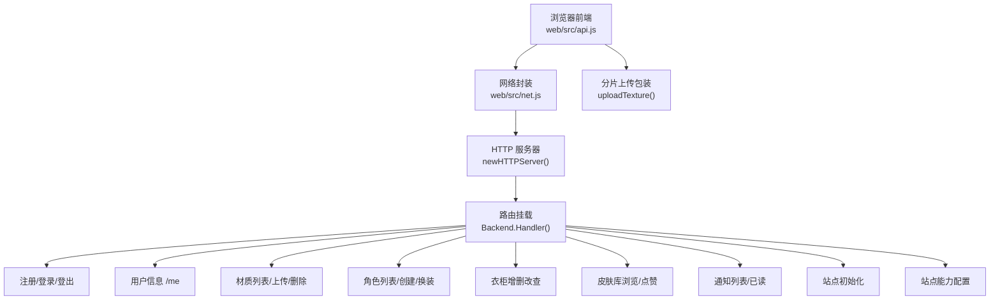
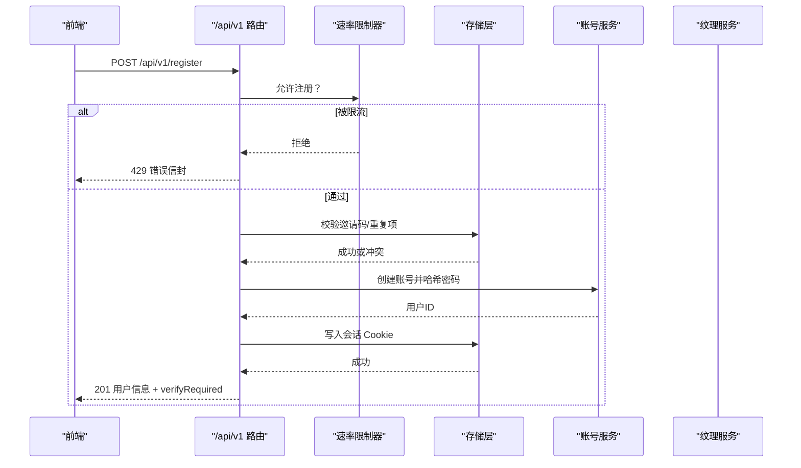
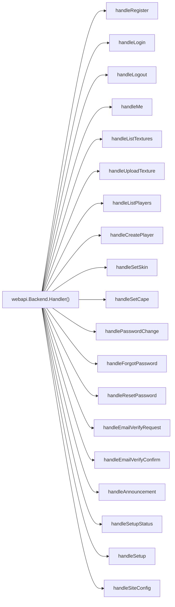

# Web API（/api/v1）

**本文引用的文件**
- [server/internal/webapi/webapi.go](https://github.com/YimingZhanshen/skin-nexus/blob/797ae1a/server/internal/webapi/webapi.go)
- [server/cmd/skin-nexus/server.go](https://github.com/YimingZhanshen/skin-nexus/blob/797ae1a/server/cmd/skin-nexus/server.go)
- [web/src/api.js](https://github.com/YimingZhanshen/skin-nexus/blob/797ae1a/web/src/api.js)
- [web/src/net.js](https://github.com/YimingZhanshen/skin-nexus/blob/797ae1a/web/src/net.js)
- [server/internal/ratelimit/limiter.go](https://github.com/YimingZhanshen/skin-nexus/blob/797ae1a/server/internal/ratelimit/limiter.go)
- [server/internal/account/service.go](https://github.com/YimingZhanshen/skin-nexus/blob/797ae1a/server/internal/account/service.go)
- [server/internal/auth/password.go](https://github.com/YimingZhanshen/skin-nexus/blob/797ae1a/server/internal/auth/password.go)
- [server/internal/store/email_verify.go](https://github.com/YimingZhanshen/skin-nexus/blob/797ae1a/server/internal/store/email_verify.go)
- [server/internal/store/setup.go](https://github.com/YimingZhanshen/skin-nexus/blob/797ae1a/server/internal/store/setup.go)
- [server/internal/store/site_options.go](https://github.com/YimingZhanshen/skin-nexus/blob/797ae1a/server/internal/store/site_options.go)
- [server/internal/texture/model.go](https://github.com/YimingZhanshen/skin-nexus/blob/797ae1a/server/internal/texture/model.go)
- [server/migrations/sqlite/0002_web_sessions.sql](https://github.com/YimingZhanshen/skin-nexus/blob/797ae1a/server/migrations/sqlite/0002_web_sessions.sql)

## 目录
1. [简介](#简介)
2. [项目结构](#项目结构)
3. [核心组件](#核心组件)
4. [架构总览](#架构总览)
5. [接口参考](#接口参考)
6. [依赖关系分析](#依赖关系分析)
7. [性能与安全特性](#性能与安全特性)
8. [故障排查指南](#故障排查指南)
9. [结论](#结论)
10. [附录：最佳实践与集成清单](#附录最佳实践与集成清单)

## 简介
本文面向 Minecraft 玩家侧前端与服务集成方，整理 SkinNexus 后端暴露的 `/api/v1/*` Web API。它覆盖账户注册登录、密码修改、邮箱验证、材质上传与删除、衣柜管理、角色管理、皮肤库浏览、通知、站点初始化等能力。所有 JSON 响应采用统一错误信封；会话通过 Cookie 维持；上传走 `multipart/form-data`；公共皮肤库与站点配置为无需认证接口。

## 项目结构
Web API 由 Go 后端提供，前端 SPA 通过原生 `fetch` 和 `XMLHttpRequest` 调用。

**图表来源**
- [server/cmd/skin-nexus/server.go:1-24](https://github.com/YimingZhanshen/skin-nexus/blob/797ae1a/server/cmd/skin-nexus/server.go#L1-L24)
- [server/internal/webapi/webapi.go:260-449](https://github.com/YimingZhanshen/skin-nexus/blob/797ae1a/server/internal/webapi/webapi.go#L260-L449)
- [web/src/api.js:1-161](https://github.com/YimingZhanshen/skin-nexus/blob/797ae1a/web/src/api.js#L1-L161)
- [web/src/net.js:1-23](https://github.com/YimingZhanshen/skin-nexus/blob/797ae1a/web/src/net.js#L1-L23)

**章节来源**
- [server/cmd/skin-nexus/server.go:1-24](https://github.com/YimingZhanshen/skin-nexus/blob/797ae1a/server/cmd/skin-nexus/server.go#L1-L24)
- [server/internal/webapi/webapi.go:260-449](https://github.com/YimingZhanshen/skin-nexus/blob/797ae1a/server/internal/webapi/webapi.go#L260-L449)
- [web/src/api.js:1-161](https://github.com/YimingZhanshen/skin-nexus/blob/797ae1a/web/src/api.js#L1-L161)
- [web/src/net.js:1-23](https://github.com/YimingZhanshen/skin-nexus/blob/797ae1a/web/src/net.js#L1-L23)

## 核心组件
- **Web API 后端**：负责路由、请求校验、会话、限流、错误信封、插件钩子与 Union 转发。
- **账号服务**：处理昵称、邮箱、密码、角色、材质、衣柜等业务逻辑与领域错误。
- **鉴权模块**：Argon2id 密码哈希与旧方案兼容。
- **速率限制器**：按 IP 与标识符保护注册与登录，支持失败锁定与重试时间。
- **存储层**：会话、用户、材质、选项、邮件验证码、站点初始化状态等。
- **HTTP 服务器**：设置连接头/读写超时，避免慢客户端耗尽资源。

**章节来源**
- [server/internal/webapi/webapi.go:1-200](https://github.com/YimingZhanshen/skin-nexus/blob/797ae1a/server/internal/webapi/webapi.go#L1-L200)
- [server/internal/account/service.go](https://github.com/YimingZhanshen/skin-nexus/blob/797ae1a/server/internal/account/service.go)
- [server/internal/auth/password.go](https://github.com/YimingZhanshen/skin-nexus/blob/797ae1a/server/internal/auth/password.go)
- [server/internal/ratelimit/limiter.go](https://github.com/YimingZhanshen/skin-nexus/blob/797ae1a/server/internal/ratelimit/limiter.go)
- [server/internal/store/email_verify.go](https://github.com/YimingZhanshen/skin-nexus/blob/797ae1a/server/internal/store/email_verify.go)
- [server/internal/store/setup.go](https://github.com/YimingZhanshen/skin-nexus/blob/797ae1a/server/internal/store/setup.go)
- [server/cmd/skin-nexus/server.go:1-24](https://github.com/YimingZhanshen/skin-nexus/blob/797ae1a/server/cmd/skin-nexus/server.go#L1-L24)

## 架构总览

**图表来源**
- [server/internal/webapi/webapi.go:531-797](https://github.com/YimingZhanshen/skin-nexus/blob/797ae1a/server/internal/webapi/webapi.go#L531-L797)
- [server/internal/ratelimit/limiter.go](https://github.com/YimingZhanshen/skin-nexus/blob/797ae1a/server/internal/ratelimit/limiter.go)
- [server/internal/account/service.go](https://github.com/YimingZhanshen/skin-nexus/blob/797ae1a/server/internal/account/service.go)

## 接口参考

### 通用约定

| 项目 | 说明 |
|---|---|
| 基础路径 | `/api/v1` |
| 会话方式 | Cookie `skin_session`，服务端设置 `HttpOnly`、`SameSite=Lax`、`Secure`（HTTPS 环境） |
| 认证要求 | 带 `me` 前缀的路径需要已登录；公开路径无需 Cookie |
| CSRF | 当前路由未显式校验 CSRF Token；跨站请求需依赖 SameSite 与同源策略 |
| 内容类型 | JSON 接口使用 `application/json`；材质上传使用 `multipart/form-data` |
| 错误体格式 | `{ "error": "<code>", "message": "<人类可读消息>", "code": "<code>" }` |
| 分页参数 | 默认 `page=1, pageSize=50`，最大页大小 200 |
| 响应编码 | 除文件下载外均为 JSON |

**章节来源**
- [server/internal/webapi/webapi.go:451-530](https://github.com/YimingZhanshen/skin-nexus/blob/797ae1a/server/internal/webapi/webapi.go#L451-L530)
- [server/internal/webapi/errorshape_test.go:1-96](https://github.com/YimingZhanshen/skin-nexus/blob/797ae1a/server/internal/webapi/errorshape_test.go#L1-L96)

---

### 站点能力与公告

#### 获取站点能力配置
- **方法**：`GET`
- **路径**：`/api/v1/site-config`
- **认证**：否
- **查询参数**：无
- **响应体**：
  - `site_name`: 站点名称
  - `invite_required`: 是否强制邀请码
  - `mail_configured`: 是否配置 SMTP
  - `union_enabled`: 是否启用联盟功能
  - `max_upload_kb`: 实际可上传的文件上限（KB）
  - `verify_gate_enabled`: 是否开启邮箱验证门槛
  - `footer`: 页脚链接与版权信息
- **状态码**：`200 OK`

#### 获取站点公告
- **方法**：`GET`
- **路径**：`/api/v1/announcement`
- **认证**：否
- **响应体**：
  - `announcement`: Markdown 原文
  - `html`: 服务端消毒后的 HTML
- **状态码**：`200 OK`

**章节来源**
- [server/internal/webapi/webapi.go:506-530](https://github.com/YimingZhanshen/skin-nexus/blob/797ae1a/server/internal/webapi/webapi.go#L506-L530)
- [server/internal/webapi/webapi.go:1189-1202](https://github.com/YimingZhanshen/skin-nexus/blob/797ae1a/server/internal/webapi/webapi.go#L1189-L1202)

---

### 站点初始化

#### 检查初始化状态
- **方法**：`GET`
- **路径**：`/api/v1/setup/status`
- **认证**：否
- **响应体**：
  - `needs_setup`: 是否需要初始化
  - `token_required`: 初始化是否要求安装令牌
- **状态码**：`200 OK`

#### 执行站点初始化
- **方法**：`POST`
- **路径**：`/api/v1/setup`
- **认证**：否（首次管理员窗口）
- **请求体**：
  - `site_name`: 字符串
  - `nickname`: 字符串
  - `password`: 至少 8 字符
  - `setup_token`: 可选，当部署配置了安装令牌时必须匹配
- **状态码**：
  - `200 OK`：初始化成功
  - `403 Forbidden`：令牌错误或缺失
  - `404 Not Found`：站点已完成初始化
  - `503 Service Unavailable`：数据库尚未迁移
- **行为约束**：仅能成功一次；并发初始化只产生一个超级管理员。

**章节来源**
- [server/internal/webapi/webapi.go:317-344](https://github.com/YimingZhanshen/skin-nexus/blob/797ae1a/server/internal/webapi/webapi.go#L317-L344)
- [server/internal/webapi/setup_token_test.go:1-147](https://github.com/YimingZhanshen/skin-nexus/blob/797ae1a/server/internal/webapi/setup_token_test.go#L1-L147)
- [server/internal/webapi/setup_gate_test.go:1-57](https://github.com/YimingZhanshen/skin-nexus/blob/797ae1a/server/internal/webapi/setup_gate_test.go#L1-L57)

---

### 账户注册与登录

#### 注册
- **方法**：`POST`
- **路径**：`/api/v1/register`
- **认证**：否
- **请求体**：
  - `email`: 字符串，可选；若站点启用邮箱验证则必填且必须合法
  - `nickname`: 字符串，2-24 位字母、数字、下划线或中文
  - `password`: 字符串，至少 8 字符
  - `invitationCode`: 字符串，可选；当站点强制邀请码时必填
  - `pluginData`: 对象，可选；主机渲染的插件字段
- **状态码**：
  - `201 Created`：注册成功，自动登录
  - `400 Bad Request`：JSON 无效、昵称非法、邮箱非法、密码过短、邀请码无效
  - `403 Forbidden`：IP 注册次数超限或被插件守卫拒绝
  - `409 Conflict`：邮箱或昵称已被占用
  - `429 Too Many Requests`：IP 注册频率超限
- **成功响应体**：
  - `id`: 用户 ID
  - `nickname`: 昵称
  - `permission`: 权限等级
  - `verifyRequired`: 是否需要邮箱验证
- **典型错误场景**：
  - 邀请码无效：返回邀请码无效错误
  - 邮箱为空但启用验证：返回邮箱必填
  - 重复昵称：返回昵称已被占用
  - 重复邮箱：返回邮箱已被占用
  - 插件表单校验失败：返回带 `plugin` 与 `field` 的错误体

#### 登录
- **方法**：`POST`
- **路径**：`/api/v1/login`
- **认证**：否
- **请求体**：
  - `identifier`: 字符串，邮箱或昵称
  - `password`: 字符串
- **状态码**：
  - `200 OK`：登录成功，设置会话 Cookie
  - `401 Unauthorized`：账号或密码错误
  - `429 Too Many Requests`：尝试过多或触发失败锁定
- **成功响应体**：
  - `id`: 用户 ID
  - `nickname`: 昵称
  - `permission`: 权限等级
  - `verifyRequired`: 是否需要邮箱验证
- **限流行为**：
  - 同一标识符失败会进入锁定窗口，响应携带 `Retry-After` 头及 `retry_after_seconds` 字段
  - 同一 IP 有独立滑动窗口限流

#### 登出
- **方法**：`POST`
- **路径**：`/api/v1/logout`
- **认证**：是
- **响应体**：`{ "ok": true }`
- **状态码**：`200 OK`

**章节来源**
- [server/internal/webapi/webapi.go:531-797](https://github.com/YimingZhanshen/skin-nexus/blob/797ae1a/server/internal/webapi/webapi.go#L531-L797)
- [server/internal/webapi/register_email_gate_test.go:1-170](https://github.com/YimingZhanshen/skin-nexus/blob/797ae1a/server/internal/webapi/register_email_gate_test.go#L1-L170)
- [server/internal/auth/password.go](https://github.com/YimingZhanshen/skin-nexus/blob/797ae1a/server/internal/auth/password.go)

---

### 密码管理

#### 修改密码
- **方法**：`POST`
- **路径**：`/api/v1/me/password`
- **认证**：是
- **请求体**：
  - `currentPassword`: 字符串
  - `newPassword`: 字符串
- **状态码**：
  - `200 OK`：修改成功
  - `400 Bad Request`：JSON 无效
  - `401 Unauthorized`：未登录
  - `409 Conflict`：新密码与旧密码相同
- **成功响应体**：`{ "ok": true }`

#### 忘记密码
- **方法**：`POST`
- **路径**：`/api/v1/password/forgot`
- **认证**：否
- **请求体**：
  - `email`: 字符串
- **状态码**：
  - `200 OK`：无论邮箱是否存在都会返回成功（防枚举）
  - `503 Service Unavailable`：SMTP 未配置
- **行为**：发送重置链接到该邮箱对应的账户；不暴露“邮箱是否存在”的信息。

#### 重置密码
- **方法**：`POST`
- **路径**：`/api/v1/password/reset`
- **认证**：否
- **请求体**：
  - `token`: 单次重置令牌
  - `password`: 新密码
- **状态码**：
  - `200 OK`：重置成功
  - `400 Bad Request`：JSON 无效
  - `404 Not Found`：令牌无效或已过期
- **行为**：消费一次性令牌；失败统一提示链接无效或已过期。

**章节来源**
- [server/internal/webapi/webapi.go:317-344](https://github.com/YimingZhanshen/skin-nexus/blob/797ae1a/server/internal/webapi/webapi.go#L317-L344)
- [server/internal/webapi/webapi.go:451-530](https://github.com/YimingZhanshen/skin-nexus/blob/797ae1a/server/internal/webapi/webapi.go#L451-L530)

---

### 邮箱验证

#### 请求邮箱验证
- **方法**：`POST`
- **路径**：`/api/v1/email/verify`
- **认证**：是
- **请求体**：无
- **状态码**：
  - `200 OK`：验证邮件已发送
  - `401 Unauthorized`：未登录
- **行为**：只能向当前登录账户自己的邮箱发送邮件；不会把地址泄露给其他设备。

#### 确认邮箱验证
- **方法**：`POST`
- **路径**：`/api/v1/email/confirm`
- **认证**：否
- **请求体**：
  - `token`: 单次验证令牌
- **状态码**：
  - `200 OK`：验证成功
  - `400 Bad Request`：JSON 无效
  - `404 Not Found`：令牌无效或已过期
- **行为**：链接可在任意设备打开；失败统一提示，不区分令牌属于哪种失败。

**章节来源**
- [server/internal/webapi/webapi.go:317-344](https://github.com/YimingZhanshen/skin-nexus/blob/797ae1a/server/internal/webapi/webapi.go#L317-L344)
- [server/internal/store/email_verify.go](https://github.com/YimingZhanshen/skin-nexus/blob/797ae1a/server/internal/store/email_verify.go)

---

### 用户信息

#### 获取当前用户
- **方法**：`GET`
- **路径**：`/api/v1/me`
- **认证**：是
- **响应体**：
  - `id`: 用户 ID
  - `nickname`: 昵称
  - `email`: 待验证邮箱（仅在验证门控生效时返回）
  - `emailVerified`: 是否已验证
  - `playerLimit`: 角色数量上限
  - `permission`: 权限等级
  - `verifyRequired`: 当前是否仍需完成邮箱验证
  - `playerCount`: 已有角色数
  - `storageBytes`: 自有材质占用字节数
  - `avatarHash`: 头像哈希
  - `unreadNotifications`: 未读通知数
- **状态码**：
  - `200 OK`
  - `401 Unauthorized`：未登录

**章节来源**
- [server/internal/webapi/webapi.go:901-975](https://github.com/YimingZhanshen/skin-nexus/blob/797ae1a/server/internal/webapi/webapi.go#L901-L975)

---

### 材质管理

#### 列出我的材质
- **方法**：`GET`
- **路径**：`/api/v1/me/textures`
- **认证**：是
- **查询参数**：
  - `page`: 页码，默认 1
  - `pageSize`: 每页数量，默认 50，最大 200
  - `q`: 模糊搜索关键词
  - `type`: `skin` 或 `cape`，空值不过滤
- **响应体**：
  - `textures`: 数组，每项含 `id, type, hash, model, description, detail, source, sourceUrl, url, previewURL, inCloset, uploadAt`
  - `total`: 总数
- **状态码**：
  - `200 OK`
  - `400 Bad Request`：`type` 不是 `skin` 或 `cape`
  - `401 Unauthorized`

#### 上传材质
- **方法**：`POST`
- **路径**：`/api/v1/me/textures`
- **认证**：是
- **内容类型**：`multipart/form-data`
- **字段**：
  - `type`: `skin` 或 `cape`
  - `file`: 二进制文件
  - `description`: 可选描述
  - `model`: 可选模型元数据（从像素读取，不应声明不存在臂宽）
  - `detail`: 可选详情
  - `source`: 来源
  - `sourceUrl`: 来源链接
  - `public`: 是否公开，传 `false` 表示不公开
  - `pluginData`: 可选插件字段
- **状态码**：
  - `201 Created`：新材质
  - `200 OK`：去重命中已有材质
  - `400 Bad Request`：字段缺失、类型非法、读取失败
  - `413 Payload Too Large`：超过站点上传限制
  - `401 Unauthorized`
- **成功响应体**：
  - `id, type, hash, url, created, description, detail, source, sourceUrl, public`

#### 删除我的材质
- **方法**：`DELETE`
- **路径**：`/api/v1/me/textures/{tid}`
- **认证**：是
- **查询参数**：
  - `force`: 布尔开关；存在引用时需提供以彻底删除
- **状态码**：
  - `200 OK`：删除成功
  - `401 Unauthorized`
  - `409 Conflict`：仍存在角色、衣柜或头像引用；不带 `force` 时返回引用清单
- **行为**：先软删除；真正物理删除在后台任务中完成。

**章节来源**
- [server/internal/webapi/webapi.go:976-1188](https://github.com/YimingZhanshen/skin-nexus/blob/797ae1a/server/internal/webapi/webapi.go#L976-L1188)
- [server/internal/texture/model.go](https://github.com/YimingZhanshen/skin-nexus/blob/797ae1a/server/internal/texture/model.go)

---

### 角色管理

#### 列出我的角色
- **方法**：`GET`
- **路径**：`/api/v1/me/players`
- **认证**：是
- **响应体**：
  - `players`: 数组，包含 `id, uid, name, uuid, skinModel, skinHash, capeHash, skinUrl, capeUrl, SkinTID, CapeTID`
- **状态码**：
  - `200 OK`
  - `401 Unauthorized`

#### 创建角色
- **方法**：`POST`
- **路径**：`/api/v1/me/players`
- **认证**：是
- **请求体**：
  - `name`: 字符串
- **状态码**：
  - `201 Created`：新建成功
  - `200 OK`：复用已有角色
  - `400 Bad Request`
  - `401 Unauthorized`
- **成功响应体**：`id, name, uuid`

#### 设置角色皮肤
- **方法**：`PUT`
- **路径**：`/api/v1/me/players/{id}/skin`
- **认证**：是
- **请求体**：
  - `textureId`: 整数，传 `0` 可取消皮肤
- **状态码**：
  - `200 OK`
  - `400 Bad Request`
  - `401 Unauthorized`
- **成功响应体**：`{ ok: true, playerId }`

#### 设置角色披风
- **方法**：`PUT`
- **路径**：/api/v1/me/players/{id}/cape
- **认证**：是
- **请求体**：同设置皮肤
- **状态码**：同设置皮肤

#### 重命名角色
- **方法**：`PUT`
- **路径**：`/api/v1/me/players/{id}/name`
- **认证**：是
- **请求体**：
  - `name`: 字符串
- **状态码**：
  - `200 OK`
  - `400 Bad Request`
  - `401 Unauthorized`

#### 删除角色
- **方法**：`DELETE`
- **路径**：`/api/v1/me/players/{id}`
- **认证**：是
- **状态码**：
  - `200 OK`
  - `401 Unauthorized`

**章节来源**
- [server/internal/webapi/webapi.go:1189-1280](https://github.com/YimingZhanshen/skin-nexus/blob/797ae1a/server/internal/webapi/webapi.go#L1189-L1280)

---

### 衣柜管理

#### 列出衣柜
- **方法**：`GET`
- **路径**：`/api/v1/me/closet`
- **认证**：是
- **查询参数**：
  - `page`: 页码
  - `pageSize`: 每页数量
  - `q`: 搜索词
  - `type`: 过滤类型
- **响应体**：衣柜条目列表及分页信息
- **状态码**：`200 OK` 或 `401 Unauthorized`

#### 添加衣柜条目
- **方法**：`POST`
- **路径**：`/api/v1/me/closet`
- **认证**：是
- **请求体**：
  - `textureId`: 整数
  - `itemName`: 可选显示名
- **状态码**：`200 OK` 或 `401 Unauthorized`

#### 重命名衣柜条目
- **方法**：`PUT`
- **路径**：`/api/v1/me/closet/{id}`
- **认证**：是
- **请求体**：
  - `itemName`: 字符串
- **状态码**：`200 OK` 或 `401 Unauthorized`

#### 移除衣柜条目
- **方法**：`DELETE`
- **路径**：`/api/v1/me/closet/{id}`
- **认证**：是
- **状态码**：`200 OK` 或 `401 Unauthorized`

#### 查看可穿戴材质
- **方法**：`GET`
- **路径**：`/api/v1/me/wearable`
- **认证**：是
- **查询参数**：
  - `type`: `skin` 或 `cape`
  - `page`: 页码
  - `pageSize`: 每页数量
  - `q`: 搜索词
- **用途**：供弹窗选择器分页检索当前用户的穿戴资源。

**章节来源**
- [server/internal/webapi/webapi.go:317-344](https://github.com/YimingZhanshen/skin-nexus/blob/797ae1a/server/internal/webapi/webapi.go#L317-L344)

---

### 通知

#### 列出通知
- **方法**：`GET`
- **路径**：`/api/v1/me/notifications`
- **认证**：是
- **查询参数**：
  - `page`: 页码
  - `perPage`: 每页数量
  - `unread`: 传 `1` 仅显示未读
- **状态码**：`200 OK` 或 `401 Unauthorized`

#### 标记通知已读
- **方法**：`POST`
- **路径**：`/api/v1/me/notifications/read`
- **认证**：是
- **请求体**：通知 ID 列表
- **状态码**：`200 OK` 或 `401 Unauthorized`

**章节来源**
- [server/internal/webapi/webapi.go:317-344](https://github.com/YimingZhanshen/skin-nexus/blob/797ae1a/server/internal/webapi/webapi.go#L317-L344)

---

### 皮肤库

#### 浏览皮肤库
- **方法**：`GET`
- **路径**：`/api/v1/skinlib`
- **认证**：否
- **查询参数**：开放键值对，由前端构造；常见包括分页、搜索、类型过滤等
- **响应体**：皮肤条目列表
- **状态码**：`200 OK`

#### 点赞皮肤
- **方法**：`POST`
- **路径**：`/api/v1/skinlib/{tid}/like`
- **认证**：是
- **状态码**：`200 OK` 或 `401 Unauthorized`

#### 取消点赞
- **方法**：`DELETE`
- **路径**：`/api/v1/skinlib/{tid}/like`
- **认证**：是
- **状态码**：`200 OK` 或 `401 Unauthorized`

#### 编辑皮肤库条目
- **方法**：`PATCH`
- **路径**：`/api/v1/skinlib/{tid}`
- **认证**：是
- **请求体**：皮肤库元数据变更
- **状态码**：`200 OK` 或 `401 Unauthorized`

#### 举报皮肤
- **方法**：`POST`
- **路径**：`/api/v1/skinlib/{tid}/report`
- **认证**：是
- **状态码**：`200 OK` 或 `401 Unauthorized`

**章节来源**
- [server/internal/webapi/webapi.go:317-344](https://github.com/YimingZhanshen/skin-nexus/blob/797ae1a/server/internal/webapi/webapi.go#L317-L344)

---

### 用户中心自我服务

#### 更新资料
- **方法**：`PUT`
- **路径**：`/api/v1/me/profile`
- **认证**：是
- **请求体**：
  - `nickname`: 可选新昵称
  - `email`: 可选新邮箱
- **状态码**：`200 OK` 或 `401 Unauthorized`

#### 删除账户
- **方法**：`DELETE`
- **路径**：`/api/v1/me`
- **认证**：是
- **请求体**：
  - `password`: 当前密码
- **状态码**：`200 OK` 或 `401 Unauthorized`

#### 设置头像
- **方法**：`PUT`
- **路径**：`/api/v1/me/avatar`
- **认证**：是
- **请求体**：
  - `textureId`: 整数
- **状态码**：`200 OK` 或 `401 Unauthorized`

#### 重置头像
- **方法**：`DELETE`
- **路径**：`/api/v1/me/avatar`
- **认证**：是
- **状态码**：`200 OK` 或 `401 Unauthorized`

**章节来源**
- [server/internal/webapi/webapi.go:317-344](https://github.com/YimingZhanshen/skin-nexus/blob/797ae1a/server/internal/webapi/webapi.go#L317-L344)

---

## 依赖关系分析

**图表来源**
- [server/internal/webapi/webapi.go:260-449](https://github.com/YimingZhanshen/skin-nexus/blob/797ae1a/server/internal/webapi/webapi.go#L260-L449)

**章节来源**
- [server/internal/webapi/webapi.go:260-449](https://github.com/YimingZhanshen/skin-nexus/blob/797ae1a/server/internal/webapi/webapi.go#L260-L449)

## 性能与安全特性

| 维度 | 行为 |
|---|---|
| 请求体限制 | JSON 请求体上限 1 MiB；材质上传单独放宽，并加 multipart 帧缓冲空间 |
| 上传限制 | 由纹理服务与站点选项共同决定，前端可从 `site-config.max_upload_kb` 获知 |
| 限流策略 | 注册按 IP 限制；登录同时按 IP 与标识符限制，失败可进入锁定窗口并返回 `Retry-After` |
| 会话 Cookie | `skin_session`，`HttpOnly`、`SameSite=Lax`，HTTPS 下启用 `Secure` |
| HTTP 超时 | 读头 10 秒、读 120 秒、写 300 秒、空闲 120 秒，防止慢客户端耗尽资源 |
| 错误契约 | 所有非 2xx 响应均返回统一信封，`error` 与 `code` 一致，便于语言包翻译 |
| 安全门控 | 邮箱验证门控可在注册时直接拒绝无邮箱账户；Union 模块可热开关 |
| 审计日志 | 注册、登录、Union 入站等关键动作记录访问日志与审计行 |

**章节来源**
- [server/internal/webapi/webapi.go:451-530](https://github.com/YimingZhanshen/skin-nexus/blob/797ae1a/server/internal/webapi/webapi.go#L451-L530)
- [server/cmd/skin-nexus/server.go:1-24](https://github.com/YimingZhanshen/skin-nexus/blob/797ae1a/server/cmd/skin-nexus/server.go#L1-L24)
- [server/internal/ratelimit/limiter.go](https://github.com/YimingZhanshen/skin-nexus/blob/797ae1a/server/internal/ratelimit/limiter.go)
- [server/migrations/sqlite/0002_web_sessions.sql](https://github.com/YimingZhanshen/skin-nexus/blob/797ae1a/server/migrations/sqlite/0002_web_sessions.sql)

## 故障排查指南

| 现象 | 可能原因 | 建议处理 |
|---|---|---|
| 注册返回 429 | IP 注册频率过高 | 前端应停止重试，等待冷却后重新尝试 |
| 登录返回 429 并带 `retry_after_seconds` | 登录失败次数过多，触发锁定 | 显示倒计时；不要立即轮询 |
| 注册返回 409 | 昵称或邮箱已被占用 | 根据后端进一步判断是哪一列冲突，提示用户修改对应字段 |
| 上传返回 413 | 文件过大或 multipart 帧超限 | 提示用户压缩图片或选择更小尺寸 |
| 删除材质返回 409 | 材质仍被角色、衣柜或头像引用 | 引导用户确认后带 `force=1` 重试 |
| 邮箱验证相关 404 | 验证或重置令牌已过期/无效 | 提示用户重新发送链接或重新申请 |
| 忘记找回密码返回 503 | SMTP 未配置 | 通知运维配置邮件服务 |
| 初始化返回 503 | 数据库表缺失或未迁移 | 运行数据库迁移或启用自动迁移 |
| 初始化返回 403 | 缺少或错误 `setup_token` | 检查部署令牌配置 |
| 所有 `/me/*` 返回 401 | Cookie 未携带或已过期 | 确保请求携带凭证；必要时重新登录 |
| Union 路由返回 404 | 联盟模块未启用 | 检查站点配置与模块开关 |

**章节来源**
- [server/internal/webapi/webapi.go:451-797](https://github.com/YimingZhanshen/skin-nexus/blob/797ae1a/server/internal/webapi/webapi.go#L451-L797)
- [server/internal/webapi/bodycap_test.go:1-74](https://github.com/YimingZhanshen/skin-nexus/blob/797ae1a/server/internal/webapi/bodycap_test.go#L1-L74)
- [server/internal/webapi/setup_gate_test.go:1-57](https://github.com/YimingZhanshen/skin-nexus/blob/797ae1a/server/internal/webapi/setup_gate_test.go#L1-L57)
- [server/internal/webapi/setup_token_test.go:1-147](https://github.com/YimingZhanshen/skin-nexus/blob/797ae1a/server/internal/webapi/setup_token_test.go#L1-L147)

## 结论
`/api/v1` 是一个围绕 Minecraft 外观管理的 RESTful API：会话基于 Cookie，错误统一编码，限流保护敏感入口，上传走独立的 multipart 路径，并通过站点能力配置让前端动态调整表单。集成时应优先读取 `site-config`，遵循分页与限流语义，对 429、409、413、404 等状态做明确的用户提示，而不是静默重试。

## 附录：最佳实践与集成清单

- **会话维持**
  - 所有 `/api/v1/me/*` 请求必须携带 Cookie；浏览器端使用 `credentials: include` 或 `withCredentials = true`。
  - 登出后应清理本地缓存，避免旧用户数据污染。

- **跨域配置**
  - 当前实现依赖同源与 SameSite Cookie；跨域时请确保后端正确配置 CORS，并允许携带凭据。
  - 若前端与后端不同源，必须同时允许 `Set-Cookie`、`Access-Control-Allow-Credentials` 与指定 Origin。

- **限流与重试**
  - 遇到 429 时不要立即重试；登录失败时读取 `Retry-After` 或 `retry_after_seconds`。
  - 对网络超时使用指数退避，但不得超过用户感知阈值。

- **上传最佳实践**
  - 使用前端提供的 `uploadTexture()`，它已处理进度、超时与错误转换。
  - 大文件应先在前端压缩或裁剪，再上传；避免超过 `site-config.max_upload_kb`。
  - 目前仓库中的上传实现是单请求上传；如需分片上传，应在前端自行分片并在后端扩展相应接口。

- **预览图缓存**
  - 材质列表返回 `previewURL`，适合用于缩略图缓存；结合浏览器缓存控制减少重复请求。
  - 皮肤 URL 可由插件过滤器重写，因此不要硬编码 `/textures/...` 路径。

- **错误处理**
  - 始终解析错误信封中的 `code`；`message` 仅作为后备显示文本。
  - 对 409、413、404 等可操作错误给出具体提示，而不是通用失败消息。

- **通知与验证门控**
  - 通知列表支持只看未读；未读数随 `/me` 响应一起返回，减少轮询。
  - 若 `verifyRequired` 为真，应引导用户完成邮箱验证后再进入完整功能。

**章节来源**
- [web/src/api.js:1-161](https://github.com/YimingZhanshen/skin-nexus/blob/797ae1a/web/src/api.js#L1-L161)
- [web/src/net.js:1-23](https://github.com/YimingZhanshen/skin-nexus/blob/797ae1a/web/src/net.js#L1-L23)
- [server/internal/webapi/webapi.go:506-530](https://github.com/YimingZhanshen/skin-nexus/blob/797ae1a/server/internal/webapi/webapi.go#L506-L530)
- [server/internal/webapi/webapi.go:901-975](https://github.com/YimingZhanshen/skin-nexus/blob/797ae1a/server/internal/webapi/webapi.go#L901-L975)
