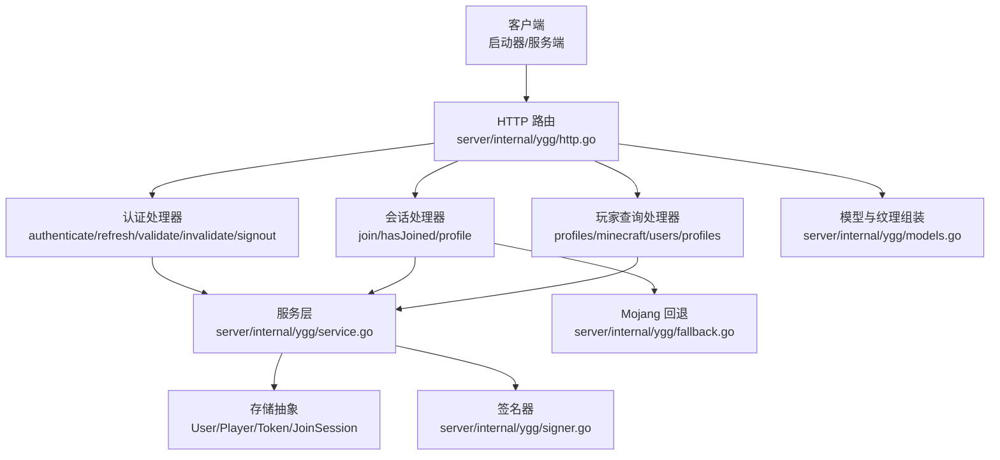
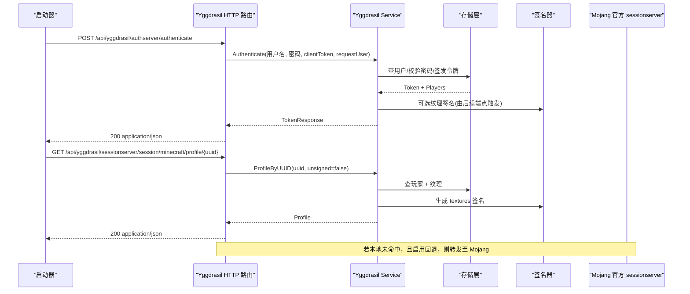
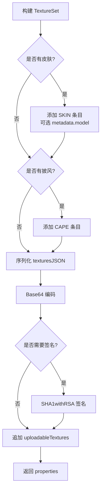
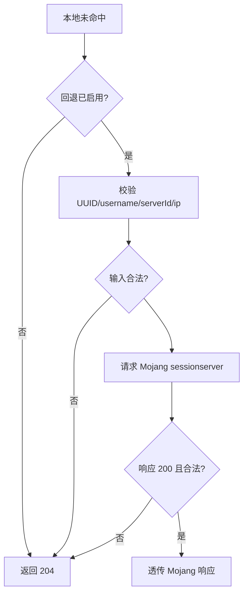
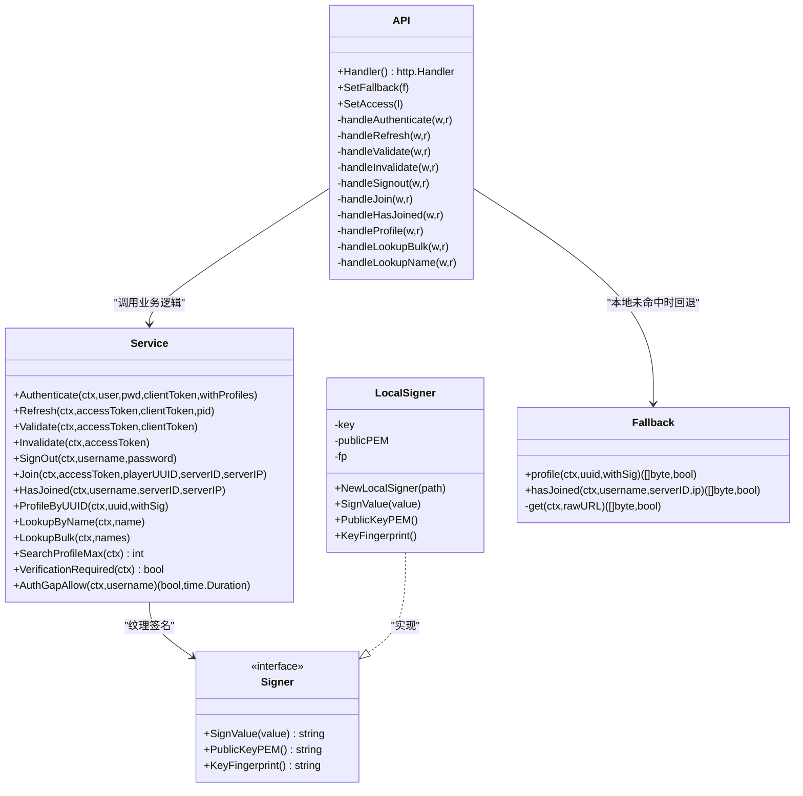

# Yggdrasil 协议 API

**本文引用的文件**
- [http.go](https://github.com/YimingZhanshen/skin-nexus/blob/797ae1a/server/internal/ygg/http.go)
- [service.go](https://github.com/YimingZhanshen/skin-nexus/blob/797ae1a/server/internal/ygg/service.go)
- [models.go](https://github.com/YimingZhanshen/skin-nexus/blob/797ae1a/server/internal/ygg/models.go)
- [signer.go](https://github.com/YimingZhanshen/skin-nexus/blob/797ae1a/server/internal/ygg/signer.go)
- [fallback.go](https://github.com/YimingZhanshen/skin-nexus/blob/797ae1a/server/internal/ygg/fallback.go)

## 目录
1. [简介](#简介)
2. [项目结构](#项目结构)
3. [核心组件](#核心组件)
4. [架构总览](#架构总览)
5. [端点详细规范](#端点详细规范)
6. [鉴权模式与速率限制](#鉴权模式与速率限制)
7. [签名机制与皮肤语义](#签名机制与皮肤语义)
8. [Mojang 正版兜底与降级行为](#mojang-正版兜底与降级行为)
9. [依赖关系分析](#依赖关系分析)
10. [性能建议](#性能建议)
11. [故障排查](#故障排查)
12. [结论](#结论)

## 简介
Yggdrasil 协议 API 是 Minecraft 客户端、启动器与服务端之间用于身份认证、会话验证和玩家资料查询的兼容层。本项目在 `/api/yggdrasil` 前缀下实现 authserver、sessionserver 以及玩家查询接口，并额外提供 `GET /api/yggdrasil` 元数据文档。该实现以“零改兼容”为目标：保持 authlib-injector、yggdrasil-connect 及旧版启动器的既有契约，同时扩展签名皮肤、Union 站点、离线校验开关、TTL 窗口等能力。

本文件面向运维与集成人员，逐项说明每个端点的请求体、响应体、状态码、错误格式、速率限制、真实 curl 示例，以及与 Mojang 官方 sessionserver 的差异和回退策略。

## 项目结构
Yggdrasil API 位于 `server/internal/ygg` 包中，路由注册、请求解析、响应写入集中在 `http.go`；业务逻辑（令牌、玩家、加入会话、签名）集中在 `service.go`；DTO 与纹理属性组装集中在 `models.go`；签名密钥与指纹逻辑集中在 `signer.go`；Mojang 官方 sessionserver 回退集中在 `fallback.go`。



**图表来源**
- [http.go:100-117](https://github.com/YimingZhanshen/skin-nexus/blob/797ae1a/server/internal/ygg/http.go#L100-L117)
- [service.go:1-120](https://github.com/YimingZhanshen/skin-nexus/blob/797ae1a/server/internal/ygg/service.go#L1-L120)
- [models.go:1-30](https://github.com/YimingZhanshen/skin-nexus/blob/797ae1a/server/internal/ygg/models.go#L1-L30)
- [signer.go:1-25](https://github.com/YimingZhanshen/skin-nexus/blob/797ae1a/server/internal/ygg/signer.go#L1-L25)
- [fallback.go:1-35](https://github.com/YimingZhanshen/skin-nexus/blob/797ae1a/server/internal/ygg/fallback.go#L1-L35)

**章节来源**
- [http.go:100-117](https://github.com/YimingZhanshen/skin-nexus/blob/797ae1a/server/internal/ygg/http.go#L100-L117)
- [service.go:1-120](https://github.com/YimingZhanshen/skin-nexus/blob/797ae1a/server/internal/ygg/service.go#L1-L120)

## 核心组件
- **API 路由层**：负责挂载 `/api/yggdrasil/*` 所有端点，统一处理 JSON Content-Type 校验、错误体、204 无内容响应、访问日志记录。
- **Service 业务层**：实现用户认证、令牌签发与刷新、令牌校验、登出、加入服务器、hasJoined 查询、按 UUID/name 查询玩家、构建带签名的 Profile。
- **Signer 签名层**：本地 RSA 私钥生成、SHA1withRSA 对 textures Base64 值签名、输出 PEM 公钥给客户端验证。
- **Fallback 回退层**：当本地未命中 profile 或 hasJoined 时，安全地调用 Mojang 官方 sessionserver，并将原始响应透传。
- **Models 数据层**：定义 Property、Profile、texturesJSON、TextureSet，保证空 textures 序列化为 `{}` 而非 null。

**章节来源**
- [http.go:240-336](https://github.com/YimingZhanshen/skin-nexus/blob/797ae1a/server/internal/ygg/http.go#L240-L336)
- [service.go:120-260](https://github.com/YimingZhanshen/skin-nexus/blob/797ae1a/server/internal/ygg/service.go#L120-L260)
- [signer.go:25-108](https://github.com/YimingZhanshen/skin-nexus/blob/797ae1a/server/internal/ygg/signer.go#L25-L108)
- [fallback.go:35-120](https://github.com/YimingZhanshen/skin-nexus/blob/797ae1a/server/internal/ygg/fallback.go#L35-L120)
- [models.go:1-105](https://github.com/YimingZhanshen/skin-nexus/blob/797ae1a/server/internal/ygg/models.go#L1-L105)

## 架构总览
Yggdrasil API 的请求路径分为三类：

1. **authserver**：`/api/yggdrasil/authserver/*`，处理登录、刷新、校验、失效、登出。
2. **sessionserver**：`/api/yggdrasil/sessionserver/*`，处理加入服务器、验证是否已加入、获取玩家资料。
3. **玩家查询**：`/api/yggdrasil/api/profiles/minecraft` 与 `/api/yggdrasil/api/users/profiles/minecraft/{name}`，返回玩家 UUID 与名称，不包含纹理属性。



**图表来源**
- [http.go:269-336](https://github.com/YimingZhanshen/skin-nexus/blob/797ae1a/server/internal/ygg/http.go#L269-L336)
- [http.go:541-567](https://github.com/YimingZhanshen/skin-nexus/blob/797ae1a/server/internal/ygg/http.go#L541-L567)
- [service.go:260-420](https://github.com/YimingZhanshen/skin-nexus/blob/797ae1a/server/internal/ygg/service.go#L260-L420)
- [service.go:664-738](https://github.com/YimingZhanshen/skin-nexus/blob/797ae1a/server/internal/ygg/service.go#L664-L738)
- [fallback.go:120-200](https://github.com/YimingZhanshen/skin-nexus/blob/797ae1a/server/internal/ygg/fallback.go#L120-L200)

## 端点详细规范

### 元数据：`GET /api/yggdrasil`
返回 ALI 发现文档，包含服务器名称、实现版本、链接、可信任 skinDomains、签名公钥，以及特性标记。

| 项目 | 说明 |
|---|---|
| HTTP 方法 | `GET` |
| URL | `/api/yggdrasil` |
| 成功状态码 | `200` |
| 响应类型 | `application/json` |
| 关键响应字段 | `meta.serverName`、`meta.implementationName`、`meta.implementationVersion`、`meta.links.homepage`、`meta.links.register`、`feature.non_email_login`、`feature.openid_configuration_url`（可选）、`skinDomains`、`signaturePublickey` |
| 头部 | `X-Authlib-Injector-API-Location`、`Access-Control-Allow-Origin: *`、`Access-Control-Allow-Methods: GET, HEAD` |
| 错误格式 | 正常不返回错误体 |
| 速率限制 | 无专用限制 |

curl 示例：
```bash
curl -i "https://your-domain/api/yggdrasil"
```

**章节来源**
- [http.go:120-176](https://github.com/YimingZhanshen/skin-nexus/blob/797ae1a/server/internal/ygg/http.go#L120-L176)

### 认证：`POST /api/yggdrasil/authserver/authenticate`
使用用户名和密码申请 access token、client token 与 availableProfiles。支持通过 player name 登录并自动绑定对应角色（legacy `non_email_login`）。

| 项目 | 说明 |
|---|---|
| HTTP 方法 | `POST` |
| URL | `/api/yggdrasil/authserver/authenticate` |
| 请求体 JSON Schema | `{ username: string, password: string, clientToken?: string, requestUser?: boolean }` |
| Content-Type | `application/json` |
| 成功状态码 | `200` |
| 失败状态码 | `400`（非法 JSON）、`403`（凭据无效、邮箱未验证、账号禁用）、`429`（速率限制） |
| 成功响应字段 | `accessToken`、`clientToken`、`availableProfiles[]`、`selectedProfile?`、`user.id?`、`user.properties?` |
| 错误体格式 | `{ error: string, errorMessage: string }` |
| 速率限制 | 同用户名最小间隔 + IP 滑动窗口 + 单标识失败锁定 |

curl 示例：
```bash
curl -X POST "https://your-domain/api/yggdrasil/authserver/authenticate" \
  -H "Content-Type: application/json" \
  -d '{"username":"Player","password":"Secret","requestUser":true}'
```

**章节来源**
- [http.go:269-336](https://github.com/YimingZhanshen/skin-nexus/blob/797ae1a/server/internal/ygg/http.go#L269-L336)
- [service.go:260-420](https://github.com/YimingZhanshen/skin-nexus/blob/797ae1a/server/internal/ygg/service.go#L260-L420)

### 刷新令牌：`POST /api/yggdrasil/authserver/refresh`
用旧 access token 换取新令牌，可选择 selectedProfile；会使旧 token 失效。

| 项目 | 说明 |
|---|---|
| HTTP 方法 | `POST` |
| URL | `/api/yggdrasil/authserver/refresh` |
| 请求体 JSON Schema | `{ accessToken: string, clientToken?: string, requestUser?: boolean, selectedProfile?: string \| { id: string } }` |
| 成功状态码 | `200` |
| 失败状态码 | `400`（非法 JSON、无效 selectedProfile 引用）、`403`（token 无效）、`429`（IP 速率限制） |
| 成功响应字段 | 同 authenticate |
| 错误体格式 | `{ error: string, errorMessage: string }` |
| 速率限制 | IP 滑动窗口 |

curl 示例：
```bash
curl -X POST "https://your-domain/api/yggdrasil/authserver/refresh" \
  -H "Content-Type: application/json" \
  -d '{"accessToken":"ACCESS_TOKEN","clientToken":"CLIENT_TOKEN"}'
```

**章节来源**
- [http.go:337-386](https://github.com/YimingZhanshen/skin-nexus/blob/797ae1a/server/internal/ygg/http.go#L337-L386)
- [service.go:420-520](https://github.com/YimingZhanshen/skin-nexus/blob/797ae1a/server/internal/ygg/service.go#L420-L520)

### 校验令牌：`POST /api/yggdrasil/authserver/validate`
判断 access token 是否仍可使用。

| 项目 | 说明 |
|---|---|
| HTTP 方法 | `POST` |
| URL | `/api/yggdrasil/authserver/validate` |
| 请求体 JSON Schema | `{ accessToken: string, clientToken?: string }` |
| 成功状态码 | `204 No Content` |
| 失败状态码 | `400`（非法 JSON）、`403`（token 无效） |
| 响应体 | 成功时无响应体 |
| 错误体格式 | `{ error: string, errorMessage: string }` |
| 速率限制 | 无专用限制 |

curl 示例：
```bash
curl -X POST "https://your-domain/api/yggdrasil/authserver/validate" \
  -H "Content-Type: application/json" \
  -d '{"accessToken":"ACCESS_TOKEN","clientToken":"CLIENT_TOKEN"}'
```

**章节来源**
- [http.go:387-410](https://github.com/YimingZhanshen/skin-nexus/blob/797ae1a/server/internal/ygg/http.go#L387-L410)
- [service.go:520-560](https://github.com/YimingZhanshen/skin-nexus/blob/797ae1a/server/internal/ygg/service.go#L520-L560)

### 失效令牌：`POST /api/yggdrasil/authserver/invalidate`
立即使指定 access token 失效。

| 项目 | 说明 |
|---|---|
| HTTP 方法 | `POST` |
| URL | `/api/yggdrasil/authserver/invalidate` |
| 请求体 JSON Schema | `{ accessToken: string }` |
| 成功状态码 | `204 No Content` |
| 失败状态码 | `400`（非法 JSON） |
| 响应体 | 无 |
| 错误体格式 | `{ error: string, errorMessage: string }` |
| 速率限制 | 无 |

curl 示例：
```bash
curl -X POST "https://your-domain/api/yggdrasil/authserver/invalidate" \
  -H "Content-Type: application/json" \
  -d '{"accessToken":"ACCESS_TOKEN"}'
```

**章节来源**
- [http.go:411-422](https://github.com/YimingZhanshen/skin-nexus/blob/797ae1a/server/internal/ygg/http.go#L411-L422)
- [service.go:560-580](https://github.com/YimingZhanshen/skin-nexus/blob/797ae1a/server/internal/ygg/service.go#L560-L580)

### 登出：`POST /api/yggdrasil/authserver/signout`
校验密码后清除该用户全部 token。

| 项目 | 说明 |
|---|---|
| HTTP 方法 | `POST` |
| URL | `/api/yggdrasil/authserver/signout` |
| 请求体 JSON Schema | `{ username: string, password: string }` |
| 成功状态码 | `204 No Content` |
| 失败状态码 | `400`（非法 JSON）；速率限制命中时仍返回 `204` |
| 响应体 | 无 |
| 错误体格式 | 正常不返回错误体 |
| 速率限制 | 同用户名最小间隔；但 wire 契约要求始终 204 |

curl 示例：
```bash
curl -X POST "https://your-domain/api/yggdrasil/authserver/signout" \
  -H "Content-Type: application/json" \
  -d '{"username":"Player","password":"Secret"}'
```

**章节来源**
- [http.go:423-443](https://github.com/YimingZhanshen/skin-nexus/blob/797ae1a/server/internal/ygg/http.go#L423-L443)
- [service.go:560-580](https://github.com/YimingZhanshen/skin-nexus/blob/797ae1a/server/internal/ygg/service.go#L560-L580)

### 加入服务器：`POST /api/yggdrasil/sessionserver/session/minecraft/join`
将当前 access token、玩家 UUID、serverId 记录为加入会话，TTL 默认 120 秒。

| 项目 | 说明 |
|---|---|
| HTTP 方法 | `POST` |
| URL | `/api/yggdrasil/sessionserver/session/minecraft/join` |
| 请求体 JSON Schema | `{ accessToken: string, selectedProfile: string \| { id: string }, serverId: string }` |
| 成功状态码 | `204 No Content` |
| 失败状态码 | `400`（缺少或无效 selectedProfile）、`403`（token 无效、邮箱未验证、玩家不匹配、插件守卫拒绝） |
| 响应体 | 成功时无响应体 |
| 错误体格式 | `{ error: string, errorMessage: string }` |
| 速率限制 | 同用户名最小间隔 |

curl 示例：
```bash
curl -X POST "https://your-domain/api/yggdrasil/sessionserver/session/minecraft/join" \
  -H "Content-Type: application/json" \
  -d '{
    "accessToken":"ACCESS_TOKEN",
    "selectedProfile":"UUID_OR_PROFILE_REF",
    "serverId":"SERVER_ID"
  }'
```

**章节来源**
- [http.go:444-513](https://github.com/YimingZhanshen/skin-nexus/blob/797ae1a/server/internal/ygg/http.go#L444-L513)
- [service.go:580-660](https://github.com/YimingZhanshen/skin-nexus/blob/797ae1a/server/internal/ygg/service.go#L580-L660)

### 是否已加入：`GET /api/yggdrasil/sessionserver/session/minecraft/hasJoined`
根据 username、serverId、ip 检查本地 join 会话，成功返回带签名的 Profile。

| 项目 | 说明 |
|---|---|
| HTTP 方法 | `GET` |
| URL | `/api/yggdrasil/sessionserver/session/minecraft/hasJoined` |
| 查询参数 | `username`、`serverId`、`ip`（可选） |
| 成功状态码 | `200` |
| 未找到或过期状态码 | `204 No Content` |
| 失败状态码 | 正常流程不返回 4xx；参数缺失直接视为未找到 |
| 成功响应字段 | `id`、`name`、`properties[]`（含 textures 签名） |
| 错误格式 | 未找到不返回错误体 |
| 速率限制 | 无 |

curl 示例：
```bash
curl -i "https://your-domain/api/yggdrasil/sessionserver/session/minecraft/hasJoined?username=Player&serverId=SERVER_ID"
```

**章节来源**
- [http.go:514-540](https://github.com/YimingZhanshen/skin-nexus/blob/797ae1a/server/internal/ygg/http.go#L514-L540)
- [service.go:623-664](https://github.com/YimingZhanshen/skin-nexus/blob/797ae1a/server/internal/ygg/service.go#L623-L664)

### 玩家资料：`GET /api/yggdrasil/sessionserver/session/minecraft/profile/{uuid}`
按 UUID 返回玩家 Profile，包含 textures 与 uploadableTextures。

| 项目 | 说明 |
|---|---|
| HTTP 方法 | `GET` |
| URL | `/api/yggdrasil/sessionserver/session/minecraft/profile/{uuid}` |
| 查询参数 | `unsigned=false` 时返回签名；省略或任意其他值等价于不签名 |
| 成功状态码 | `200` |
| 未找到状态码 | `204 No Content` |
| 成功响应字段 | `id`、`name`、`properties[]` |
| properties 结构 | 至少包含 `textures`，可能包含 `uploadableTextures`；当 `unsigned=false` 时 `textures.signature` 非空 |
| 错误格式 | 未找到不返回错误体 |
| 速率限制 | 无 |

curl 示例：
```bash
curl -i "https://your-domain/api/yggdrasil/sessionserver/session/minecraft/profile/UUID"
```

**章节来源**
- [http.go:541-567](https://github.com/YimingZhanshen/skin-nexus/blob/797ae1a/server/internal/ygg/http.go#L541-L567)
- [service.go:664-738](https://github.com/YimingZhanshen/skin-nexus/blob/797ae1a/server/internal/ygg/service.go#L664-L738)
- [models.go:30-105](https://github.com/YimingZhanshen/skin-nexus/blob/797ae1a/server/internal/ygg/models.go#L30-L105)

### 批量玩家查询：`POST /api/yggdrasil/api/profiles/minecraft`
传入玩家名数组，返回 UUID 与名称列表，不包含 textures。

| 项目 | 说明 |
|---|---|
| HTTP 方法 | `POST` |
| URL | `/api/yggdrasil/api/profiles/minecraft` |
| 请求体 JSON Schema | `string[]` |
| 成功状态码 | `200` |
| 失败状态码 | `400`（非法 JSON）、`403`（超出最大查询数量） |
| 成功响应结构 | `[{ id: string, name: string }]` |
| 错误体格式 | `{ error: string, errorMessage: string }` |
| 速率限制 | 无专用限制；受 `SearchProfileMax` 上限控制 |

curl 示例：
```bash
curl -X POST "https://your-domain/api/yggdrasil/api/profiles/minecraft" \
  -H "Content-Type: application/json" \
  -d '["Player1","Player2","Player3"]'
```

**章节来源**
- [http.go:580-617](https://github.com/YimingZhanshen/skin-nexus/blob/797ae1a/server/internal/ygg/http.go#L580-L617)
- [service.go:700-720](https://github.com/YimingZhanshen/skin-nexus/blob/797ae1a/server/internal/ygg/service.go#L700-L720)

### 按名称查询玩家：`GET /api/yggdrasil/api/users/profiles/minecraft/{name}`
返回单个玩家的 UUID 与名称。

| 项目 | 说明 |
|---|---|
| HTTP 方法 | `GET` |
| URL | `/api/yggdrasil/api/users/profiles/minecraft/{name}` |
| 成功状态码 | `200` |
| 未找到状态码 | `204 No Content` |
| 成功响应结构 | `{ id: string, name: string }` |
| 错误格式 | 未找到不返回错误体 |
| 速率限制 | 无 |

curl 示例：
```bash
curl -i "https://your-domain/api/yggdrasil/api/users/profiles/minecraft/Player"
```

**章节来源**
- [http.go:618-628](https://github.com/YimingZhanshen/skin-nexus/blob/797ae1a/server/internal/ygg/http.go#L618-L628)
- [service.go:700-720](https://github.com/YimingZhanshen/skin-nexus/blob/797ae1a/server/internal/ygg/service.go#L700-L720)

## 鉴权模式与速率限制

### 鉴权模式
- **用户名+密码认证**：`authenticate` 先按用户名查用户，再验密；若用户名不是用户标识而是玩家名，则走 legacy non-email login 反向绑定玩家所属用户。
- **令牌刷新**：`refresh` 使用旧 access token 换发新 token，并校验 clientToken；支持选择 owned profile。
- **令牌校验**：`validate` 只判断 token 是否仍有效，不修改状态。
- **令牌失效**：`invalidate` 立即失效指定 token。
- **登出**：`signout` 校验密码后失效用户全部 token。
- **加入服务器**：`join` 校验 token 有效性、邮箱验证门控、玩家归属与 selectedProfile 一致性，然后保存 120 秒 TTL 的 join 会话。
- **hasJoined**：查找最近一次有效的 join 会话，成功返回带签名的 Profile。

### 速率限制
| 端点 | 限制维度 | 行为 |
|---|---|---|
| `authenticate` | 同用户名最小间隔 + IP 滑动窗口 + 单标识失败锁定 | 超过阈值返回 `429 TooManyRequests`；同一用户名频繁失败会锁定标识键 |
| `refresh` | IP 滑动窗口 | 超限返回 `429` |
| `signout` | 同用户名最小间隔 | 限速命中时跳过密码检查但仍返回 `204`，保持 wire 契约 |
| 其他端点 | 无专用限制 | 由上层网关或基础设施限制 |

**章节来源**
- [http.go:269-336](https://github.com/YimingZhanshen/skin-nexus/blob/797ae1a/server/internal/ygg/http.go#L269-L336)
- [http.go:337-386](https://github.com/YimingZhanshen/skin-nexus/blob/797ae1a/server/internal/ygg/http.go#L337-L386)
- [http.go:423-443](https://github.com/YimingZhanshen/skin-nexus/blob/797ae1a/server/internal/ygg/http.go#L423-L443)
- [service.go:201-260](https://github.com/YimingZhanshen/skin-nexus/blob/797ae1a/server/internal/ygg/service.go#L201-L260)

## 签名机制与皮肤语义

### textures 字段语义
- `textures` 是一个 Base64 编码的 JSON 对象，包含 `timestamp`、`profileId`、`profileName`、`isPublic`、`textures`。
- 空 textures 必须序列化为 `{}`，不能为 `null` 或空数组。
- `SKIN` 条目可携带 `metadata.model`，值为 `"slim"` 表示 slim 模型；默认模型可不写 model。
- `CAPE` 条目仅包含 `url`。
- `uploadableTextures` 固定为 `"skin,cape"`。

### 签名规则
- 当 `unsigned=false` 时，服务端对 textures Base64 字符串进行 SHA1withRSA 签名，并把结果放入 `properties[0].signature`。
- 元数据中的 `signaturePublickey` 是 PEM 格式的 SubjectPublicKeyInfo，供客户端验证。
- 当请求带 `unsigned=true` 或默认不签名时，返回的 properties 中 signature 为空或被清理。



**图表来源**
- [models.go:30-105](https://github.com/YimingZhanshen/skin-nexus/blob/797ae1a/server/internal/ygg/models.go#L30-L105)
- [signer.go:40-108](https://github.com/YimingZhanshen/skin-nexus/blob/797ae1a/server/internal/ygg/signer.go#L40-L108)
- [service.go:680-738](https://github.com/YimingZhanshen/skin-nexus/blob/797ae1a/server/internal/ygg/service.go#L680-L738)

**章节来源**
- [models.go:1-105](https://github.com/YimingZhanshen/skin-nexus/blob/797ae1a/server/internal/ygg/models.go#L1-L105)
- [signer.go:1-108](https://github.com/YimingZhanshen/skin-nexus/blob/797ae1a/server/internal/ygg/signer.go#L1-L108)
- [service.go:680-738](https://github.com/YimingZhanshen/skin-nexus/blob/797ae1a/server/internal/ygg/service.go#L680-L738)

## Mojang 正版兜底与降级行为

### 触发条件
- `GET /api/yggdrasil/sessionserver/session/minecraft/profile/{uuid}`：本地未找到该 UUID 对应的玩家。
- `GET /api/yggdrasil/sessionserver/session/minecraft/hasJoined`：本地没有匹配的 join 会话。

### 回退流程
1. 检查是否启用 fallback。
2. 对 uuid 做严格校验：必须是 32 位小写十六进制。
3. 对 hasJoined 的 username 使用 Mojang 字符集正则过滤，中文或非法字符直接放弃回退。
4. 向 `https://sessionserver.mojang.com` 发起请求，禁止重定向，连接超时 4 秒，响应体最多 1 MiB。
5. 出站连接仅允许公网地址，拒绝环回、私有网段、链路本地、CGNAT。
6. 只有 200 且能解析为含 `id` 与 `name` 的 JSON 对象才视为有效。
7. 有效时原样返回 Mojang 响应；否则视为未命中，返回 `204`。



**图表来源**
- [fallback.go:35-120](https://github.com/YimingZhanshen/skin-nexus/blob/797ae1a/server/internal/ygg/fallback.go#L35-L120)
- [fallback.go:120-200](https://github.com/YimingZhanshen/skin-nexus/blob/797ae1a/server/internal/ygg/fallback.go#L120-L200)
- [fallback.go:201-245](https://github.com/YimingZhanshen/skin-nexus/blob/797ae1a/server/internal/ygg/fallback.go#L201-L245)
- [http.go:514-567](https://github.com/YimingZhanshen/skin-nexus/blob/797ae1a/server/internal/ygg/http.go#L514-L567)

### 与 Mojang 官方 API 的差异
- 本地优先：所有本地已有数据不受回退影响。
- 签名策略一致：`unsigned=true` 时不回退签名；`unsigned=false` 时回退请求也带上签名策略。
- 错误收敛：任何回退失败都退化为 204，不会把外部错误暴露给客户端。
- hasJoined 额外过滤：非法用户名不会发起外部请求，避免无意义的超时。

**章节来源**
- [fallback.go:1-35](https://github.com/YimingZhanshen/skin-nexus/blob/797ae1a/server/internal/ygg/fallback.go#L1-L35)
- [fallback.go:120-200](https://github.com/YimingZhanshen/skin-nexus/blob/797ae1a/server/internal/ygg/fallback.go#L120-L200)
- [http.go:514-567](https://github.com/YimingZhanshen/skin-nexus/blob/797ae1a/server/internal/ygg/http.go#L514-L567)

## 依赖关系分析



**图表来源**
- [http.go:100-117](https://github.com/YimingZhanshen/skin-nexus/blob/797ae1a/server/internal/ygg/http.go#L100-L117)
- [service.go:120-260](https://github.com/YimingZhanshen/skin-nexus/blob/797ae1a/server/internal/ygg/service.go#L120-L260)
- [signer.go:25-108](https://github.com/YimingZhanshen/skin-nexus/blob/797ae1a/server/internal/ygg/signer.go#L25-L108)
- [fallback.go:35-120](https://github.com/YimingZhanshen/skin-nexus/blob/797ae1a/server/internal/ygg/fallback.go#L35-L120)

**章节来源**
- [http.go:100-117](https://github.com/YimingZhanshen/skin-nexus/blob/797ae1a/server/internal/ygg/http.go#L100-L117)
- [service.go:120-260](https://github.com/YimingZhanshen/skin-nexus/blob/797ae1a/server/internal/ygg/service.go#L120-L260)
- [signer.go:25-108](https://github.com/YimingZhanshen/skin-nexus/blob/797ae1a/server/internal/ygg/signer.go#L25-L108)
- [fallback.go:35-120](https://github.com/YimingZhanshen/skin-nexus/blob/797ae1a/server/internal/ygg/fallback.go#L35-L120)

## 性能建议

### TTL 缓存
- Join 会话 TTL 固定为 120 秒，适合高频 hasJoined 查询场景。
- 建议在上游 CDN 或反向代理层对 `profile/{uuid}` 和 `hasJoined` 做短 TTL 缓存，例如 10-60 秒，以降低数据库压力。
- 注意缓存 key 必须包含 `uuid`、`unsigned`、`username`、`serverId`、`ip` 等影响响应的参数。

### 并发请求优化
- 批量查询 `api/profiles/minecraft` 会先去重，再按上限检查；建议客户端先去重再调用，避免浪费后端查询。
- 回退请求有 4 秒硬超时，且每主机最多 4 个空闲连接，生产环境应避免大量并发回退到 Mojang。
- 若启用 Union 或多站点，应限制 per-request 的 extra skin domains 计算成本，避免重复解析。

### 离线模式注意事项
- 若关闭邮箱验证门控，`authenticate` 和 `join` 不再因邮箱未验证而拒绝；但 `CanJoinServer` 仍可由用户状态控制。
- 若未配置签名私钥或签名失败，`buildProfile` 会返回错误，因此生产环境必须确保私钥文件存在且可读。
- 回退功能仅在本地未命中时启用，不应被当作替代数据库的权威源。

**章节来源**
- [service.go:120-180](https://github.com/YimingZhanshen/skin-nexus/blob/797ae1a/server/internal/ygg/service.go#L120-L180)
- [service.go:623-664](https://github.com/YimingZhanshen/skin-nexus/blob/797ae1a/server/internal/ygg/service.go#L623-L664)
- [http.go:580-617](https://github.com/YimingZhanshen/skin-nexus/blob/797ae1a/server/internal/ygg/http.go#L580-L617)
- [fallback.go:35-120](https://github.com/YimingZhanshen/skin-nexus/blob/797ae1a/server/internal/ygg/fallback.go#L35-L120)

## 故障排查

### 常见错误与定位
| 现象 | 可能原因 | 排查方向 |
|---|---|---|
| `ForbiddenOperationException: Invalid credentials` | 用户名不存在、密码错误、账号禁用、邮箱验证门控开启 | 检查用户是否存在、密码是否正确、`CanJoinServer`、邮箱验证设置 |
| `TooManyRequests` | IP 或同用户名频率过高 | 检查上游限流配置、重试间隔、CDN 真实 IP 配置 |
| `Email not verified` | 邮箱未验证且门控开启，且不在宽限期内 | 检查 `require_verification`、`email_verify_grace_days`、用户创建时间 |
| `the selected profile is not owned by this access token` | selectedProfile 不属于 token 持有者，或与 SelectedPID 不一致 | 检查 launcher 选择的 UUID 是否与 token 绑定 |
| textures 签名失败 | 私钥损坏、格式非 PKCS#8、权限不足 | 检查签名私钥文件路径、权限、是否为 RSA 私钥 |
| 皮肤加载失败但账户正常 | skinDomains 未包含皮肤域名，或端口形式不被客户端匹配 | 检查 `signaturePublickey`、`skinDomains`、是否补发了无端口 twin |
| hasJoined 一直 204 | 本地无 join 会话，且回退未启用或未命中 Mojang | 检查 join 是否成功、回退开关、Mojang 可达性 |

### 调试方法
1. 打开管理面板的访问日志窗口，查看 Yggdrasil 请求的 Outcome、Who、Detail。
2. 核对 `GET /api/yggdrasil` 返回的 `signaturePublickey` 是否与本地私钥对应。
3. 使用 `curl -i` 观察状态码与响应头，特别是 `X-Authlib-Injector-API-Location` 与 CORS 头。
4. 对于 hasJoined 问题，分别测试本地回退关闭与开启两种情况，确认 Mojang 是否能确认该 join。
5. 对于客户端无法识别 textures，检查 `properties[0].name` 是否为 `textures`，`value` 是否为合法的 Base64 JSON，`signature` 是否由对应公钥验证通过。

**章节来源**
- [http.go:240-336](https://github.com/YimingZhanshen/skin-nexus/blob/797ae1a/server/internal/ygg/http.go#L240-L336)
- [http.go:444-567](https://github.com/YimingZhanshen/skin-nexus/blob/797ae1a/server/internal/ygg/http.go#L444-L567)
- [signer.go:40-108](https://github.com/YimingZhanshen/skin-nexus/blob/797ae1a/server/internal/ygg/signer.go#L40-L108)
- [service.go:260-738](https://github.com/YimingZhanshen/skin-nexus/blob/797ae1a/server/internal/ygg/service.go#L260-L738)

## 结论
该 Yggdrasil API 实现以兼容性为首要目标：保留 authlib-injector 与 yggdrasil-connect 的既有行为，同时在本地存储之上增加签名皮肤、Union 域名白名单、双 TTL 令牌窗口、邮箱验证门控、插件守卫、Mojang 回退与访问日志能力。集成时应重点关注：

- 正确配置 `signaturePublickey` 与私钥文件。
- 合理设置 `skinDomains`，包括带端口域名的无端口 twin。
- 谨慎开启邮箱验证门控，并确保宽限期与邮件流程配合。
- 在生产环境中启用回退前，评估 Mojang 可达性与超时风险。
- 对高频端点启用短 TTL 缓存，并对批量查询做客户端去重。
- 通过访问日志与管理面板诊断认证失败、签名错误与回退行为。
