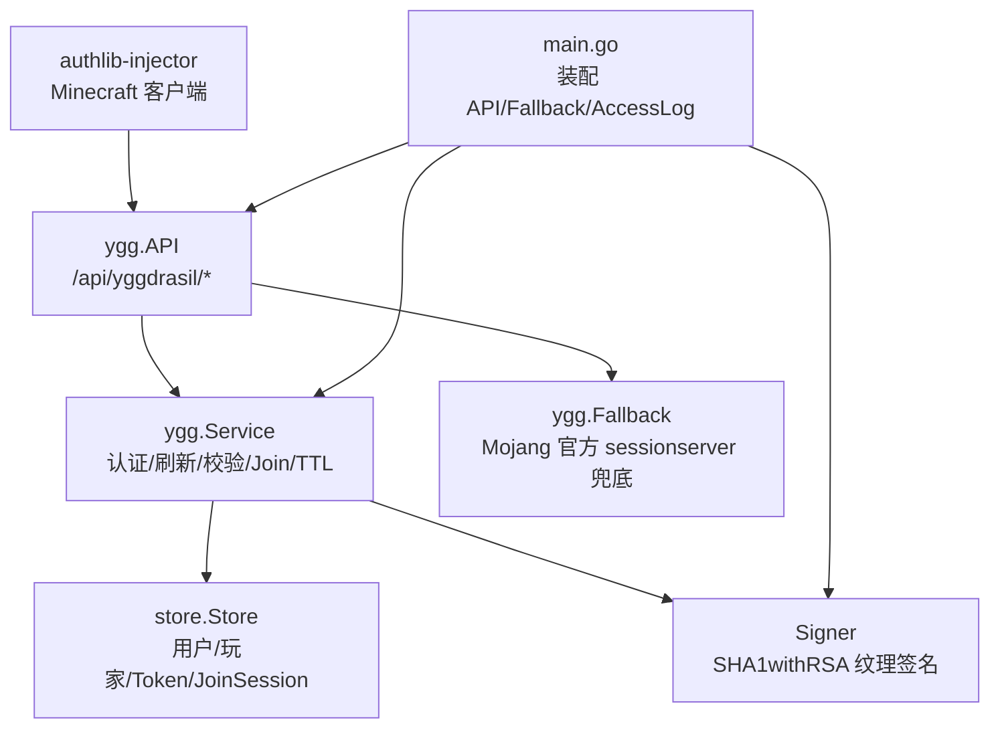
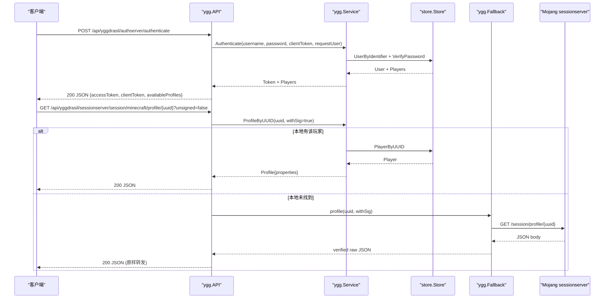
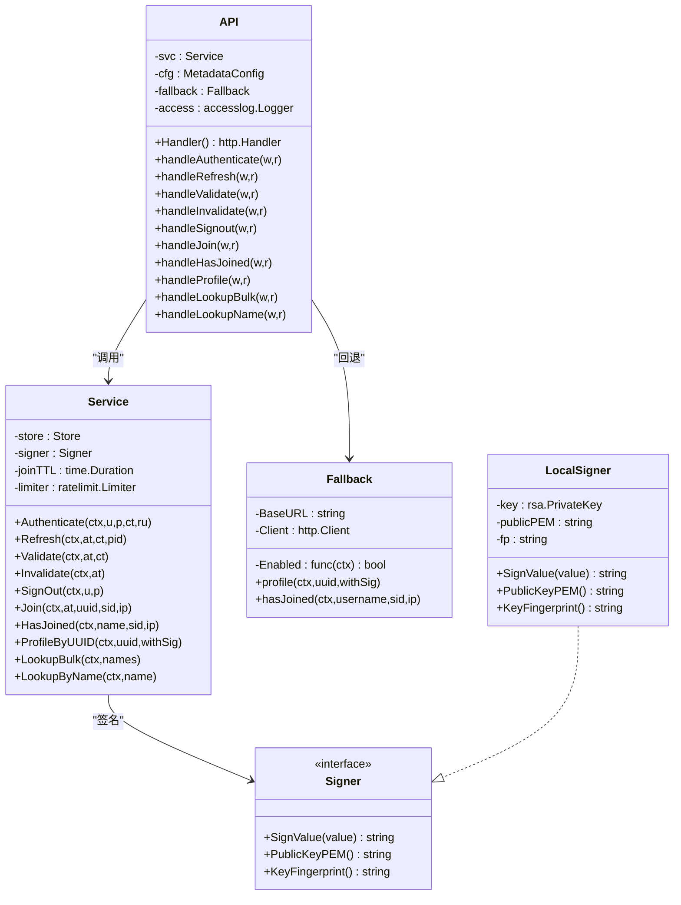

# Yggdrasil 协议实现

**本文引用的文件**
- [server/cmd/skin-nexus/main.go](https://github.com/YimingZhanshen/skin-nexus/blob/797ae1a/server/cmd/skin-nexus/main.go)
- [server/internal/ygg/http.go](https://github.com/YimingZhanshen/skin-nexus/blob/797ae1a/server/internal/ygg/http.go)
- [server/internal/ygg/service.go](https://github.com/YimingZhanshen/skin-nexus/blob/797ae1a/server/internal/ygg/service.go)
- [server/internal/ygg/fallback.go](https://github.com/YimingZhanshen/skin-nexus/blob/797ae1a/server/internal/ygg/fallback.go)
- [server/internal/ygg/models.go](https://github.com/YimingZhanshen/skin-nexus/blob/797ae1a/server/internal/ygg/models.go)
- [server/internal/ygg/signer.go](https://github.com/YimingZhanshen/skin-nexus/blob/797ae1a/server/internal/ygg/signer.go)

## 目录
1. [简介](#简介)
2. [项目结构](#项目结构)
3. [核心组件](#核心组件)
4. [架构总览](#架构总览)
5. [详细接口分析](#详细接口分析)
6. [依赖关系分析](#依赖关系分析)
7. [性能与限流](#性能与限流)
8. [故障排查指南](#故障排查指南)
9. [结论](#结论)
10. [附录：请求与响应示例、联调脚本、错误契约](#附录请求与响应示例联调脚本错误契约)

## 简介
SkinNexus 通过 `/api/yggdrasil/*` 暴露完整的 Minecraft Yggdrasil 兼容接口，使使用 authlib-injector 的客户端无需修改即可连接。入口由 `server/cmd/skin-nexus/main.go` 装配，路由表在 `server/internal/ygg/http.go` 中定义；认证、刷新、校验、加入、签名、TTL 等核心逻辑集中在 `server/internal/ygg/service.go`；Mojang 官方服务端点的兜底转发在 `server/internal/ygg/fallback.go` 中实现；公开的数据模型和纹理属性组装在 `server/internal/ygg/models.go`；纹理属性的 SHA1withRSA 签名在 `server/internal/ygg/signer.go` 中实现。

关键点：
- 所有 Yggdrasil 端点统一挂载在 `/api/yggdrasil` 下。
- 未识别 UUID 或本地无 join 记录时，可回退到 Mojang 官方 sessionserver。
- 玩家校验委托给后端 store（account.players 语义）：验证 token、用户名、UUID 所有权及 selectedProfile。
- 纹理 properties 使用本地 RSA 私钥对 Base64 textures 值进行 SHA1withRSA 签名，公钥在元数据中暴露。

## 项目结构
Yggdrasil 相关代码位于 `server/internal/ygg`，由皮肤服务器主进程 `skin-nexus` 启动并装配。



**图示来源**
- [server/cmd/skin-nexus/main.go:200-549](https://github.com/YimingZhanshen/skin-nexus/blob/797ae1a/server/cmd/skin-nexus/main.go#L200-L549)
- [server/internal/ygg/http.go:41-110](https://github.com/YimingZhanshen/skin-nexus/blob/797ae1a/server/internal/ygg/http.go#L41-L110)
- [server/internal/ygg/service.go:120-210](https://github.com/YimingZhanshen/skin-nexus/blob/797ae1a/server/internal/ygg/service.go#L120-L210)
- [server/internal/ygg/fallback.go:1-100](https://github.com/YimingZhanshen/skin-nexus/blob/797ae1a/server/internal/ygg/fallback.go#L1-L100)
- [server/internal/ygg/signer.go:1-40](https://github.com/YimingZhanshen/skin-nexus/blob/797ae1a/server/internal/ygg/signer.go#L1-L40)

**章节来源**
- [server/cmd/skin-nexus/main.go:1-60](https://github.com/YimingZhanshen/skin-nexus/blob/797ae1a/server/cmd/skin-nexus/main.go#L1-L60)
- [server/internal/ygg/http.go:41-110](https://github.com/YimingZhanshen/skin-nexus/blob/797ae1a/server/internal/ygg/http.go#L41-L110)

## 核心组件
- `ygg.API`：HTTP 处理器集合，负责路由、鉴权体解析、状态码映射、访问日志埋点。
- `ygg.Service`：Yggdrasil 业务层，封装 store、signer、rate limit、双 TTL、插件钩子。
- `ygg.Fallback`：仅对 profile 和 hasJoined 的本地 miss 调用 Mojang official sessionserver。
- `Signer` 接口：提供纹理属性签名和公钥导出；默认实现为本地 RSA 私钥。
- `models.go`：公开 Profile、Property、TextureSet 等 DTO，保证空 textures 序列化为 `{}`。

关键职责边界：
- HTTP 层不直接读库，只解析 JSON、做轻量校验、调用 service。
- Service 层决定 token 是否有效、玩家是否匹配、join 是否允许、签名是否附加。
- Fallback 是“失败增强”而非替代：只有本地未命中才发往 Mojang。
- Signer 只在构建 textures property 且需要签名时使用。

**章节来源**
- [server/internal/ygg/http.go:41-110](https://github.com/YimingZhanshen/skin-nexus/blob/797ae1a/server/internal/ygg/http.go#L41-L110)
- [server/internal/ygg/service.go:120-210](https://github.com/YimingZhanshen/skin-nexus/blob/797ae1a/server/internal/ygg/service.go#L120-L210)
- [server/internal/ygg/fallback.go:1-100](https://github.com/YimingZhanshen/skin-nexus/blob/797ae1a/server/internal/ygg/fallback.go#L1-L100)
- [server/internal/ygg/models.go:1-105](https://github.com/YimingZhanshen/skin-nexus/blob/797ae1a/server/internal/ygg/models.go#L1-L105)
- [server/internal/ygg/signer.go:1-40](https://github.com/YimingZhanshen/skin-nexus/blob/797ae1a/server/internal/ygg/signer.go#L1-L40)

## 架构总览
Yggdrasil 请求从 HTTP handler 进入后，典型路径如下：



**图示来源**
- [server/internal/ygg/http.go:280-420](https://github.com/YimingZhanshen/skin-nexus/blob/797ae1a/server/internal/ygg/http.go#L280-L420)
- [server/internal/ygg/service.go:330-520](https://github.com/YimingZhanshen/skin-nexus/blob/797ae1a/server/internal/ygg/service.go#L330-L520)
- [server/internal/ygg/fallback.go:60-160](https://github.com/YimingZhanshen/skin-nexus/blob/797ae1a/server/internal/ygg/fallback.go#L60-L160)

## 详细接口分析

### 路由与元数据
`ygg.API.Handler()` 注册以下路径：
- `GET /api/yggdrasil` 与 `GET /api/yggdrasil/`：返回元数据，包含 `implementationName=SkinNexus`、`signaturePublickey`、`skinDomains`、`feature.non_email_login`，以及可选 OIDC discovery URL。
- `POST /api/yggdrasil/authserver/authenticate`：登录获取 access token。
- `POST /api/yggdrasil/authserver/refresh`：刷新 token。
- `POST /api/yggdrasil/authserver/validate`：校验 token。
- `POST /api/yggdrasil/authserver/invalidate`：失效单个 token。
- `POST /api/yggdrasil/authserver/signout`：注销账号全部 token。
- `POST /api/yggdrasil/sessionserver/session/minecraft/join`：记录 join 会话。
- `GET /api/yggdrasil/sessionserver/session/minecraft/hasJoined`：查询是否已加入。
- `GET /api/yggdrasil/sessionserver/session/minecraft/profile/{uuid}`：按 UUID 查资料。
- `POST /api/yggdrasil/api/profiles/minecraft`：批量名字查 UUID。
- `GET /api/yggdrasil/api/users/profiles/minecraft/{name}`：单名字查 UUID。

元数据中的 `signaturePublickey` 用于客户端验证 textures property 签名；`X-Authlib-Injector-API-Location` 告诉客户端本站兼容接口的根地址。

**章节来源**
- [server/internal/ygg/http.go:41-110](https://github.com/YimingZhanshen/skin-nexus/blob/797ae1a/server/internal/ygg/http.go#L41-L110)
- [server/internal/ygg/http.go:110-200](https://github.com/YimingZhanshen/skin-nexus/blob/797ae1a/server/internal/ygg/http.go#L110-L200)

### authenticate
输入字段：
- `username`：邮箱、昵称或启用了非邮箱登录时的玩家名。
- `password`：明文密码。
- `clientToken`：可选；为空时服务生成 16 位十六进制值。
- `requestUser`：布尔；true 时在响应中附带 user.id（基于 uid 的 UUIDv5 DNS 命名空间）。

处理流程：
1. 检查 `Content-Type` 必须包含 `application/json`，否则返回 200 + 错误体。
2. 先执行同用户名最小间隔限制；命中则返回 403 + `ForbiddenOperationException`，并带 `Retry-After`。
3. 若启用 rate limiter，再检查 per-identifier 失败锁定与 IP 滑动窗口。
4. 调用 `Service.Authenticate`：查找用户、检查邮件验证门控与封禁、核对密码、生成 token pair、绑定单一 player（多 player 时留待 refresh 选择）。
5. 成功返回 200 JSON，包含 `accessToken`、`clientToken`、`availableProfiles`，可选 `selectedProfile` 与 `user`。
6. 失败返回 403 `ForbiddenOperationException`，错误信息固定为“Invalid credentials. Invalid username or password.”。

注意：认证失败时若启用 limiter，会标记 identifier 失败；成功则清除该标识符的失败计数。

**章节来源**
- [server/internal/ygg/http.go:220-320](https://github.com/YimingZhanshen/skin-nexus/blob/797ae1a/server/internal/ygg/http.go#L220-L320)
- [server/internal/ygg/service.go:330-420](https://github.com/YimingZhanshen/skin-nexus/blob/797ae1a/server/internal/ygg/service.go#L330-L420)

### refresh
输入字段：
- `accessToken`：当前 access token。
- `clientToken`：可选，需与旧 token 一致。
- `requestUser`：可选。
- `selectedProfile`：可选，支持两种格式：字符串 UUID 或对象 `{"id":"..."}`。

行为：
- 先解析 selectedProfile；若存在则查其 PID 并校验该玩家属于该 token 所属用户。
- 调用 `Service.Refresh`：检查 token 有效性、是否可刷新、clientToken 一致性。
- 刷新后会失效旧 token，并生成新 token。
- 成功返回 200 JSON，结构与 authenticate 类似。
- 失败返回 403 `ForbiddenOperationException`，消息为 “Invalid token.”。

**章节来源**
- [server/internal/ygg/http.go:320-420](https://github.com/YimingZhanshen/skin-nexus/blob/797ae1a/server/internal/ygg/http.go#L320-L420)
- [server/internal/ygg/service.go:420-520](https://github.com/YimingZhanshen/skin-nexus/blob/797ae1a/server/internal/ygg/service.go#L420-L520)

### validate
输入字段：
- `accessToken`
- `clientToken`：可选；若新旧 token 都有 clientToken 字段，则必须相等。

行为：
- 调用 `Service.Validate`，检查 token 未失效、未过期、clientToken 一致。
- 成功返回 204 No Content。
- 失败返回 403 `ForbiddenOperationException`，消息为 “Invalid token.”。

**章节来源**
- [server/internal/ygg/http.go:420-480](https://github.com/YimingZhanshen/skin-nexus/blob/797ae1a/server/internal/ygg/http.go#L420-L480)
- [server/internal/ygg/service.go:520-560](https://github.com/YimingZhanshen/skin-nexus/blob/797ae1a/server/internal/ygg/service.go#L520-L560)

### signout
输入字段：
- `username`
- `password`

行为：
- 先执行同用户名最小间隔限制；若被限流，仍返回 204，但跳过实际注销逻辑，以兼顾防暴力破解与协议契约。
- 若未被限流，则校验密码，成功后删除该用户全部 token。
- 始终返回 204 No Content。

**章节来源**
- [server/internal/ygg/http.go:480-520](https://github.com/YimingZhanshen/skin-nexus/blob/797ae1a/server/internal/ygg/http.go#L480-L520)
- [server/internal/ygg/service.go:560-600](https://github.com/YimingZhanshen/skin-nexus/blob/797ae1a/server/internal/ygg/service.go#L560-L600)

### join
输入字段：
- `accessToken`
- `selectedProfile`：支持字符串 UUID 或 `{"id":"..."}`。
- `serverId`

行为：
- 校验 selectedProfile 可解析。
- 调用 `Service.Join`：解析 token、检查用户与封禁状态、校验 email verification gate、校验 UUID 属于 token 所有者且与 selectedProfile 一致。
- 若启用 JoinGuard，插件拒绝时会返回 403 `ForbiddenOperationException`，消息为插件提供的 Message。
- 成功写入 join session，TTL 默认 120 秒。
- 成功返回 204 No Content。

错误映射：
- 未验证邮箱：403 `ForbiddenOperationException`，消息 “Email not verified.”。
- UUID 不匹配或未拥有：403 `ForbiddenOperationException`，消息 “the selected profile is not owned by this access token”。
- token 无效：403 `ForbiddenOperationException`，消息 “Invalid token.”。

**章节来源**
- [server/internal/ygg/http.go:520-620](https://github.com/YimingZhanshen/skin-nexus/blob/797ae1a/server/internal/ygg/http.go#L520-L620)
- [server/internal/ygg/service.go:600-738](https://github.com/YimingZhanshen/skin-nexus/blob/797ae1a/server/internal/ygg/service.go#L600-L738)

### hasJoined
查询参数：
- `username`
- `serverId`
- `ip`：可选，若解析失败会被忽略。

行为：
1. 调用 `Service.HasJoined`：查找本地 join session，校验 serverId、IP、过期时间。
2. 若本地未找到，且启用 fallback，则调用 `Fallback.hasJoined` 向 Mojang 查询。
3. 若 Mojang 确认，则原样返回其 JSON。
4. 否则返回 204 No Content。

注意：即使 failover 成功，返回体仍是 Mojang 原始 JSON，而不是 SkinNexus 重新构造的 Profile。

**章节来源**
- [server/internal/ygg/http.go:540-620](https://github.com/YimingZhanshen/skin-nexus/blob/797ae1a/server/internal/ygg/http.go#L540-L620)
- [server/internal/ygg/fallback.go:120-180](https://github.com/YimingZhanshen/skin-nexus/blob/797ae1a/server/internal/ygg/fallback.go#L120-L180)

### profile/\{uuid\}
路径参数：
- `uuid`：任意 UUID 拼写。

查询参数：
- `unsigned=false`：保留 textures 签名；其他值或缺省时移除 signature 字段。

行为：
1. 调用 `Service.ProfileByUUID`。
2. 若本地未找到且启用 fallback，则调用 `Fallback.profile` 查询 Mojang。
3. 若 fallback 成功，直接返回其 JSON。
4. 否则返回 204 No Content。
5. 若本地找到但请求 unsigned，则遍历 properties 并将每个 property 的 signature 置空。

**章节来源**
- [server/internal/ygg/http.go:620-700](https://github.com/YimingZhanshen/skin-nexus/blob/797ae1a/server/internal/ygg/http.go#L620-L700)
- [server/internal/ygg/fallback.go:100-160](https://github.com/YimingZhanshen/skin-nexus/blob/797ae1a/server/internal/ygg/fallback.go#L100-L160)

### 批量名字查询与单名字查询
- `POST /api/yggdrasil/api/profiles/minecraft`：接收字符串数组；先去重，再判断数量上限，默认最大 5；返回 `{id,name}` 列表。
- `GET /api/yggdrasil/api/users/profiles/minecraft/{name}`：返回 `{id,name}` 或 204。

上限可通过 `SearchProfileMax` 动态解析，默认 5，范围约束为 1-100。

**章节来源**
- [server/internal/ygg/http.go:700-760](https://github.com/YimingZhanshen/skin-nexus/blob/797ae1a/server/internal/ygg/http.go#L700-L760)
- [server/internal/ygg/service.go:180-210](https://github.com/YimingZhanshen/skin-nexus/blob/797ae1a/server/internal/ygg/service.go#L180-L210)

## 依赖关系分析



**图示来源**
- [server/internal/ygg/http.go:41-110](https://github.com/YimingZhanshen/skin-nexus/blob/797ae1a/server/internal/ygg/http.go#L41-L110)
- [server/internal/ygg/service.go:120-210](https://github.com/YimingZhanshen/skin-nexus/blob/797ae1a/server/internal/ygg/service.go#L120-L210)
- [server/internal/ygg/fallback.go:60-120](https://github.com/YimingZhanshen/skin-nexus/blob/797ae1a/server/internal/ygg/fallback.go#L60-L120)
- [server/internal/ygg/signer.go:20-108](https://github.com/YimingZhanshen/skin-nexus/blob/797ae1a/server/internal/ygg/signer.go#L20-L108)

耦合与内聚：
- HTTP 层与 Service 层解耦，便于替换 token resolver（OIDC JWT 与 opaque token 双态）。
- Fallback 独立于主认证链路，仅在特定 miss 路径触发。
- Signer 接口抽象了本地私钥与未来联盟共享密钥的实现差异。
- Service 对外暴露 store 能力，内部还持有 rate limiter、plugins hooks、verification gate。

潜在循环依赖：
- 未发现 ygg 包内部循环导入；main.go 作为装配层同时依赖 ygg、plugin、store、adminapi 等。

外部依赖：
- Mojang official sessionserver：仅用于 fallback。
- 数据库 store：用户、玩家、token、join session。
- 可选 OIDC provider：注入 token resolver，但不改变 HTTP wire。

**章节来源**
- [server/cmd/skin-nexus/main.go:200-549](https://github.com/YimingZhanshen/skin-nexus/blob/797ae1a/server/cmd/skin-nexus/main.go#L200-L549)
- [server/internal/ygg/http.go:41-110](https://github.com/YimingZhanshen/skin-nexus/blob/797ae1a/server/internal/ygg/http.go#L41-L110)
- [server/internal/ygg/service.go:120-210](https://github.com/YimingZhanshen/skin-nexus/blob/797ae1a/server/internal/ygg/service.go#L120-L210)
- [server/internal/ygg/fallback.go:60-120](https://github.com/YimingZhanshen/skin-nexus/blob/797ae1a/server/internal/ygg/fallback.go#L60-L120)
- [server/internal/ygg/signer.go:20-108](https://github.com/YimingZhanshen/skin-nexus/blob/797ae1a/server/internal/ygg/signer.go#L20-L108)

## 性能与限流

### TTL 策略
- Join session TTL：默认 120 秒，与历史部署一致。
- Token 双 TTL：
  - Soft window：默认 72 小时，写入 ExpiresAt。
  - Hard window：默认 7 天，从 CreatedAt 起算。
  - 超过 soft 但未超 hard：validate/join/userinfo 拒绝，refresh 仍可续期。
  - 超过 hard：完全失效，必须重新登录。
- 双 TTL 可通过 `ygg_token_expire_1`、`ygg_token_expire_2` 动态解析。

### 速率限制
- 同用户名最小间隔：默认 1 秒，作用于 authenticate 与 signout。
- Per-identifier 失败锁定：防止凭据猜测。
- IP 滑动窗口：防止同一 IP 大量刷新或刷新暴力。
- 批量 profile 查询上限：默认 5，最多可配置到 100。
- 每用户 token 数 LRU 清理：默认 10，超出时淘汰最旧 token。

### Fallback 性能与安全
- Mojang 请求硬超时：4 秒。
- 响应体上限：1 MiB。
- 禁止跟随重定向。
- 拨号层仅允许公网 IP，拒绝环回、私有网段、CGNAT、组播与 link-local。
- 空闲连接池每主机最多 4，空闲超时 30 秒。

### 诊断与访问日志
- 每个 Yggdrasil 请求都尝试记录 access log，但 capture 仅在超级管理员诊断窗口打开时才携带敏感详情。
- 诊断模式结束后自动清理 credential 字段。
- 后台任务每 6 小时清理 90 天前的 access_logs、join_sessions 与诊断明细。

**章节来源**
- [server/internal/ygg/service.go:200-330](https://github.com/YimingZhanshen/skin-nexus/blob/797ae1a/server/internal/ygg/service.go#L200-L330)
- [server/internal/ygg/fallback.go:1-100](https://github.com/YimingZhanshen/skin-nexus/blob/797ae1a/server/internal/ygg/fallback.go#L1-L100)
- [server/internal/ygg/fallback.go:201-245](https://github.com/YimingZhanshen/skin-nexus/blob/797ae1a/server/internal/ygg/fallback.go#L201-L245)
- [server/cmd/skin-nexus/main.go:420-549](https://github.com/YimingZhanshen/skin-nexus/blob/797ae1a/server/cmd/skin-nexus/main.go#L420-L549)

## 故障排查指南

### UUID 不匹配
现象：
- join 返回 403，错误信息包含 “the selected profile is not owned by this access token”。

可能原因：
- selectedProfile 不是当前 token 所属用户的玩家。
- selectedProfile 与 token 绑定的 SelectedPID 不一致。
- 客户端在多个玩家间切换后仍使用旧 token。

排查步骤：
1. 用 validate 确认 token 仍然有效。
2. 检查 refresh 是否传入了正确的 selectedProfile。
3. 检查 store 中 Player.UUID 与 token.SelectedPID 是否一致。
4. 查看 access log detail 中 uuid 与 serverId。

**章节来源**
- [server/internal/ygg/http.go:520-620](https://github.com/YimingZhanshen/skin-nexus/blob/797ae1a/server/internal/ygg/http.go#L520-L620)
- [server/internal/ygg/service.go:600-738](https://github.com/YimingZhanshen/skin-nexus/blob/797ae1a/server/internal/ygg/service.go#L600-L738)

### Mojang 超时或不可达
现象：
- profile 或 hasJoined 最终返回 204，而不是预期的 Mojang JSON。

可能原因：
- 配置 `ygg_mojang_fallback` 关闭。
- Mojang 网络超时（4 秒硬超时）。
- 目标地址被 fallback 安全层拒绝。
- Mojang 返回非 200、HTML、超大响应或无法解析为 profile JSON。

排查步骤：
1. 检查管理面板开关 `ygg_mojang_fallback`。
2. 观察 access log 中 fallback 来源是否为 `src=official`。
3. 检查 DNS 是否被污染导致解析到私有 IP。
4. 临时禁用 CDN 或代理，确认出站可达性。

**章节来源**
- [server/internal/ygg/fallback.go:1-100](https://github.com/YimingZhanshen/skin-nexus/blob/797ae1a/server/internal/ygg/fallback.go#L1-L100)
- [server/internal/ygg/fallback.go:201-245](https://github.com/YimingZhanshen/skin-nexus/blob/797ae1a/server/internal/ygg/fallback.go#L201-L245)
- [server/cmd/skin-nexus/main.go:480-549](https://github.com/YimingZhanshen/skin-nexus/blob/797ae1a/server/cmd/skin-nexus/main.go#L480-L549)

### 签名校验失败
现象：
- 客户端报告 textures property 签名无效，或 skin 加载失败。

可能原因：
- 本地签名私钥损坏或被替换。
- metadata 中的 `signaturePublickey` 与实际私钥不匹配。
- 客户端使用了错误的公钥来源。
- textures value 在传输过程中被篡改。

排查步骤：
1. 检查启动日志中的签名密钥指纹。
2. 对比 metadata 返回的 `signaturePublickey` 与本地 PEM。
3. 使用 profile 接口并传入 `unsigned=false`，确认返回的 property.signature 是否存在。
4. 检查是否启用了 union signer；若启用 hub 共享密钥，需确保各节点使用相同 key。

**章节来源**
- [server/internal/ygg/signer.go:20-108](https://github.com/YimingZhanshen/skin-nexus/blob/797ae1a/server/internal/ygg/signer.go#L20-L108)
- [server/internal/ygg/models.go:40-105](https://github.com/YimingZhanshen/skin-nexus/blob/797ae1a/server/internal/ygg/models.go#L40-L105)
- [server/cmd/skin-nexus/main.go:360-420](https://github.com/YimingZhanshen/skin-nexus/blob/797ae1a/server/cmd/skin-nexus/main.go#L360-L420)

### authlib-injector 连接问题
现象：
- 客户端无法发现 API 地址。
- 跨站名称回填失败。
- 皮肤域名不被信任。

排查步骤：
1. 确认客户端配置的 authlib-injector 地址指向 `/api/yggdrasil`。
2. 检查 `X-Authlib-Injector-API-Location` 是否正确。
3. 检查 `skinDomains` 是否包含皮肤托管域名。
4. 若站点使用反向代理，确认 TLS 终止、Host、X-Forwarded-Proto 正确传递。
5. 检查 CDN 模式下真实 IP 提取是否生效，避免 rate limit 误伤。

**章节来源**
- [server/internal/ygg/http.go:110-200](https://github.com/YimingZhanshen/skin-nexus/blob/797ae1a/server/internal/ygg/http.go#L110-L200)
- [server/cmd/skin-nexus/main.go:200-360](https://github.com/YimingZhanshen/skin-nexus/blob/797ae1a/server/cmd/skin-nexus/main.go#L200-L360)

## 结论
SkinNexus 的 Yggdrasil 实现以清晰的分层将 HTTP 协议、业务逻辑、存储与签名分离，并通过 fallback 机制兼容官方 Mojang 账户。认证流程严格遵循 authlib-injector 期望的 wire contract：authenticate 返回 token 与 profiles，validate 返回 204，join 记录 120 秒 join session，profile 返回带 textures property 的 JSON。签名算法采用 SHA1withRSA，公钥由 metadata 暴露。TTL 采用软/硬双窗口，配合同用户名间隔、per-identifier 锁定与 IP 滑动窗口，既兼容上游行为，又缓解暴力攻击。fallback 以安全严格的出站网关保护系统，不会把失败转为错误数据。

## 附录：请求与响应示例、联调脚本、错误契约

### 错误契约
通用错误体结构：
```json
{
  "error": "错误码",
  "errorMessage": "人类可读消息"
}
```

常见错误码：
- `IllegalArgumentException`：JSON 解析失败、参数缺失或非法。
- `ForbiddenOperationException`：凭据错误、邮箱未验证、player mismatch、插件拒绝、上限超限。
- `TooManyRequests`：IP 或 per-identifier 速率限制。

状态码约定：
- 成功认证/刷新：200 JSON。
- 成功 validate、invalidate、signout、join：204 No Content。
- 未知 profile/unknown session：204 No Content。
- 认证失败、token 无效、player mismatch、email unverified：403。
- 速率限制：429。
- 非 JSON POST：200 + 错误体。

**章节来源**
- [server/internal/ygg/http.go:140-200](https://github.com/YimingZhanshen/skin-nexus/blob/797ae1a/server/internal/ygg/http.go#L140-L200)
- [server/internal/ygg/http.go:220-520](https://github.com/YimingZhanshen/skin-nexus/blob/797ae1a/server/internal/ygg/http.go#L220-L520)

### curl 联调示例

#### 登录
```bash
curl -i -X POST \
  -H "Content-Type: application/json" \
  -d '{
    "username": "your_username_or_player_name",
    "password": "your_password",
    "clientToken": "",
    "requestUser": true
  }' \
  https://你的域名/api/yggdrasil/authserver/authenticate
```

#### 刷新
```bash
curl -i -X POST \
  -H "Content-Type: application/json" \
  -d '{
    "accessToken": "上一步返回的 accessToken",
    "clientToken": "上一步返回的 clientToken",
    "requestUser": false,
    "selectedProfile": "UUID 字符串或{\"id\":\"UUID\"}"
  }' \
  https://你的域名/api/yggdrasil/authserver/refresh
```

#### 校验
```bash
curl -i -X POST \
  -H "Content-Type: application/json" \
  -d '{
    "accessToken": "your_access_token",
    "clientToken": "your_client_token"
  }' \
  https://你的域名/api/yggdrasil/authserver/validate
```

#### 注销
```bash
curl -i -X POST \
  -H "Content-Type: application/json" \
  -d '{
    "username": "your_username",
    "password": "your_password"
  }' \
  https://你的域名/api/yggdrasil/authserver/signout
```

#### 加入服务器
```bash
curl -i -X POST \
  -H "Content-Type: application/json" \
  -d '{
    "accessToken": "your_access_token",
    "selectedProfile": "UUID",
    "serverId": "server_id_from_launcher"
  }' \
  https://你的域名/api/yggdrasil/sessionserver/session/minecraft/join
```

#### 查询是否已加入
```bash
curl -i "https://你的域名/api/yggdrasil/sessionserver/session/minecraft/hasJoined?username=你的名字&serverId=server_id_from_launcher"
```

#### 查询资料
```bash
curl -i "https://你的域名/api/yggdrasil/sessionserver/session/minecraft/profile/UUID?unsigned=false"
```

### Node.js 伪客户端示例
以下为伪代码，用于联调流程，不应直接在生产中使用：

```javascript
const BASE = "https://你的域名/api/yggdrasil";

async function post(path, body) {
  const res = await fetch(BASE + path, {
    method: "POST",
    headers: { "Content-Type": "application/json" },
    body: JSON.stringify(body),
  });
  return { status: res.status, json: res.json(), text: res.text() };
}

async function get(url) {
  const res = await fetch(url);
  return { status: res.status, json: res.json(), text: res.text() };
}

(async () => {
  // 登录
  const login = await post("/authserver/authenticate", {
    username: "用户名",
    password: "密码",
    requestUser: true,
  });
  if (login.status !== 200) throw new Error("登录失败");

  const { accessToken, clientToken, availableProfiles } = await login.json();

  // 校验
  const validate = await post("/authserver/validate", {
    accessToken,
    clientToken,
  });
  console.log("validate:", validate.status);

  // 加入
  const join = await post("/sessionserver/session/minecraft/join", {
    accessToken,
    selectedProfile: availableProfiles[0].id,
    serverId: "测试服务器ID",
  });
  console.log("join:", join.status);

  // hasJoined
  const hasJoined = await get(
    "/sessionserver/session/minecraft/hasJoined?username=用户名&serverId=测试服务器ID"
  );
  console.log("hasJoined:", hasJoined.status);

  // profile
  const profile = await get(
    `/sessionserver/session/minecraft/profile/${availableProfiles[0].id}?unsigned=false`
  );
  console.log("profile:", profile.status);
})();
```

### 签名算法说明
- 签名对象：textures property 的 Base64 文本值。
- 哈希算法：SHA-1。
- RSA 签名：PKCS#1 v1.5。
- 签名结果：Base64 编码后放入 property.signature。
- 公钥：X.509 SubjectPublicKeyInfo PEM，由 metadata 的 `signaturePublickey` 提供。
- 空 textures：序列化时必须为 `{}`，不能为 null 或数组。

**章节来源**
- [server/internal/ygg/models.go:40-105](https://github.com/YimingZhanshen/skin-nexus/blob/797ae1a/server/internal/ygg/models.go#L40-L105)
- [server/internal/ygg/signer.go:20-108](https://github.com/YimingZhanshen/skin-nexus/blob/797ae1a/server/internal/ygg/signer.go#L20-L108)

### TTL 行为速查
- join session：120 秒。
- token soft window：默认 72 小时。
- token hard window：默认 7 天。
- fallback Mojang 请求：4 秒超时、1 MiB 上限、不跟随重定向。
- access log：默认保留 90 天，每 6 小时清理。

**章节来源**
- [server/internal/ygg/service.go:240-330](https://github.com/YimingZhanshen/skin-nexus/blob/797ae1a/server/internal/ygg/service.go#L240-L330)
- [server/internal/ygg/fallback.go:1-100](https://github.com/YimingZhanshen/skin-nexus/blob/797ae1a/server/internal/ygg/fallback.go#L1-L100)
- [server/cmd/skin-nexus/main.go:480-549](https://github.com/YimingZhanshen/skin-nexus/blob/797ae1a/server/cmd/skin-nexus/main.go#L480-L549)
