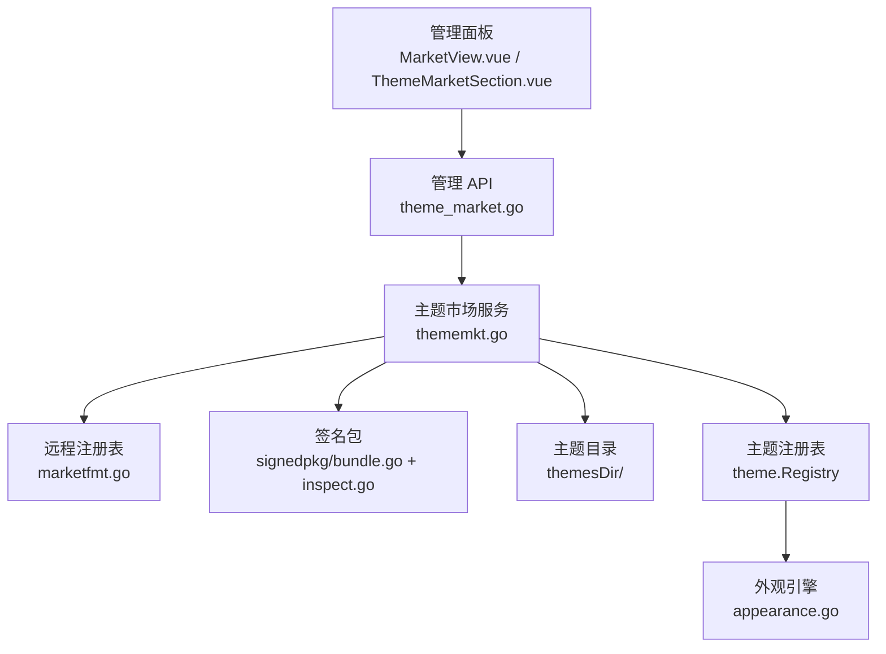
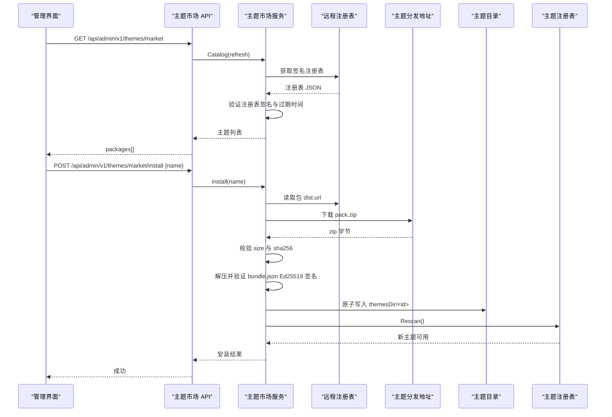
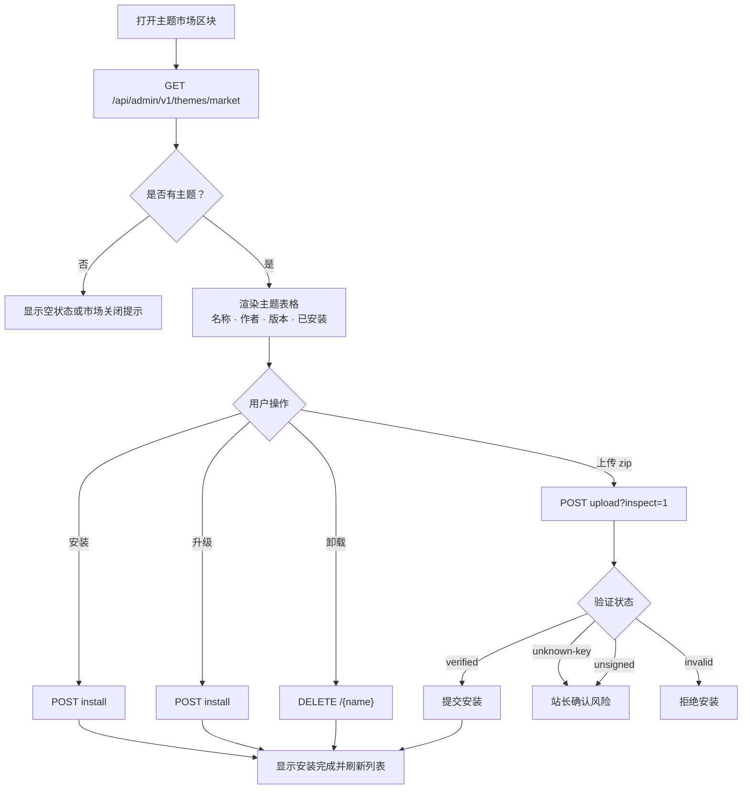
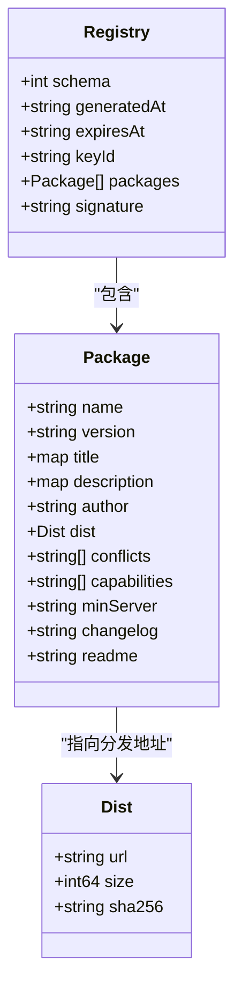
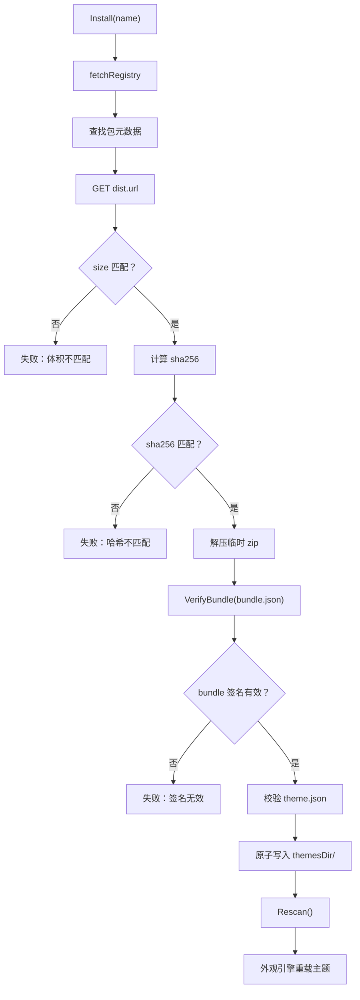
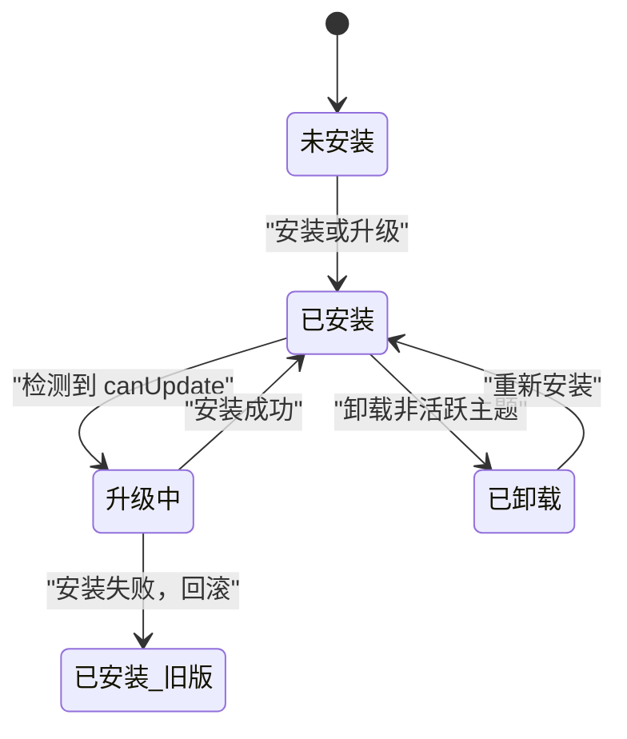
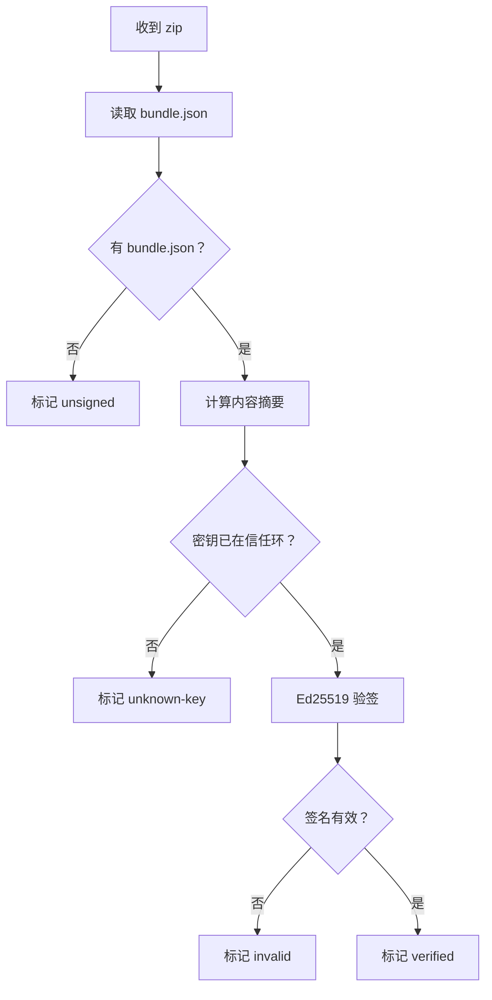
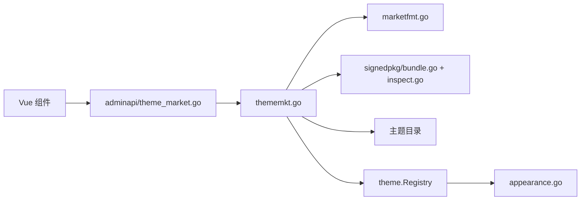

# 主题市场

**本文引用的文件**
- [MarketView.vue](https://github.com/YimingZhanshen/skin-nexus/blob/797ae1a/web/src/components/admin/MarketView.vue)
- [ThemeMarketSection.vue](https://github.com/YimingZhanshen/skin-nexus/blob/797ae1a/web/src/components/admin/ThemeMarketSection.vue)
- [theme_market.go](https://github.com/YimingZhanshen/skin-nexus/blob/797ae1a/server/internal/adminapi/theme_market.go)
- [thememkt.go](https://github.com/YimingZhanshen/skin-nexus/blob/797ae1a/server/internal/thememkt/thememkt.go)
- [marketfmt.go](https://github.com/YimingZhanshen/skin-nexus/blob/797ae1a/server/internal/marketfmt/marketfmt.go)
- [bundle.go](https://github.com/YimingZhanshen/skin-nexus/blob/797ae1a/server/internal/signedpkg/bundle.go)
- [inspect.go](https://github.com/YimingZhanshen/skin-nexus/blob/797ae1a/server/internal/signedpkg/inspect.go)
- [appearance.go](https://github.com/YimingZhanshen/skin-nexus/blob/797ae1a/server/internal/appearance/appearance.go)
- [check-theme-contract.mjs](https://github.com/YimingZhanshen/skin-nexus/blob/797ae1a/scripts/check-theme-contract.mjs)

## 目录
1. [引言](#引言)
2. [项目结构](#项目结构)
3. [核心组件](#核心组件)
4. [架构总览](#架构总览)
5. [详细组件分析](#详细组件分析)
6. [依赖关系分析](#依赖关系分析)
7. [性能与可靠性](#性能与可靠性)
8. [故障排查指南](#故障排查指南)
9. [站长常用示例](#站长常用示例)
10. [结论](#结论)

## 引言
本文件说明 SkinNexus 的“主题市场”能力：管理面板中的主题列表、本地主题包导入、远程注册表协议、Ed25519 签名验证、安装升级卸载流程，以及离线部署和故障处理。前端包含两个相关界面：
- `MarketView.vue`：通用插件市场视图，也展示插件类主题（带权限计划、冲突提示等）。
- `ThemeMarketSection.vue`：嵌入外观配置的主题市场区块，侧重主题安装、升级、卸载和本地 zip 包导入。

后端由 `adminapi/theme_market.go` 暴露管理接口，`thememkt` 服务负责拉取签名注册表、下载并验签主题包、写入文件系统、热重载主题注册表；`marketfmt` 定义注册表格式；`signedpkg` 提供 Ed25519 bundle 验签工具。

## 项目结构
主题市场涉及三层：
- 前端管理界面：Vue 组件调用 `/api/admin/v1/themes/market*` 与 `/api/admin/v1/themes/upload`。
- 管理 API 层：校验超级管理员身份、CSRF、请求体大小，并将错误映射为可操作提示。
- 主题市场服务：拉取远端注册表、下载主题包、验证元数据与签名、原子替换目录、重新扫描主题注册表。

**图表来源**
- [MarketView.vue:1-200](https://github.com/YimingZhanshen/skin-nexus/blob/797ae1a/web/src/components/admin/MarketView.vue#L1-L200)
- [ThemeMarketSection.vue:1-200](https://github.com/YimingZhanshen/skin-nexus/blob/797ae1a/web/src/components/admin/ThemeMarketSection.vue#L1-L200)
- [theme_market.go:1-136](https://github.com/YimingZhanshen/skin-nexus/blob/797ae1a/server/internal/adminapi/theme_market.go#L1-L136)
- [thememkt.go:1-200](https://github.com/YimingZhanshen/skin-nexus/blob/797ae1a/server/internal/thememkt/thememkt.go#L1-L200)
- [marketfmt.go:1-182](https://github.com/YimingZhanshen/skin-nexus/blob/797ae1a/server/internal/marketfmt/marketfmt.go#L1-L182)
- [bundle.go:1-198](https://github.com/YimingZhanshen/skin-nexus/blob/797ae1a/server/internal/signedpkg/bundle.go#L1-L198)
- [inspect.go:1-90](https://github.com/YimingZhanshen/skin-nexus/blob/797ae1a/server/internal/signedpkg/inspect.go#L1-L90)
- [appearance.go:1-200](https://github.com/YimingZhanshen/skin-nexus/blob/797ae1a/server/internal/appearance/appearance.go#L1-L200)

**章节来源**
- [MarketView.vue:1-300](https://github.com/YimingZhanshen/skin-nexus/blob/797ae1a/web/src/components/admin/MarketView.vue#L1-L300)
- [ThemeMarketSection.vue:1-228](https://github.com/YimingZhanshen/skin-nexus/blob/797ae1a/web/src/components/admin/ThemeMarketSection.vue#L1-L228)
- [theme_market.go:1-136](https://github.com/YimingZhanshen/skin-nexus/blob/797ae1a/server/internal/adminapi/theme_market.go#L1-L136)

## 核心组件
- `MarketView.vue`：从 `/api/admin/v1/market/catalog` 拉取插件目录，支持搜索、分页、上传 zip 预检、二次确认安装、权限同意、刷新目录。它主要用于插件市场，但也可展示插件型主题。
- `ThemeMarketSection.vue`：从 `/api/admin/v1/themes/market` 拉取主题目录，显示主题名称、作者、版本、是否已安装、可更新状态，并提供安装、升级、卸载、本地 zip 预检与提交。
- `theme_market.go`：实现主题市场目录、安装、卸载、本地上传接口；区分“市场关闭”“未验证包”“哈希不匹配”“包无效”“主题不存在”等错误。
- `thememkt.go`：主题市场业务逻辑，包括注册表缓存、目录合并、主题包下载、size/sha256/bundle.json 校验、安装回滚、卸载保护。
- `marketfmt.go`：注册表的 JSON 结构、Ed25519 签名校验、过期时间、包名和 dist URL 校验、版本号比较。
- `signedpkg/bundle.go` 与 `inspect.go`：读取/验证 bundle.json、计算内容摘要、Ed25519 验签、分类验证状态。
- `appearance.go`：外观引擎保存当前活跃主题，并在保存时校验主题是否存在；主题加载失败时表现为样式缺失或回退到默认主题。

**章节来源**
- [thememkt.go:1-200](https://github.com/YimingZhanshen/skin-nexus/blob/797ae1a/server/internal/thememkt/thememkt.go#L1-L200)
- [theme_market.go:1-136](https://github.com/YimingZhanshen/skin-nexus/blob/797ae1a/server/internal/adminapi/theme_market.go#L1-L136)
- [marketfmt.go:1-182](https://github.com/YimingZhanshen/skin-nexus/blob/797ae1a/server/internal/marketfmt/marketfmt.go#L1-L182)
- [bundle.go:1-198](https://github.com/YimingZhanshen/skin-nexus/blob/797ae1a/server/internal/signedpkg/bundle.go#L1-L198)
- [inspect.go:1-90](https://github.com/YimingZhanshen/skin-nexus/blob/797ae1a/server/internal/signedpkg/inspect.go#L1-L90)
- [appearance.go:1-200](https://github.com/YimingZhanshen/skin-nexus/blob/797ae1a/server/internal/appearance/appearance.go#L1-L200)

## 架构总览
主题市场客户端与服务端的交互分为两条线：
1. **远程主题市场**：前端调用主题市场目录接口 → 服务端拉取并验证注册表 → 返回主题列表 → 安装时拉取 dist 包 → 验签 → 安装。
2. **本地主题包**：前端选择 zip → 预检 → 根据验证状态决定是否要求站长确认 → 提交后安装。

**图表来源**
- [theme_market.go:18-60](https://github.com/YimingZhanshen/skin-nexus/blob/797ae1a/server/internal/adminapi/theme_market.go#L18-L60)
- [thememkt.go:200-300](https://github.com/YimingZhanshen/skin-nexus/blob/797ae1a/server/internal/thememkt/thememkt.go#L200-L300)
- [marketfmt.go:100-182](https://github.com/YimingZhanshen/skin-nexus/blob/797ae1a/server/internal/marketfmt/marketfmt.go#L100-L182)
- [bundle.go:60-120](https://github.com/YimingZhanshen/skin-nexus/blob/797ae1a/server/internal/signedpkg/bundle.go#L60-L120)

## 详细组件分析

### MarketView.vue：插件型主题与市场入口
该组件主要负责：
- 从 `/api/admin/v1/market/catalog` 拉取目录。
- 按名称、标题多语言字段搜索，并按页显示。
- 对已安装主题显示本地版本，对可更新主题显示“旧版本 → 新版本”。
- 支持上传 zip 预检，显示信任状态、签名者 keyId、zip SHA、额外权限和风险确认。
- 需要新增权限的主题在安装前强制勾选同意。
- 非超级管理员只读。

它不是主题市场的专属页面，但能展示插件型主题的安装流程，包括权限、缺失依赖、冲突提示。

**章节来源**
- [MarketView.vue:1-200](https://github.com/YimingZhanshen/skin-nexus/blob/797ae1a/web/src/components/admin/MarketView.vue#L1-L200)
- [MarketView.vue:201-300](https://github.com/YimingZhanshen/skin-nexus/blob/797ae1a/web/src/components/admin/MarketView.vue#L201-L300)

### ThemeMarketSection.vue：主题市场专用区块
该组件是主题市场的用户入口，重点行为如下：

| 功能 | 前端行为 | 后端接口 |
|---|---|---|
| 列出主题 | 调用 `/api/admin/v1/themes/market`，支持 `?refresh=1` | 返回 `packages` 数组，包含 `name`、`title`、`author`、`version`、`installed`、`canUpdate` |
| 安装主题 | 点击安装按钮，发送 `{ name }` | `/api/admin/v1/themes/market/install` |
| 升级主题 | 当 `canUpdate` 为真时显示升级按钮，调用相同安装接口 | 同安装 |
| 卸载主题 | 确认后 DELETE `/api/admin/v1/themes/market/{name}` | 删除主题目录并重新扫描 |
| 本地 zip 预检 | 选择 zip 后调用 `/api/admin/v1/themes/upload`，携带 `inspect=1` | 返回 `status`、`name`、`version`、`zipSha`、`theme` |
| 提交本地包 | 再次 POST `/api/admin/v1/themes/upload`，携带 `expectDigest` 与可选 `acceptUnverified` | 安装并返回 `id`、`version`、`trust` |

模板中明确展示：
- 主题名称：优先使用当前语言的 `title`，回退到 `name`。
- 作者：`p.author`。
- 版本：`p.version`。
- 已安装状态：`p.installed` 为本地已安装版本字符串，否则显示空。
- 操作列：未安装时显示“安装”，已安装且可更新时显示“升级”，始终显示“卸载”。

**图表来源**
- [ThemeMarketSection.vue:1-200](https://github.com/YimingZhanshen/skin-nexus/blob/797ae1a/web/src/components/admin/ThemeMarketSection.vue#L1-L200)
- [ThemeMarketSection.vue:201-228](https://github.com/YimingZhanshen/skin-nexus/blob/797ae1a/web/src/components/admin/ThemeMarketSection.vue#L201-L228)
- [theme_market.go:18-136](https://github.com/YimingZhanshen/skin-nexus/blob/797ae1a/server/internal/adminapi/theme_market.go#L18-L136)

**章节来源**
- [ThemeMarketSection.vue:1-228](https://github.com/YimingZhanshen/skin-nexus/blob/797ae1a/web/src/components/admin/ThemeMarketSection.vue#L1-L228)

### 主题市场客户端与远程 registry 的交互协议
主题注册表采用 `marketfmt` 定义的 JSON 结构，并由 Ed25519 签名。关键约束：
- 注册表必须包含 `schema`、`generatedAt`、`expiresAt`、`keyId`、`packages`、`signature`。
- `expiresAt` 必须晚于当前时间。
- 每个包的 `dist.url` 必须是 HTTPS、无查询参数和无片段。
- 每个包必须声明 `size` 和 `sha256`。
- 包名必须符合小写字母数字及连字符、下划线规则。
- 包名不能重复。

客户端侧通过 `/api/admin/v1/themes/market` 间接访问该协议，不直接调用注册表地址。服务端会：
1. 解析 `MarketURL`。
2. 发起 HTTP GET。
3. 用配置的信任密钥环验证注册表签名。
4. 检查过期时间。
5. 将验证后的注册表放入内存缓存（TTL 10 分钟）和磁盘缓存。
6. 与本地主题目录合并，标注 `installed` 与 `canUpdate`。

**图表来源**
- [marketfmt.go:1-182](https://github.com/YimingZhanshen/skin-nexus/blob/797ae1a/server/internal/marketfmt/marketfmt.go#L1-L182)

**章节来源**
- [marketfmt.go:1-182](https://github.com/YimingZhanshen/skin-nexus/blob/797ae1a/server/internal/marketfmt/marketfmt.go#L1-L182)
- [thememkt.go:1-200](https://github.com/YimingZhanshen/skin-nexus/blob/797ae1a/server/internal/thememkt/thememkt.go#L1-L200)

### 主题安装流程：拉取元数据 → 下载 bundle → 验签 → 写入文件 → 刷新 theme token → 重载外观
完整安装路径如下：

1. **拉取元数据**
   服务端调用 `Catalog`，从 `MarketURL` 拉取注册表，并用 `VerifyRegistry` 验证 Ed25519 签名、过期时间和包元数据。

2. **定位主题包**
   根据 `name` 查找 `packages`，取出 `dist.url`、`dist.size`、`dist.sha256`。

3. **下载 bundle**
   使用出站客户端限制目标主机、超时 15 秒、最大 32 MiB，下载 zip 字节。

4. **校验体积与哈希**
   如果注册表声明了 size，则长度必须相等；然后计算 SHA-256 并与注册表中的 `sha256` 比较。

5. **验证 bundle 签名**
   解压临时 zip，读取 `bundle.json`，用配置的信任密钥环验证 Ed25519 签名，并核对 `bundle.json` 中的 `name` 与 `version` 是否与注册表一致。

6. **校验主题清单**
   读取 `theme.json`，校验主题 ID、版本、host 版本兼容性和主题契约。

7. **原子写入主题目录**
   解压到 `themesDir/.install-<id>-*`，找到打包根目录，若已有旧主题则重命名为 `.replaced-时间戳`，再移动新目录。

8. **重新扫描主题注册表**
   调用 `Rescan()`，让外观引擎发现新主题。

9. **刷新 theme token 与外观**
   主题目录变更后，主题注册表重新加载，外观注入块随之变化；切换活跃主题时由外观引擎持久化 `active_theme` 并清除缓存。

**图表来源**
- [thememkt.go:200-473](https://github.com/YimingZhanshen/skin-nexus/blob/797ae1a/server/internal/thememkt/thememkt.go#L200-L473)
- [bundle.go:60-120](https://github.com/YimingZhanshen/skin-nexus/blob/797ae1a/server/internal/signedpkg/bundle.go#L60-L120)
- [appearance.go:120-200](https://github.com/YimingZhanshen/skin-nexus/blob/797ae1a/server/internal/appearance/appearance.go#L120-L200)

**章节来源**
- [thememkt.go:200-473](https://github.com/YimingZhanshen/skin-nexus/blob/797ae1a/server/internal/thememkt/thememkt.go#L200-L473)
- [bundle.go:1-198](https://github.com/YimingZhanshen/skin-nexus/blob/797ae1a/server/internal/signedpkg/bundle.go#L1-L198)
- [inspect.go:1-90](https://github.com/YimingZhanshen/skin-nexus/blob/797ae1a/server/internal/signedpkg/inspect.go#L1-L90)
- [appearance.go:1-200](https://github.com/YimingZhanshen/skin-nexus/blob/797ae1a/server/internal/appearance/appearance.go#L1-L200)

### 本地主题与远程主题的优先级、冲突处理、回滚策略
- **本地主题与远程主题的关系**
  主题列表由远程注册表生成，`installed` 字段表示本地是否安装了同名主题。若本地存在主题，其版本用于判断 `canUpdate`。也就是说，远程主题不会自动覆盖本地主题；只有显式执行安装/升级才会替换本地目录。

- **冲突处理**
  - 远程注册表不允许重复包名。
  - 安装时会校验 `theme.json` 的 ID 与注册表名称一致。
  - 主题卸载时禁止卸载当前活跃主题。
  - 本地 zip 预检会检查 `theme.json` 是否存在、是否可解析、主题契约是否通过。

- **回滚策略**
  安装过程使用临时目录和备份目录：
  1. 先解压到 `.install-<id>-*`。
  2. 若原主题存在，重命名为 `.replaced-时间戳`。
  3. 移动新主题到最终目录。
  4. 若 `Rescan()` 失败，删除新主题并恢复备份。
  5. 若主题被注册表拒绝，同样回滚到旧版本。
  6. 成功后删除备份目录。

**图表来源**
- [thememkt.go:350-473](https://github.com/YimingZhanshen/skin-nexus/blob/797ae1a/server/internal/thememkt/thememkt.go#L350-L473)
- [theme_market.go:61-104](https://github.com/YimingZhanshen/skin-nexus/blob/797ae1a/server/internal/adminapi/theme_market.go#L61-L104)

**章节来源**
- [thememkt.go:300-473](https://github.com/YimingZhanshen/skin-nexus/blob/797ae1a/server/internal/thememkt/thememkt.go#L300-L473)
- [theme_market.go:61-104](https://github.com/YimingZhanshen/skin-nexus/blob/797ae1a/server/internal/adminapi/theme_market.go#L61-L104)

### 主题包签名与验证模型
主题包是一个 zip，内部必须包含：
- `bundle.json`：包含 `name`、`version`、`keyId`、`signature`。
- `theme.json`：主题清单。
- 其他 CSS、JS、字体等资源。

验证步骤：
1. 读取 `bundle.json`。
2. 计算除 `bundle.json` 外所有条目内容的摘要。
3. 使用 Ed25519 和信任密钥环验证签名。
4. 校验 `bundle.json` 的 `name` 与 `version` 与主题清单一致。
5. 校验 `theme.json` 的 ID、版本和主题契约。

预检模式不提取整个包，只读取 `bundle.json` 并计算 zip SHA-256，返回以下状态：
- `verified`：签名有效且密钥已钉住。
- `unknown-key`：签名载体引用了未钉住的密钥。
- `unsigned`：没有 `bundle.json`。
- `invalid`：JSON 无效、签名不匹配或 bundle 与主题不一致。

**图表来源**
- [inspect.go:1-90](https://github.com/YimingZhanshen/skin-nexus/blob/797ae1a/server/internal/signedpkg/inspect.go#L1-L90)
- [bundle.go:60-120](https://github.com/YimingZhanshen/skin-nexus/blob/797ae1a/server/internal/signedpkg/bundle.go#L60-L120)

**章节来源**
- [inspect.go:1-90](https://github.com/YimingZhanshen/skin-nexus/blob/797ae1a/server/internal/signedpkg/inspect.go#L1-L90)
- [bundle.go:1-198](https://github.com/YimingZhanshen/skin-nexus/blob/797ae1a/server/internal/signedpkg/bundle.go#L1-L198)
- [thememkt.go:300-420](https://github.com/YimingZhanshen/skin-nexus/blob/797ae1a/server/internal/thememkt/thememkt.go#L300-L420)

## 依赖关系分析
主题市场依赖关系如下：

**图表来源**
- [MarketView.vue:1-200](https://github.com/YimingZhanshen/skin-nexus/blob/797ae1a/web/src/components/admin/MarketView.vue#L1-L200)
- [ThemeMarketSection.vue:1-200](https://github.com/YimingZhanshen/skin-nexus/blob/797ae1a/web/src/components/admin/ThemeMarketSection.vue#L1-L200)
- [theme_market.go:1-136](https://github.com/YimingZhanshen/skin-nexus/blob/797ae1a/server/internal/adminapi/theme_market.go#L1-L136)
- [thememkt.go:1-200](https://github.com/YimingZhanshen/skin-nexus/blob/797ae1a/server/internal/thememkt/thememkt.go#L1-L200)
- [marketfmt.go:1-182](https://github.com/YimingZhanshen/skin-nexus/blob/797ae1a/server/internal/marketfmt/marketfmt.go#L1-L182)
- [bundle.go:1-198](https://github.com/YimingZhanshen/skin-nexus/blob/797ae1a/server/internal/signedpkg/bundle.go#L1-L198)
- [inspect.go:1-90](https://github.com/YimingZhanshen/skin-nexus/blob/797ae1a/server/internal/signedpkg/inspect.go#L1-L90)
- [appearance.go:1-200](https://github.com/YimingZhanshen/skin-nexus/blob/797ae1a/server/internal/appearance/appearance.go#L1-L200)

**章节来源**
- [thememkt.go:1-200](https://github.com/YimingZhanshen/skin-nexus/blob/797ae1a/server/internal/thememkt/thememkt.go#L1-L200)
- [theme_market.go:1-136](https://github.com/YimingZhanshen/skin-nexus/blob/797ae1a/server/internal/adminapi/theme_market.go#L1-L136)

## 性能与可靠性
- 注册表缓存：内存 TTL 10 分钟，失败时可回退到磁盘缓存。
- 主题设置缓存：外观引擎对站点选项缓存 60 秒。
- 主题目录变更通过 `Rescan()` 触发注册表重建，避免重启。
- 安装过程限制主题包大小，远程下载限制超时和响应大小。
- 本地上传限制 16 MiB，并使用 `MaxBytesReader` 防止超大请求。
- 主题契约检查脚本会检测文档与默认值漂移、以及主题包中对宿主变量的悬空引用。

**章节来源**
- [thememkt.go:1-120](https://github.com/YimingZhanshen/skin-nexus/blob/797ae1a/server/internal/thememkt/thememkt.go#L1-L120)
- [appearance.go:100-160](https://github.com/YimingZhanshen/skin-nexus/blob/797ae1a/server/internal/appearance/appearance.go#L100-L160)
- [check-theme-contract.mjs:1-130](https://github.com/YimingZhanshen/skin-nexus/blob/797ae1a/scripts/check-theme-contract.mjs#L1-L130)

## 故障排查指南

### 主题市场不可用
- 现象：主题市场区块显示“市场关闭”或接口返回 404。
- 原因：未配置 `MarketURL` 或未配置信任密钥。
- 处理：启用主题市场配置；在离线部署中，可通过本地 zip 导入主题。

**章节来源**
- [theme_market.go:18-36](https://github.com/YimingZhanshen/skin-nexus/blob/797ae1a/server/internal/adminapi/theme_market.go#L18-L36)
- [thememkt.go:120-160](https://github.com/YimingZhanshen/skin-nexus/blob/797ae1a/server/internal/thememkt/thememkt.go#L120-L160)

### 本地主题包签名失效
- 现象：预检返回 `unknown-key`、`unsigned` 或 `invalid`。
- 原因：
  - `unknown-key`：bundle 使用了未钉住的密钥。
  - `unsigned`：zip 中没有 `bundle.json`。
  - `invalid`：bundle.json 无效、签名不匹配、bundle 与主题不一致。
- 处理：
  - 如果是受信任的内部仓库，可在预检后勾选风险确认并提交。
  - 使用 `expectDigest` 防止预检与提交之间包被替换。
  - 检查主题包是否由正确密钥签名，且 `bundle.json` 与 `theme.json` 一致。

**章节来源**
- [inspect.go:1-90](https://github.com/YimingZhanshen/skin-nexus/blob/797ae1a/server/internal/signedpkg/inspect.go#L1-L90)
- [thememkt.go:300-420](https://github.com/YimingZhanshen/skin-nexus/blob/797ae1a/server/internal/thememkt/thememkt.go#L300-L420)
- [theme_market.go:105-136](https://github.com/YimingZhanshen/skin-nexus/blob/797ae1a/server/internal/adminapi/theme_market.go#L105-L136)

### 主题加载失败或样式异常
- 现象：网站样式不完整、变量缺失、主题看起来损坏。
- 可能原因：
  - 主题包缺少 `theme.json`。
  - 主题包声明的 CSS 引用了宿主未定义的变量。
  - 主题包版本与 host 版本不兼容。
  - 主题目录安装失败但未回滚。
- 排查步骤：
  1. 查看本地 zip 预检结果。
  2. 检查主题包是否包含 `theme.json` 和 `inject.css`。
  3. 运行主题契约检查脚本，确认没有悬空变量引用。
  4. 检查 `themesDir` 下对应主题目录是否完整。
  5. 尝试重新安装或回滚到上一个稳定版本。

**章节来源**
- [thememkt.go:420-473](https://github.com/YimingZhanshen/skin-nexus/blob/797ae1a/server/internal/thememkt/thememkt.go#L420-L473)
- [check-theme-contract.mjs:1-130](https://github.com/YimingZhanshen/skin-nexus/blob/797ae1a/scripts/check-theme-contract.mjs#L1-L130)
- [appearance.go:160-200](https://github.com/YimingZhanshen/skin-nexus/blob/797ae1a/server/internal/appearance/appearance.go#L160-L200)

### 无法卸载主题
- 现象：卸载接口返回冲突或找不到主题。
- 原因：
  - 该主题是当前活跃主题。
  - 主题不存在。
  - 主题包结构无效。
- 处理：先切换到其他主题，再卸载。

**章节来源**
- [theme_market.go:61-104](https://github.com/YimingZhanshen/skin-nexus/blob/797ae1a/server/internal/adminapi/theme_market.go#L61-L104)
- [thememkt.go:420-440](https://github.com/YimingZhanshen/skin-nexus/blob/797ae1a/server/internal/thememkt/thememkt.go#L420-L440)

## 站长常用示例

### 切换站点主题
1. 安装所需主题：在 `ThemeMarketSection.vue` 中选择远程主题并点击“安装”。
2. 进入外观配置，将 `active_theme` 设置为该主题 ID。
3. 保存后，外观引擎会校验主题存在并刷新缓存。
4. 刷新页面即可看到新主题生效。

**章节来源**
- [ThemeMarketSection.vue:1-200](https://github.com/YimingZhanshen/skin-nexus/blob/797ae1a/web/src/components/admin/ThemeMarketSection.vue#L1-L200)
- [appearance.go:120-200](https://github.com/YimingZhanshen/skin-nexus/blob/797ae1a/server/internal/appearance/appearance.go#L120-L200)

### 锁定特定版本
- 远程注册表只提供最新版本元数据；要锁定版本，应安装本地 zip 包。
- 安装本地包时，使用预检确认包内容与预期一致，并通过 `expectDigest` 绑定 zip SHA-256。
- 不要重复发布同名同版本的新包，否则可能出现“哈希不匹配”或需要重新预检。

**章节来源**
- [ThemeMarketSection.vue:100-180](https://github.com/YimingZhanshen/skin-nexus/blob/797ae1a/web/src/components/admin/ThemeMarketSection.vue#L100-L180)
- [thememkt.go:380-420](https://github.com/YimingZhanshen/skin-nexus/blob/797ae1a/server/internal/thememkt/thememkt.go#L380-L420)

### 从私有仓库安装主题
1. 将主题打包为 zip，包含 `theme.json` 和 `bundle.json`。
2. 使用内部密钥生成签名 bundle。
3. 将主题发布到私有仓库。
4. 在管理面板中选择 zip 并点击“预检”。
5. 如果返回 `unknown-key`，勾选风险确认。
6. 点击“提交安装”，等待主题出现在列表中。
7. 如需完全信任，可将签名公钥加入主题市场信任密钥环。

**章节来源**
- [ThemeMarketSection.vue:80-180](https://github.com/YimingZhanshen/skin-nexus/blob/797ae1a/web/src/components/admin/ThemeMarketSection.vue#L80-L180)
- [bundle.go:120-198](https://github.com/YimingZhanshen/skin-nexus/blob/797ae1a/server/internal/signedpkg/bundle.go#L120-L198)
- [inspect.go:1-90](https://github.com/YimingZhanshen/skin-nexus/blob/797ae1a/server/internal/signedpkg/inspect.go#L1-L90)
- [thememkt.go:300-420](https://github.com/YimingZhanshen/skin-nexus/blob/797ae1a/server/internal/thememkt/thememkt.go#L300-L420)

### 离线部署主题
- 如果未配置 `MarketURL`，主题市场目录接口会返回 404，但本地上传仍可用。
- 站长可直接上传主题 zip，系统会进行预检和安装。
- 离线环境建议：
  - 提前准备经过审核的主题包。
  - 记录每个包的 zip SHA-256。
  - 使用 `expectDigest` 确保提交的是刚预检过的包。
  - 安装后检查主题列表和外观是否正常。
  - 如主题失效，先切换回其他主题，再删除问题主题目录并重新安装。

**章节来源**
- [theme_market.go:18-36](https://github.com/YimingZhanshen/skin-nexus/blob/797ae1a/server/internal/adminapi/theme_market.go#L18-L36)
- [thememkt.go:100-140](https://github.com/YimingZhanshen/skin-nexus/blob/797ae1a/server/internal/thememkt/thememkt.go#L100-L140)
- [ThemeMarketSection.vue:100-228](https://github.com/YimingZhanshen/skin-nexus/blob/797ae1a/web/src/components/admin/ThemeMarketSection.vue#L100-L228)

## 结论
主题市场由“前端展示 + 管理 API + 主题市场服务 + 签名验证 + 主题注册表 + 外观引擎”组成。远程市场提供可信目录和下载链接，本地上传提供离线和私有仓库能力。安装过程严格校验体积、哈希、bundle 签名、主题清单和目录结构，并通过原子替换与备份机制保证回滚安全。对于站长而言，最安全的做法是优先使用已签名的远程主题；在离线或私有场景中，应配合预检、风险确认和哈希钉住来降低误装风险。
