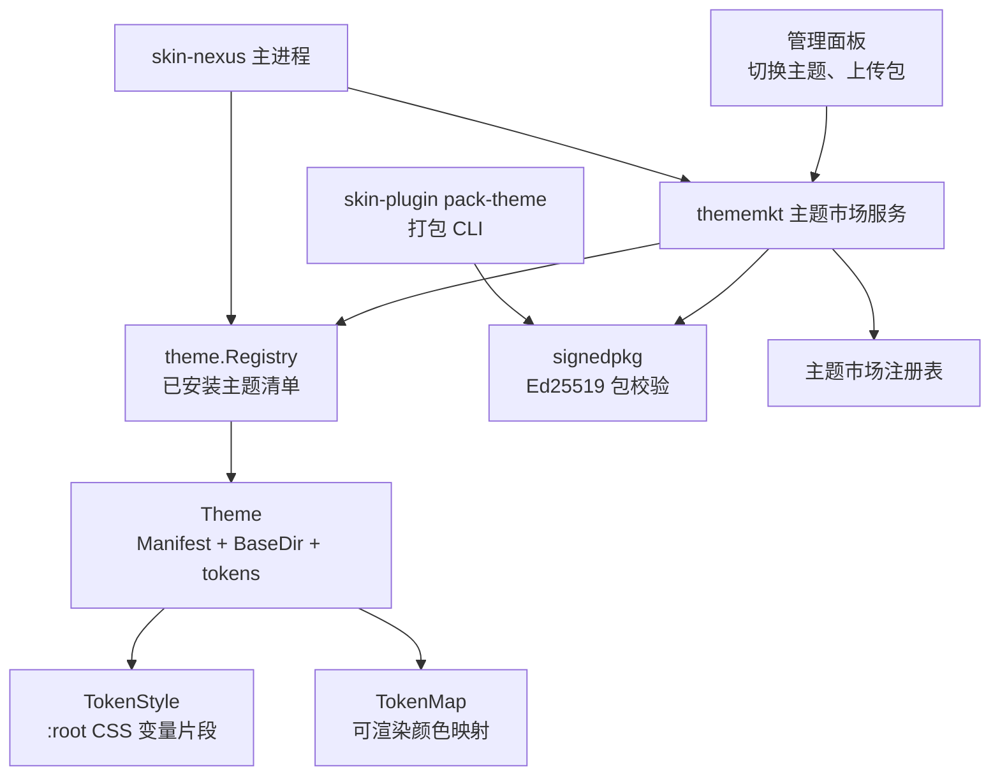
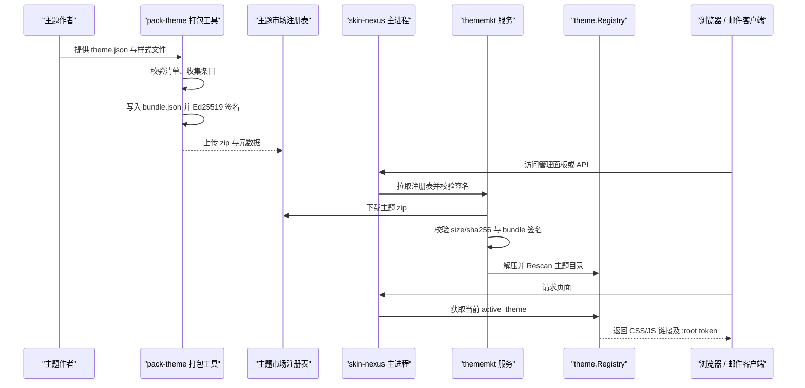
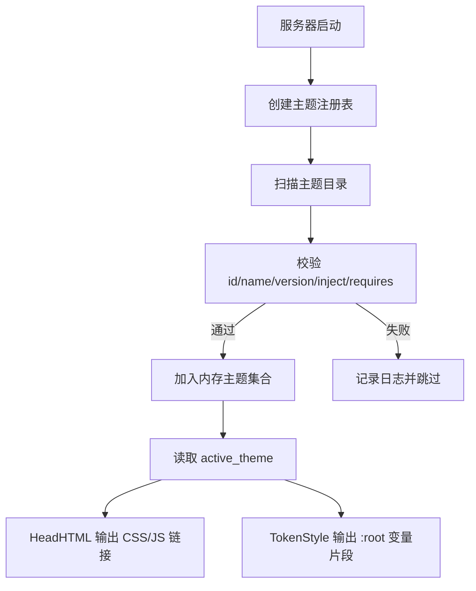
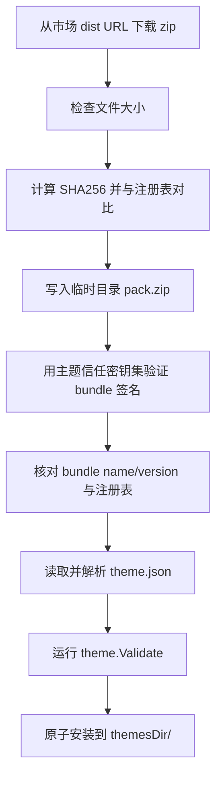
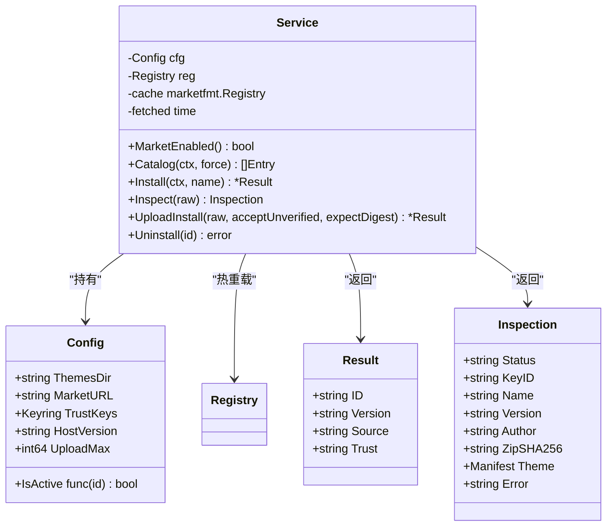
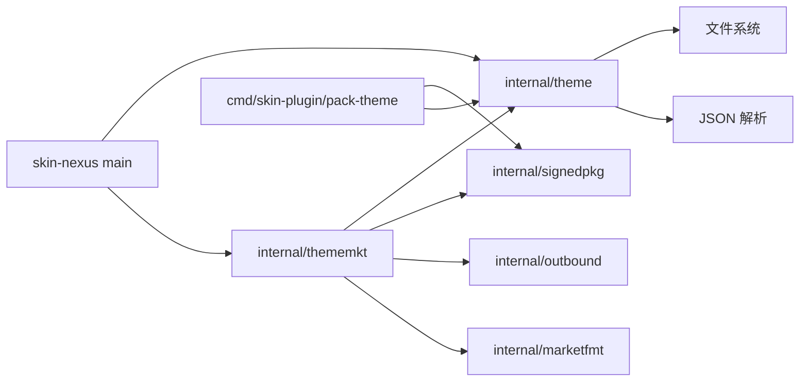
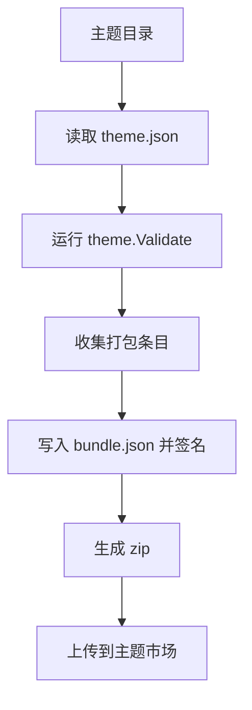

# 主题系统

**本文引用的文件**
- [server/internal/theme/theme.go](https://github.com/YimingZhanshen/skin-nexus/blob/797ae1a/server/internal/theme/theme.go)
- [server/internal/theme/tokens.go](https://github.com/YimingZhanshen/skin-nexus/blob/797ae1a/server/internal/theme/tokens.go)
- [server/internal/theme/tokens_map.go](https://github.com/YimingZhanshen/skin-nexus/blob/797ae1a/server/internal/theme/tokens_map.go)
- [server/internal/theme/validate.go](https://github.com/YimingZhanshen/skin-nexus/blob/797ae1a/server/internal/theme/validate.go)
- [server/internal/thememkt/thememkt.go](https://github.com/YimingZhanshen/skin-nexus/blob/797ae1a/server/internal/thememkt/thememkt.go)
- [server/cmd/skin-plugin/packtheme.go](https://github.com/YimingZhanshen/skin-nexus/blob/797ae1a/server/cmd/skin-plugin/packtheme.go)
- [server/cmd/skin-nexus/main.go](https://github.com/YimingZhanshen/skin-nexus/blob/797ae1a/server/cmd/skin-nexus/main.go)
- [server/cmd/skin-nexus/theme-base.css](https://github.com/YimingZhanshen/skin-nexus/blob/797ae1a/server/cmd/skin-nexus/theme-base.css)
- [scripts/check-theme-contract.mjs](https://github.com/YimingZhanshen/skin-nexus/blob/797ae1a/scripts/check-theme-contract.mjs)

## 目录
1. [引言](#引言)
2. [项目结构](#项目结构)
3. [核心组件](#核心组件)
4. [架构总览](#架构总览)
5. [详细组件分析](#详细组件分析)
6. [依赖关系分析](#依赖关系分析)
7. [性能与兼容性](#性能与兼容性)
8. [从零开发自定义主题](#从零开发自定义主题)
9. [故障排查](#故障排查)
10. [结论](#结论)

## 引言
本主题系统允许站点管理员在磁盘目录中部署纯 CSS、可选 JS 以及一个 `theme.json` 描述文件，由服务器启动时扫描为“主题包”，并通过主题市场或管理面板安装。主题不要求构建步骤：作者可直接编写样式，通过 Ed25519 签名打包后发布到主题市场；服务端在安装时对注册表签名、包大小、SHA256 和包内签名进行校验，再通过 `theme.json` 的 `inject` 列表将 CSS/JS 注入到页面头部，并把根选择器中的 CSS 变量提取为 token，供 SSR、邮件等非浏览器环境使用。

## 项目结构
主题相关代码集中在后端 Go 模块中，前端只消费最终注入的 CSS/JS 资源：

**图示来源**
- [server/internal/thememkt/thememkt.go:1-120](https://github.com/YimingZhanshen/skin-nexus/blob/797ae1a/server/internal/thememkt/thememkt.go#L1-L120)
- [server/internal/theme/theme.go:1-120](https://github.com/YimingZhanshen/skin-nexus/blob/797ae1a/server/internal/theme/theme.go#L1-L120)
- [server/cmd/skin-plugin/packtheme.go:1-60](https://github.com/YimingZhanshen/skin-nexus/blob/797ae1a/server/cmd/skin-plugin/packtheme.go#L1-L60)
- [server/cmd/skin-nexus/main.go:240-320](https://github.com/YimingZhanshen/skin-nexus/blob/797ae1a/server/cmd/skin-nexus/main.go#L240-L320)

**章节来源**
- [server/internal/theme/theme.go:1-120](https://github.com/YimingZhanshen/skin-nexus/blob/797ae1a/server/internal/theme/theme.go#L1-L120)
- [server/internal/thememkt/thememkt.go:1-120](https://github.com/YimingZhanshen/skin-nexus/blob/797ae1a/server/internal/thememkt/thememkt.go#L1-L120)
- [server/cmd/skin-nexus/main.go:240-320](https://github.com/YimingZhanshen/skin-nexus/blob/797ae1a/server/cmd/skin-nexus/main.go#L240-L320)

## 核心组件
- **主题清单 Manifest**：定义主题 ID、名称、版本、作者、扩展目标、注入资源、调色板、依赖版本等。
- **主题 Registry**：从 `SKIN_THEMES_DIR` 下扫描所有合法目录，解析并缓存每个主题的 Manifest。
- **Theme 对象**：承载 Manifest、主题目录、首用缓存的 token CSS 视图和 token 颜色映射。
- **Token 视图**：从主题 CSS 中提取 `:root` 中的 CSS 自定义属性，生成供插件 iframe 或邮件客户端使用的轻量 token。
- **主题市场 thememkt**：拉取签名注册表、下载并验证主题包、安装到主题目录并热重载 Registry。
- **打包工具 skin-plugin pack-theme**：读取本地主题目录，生成带 bundle.json 签名的 ZIP 包。

**章节来源**
- [server/internal/theme/theme.go:1-120](https://github.com/YimingZhanshen/skin-nexus/blob/797ae1a/server/internal/theme/theme.go#L1-L120)
- [server/internal/theme/tokens.go:1-120](https://github.com/YimingZhanshen/skin-nexus/blob/797ae1a/server/internal/theme/tokens.go#L1-L120)
- [server/internal/theme/tokens_map.go:1-60](https://github.com/YimingZhanshen/skin-nexus/blob/797ae1a/server/internal/theme/tokens_map.go#L1-L60)
- [server/internal/thememkt/thememkt.go:1-120](https://github.com/YimingZhanshen/skin-nexus/blob/797ae1a/server/internal/thememkt/thememkt.go#L1-L120)
- [server/cmd/skin-plugin/packtheme.go:1-60](https://github.com/YimingZhanshen/skin-nexus/blob/797ae1a/server/cmd/skin-plugin/packtheme.go#L1-L60)

## 架构总览
主题生命周期分为五个阶段：**清单校验 → 打包签名 → 注册表分发 → 服务端安装验证 → 运行时注入**。

**图示来源**
- [server/cmd/skin-plugin/packtheme.go:60-170](https://github.com/YimingZhanshen/skin-nexus/blob/797ae1a/server/cmd/skin-plugin/packtheme.go#L60-L170)
- [server/internal/thememkt/thememkt.go:201-473](https://github.com/YimingZhanshen/skin-nexus/blob/797ae1a/server/internal/thememkt/thememkt.go#L201-L473)
- [server/internal/theme/theme.go:120-261](https://github.com/YimingZhanshen/skin-nexus/blob/797ae1a/server/internal/theme/theme.go#L120-L261)
- [server/cmd/skin-nexus/main.go:240-320](https://github.com/YimingZhanshen/skin-nexus/blob/797ae1a/server/cmd/skin-nexus/main.go#L240-L320)

## 详细组件分析

### 主题清单 `theme.json` 规范
`theme.json` 是主题包的唯一清单入口，被 `Registry.Rescan` 与打包工具共同校验。

| 字段 | 类型 | 是否必需 | 语义 |
|---|---|---:|---|
| `id` | 字符串 | 是 | 主题标识，必须与所在目录名一致，且匹配 `[a-z0-9][a-z0-9_-]*`。 |
| `name` | 字符串 | 是 | 显示名称。 |
| `version` | 字符串 | 是 | 主题版本，用于资源缓存破坏和注册表区分。 |
| `author` | 字符串 | 否 | 作者信息。 |
| `description` | 字符串 | 否 | 主题描述。 |
| `extends` | 字符串 | 否 | 可扩展其他主题（清单结构保留）。 |
| `inject.css` | 字符串数组 | 至少一项存在 | 按顺序加载的主题 CSS 文件路径。 |
| `inject.js` | 字符串数组 | 至少一项存在 | 按顺序加载的主题 JS 文件路径。 |
| `palette` | 键值映射 | 否 | 调色板映射，供 UI 消费。 |
| `requires.skin_nexus` | 字符串 | 否 | 最低主机版本约束，仅支持 `>=x.y[.z]` 形式。 |

清单校验规则包括：
- 目录名必须匹配主题 ID 正则。
- `theme.json` 中的 `id` 必须等于目录名，防止别名替换。
- 必须提供 `name`、`version`，并且至少声明一个 `inject.css` 或 `inject.js`。
- `requires.skin_nexus` 若为空则放行；非空时必须满足 `>=` 比较。

**章节来源**
- [server/internal/theme/theme.go:20-60](https://github.com/YimingZhanshen/skin-nexus/blob/797ae1a/server/internal/theme/theme.go#L20-L60)
- [server/internal/theme/theme.go:120-200](https://github.com/YimingZhanshen/skin-nexus/blob/797ae1a/server/internal/theme/theme.go#L120-L200)
- [server/internal/theme/validate.go:1-25](https://github.com/YimingZhanshen/skin-nexus/blob/797ae1a/server/internal/theme/validate.go#L1-L25)

### CSS 与 JS 资源组织方式
主题包采用扁平资源模型：
- 根目录放置 `theme.json`。
- `inject.css` 和 `inject.js` 引用包内相对路径的文件名。
- 文件名必须匹配 `[a-z0-9][a-z0-9._-]*`，不允许路径穿越。
- 运行时通过 `/theme-assets/<id>/<file>?v=<version>` 暴露资源，版本参数用于破坏 CDN 缓存。
- 每个主题包的资源最多读取 2 MiB 用于 token 提取，超过视为打包产物而非可解析样式。

这种设计让主题不需要构建步骤，但要求作者自己管理 CSS/JS 的体积和依赖。

**章节来源**
- [server/internal/theme/theme.go:120-200](https://github.com/YimingZhanshen/skin-nexus/blob/797ae1a/server/internal/theme/theme.go#L120-L200)
- [server/internal/theme/theme.go:201-261](https://github.com/YimingZhanshen/skin-nexus/blob/797ae1a/server/internal/theme/theme.go#L201-L261)
- [server/internal/theme/tokens.go:20-60](https://github.com/YimingZhanshen/skin-nexus/blob/797ae1a/server/internal/theme/tokens.go#L20-L60)

### 主题装载与页面注入流程
服务器启动时执行以下流程：

1. 创建 `theme.NewRegistry(ThemesDir, version)`。
2. 扫描 `ThemesDir` 下的子目录，跳过非法 ID、缺失清单、无效清单或不满足版本要求的主题。
3. 把合法主题放入内存 Registry。
4. 当前活跃主题由外观引擎根据选项 `active_theme` 决定。
5. 页面渲染时调用 `Theme.HeadHTML()`，按 `inject.css` 和 `inject.js` 顺序输出 `<link>` 和 `<script>`。
6. 对于插件 iframe 等需要继承配色但不继承宿主布局的场景，使用 `Theme.TokenStyle()` 注入仅包含 `:root` CSS 变量的 `<style id="skin-theme-tokens">`。

**图示来源**
- [server/cmd/skin-nexus/main.go:240-320](https://github.com/YimingZhanshen/skin-nexus/blob/797ae1a/server/cmd/skin-nexus/main.go#L240-L320)
- [server/internal/theme/theme.go:120-261](https://github.com/YimingZhanshen/skin-nexus/blob/797ae1a/server/internal/theme/theme.go#L120-L261)

**章节来源**
- [server/cmd/skin-nexus/main.go:240-320](https://github.com/YimingZhanshen/skin-nexus/blob/797ae1a/server/cmd/skin-nexus/main.go#L240-L320)
- [server/internal/theme/theme.go:120-261](https://github.com/YimingZhanshen/skin-nexus/blob/797ae1a/server/internal/theme/theme.go#L120-L261)

### Ed25519 签名包校验流程
主题包采用与插件包相同的信任模型：bundle.json 载体签名 + 内容摘要。

关键安全点：
- 注册表本身由主题市场信任密钥签名，未配置或密钥无效时禁用市场安装。
- 下载的 zip 先校验 size 和 sha256。
- 再用独立的 `SKIN_THEME_TRUST_KEYS` 验证包内 bundle 签名。
- 最后再对 `theme.json` 做与安装时一致的清单校验。

**图示来源**
- [server/internal/thememkt/thememkt.go:201-473](https://github.com/YimingZhanshen/skin-nexus/blob/797ae1a/server/internal/thememkt/thememkt.go#L201-L473)
- [server/cmd/skin-plugin/packtheme.go:100-170](https://github.com/YimingZhanshen/skin-nexus/blob/797ae1a/server/cmd/skin-plugin/packtheme.go#L100-L170)

**章节来源**
- [server/internal/thememkt/thememkt.go:1-120](https://github.com/YimingZhanshen/skin-nexus/blob/797ae1a/server/internal/thememkt/thememkt.go#L1-L120)
- [server/internal/thememkt/thememkt.go:201-473](https://github.com/YimingZhanshen/skin-nexus/blob/797ae1a/server/internal/thememkt/thememkt.go#L201-L473)
- [server/cmd/skin-plugin/packtheme.go:60-170](https://github.com/YimingZhanshen/skin-nexus/blob/797ae1a/server/cmd/skin-plugin/packtheme.go#L60-L170)

### 预定义主题 token 语义
主题系统的契约真源是 `server/cmd/skin-nexus/theme-base.css` 中的 `:root` 块。它定义了站点默认配色、排版、间距、层级、字体、阴影等 CSS 变量。主题包可以覆盖其中一部分键，从而改变整体视觉风格，而不必重写全部样式。

重点契约键包括：
- `--bg`：页面背景底色。
- `--panel`：卡片、面板面。
- `--border`：发丝线边框色。
- `--text`：正文文字色。
- `--muted`：次要文字色。
- `--accent`：主操作强调色，如朱砂。
- `--danger`：错误、危险强调色。
- `--ok`：成功状态色。
- `--r-s/m/l`：圆角刻度。
- `--sp-*`：间距刻度。
- `--font-sans/serif/mono`：字体族。
- `--fs-xs/s/m/l/xl/2xl`：字号刻度。
- `--shadow/shadow-lift`：阴影。
- `--topbar-h`：顶部栏高度。
- `--z-topbar/menu/modal/toast`：层级刻度。
- `--ease/t-fast/t-mid`：动效曲线与时长。
- `--hover-wash/accent-wash/sel/fog`：悬停、选中、场景雾等修饰色。
- `--glow-cinnabar/glow-danger/ring-cinnabar`：焦点环与光晕。
- `--ink/ink-2/ink-3/panel-2/line/line-strong`：语义别名层。
- `--moon/moon-2/cinnabar/cinnabar-hi/on-cinnabar/jade/jade-hi/gold/ochre/danger-hi/danger-ink/on-danger`：业务语义别名。
- `--mtn-far/mtn-mid/mtn-near`：落地页远山装饰色。

这些默认值由 `theme-base.css` 维护，文档中的契约示例由 `check-theme-contract.mjs` 强制比对，避免文档与源码漂移。

**章节来源**
- [server/cmd/skin-nexus/theme-base.css:1-106](https://github.com/YimingZhanshen/skin-nexus/blob/797ae1a/server/cmd/skin-nexus/theme-base.css#L1-L106)
- [scripts/check-theme-contract.mjs:1-130](https://github.com/YimingZhanshen/skin-nexus/blob/797ae1a/scripts/check-theme-contract.mjs#L1-L130)

### `tokens.go`：从主题样式提取 token
`tokens.go` 负责生成两个视图：

1. **TokenStyle**：遍历主题注入的 CSS，提取根选择器中的 CSS 自定义属性和 `color-scheme`，拼接成 `<style id="skin-theme-tokens">`。该视图保留 `@media`、`@supports`、`@layer`、`@container` 等条件分组，因为浏览器能理解上下文。
2. **ExtractRootTokens**：实现轻量 CSS 解析器，忽略注释和字符串中的花括号，只保留 `:root` 或 `html` 选择器中的 `--*` 和 `color-scheme` 声明，丢弃可能污染插件页面的 body、h1、input 等宿主 DOM 规则。

复杂度方面：
- 单次解析以 CSS 字节数为输入，时间复杂度约为 O(n)。
- 每份 CSS 最大读取 2 MiB，防止大型打包产物导致无意义解析。
- 结果通过 `sync.Once` 缓存，避免重复 IO 和解析。

**章节来源**
- [server/internal/theme/tokens.go:1-120](https://github.com/YimingZhanshen/skin-nexus/blob/797ae1a/server/internal/theme/tokens.go#L1-L120)
- [server/internal/theme/tokens.go:120-312](https://github.com/YimingZhanshen/skin-nexus/blob/797ae1a/server/internal/theme/tokens.go#L120-L312)

### `tokens_map.go`：将主题变量映射为可渲染颜色
`tokens_map.go` 面向无法评估 CSS 的消费者，尤其是邮件客户端。它返回 `map[string]string`，只包含能够稳定渲染的颜色值。

处理逻辑：
- 仅读取无条件 `:root` 块中的 `--*` 声明，跳过 `@media` 等条件块，因为邮件没有媒体查询上下文。
- 最多两跳解析 `var(--alias)` 别名，遇到循环或缺失目标时丢弃该 token。
- 只接受三种颜色格式：3 位或 6 位十六进制、整数 `rgb(...)`、透明度恰好为 1 的 `rgba(...)`。
- 半透明颜色被拒绝，因为邮件客户端背景未知，半透明会产生不可预测效果。
- 结果同样通过 `sync.Once` 缓存。

这保证了邮件主题不会泄漏暗色模式变量，也不会发送邮件客户端无法渲染的现代颜色语法。

**章节来源**
- [server/internal/theme/tokens_map.go:1-153](https://github.com/YimingZhanshen/skin-nexus/blob/797ae1a/server/internal/theme/tokens_map.go#L1-L153)

### 主题市场客户端行为
`thememkt` 提供以下能力：

| 能力 | 行为 |
|---|---|
| 注册表启用 | 当 `ThemeMarketURL` 和 `ThemeTrustKeys` 都有效时启用。 |
| 注册表缓存 | 内存缓存 10 分钟，磁盘缓存 `.market-cache/registry.json`，网络失败时可回退旧缓存。 |
| 浏览主题 | 合并本地已安装主题，标记可更新项。 |
| 安装主题 | 下载 zip → 校验 size/sha256 → 验证 bundle 签名 → 校验 manifest → 原子安装 → 热重载 Registry。 |
| 预览上传包 | 报告已验证、未知密钥、未签名、无效四种状态。 |
| 本地上传安装 | 未签名包需要显式同意；使用期望摘要防御 TOCTOU。 |
| 卸载主题 | 不能卸载当前活跃主题；删除目录后 Rescan。 |

**图示来源**
- [server/internal/thememkt/thememkt.go:1-200](https://github.com/YimingZhanshen/skin-nexus/blob/797ae1a/server/internal/thememkt/thememkt.go#L1-L200)
- [server/internal/thememkt/thememkt.go:201-473](https://github.com/YimingZhanshen/skin-nexus/blob/797ae1a/server/internal/thememkt/thememkt.go#L201-L473)

**章节来源**
- [server/internal/thememkt/thememkt.go:1-200](https://github.com/YimingZhanshen/skin-nexus/blob/797ae1a/server/internal/thememkt/thememkt.go#L1-L200)
- [server/internal/thememkt/thememkt.go:201-473](https://github.com/YimingZhanshen/skin-nexus/blob/797ae1a/server/internal/thememkt/thememkt.go#L201-L473)

### 主题切换、回退默认主题与兼容性检查
- **主题切换**：由外观引擎根据 `active_theme` 决定。切换后，新主题会在下次页面请求中通过 `HeadHTML` 注入。
- **回退默认主题**：如果 `active_theme` 为空，或对应主题不存在于 Registry，外观引擎不会报错，而是回退到站点默认主题；邮件 palette 读取失败时也回退为常量颜色。
- **兼容性检查**：`requires.skin_nexus` 使用简单的分段数字比较，仅支持 `>=` 前缀；未解析或不受支持的约束会保守地拒绝主题，避免拼写错误导致兼容范围意外扩大。
- **热重载**：主题安装、卸载后都会调用 `Rescan`，无需重启服务器即可生效。

**章节来源**
- [server/internal/theme/theme.go:120-200](https://github.com/YimingZhanshen/skin-nexus/blob/797ae1a/server/internal/theme/theme.go#L120-L200)
- [server/internal/theme/theme.go:201-261](https://github.com/YimingZhanshen/skin-nexus/blob/797ae1a/server/internal/theme/theme.go#L201-L261)
- [server/internal/thememkt/thememkt.go:400-473](https://github.com/YimingZhanshen/skin-nexus/blob/797ae1a/server/internal/thememkt/thememkt.go#L400-L473)
- [server/cmd/skin-nexus/main.go:240-320](https://github.com/YimingZhanshen/skin-nexus/blob/797ae1a/server/cmd/skin-nexus/main.go#L240-L320)

## 依赖关系分析
主题系统的关键依赖如下：

**图示来源**
- [server/cmd/skin-nexus/main.go:240-320](https://github.com/YimingZhanshen/skin-nexus/blob/797ae1a/server/cmd/skin-nexus/main.go#L240-L320)
- [server/internal/thememkt/thememkt.go:1-120](https://github.com/YimingZhanshen/skin-nexus/blob/797ae1a/server/internal/thememkt/thememkt.go#L1-L120)
- [server/cmd/skin-plugin/packtheme.go:1-60](https://github.com/YimingZhanshen/skin-nexus/blob/797ae1a/server/cmd/skin-plugin/packtheme.go#L1-L60)

**章节来源**
- [server/cmd/skin-nexus/main.go:240-320](https://github.com/YimingZhanshen/skin-nexus/blob/797ae1a/server/cmd/skin-nexus/main.go#L240-L320)
- [server/internal/thememkt/thememkt.go:1-120](https://github.com/YimingZhanshen/skin-nexus/blob/797ae1a/server/internal/thememkt/thememkt.go#L1-L120)
- [server/cmd/skin-plugin/packtheme.go:1-60](https://github.com/YimingZhanshen/skin-nexus/blob/797ae1a/server/cmd/skin-plugin/packtheme.go#L1-L60)

## 性能与兼容性
- **令牌视图缓存**：`TokenStyle` 和 `TokenMap` 均使用 `sync.Once`，避免每次请求重复读取文件和解析 CSS。
- **主题清单扫描**：仅在启动和安装/卸载时执行，正常页面请求不扫描文件系统。
- **CSS 解析限制**：单份样式最多读取 2 MiB，防止大型打包产物拖慢 token 提取。
- **CDN 缓存破坏**：`HeadHTML` 附带 `?v=<version>`，主题升级后可使旧缓存失效。
- **邮件客户端兼容性**：`TokenMap` 拒绝现代颜色语法和半透明值，确保邮件渲染稳定。
- **浏览器兼容性**：主题仍应优先使用广泛支持的 CSS 特性；过度依赖实验性功能可能导致部分浏览器表现异常。

**章节来源**
- [server/internal/theme/tokens.go:20-60](https://github.com/YimingZhanshen/skin-nexus/blob/797ae1a/server/internal/theme/tokens.go#L20-L60)
- [server/internal/theme/tokens_map.go:1-60](https://github.com/YimingZhanshen/skin-nexus/blob/797ae1a/server/internal/theme/tokens_map.go#L1-L60)
- [server/internal/theme/theme.go:201-261](https://github.com/YimingZhanshen/skin-nexus/blob/797ae1a/server/internal/theme/theme.go#L201-L261)

## 从零开发自定义主题

### 第一步：准备主题目录
在本地创建一个目录，目录名即主题 ID，例如 `my-dark-theme`。目录名必须符合 `[a-z0-9][a-z0-9_-]*`。

### 第二步：编写 `theme.json`
清单至少包含：
- `id`：与目录名相同。
- `name`：主题显示名。
- `version`：版本号，建议使用语义化版本。
- `inject.css`：列出要引入的样式文件。
- 可选：`author`、`description`、`requires.skin_nexus`。

如果主题依赖特定 SkinNexus 版本，可使用 `requires.skin_nexus` 指定最低版本。

### 第三步：编写样式
在主题目录中编写 CSS，并覆盖需要的契约 token，例如 `--bg`、`--panel`、`--text`、`--accent`、`--danger` 等。不要复制 `theme-base.css` 的整段 `:root`；只需覆盖想要变化的键。

如果需要 JS，可在 `inject.js` 中列出脚本文件，注意 JS 与管理员自定义 JS 具有同等信任级别。

### 第四步：本地预览
将主题目录放到服务器的 `ThemesDir`（默认数据目录下的 `themes/<id>`），然后重启或使用管理面板触发安装。服务器启动时会扫描主题目录，合法主题会出现在 Registry 中。

也可通过管理面板的“主题市场”界面上传本地 zip，完成两步检查后再确认安装。

### 第五步：打包与签名
使用 `skin-plugin pack-theme` 生成 ZIP：
- 参数包括主题目录、输出路径、Ed25519 私钥、密钥 ID。
- 打包工具会再次运行 `theme.Validate`，并使用 `hostVersionAny` 跳过打包时的版本门控，实际版本检查在服务端安装时执行。
- 输出包含 zip 路径、sha256、size 和 bundle digest。

**图示来源**
- [server/cmd/skin-plugin/packtheme.go:60-170](https://github.com/YimingZhanshen/skin-nexus/blob/797ae1a/server/cmd/skin-plugin/packtheme.go#L60-L170)

### 第六步：发布到主题市场
将打包后的 zip 和元数据发布到主题市场注册表。主题市场客户端会从受信任的注册表地址拉取元数据，并用主题信任密钥验证注册表签名。

### 第七步：安装主题
在服务器侧：
- 如果使用主题市场，调用安装接口，服务端会自动下载、校验并安装。
- 如果使用本地上传，必须先 Inspect，再使用相同 zip 摘要进行 UploadInstall；未签名包需要显式同意。

**章节来源**
- [server/cmd/skin-plugin/packtheme.go:60-170](https://github.com/YimingZhanshen/skin-nexus/blob/797ae1a/server/cmd/skin-plugin/packtheme.go#L60-L170)
- [server/internal/thememkt/thememkt.go:201-473](https://github.com/YimingZhanshen/skin-nexus/blob/797ae1a/server/internal/thememkt/thememkt.go#L201-L473)

## 故障排查

### 签名无效
常见原因：
- bundle.json 中的 name/version 与 `theme.json` 不一致。
- 主题信任密钥未正确配置。
- 主题包不是由受信任密钥签名。
- 市场注册表签名无效。

排查步骤：
1. 使用打包工具重新签名，确认 key 和 key-id。
2. 检查 `theme.json` 与 bundle 元数据的 name/version 是否一致。
3. 检查 `SKIN_THEME_TRUST_KEYS` 是否配置正确。
4. 查看安装返回的错误码，区分“未验证包”“签名无效”“清单无效”。

**章节来源**
- [server/internal/thememkt/thememkt.go:201-473](https://github.com/YimingZhanshen/skin-nexus/blob/797ae1a/server/internal/thememkt/thememkt.go#L201-L473)
- [server/cmd/skin-plugin/packtheme.go:100-170](https://github.com/YimingZhanshen/skin-nexus/blob/797ae1a/server/cmd/skin-plugin/packtheme.go#L100-L170)

### token 缺失
现象：主题没有颜色变化，或邮件中没有主题色。

可能原因：
- `theme.json` 未声明任何 `inject.css`。
- 样式文件中没有在 `:root` 或 `html` 上定义 `--*`。
- token 被写在非根选择器中。
- 主题包使用了现代颜色语法，`TokenMap` 无法渲染。

排查步骤：
1. 确认 `inject.css` 指向真实存在的文件。
2. 检查样式中是否存在 `:root { --xxx: ... }`。
3. 检查 CI 契约检查脚本是否报告悬挂 token 引用。
4. 如果是邮件场景，确认颜色值为 3/6 位十六进制或整数 `rgb`。

**章节来源**
- [server/internal/theme/tokens.go:20-120](https://github.com/YimingZhanshen/skin-nexus/blob/797ae1a/server/internal/theme/tokens.go#L20-L120)
- [server/internal/theme/tokens_map.go:1-153](https://github.com/YimingZhanshen/skin-nexus/blob/797ae1a/server/internal/theme/tokens_map.go#L1-L153)
- [scripts/check-theme-contract.mjs:60-130](https://github.com/YimingZhanshen/skin-nexus/blob/797ae1a/scripts/check-theme-contract.mjs#L60-L130)

### CSS 变量未生效
可能原因：
- 主题覆盖了错误的 token 键名。
- 主题引用了宿主不再定义的 token。
- 主题使用了条件媒体查询，但消费者不支持该上下文。
- 样式文件被缓存，版本未更新。

排查步骤：
1. 对照 `theme-base.css` 中的契约键。
2. 使用 `check-theme-contract.mjs` 检查文档与源码是否一致。
3. 检查主题是否引用了宿主未定义的 token。
4. 刷新浏览器并确认资源 URL 中包含新版本号。
5. 检查 CDN 是否缓存了旧版本。

**章节来源**
- [server/cmd/skin-nexus/theme-base.css:1-106](https://github.com/YimingZhanshen/skin-nexus/blob/797ae1a/server/cmd/skin-nexus/theme-base.css#L1-L106)
- [scripts/check-theme-contract.mjs:1-130](https://github.com/YimingZhanshen/skin-nexus/blob/797ae1a/scripts/check-theme-contract.mjs#L1-L130)
- [server/internal/theme/theme.go:201-261](https://github.com/YimingZhanshen/skin-nexus/blob/797ae1a/server/internal/theme/theme.go#L201-L261)

### 浏览器兼容问题
可能原因：
- 使用了过新的 CSS 特性。
- 使用了 `@layer`、`@container` 等较新语法。
- 主题覆盖了全局字体、字号、body 背景等宿主决策，造成布局异常。
- 插件 iframe 中直接链接完整主题样式，而不是仅注入 token。

排查步骤：
1. 避免在主题中覆盖宿主元素规则；只覆盖 token。
2. 对插件 iframe 使用 `TokenStyle` 而非完整样式。
3. 逐步移除实验性 CSS 特性，确认问题来源。
4. 在不同浏览器和设备上测试主题。

**章节来源**
- [server/internal/theme/tokens.go:20-60](https://github.com/YimingZhanshen/skin-nexus/blob/797ae1a/server/internal/theme/tokens.go#L20-L60)
- [server/internal/theme/tokens.go:60-120](https://github.com/YimingZhanshen/skin-nexus/blob/797ae1a/server/internal/theme/tokens.go#L60-L120)

### 主题兼容性检查失败
现象：主题被跳过，日志提示 `requires.skin_nexus not met by host`。

原因：
- 主题声明的最低版本高于当前服务器版本。
- 约束字符串不是合法的 `>=x.y` 形式。
- 版本号解析失败，系统保守拒绝。

处理建议：
- 降低主题的 `requires.skin_nexus`。
- 升级服务器版本。
- 修正版本号格式。

**章节来源**
- [server/internal/theme/theme.go:160-200](https://github.com/YimingZhanshen/skin-nexus/blob/797ae1a/server/internal/theme/theme.go#L160-L200)
- [server/internal/theme/validate.go:1-25](https://github.com/YimingZhanshen/skin-nexus/blob/797ae1a/server/internal/theme/validate.go#L1-L25)

## 结论
主题系统通过 `theme.json` 清单、纯 CSS/JS 资源和 Ed25519 签名机制，实现了低门槛、可审计、可回退的视觉定制能力。其核心边界清晰：
- `theme-base.css` 是契约真源。
- `theme.json` 是包清单。
- `theme.Registry` 是运行时主题目录。
- `Theme.HeadHTML` 注入完整样式。
- `Theme.TokenStyle` 和 `Theme.TokenMap` 提供安全的 token 视图。
- `thememkt` 负责远程下载、缓存、验证和安装。
- `pack-theme` 负责本地打包和签名。

开发自定义主题时，应优先覆盖契约 token，避免直接复制宿主样式；发布前应使用打包工具校验清单，并在服务端安装时完成最终的安全与兼容性检查。
