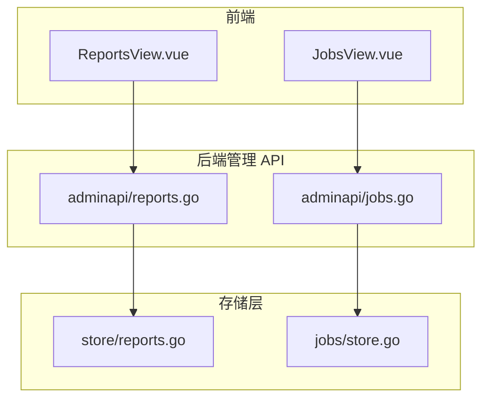
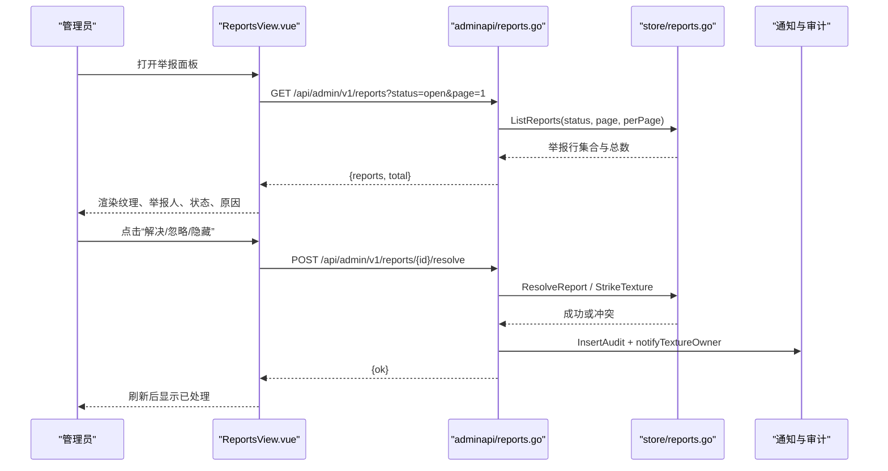
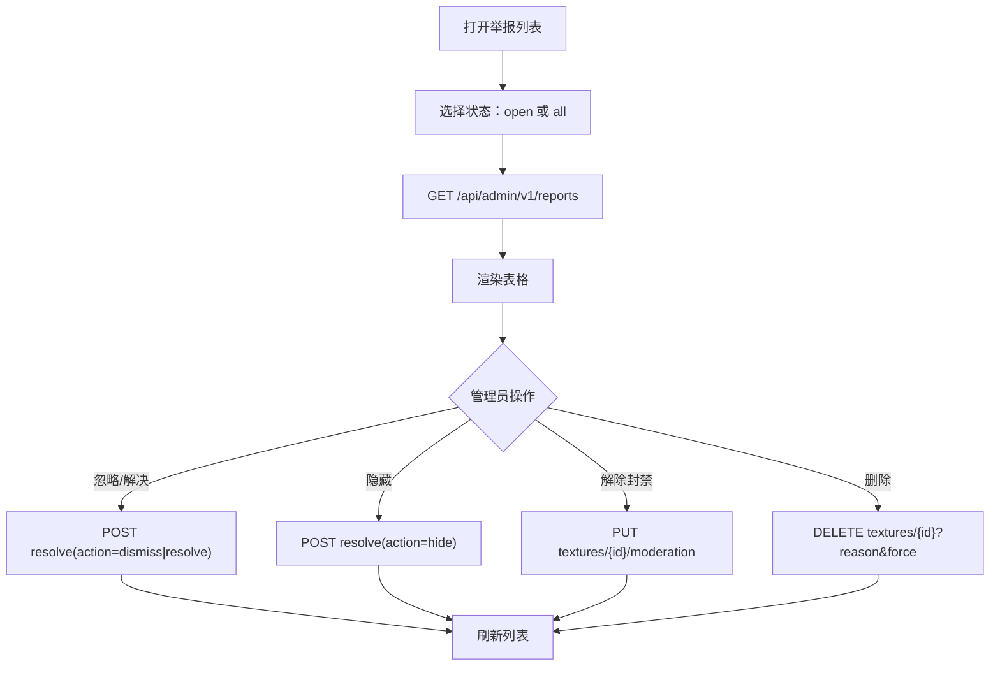
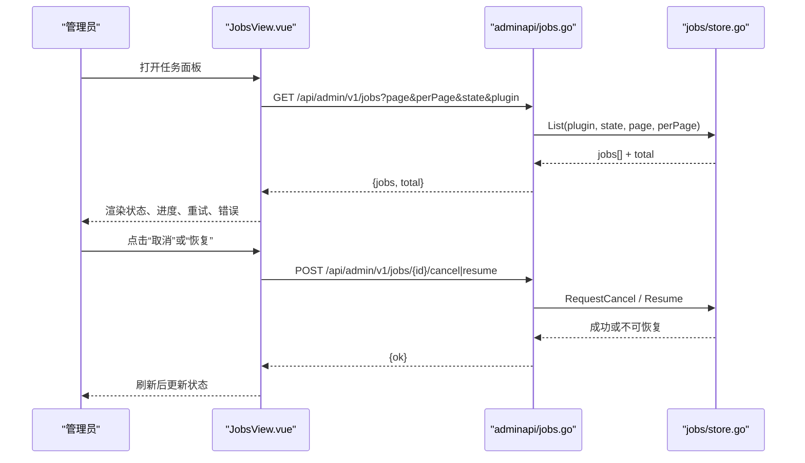
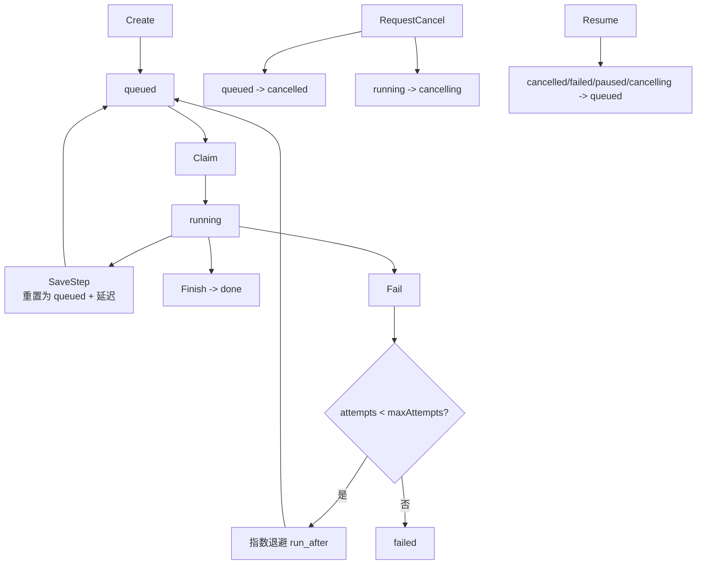
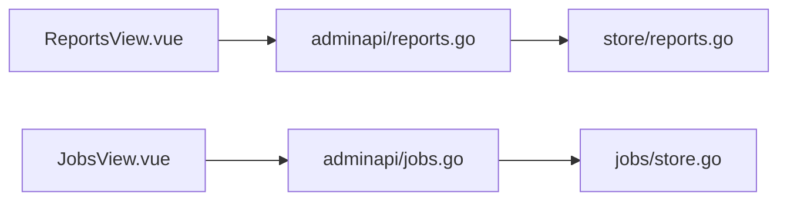
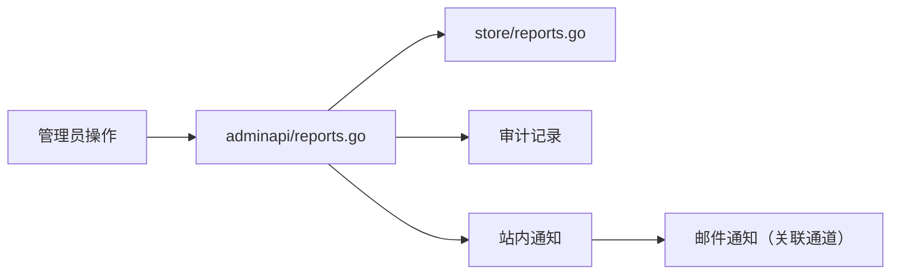

# 举报、通知与任务

**本文引用的文件**
- [ReportsView.vue](https://github.com/YimingZhanshen/skin-nexus/blob/797ae1a/web/src/components/admin/ReportsView.vue)
- [JobsView.vue](https://github.com/YimingZhanshen/skin-nexus/blob/797ae1a/web/src/components/admin/JobsView.vue)
- [reports.go](https://github.com/YimingZhanshen/skin-nexus/blob/797ae1a/server/internal/adminapi/reports.go)
- [jobs.go](https://github.com/YimingZhanshen/skin-nexus/blob/797ae1a/server/internal/adminapi/jobs.go)
- [reports.go（存储层）](https://github.com/YimingZhanshen/skin-nexus/blob/797ae1a/server/internal/store/reports.go)
- [store.go（任务存储层）](https://github.com/YimingZhanshen/skin-nexus/blob/797ae1a/server/internal/jobs/store.go)

## 目录
1. [引言](#引言)
2. [项目结构定位](#项目结构定位)
3. [核心组件](#核心组件)
4. [架构总览](#架构总览)
5. [详细组件分析](#详细组件分析)
6. [依赖关系分析](#依赖关系分析)
7. [性能与并发特性](#性能与并发特性)
8. [故障排查指南](#故障排查指南)
9. [站长操作示例](#站长操作示例)
10. [结论](#结论)

## 引言
本文围绕三个管理面能力展开：纹理举报处理、后台任务队列，以及举报处理触发的站内通知、邮件通知与审计记录。前端由两个管理面板页面组成：`ReportsView.vue` 展示纹理举报列表及处置动作；`JobsView.vue` 展示插件任务队列、执行进度、重试次数和错误信息。后端通过管理 API 提供查询、关闭、隐藏、删除纹理、列举任务、取消/恢复任务等能力，并通过持久化任务存储实现带租约的重试机制。

## 项目结构定位
- 前端管理页面位于 `web/src/components/admin/`。
- 举报相关后端逻辑位于 `server/internal/adminapi/reports.go`，数据访问位于 `server/internal/store/reports.go`。
- 任务相关前端页面位于 `web/src/components/admin/JobsView.vue`，管理 API 位于 `server/internal/adminapi/jobs.go`，任务持久化与调度语义位于 `server/internal/jobs/store.go`。

**图示来源**
- [ReportsView.vue:1-221](https://github.com/YimingZhanshen/skin-nexus/blob/797ae1a/web/src/components/admin/ReportsView.vue#L1-L221)
- [JobsView.vue:1-162](https://github.com/YimingZhanshen/skin-nexus/blob/797ae1a/web/src/components/admin/JobsView.vue#L1-L162)
- [reports.go（管理 API）:1-224](https://github.com/YimingZhanshen/skin-nexus/blob/797ae1a/server/internal/adminapi/reports.go#L1-L224)
- [jobs.go（管理 API）:1-101](https://github.com/YimingZhanshen/skin-nexus/blob/797ae1a/server/internal/adminapi/jobs.go#L1-L101)
- [reports.go（存储层）:1-221](https://github.com/YimingZhanshen/skin-nexus/blob/797ae1a/server/internal/store/reports.go#L1-L221)
- [store.go（任务存储层）:1-320](https://github.com/YimingZhanshen/skin-nexus/blob/797ae1a/server/internal/jobs/store.go#L1-L320)

**章节来源**
- [ReportsView.vue:1-221](https://github.com/YimingZhanshen/skin-nexus/blob/797ae1a/web/src/components/admin/ReportsView.vue#L1-L221)
- [JobsView.vue:1-162](https://github.com/YimingZhanshen/skin-nexus/blob/797ae1a/web/src/components/admin/JobsView.vue#L1-L162)

## 核心组件
- **纹理举报面板**：负责列出待处理或已处理的举报，展示纹理预览、上传者、举报人、举报原因、状态和处理时间，并提供“忽略”“解决”“隐藏”“解除封禁”“删除”等操作。
- **任务队列面板**：负责列出插件任务，支持按状态和插件名筛选分页，显示进度、尝试次数、最大尝试次数、回收次数、最后错误、任务处理器标识，并支持取消与恢复。
- **举报管理 API**：提供举报列表、举报解决/忽略、纹理封禁/解封、纹理删除接口，并在成功时写入审计记录和触发对纹理所有者的通知。
- **任务管理 API**：提供任务列表、单个任务查询、取消、恢复接口，并在操作成功后写入审计记录。
- **任务持久化存储**：实现任务创建、查询、认领、分步保存、完成、失败重试、取消、恢复、暂停与重新入队等完整生命周期。

**章节来源**
- [reports.go（管理 API）:1-224](https://github.com/YimingZhanshen/skin-nexus/blob/797ae1a/server/internal/adminapi/reports.go#L1-L224)
- [jobs.go（管理 API）:1-101](https://github.com/YimingZhanshen/skin-nexus/blob/797ae1a/server/internal/adminapi/jobs.go#L1-L101)
- [store.go（任务存储层）:1-320](https://github.com/YimingZhanshen/skin-nexus/blob/797ae1a/server/internal/jobs/store.go#L1-L320)

## 架构总览
举报与任务在系统内属于“管理员驱动 + 持久化状态 + 可观测结果”的管理型子系统。举报流程侧重内容治理闭环；任务流程侧重插件工作流的可观测与可控。

**图示来源**
- [ReportsView.vue:1-221](https://github.com/YimingZhanshen/skin-nexus/blob/797ae1a/web/src/components/admin/ReportsView.vue#L1-L221)
- [reports.go（管理 API）:1-224](https://github.com/YimingZhanshen/skin-nexus/blob/797ae1a/server/internal/adminapi/reports.go#L1-L224)
- [reports.go（存储层）:1-221](https://github.com/YimingZhanshen/skin-nexus/blob/797ae1a/server/internal/store/reports.go#L1-L221)

## 详细组件分析

### 纹理举报面板 ReportsView.vue
#### 展示字段
- **纹理信息**：纹理名称、类型、预览图、上传者、是否公开、是否已被封禁。
- **举报信息**：举报原因、举报详情、举报人、举报状态、创建时间。
- **操作列**：查看纹理、忽略、解决、隐藏、解除封禁、删除。

#### 关键交互
- 顶部按钮切换状态过滤：仅开放举报、全部举报。
- 每次翻页调用 `/api/admin/v1/reports?status=&page=` 获取分页数据。
- “解决/忽略”调用 `/api/admin/v1/reports/{id}/resolve`，请求体包含 `action`，值为 `resolve` 或 `dismiss`。
- “隐藏”会先弹出危险确认对话框，再提交相同解决接口但 action 为 `hide`。
- “解除封禁”调用 `/api/admin/v1/textures/{textureId}/moderation`，将 moderation 清空。
- “删除”调用 `/api/admin/v1/textures/{textureId}`，可选 `force=1` 和 `reason`；若返回 409，则根据占用角色、衣柜、头像数量再次确认强制解绑。

**图示来源**
- [ReportsView.vue:1-221](https://github.com/YimingZhanshen/skin-nexus/blob/797ae1a/web/src/components/admin/ReportsView.vue#L1-L221)

**章节来源**
- [ReportsView.vue:1-221](https://github.com/YimingZhanshen/skin-nexus/blob/797ae1a/web/src/components/admin/ReportsView.vue#L1-L221)

### 后台任务面板 JobsView.vue
#### 展示字段
- **基础信息**：更新时间、插件名、状态、进度百分比、尝试次数与最大尝试次数、回收次数、最后错误或消息、任务处理器标识。
- **操作**：取消、恢复。
- **筛选**：状态下拉、插件名输入框、搜索按钮、分页器。
- **不可用状态**：当路由未挂载时显示 404，标记为“本部署没有任务队列模块”。

#### 状态说明
- 支持的状态包括：排队、运行中、暂停、取消中、已取消、失败、完成。
- 可取消状态：排队、运行中、暂停。
- 可恢复状态：暂停、失败、已取消、取消中。

**图示来源**
- [JobsView.vue:1-162](https://github.com/YimingZhanshen/skin-nexus/blob/797ae1a/web/src/components/admin/JobsView.vue#L1-L162)
- [jobs.go（管理 API）:1-101](https://github.com/YimingZhanshen/skin-nexus/blob/797ae1a/server/internal/adminapi/jobs.go#L1-L101)
- [store.go（任务存储层）:1-320](https://github.com/YimingZhanshen/skin-nexus/blob/797ae1a/server/internal/jobs/store.go#L1-L320)

**章节来源**
- [JobsView.vue:1-162](https://github.com/YimingZhanshen/skin-nexus/blob/797ae1a/web/src/components/admin/JobsView.vue#L1-L162)

### 举报后端 API
#### 查询举报
- **路径**：`GET /api/admin/v1/reports`
- **参数**：`status`、`page`、`perPage`
- **响应**：`reports` 数组与 `total`、`page`
- **行为**：调用 `Store.ListReports`，并将数据库行映射为视图对象，包含纹理预览、上传者、举报人、原因、详情、状态、公开标志、封禁标记、创建时间与处理时间。

#### 关闭或处理举报
- **路径**：`POST /api/admin/v1/reports/{id}/resolve`
- **请求体**：`{ action }`，值可为 `resolve`、`dismiss`、`hide`
- **行为**：
  - `resolve`：状态改为 `resolved`。
  - `dismiss`：状态改为 `dismissed`。
  - `hide`：调用 `StrikeTexture` 将纹理设为非公开、清除公共去重键、标记违规，并关闭对应举报。
- **副作用**：写入审计记录，并通知纹理所有者。
- **错误**：ID 无效返回 400；举报不存在返回 404；重复处理返回 409；未知 action 返回 400。

#### 解除纹理封禁
- **路径**：`PUT /api/admin/v1/textures/{tid}/moderation`
- **请求体**：`{ moderation: "" }`
- **行为**：清除 textures 表的 moderation 字段，允许所有者重新决定发布。
- **错误**：ID 无效、JSON 非法、纹理不存在、更新失败分别返回相应状态码。

#### 删除纹理
- **路径**：`DELETE /api/admin/v1/textures/{tid}`
- **参数**：`reason`、`force=1`
- **行为**：调用账户服务删除纹理；若存在角色、衣柜、头像引用且未传 `force`，返回 409 并附带占用方清单，用于二次确认。
- **错误**：服务不可用时返回 500。

**章节来源**
- [reports.go（管理 API）:1-224](https://github.com/YimingZhanshen/skin-nexus/blob/797ae1a/server/internal/adminapi/reports.go#L1-L224)

### 任务后端 API
#### 列举任务
- **路径**：`GET /api/admin/v1/jobs`
- **参数**：`page`、`perPage`、`plugin`、`state`
- **响应**：`jobs` 数组与 `total`
- **行为**：调用 `Jobs.List`，将任务实体序列化为视图对象，包括 payload、cursor、result 的 JSON 反序列化结果。

#### 查询单个任务
- **路径**：`GET /api/admin/v1/jobs/{id}`
- **响应**：单个任务视图对象。
- **错误**：任务不存在返回 404。

#### 取消任务
- **路径**：`POST /api/admin/v1/jobs/{id}/cancel`
- **行为**：调用 `Jobs.RequestCancel`，并将审计事件写入 `plugin_job_cancel`。
- **错误**：内部错误返回 500。

#### 恢复任务
- **路径**：`POST /api/admin/v1/jobs/{id}/resume`
- **行为**：调用 `Jobs.Resume`，将任务重新入队；成功时写入审计事件 `plugin_job_resume`。
- **错误**：任务不可恢复返回 409。

**章节来源**
- [jobs.go（管理 API）:1-101](https://github.com/YimingZhanshen/skin-nexus/blob/797ae1a/server/internal/adminapi/jobs.go#L1-L101)

### 任务持久化与重试机制
任务存储层定义 `host_jobs` 表上的任务模型与生命周期方法：
- **Claim**：认领任务，优先从排队任务中选择，也可回收租约过期的运行中任务；使用 guarded UPDATE 避免多 worker 争抢。
- **SaveStep**：插件分步完成后保存 cursor、进度、消息，并将任务状态重置为排队，延迟一段时间后再被认领。
- **Finish**：标记完成，设置结果、进度 100%。
- **Fail**：按指数退避重试；超过最大尝试次数后标记失败。
- **RequestCancel**：将排队、暂停任务直接标记为已取消，运行中或取消中标记为取消中。
- **Resume**：将已取消、失败、暂停、取消中任务重新入队，并清零尝试次数。
- **PausePlugin / ResumePausedByPlugin**：批量暂停某插件排队任务，或在插件恢复后重新入队。
- **Requeue**：释放租约但不消耗尝试次数，适用于插件尚未加载或主机关闭场景。

**图示来源**
- [store.go（任务存储层）:1-320](https://github.com/YimingZhanshen/skin-nexus/blob/797ae1a/server/internal/jobs/store.go#L1-L320)

**章节来源**
- [store.go（任务存储层）:1-320](https://github.com/YimingZhanshen/skin-nexus/blob/797ae1a/server/internal/jobs/store.go#L1-L320)

## 依赖关系分析
- `ReportsView.vue` 依赖管理 API 的举报列表与解决接口，并通过纹理 ID 跳转到皮肤库页面。
- `JobsView.vue` 依赖管理 API 的任务列表、取消、恢复接口，并根据 404 判断任务模块是否启用。
- 管理 API 层依赖存储层：举报 API 依赖 `store/reports.go`，任务 API 依赖 `jobs/store.go`。
- 举报处理不仅更新数据库，还触发审计记录与通知逻辑；任务操作同样写入审计事件。

**图示来源**
- [ReportsView.vue:1-221](https://github.com/YimingZhanshen/skin-nexus/blob/797ae1a/web/src/components/admin/ReportsView.vue#L1-L221)
- [JobsView.vue:1-162](https://github.com/YimingZhanshen/skin-nexus/blob/797ae1a/web/src/components/admin/JobsView.vue#L1-L162)
- [reports.go（管理 API）:1-224](https://github.com/YimingZhanshen/skin-nexus/blob/797ae1a/server/internal/adminapi/reports.go#L1-L224)
- [jobs.go（管理 API）:1-101](https://github.com/YimingZhanshen/skin-nexus/blob/797ae1a/server/internal/adminapi/jobs.go#L1-L101)
- [reports.go（存储层）:1-221](https://github.com/YimingZhanshen/skin-nexus/blob/797ae1a/server/internal/store/reports.go#L1-L221)
- [store.go（任务存储层）:1-320](https://github.com/YimingZhanshen/skin-nexus/blob/797ae1a/server/internal/jobs/store.go#L1-L320)

**章节来源**
- [reports.go（管理 API）:1-224](https://github.com/YimingZhanshen/skin-nexus/blob/797ae1a/server/internal/adminapi/reports.go#L1-L224)
- [jobs.go（管理 API）:1-101](https://github.com/YimingZhanshen/skin-nexus/blob/797ae1a/server/internal/adminapi/jobs.go#L1-L101)

## 性能与并发特性
- 举报列表查询支持分页，默认每页 20，上限 100，并按创建时间倒序排列。
- 任务列表查询支持按插件名和状态过滤，同样分页。
- 任务认领使用“条件 UPDATE”保证同一任务只被一个 worker 领取，避免重复执行。
- 任务分步保存会主动释放租约，避免长时间持有锁导致其他 worker 无法推进。
- 任务失败重试采用指数退避，防止瞬时失败引发重试风暴。
- 删除纹理在未强制时可能返回 409，需要管理员二次确认才能解绑引用。

**章节来源**
- [reports.go（存储层）:1-221](https://github.com/YimingZhanshen/skin-nexus/blob/797ae1a/server/internal/store/reports.go#L1-L221)
- [store.go（任务存储层）:1-320](https://github.com/YimingZhanshen/skin-nexus/blob/797ae1a/server/internal/jobs/store.go#L1-L320)

## 故障排查指南

### 任务长期 pending
- **现象**：任务停留在 `queued` 或 `paused`，进度不增长。
- **检查项**：
  - 是否为插件级暂停：检查是否存在该插件的所有排队任务均为 `paused`。
  - 是否因 `run_after` 未来时间导致暂不可认领。
  - 任务模块是否启用：前端 404 表示当前部署未挂载任务路由。
- **处理建议**：
  - 使用“恢复”将 `paused`、`failed`、`cancelled`、`cancelling` 任务重新入队。
  - 若插件刚启用，应确保插件恢复后调用恢复暂停任务的逻辑，使排队任务重新变为 `queued`。
  - 观察任务日志、错误信息与审计记录，确认是否有外部依赖失败。

**章节来源**
- [JobsView.vue:1-162](https://github.com/YimingZhanshen/skin-nexus/blob/797ae1a/web/src/components/admin/JobsView.vue#L1-L162)
- [store.go（任务存储层）:180-320](https://github.com/YimingZhanshen/skin-nexus/blob/797ae1a/server/internal/jobs/store.go#L180-L320)

### 重试风暴
- **现象**：任务反复进入 `queued` → `running` → `failed`，尝试次数快速上升。
- **原因**：任务 `Fail` 在未达到 `maxAttempts` 时会指数退避后重新入队；如果底层错误持续存在，会形成多次重试。
- **排查**：
  - 查看 `lastError` 与 `message`，定位具体错误。
  - 比较 `attempts` 与 `maxAttempts`，判断是否接近最终失败。
  - 检查外部依赖：邮件服务、Union 接口、文件系统权限等。
- **缓解**：
  - 若错误是临时性的，等待自动重试。
  - 若错误是配置错误，修复后手动“恢复”任务。
  - 若任务已无意义，停止上游继续生产相同任务，必要时让其自然失败或干预任务生命周期。

**章节来源**
- [store.go（任务存储层）:240-320](https://github.com/YimingZhanshen/skin-nexus/blob/797ae1a/server/internal/jobs/store.go#L240-L320)

### 任务失败堆栈
- **现象**：任务状态为 `failed`，界面显示最后错误。
- **定位**：
  - 查看 `lastError` 与 `message`。
  - 通过任务 ID 调用单个任务接口获取更完整的 payload、cursor、result。
  - 结合审计记录确认是哪次管理员操作或系统流程触发了该任务。
- **处理**：
  - 修复错误后点击“恢复”，任务会从零开始尝试。
  - 若只是中间步骤失败，插件侧应使用 SaveStep 保存 cursor，以便下次从断点继续。

**章节来源**
- [JobsView.vue:1-162](https://github.com/YimingZhanshen/skin-nexus/blob/797ae1a/web/src/components/admin/JobsView.vue#L1-L162)
- [jobs.go（管理 API）:1-101](https://github.com/YimingZhanshen/skin-nexus/blob/797ae1a/server/internal/adminapi/jobs.go#L1-L101)
- [store.go（任务存储层）:200-320](https://github.com/YimingZhanshen/skin-nexus/blob/797ae1a/server/internal/jobs/store.go#L200-L320)

### 数据库锁竞争
- **现象**：举报处理或纹理删除出现冲突、卡顿或超时。
- **原因**：
  - 纹理封禁会先锁定纹理行，再更新举报状态和纹理可见性。
  - 删除纹理可能在未强制模式下返回 409，提示仍有角色、衣柜、头像引用。
- **排查**：
  - 检查是否有多位管理员同时处理同一举报。
  - 检查纹理是否仍被玩家资源引用。
- **处理**：
  - 等待事务完成。
  - 删除前使用强制模式前先查看占用清单，确认可以解绑。

**章节来源**
- [reports.go（存储层）:150-221](https://github.com/YimingZhanshen/skin-nexus/blob/797ae1a/server/internal/store/reports.go#L150-L221)
- [reports.go（管理 API）:160-224](https://github.com/YimingZhanshen/skin-nexus/blob/797ae1a/server/internal/adminapi/reports.go#L160-L224)

## 站长操作示例

### 批量处理低质量举报
1. 打开“纹理举报”页面。
2. 选择“开放举报”过滤待处理项。
3. 对明显误报点击“忽略”，对确有问题点击“解决”。
4. 对严重违规内容点击“隐藏”，系统将把纹理设为私有、清除公共去重键并标记违规。
5. 如需彻底移除，点击“删除”；若返回占用方清单，二次确认后使用强制删除。
6. 完成后刷新列表，确认状态变为“已解决”或“已忽略”。

**章节来源**
- [ReportsView.vue:1-221](https://github.com/YimingZhanshen/skin-nexus/blob/797ae1a/web/src/components/admin/ReportsView.vue#L1-L221)
- [reports.go（管理 API）:1-224](https://github.com/YimingZhanshen/skin-nexus/blob/797ae1a/server/internal/adminapi/reports.go#L1-L224)

### 重试失败的邮件任务
1. 打开“后台任务”页面。
2. 在状态筛选中选择“失败”，或在插件名中输入邮件相关插件名。
3. 查看 `lastError` 与 `message`，确认是否为临时网络或 SMTP 问题。
4. 点击“恢复”，任务会被重新入队。
5. 观察任务状态是否变为“运行中”并最终“完成”。
6. 若仍失败，检查邮件配置与外部服务可用性，并查看审计记录确认重试来源。

**章节来源**
- [JobsView.vue:1-162](https://github.com/YimingZhanshen/skin-nexus/blob/797ae1a/web/src/components/admin/JobsView.vue#L1-L162)
- [jobs.go（管理 API）:1-101](https://github.com/YimingZhanshen/skin-nexus/blob/797ae1a/server/internal/adminapi/jobs.go#L1-L101)

### 观察 Union 同步健康度
1. 打开“后台任务”页面。
2. 按插件名筛选 Union 相关任务。
3. 关注状态分布：大量 `failed` 表示同步异常；大量 `queued` 表示积压；频繁 `running` 转 `failed` 可能是重试风暴。
4. 查看最后错误信息，区分认证失败、限流、网络超时等。
5. 若任务为插件级暂停，先确认插件是否已启用，再恢复排队任务。
6. 通过审计记录确认是否有管理员干预或系统自动恢复。

**章节来源**
- [JobsView.vue:1-162](https://github.com/YimingZhanshen/skin-nexus/blob/797ae1a/web/src/components/admin/JobsView.vue#L1-L162)
- [store.go（任务存储层）:200-320](https://github.com/YimingZhanshen/skin-nexus/blob/797ae1a/server/internal/jobs/store.go#L200-L320)

## 通知机制
举报处理会触发三类后续记录：
- **站内通知**：举报解决、忽略或纹理隐藏后，系统会向纹理所有者发送站内通知。
- **邮件通知**：举报与纹理变更的通知通道与邮件子系统关联，但具体模板与投递逻辑由通知与邮件层实现。
- **审计记录**：每次举报解决、忽略、隐藏、封禁解除或删除都会写入审计事件，便于追踪管理员操作。

三者关系可概括为：
- 管理员操作是触发源。
- 存储层更新业务状态。
- 管理 API 层统一写入审计记录。
- 通知层面向纹理所有者发出站内通知，并可联动邮件通道。

**图示来源**
- [reports.go（管理 API）:1-224](https://github.com/YimingZhanshen/skin-nexus/blob/797ae1a/server/internal/adminapi/reports.go#L1-L224)

**章节来源**
- [reports.go（管理 API）:1-224](https://github.com/YimingZhanshen/skin-nexus/blob/797ae1a/server/internal/adminapi/reports.go#L1-L224)

## 结论
举报与任务两个管理面共同构成内容治理与后台工作流的可视化入口。举报面板帮助站长快速识别、分类和处置问题纹理；任务面板帮助站长观察插件工作流的健康状况、定位失败原因并进行可控恢复。后端通过明确的 API 契约、幂等的状态机、带租约的任务认领与指数退避重试，保证了操作可审计、状态可观测、失败可恢复。站长应优先通过状态、错误信息和审计记录进行诊断，再采取忽略、解决、隐藏、恢复或强制删除等针对性操作。
