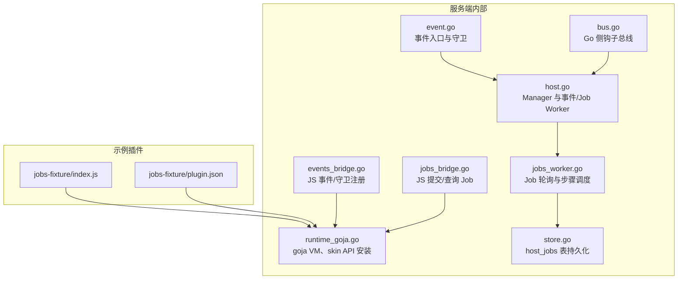
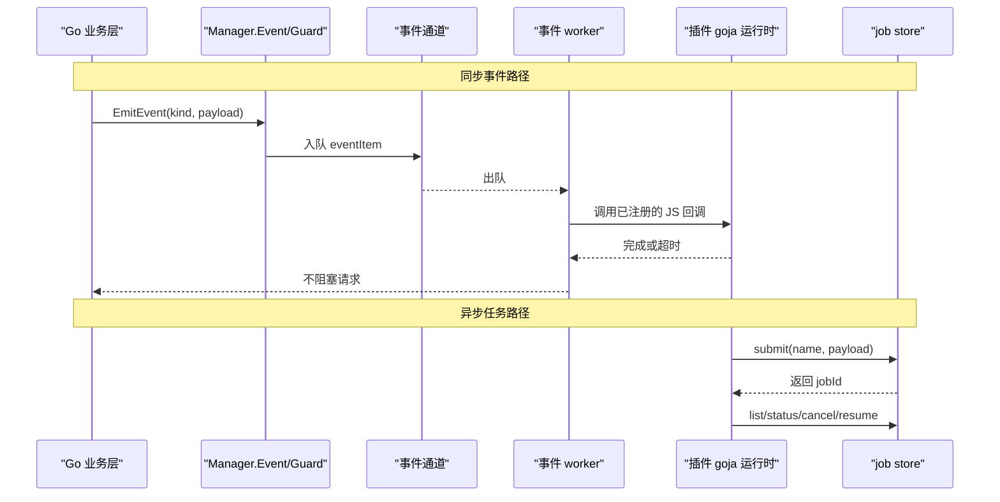
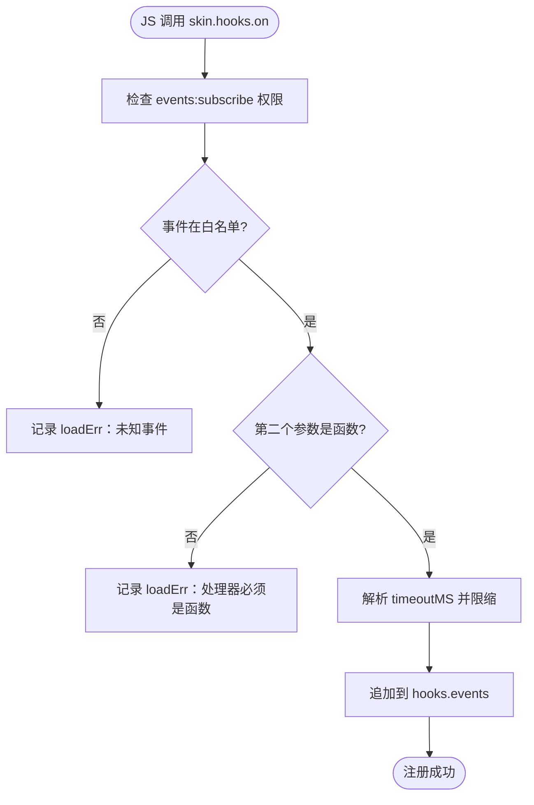
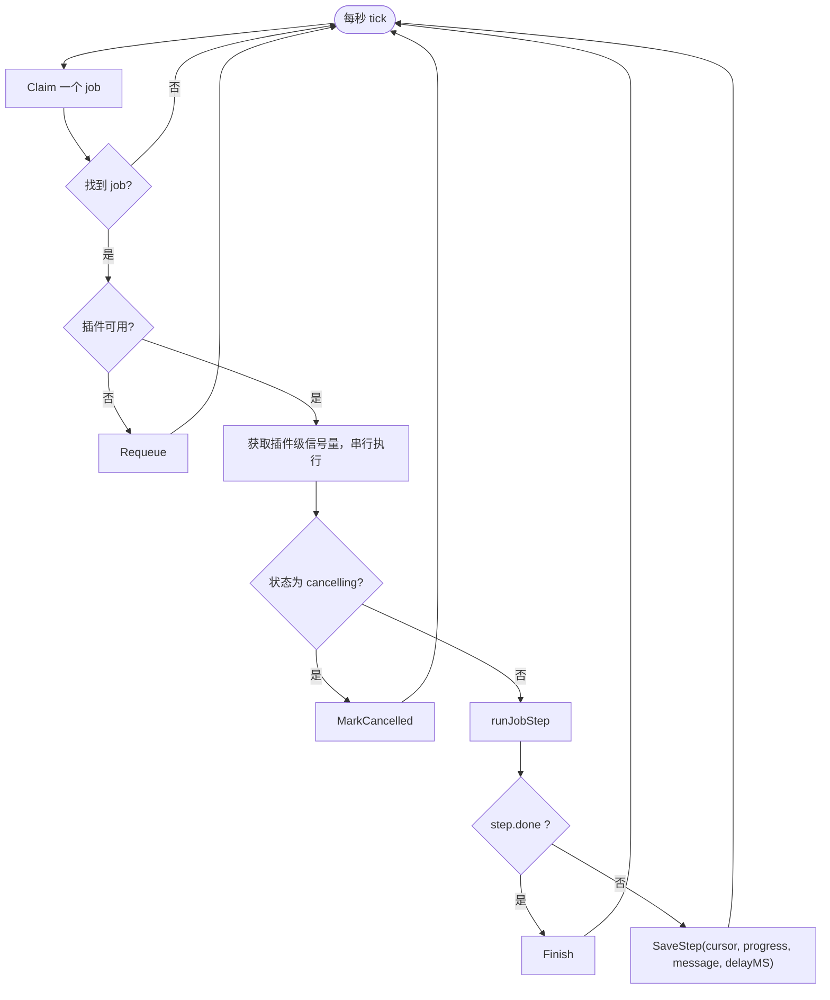
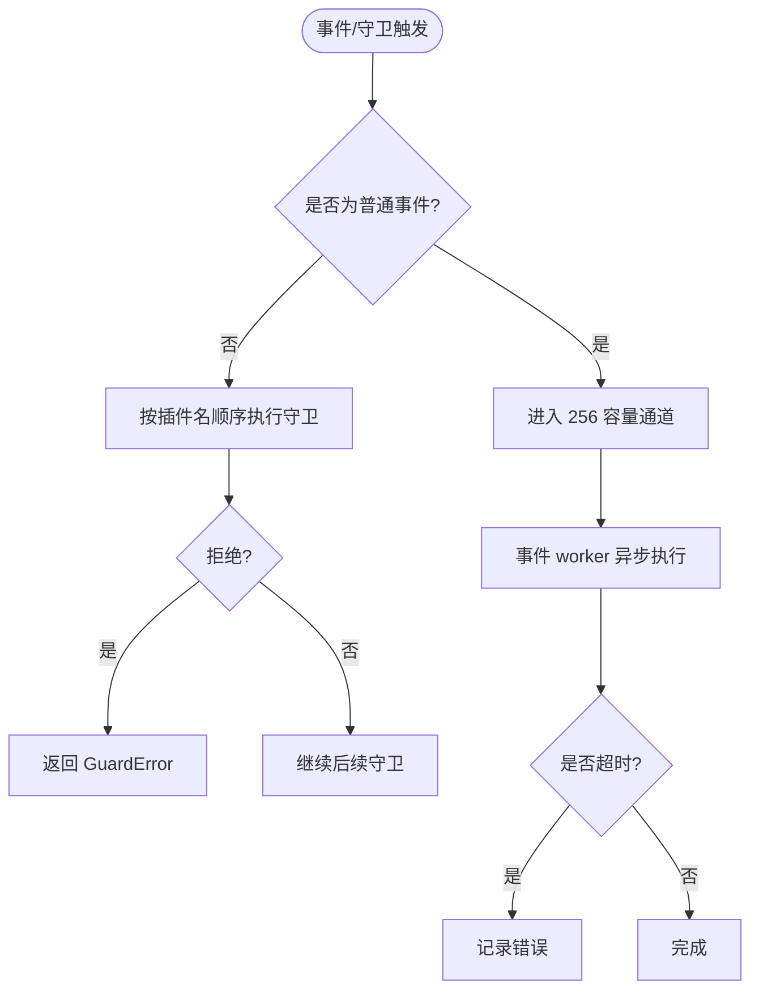

# 事件总线与钩子

**本文引用的文件**
- [events.go](https://github.com/YimingZhanshen/skin-nexus/blob/797ae1a/server/internal/plugin/events.go)
- [events_bridge.go](https://github.com/YimingZhanshen/skin-nexus/blob/797ae1a/server/internal/plugin/events_bridge.go)
- [bus.go](https://github.com/YimingZhanshen/skin-nexus/blob/797ae1a/server/internal/plugin/bus.go)
- [contract.go](https://github.com/YimingZhanshen/skin-nexus/blob/797ae1a/server/internal/plugin/contract.go)
- [host.go](https://github.com/YimingZhanshen/skin-nexus/blob/797ae1a/server/internal/plugin/host.go)
- [runtime_goja.go](https://github.com/YimingZhanshen/skin-nexus/blob/797ae1a/server/internal/plugin/runtime_goja.go)
- [jobs_bridge.go](https://github.com/YimingZhanshen/skin-nexus/blob/797ae1a/server/internal/plugin/jobs_bridge.go)
- [jobs_worker.go](https://github.com/YimingZhanshen/skin-nexus/blob/797ae1a/server/internal/plugin/jobs_worker.go)
- [store.go](https://github.com/YimingZhanshen/skin-nexus/blob/797ae1a/server/internal/jobs/store.go)
- [index.js](https://github.com/YimingZhanshen/skin-nexus/blob/797ae1a/examples/plugins/jobs-fixture/index.js)
- [plugin.json](https://github.com/YimingZhanshen/skin-nexus/blob/797ae1a/examples/plugins/jobs-fixture/plugin.json)

## 目录
1. [引言](#引言)
2. [项目结构定位](#项目结构定位)
3. [核心组件总览](#核心组件总览)
4. [架构总览](#架构总览)
5. [可订阅事件与守卫清单](#可订阅事件与守卫清单)
6. [事件触发时机与数据模型](#事件触发时机与数据模型)
7. [Go 到 JavaScript 运行时桥接](#go-到-javascript-运行时桥接)
8. [后台任务系统](#后台任务系统)
9. [jobs-fixture 示例：订阅、延迟任务与插件存储](#jobs-fixture-示例订阅延迟任务与插件存储)
10. [执行顺序、失败重试与性能影响](#执行顺序失败重试与性能影响)
11. [监控指标与可观测性](#监控指标与可观测性)
12. [常见问题排查](#常见问题排查)
13. [结论](#结论)

## 引言
本文面向插件开发者与维护者，系统化说明 SkinNexus 插件系统的“事件总线 + 钩子 + 后台任务”机制。重点包括：
- 所有可订阅事件的名称、含义、触发时机和 payload 字段。
- 哪些操作支持“守卫（guard）”拦截，以及守卫返回语义。
- Go 层如何把事件安全地交给 goja JavaScript 运行时执行。
- 长时间任务如何通过 jobs store 持久化，并由 worker 逐步执行。
- 使用 `examples/plugins/jobs-fixture` 演示订阅、提交任务、读取/写入插件 KV 的完整流程。
- 事件执行顺序、失败处理、超时、并发限制及常见故障排查。

## 项目结构定位
事件与任务相关代码集中在 `server/internal/plugin` 包中；持久化 job 队列在 `server/internal/jobs`；示例插件在 `examples/plugins/jobs-fixture`。

**图示来源**
- [events.go:1-94](https://github.com/YimingZhanshen/skin-nexus/blob/797ae1a/server/internal/plugin/events.go#L1-L94)
- [events_bridge.go:1-164](https://github.com/YimingZhanshen/skin-nexus/blob/797ae1a/server/internal/plugin/events_bridge.go#L1-L164)
- [bus.go:1-123](https://github.com/YimingZhanshen/skin-nexus/blob/797ae1a/server/internal/plugin/bus.go#L1-L123)
- [host.go:1-200](https://github.com/YimingZhanshen/skin-nexus/blob/797ae1a/server/internal/plugin/host.go#L1-L200)
- [runtime_goja.go:1-200](https://github.com/YimingZhanshen/skin-nexus/blob/797ae1a/server/internal/plugin/runtime_goja.go#L1-L200)
- [jobs_bridge.go:1-200](https://github.com/YimingZhanshen/skin-nexus/blob/797ae1a/server/internal/plugin/jobs_bridge.go#L1-L200)
- [jobs_worker.go:1-97](https://github.com/YimingZhanshen/skin-nexus/blob/797ae1a/server/internal/plugin/jobs_worker.go#L1-L97)
- [store.go:1-200](https://github.com/YimingZhanshen/skin-nexus/blob/797ae1a/server/internal/jobs/store.go#L1-L200)
- [index.js:1-89](https://github.com/YimingZhanshen/skin-nexus/blob/797ae1a/examples/plugins/jobs-fixture/index.js#L1-L89)
- [plugin.json:1-40](https://github.com/YimingZhanshen/skin-nexus/blob/797ae1a/examples/plugins/jobs-fixture/plugin.json#L1-L40)

**章节来源**
- [host.go:120-200](https://github.com/YimingZhanshen/skin-nexus/blob/797ae1a/server/internal/plugin/host.go#L120-L200)
- [runtime_goja.go:1-120](https://github.com/YimingZhanshen/skin-nexus/blob/797ae1a/server/internal/plugin/runtime_goja.go#L1-L120)

## 核心组件总览
| 组件 | 职责 | 关键行为 |
| --- | --- | --- |
| `EventPayload` | 统一事件载荷 | 包含 kind、userId、playerId、playerName、uuid、hash、type、ip、data |
| Manager | 插件生命周期、事件分发、Job Worker | 启动事件工作协程和最多两个 job worker |
| events_bridge | JS 暴露 `skin.hooks.on*` 与守卫注册 | 校验权限、白名单事件名、包装超时与错误记录 |
| bus | Go 侧 HookBus 实现 | 让 host-level Go 代码也能注册过滤钩子 |
| runtime_goja | goja 运行时封装 | 安装 skin API、运行 entrypoint、隔离每个插件的 VM |
| jobs_bridge | JS 暴露 `skin.jobs.register/submit/list/status/cancel/resume` | 权限校验、持久化 job、管理端查询 |
| jobs_worker | 定时轮询并执行 job 单步 | 租约、串行化每插件步骤、取消与重试 |
| jobs.Store | 数据库持久化 | Claim/List/Create/Finish/Cancel 等状态机操作 |

**章节来源**
- [contract.go:120-200](https://github.com/YimingZhanshen/skin-nexus/blob/797ae1a/server/internal/plugin/contract.go#L120-L200)
- [host.go:120-200](https://github.com/YimingZhanshen/skin-nexus/blob/797ae1a/server/internal/plugin/host.go#L120-L200)
- [runtime_goja.go:120-220](https://github.com/YimingZhanshen/skin-nexus/blob/797ae1a/server/internal/plugin/runtime_goja.go#L120-L220)

## 架构总览
下图展示一次典型用户注册或纹理上传时，事件从 Go 业务层进入插件事件总线，再由 worker 异步调用 JS 回调的流程；同时对比 JS 主动提交的后台任务如何进入 job store。

**图示来源**
- [events.go:10-25](https://github.com/YimingZhanshen/skin-nexus/blob/797ae1a/server/internal/plugin/events.go#L10-L25)
- [events_bridge.go:60-110](https://github.com/YimingZhanshen/skin-nexus/blob/797ae1a/server/internal/plugin/events_bridge.go#L60-L110)
- [host.go:150-200](https://github.com/YimingZhanshen/skin-nexus/blob/797ae1a/server/internal/plugin/host.go#L150-L200)
- [jobs_bridge.go:60-150](https://github.com/YimingZhanshen/skin-nexus/blob/797ae1a/server/internal/plugin/jobs_bridge.go#L60-L150)
- [jobs_worker.go:1-97](https://github.com/YimingZhanshen/skin-nexus/blob/797ae1a/server/internal/plugin/jobs_worker.go#L1-L97)

## 可订阅事件与守卫清单

### 通用事件白名单
当前通过 `knownEvents` 暴露给 JS 的事件如下：

| 事件名 | 中文含义 | 是否由 `EmitEvent` 触发 | 是否可修改/取消 | 说明 |
| --- | --- | --- | --- | --- |
| `user.registered` | 用户注册完成 | 是 | 否 | 通知型事件，仅消费 |
| `user.logged_in` | 用户登录成功 | 是 | 否 | 通知型事件 |
| `user.deleted` | 用户删除完成 | 是 | 否 | 通知型事件 |
| `player.added` | 玩家加入站点 | 是 | 否 | 通知型事件 |
| `player.renamed` | 玩家改名 | 是 | 否 | 通知型事件 |
| `player.deleted` | 玩家删除 | 是 | 否 | 通知型事件 |
| `profile.updated` | 用户资料更新 | 是 | 否 | 通知型事件 |
| `texture.uploaded` | 纹理上传完成 | 是 | 否 | 通知型事件 |
| `texture.deleted` | 纹理删除完成 | 是 | 否 | 通知型事件 |

注意：仓库中的通用事件名使用的是 `user.*`、`texture.*`、`player.*`、`profile.*`，而不是问题描述中的 `account.register`、`role.create`、`role.delete`、`player.update`。也就是说，`account.register`、`role.create`、`role.delete`、`player.update` **不在当前白名单中**，JS 调用 `skin.hooks.on("...")` 会报“未知事件”。

### 守卫白名单
守卫用于在关键动作发生前做拒绝判断，对应 `knownGuards`：

| 守卫名 | 触发阶段 | 返回值语义 | 默认失败策略 |
| --- | --- | --- | --- |
| `user.registration.check` | 用户注册检查 | 返回布尔或 `{allow,message,code}` | fail-closed：异常视为拒绝 |
| `auth.login.check` | 登录检查 | 同上 | fail-closed |
| `auth.join.check` | Yggdrasil join 检查 | 同上 | fail-closed |
| `profile.update.check` | 个人资料更新检查 | 同上 | fail-closed |
| `player.rename.check` | 玩家改名检查 | 同上 | fail-closed |
| `texture.upload.check` | 纹理上传检查 | 同上 | fail-closed |
| `texture.delete.check` | 纹理删除检查 | 同上 | fail-closed |

守卫可通过选项设置 `onError`：
- `"deny"`：JS 抛出异常时视为拒绝。
- `"allow"`：JS 抛出异常时放行，但不记录为成功。

**章节来源**
- [events_bridge.go:15-45](https://github.com/YimingZhanshen/skin-nexus/blob/797ae1a/server/internal/plugin/events_bridge.go#L15-L45)
- [events_bridge.go:80-140](https://github.com/YimingZhanshen/skin-nexus/blob/797ae1a/server/internal/plugin/events_bridge.go#L80-L140)
- [events.go:10-70](https://github.com/YimingZhanshen/skin-nexus/blob/797ae1a/server/internal/plugin/events.go#L10-L70)

## 事件触发时机与数据模型

### EventPayload 字段
通用事件通过 `payloadMap` 转换为 JS 对象，字段如下：

| JS 字段 | Go 字段 | 类型 | 含义 |
| --- | --- | --- | --- |
| `kind` | `Kind` | string | 事件名 |
| `userId` | `UserID` | number | 关联用户 ID |
| `playerId` | `PlayerID` | number | 关联玩家 ID |
| `playerName` | `PlayerName` | string | 玩家名称 |
| `uuid` | `UUID` | string | 玩家 UUID |
| `hash` | `Hash` | string | 纹理哈希 |
| `type` | `Type` | string | 纹理类型或扩展上下文 |
| `ip` | `IP` | string | 客户端 IP |
| `data` | `Data` | object | 可选扩展数据 |

该结构明确声明“不包含密码、Cookie 或原始请求体”，因此 JS 不应依赖敏感字段存在。

### 事件语义与注意事项
- `EmitEvent` 不会阻塞请求路径；它把事件放入有界通道，饱和时会丢弃。
- 事件回调由 worker 异步执行，JS 回调即使抛错也不会直接回退原请求。
- 事件回调没有“返回值”机制，不能用来修改后续流程；要阻止流程应使用守卫。
- 若需要可取消、可暂停、可恢复的长任务，应使用 job，而不是在事件回调里 sleep。

**章节来源**
- [events.go:10-25](https://github.com/YimingZhanshen/skin-nexus/blob/797ae1a/server/internal/plugin/events.go#L10-L25)
- [events_bridge.go:45-60](https://github.com/YimingZhanshen/skin-nexus/blob/797ae1a/server/internal/plugin/events_bridge.go#L45-L60)
- [contract.go:150-180](https://github.com/YimingZhanshen/skin-nexus/blob/797ae1a/server/internal/plugin/contract.go#L150-L180)

## Go 到 JavaScript 运行时桥接

### 注册流程
JS 通过 `skin.hooks.on(eventName, handler, options?)` 注册事件监听器：
1. 运行时检查权限 `events:subscribe`。
2. 校验事件名是否在 `knownEvents`。
3. 校验第二个参数是函数。
4. 解析 `timeoutMS`，并使用 `clampTimeout` 确保不超过宿主默认上限。
5. 将包装后的回调加入 `rt.hooks.events[kind]`。

### 守卫注册流程
JS 通过 `skin.hooks.guard(guardName, handler, options?)` 注册守卫：
1. 检查权限 `auth:guards`。
2. 校验守卫名是否在 `knownGuards`。
3. 解析 `timeoutMS` 和 `onError`。
4. 以 `failClosed` 标志保存守卫条目。
5. 实际执行时，JS 抛出异常按 fail-closed 策略拒绝。

### 执行流程
当 Go 侧调用 `CheckGuard` 或派发事件时：
- 守卫：JS 返回 `true/false` 或 `{allow,message,code}`；空值或非法值会被解释为允许或拒绝。
- 事件：JS 回调返回值被忽略；异常通过 `rt.record(err)` 记录，但不会传播回调用方。

**图示来源**
- [events_bridge.go:60-110](https://github.com/YimingZhanshen/skin-nexus/blob/797ae1a/server/internal/plugin/events_bridge.go#L60-L110)
- [bus.go:1-40](https://github.com/YimingZhanshen/skin-nexus/blob/797ae1a/server/internal/plugin/bus.go#L1-L40)

**章节来源**
- [events_bridge.go:60-140](https://github.com/YimingZhanshen/skin-nexus/blob/797ae1a/server/internal/plugin/events_bridge.go#L60-L140)
- [runtime_goja.go:120-220](https://github.com/YimingZhanshen/skin-nexus/blob/797ae1a/server/internal/plugin/runtime_goja.go#L120-L220)

## 后台任务系统

### Job 数据结构
持久化的 job 包含以下关键字段：

| 字段 | 含义 |
| --- | --- |
| `id` | 随机生成的 job ID |
| `plugin` | 插件名 |
| `handler` | JS 中注册的 handler 名 |
| `owner_uid` | 提交者的用户 ID |
| `state` | `queued` / `running` / `cancelled` / `finished` 等 |
| `payload` | JSON 序列化后的输入 |
| `cursor` | JS 步骤间持久化的游标 |
| `result` | 最终结果 |
| `progress` | 百分比进度 |
| `message` | 当前步骤消息 |
| `last_error` | 最近一次错误 |
| `attempts` | 已尝试次数 |
| `max_attempts` | 最大尝试次数 |
| `run_after` | 最早可执行时间 |
| `lease_owner` / `lease_until` | 租约持有者与过期时间 |

### JS 暴露的 Job API
| JS 方法 | 权限 | 行为 |
| --- | --- | --- |
| `skin.jobs.register(name, handler)` | `schedule:jobs` | 声明并绑定 job handler |
| `skin.jobs.submit(name, payload)` | `schedule:jobs` | 创建持久化 job，返回 `jobId` |
| `skin.jobs.list(page)` | `schedule:jobs` | 列出当前插件的 job |
| `skin.jobs.status(jobId)` | `schedule:jobs` | 查询单个 job |
| `skin.jobs.cancel(jobId)` | `schedule:jobs` | 请求取消 |
| `skin.jobs.resume(jobId)` | `schedule:jobs` | 恢复取消的 job |

### Worker 调度逻辑
worker 每秒轮询一次：
1. 从 store 租约 claim 一个 due job。
2. 若插件实例不存在或未启用，重新排队。
3. 同一插件的 job 步骤串行执行，避免共享 VM 竞争。
4. 执行 JS 的单个 step。
5. 如果 step 返回 `done=true`，则 finish。
6. 否则保存 cursor、progress、message，并按 `delayMS` 重入。
7. 若 job 处于 `cancelling`，标记为 `cancelled`。

**图示来源**
- [jobs_worker.go:1-97](https://github.com/YimingZhanshen/skin-nexus/blob/797ae1a/server/internal/plugin/jobs_worker.go#L1-L97)
- [store.go:120-200](https://github.com/YimingZhanshen/skin-nexus/blob/797ae1a/server/internal/jobs/store.go#L120-L200)

**章节来源**
- [jobs_bridge.go:1-200](https://github.com/YimingZhanshen/skin-nexus/blob/797ae1a/server/internal/plugin/jobs_bridge.go#L1-L200)
- [jobs_worker.go:1-97](https://github.com/YimingZhanshen/skin-nexus/blob/797ae1a/server/internal/plugin/jobs_worker.go#L1-L97)
- [store.go:1-200](https://github.com/YimingZhanshen/skin-nexus/blob/797ae1a/server/internal/jobs/store.go#L1-L200)

## jobs-fixture 示例：订阅、延迟任务与插件存储

### 插件配置
`plugin.json` 声明：
- 权限：`http:routes:admin`、`schedule:jobs`。
- 路由：`POST /admin/start`、`GET /admin/jobs`。
- Job：`tick`，超时 30 秒，最大重试 3 次。
- 最低服务器版本要求。

### JS 行为
`index.js` 主要提供两类能力：
1. **Job 示例**：注册名为 `tick` 的 job handler，逐步骤燃烧时间，并在每一步检查 `skin.jobs.cancelRequested(jobId)` 是否被外部取消。
2. **管理路由**：
   - `POST /admin/start`：提交一个 `tick` job，body 支持 `steps` 和 `stepMS`。
   - `GET /admin/jobs`：返回 `skin.jobs.list(1)`。

该示例不读写业务数据，只通过 job cursor 跟踪步骤计数，目的是验证面板上的取消与恢复按钮。

### 如何订阅事件
虽然 `jobs-fixture` 本身未订阅事件，但根据 `events_bridge.go` 的实现，你可以在任意拥有 `events:subscribe` 权限的插件中这样订阅：
- 使用 `skin.hooks.on("texture.uploaded", handler)` 监听纹理上传。
- 使用 `skin.hooks.on("user.registered", handler)` 监听用户注册。
- 使用 `skin.hooks.on("player.added", handler)` 监听玩家加入。
- 使用 `skin.hooks.on("profile.updated", handler)` 监听资料更新。

如果你希望监听 `account.register`、`role.create`、`role.delete` 或 `player.update`，必须先在后端添加这些事件名到 `knownEvents`；当前仓库不会识别它们。

### 如何读取/写入插件 KV
插件 KV 由 `store_bridge.go` 暴露给 JS（文件名未在本题聚焦范围内，但其服务类在 `runtime_goja.go` 中被注入）。典型用法模式是：
- 读取：`skin.store.get(key)`。
- 写入：`skin.store.set(key, value)`。
- 删除：`skin.store.delete(key)`。
- 列表：`skin.store.list(prefix)`。

具体键名和编码约定应由插件自行约定，因为事件 payload 的 `data` 字段是可选扩展区，不适合当作插件 KV schema。

**章节来源**
- [plugin.json:1-40](https://github.com/YimingZhanshen/skin-nexus/blob/797ae1a/examples/plugins/jobs-fixture/plugin.json#L1-L40)
- [index.js:1-89](https://github.com/YimingZhanshen/skin-nexus/blob/797ae1a/examples/plugins/jobs-fixture/index.js#L1-L89)
- [events_bridge.go:60-110](https://github.com/YimingZhanshen/skin-nexus/blob/797ae1a/server/internal/plugin/events_bridge.go#L60-L110)
- [runtime_goja.go:200-350](https://github.com/YimingZhanshen/skin-nexus/blob/797ae1a/server/internal/plugin/runtime_goja.go#L200-L350)

## 执行顺序、失败重试与性能影响

### 事件执行顺序
- 同一插件内，多个同事件监听器按注册顺序依次执行。
- 不同插件之间，事件通过 `Manager.emit` 走统一通道，worker 逐个取出后分发给各插件。
- 事件回调是异步的，调用 `EmitEvent` 的 HTTP 请求不会等待 JS 回调完成。
- 事件回调不支持返回值传递，也不支持取消。

### 守卫执行顺序
- 守卫按插件名排序遍历实例。
- 任一守卫拒绝即返回 `GuardError`。
- 若某守卫 fail-closed 且 JS 抛出异常，整体拒绝。
- super-admin 可通过 `plugin_guards_bypass` 绕过全部守卫，该开关会审计记录。

### Job 重试与取消
- `MaxAttempts` 小于等于 0 时默认 3。
- 每次 step 失败都会增加 attempts，超过 `MaxAttempts` 则 fail。
- cancel 不是立即中断正在运行的 VM 调用；它在 step 边界生效。
- job 步骤在同一插件内串行，避免共享 goja VM 产生竞态。
- lease 最长 90 秒；reclaims 超过 10 会直接 fail，防止无限 reclaim。

### 性能影响
- 事件通道容量为 256，饱和后会丢事件，不会阻塞请求。
- 默认 hook 超时为 100ms，auth 超时为 50ms，route 超时为 1s，load 超时为 2s。
- JS 回调超时由 `clampTimeout` 限制，不能超过宿主默认上限。
- 每个插件的 job 步骤串行，避免多个 worker 同时跑同一个 VM。
- 事件和 job 都应在 JS 中保持短小快速；长耗时逻辑应拆成 job。

**图示来源**
- [events.go:10-70](https://github.com/YimingZhanshen/skin-nexus/blob/797ae1a/server/internal/plugin/events.go#L10-L70)
- [events_bridge.go:60-140](https://github.com/YimingZhanshen/skin-nexus/blob/797ae1a/server/internal/plugin/events_bridge.go#L60-L140)
- [host.go:150-200](https://github.com/YimingZhanshen/skin-nexus/blob/797ae1a/server/internal/plugin/host.go#L150-L200)
- [jobs_worker.go:1-97](https://github.com/YimingZhanshen/skin-nexus/blob/797ae1a/server/internal/plugin/jobs_worker.go#L1-L97)

**章节来源**
- [events.go:10-94](https://github.com/YimingZhanshen/skin-nexus/blob/797ae1a/server/internal/plugin/events.go#L10-L94)
- [events_bridge.go:60-164](https://github.com/YimingZhanshen/skin-nexus/blob/797ae1a/server/internal/plugin/events_bridge.go#L60-L164)
- [host.go:150-200](https://github.com/YimingZhanshen/skin-nexus/blob/797ae1a/server/internal/plugin/host.go#L150-L200)
- [jobs_worker.go:1-97](https://github.com/YimingZhanshen/skin-nexus/blob/797ae1a/server/internal/plugin/jobs_worker.go#L1-L97)

## 监控指标与可观测性
运行时在每个 plugin goja runtime 上维护以下计数器：
- `calls`：JS 调用总数。
- `errors`：JS 调用错误数。
- `timeouts`：JS 调用超时数。
- `routeCalls`：路由调用数。
- `logs`：JS 侧日志。
- `lastErr`：最近错误。

此外：
- 守卫绕过开关变更会通过审计函数记录。
- job 的状态、错误、进度、消息、attempt 数均可通过 `skin.jobs.list` 与管理面板查看。
- 事件本身不返回错误给调用方，但 JS 回调异常会被记录到对应 runtime。

**章节来源**
- [runtime_goja.go:120-220](https://github.com/YimingZhanshen/skin-nexus/blob/797ae1a/server/internal/plugin/runtime_goja.go#L120-L220)
- [events.go:70-94](https://github.com/YimingZhanshen/skin-nexus/blob/797ae1a/server/internal/plugin/events.go#L70-L94)
- [jobs_bridge.go:120-200](https://github.com/YimingZhanshen/skin-nexus/blob/797ae1a/server/internal/plugin/jobs_bridge.go#L120-L200)

## 常见问题排查

### 事件未触发
可能原因：
1. JS 订阅了白名单外的名字，例如 `account.register`、`role.create`、`role.delete`、`player.update`。
2. 插件缺少 `events:subscribe` 权限。
3. 插件未启用或 JS entrypoint 加载失败。
4. 事件通道饱和，事件被丢弃。
5. 事件 worker 未启动或进程崩溃。

排查步骤：
- 确认事件名出现在 `knownEvents`。
- 检查插件 manifest 是否声明 `events:subscribe`。
- 检查插件状态是否为 loaded/ok。
- 检查是否有大量事件积压。
- 查看 runtime 的 `errors`、`lastErr`、`logs`。

**章节来源**
- [events_bridge.go:15-45](https://github.com/YimingZhanshen/skin-nexus/blob/797ae1a/server/internal/plugin/events_bridge.go#L15-L45)
- [events_bridge.go:60-110](https://github.com/YimingZhanshen/skin-nexus/blob/797ae1a/server/internal/plugin/events_bridge.go#L60-L110)
- [host.go:150-200](https://github.com/YimingZhanshen/skin-nexus/blob/797ae1a/server/internal/plugin/host.go#L150-L200)

### payload 缺失或字段不对
可能原因：
1. 使用了错误的事件名，导致 payload 字段不匹配。
2. 期望字段只在特定事件中填充，而你的事件没有该字段。
3. 把业务敏感字段误认为一定会存在。

排查步骤：
- 打印 `kind` 和 `data`。
- 对照 `EventPayload` 字段映射。
- 对可选字段做空值保护。

**章节来源**
- [events_bridge.go:45-60](https://github.com/YimingZhanshen/skin-nexus/blob/797ae1a/server/internal/plugin/events_bridge.go#L45-L60)
- [contract.go:150-180](https://github.com/YimingZhanshen/skin-nexus/blob/797ae1a/server/internal/plugin/contract.go#L150-L180)

### JS 抛出异常
现象：
- 普通事件回调抛错不会影响原 HTTP 请求。
- 守卫抛错可能拒绝请求，取决于 `onError` 和 fail-closed 配置。
- runtime 会记录错误和超时。

排查步骤：
- 查看 JS console 和插件 logs。
- 检查 `timeoutMS` 是否过小。
- 对守卫显式设置 `onError`。
- 检查 `errors` 和 `timeouts` 计数器。

**章节来源**
- [events_bridge.go:110-164](https://github.com/YimingZhanshen/skin-nexus/blob/797ae1a/server/internal/plugin/events_bridge.go#L110-L164)
- [events.go:25-70](https://github.com/YimingZhanshen/skin-nexus/blob/797ae1a/server/internal/plugin/events.go#L25-L70)

### Job 堆积
可能原因：
1. 未配置 `jobs.Store`，`skin.jobs.submit` 直接报错。
2. job worker 未启动。
3. JS handler 卡住，超出 step budget。
4. job 被反复 cancel/requeue，lease 丢失。
5. reclaims 超过阈值，job 被强制 fail。
6. 插件实例未启用或 job handler 未注册。

排查步骤：
- 检查 `skin.jobs.list()` 中 `state=queued` 的数量。
- 检查 `state=running` 是否长期不变。
- 检查 `last_error`、`attempts`、`max_attempts`。
- 确认插件 manifest 中声明了该 job。
- 确认 handler 在 JS 中调用了 `skin.jobs.register`。
- 检查 `cancelRequested` 是否被正确使用以避免长时间阻塞。

**章节来源**
- [jobs_bridge.go:60-150](https://github.com/YimingZhanshen/skin-nexus/blob/797ae1a/server/internal/plugin/jobs_bridge.go#L60-L150)
- [jobs_worker.go:1-97](https://github.com/YimingZhanshen/skin-nexus/blob/797ae1a/server/internal/plugin/jobs_worker.go#L1-L97)
- [store.go:120-200](https://github.com/YimingZhanshen/skin-nexus/blob/797ae1a/server/internal/jobs/store.go#L120-L200)
- [index.js:1-89](https://github.com/YimingZhanshen/skin-nexus/blob/797ae1a/examples/plugins/jobs-fixture/index.js#L1-L89)

## 结论
SkinNexus 的插件事件总线采用“Go 主流程 + 异步 JS 回调”的设计：
- 通用事件只负责通知，不修改数据，也不支持取消。
- 守卫用于在关键流程前做拒绝决策，支持 fail-closed 或 fail-open。
- JS 运行时通过权限控制、事件白名单、超时限缩和错误记录保证安全性。
- 长时间任务应使用 job 系统，通过 cursor 实现多步、可取消、可恢复的可靠执行。
- 对于文档中提到的 `account.register`、`role.create`、`role.delete`、`player.update`，当前仓库并未暴露这些事件名；如需新增，应在后端扩展 `knownEvents`、`knownGuards` 以及对应的触发点。
