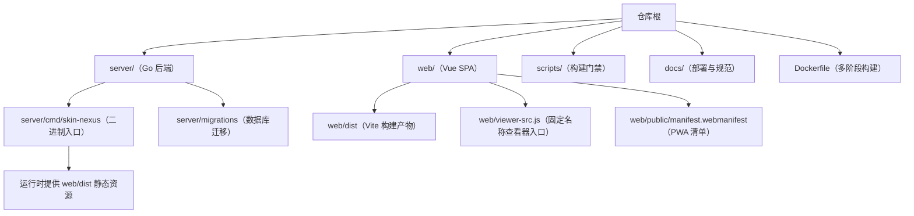
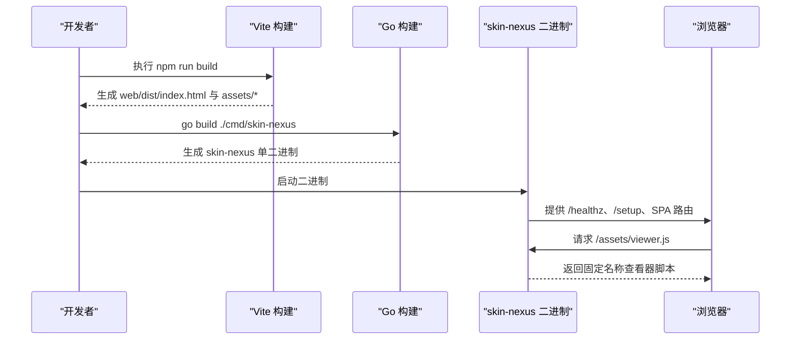
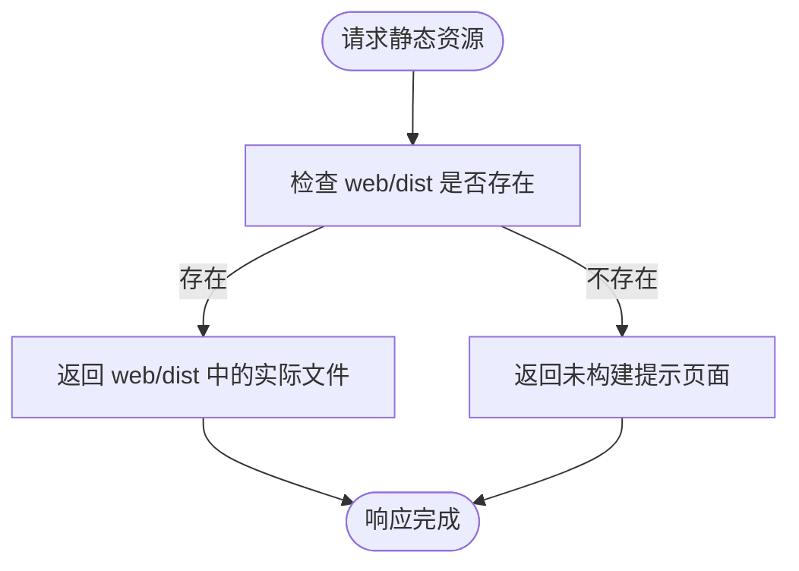
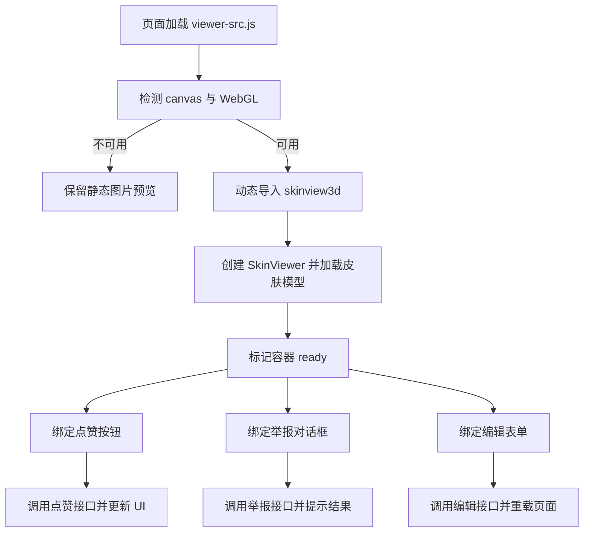
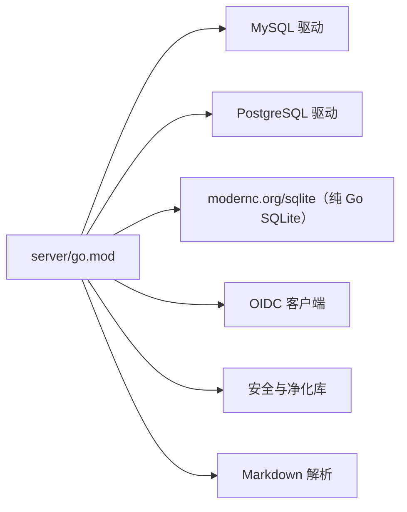
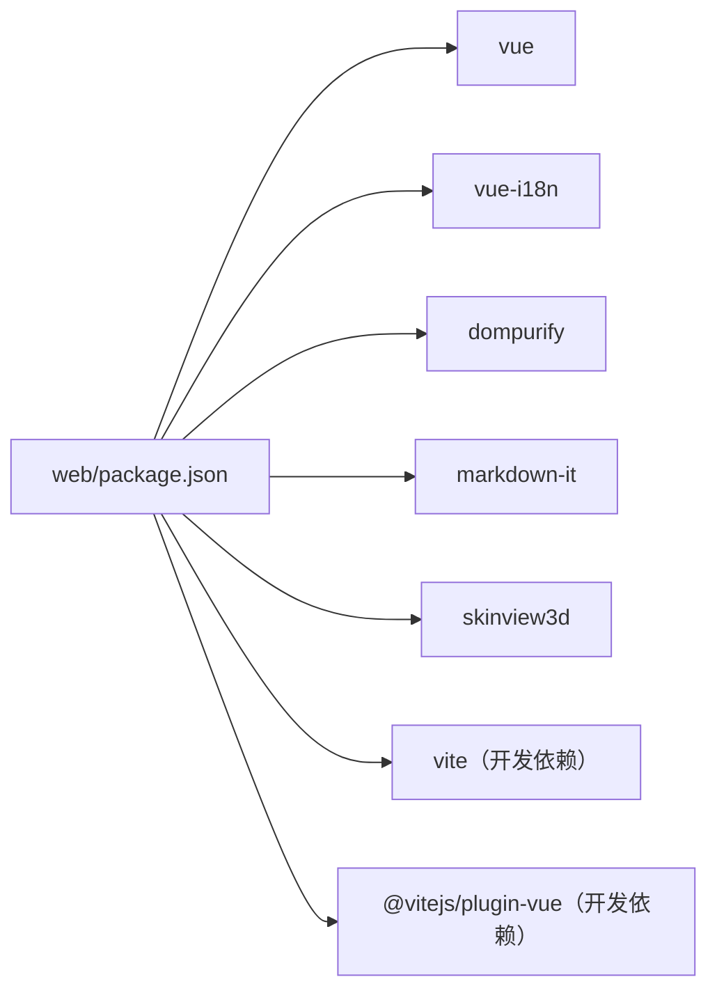

# 二进制与源码构建

**本文引用的文件**
- [server/go.mod](https://github.com/YimingZhanshen/skin-nexus/blob/797ae1a/server/go.mod)
- [web/package.json](https://github.com/YimingZhanshen/skin-nexus/blob/797ae1a/web/package.json)
- [web/vite.config.js](https://github.com/YimingZhanshen/skin-nexus/blob/797ae1a/web/vite.config.js)
- [web/viewer-src.js](https://github.com/YimingZhanshen/skin-nexus/blob/797ae1a/web/viewer-src.js)
- [web/public/manifest.webmanifest](https://github.com/YimingZhanshen/skin-nexus/blob/797ae1a/web/public/manifest.webmanifest)
- [server/cmd/skin-nexus/main.go](https://github.com/YimingZhanshen/skin-nexus/blob/797ae1a/server/cmd/skin-nexus/main.go)
- [Dockerfile](https://github.com/YimingZhanshen/skin-nexus/blob/797ae1a/Dockerfile)
- [README.md](https://github.com/YimingZhanshen/skin-nexus/blob/797ae1a/README.md)

## 目录
1. [简介](#简介)
2. [项目结构](#项目结构)
3. [核心组件](#核心组件)
4. [架构总览](#架构总览)
5. [详细组件分析](#详细组件分析)
6. [依赖关系分析](#依赖关系分析)
7. [性能考量](#性能考量)
8. [故障排查指南](#故障排查指南)
9. [发布前校验清单](#发布前校验清单)
10. [结论](#结论)

## 简介
本指南说明如何从源码构建 SkinNexus：使用 Go 后端生成单二进制，并通过 Vite 构建前端 Vue SPA；最终由 Go 程序在运行时提供静态资源。文档同时覆盖开发环境与生产构建的差异、Go 与 Node.js 版本要求、平台构建步骤、交叉编译注意事项、静态资源打包路径以及发布前的质量校验。

- Go 后端入口位于 `server/cmd/skin-nexus`，通过 `go build ./cmd/skin-nexus` 生成名为 `skin-nexus` 的单二进制。
- 前端位于 `web/`，使用 Vite + Vue 3 构建产物到 `web/dist`，并由 Go 服务器在运行时读取该目录作为 SPA 静态资源。
- Docker 多阶段构建中，Go 构建阶段启用 `CGO_ENABLED=0`，因此生产二进制默认不依赖系统 C 工具链；SQLite 由纯 Go 实现驱动。

**章节来源**
- [server/cmd/skin-nexus/main.go:1-20](https://github.com/YimingZhanshen/skin-nexus/blob/797ae1a/server/cmd/skin-nexus/main.go#L1-L20)
- [Dockerfile:1-68](https://github.com/YimingZhanshen/skin-nexus/blob/797ae1a/Dockerfile#L1-L68)
- [README.md:1-114](https://github.com/YimingZhanshen/skin-nexus/blob/797ae1a/README.md#L1-L114)

## 项目结构
SkinNexus 采用“Go 后端 + 独立前端”的仓库布局：

- `server/`：Go 模块、命令行入口、业务逻辑、数据库迁移与主题基础样式。
- `web/`：Vue 3 SPA、Vite 配置、PWA manifest、国际化文案与静态资源。
- `scripts/`：构建门禁脚本，例如语言包校验、主题契约检查等。
- `docs/`：部署、迁移、兼容矩阵、启动器 API 等文档。
- `examples/plugins/`：插件示例。
- `Dockerfile`：定义 Web 构建、Go 构建和最小运行镜像三个构建阶段。

**图示来源**
- [server/cmd/skin-nexus/main.go:1190-1341](https://github.com/YimingZhanshen/skin-nexus/blob/797ae1a/server/cmd/skin-nexus/main.go#L1190-L1341)
- [web/vite.config.js:1-43](https://github.com/YimingZhanshen/skin-nexus/blob/797ae1a/web/vite.config.js#L1-L43)
- [Dockerfile:1-68](https://github.com/YimingZhanshen/skin-nexus/blob/797ae1a/Dockerfile#L1-L68)

**章节来源**
- [server/cmd/skin-nexus/main.go:1190-1341](https://github.com/YimingZhanshen/skin-nexus/blob/797ae1a/server/cmd/skin-nexus/main.go#L1190-L1341)
- [web/vite.config.js:1-43](https://github.com/YimingZhanshen/skin-nexus/blob/797ae1a/web/vite.config.js#L1-L43)
- [Dockerfile:1-68](https://github.com/YimingZhanshen/skin-nexus/blob/797ae1a/Dockerfile#L1-L68)

## 核心组件
### Go 后端与单二进制
- 二进制入口为 `server/cmd/skin-nexus/main.go`，支持 `version`、`migrate`、`redetect-models`、`fsck` 等子命令。
- 版本号、提交哈希、构建时间、分支信息可通过 ldflags 注入；本地构建时也会尝试从构建信息中回填。
- 运行时根据配置加载数据库、应用迁移、初始化站点选项并启动 HTTP 服务。

**章节来源**
- [server/cmd/skin-nexus/main.go:1-200](https://github.com/YimingZhanshen/skin-nexus/blob/797ae1a/server/cmd/skin-nexus/main.go#L1-L200)

### Vue SPA 与 Vite 构建
- `web/package.json` 定义 Vue 3、Vite、i18n、皮肤预览库等依赖，并提供 `dev`、`build`、`preview` 脚本。
- `web/vite.config.js` 将开发服务器端口设为 5173，并把 `/api` 与 `/textures` 代理到 `http://localhost:8080`。
- 构建输出目录为 `web/dist`，关闭 CSS 代码分割以保证主题样式优先于懒加载页面样式。
- 两个构建入口：
  - `index.html`：主 SPA。
  - `viewer-src.js`：固定输出名称 `assets/viewer.js`，专供服务端渲染的皮肤详情页使用。

**章节来源**
- [web/package.json:1-22](https://github.com/YimingZhanshen/skin-nexus/blob/797ae1a/web/package.json#L1-L22)
- [web/vite.config.js:1-43](https://github.com/YimingZhanshen/skin-nexus/blob/797ae1a/web/vite.config.js#L1-L43)

### PWA 清单与图标
- `web/public/manifest.webmanifest` 定义站点名、短名称、描述、起始路径、显示模式、主题色与背景色。
- 图标引用 favicon.svg、icon-192.png、icon-512.png，这些属于公开静态资源，应随网站一同部署。

**章节来源**
- [web/public/manifest.webmanifest:1-14](https://github.com/YimingZhanshen/skin-nexus/blob/797ae1a/web/public/manifest.webmanifest#L1-L14)

## 架构总览
下图展示源码构建、运行时的主要流程：开发者先构建前端，再构建 Go 二进制；运行时 Go 服务读取 `web/dist` 提供 SPA，并返回皮肤详情页所需的固定 JS 入口。

**图示来源**
- [web/vite.config.js:1-43](https://github.com/YimingZhanshen/skin-nexus/blob/797ae1a/web/vite.config.js#L1-L43)
- [server/cmd/skin-nexus/main.go:1190-1341](https://github.com/YimingZhanshen/skin-nexus/blob/797ae1a/server/cmd/skin-nexus/main.go#L1190-L1341)
- [Dockerfile:1-68](https://github.com/YimingZhanshen/skin-nexus/blob/797ae1a/Dockerfile#L1-L68)

## 详细组件分析

### 前端构建产物与静态资源嵌入机制
Vite 构建后，Go 运行时并不把 `web/dist` 直接 `go:embed` 进二进制，而是在运行时查找二进制旁边的 `web/dist` 目录：如果存在则提供真实静态资源，否则返回占位提示。这意味着：

- 生产构建必须先生成 `web/dist`。
- 部署时需保证二进制能访问 `web/dist`，或在容器中复制构建产物。
- 若跳过前端构建，浏览器会收到“尚未构建 web/dist”的提示页。

**图示来源**
- [server/cmd/skin-nexus/main.go:1190-1341](https://github.com/YimingZhanshen/skin-nexus/blob/797ae1a/server/cmd/skin-nexus/main.go#L1190-L1341)

**章节来源**
- [server/cmd/skin-nexus/main.go:1190-1341](https://github.com/YimingZhanshen/skin-nexus/blob/797ae1a/server/cmd/skin-nexus/main.go#L1190-L1341)

### 固定名称查看器入口 `web/viewer-src.js`
`viewer-src.js` 是服务端渲染的皮肤详情页增强脚本，具有以下关键行为：

- 渐进增强：页面先提供静态图片预览，无 JavaScript 或爬虫仍可正常阅读内容。
- WebGL 探测：仅在检测到 canvas 且支持 WebGL 时才动态导入 `skinview3d`。
- 延迟加载：skinview3d 被拆分为独立 chunk，避免非皮肤页面加载约 500 KB 的 3D 库。
- 用户交互：点赞、举报、编辑等操作通过 `/api/v1/skinlib` 相关接口更新状态。
- 登录回跳：遇到 401 时携带当前页面地址跳转至 `/login?next=...`，避免丢失上下文。
- 错误反馈：网络失败、保存失败、重复举报等场景向用户展示可理解消息。

**图示来源**
- [web/viewer-src.js:1-182](https://github.com/YimingZhanshen/skin-nexus/blob/797ae1a/web/viewer-src.js#L1-L182)

**章节来源**
- [web/viewer-src.js:1-182](https://github.com/YimingZhanshen/skin-nexus/blob/797ae1a/web/viewer-src.js#L1-L182)

### PWA 清单与主题市场
- `web/public/manifest.webmanifest` 是 PWA 清单，不是主题市场配置。
- 主题市场相关逻辑位于 Go 后端的管理端 API 与主题市场模块，但本次构建指南聚焦二进制与源码构建，不再展开主题市场内部实现。

**章节来源**
- [web/public/manifest.webmanifest:1-14](https://github.com/YimingZhanshen/skin-nexus/blob/797ae1a/web/public/manifest.webmanifest#L1-L14)

## 依赖关系分析

### Go 版本与模块依赖
- `server/go.mod` 声明 Go 版本为 1.26.0。
- 主要依赖包括 MySQL、PostgreSQL、SQLite、OIDC、安全策略、Markdown 处理、日志与 OpenTelemetry 相关库。
- SQLite 通过纯 Go 实现引入，配合 `CGO_ENABLED=0` 可在无 C 工具链环境下构建。

**图示来源**
- [server/go.mod:1-54](https://github.com/YimingZhanshen/skin-nexus/blob/797ae1a/server/go.mod#L1-L54)

**章节来源**
- [server/go.mod:1-54](https://github.com/YimingZhanshen/skin-nexus/blob/797ae1a/server/go.mod#L1-L54)

### Node.js 与前端依赖
- `web/package.json` 使用 `"type": "module"`，表明 ESM 环境。
- 运行时依赖包含 Vue 3、Vue I18n、DOMPurify、markdown-it 与 skinview3d。
- 开发依赖包含 Vite 与 Vue 插件。

**图示来源**
- [web/package.json:1-22](https://github.com/YimingZhanshen/skin-nexus/blob/797ae1a/web/package.json#L1-L22)

**章节来源**
- [web/package.json:1-22](https://github.com/YimingZhanshen/skin-nexus/blob/797ae1a/web/package.json#L1-L22)

## 性能考量
- Vite 关闭 CSS 代码分割，使基础样式、主题样式与自定义样式的层叠顺序可控，避免因懒加载样式优先级问题导致管理面板主题回归。
- 皮肤详情查看器按需动态导入 skinview3d，非 3D 页面不会加载大型 chunk。
- Go HTTP 服务器设置了读头、读体、写体与空闲超时，防止慢客户端耗尽连接。
- 生产镜像使用 Alpine 精简运行时，减少攻击面与体积。

**章节来源**
- [web/vite.config.js:15-43](https://github.com/YimingZhanshen/skin-nexus/blob/797ae1a/web/vite.config.js#L15-L43)
- [web/viewer-src.js:1-60](https://github.com/YimingZhanshen/skin-nexus/blob/797ae1a/web/viewer-src.js#L1-L60)
- [server/cmd/skin-nexus/server.go:1-24](https://github.com/YimingZhanshen/skin-nexus/blob/797ae1a/server/cmd/skin-nexus/server.go#L1-L24)
- [Dockerfile:40-68](https://github.com/YimingZhanshen/skin-nexus/blob/797ae1a/Dockerfile#L40-L68)

## 故障排查指南

### 常见构建失败原因
1. **Go Module 下载失败**
   - 现象：`go mod download` 或 `go build` 报无法获取依赖。
   - 原因：网络受限、代理不可用、缓存损坏。
   - 处理：
     - 设置合适的 Go module 代理。
     - 清理模块缓存后重试。
     - 在 CI 环境中使用稳定可达的代理地址。

2. **Node.js 版本不符合要求**
   - 现象：Vite 构建报错、ESM 语法不支持、插件版本不匹配。
   - 原因：Node.js 版本过低或不稳定。
   - 处理：
     - 使用 Node.js 22 或更高版本。
     - 删除旧锁文件或重新生成依赖。
     - 确保 `npm ci` 或 `npm install` 成功后再执行构建。

3. **Vue 依赖缺失或安装不完整**
   - 现象：`vite build` 找不到 Vue、Vite 插件或第三方库。
   - 原因：依赖未安装、缓存不一致、CI 未安装依赖。
   - 处理：
     - 进入 `web/` 目录执行依赖安装。
     - 使用 `npm ci` 基于锁文件安装。
     - 确认 `web/dist` 是否已生成。

4. **跳过前端构建导致静态资源缺失**
   - 现象：访问站点后看到“尚未构建 web/dist”的提示页。
   - 原因：未执行 `npm run build` 或部署时未复制 `web/dist`。
   - 处理：
     - 先构建前端，再生成 Go 二进制。
     - 在容器中确保 `web/dist` 被复制到运行镜像。

5. **CGO 禁用导致的 SQLite 行为差异**
   - 现象：某些涉及 CGO 的行为在禁用 CGO 时不同；本项目 SQLite 使用纯 Go 实现，通常不受影响。
   - 原因：不同数据库驱动对并发、事务、函数扩展的支持存在差异。
   - 处理：
     - 保持开发与生产一致使用同一数据库引擎测试。
     - 如需启用 CGO，需安装对应系统的 C 工具链。
     - 生产构建建议沿用 `CGO_ENABLED=0`，获得更稳定的可移植性。

6. **端口冲突**
   - 现象：Vite 开发服务器无法启动或 Go 服务无法监听。
   - 原因：5173 或 8080 端口被占用。
   - 处理：
     - 修改 Vite 端口或停止占用进程。
     - 调整环境变量中的监听端口。

7. **数据库迁移失败**
   - 现象：启动时报迁移错误或数据表不一致。
   - 原因：迁移脚本未执行、DSN 配置错误、目标数据库权限不足。
   - 处理：
     - 使用 `./skin-nexus migrate` 执行迁移。
     - 检查 `SKIN_AUTO_MIGRATE`、`SKIN_MIGRATIONS_DIR` 等环境变量。
     - 验证数据库账号权限与连接字符串。

**章节来源**
- [server/cmd/skin-nexus/main.go:1-200](https://github.com/YimingZhanshen/skin-nexus/blob/797ae1a/server/cmd/skin-nexus/main.go#L1-L200)
- [server/cmd/skin-nexus/main.go:1190-1341](https://github.com/YimingZhanshen/skin-nexus/blob/797ae1a/server/cmd/skin-nexus/main.go#L1190-L1341)
- [Dockerfile:1-68](https://github.com/YimingZhanshen/skin-nexus/blob/797ae1a/Dockerfile#L1-L68)

## 发布前校验清单

### 环境与版本
- [ ] Go 版本满足 `server/go.mod` 要求（当前为 1.26.0）。
- [ ] Node.js 版本满足 Vite 与 Vue 插件要求（建议使用 Node.js 22+）。
- [ ] 系统具备必要的 C 工具链（仅当需要 CGO 时）。
- [ ] Go module 代理可访问，依赖可下载。
- [ ] 前端依赖已通过 `npm ci` 或 `npm install` 安装。

### 前端构建
- [ ] 在 `web/` 目录下执行 `npm run build`。
- [ ] `web/dist/index.html` 已生成。
- [ ] `web/dist/assets/viewer.js` 已生成，供皮肤详情页使用。
- [ ] CSS 未发生异常代码分割，主题样式层级正确。
- [ ] PWA 清单、图标、静态资源已存在于 `web/dist` 或公共静态目录。

### Go 后端构建
- [ ] 执行 `go build ./cmd/skin-nexus` 生成单二进制。
- [ ] 二进制支持 `version`、`migrate`、`redetect-models`、`fsck` 等子命令。
- [ ] 版本号、提交哈希、构建时间、分支信息按发布要求注入。
- [ ] 生产构建使用 `CGO_ENABLED=0`，二进制可跨主机运行。

### 数据库与迁移
- [ ] 数据库 DSN 指向预期环境。
- [ ] 迁移脚本已同步到 `server/migrations`。
- [ ] 已在目标数据库执行迁移或启用自动迁移。
- [ ] 已验证 MySQL/MariaDB、PostgreSQL、SQLite 至少一种引擎可用。

### 运行与功能
- [ ] 站点健康检查可访问。
- [ ] 管理面板与 SPA 路由可加载。
- [ ] 皮肤详情页可查看 3D 预览。
- [ ] 点赞、举报、编辑等交互接口返回预期状态。
- [ ] 401 未登录场景正确跳转到登录页并携带 next 参数。

### 语言包与主题
- [ ] 中英文语言包完整。
- [ ] 语言包校验脚本通过。
- [ ] 主题契约校验脚本通过。
- [ ] 主题市场地址、签名密钥与安装流程在生产环境可验证。

### 部署与可观测性
- [ ] 反向代理透传协议与客户端 IP。
- [ ] 签名密钥备份路径可访问。
- [ ] 数据卷或持久化目录已挂载。
- [ ] 日志、审计、诊断接口符合预期。

**章节来源**
- [server/go.mod:1-54](https://github.com/YimingZhanshen/skin-nexus/blob/797ae1a/server/go.mod#L1-L54)
- [web/package.json:1-22](https://github.com/YimingZhanshen/skin-nexus/blob/797ae1a/web/package.json#L1-L22)
- [web/vite.config.js:1-43](https://github.com/YimingZhanshen/skin-nexus/blob/797ae1a/web/vite.config.js#L1-L43)
- [web/viewer-src.js:1-182](https://github.com/YimingZhanshen/skin-nexus/blob/797ae1a/web/viewer-src.js#L1-L182)
- [web/public/manifest.webmanifest:1-14](https://github.com/YimingZhanshen/skin-nexus/blob/797ae1a/web/public/manifest.webmanifest#L1-L14)
- [server/cmd/skin-nexus/main.go:1-200](https://github.com/YimingZhanshen/skin-nexus/blob/797ae1a/server/cmd/skin-nexus/main.go#L1-L200)
- [Dockerfile:1-68](https://github.com/YimingZhanshen/skin-nexus/blob/797ae1a/Dockerfile#L1-L68)

## 结论
SkinNexus 的构建流程清晰分离了前端与后端：Vite 负责构建 Vue SPA 并输出到 `web/dist`，Go 后端通过 `go build ./cmd/skin-nexus` 生成单二进制，并在运行时提供静态资源。生产构建推荐禁用 CGO，使用纯 Go SQLite，从而获得更稳定的跨平台分发体验。发布前应重点校验 Go 与 Node.js 版本、前端构建产物、数据库迁移、语言包、主题市场地址与签名密钥，确保二进制在目标平台上可运行、可升级、可观测。
