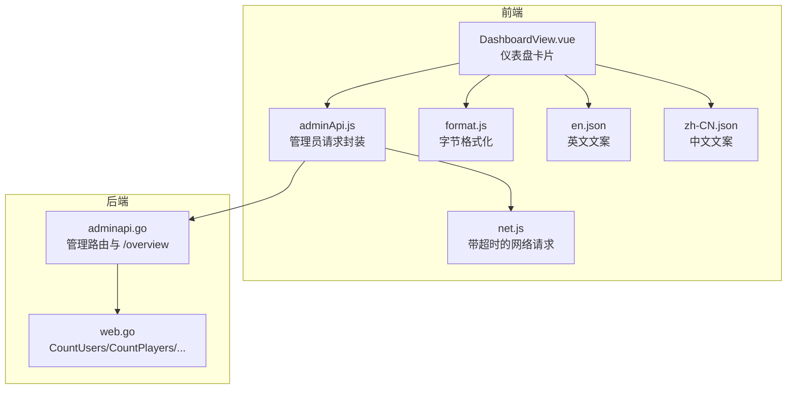
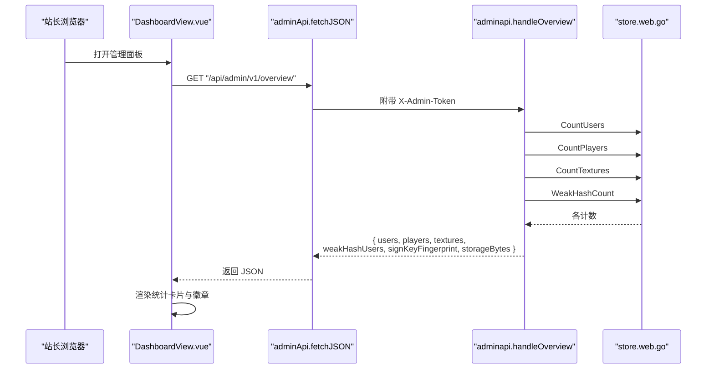
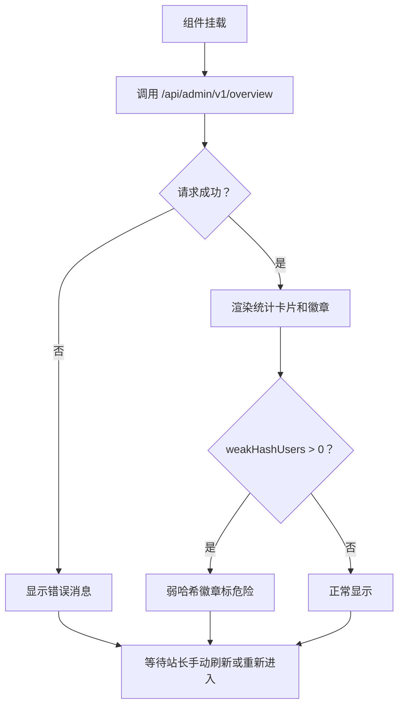
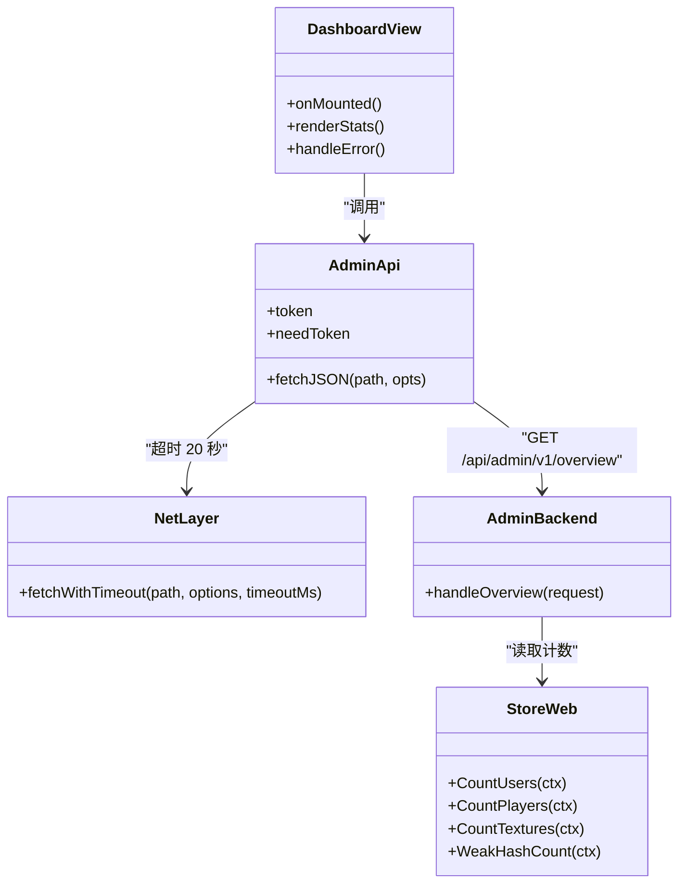

# 仪表盘

**本文引用的文件**
- [DashboardView.vue](https://github.com/YimingZhanshen/skin-nexus/blob/797ae1a/web/src/components/admin/DashboardView.vue)
- [adminApi.js](https://github.com/YimingZhanshen/skin-nexus/blob/797ae1a/web/src/adminApi.js)
- [net.js](https://github.com/YimingZhanshen/skin-nexus/blob/797ae1a/web/src/net.js)
- [format.js](https://github.com/YimingZhanshen/skin-nexus/blob/797ae1a/web/src/format.js)
- [en.json](https://github.com/YimingZhanshen/skin-nexus/blob/797ae1a/web/src/locales/en.json)
- [zh-CN.json](https://github.com/YimingZhanshen/skin-nexus/blob/797ae1a/web/src/locales/zh-CN.json)
- [adminapi.go](https://github.com/YimingZhanshen/skin-nexus/blob/797ae1a/server/internal/adminapi/adminapi.go)
- [diagnostics.go](https://github.com/YimingZhanshen/skin-nexus/blob/797ae1a/server/internal/adminapi/diagnostics.go)
- [web.go](https://github.com/YimingZhanshen/skin-nexus/blob/797ae1a/server/internal/store/web.go)

## 目录
1. [引言](#引言)
2. [项目结构](#项目结构)
3. [核心组件](#核心组件)
4. [架构总览](#架构总览)
5. [详细组件分析](#详细组件分析)
6. [依赖关系分析](#依赖关系分析)
7. [性能与刷新策略](#性能与刷新策略)
8. [故障排查指南](#故障排查指南)
9. [结论](#结论)

## 引言
本文面向站点站长，说明管理面板中的“仪表盘”视图（`DashboardView`）如何展示系统关键指标，以及这些指标对应的后端诊断接口。重点包括：

- 仪表盘当前实际展示的指标：用户数、在线玩家数、材质数量、存储空间、弱哈希用户数、签名密钥指纹。
- 每个指标对应的后端接口 `/api/admin/v1/overview` 的请求方式、返回字段、错误行为。
- 数据采集路径、缓存与降级策略。
- 站长如何使用这些指标判断系统是否异常。
- 需要避免的轮询和性能风险，以及推荐的网络超时与重试建议。

特别说明：
- “上传次数”“邮件队列长度”“Union 健康状态”“最近审计事件”“运行版本”等常见运维指标并不由 `DashboardView` 直接展示；它们分别位于其他页面或接口。本文会在相应位置给出对应接口指引，但不会把 DashboardView 描述成“全能监控页”。

**章节来源**
- [DashboardView.vue:1-71](https://github.com/YimingZhanshen/skin-nexus/blob/797ae1a/web/src/components/admin/DashboardView.vue#L1-L71)
- [adminapi.go:100-125](https://github.com/YimingZhanshen/skin-nexus/blob/797ae1a/server/internal/adminapi/adminapi.go#L100-L125)
- [adminapi.go:329-356](https://github.com/YimingZhanshen/skin-nexus/blob/797ae1a/server/internal/adminapi/adminapi.go#L329-L356)

## 项目结构
仪表盘相关代码分布在前端 Vue 组件、共享管理员请求工具、国际化文案，以及后端管理 API 和存储层。



**图表来源**
- [DashboardView.vue:1-71](https://github.com/YimingZhanshen/skin-nexus/blob/797ae1a/web/src/components/admin/DashboardView.vue#L1-L71)
- [adminApi.js:1-32](https://github.com/YimingZhanshen/skin-nexus/blob/797ae1a/web/src/adminApi.js#L1-L32)
- [adminapi.go:100-125](https://github.com/YimingZhanshen/skin-nexus/blob/797ae1a/server/internal/adminapi/adminapi.go#L100-L125)
- [adminapi.go:329-356](https://github.com/YimingZhanshen/skin-nexus/blob/797ae1a/server/internal/adminapi/adminapi.go#L329-L356)
- [web.go:180-186](https://github.com/YimingZhanshen/skin-nexus/blob/797ae1a/server/internal/store/web.go#L180-L186)
- [web.go:598-610](https://github.com/YimingZhanshen/skin-nexus/blob/797ae1a/server/internal/store/web.go#L598-L610)

**章节来源**
- [DashboardView.vue:1-71](https://github.com/YimingZhanshen/skin-nexus/blob/797ae1a/web/src/components/admin/DashboardView.vue#L1-L71)
- [adminApi.js:1-32](https://github.com/YimingZhanshen/skin-nexus/blob/797ae1a/web/src/adminApi.js#L1-L32)
- [adminapi.go:100-125](https://github.com/YimingZhanshen/skin-nexus/blob/797ae1a/server/internal/adminapi/adminapi.go#L100-L125)
- [web.go:180-186](https://github.com/YimingZhanshen/skin-nexus/blob/797ae1a/server/internal/store/web.go#L180-L186)
- [web.go:598-610](https://github.com/YimingZhanshen/skin-nexus/blob/797ae1a/server/internal/store/web.go#L598-L610)

## 核心组件
### 前端仪表盘组件 `DashboardView.vue`
`DashboardView` 是管理面板中的概览卡片组件，负责：

1. 在组件挂载时发起一次 GET 请求 `/api/admin/v1/overview`。
2. 成功后渲染四个统计卡片：
   - 用户数：可点击跳转到用户管理视图。
   - 在线玩家数：可点击跳转到玩家管理视图。
   - 材质数量：仅展示，不跳转。
   - 存储空间：使用 `formatBytes` 将字节转为可读单位。
3. 显示两个徽章：
   - 弱哈希用户数：当值大于 0 时以危险样式提示。
   - 签名密钥指纹：用于确认 Yggdrasil 签名身份。
4. 如果请求失败，在组件内设置 `error` 并显示错误消息。

该组件没有自动轮询逻辑，也没有内置重试机制。每次进入管理面板后，它只调用一次 `onMounted` 中的请求。

**章节来源**
- [DashboardView.vue:1-71](https://github.com/YimingZhanshen/skin-nexus/blob/797ae1a/web/src/components/admin/DashboardView.vue#L1-L71)

### 管理员请求封装 `adminApi.js`
`fetchJSON` 是所有管理页面的统一 JSON 请求入口：

- 自动携带 `X-Admin-Token`，前提是本地已保存管理员令牌。
- 底层调用 `fetchWithTimeout`，默认超时时间为 20 秒。
- 响应非成功状态时抛出错误，并保留 HTTP 状态码、结构化数据。
- 401 或 403 会触发 `needToken.value = true`，让外壳层显示令牌提示。
- 响应体解析失败时回退为空对象，避免后续 JSON 解析抛错。

**章节来源**
- [adminApi.js:1-32](https://github.com/YimingZhanshen/skin-nexus/blob/797ae1a/web/src/adminApi.js#L1-L32)

### 字节格式化工具 `format.js`
仪表盘用 `formatBytes(overview.storageBytes)` 将后端返回的字节数转换为人类可读的大小，例如 KB、MB、GB。这不会影响后端数据，只是前端展示层处理。

**章节来源**
- [DashboardView.vue:1-71](https://github.com/YimingZhanshen/skin-nexus/blob/797ae1a/web/src/components/admin/DashboardView.vue#L1-L71)

## 架构总览
仪表盘的数据流从浏览器开始，经过前端组件、管理员 API 封装、后端路由、存储层查询，最后回到前端渲染。



**图表来源**
- [DashboardView.vue:1-71](https://github.com/YimingZhanshen/skin-nexus/blob/797ae1a/web/src/components/admin/DashboardView.vue#L1-L71)
- [adminApi.js:1-32](https://github.com/YimingZhanshen/skin-nexus/blob/797ae1a/web/src/adminApi.js#L1-L32)
- [adminapi.go:100-125](https://github.com/YimingZhanshen/skin-nexus/blob/797ae1a/server/internal/adminapi/adminapi.go#L100-L125)
- [adminapi.go:329-356](https://github.com/YimingZhanshen/skin-nexus/blob/797ae1a/server/internal/adminapi/adminapi.go#L329-L356)
- [web.go:180-186](https://github.com/YimingZhanshen/skin-nexus/blob/797ae1a/server/internal/store/web.go#L180-L186)
- [web.go:598-610](https://github.com/YimingZhanshen/skin-nexus/blob/797ae1a/server/internal/store/web.go#L598-L610)

## 详细组件分析

### 后端概览接口 `/api/admin/v1/overview`
#### 基本信息
- 方法：GET
- 路径：`/api/admin/v1/overview`
- 认证：受管理面板认证保护，通常需要有效的管理员会话或 `X-Admin-Token`。
- 用途：为仪表盘提供站点级计数和基础安全信息。

#### 请求参数
- 无查询参数。
- 无请求体。
- 可选头部：`X-Admin-Token`，由 `adminApi.js` 自动附加。

#### 返回字段
| 字段名 | 类型 | 含义 | 数据来源 |
|---|---:|---|---|
| `users` | 整数 | 注册用户总数 | `Store.CountUsers` |
| `players` | 整数 | 在线玩家总数 | `Store.CountPlayers` |
| `textures` | 整数 | 材质记录总数 | `Store.CountTextures` |
| `weakHashUsers` | 整数 | 使用弱哈希算法的用户数 | `Store.WeakHashCount` |
| `signKeyFingerprint` | 字符串 | Yggdrasil 签名密钥指纹 | `Ygg.SignerFingerprint` |
| `storageBytes` | 数字或空值 | 材质目录存储字节数；若计算失败则为空 | 注入的 `StorageBytes` 函数 |

注意：
- `storageBytes` 可能为空值。实现中明确对存储字节计算失败进行降级，不会阻止其他计数返回。
- 所有计数查询出错时，后端忽略错误并继续返回结果；因此即使数据库部分查询失败，也可能得到部分为零或默认值的响应。

#### 错误行为
- 正常响应：HTTP 200 + JSON。
- 未授权或权限不足：401 或 403，由 `adminApi.js` 转为带 `status` 的错误，并触发令牌提示。
- 服务器内部错误：通常返回 500，由 `adminApi.js` 包装为普通错误。
- 网络失败或超时：由 `fetchWithTimeout` 和 `adminApi.js` 统一处理。

#### 典型响应示例
以下示例仅为字段结构示意，不代表真实业务数据：

```json
{
  "users": 120,
  "players": 35,
  "textures": 470,
  "weakHashUsers": 3,
  "signKeyFingerprint": "SHA256:xxxxxxxx",
  "storageBytes": 1048576
}
```

其中 `storageBytes` 也可能是 `null`，表示存储大小不可用。

**章节来源**
- [adminapi.go:100-125](https://github.com/YimingZhanshen/skin-nexus/blob/797ae1a/server/internal/adminapi/adminapi.go#L100-L125)
- [adminapi.go:329-356](https://github.com/YimingZhanshen/skin-nexus/blob/797ae1a/server/internal/adminapi/adminapi.go#L329-L356)
- [web.go:180-186](https://github.com/YimingZhanshen/skin-nexus/blob/797ae1a/server/internal/store/web.go#L180-L186)
- [web.go:598-610](https://github.com/YimingZhanshen/skin-nexus/blob/797ae1a/server/internal/store/web.go#L598-L610)
- [adminApi.js:1-32](https://github.com/YimingZhanshen/skin-nexus/blob/797ae1a/web/src/adminApi.js#L1-L32)

### 前端渲染逻辑
`DashboardView` 根据 `overview` 对象渲染内容：

- 如果 `overview` 存在，显示四张统计卡片。
- 如果 `overview.weakHashUsers > 0`，弱哈希徽章标记为危险状态。
- 如果请求抛出错误，显示 `error` 消息。
- 用户数和玩家数卡片通过自定义 `go` 事件导航到对应管理视图。
- 材质卡不可点击跳转，因为源码注释明确指出材质没有独立管理视图。



**图表来源**
- [DashboardView.vue:1-71](https://github.com/YimingZhanshen/skin-nexus/blob/797ae1a/web/src/components/admin/DashboardView.vue#L1-L71)

**章节来源**
- [DashboardView.vue:1-71](https://github.com/YimingZhanshen/skin-nexus/blob/797ae1a/web/src/components/admin/DashboardView.vue#L1-L71)

### 与其他仪表盘相关指标的关系
虽然 `DashboardView` 只展示上述六个字段，但站长在管理面板中还可能关心以下指标：

| 指标 | 是否在 DashboardView 展示 | 对应接口或页面 | 说明 |
|---|---:|---|---|
| 在线玩家数 | 是 | `/api/admin/v1/overview` → `players` | 由 `CountPlayers` 提供 |
| 上传次数 | 否 | 用户资料页或纹理列表页 | 通常由 `api.me()` 或纹理分页接口提供 |
| 存储空间 | 是 | `/api/admin/v1/overview` → `storageBytes` | 可能为 `null` |
| 邮件队列长度 | 否 | 任务管理页或诊断接口 | 队列相关能力在任务模块和诊断模块中 |
| Union 健康状态 | 否 | Union 管理页或诊断页 | 由 Union 相关页面和诊断检查承担 |
| 最近审计事件 | 否 | `/api/admin/v1/audit` | 审计日志分页接口 |
| 运行版本 | 否 | `/api/admin/v1/status` | 构建版本、Go 版本、数据库信息等 |

**章节来源**
- [adminapi.go:100-125](https://github.com/YimingZhanshen/skin-nexus/blob/797ae1a/server/internal/adminapi/adminapi.go#L100-L125)
- [adminapi.go:460-486](https://github.com/YimingZhanshen/skin-nexus/blob/797ae1a/server/internal/adminapi/adminapi.go#L460-L486)
- [adminapi.go:356-410](https://github.com/YimingZhanshen/skin-nexus/blob/797ae1a/server/internal/adminapi/adminapi.go#L356-L410)

## 依赖关系分析



**图表来源**
- [DashboardView.vue:1-71](https://github.com/YimingZhanshen/skin-nexus/blob/797ae1a/web/src/components/admin/DashboardView.vue#L1-L71)
- [adminApi.js:1-32](https://github.com/YimingZhanshen/skin-nexus/blob/797ae1a/web/src/adminApi.js#L1-L32)
- [adminapi.go:100-125](https://github.com/YimingZhanshen/skin-nexus/blob/797ae1a/server/internal/adminapi/adminapi.go#L100-L125)
- [adminapi.go:329-356](https://github.com/YimingZhanshen/skin-nexus/blob/797ae1a/server/internal/adminapi/adminapi.go#L329-L356)
- [web.go:180-186](https://github.com/YimingZhanshen/skin-nexus/blob/797ae1a/server/internal/store/web.go#L180-L186)
- [web.go:598-610](https://github.com/YimingZhanshen/skin-nexus/blob/797ae1a/server/internal/store/web.go#L598-L610)

**章节来源**
- [DashboardView.vue:1-71](https://github.com/YimingZhanshen/skin-nexus/blob/797ae1a/web/src/components/admin/DashboardView.vue#L1-L71)
- [adminApi.js:1-32](https://github.com/YimingZhanshen/skin-nexus/blob/797ae1a/web/src/adminApi.js#L1-L32)
- [adminapi.go:329-356](https://github.com/YimingZhanshen/skin-nexus/blob/797ae1a/server/internal/adminapi/adminapi.go#L329-L356)
- [web.go:180-186](https://github.com/YimingZhanshen/skin-nexus/blob/797ae1a/server/internal/store/web.go#L180-L186)
- [web.go:598-610](https://github.com/YimingZhanshen/skin-nexus/blob/797ae1a/server/internal/store/web.go#L598-L610)

## 性能与刷新策略

### 当前行为
- 前端只在组件挂载时发起一次请求。
- 没有定时器轮询。
- 没有自动重试。
- 请求超时默认为 20 秒。
- 错误被捕获并显示，但不会自动恢复。

这意味着 DashboardView 本身已经避免了频繁轮询带来的资源浪费，但也意味着数据不是实时刷新。

### 推荐刷新策略
- **首次加载**：进入管理面板时拉取一次。
- **手动刷新**：站长主动切换页面或重新进入概览区域。
- **后台低频刷新**：如果需要近似实时，可使用较长间隔（例如 30 秒以上），并在页面失焦时停止刷新。
- **避免短间隔轮询**：不要使用 1~5 秒级轮询，否则会增加数据库连接压力和管理面板请求量。
- **合并请求**：如果同时需要多个指标，应复用同一个 `/api/admin/v1/overview` 响应，而不是再拆出多个接口。
- **取消旧请求**：在快速切换页面时，应丢弃上一个未完成请求的结果，避免旧数据覆盖新数据。

### 错误重试与超时
- 当前实现没有自动重试。
- 20 秒超时适合管理面板操作，但不适合高频轮询场景。
- 建议在应用层实现指数退避重试，限制最大重试次数，并把失败状态写入 UI。
- 对于网络失败，不应静默显示零值，而应明确提示“数据获取失败”，以免站长误判系统为空。

### 缓存行为
- 前端组件没有全局缓存。
- 后端 `/api/admin/v1/overview` 不是公共缓存端点，也不是 `/status` 快照。
- 存储字节计算失败会降级为空值，但不会阻塞其他计数。
- 数据库计数查询失败会被忽略，可能导致某个字段为零或默认值。

**章节来源**
- [DashboardView.vue:1-71](https://github.com/YimingZhanshen/skin-nexus/blob/797ae1a/web/src/components/admin/DashboardView.vue#L1-L71)
- [adminApi.js:1-32](https://github.com/YimingZhanshen/skin-nexus/blob/797ae1a/web/src/adminApi.js#L1-L32)
- [adminapi.go:329-356](https://github.com/YimingZhanshen/skin-nexus/blob/797ae1a/server/internal/adminapi/adminapi.go#L329-L356)

## 故障排查指南

### 常见问题与判断方法

| 现象 | 可能原因 | 排查步骤 | 站长决策 |
|---|---|---|---|
| 仪表盘空白或报错 | 管理员会话失效、令牌无效、401/403 | 检查是否登录管理面板；查看是否需要输入 `X-Admin-Token` | 重新登录或配置令牌 |
| 网络请求一直转圈 | 后端无响应或超过 20 秒 | 检查后端服务、防火墙、反向代理超时 | 检查服务进程和代理配置 |
| `storageBytes` 为空 | 存储目录扫描失败或未注入 | 查看后端日志中存储字节计算错误 | 检查材质目录路径和权限 |
| 所有计数都为零 | 数据库查询失败被忽略 | 检查数据库连接和表是否存在 | 修复数据库或迁移 |
| `weakHashUsers` 大于 0 | 存在使用旧哈希算法的用户 | 检查密码算法迁移进度 | 安排迁移或提醒受影响用户 |
| `signKeyFingerprint` 不符合预期 | Yggdrasil 签名密钥变更 | 对比部署前指纹 | 确认是否为计划内密钥轮换 |
| 在线玩家数为 0 | 确实没有在线玩家 | 结合玩家管理页和活动日志判断 | 区分“无人在线”和“数据异常” |

### 与仪表盘相关的额外诊断接口
- `/api/admin/v1/status`：运行状态，包含版本、Go 版本、数据库版本、构建信息、主机名、容器类型等。
- `/api/admin/v1/diagnostics`：部署自检，检查站点地址、迁移、邮件、验证门控、预览渲染、Web 静态资源、插件签名密钥环等。
- `/api/admin/v1/audit`：审计日志，支持按关键词、动作、页码查询。

站长应把 DashboardView 视为“概览入口”，而不是完整监控系统。出现异常时，再跳转到状态页、诊断页或审计页。

**章节来源**
- [adminapi.go:100-125](https://github.com/YimingZhanshen/skin-nexus/blob/797ae1a/server/internal/adminapi/adminapi.go#L100-L125)
- [adminapi.go:356-410](https://github.com/YimingZhanshen/skin-nexus/blob/797ae1a/server/internal/adminapi/adminapi.go#L356-L410)
- [diagnostics.go:1-200](https://github.com/YimingZhanshen/skin-nexus/blob/797ae1a/server/internal/adminapi/diagnostics.go#L1-L200)
- [adminapi.go:460-486](https://github.com/YimingZhanshen/skin-nexus/blob/797ae1a/server/internal/adminapi/adminapi.go#L460-L486)

## 结论
`DashboardView` 的核心职责是提供简洁的管理面板概览：用户数、在线玩家数、材质数量、存储空间、弱哈希用户数和签名密钥指纹。它通过 `/api/admin/v1/overview` 获取数据，使用 20 秒超时，没有自动轮询和自动重试。

站长应这样理解仪表盘：
- 它适合快速确认站点是否有用户、玩家和材质。
- 它适合检查弱哈希风险和签名密钥指纹。
- 它不适合当作实时监控系统。
- 需要更详细的运行时信息时，应使用 `/api/admin/v1/status`。
- 需要部署自检时，应使用 `/api/admin/v1/diagnostics`。
- 需要审计事件时，应使用 `/api/admin/v1/audit`。

为避免性能问题，不建议为仪表盘添加高频轮询；如需接近实时，请使用长间隔、去抖、取消旧请求、有限重试和清晰的状态提示。
