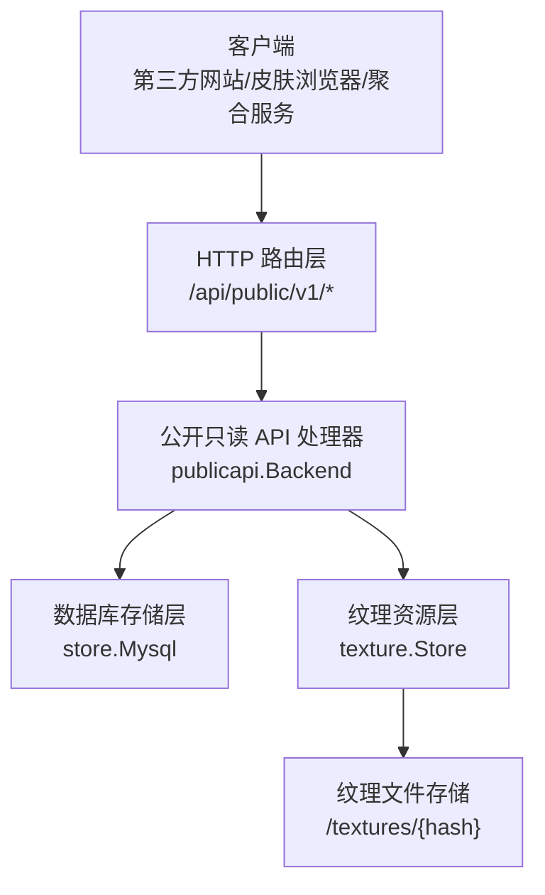
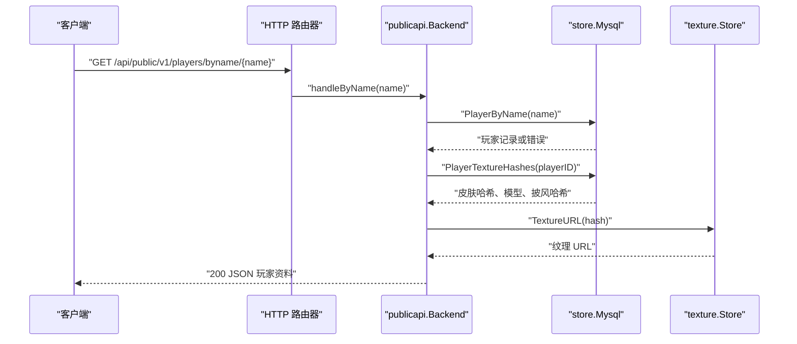
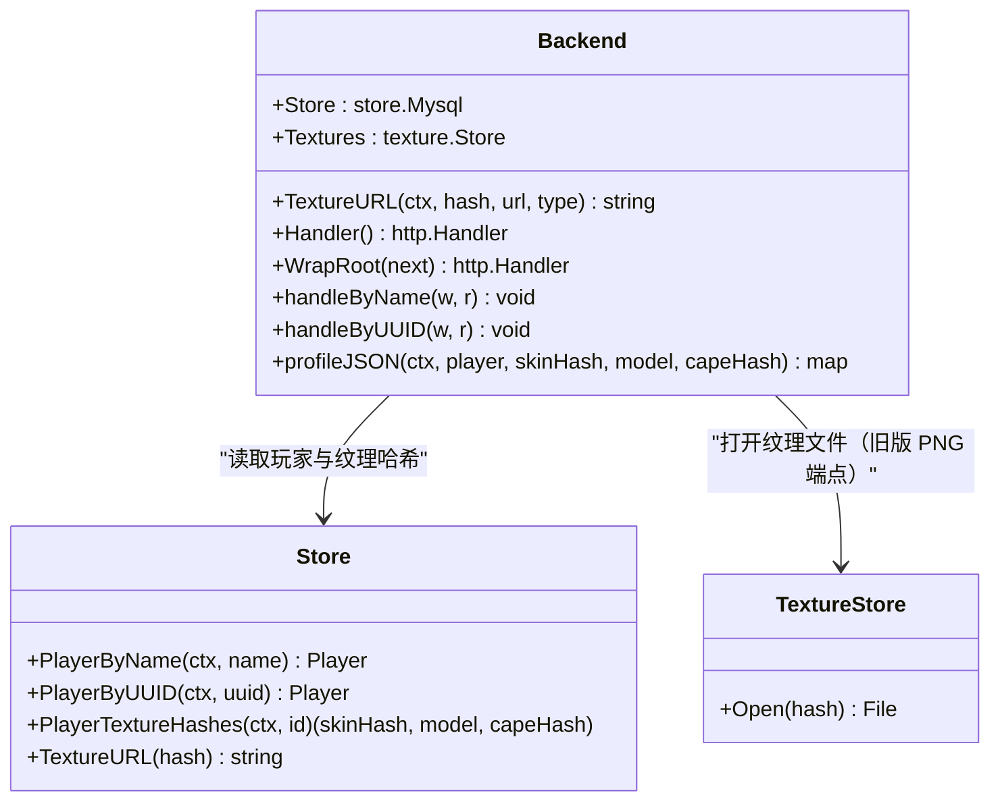

# 公开只读 API（/api/public/v1）

**本文引用的文件**
- [server/cmd/skin-nexus/main.go](https://github.com/YimingZhanshen/skin-nexus/blob/797ae1a/server/cmd/skin-nexus/main.go)
- [server/internal/publicapi/publicapi.go](https://github.com/YimingZhanshen/skin-nexus/blob/797ae1a/server/internal/publicapi/publicapi.go)
- [server/internal/webapi/webapi.go](https://github.com/YimingZhanshen/skin-nexus/blob/797ae1a/server/internal/webapi/webapi.go)
- [server/internal/webapi/skinlib.go](https://github.com/YimingZhanshen/skin-nexus/blob/797ae1a/server/internal/webapi/skinlib.go)
- [server/internal/store/skinlib.go](https://github.com/YimingZhanshen/skin-nexus/blob/797ae1a/server/internal/store/skinlib.go)
- [server/internal/ratelimit/limiter.go](https://github.com/YimingZhanshen/skin-nexus/blob/797ae1a/server/internal/ratelimit/limiter.go)

## 目录
1. [简介](#简介)
2. [项目结构与入口](#项目结构与入口)
3. [接口总览](#接口总览)
4. [通用行为](#通用行为)
5. [端点详情](#端点详情)
6. [架构与数据流](#架构与数据流)
7. [依赖关系分析](#依赖关系分析)
8. [性能与缓存](#性能与缓存)
9. [常见问题](#常见问题)
10. [结论](#结论)

## 简介
`/api/public/v1/*` 是 SkinNexus 的公开只读 API，面向第三方网站、皮肤浏览器和聚合服务。调用方无需登录或携带令牌即可访问，用于：

- 通过玩家用户名或 UUID 获取其公开皮肤信息；
- 查询站点暴露的基础资源标识（如纹理哈希、模型类型）；
- 配合 `/textures/{hash}` 静态资源端点读取实际纹理文件。

该接口组不执行写入操作；写操作位于需要会话认证的 `/api/v1/*` 下。

## 项目结构与入口
公开只读 API 由 `publicapi.Backend` 提供处理器，并通过 HTTP 多路复用器挂载到 `GET /api/public/v1/players/byname/{name}` 和 `GET /api/public/v1/players/byuuid/{uuid}`。



**图表来源**
- [server/internal/publicapi/publicapi.go:45-47](https://github.com/YimingZhanshen/skin-nexus/blob/797ae1a/server/internal/publicapi/publicapi.go#L45-L47)
- [server/cmd/skin-nexus/main.go:928](https://github.com/YimingZhanshen/skin-nexus/blob/797ae1a/server/cmd/skin-nexus/main.go#L928)

**章节来源**
- [server/internal/publicapi/publicapi.go:45-47](https://github.com/YimingZhanshen/skin-nexus/blob/797ae1a/server/internal/publicapi/publicapi.go#L45-L47)
- [server/cmd/skin-nexus/main.go:6-12](https://github.com/YimingZhanshen/skin-nexus/blob/797ae1a/server/cmd/skin-nexus/main.go#L6-L12)

## 接口总览

| 方法 | URL 模式 | 用途 | 认证要求 |
|---|---|---|---|
| GET | `/api/public/v1/players/byname/{name}` | 按用户名查找玩家公开皮肤资料 | 无 |
| GET | `/api/public/v1/players/byuuid/{uuid}` | 按 UUID 查找玩家公开皮肤资料 | 无 |

注意：

- 本仓库中未定义“皮肤列表”“按标签筛选”“分页拉取”等 `/api/public/v1` 下的皮肤库查询端点。
- 皮肤库列表 API 位于受会话控制的 `/api/v1/skinlib`，不是 `/api/public/v1/*`。
- 如果第三方系统需要浏览皮肤库，应使用 `/api/v1/skinlib` 并在服务端以管理员身份发起请求，或通过服务器渲染页面间接消费；不能假设公开只读 API 提供完整皮肤库检索能力。

**章节来源**
- [server/internal/publicapi/publicapi.go:45-47](https://github.com/YimingZhanshen/skin-nexus/blob/797ae1a/server/internal/publicapi/publicapi.go#L45-L47)
- [server/internal/webapi/webapi.go:344](https://github.com/YimingZhanshen/skin-nexus/blob/797ae1a/server/internal/webapi/webapi.go#L344)
- [server/internal/webapi/skinlib.go:34-37](https://github.com/YimingZhanshen/skin-nexus/blob/797ae1a/server/internal/webapi/skinlib.go#L34-L37)

## 通用行为

### 跨域支持
所有公开只读 API 响应均设置：

- `Access-Control-Allow-Origin: *`
- `Access-Control-Allow-Methods: GET, OPTIONS`

浏览器对跨域请求先发送 `OPTIONS`，服务器返回 `204 No Content`，随后再发送真实 GET 请求。

**章节来源**
- [server/internal/publicapi/publicapi.go:110-120](https://github.com/YimingZhanshen/skin-nexus/blob/797ae1a/server/internal/publicapi/publicapi.go#L110-L120)

### 成功响应格式
成功时返回 `Content-Type: application/json`，状态码为 `200 OK`。

### 错误格式
公开只读 API 的失败路径主要返回 HTTP 状态码，而不是统一的 JSON 错误体：

- 找不到玩家时返回 `404 Not Found`；
- 底层数据读取失败时可能直接返回 `404` 或不返回结构化错误体；
- 只有显式 `writeJSON(w, status, ...)` 的路径才会输出 JSON。

因此，调用方应以状态码为主要判断依据，不要假设每个错误都包含 JSON 字段。

**章节来源**
- [server/internal/publicapi/publicapi.go:148-176](https://github.com/YimingZhanshen/skin-nexus/blob/797ae1a/server/internal/publicapi/publicapi.go#L148-L176)

### 速率限制
代码中创建的滑动窗口速率限制器主要用于 Yggdrasil 和会话认证相关组件，并注入到 `yggSvc.Limiter` 与 `backend.Limiter`。公开只读 API 处理器本身没有独立的 per-endpoint 限流逻辑；是否受限取决于部署配置以及上层反向代理策略。

**章节来源**
- [server/cmd/skin-nexus/main.go:648-650](https://github.com/YimingZhanshen/skin-nexus/blob/797ae1a/server/cmd/skin-nexus/main.go#L648-L650)
- [server/internal/ratelimit/limiter.go:1-25](https://github.com/YimingZhanshen/skin-nexus/blob/797ae1a/server/internal/ratelimit/limiter.go#L1-L25)

## 端点详情

### 按用户名查询玩家资料

- **URL**：`GET /api/public/v1/players/byname/{name}`
- **路径参数**：
  - `name`：不区分大小写的用户名。
- **查询参数**：无。
- **成功响应体**：

| 字段 | 类型 | 含义 |
|---|---|---|
| `id` | 字符串 | 玩家 UUID |
| `name` | 字符串 | 玩家名称 |
| `skins` | 对象 | 皮肤映射，键为模型前缀，值为纹理 URL |
| `cape` | 字符串或省略 | 披风纹理 URL（仅存在时返回） |

`skins` 的键：

- 普通模型时为 `default`；
- Slim 模型时为 `slim`；
- 若玩家没有皮肤，则 `skins` 为空对象。

- **状态码**：
  - `200 OK`：找到玩家；
  - `404 Not Found`：未找到玩家或无法解析出有效皮肤信息。

- **示例请求**：

```text
GET https://skin.example.com/api/public/v1/players/byname/Steve
```

- **示例响应**：

```json
{
  "id": "xxxxxxxx-xxxx-xxxx-xxxx-xxxxxxxxxxxx",
  "name": "Steve",
  "skins": {
    "default": "https://skin.example.com/textures/abcdef"
  },
  "cape": "https://skin.example.com/textures/123456"
}
```

**章节来源**
- [server/internal/publicapi/publicapi.go:45](https://github.com/YimingZhanshen/skin-nexus/blob/797ae1a/server/internal/publicapi/publicapi.go#L45)
- [server/internal/publicapi/publicapi.go:148-176](https://github.com/YimingZhanshen/skin-nexus/blob/797ae1a/server/internal/publicapi/publicapi.go#L148-L176)
- [server/internal/publicapi/publicapi.go:178-200](https://github.com/YimingZhanshen/skin-nexus/blob/797ae1a/server/internal/publicapi/publicapi.go#L178-L200)

### 按 UUID 查询玩家资料

- **URL**：`GET /api/public/v1/players/byuuid/{uuid}`
- **路径参数**：
  - `uuid`：小写 UUID。
- **查询参数**：无。
- **成功响应体**：与按用户名查询相同，包含 `id`、`name`、`skins`，可选 `cape`。
- **状态码**：
  - `200 OK`：成功；
  - `404 Not Found`：UUID 不存在或纹理信息不可用。
- **示例请求**：

```text
GET https://skin.example.com/api/public/v1/players/byuuid/xxxxxxxx-xxxx-xxxx-xxxx-xxxxxxxxxxxx
```

**章节来源**
- [server/internal/publicapi/publicapi.go:46](https://github.com/YimingZhanshen/skin-nexus/blob/797ae1a/server/internal/publicapi/publicapi.go#L46)
- [server/internal/publicapi/publicapi.go:178-199](https://github.com/YimingZhanshen/skin-nexus/blob/797ae1a/server/internal/publicapi/publicapi.go#L178-L199)

### 响应体 JSON Schema

#### 玩家资料对象

```jsonc
{
  "$schema": "http://json-schema.org/draft-07/schema#",
  "type": "object",
  "required": ["id", "name", "skins"],
  "properties": {
    "id": {
      "type": "string"
    },
    "name": {
      "type": "string"
    },
    "skins": {
      "type": "object",
      "additionalProperties": {
        "type": "string"
      }
    },
    "cape": {
      "type": "string"
    }
  }
}
```

约束说明：

- `id` 为玩家 UUID；
- `name` 为玩家显示名；
- `skins.default` 或 `skins.slim` 至少有一个存在时才有意义；
- `cape` 为可选字段；
- `skins` 中的值是纹理 URL，通常形如 `/textures/{hash}`。

**章节来源**
- [server/internal/publicapi/publicapi.go:178-200](https://github.com/YimingZhanshen/skin-nexus/blob/797ae1a/server/internal/publicapi/publicapi.go#L178-L200)

## 架构与数据流



**图表来源**
- [server/internal/publicapi/publicapi.go:148-176](https://github.com/YimingZhanshen/skin-nexus/blob/797ae1a/server/internal/publicapi/publicapi.go#L148-L176)
- [server/internal/publicapi/publicapi.go:178-200](https://github.com/YimingZhanshen/skin-nexus/blob/797ae1a/server/internal/publicapi/publicapi.go#L178-L200)
- [server/cmd/skin-nexus/main.go:928](https://github.com/YimingZhanshen/skin-nexus/blob/797ae1a/server/cmd/skin-nexus/main.go#L928)

## 依赖关系分析



**图表来源**
- [server/internal/publicapi/publicapi.go:24-44](https://github.com/YimingZhanshen/skin-nexus/blob/797ae1a/server/internal/publicapi/publicapi.go#L24-L44)
- [server/internal/publicapi/publicapi.go:148-200](https://github.com/YimingZhanshen/skin-nexus/blob/797ae1a/server/internal/publicapi/publicapi.go#L148-L200)
- [server/internal/publicapi/publicapi.go:227-280](https://github.com/YimingZhanshen/skin-nexus/blob/797ae1a/server/internal/publicapi/publicapi.go#L227-L280)

## 性能与缓存

### 缓存行为

| 内容 | 行为 |
|---|---|
| 公开只读 API 响应头 | 处理器未显式设置 `Cache-Control`、`ETag`、`Last-Modified` 等头部；默认行为取决于 Go HTTP 服务器与上游代理。 |
| 纹理静态资源 | `/textures/{hash}` 是独立端点，不属于 `/api/public/v1`；但它是公开只读 API 返回值的下游资源。 |
| 旧版 PNG 端点 | `/skin/{player}.png` 和 `/cape/{player}.png` 明确设置 `Cache-Control: public, max-age=3600`，这是旧版兼容端点，不是 `/api/public/v1`。 |

因此，不要把旧版 PNG 端点的缓存语义直接推广到 `/api/public/v1/players/*`。

**章节来源**
- [server/internal/publicapi/publicapi.go:110-120](https://github.com/YimingZhanshen/skin-nexus/blob/797ae1a/server/internal/publicapi/publicapi.go#L110-L120)
- [server/internal/publicapi/publicapi.go:227-280](https://github.com/YimingZhanshen/skin-nexus/blob/797ae1a/server/internal/publicapi/publicapi.go#L227-L280)
- [server/cmd/skin-nexus/main.go:928](https://github.com/YimingZhanshen/skin-nexus/blob/797ae1a/server/cmd/skin-nexus/main.go#L928)

### 一致性保证

- 玩家查找基于 `store.PlayerByName` 与 `store.PlayerByUUID`；
- 纹理哈希通过 `store.PlayerTextureHashes` 获取；
- 若玩家不存在或纹理哈希不可用，公开只读 API 返回 `404`；
- 纹理 URL 由 `store.TextureURL` 生成，插件可通过 `TextureURL` 钩子在响应时重写 URL；
- 公开只读 API 本身不会因缺少插件而失败，而是回退到默认 URL。

这意味着：**公开只读 API 反映的是当前数据库中已解析出的玩家纹理信息**。如果纹理刚上传、索引尚未完成或玩家被删除，调用方可能看到空结果或 `404`。

**章节来源**
- [server/internal/publicapi/publicapi.go:122-146](https://github.com/YimingZhanshen/skin-nexus/blob/797ae1a/server/internal/publicapi/publicapi.go#L122-L146)
- [server/internal/publicapi/publicapi.go:148-200](https://github.com/YimingZhanshen/skin-nexus/blob/797ae1a/server/internal/publicapi/publicapi.go#L148-L200)

### 跨域允许范围
公开只读 API 对所有来源开放 CORS，允许任意域名发起 `GET` 和 `OPTIONS` 请求。这对第三方网站集成非常友好，但也意味着不应把敏感用户数据放在该接口中——当前接口只返回公开皮肤信息。

**章节来源**
- [server/internal/publicapi/publicapi.go:110-120](https://github.com/YimingZhanshen/skin-nexus/blob/797ae1a/server/internal/publicapi/publicapi.go#L110-L120)

### 代理缓存建议
由于服务器未在公开只读 API 上强制设置强缓存头，推荐在反向代理层根据业务需求补充缓存策略：

- 对玩家资料类查询可设置较短的 TTL，例如几秒到几分钟；
- 对高频聚合场景可使用单飞（single-flight）或去重缓存；
- 对下游纹理资源 `/textures/{hash}` 可启用更长的 immutable 缓存；
- 不要在代理层缓存带敏感路径的请求。

**章节来源**
- [server/internal/publicapi/publicapi.go:148-200](https://github.com/YimingZhanshen/skin-nexus/blob/797ae1a/server/internal/publicapi/publicapi.go#L148-L200)
- [server/cmd/skin-nexus/main.go:928](https://github.com/YimingZhanshen/skin-nexus/blob/797ae1a/server/cmd/skin-nexus/main.go#L928)

## 常见问题

### 1. 如何获取皮肤列表？
当前 `/api/public/v1/*` 不提供皮肤列表端点。若需要遍历皮肤库，应使用 `/api/v1/skinlib`，该端点支持：

| 参数 | 类型 | 含义 |
|---|---|---|
| `filter` | 字符串 | `skin`、`cape`、`steve`、`alex` |
| `keyword` | 字符串 | 按描述关键词搜索 |
| `uploader` | 整数 | 按上传者过滤 |
| `sort` | 字符串 | `time` 或 `likes` |
| `page` | 整数 | 从 1 开始的页码 |

默认每页 20 条，最大 50 条。匿名访问只看到公开纹理。

**章节来源**
- [server/internal/webapi/skinlib.go:34-88](https://github.com/YimingZhanshen/skin-nexus/blob/797ae1a/server/internal/webapi/skinlib.go#L34-L88)
- [server/internal/store/skinlib.go:23-50](https://github.com/YimingZhanshen/skin-nexus/blob/797ae1a/server/internal/store/skinlib.go#L23-L50)
- [server/internal/store/skinlib.go:126-198](https://github.com/YimingZhanshen/skin-nexus/blob/797ae1a/server/internal/store/skinlib.go#L126-L198)

### 2. 如何按标签筛选？
公开只读 API 不支持“标签”字段。皮肤库列表支持 `filter`、`keyword`、`uploader`、`sort`，但不存在名为“标签”的参数。`filter` 控制类型和模型，`keyword` 做描述模糊匹配。

**章节来源**
- [server/internal/webapi/skinlib.go:34-88](https://github.com/YimingZhanshen/skin-nexus/blob/797ae1a/server/internal/webapi/skinlib.go#L34-L88)
- [server/internal/store/skinlib.go:23-50](https://github.com/YimingZhanshen/skin-nexus/blob/797ae1a/server/internal/store/skinlib.go#L23-L50)

### 3. 空结果集格式是什么？
公开只读 API 的玩家查询不是分页列表，因此不存在“空数组”概念：

- 找到玩家但无皮肤：返回 `skins: {}`；
- 未找到玩家：返回 `404`，不一定返回 JSON。

对于 `/api/v1/skinlib`，空结果集格式为：

```json
{
  "items": [],
  "total": 0,
  "page": 1,
  "perPage": 20
}
```

**章节来源**
- [server/internal/publicapi/publicapi.go:148-176](https://github.com/YimingZhanshen/skin-nexus/blob/797ae1a/server/internal/publicapi/publicapi.go#L148-L176)
- [server/internal/webapi/skinlib.go:66-88](https://github.com/YimingZhanshen/skin-nexus/blob/797ae1a/server/internal/webapi/skinlib.go#L66-L88)

### 4. `/api/public/v1/players/byuuid/{uuid}` 与 `/textures/{hash}` 的区别？
- `/api/public/v1/players/byuuid/{uuid}` 返回 JSON 元数据，包括玩家 ID、名称、皮肤模型前缀和纹理 URL；
- `/textures/{hash}` 返回二进制纹理文件（通常为 `image/png`），是公开只读 API 返回值中 URL 指向的实际资源；
- 二者不是同一资源：前者是元数据，后者是内容。

**章节来源**
- [server/internal/publicapi/publicapi.go:178-200](https://github.com/YimingZhanshen/skin-nexus/blob/797ae1a/server/internal/publicapi/publicapi.go#L178-L200)
- [server/cmd/skin-nexus/main.go:928](https://github.com/YimingZhanshen/skin-nexus/blob/797ae1a/server/cmd/skin-nexus/main.go#L928)

### 5. 404 对应已删除纹理吗？
对 `/api/public/v1/players/byname/{name}` 和 `/api/public/v1/players/byuuid/{uuid}` 而言，`404` 表示：

- 玩家不存在；
- 或玩家纹理哈希不可用；
- 或后端读取出现“未找到”分支。

它不等同于“纹理文件丢失”。纹理文件缺失属于纹理存储层异常；公开只读 API 主要表达“查不到可用玩家纹理信息”，而不是逐条校验每个纹理文件是否存在。

**章节来源**
- [server/internal/publicapi/publicapi.go:148-176](https://github.com/YimingZhanshen/skin-nexus/blob/797ae1a/server/internal/publicapi/publicapi.go#L148-L176)
- [server/internal/publicapi/publicapi.go:227-280](https://github.com/YimingZhanshen/skin-nexus/blob/797ae1a/server/internal/publicapi/publicapi.go#L227-L280)

### 6. 是否需要认证？
不需要。公开只读 API 设计为第三方网站、皮肤浏览器和聚合服务可直接调用。敏感写操作必须走 `/api/v1/*` 并携带会话认证。

**章节来源**
- [server/internal/publicapi/publicapi.go:1-13](https://github.com/YimingZhanshen/skin-nexus/blob/797ae1a/server/internal/publicapi/publicapi.go#L1-L13)
- [server/cmd/skin-nexus/main.go:6-12](https://github.com/YimingZhanshen/skin-nexus/blob/797ae1a/server/cmd/skin-nexus/main.go#L6-L12)

## 结论
`/api/public/v1/*` 是一个最小化、跨域开放的只读表面，核心能力是按用户名或 UUID 获取玩家的公开皮肤元数据。它不适合用作皮肤库浏览接口；皮肤库浏览应使用 `/api/v1/skinlib`。调用方应以状态码为主判断依据，谨慎处理 404，并结合反向代理实现合理的缓存与速率限制策略。纹理内容则通过公开只读 API 返回的 `/textures/{hash}` URL 获取。
