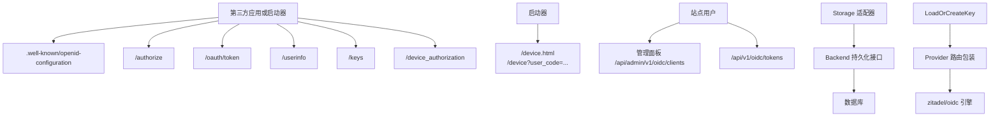
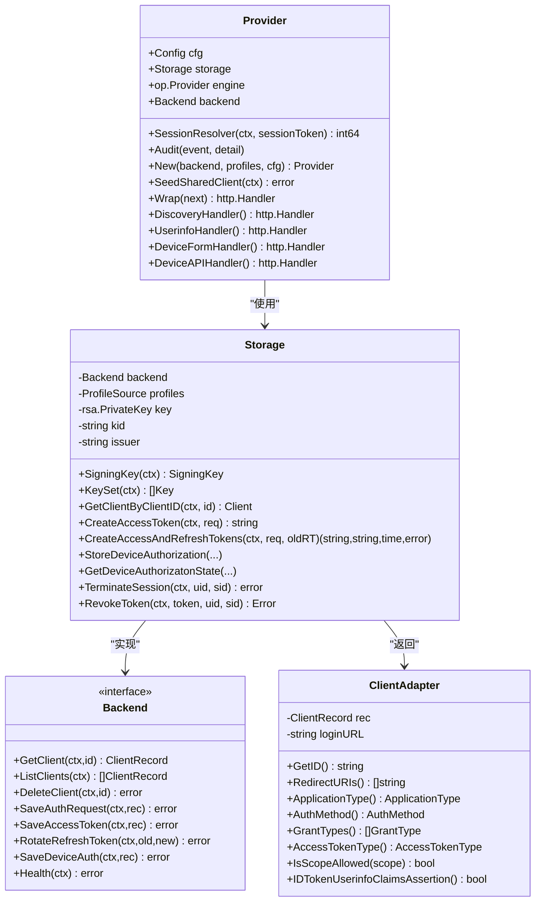
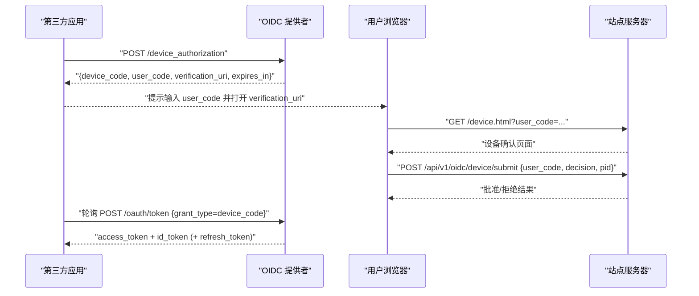
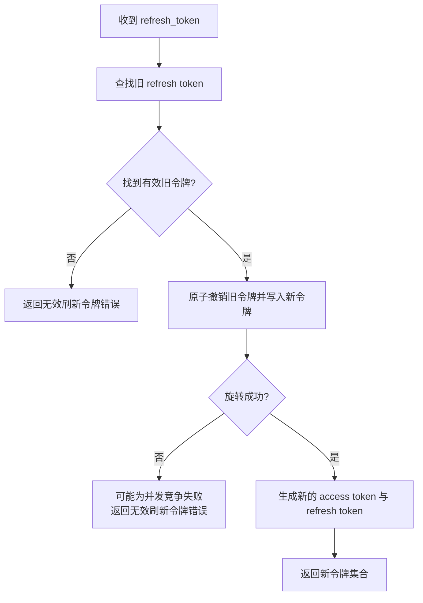
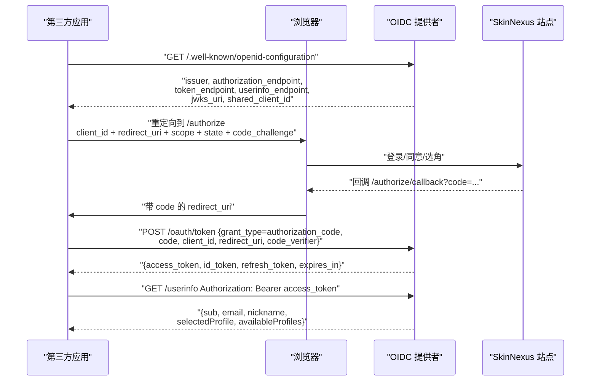
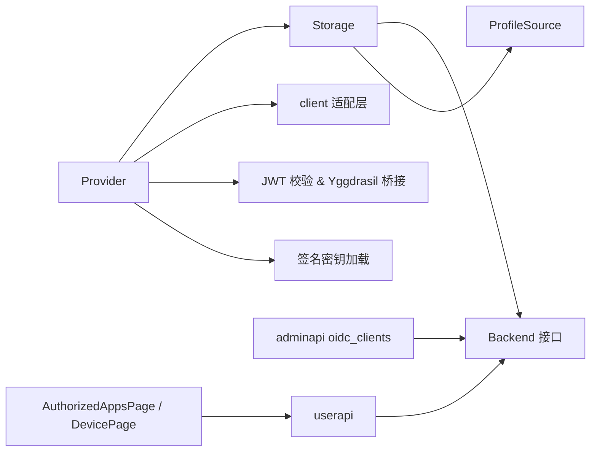

# 内置 OIDC 提供者

**本文引用的文件**
- [provider.go](https://github.com/YimingZhanshen/skin-nexus/blob/797ae1a/server/internal/oidc/provider.go)
- [storage.go](https://github.com/YimingZhanshen/skin-nexus/blob/797ae1a/server/internal/oidc/storage.go)
- [client.go](https://github.com/YimingZhanshen/skin-nexus/blob/797ae1a/server/internal/oidc/client.go)
- [jwt.go](https://github.com/YimingZhanshen/skin-nexus/blob/797ae1a/server/internal/oidc/jwt.go)
- [keyfile.go](https://github.com/YimingZhanshen/skin-nexus/blob/797ae1a/server/internal/oidc/keyfile.go)
- [backend.go](https://github.com/YimingZhanshen/skin-nexus/blob/797ae1a/server/internal/oidc/backend.go)
- [userapi.go](https://github.com/YimingZhanshen/skin-nexus/blob/797ae1a/server/internal/oidc/userapi.go)
- [oidc_clients.go](https://github.com/YimingZhanshen/skin-nexus/blob/797ae1a/server/internal/adminapi/oidc_clients.go)
- [AuthorizedAppsPage.vue](https://github.com/YimingZhanshen/skin-nexus/blob/797ae1a/web/src/pages/AuthorizedAppsPage.vue)
- [DevicePage.vue](https://github.com/YimingZhanshen/skin-nexus/blob/797ae1a/web/src/pages/DevicePage.vue)
- [api.js](https://github.com/YimingZhanshen/skin-nexus/blob/797ae1a/web/src/api.js)
- [compat-matrix.md](https://github.com/YimingZhanshen/skin-nexus/blob/797ae1a/docs/compat-matrix.md)
- [README.md](https://github.com/YimingZhanshen/skin-nexus/blob/797ae1a/README.md)

## 目录
1. [简介](#简介)
2. [项目结构](#项目结构)
3. [核心组件](#核心组件)
4. [架构总览](#架构总览)
5. [端点与协议行为](#端点与协议行为)
6. [设备码流程](#设备码流程)
7. [无密码刷新令牌轮换](#无密码刷新令牌轮换)
8. [授权应用管理](#授权应用管理)
9. [JWT、JWK 与密钥轮换](#jwtjwk-与密钥轮换)
10. [Web 侧交互](#web-侧交互)
11. [登录时序图与调用示例](#登录时序图与调用示例)
12. [与 Yggdrasil 及 Mojang 正版兜底的区别](#与-yggdrasil-及-mojang-正版兜底的区别)
13. [依赖关系分析](#依赖关系分析)
14. [性能考量](#性能考量)
15. [故障排查](#故障排查)
16. [安全建议](#安全建议)
17. [结论](#结论)

## 简介
SkinNexus 内置了一个基于 zitadel/oidc v3 的 OIDC Provider，用于为通用 OAuth2/OIDC 客户端提供免密登录。它暴露标准发现文档、授权、令牌、用户信息、公钥和设备授权等端点；同时把 OIDC 签发的 RS256 JWT access token 直接复用为 Minecraft Yggdrasil 会话凭证，从而让启动器在不引入额外认证中间件的情况下完成进服验证。

该实现替代了过去的 Janus 外挂方案，并在兼容矩阵中明确区分三类身份面：
- OIDC/yggc：面向通用 OAuth2/OIDC 客户端。
- Yggdrasil：Minecraft authlib-injector 专用协议面。
- Mojang 正版兜底：当本地未命中时回源官方服务。

**章节来源**
- [README.md:1-114](https://github.com/YimingZhanshen/skin-nexus/blob/797ae1a/README.md#L1-L114)
- [compat-matrix.md:1-68](https://github.com/YimingZhanshen/skin-nexus/blob/797ae1a/docs/compat-matrix.md#L1-L68)

## 项目结构
OIDC 能力集中在 `server/internal/oidc` 包中，按职责拆分为：
- 路由与发现：`provider.go`
- 存储适配与令牌生命周期：`storage.go`
- 客户端契约映射：`client.go`
- JWT 签发与校验、Yggdrasil 集成：`jwt.go`
- 签名密钥加载：`keyfile.go`
- 持久化接口：`backend.go`
- 用户中心“已授权应用”API：`userapi.go`

Web 侧对应页面位于 `web/src/pages/AuthorizedAppsPage.vue` 和 `DevicePage.vue`，并通过 `web/src/api.js` 中的 `oidc` 对象访问后端。

**图表来源**
- [provider.go:97-152](https://github.com/YimingZhanshen/skin-nexus/blob/797ae1a/server/internal/oidc/provider.go#L97-L152)
- [storage.go:1-120](https://github.com/YimingZhanshen/skin-nexus/blob/797ae1a/server/internal/oidc/storage.go#L1-L120)
- [keyfile.go:1-48](https://github.com/YimingZhanshen/skin-nexus/blob/797ae1a/server/internal/oidc/keyfile.go#L1-L48)
- [userapi.go:1-124](https://github.com/YimingZhanshen/skin-nexus/blob/797ae1a/server/internal/oidc/userapi.go#L1-L124)

**章节来源**
- [provider.go:1-200](https://github.com/YimingZhanshen/skin-nexus/blob/797ae1a/server/internal/oidc/provider.go#L1-L200)
- [storage.go:1-200](https://github.com/YimingZhanshen/skin-nexus/blob/797ae1a/server/internal/oidc/storage.go#L1-L200)
- [backend.go:1-152](https://github.com/YimingZhanshen/skin-nexus/blob/797ae1a/server/internal/oidc/backend.go#L1-L152)
- [api.js:140-161](https://github.com/YimingZhanshen/skin-nexus/blob/797ae1a/web/src/api.js#L140-L161)

## 核心组件
- **Provider**：持有配置、存储、zitadel 引擎、审计回调和会话解析函数；通过 `Wrap` 注册所有 OIDC 路径，并把其余请求交给 SPA 处理器。
- **Storage**：实现 zitadel 的存储接口，负责授权请求、access token、refresh token、设备授权状态、claims 填充以及撤销与会话终止。
- **client 适配层**：把数据库中的 `ClientRecord` 转换为 zitadel 所需的 `op.Client`，决定公开/机密客户端、响应类型、grant type、scope 限制和 claims 合并策略。
- **JWT 模块**：定义 Yggdrasil join scope、解析并校验 RS256 JWT，把 jti ledger 作为最终权威，并桥接为 yggdrasil 会话 token。
- **Backend 接口**：抽象客户端、授权请求、access token、refresh token、设备授权状态的持久化操作，是数据库实现和测试双测的共同契约。
- **UserAPI**：面向已登录用户的“已授权应用”列表与撤销 API。
- **管理面板 OIDC 客户端 API**：创建、列出、删除注册客户端，保护共享启动器 client。

**章节来源**
- [provider.go:22-68](https://github.com/YimingZhanshen/skin-nexus/blob/797ae1a/server/internal/oidc/provider.go#L22-L68)
- [storage.go:120-200](https://github.com/YimingZhanshen/skin-nexus/blob/797ae1a/server/internal/oidc/storage.go#L120-L200)
- [client.go:1-101](https://github.com/YimingZhanshen/skin-nexus/blob/797ae1a/server/internal/oidc/client.go#L1-L101)
- [jwt.go:1-154](https://github.com/YimingZhanshen/skin-nexus/blob/797ae1a/server/internal/oidc/jwt.go#L1-L154)
- [backend.go:1-152](https://github.com/YimingZhanshen/skin-nexus/blob/797ae1a/server/internal/oidc/backend.go#L1-L152)
- [userapi.go:1-124](https://github.com/YimingZhanshen/skin-nexus/blob/797ae1a/server/internal/oidc/userapi.go#L1-L124)

## 架构总览
Provider 在启动时根据配置初始化 zitadel 引擎，并注入支持 PKCE、refresh token、device authorization、RS256 和自定义 claims 的能力。随后通过 `Wrap` 挂载一组路径，使 SkinNexus 同时承担 OIDC Provider、SPA 路由入口和 Yggdrasil/JWT 验证者三重角色。

**图表来源**
- [provider.go:22-152](https://github.com/YimingZhanshen/skin-nexus/blob/797ae1a/server/internal/oidc/provider.go#L22-L152)
- [storage.go:1-200](https://github.com/YimingZhanshen/skin-nexus/blob/797ae1a/server/internal/oidc/storage.go#L1-L200)
- [client.go:1-101](https://github.com/YimingZhanshen/skin-nexus/blob/797ae1a/server/internal/oidc/client.go#L1-L101)
- [backend.go:1-152](https://github.com/YimingZhanshen/skin-nexus/blob/797ae1a/server/internal/oidc/backend.go#L1-L152)

**章节来源**
- [provider.go:22-152](https://github.com/YimingZhanshen/skin-nexus/blob/797ae1a/server/internal/oidc/provider.go#L22-L152)
- [storage.go:1-200](https://github.com/YimingZhanshen/skin-nexus/blob/797ae1a/server/internal/oidc/storage.go#L1-L200)

## 端点与协议行为
| 端点 | 职责 | 关键行为 |
|---|---|---|
| `/.well-known/openid-configuration` | 发布 OIDC 发现文档 | 注入 `shared_client_id`、支持的 scope/claims、`RS256`、S256、device flow、response modes；对 `/api/yggdrasil` 根路径下的转发做路径规范化处理。 |
| `/authorize` | 授权码流入口 | 由 zitadel 引擎处理，结合 `LoginURL` 跳转至站点登录和同意页。 |
| `/oauth/token` | 颁发 access token 和 refresh token | 包装 zitadel 处理器；支持授权码、PKCE、device code、refresh token。 |
| `/userinfo` | 返回当前 bearer token 对应的用户信息 | 校验 access token，按 scope 输出 profile/email，并附带 selectedProfile/availableProfiles。 |
| `/yggc/userinfo` | 与 `/userinfo` 同义 | 为兼容性保留的另一挂载点。 |
| `/keys` | 返回 JWK set | 仅包含当前 RS256 签名公钥，kid 与配置一致。 |
| `/authorize/callback` | 授权码回调 | 由引擎处理，将 code 换为 token。 |
| `/revoke` | 标准 token 撤销 | 支持按 jti 撤销 access token，或撤销 refresh token。 |
| `/end_session` | 登出会话 | 触发服务端撤销两类 token。 |
| `/device_authorization` | RFC 8628 设备授权 | 返回 device_code、user_code、verification_uri、expires_in、interval。 |
| `/device.html` | 无 JS 设备确认页 | 最小化表单页面，供不支持 SPA 的环境使用。 |
| `/api/v1/oidc/` | 设备查询、提交和用户授权管理 | 设备 info/submit、tokens 列表、revoke；仅 POST 变异请求执行统一 Origin 校验。 |

**章节来源**
- [provider.go:383-397](https://github.com/YimingZhanshen/skin-nexus/blob/0a1b074/server/internal/oidc/provider.go#L383-L397)
- [origin_gate_test.go:53-189](https://github.com/YimingZhanshen/skin-nexus/blob/0a1b074/server/internal/oidc/origin_gate_test.go#L53-L189)
- [provider.go:97-152](https://github.com/YimingZhanshen/skin-nexus/blob/797ae1a/server/internal/oidc/provider.go#L97-L152)
- [provider.go:152-200](https://github.com/YimingZhanshen/skin-nexus/blob/797ae1a/server/internal/oidc/provider.go#L152-L200)
- [storage.go:200-360](https://github.com/YimingZhanshen/skin-nexus/blob/797ae1a/server/internal/oidc/storage.go#L200-L360)
- [storage.go:360-578](https://github.com/YimingZhanshen/skin-nexus/blob/797ae1a/server/internal/oidc/storage.go#L360-L578)

## 设备码流程
设备码流程用于无浏览器环境（如启动器）发起登录。流程如下：

1. 客户端向 `/device_authorization` 发送请求，携带 `client_id`、`scope`。
2. 服务器返回 `device_code`、`user_code`、`verification_uri`、`expires_in`、`interval`。
3. 用户打开 `verification_uri`，进入 `/device.html` 或 SPA 的 `/device?user_code=...`。
4. 用户登录后，在设备确认页面选择要授权的角色，并点击批准或拒绝。
5. 前端通过 `/api/v1/oidc/device/submit` 提交决策和选择的玩家 ID。
6. 客户端按 interval 轮询 `/oauth/token`，直到收到成功令牌或错误。

**图表来源**
- [provider.go:97-152](https://github.com/YimingZhanshen/skin-nexus/blob/797ae1a/server/internal/oidc/provider.go#L97-L152)
- [storage.go:480-578](https://github.com/YimingZhanshen/skin-nexus/blob/797ae1a/server/internal/oidc/storage.go#L480-L578)
- [DevicePage.vue:1-123](https://github.com/YimingZhanshen/skin-nexus/blob/797ae1a/web/src/pages/DevicePage.vue#L1-L123)
- [api.js:140-161](https://github.com/YimingZhanshen/skin-nexus/blob/797ae1a/web/src/api.js#L140-L161)

设备确认页面的前端逻辑会：
- 从 URL 参数读取 `user_code`；
- 调用 `/api/v1/oidc/device/info` 获取设备请求详情；
- 对单玩家账号显示默认可选角色，但不会自动替用户选定角色；
- 调用 `/api/v1/oidc/device/submit` 提交 approve/deny 和所选 player id；
- 对 401 登录态缺失做友好提示，而不是强制跳转。

**章节来源**
- [DevicePage.vue:1-123](https://github.com/YimingZhanshen/skin-nexus/blob/797ae1a/web/src/pages/DevicePage.vue#L1-L123)
- [api.js:140-161](https://github.com/YimingZhanshen/skin-nexus/blob/797ae1a/web/src/api.js#L140-L161)
- [backend.go:110-152](https://github.com/YimingZhanshen/skin-nexus/blob/797ae1a/server/internal/oidc/backend.go#L110-L152)
- [storage.go:480-578](https://github.com/YimingZhanshen/skin-nexus/blob/797ae1a/server/internal/oidc/storage.go#L480-L578)

## 无密码刷新令牌轮换
refresh token 采用“旧令作废、新令生成”的原子轮换机制：
- 首次使用 refresh token 时，系统先查询旧记录；若旧记录不存在，则拒绝颁发新 pair，防止未知或伪造 refresh token 获得合法 grant。
- 旋转成功后，旧 refresh token 失效，新 refresh token 有效期约 30 天。
- access token 默认有效期约 1 小时。
- 如果 refresh token 被撤销、过期，或被并发竞争落败，都会返回无效 refresh token 错误。
- “全部撤销”会同时撤销 access token 和 refresh token；单个 jti 撤销还会尝试撤销同一用户+客户端的 refresh token。

**图表来源**
- [storage.go:300-420](https://github.com/YimingZhanshen/skin-nexus/blob/797ae1a/server/internal/oidc/storage.go#L300-L420)
- [userapi.go:60-124](https://github.com/YimingZhanshen/skin-nexus/blob/797ae1a/server/internal/oidc/userapi.go#L60-L124)

**章节来源**
- [storage.go:300-420](https://github.com/YimingZhanshen/skin-nexus/blob/797ae1a/server/internal/oidc/storage.go#L300-L420)
- [userapi.go:60-124](https://github.com/YimingZhanshen/skin-nexus/blob/797ae1a/server/internal/oidc/userapi.go#L60-L124)

## 授权应用管理
### 管理面板中的客户端创建
管理员可通过管理 API 创建或更新 OIDC 客户端：
- 列表：`GET /api/admin/v1/oidc/clients`
- 创建/更新：`POST /api/admin/v1/oidc/clients`
- 删除：`DELETE /api/admin/v1/oidc/clients/{id}`

客户端关键字段包括：
- `client_id`：精确匹配，不能为空。
- `name`：人类可读名称。
- `redirect_uris`：授权码回调域名列表，要求精确匹配。
- `grant_types`：例如 `authorization_code`、`urn:ietf:params:oauth:grant-type:device_code`、`refresh_token`。
- `scopes`：允许 scope 白名单；空表示允许所有受支持 scope。
- `public`：是否公开客户端；公开客户端没有 secret。
- `secret`：机密客户端的明文 secret，仅在创建响应中返回一次，不重复存储。

共享启动器客户端（discovery 中的 `shared_client_id`）受保护，不能被删除。

**章节来源**
- [oidc_clients.go:1-128](https://github.com/YimingZhanshen/skin-nexus/blob/797ae1a/server/internal/adminapi/oidc_clients.go#L1-L128)
- [backend.go:18-40](https://github.com/YimingZhanshen/skin-nexus/blob/797ae1a/server/internal/oidc/backend.go#L18-L40)
- [provider.go:68-96](https://github.com/YimingZhanshen/skin-nexus/blob/797ae1a/server/internal/oidc/provider.go#L68-L96)

### 用户侧已授权应用页面
用户可在 Web 端查看自己当前有效的 access token 授权，并可撤销某个应用或“在所有地方退出”。

| 操作 | 前端行为 | 后端行为 |
|---|---|---|
| 列出授权 | `GET /api/v1/oidc/tokens` | 返回当前用户非撤销、非过期的 access token 条目。 |
| 撤销单个 | `POST /api/v1/oidc/tokens/revoke {jti}` | 撤销该 jti，并尝试撤销同一用户+客户端的 refresh token。 |
| 全部撤销 | `POST /api/v1/oidc/tokens/revoke {all: true}` | 撤销用户所有 access token 和 refresh token。 |

**章节来源**
- [AuthorizedAppsPage.vue:1-81](https://github.com/YimingZhanshen/skin-nexus/blob/797ae1a/web/src/pages/AuthorizedAppsPage.vue#L1-L81)
- [userapi.go:1-124](https://github.com/YimingZhanshen/skin-nexus/blob/797ae1a/server/internal/oidc/userapi.go#L1-L124)
- [api.js:140-161](https://github.com/YimingZhanshen/skin-nexus/blob/797ae1a/web/src/api.js#L140-L161)

## JWT、JWK 与密钥轮换
### 签发
- access token 和 id token 均为 RS256 JWT。
- signing key 由 `LoadOrCreateKey` 从 PEM 文件加载；若文件不存在，则生成 RSA-4096 私钥并以 PKCS#8 PEM 格式保存。
- kid 来自配置的 `KID`，或由公钥指纹推导。
- JWKS `/keys` 只暴露当前签名公钥。

### 校验
- 校验顺序：分三段 → base64 解码 header → 必须为 RS256 → 用公钥校验签名 → 解码 payload → 检查 iss、jti、sub、exp → 查 jti ledger 判断撤销和过期 → 如需 join，检查 scope。
- access token 的 jti 是权威凭据索引；即使 JWT claim 中缺少 scope，仍可从 ledger 的 scopes 字段判断。
- Yggdrasil join 场景必须包含 `Yggdrasil.Server.Join` scope。

### 轮换注意事项
- 更换签名私钥后，旧 JWT 将无法通过签名校验，因为校验使用当前公钥。
- 更换私钥会导致 `/keys` 返回不同 kid 和公钥；依赖 kid 匹配的客户端需要重新拉取 discovery 和 JWKS。
- 皮肤签名密钥与 OIDC 签名密钥分离，两者应独立轮换，避免互相影响。
- 部署说明明确要求备份签名密钥，否则已下发内容或令牌会失效。

**章节来源**
- [keyfile.go:1-48](https://github.com/YimingZhanshen/skin-nexus/blob/797ae1a/server/internal/oidc/keyfile.go#L1-L48)
- [jwt.go:1-154](https://github.com/YimingZhanshen/skin-nexus/blob/797ae1a/server/internal/oidc/jwt.go#L1-L154)
- [storage.go:120-180](https://github.com/YimingZhanshen/skin-nexus/blob/797ae1a/server/internal/oidc/storage.go#L120-L180)
- [provider.go:22-68](https://github.com/YimingZhanshen/skin-nexus/blob/797ae1a/server/internal/oidc/provider.go#L22-L68)
- [README.md:41-60](https://github.com/YimingZhanshen/skin-nexus/blob/797ae1a/README.md#L41-L60)

## Web 侧交互
### AuthorizedAppsPage
该页面展示当前用户的所有活跃 OIDC 授权，并按创建时间倒序排列。每个条目显示：
- `client_id`
- `scopes`
- `selected_pid`
- `created_at`
- `expires_at`

用户可以撤销单个授权，也可以一键撤销所有授权。调用失败时会显示稳定错误消息，401 由会话守卫统一处理。

**章节来源**
- [AuthorizedAppsPage.vue:1-81](https://github.com/YimingZhanshen/skin-nexus/blob/797ae1a/web/src/pages/AuthorizedAppsPage.vue#L1-L81)
- [userapi.go:20-59](https://github.com/YimingZhanshen/skin-nexus/blob/797ae1a/server/internal/oidc/userapi.go#L20-L59)

### DevicePage
该页面负责设备码确认流程：
- 支持从 URL 参数加载 `user_code`；
- 支持手动输入 user_code；
- 显示请求来源客户端、scope、可选玩家列表；
- 对没有可用角色的情况给出导航提示；
- 提交时携带 `decision` 和 `pid`；
- 401 时显示“需要登录”提示，但不打断设备流程。

**章节来源**
- [DevicePage.vue:1-123](https://github.com/YimingZhanshen/skin-nexus/blob/797ae1a/web/src/pages/DevicePage.vue#L1-L123)
- [api.js:140-161](https://github.com/YimingZhanshen/skin-nexus/blob/797ae1a/web/src/api.js#L140-L161)

### 前端 OIDC API 封装
`web/src/api.js` 暴露的 `oidc` 对象提供四个方法：
- `deviceInfo(userCode)`
- `deviceSubmit(userCode, decision, pid)`
- `tokens()`
- `revokeToken(body)`

这些方法通过同源 fetch 发送 JSON，统一处理超时、非 JSON 响应、业务错误体和 401。

**章节来源**
- [api.js:1-40](https://github.com/YimingZhanshen/skin-nexus/blob/797ae1a/web/src/api.js#L1-L40)
- [api.js:140-161](https://github.com/YimingZhanshen/skin-nexus/blob/797ae1a/web/src/api.js#L140-L161)

## 登录时序图与调用示例
### 第三方应用或启动器 OIDC 登录时序
以下时序描述从第三方应用发起 OIDC 登录到获得 ID Token/access token 的主要路径。实际实现中，启动器通常走设备码流程；普通 Web 应用可走授权码流程。

**图表来源**
- [provider.go:97-200](https://github.com/YimingZhanshen/skin-nexus/blob/797ae1a/server/internal/oidc/provider.go#L97-L200)
- [storage.go:200-420](https://github.com/YimingZhanshen/skin-nexus/blob/797ae1a/server/internal/oidc/storage.go#L200-L420)
- [client.go:1-101](https://github.com/YimingZhanshen/skin-nexus/blob/797ae1a/server/internal/oidc/client.go#L1-L101)

### curl 调用示例
以下为概念性示例，用于理解端点关系；实际值需替换为站点地址、client_id、redirect_uri、scope 和 token。

- 拉取发现文档：
  - `curl https://skin.example.com/.well-known/openid-configuration`
- 获取 JWKS：
  - `curl https://skin.example.com/keys`
- 获取用户信息：
  - `curl -H "Authorization: Bearer <access_token>" https://skin.example.com/userinfo`

注意：
- 真实 `/authorize`、`/oauth/token` 和 `/device_authorization` 请求需要在第三方应用中完整实现 OAuth2/OIDC 状态机。
- 启动器通常使用 `shared_client_id` 和设备码流程，而不是手工构造完整的授权码流程。

**章节来源**
- [provider.go:97-200](https://github.com/YimingZhanshen/skin-nexus/blob/797ae1a/server/internal/oidc/provider.go#L97-L200)
- [compat-matrix.md:20-68](https://github.com/YimingZhanshen/skin-nexus/blob/797ae1a/docs/compat-matrix.md#L20-L68)

## 与 Yggdrasil 及 Mojang 正版兜底的区别
| 维度 | OIDC/yggc | Yggdrasil | Mojang 正版兜底 |
|---|---|---|---|
| 目标客户端 | 通用 OAuth2/OIDC 客户端、社区启动器 | Minecraft authlib-injector 专用协议 | 官方 Minecraft 客户端或服务端 |
| 主要端点 | `/.well-known/openid-configuration`、`/authorize`、`/oauth/token`、`/userinfo`、`/keys`、`/device_authorization` | `/api/yggdrasil`、`authserver/*`、`sessionserver/*` | 外部 Mojang 服务 |
| 令牌形态 | RS256 JWT，可作为 Yggdrasil token 透传 | 原生 Yggdrasil token 形状 | 官方服务返回 |
| 适用场景 | 任意支持 OIDC 的应用、launcher-api、通用 OAuth2 集成 | Minecraft 客户端直连 | 本地未命中时的正版校验回退 |
| 鉴权范围 | openid/profile/email/offline_access/Yggdrasil.* | Minecraft 认证/会话语义 | Mojang 官方账户体系 |

兼容矩阵明确指出：OIDC 的 device 流、JWKS、userinfo、access token 直通 Yggdrasil join/validate 均已验收；而 Yggdrasil 面保持 authlib-injector 所需的一整套端点。

**章节来源**
- [compat-matrix.md:1-68](https://github.com/YimingZhanshen/skin-nexus/blob/797ae1a/docs/compat-matrix.md#L1-L68)
- [jwt.go:1-40](https://github.com/YimingZhanshen/skin-nexus/blob/797ae1a/server/internal/oidc/jwt.go#L1-L40)
- [README.md:61-114](https://github.com/YimingZhanshen/skin-nexus/blob/797ae1a/README.md#L61-L114)

## 依赖关系分析

**图表来源**
- [provider.go:22-152](https://github.com/YimingZhanshen/skin-nexus/blob/797ae1a/server/internal/oidc/provider.go#L22-L152)
- [storage.go:1-200](https://github.com/YimingZhanshen/skin-nexus/blob/797ae1a/server/internal/oidc/storage.go#L1-L200)
- [backend.go:1-152](https://github.com/YimingZhanshen/skin-nexus/blob/797ae1a/server/internal/oidc/backend.go#L1-L152)
- [oidc_clients.go:1-128](https://github.com/YimingZhanshen/skin-nexus/blob/797ae1a/server/internal/adminapi/oidc_clients.go#L1-L128)
- [userapi.go:1-124](https://github.com/YimingZhanshen/skin-nexus/blob/797ae1a/server/internal/oidc/userapi.go#L1-L124)

耦合关系要点：
- Provider 与 zitadel 引擎紧耦合，但通过 Storage 和 Backend 解耦数据层。
- client 适配层把数据库模型映射到 zitadel 接口，避免上游类型泄漏。
- JWT 模块直接依赖 ygg 包，承担 OIDC token 到 Minecraft 会话的桥接。
- 管理面板和用户侧 API 都依赖同一个 Backend 接口，保证审计与一致性。

**章节来源**
- [provider.go:22-152](https://github.com/YimingZhanshen/skin-nexus/blob/797ae1a/server/internal/oidc/provider.go#L22-L152)
- [storage.go:1-200](https://github.com/YimingZhanshen/skin-nexus/blob/797ae1a/server/internal/oidc/storage.go#L1-L200)
- [jwt.go:1-154](https://github.com/YimingZhanshen/skin-nexus/blob/797ae1a/server/internal/oidc/jwt.go#L1-L154)
- [oidc_clients.go:1-128](https://github.com/YimingZhanshen/skin-nexus/blob/797ae1a/server/internal/adminapi/oidc_clients.go#L1-L128)
- [userapi.go:1-124](https://github.com/YimingZhanshen/skin-nexus/blob/797ae1a/server/internal/oidc/userapi.go#L1-L124)

## 性能考量
- 发现文档在 `/api/yggdrasil` 根路径下存在转发重写，避免引擎因路径不对齐而 404。
- refresh token 旋转是原子操作，可减少并发竞争导致的 stale token 问题。
- 设备授权状态在内存中维护 selectedPID 映射，并有 64 项上限和 15 分钟清理策略，避免长期增长。
- access token 默认 1 小时过期，refresh token 默认约 30 天，适合启动器长时间运行但不过期过快。
- 用户授权历史只返回当前用户的有效条目，减少不必要的数据暴露。

**章节来源**
- [provider.go:152-200](https://github.com/YimingZhanshen/skin-nexus/blob/797ae1a/server/internal/oidc/provider.go#L152-L200)
- [storage.go:300-420](https://github.com/YimingZhanshen/skin-nexus/blob/797ae1a/server/internal/oidc/storage.go#L300-L420)
- [storage.go:520-578](https://github.com/YimingZhanshen/skin-nexus/blob/797ae1a/server/internal/oidc/storage.go#L520-L578)

## 故障排查
| 现象 | 可能原因 | 排查建议 |
|---|---|---|
| 回调 URL 不匹配 | `redirect_uris` 配置与客户端请求不一致；OIDC 使用精确匹配 | 核对管理面板中客户端的 `redirect_uris`，确保 scheme、host、port、path 完全一致。 |
| refresh token 失效 | 令牌过期、被撤销、并发旋转失败、旧令牌已被使用 | 检查 `/api/v1/oidc/tokens`；必要时执行“全部撤销”并重新登录。 |
| JWK 集合缓存不一致 | 更换签名密钥后客户端未刷新 JWKS | 重启客户端或强制重新拉取 `/.well-known/openid-configuration` 和 `/keys`。 |
| 设备码超时 | `expires_in` 到期前未完成批准；或设备码已被消费 | 重新发起 `/device_authorization`，注意单次消费语义。 |
| 设备确认页无法提交 | 未登录或会话过期 | 先登录站点，再回到设备确认页提交；前端会对 401 做友好提示。 |
| 撤销授权后仍可进服 | access token 尚未过期，但 refresh token 已被撤销 | 等待 access token 自然过期，或让用户重新登录刷新凭证。 |
| 管理面板无法删除客户端 | 删除的是共享启动器客户端 | 共享客户端不可删除；只能修改其他客户端。 |

**章节来源**
- [client.go:18-40](https://github.com/YimingZhanshen/skin-nexus/blob/797ae1a/server/internal/oidc/client.go#L18-L40)
- [storage.go:300-420](https://github.com/YimingZhanshen/skin-nexus/blob/797ae1a/server/internal/oidc/storage.go#L300-L420)
- [storage.go:480-578](https://github.com/YimingZhanshen/skin-nexus/blob/797ae1a/server/internal/oidc/storage.go#L480-L578)
- [DevicePage.vue:1-123](https://github.com/YimingZhanshen/skin-nexus/blob/797ae1a/web/src/pages/DevicePage.vue#L1-L123)
- [oidc_clients.go:90-128](https://github.com/YimingZhanshen/skin-nexus/blob/797ae1a/server/internal/adminapi/oidc_clients.go#L90-L128)

## 安全建议
- 严格校验 `redirect_uri`：只允许预注册的精确值，不要接受通配或动态拼接。
- 限制 scope：为每个客户端配置最小必要 scope，尤其是 `offline_access` 和 Yggdrasil 相关 scope。
- 启用 CSRF 防护：Web 授权码流程应使用 state 参数；PKCE 的 S256 challenge 已在引擎中启用。
- 设备 API 的 POST 变异（device submit、tokens revoke）必须通过统一 Origin 校验；`/oauth/token`、`/device_authorization`、`/authorize`、`/revoke` 等协议端点不套用该门禁。
- 使用 HTTPS：所有 OIDC 端点都应通过 TLS 暴露，避免 access token 和 refresh token 泄露。
- 轮换签名密钥时做好公告与灰度：旧 JWT 会立即失效，客户端需要重新获取 JWKS。
- 记录审计事件：客户端增删改、设备批准/拒绝、token 撤销都应落入审计日志。
- 监控 revoke 部分成功：单个 jti 撤销后，refresh token 撤销失败会返回部分成功状态，不应视为完全撤销。
- 控制公开客户端权限：共享启动器客户端不应被删除，也不应随意扩大其 grant types 或 scopes。

**章节来源**
- [provider.go:389-397](https://github.com/YimingZhanshen/skin-nexus/blob/0a1b074/server/internal/oidc/provider.go#L389-L397)
- [origin_gate_test.go:145-189](https://github.com/YimingZhanshen/skin-nexus/blob/0a1b074/server/internal/oidc/origin_gate_test.go#L145-L189)
- [client.go:18-101](https://github.com/YimingZhanshen/skin-nexus/blob/797ae1a/server/internal/oidc/client.go#L18-L101)
- [provider.go:22-68](https://github.com/YimingZhanshen/skin-nexus/blob/797ae1a/server/internal/oidc/provider.go#L22-L68)
- [userapi.go:60-124](https://github.com/YimingZhanshen/skin-nexus/blob/797ae1a/server/internal/oidc/userapi.go#L60-L124)
- [oidc_clients.go:1-128](https://github.com/YimingZhanshen/skin-nexus/blob/797ae1a/server/internal/adminapi/oidc_clients.go#L1-L128)

## 结论
SkinNexus 的内置 OIDC 提供者以 zitadel/oidc v3 为基础，实现了覆盖发现、授权码、设备码、userinfo、JWKS 和 token 撤销的标准 OIDC 能力，并通过 RS256 JWT 把 access token 直接复用为 Yggdrasil 会话凭证。它与 Yggdrasil 协议面和 Mojang 正版兜底形成互补：OIDC 服务于通用 OAuth2/OIDC 客户端，Yggdrasil 服务于 Minecraft 客户端，Mojang 兜底服务于官方校验链路。

运维重点在于：
- 正确配置 `shared_client_id`、`redirect_uris`、scope 和 grant types；
- 使用设备码流程配合站点确认页完成无密码登录；
- 理解 refresh token 轮换和撤销语义；
- 谨慎轮换签名密钥；
- 通过管理面板和用户授权页面进行审计与自我修复。
