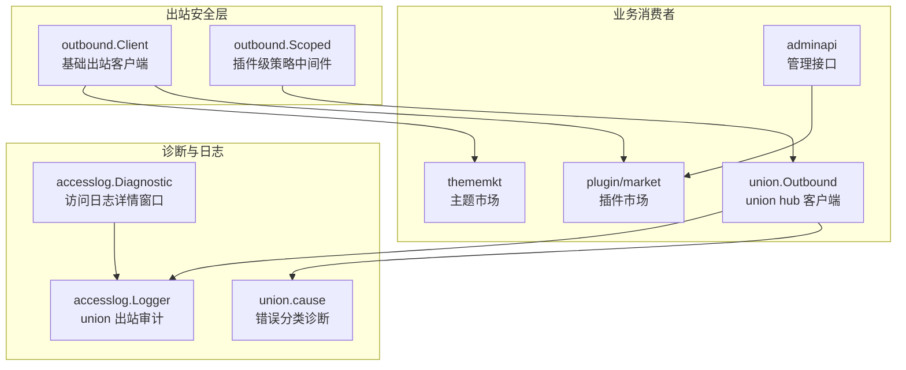
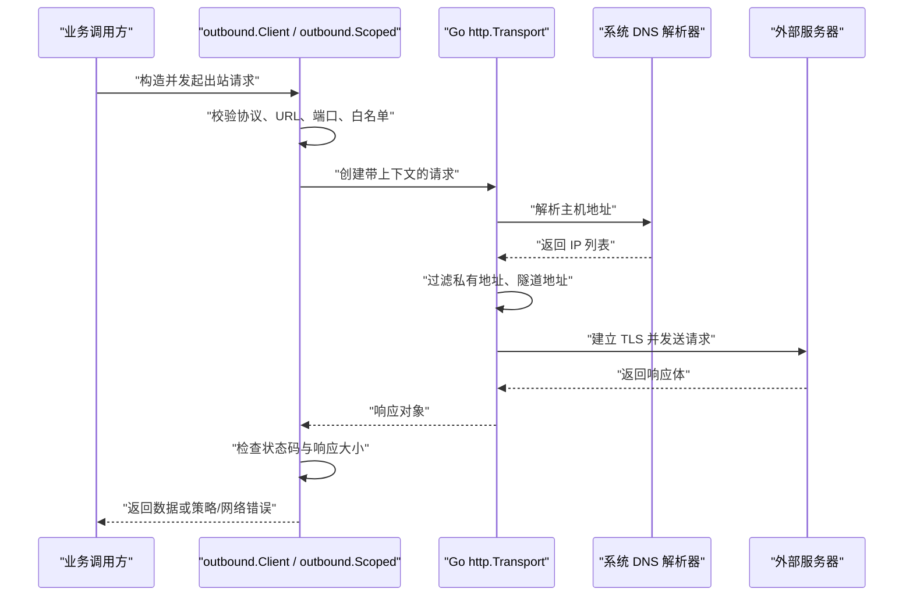
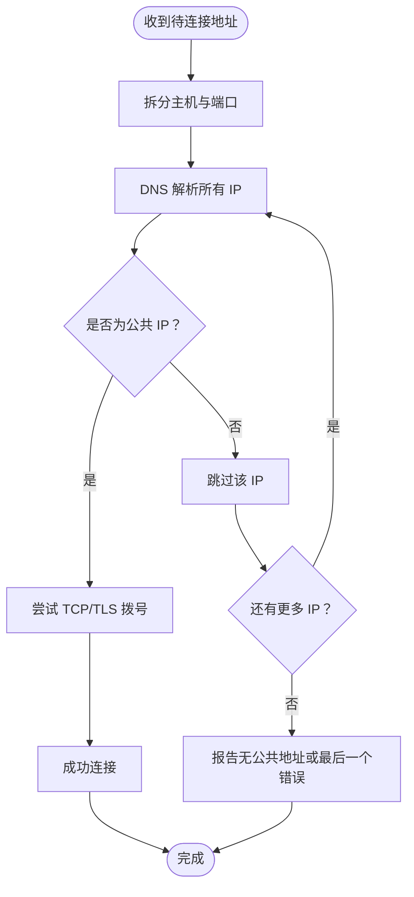
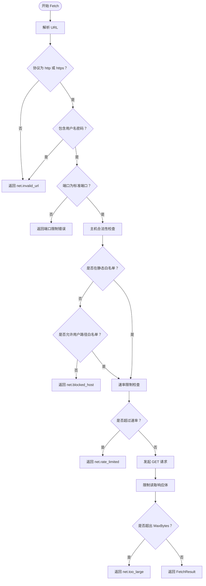
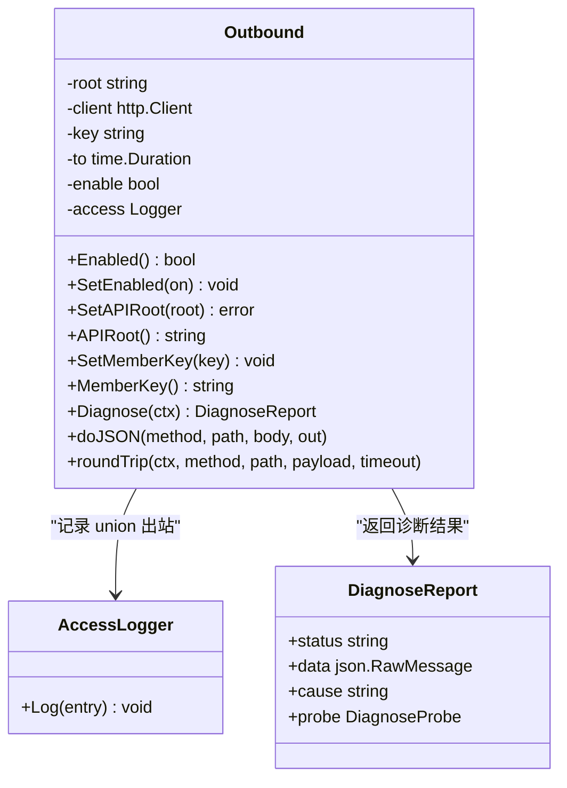
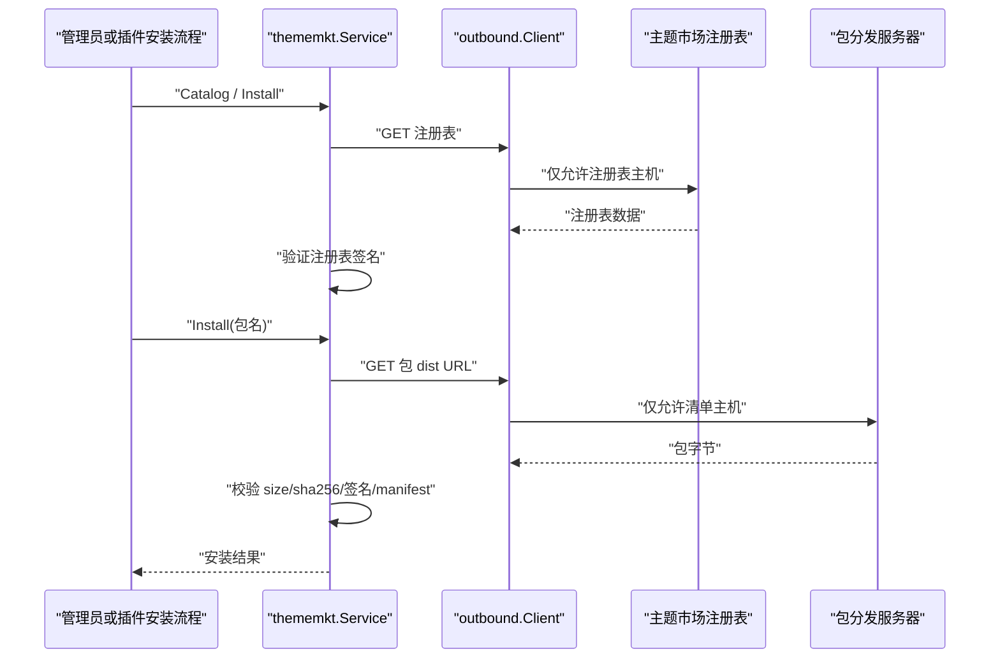
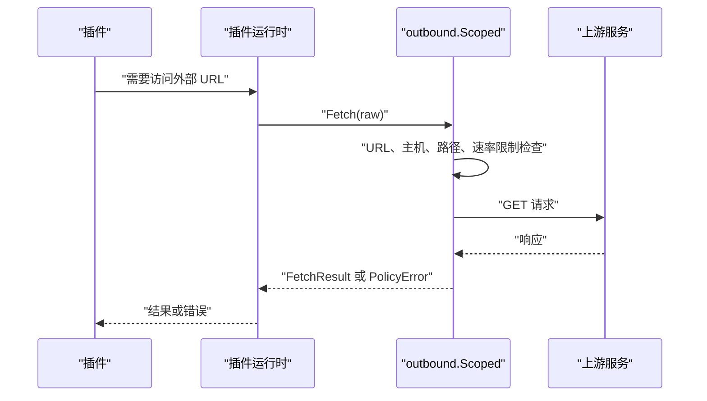
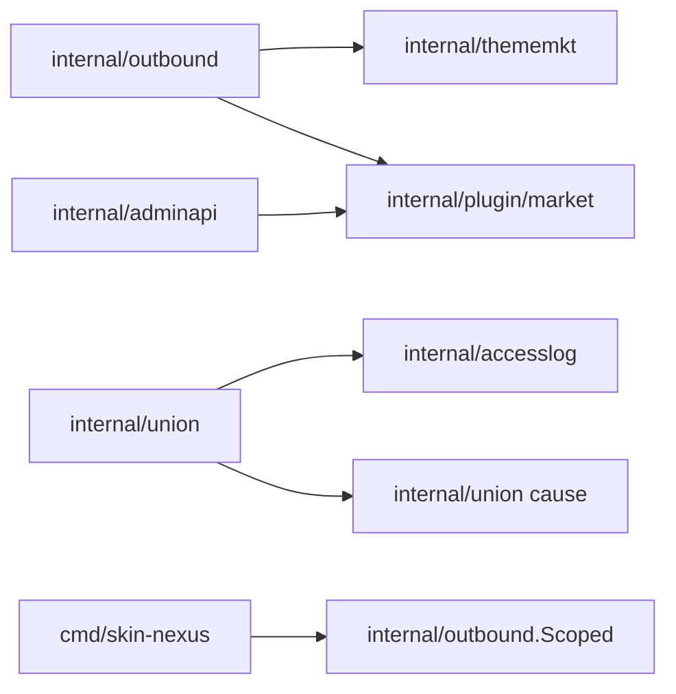
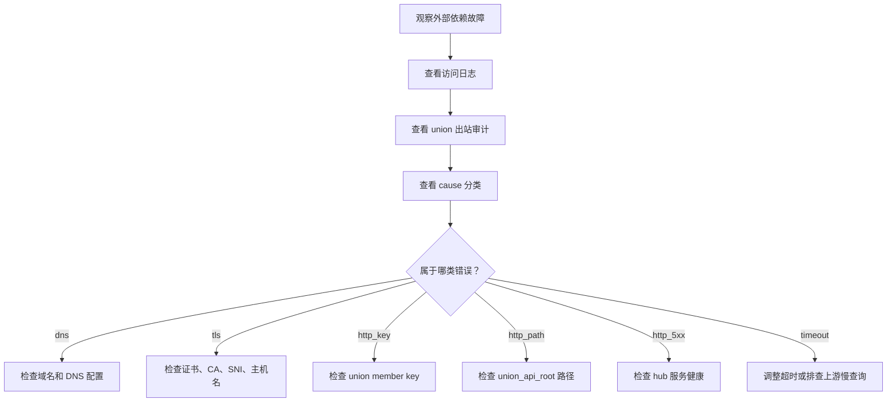

# 出站请求安全封装

**本文引用的文件**
- [outbound.go](https://github.com/YimingZhanshen/skin-nexus/blob/797ae1a/server/internal/outbound/outbound.go)
- [scoped.go](https://github.com/YimingZhanshen/skin-nexus/blob/797ae1a/server/internal/outbound/scoped.go)
- [union_outbound.go](https://github.com/YimingZhanshen/skin-nexus/blob/797ae1a/server/internal/union/outbound.go)
- [union_cause.go](https://github.com/YimingZhanshen/skin-nexus/blob/797ae1a/server/internal/union/outbound_cause.go)
- [thememkt.go](https://github.com/YimingZhanshen/skin-nexus/blob/797ae1a/server/internal/thememkt/thememkt.go)
- [admin_market.go](https://github.com/YimingZhanshen/skin-nexus/blob/797ae1a/server/internal/adminapi/market.go)
- [union_boot.go](https://github.com/YimingZhanshen/skin-nexus/blob/797ae1a/server/cmd/skin-nexus/union_boot.go)
- [plugin_market.go](https://github.com/YimingZhanshen/skin-nexus/blob/797ae1a/server/internal/plugin/market.go)
- [plugin_runtime_goja.go](https://github.com/YimingZhanshen/skin-nexus/blob/797ae1a/server/internal/plugin/runtime_goja.go)
- [accesslog_diagnostic.go](https://github.com/YimingZhanshen/skin-nexus/blob/797ae1a/server/internal/accesslog/diagnostic.go)

## 目录
1. [简介](#简介)
2. [项目结构](#项目结构)
3. [核心组件](#核心组件)
4. [架构总览](#架构总览)
5. [详细组件分析](#详细组件分析)
6. [依赖关系分析](#依赖关系分析)
7. [性能与容量特性](#性能与容量特性)
8. [故障排查指南](#故障排查指南)
9. [生产部署建议](#生产部署建议)
10. [结论](#结论)

## 简介
本文件说明 `server/internal/outbound` 如何为所有外部 HTTP 调用提供统一的安全约束，并解释它在以下场景中的复用方式：
- union 成员到 hub 的出站请求
- thememkt 主题市场注册表和包下载
- plugin market（插件市场）
- adminapi 中由插件宿主驱动的市场操作
- union membernames 等扩展中对 `Scoped` 中间件的直接复用

`outbound` 的核心设计是：**不信任用户提供的目标地址，也不把完整网络能力暴露给插件脚本**。它通过域名白名单、IP 范围限制、最大响应体大小、超时、重定向拒绝、User-Agent 标记和来源 cause 追踪，把“能访问外网”变成“只能访问明确允许的外网”。

## 项目结构

**图示来源**
- [outbound.go:1-167](https://github.com/YimingZhanshen/skin-nexus/blob/797ae1a/server/internal/outbound/outbound.go#L1-L167)
- [scoped.go:1-223](https://github.com/YimingZhanshen/skin-nexus/blob/797ae1a/server/internal/outbound/scoped.go#L1-L223)
- [thememkt.go:1-473](https://github.com/YimingZhanshen/skin-nexus/blob/797ae1a/server/internal/thememkt/thememkt.go#L1-L473)
- [plugin_market.go:52-169](https://github.com/YimingZhanshen/skin-nexus/blob/797ae1a/server/internal/plugin/market.go#L52-L169)
- [union_outbound.go:1-767](https://github.com/YimingZhanshen/skin-nexus/blob/797ae1a/server/internal/union/outbound.go#L1-L767)
- [union_cause.go:1-126](https://github.com/YimingZhanshen/skin-nexus/blob/797ae1a/server/internal/union/outbound_cause.go#L1-L126)
- [accesslog_diagnostic.go:1-140](https://github.com/YimingZhanshen/skin-nexus/blob/797ae1a/server/internal/accesslog/diagnostic.go#L1-L140)

**章节来源**
- [outbound.go:1-167](https://github.com/YimingZhanshen/skin-nexus/blob/797ae1a/server/internal/outbound/outbound.go#L1-L167)
- [scoped.go:1-223](https://github.com/YimingZhanshen/skin-nexus/blob/797ae1a/server/internal/outbound/scoped.go#L1-L223)

## 核心组件

### outbound.Client：最小化市场下载客户端
`Client` 面向“从受信任注册表拉取资源”的场景。它的职责非常窄：只发起 GET，拒绝非公共目的地，不跟随重定向，并对响应体做硬上限。

关键约束包括：
- 只允许 `https` 和 `http` 协议
- 禁止 URL 中携带用户名和密码
- 只允许标准端口 80 或 443
- 必须命中域名白名单
- 只连接全局可达 IP，拒绝私有地址、回环、链路本地、IPv4 私有段、`2002::/16`、`2001::/32`、Cloud Provider IP Space
- 默认 4 秒超时；TLS 握手 5 秒；禁用 Keep-Alive
- 显式拒绝所有重定向
- 先检查 `Content-Length`，再用 `io.LimitReader` 读取额外 1 字节确认未超限

**章节来源**
- [outbound.go:12-24](https://github.com/YimingZhanshen/skin-nexus/blob/797ae1a/server/internal/outbound/outbound.go#L12-L24)
- [outbound.go:25-54](https://github.com/YimingZhanshen/skin-nexus/blob/797ae1a/server/internal/outbound/outbound.go#L25-L54)
- [outbound.go:55-102](https://github.com/YimingZhanshen/skin-nexus/blob/797ae1a/server/internal/outbound/outbound.go#L55-L102)
- [outbound.go:103-167](https://github.com/YimingZhanshen/skin-nexus/blob/797ae1a/server/internal/outbound/outbound.go#L103-L167)

### outbound.Scoped：插件级出站中间件
`Scoped` 比 `Client` 更严格，因为它要保护插件运行时不受恶意插件影响。它不仅校验目标，还维护每个主机的速率限制，并返回稳定的 `PolicyError` 供上层区分策略拒绝、网络不可用和超时。

新增安全点：
- 支持按主机静态白名单 + 可选的用户路径前缀白名单
- 默认拒绝 IP 字面量
- 默认拒绝 `.local` 和尾随点的域名
- 每主机每秒最多 2 次请求，突发上限 4 次
- 固定 User-Agent 头；可由 Policy 覆盖
- 仅测试模式允许 Loopback
- 不发送 Cookie 和 Authorization

**章节来源**
- [scoped.go:15-39](https://github.com/YimingZhanshen/skin-nexus/blob/797ae1a/server/internal/outbound/scoped.go#L15-L39)
- [scoped.go:40-85](https://github.com/YimingZhanshen/skin-nexus/blob/797ae1a/server/internal/outbound/scoped.go#L40-L85)
- [scoped.go:86-169](https://github.com/YimingZhanshen/skin-nexus/blob/797ae1a/server/internal/outbound/scoped.go#L86-L169)
- [scoped.go:170-200](https://github.com/YimingZhanshen/skin-nexus/blob/797ae1a/server/internal/outbound/scoped.go#L170-L200)
- [scoped.go:201-223](https://github.com/YimingZhanshen/skin-nexus/blob/797ae1a/server/internal/outbound/scoped.go#L201-L223)

### union.Outbound：union hub 客户端
`union.Outbound` 不是 `outbound.Client` 的直接包装，而是另一个独立的出站抽象。它负责向 union hub 发送认证后的 JSON 请求，并通过 `accesslog.Logger` 记录 union 出站审计行，同时提供 `DiagnoseReport` 和 `Cause` 分类，帮助运维区分 DNS、TLS、HTTP 状态和网络层问题。

主要职责：
- 可热开关启用状态
- 可动态替换 API Root 和 member key
- 对每个 hub 调用打点：方法、路径、状态码、耗时、捕获信息
- 将非 2xx 转为 `APIError`
- 对黑名单代理端点透传上游状态体和头部
- 诊断接口返回稳定 cause 词汇表

**章节来源**
- [union_outbound.go:15-49](https://github.com/YimingZhanshen/skin-nexus/blob/797ae1a/server/internal/union/outbound.go#L15-L49)
- [union_outbound.go:50-99](https://github.com/YimingZhanshen/skin-nexus/blob/797ae1a/server/internal/union/outbound.go#L50-L99)
- [union_outbound.go:100-199](https://github.com/YimingZhanshen/skin-nexus/blob/797ae1a/server/internal/union/outbound.go#L100-L199)
- [union_outbound.go:200-360](https://github.com/YimingZhanshen/skin-nexus/blob/797ae1a/server/internal/union/outbound.go#L200-L360)
- [union_outbound.go:450-767](https://github.com/YimingZhanshen/skin-nexus/blob/797ae1a/server/internal/union/outbound.go#L450-L767)

### union Cause 分类：DNS、TLS、HTTP、超时的稳定标签
`CauseOf` 和内部分类函数把错误映射成 UI 可读的稳定 token，例如：
- `dns`：DNS 解析失败
- `tls`：证书验证、未知权威、主机名不匹配、协议告警等
- `timeout`：上下文超时、操作系统超时或 TCP 超时
- `refused`：连接被拒绝
- `tcp`：其他 TCP 层错误
- `http_key`：401/403
- `http_path`：404
- `http_busy`：请求超时、太多请求、服务不可用
- `http_5xx`：服务端错误
- `disabled`：模块被关闭
- `unknown`：无法识别的错误

**章节来源**
- [union_cause.go:1-126](https://github.com/YimingZhanshen/skin-nexus/blob/797ae1a/server/internal/union/outbound_cause.go#L1-L126)

## 架构总览

**图示来源**
- [outbound.go:25-102](https://github.com/YimingZhanshen/skin-nexus/blob/797ae1a/server/internal/outbound/outbound.go#L25-L102)
- [outbound.go:103-167](https://github.com/YimingZhanshen/skin-nexus/blob/797ae1a/server/internal/outbound/outbound.go#L103-L167)
- [scoped.go:86-169](https://github.com/YimingZhanshen/skin-nexus/blob/797ae1a/server/internal/outbound/scoped.go#L86-L169)

## 详细组件分析

### outbound.Client 配置与安全语义

| 配置项 | 作用 | 默认值 | 安全影响 |
|---|---|---:|---|
| `AllowedHosts` | 域名白名单，支持精确匹配和 `*.` 后缀 | 无默认；必须由调用方传入 | 空名单会拒绝所有请求；通配符过宽可能扩大 SSRF 面 |
| `Timeout` | 整体请求超时和 `ResponseHeaderTimeout` | 4 秒 | 过小导致正常慢站失败；过大可能导致请求挂起 |
| `MaxBytes` | 最大响应体大小 | 1 MiB | 过小破坏大资源；过大增加内存耗尽风险 |
| `HTTP` | 底层 `http.Client`，可注入测试客户端 | 内置，禁用代理、禁用 Keep-Alive | 自定义时仍需保留安全传输配置 |
| `CheckRedirect` | 重定向控制 | 始终拒绝 | 防止通过重定向绕过白名单 |
| `DialContext` | 自定义拨号逻辑 | 使用 `publicDialContext` | 核心 SSRF 防护入口 |
| `TLSHandshakeTimeout` | TLS 握手超时 | 5 秒 | 避免证书链缓慢导致的长期阻塞 |

#### 域名白名单匹配规则
- 去掉前后空格并转小写
- 空条目跳过
- `*.example.com` 表示以 `.example.com` 结尾且长度更长
- 其余为精确匹配

#### 公共 IP 判定
不允许的地址类型包括：
- nil、未指定、回环
- 链路本地单播/多播
- 私有地址
- `2002::/16`（6to4）
- `2001::/32`（Teredo）
- Cloud Provider IP Space（`100.64.0.0/10`）
- 非全局单播 IPv4

**图示来源**
- [outbound.go:103-167](https://github.com/YimingZhanshen/skin-nexus/blob/797ae1a/server/internal/outbound/outbound.go#L103-L167)

**章节来源**
- [outbound.go:12-102](https://github.com/YimingZhanshen/skin-nexus/blob/797ae1a/server/internal/outbound/outbound.go#L12-L102)
- [outbound.go:103-167](https://github.com/YimingZhanshen/skin-nexus/blob/797ae1a/server/internal/outbound/outbound.go#L103-L167)

### outbound.Scoped 配置与安全语义

| 配置项 | 作用 | 默认值 | 安全影响 |
|---|---|---:|---|
| `Hosts` | 静态允许的主机列表 | 空列表 | 若启用了 `AllowUserHosts` 但未设置 `UserHostPaths`，仍可能放行 |
| `AllowUserHosts` | 是否允许插件声明的路径前缀作为附加白名单 | false | true 时必须配合严格的 `UserHostPaths` |
| `UserHostPaths` | 用户 URL 的路径前缀白名单 | 空列表 | 应限定为绝对路径片段，避免过于宽泛 |
| `MaxBytes` | 最大响应体大小 | 1 MiB，上限 4 MiB | 超过上限会被拒绝 |
| `Timeout` | 请求和响应头超时 | 5 秒 | 插件侧不建议无限等待 |
| `UserAgent` | 标识头 | `"SkinNexus-Plugin/1.0"` | 让上游知道请求来自插件运行时 |
| `AllowLoopback` | 是否允许回环地址 | false | 生产环境绝不应开启 |

#### Fetch 流程

**图示来源**
- [scoped.go:86-169](https://github.com/YimingZhanshen/skin-nexus/blob/797ae1a/server/internal/outbound/scoped.go#L86-L169)

**章节来源**
- [scoped.go:15-85](https://github.com/YimingZhanshen/skin-nexus/blob/797ae1a/server/internal/outbound/scoped.go#L15-L85)
- [scoped.go:86-200](https://github.com/YimingZhanshen/skin-nexus/blob/797ae1a/server/internal/outbound/scoped.go#L86-L200)
- [scoped.go:201-223](https://github.com/YimingZhanshen/skin-nexus/blob/797ae1a/server/internal/outbound/scoped.go#L201-L223)

### union.Outbound 装配与复用模式

`union.Outbound` 并不直接使用 `outbound.Client` 的域名白名单和公网 IP 过滤，因为它是站点内部服务之间的 hub 客户端。它的出站安全由以下机制共同构成：
- 通过配置启用/禁用
- 通过 `ApiRoot` 限制目标根地址
- 通过 per-call context timeout 限制请求时长
- 通过 `readCapped` 限制响应体缓冲大小
- 通过 `accesslog.Logger` 记录 union 出站审计
- 通过 `Cause` 分类辅助诊断

在管理面板中，`SetAccess` 安装 access log sink；`Diagnose` 返回 `DiagnoseReport`，其中 `Cause` 字段由 `classifyError` 生成，`Probe` 字段反映本机 TLS 协商和时钟差异。

**图示来源**
- [union_outbound.go:15-99](https://github.com/YimingZhanshen/skin-nexus/blob/797ae1a/server/internal/union/outbound.go#L15-L99)
- [union_outbound.go:200-360](https://github.com/YimingZhanshen/skin-nexus/blob/797ae1a/server/internal/union/outbound.go#L200-L360)
- [union_outbound.go:450-767](https://github.com/YimingZhanshen/skin-nexus/blob/797ae1a/server/internal/union/outbound.go#L450-L767)

**章节来源**
- [union_outbound.go:15-99](https://github.com/YimingZhanshen/skin-nexus/blob/797ae1a/server/internal/union/outbound.go#L15-L99)
- [union_outbound.go:200-360](https://github.com/YimingZhanshen/skin-nexus/blob/797ae1a/server/internal/union/outbound.go#L200-L360)
- [union_outbound.go:450-767](https://github.com/YimingZhanshen/skin-nexus/blob/797ae1a/server/internal/union/outbound.go#L450-L767)
- [union_cause.go:1-126](https://github.com/YimingZhanshen/skin-nexus/blob/797ae1a/server/internal/union/outbound_cause.go#L1-L126)

### thememkt 与 plugin market 的复用模式

thememkt 和 plugin market 都使用 `outbound.New` 拉取受信任注册表和包：
- 注册表拉取：超时 5 秒，最大响应体 1 MiB
- 包下载：超时 15 秒，最大响应体 32 MiB
- 域名白名单基于注册表或包清单中的主机名
- 下载后校验 size、sha256、签名、manifest id/version

**图示来源**
- [thememkt.go:110-170](https://github.com/YimingZhanshen/skin-nexus/blob/797ae1a/server/internal/thememkt/thememkt.go#L110-L170)
- [thememkt.go:200-230](https://github.com/YimingZhanshen/skin-nexus/blob/797ae1a/server/internal/thememkt/thememkt.go#L200-L230)
- [plugin_market.go:52-169](https://github.com/YimingZhanshen/skin-nexus/blob/797ae1a/server/internal/plugin/market.go#L52-L169)

**章节来源**
- [thememkt.go:110-170](https://github.com/YimingZhanshen/skin-nexus/blob/797ae1a/server/internal/thememkt/thememkt.go#L110-L170)
- [thememkt.go:200-230](https://github.com/YimingZhanshen/skin-nexus/blob/797ae1a/server/internal/thememkt/thememkt.go#L200-L230)
- [plugin_market.go:52-169](https://github.com/YimingZhanshen/skin-nexus/blob/797ae1a/server/internal/plugin/market.go#L52-L169)

### adminapi 市场请求的职责边界
`adminapi/market.go` 主要负责管理接口的权限、CSRF、Origin 校验以及调用插件宿主的 Market API。它本身不直接发起外部 HTTP 出站请求，而是通过 `plugins.Host.MarketCatalog`、`MarketInstall` 等接口间接复用插件市场的出站能力。因此，SSRF 防护的关键不在该文件，而在下游插件市场和 `outbound` 层。

**章节来源**
- [admin_market.go:1-176](https://github.com/YimingZhanshen/skin-nexus/blob/797ae1a/server/internal/adminapi/market.go#L1-L176)

### Scoped 中间件在 union 与插件运行时的装配
`union_boot.go` 中通过 `outbound.NewScoped(outbound.Policy{...})` 构建 union member names 相关的出站策略；插件 Goja 运行时也通过同样的 `Policy` 注入受限的网络能力。这意味着：
- 插件不能随意访问任意公网地址
- 插件只能访问白名单主机，或在启用 `AllowUserHosts` 时访问白名单路径
- 插件流量带有固定或可配置的 User-Agent
- 插件请求受每主机速率限制

**图示来源**
- [union_boot.go:380](https://github.com/YimingZhanshen/skin-nexus/blob/797ae1a/server/cmd/skin-nexus/union_boot.go#L380)
- [plugin_runtime_goja.go:127](https://github.com/YimingZhanshen/skin-nexus/blob/797ae1a/server/internal/plugin/runtime_goja.go#L127)
- [scoped.go:86-169](https://github.com/YimingZhanshen/skin-nexus/blob/797ae1a/server/internal/outbound/scoped.go#L86-L169)

**章节来源**
- [union_boot.go:380](https://github.com/YimingZhanshen/skin-nexus/blob/797ae1a/server/cmd/skin-nexus/union_boot.go#L380)
- [plugin_runtime_goja.go:127](https://github.com/YimingZhanshen/skin-nexus/blob/797ae1a/server/internal/plugin/runtime_goja.go#L127)
- [scoped.go:86-169](https://github.com/YimingZhanshen/skin-nexus/blob/797ae1a/server/internal/outbound/scoped.go#L86-L169)

## 依赖关系分析

**图示来源**
- [outbound.go:1-167](https://github.com/YimingZhanshen/skin-nexus/blob/797ae1a/server/internal/outbound/outbound.go#L1-L167)
- [scoped.go:1-223](https://github.com/YimingZhanshen/skin-nexus/blob/797ae1a/server/internal/outbound/scoped.go#L1-L223)
- [thememkt.go:1-473](https://github.com/YimingZhanshen/skin-nexus/blob/797ae1a/server/internal/thememkt/thememkt.go#L1-L473)
- [plugin_market.go:52-169](https://github.com/YimingZhanshen/skin-nexus/blob/797ae1a/server/internal/plugin/market.go#L52-L169)
- [union_outbound.go:1-767](https://github.com/YimingZhanshen/skin-nexus/blob/797ae1a/server/internal/union/outbound.go#L1-L767)
- [union_cause.go:1-126](https://github.com/YimingZhanshen/skin-nexus/blob/797ae1a/server/internal/union/outbound_cause.go#L1-L126)
- [admin_market.go:1-176](https://github.com/YimingZhanshen/skin-nexus/blob/797ae1a/server/internal/adminapi/market.go#L1-L176)
- [union_boot.go:380](https://github.com/YimingZhanshen/skin-nexus/blob/797ae1a/server/cmd/skin-nexus/union_boot.go#L380)

**章节来源**
- [outbound.go:1-167](https://github.com/YimingZhanshen/skin-nexus/blob/797ae1a/server/internal/outbound/outbound.go#L1-L167)
- [scoped.go:1-223](https://github.com/YimingZhanshen/skin-nexus/blob/797ae1a/server/internal/outbound/scoped.go#L1-L223)
- [union_outbound.go:1-767](https://github.com/YimingZhanshen/skin-nexus/blob/797ae1a/server/internal/union/outbound.go#L1-L767)
- [thememkt.go:1-473](https://github.com/YimingZhanshen/skin-nexus/blob/797ae1a/server/internal/thememkt/thememkt.go#L1-L473)
- [plugin_market.go:52-169](https://github.com/YimingZhanshen/skin-nexus/blob/797ae1a/server/internal/plugin/market.go#L52-L169)
- [admin_market.go:1-176](https://github.com/YimingZhanshen/skin-nexus/blob/797ae1a/server/internal/adminapi/market.go#L1-L176)
- [union_boot.go:380](https://github.com/YimingZhanshen/skin-nexus/blob/797ae1a/server/cmd/skin-nexus/union_boot.go#L380)

## 性能与容量特性

| 组件 | 超时 | 最大响应体 | 连接复用 | 备注 |
|---|---:|---:|---|---|
| `outbound.Client` | 4 秒 | 1 MiB | 禁用 Keep-Alive | 适合受信任注册表拉取 |
| `outbound.Scoped` | 5 秒 | 1~4 MiB | 禁用 Keep-Alive | 插件侧需防长连接堆积 |
| thememkt 注册表 | 5 秒 | 1 MiB | 复用 Client | 有磁盘缓存和 TTL |
| thememkt 包下载 | 15 秒 | 32 MiB | 复用 Client | 后续再校验 sha256 和签名 |
| union.Outbound | 可配置 | 8 MiB | 使用注入的 http.Client | 诊断 10 秒，常规 5 秒 |

注意：
- `outbound.Client` 和 `Scoped` 都显式关闭 Keep-Alive，减少连接池放大攻击面。
- union.Outbound 的 8 MiB 上限更大，因为黑名单代理需要透传上游响应，但仍有 `readCapped` 保护。
- thememkt 的磁盘缓存可减少频繁访问外部注册表。

**章节来源**
- [outbound.go:25-54](https://github.com/YimingZhanshen/skin-nexus/blob/797ae1a/server/internal/outbound/outbound.go#L25-L54)
- [scoped.go:40-85](https://github.com/YimingZhanshen/skin-nexus/blob/797ae1a/server/internal/outbound/scoped.go#L40-L85)
- [thememkt.go:110-170](https://github.com/YimingZhanshen/skin-nexus/blob/797ae1a/server/internal/thememkt/thememkt.go#L110-L170)
- [union_outbound.go:520-560](https://github.com/YimingZhanshen/skin-nexus/blob/797ae1a/server/internal/union/outbound.go#L520-L560)

## 故障排查指南

### 1. 先区分错误阶段
| 现象 | 可能原因 | 定位位置 |
|---|---|---|
| DNS 解析失败 | 域名不存在、DNS 不可达、反向代理域名未解析 | `net.DNSError`、union cause `dns` |
| TLS 握手失败 | 证书过期、未知权威、主机名不匹配、协议告警 | `tls.AlertError`、`x509.*`、union cause `tls` |
| 4xx 错误 | 上游拒绝、路径错误、鉴权失败 | union `APIError.StatusCode`、cause `http_key`/`http_path`/`http_other` |
| 5xx 错误 | 上游服务异常 | union cause `http_5xx` |
| 超时 | 上游慢、网络拥塞、context deadline | union cause `timeout`、`net.timeout` |
| 连接被拒 | 防火墙、端口未监听 | union cause `refused` |
| 响应体过大 | 上游返回异常大内容 | `outbound` 的 too large 错误、union `maxResponseBytes` |

### 2. 访问日志与 union 出站审计
- 普通访问日志：每个入站请求一条轻量摘要
- union 出站审计：每个 hub 调用记录 outcome、method/path/status/duration 和 capture
- 诊断模式：通过 `access_detail_until` 打开详情写入窗口，保存更细的请求细节

**图示来源**
- [union_outbound.go:50-99](https://github.com/YimingZhanshen/skin-nexus/blob/797ae1a/server/internal/union/outbound.go#L50-L99)
- [union_cause.go:1-126](https://github.com/YimingZhanshen/skin-nexus/blob/797ae1a/server/internal/union/outbound_cause.go#L1-L126)
- [accesslog_diagnostic.go:1-140](https://github.com/YimingZhanshen/skin-nexus/blob/797ae1a/server/internal/accesslog/diagnostic.go#L1-L140)

### 3. 调试建议
- 先看 union diagnostic 输出中的 `cause`，再结合 `probe` 判断 TLS 和本机时间是否正常。
- 如果 cause 是 `dns`，不要误判为 hub 服务挂了；优先检查服务器 DNS。
- 如果 cause 是 `tls`，检查证书链、颁发机构、SNI 和主机名一致性。
- 如果 cause 是 `http_key`，检查 union member key 是否旋转或配置错误。
- 如果 cause 是 `http_path`，检查 `union_api_root` 是否指向真实 hub。
- 如果是 `timeout`，区分 context 超时和 TCP 超时；插件侧通常应缩短超时，避免阻塞。
- 对于插件出站失败，关注 `PolicyError.Code`：`net.blocked_host`、`net.rate_limited`、`net.invalid_url`、`net.unavailable`、`net.timeout`、`net.too_large`。

**章节来源**
- [union_outbound.go:50-99](https://github.com/YimingZhanshen/skin-nexus/blob/797ae1a/server/internal/union/outbound.go#L50-L99)
- [union_cause.go:1-126](https://github.com/YimingZhanshen/skin-nexus/blob/797ae1a/server/internal/union/outbound_cause.go#L1-L126)
- [scoped.go:120-169](https://github.com/YimingZhanshen/skin-nexus/blob/797ae1a/server/internal/outbound/scoped.go#L120-L169)
- [accesslog_diagnostic.go:1-140](https://github.com/YimingZhanshen/skin-nexus/blob/797ae1a/server/internal/accesslog/diagnostic.go#L1-L140)

## 生产部署建议

### 1. 关闭对私有网络地址的出站访问
这是防御 SSRF 的关键。`outbound.Client` 和 `outbound.Scoped` 都在拨号阶段拒绝私有地址、回环地址、链路本地地址、6to4、Teredo 和 Cloud Provider IP Space。生产环境必须确保：
- 不使用 `AllowLoopback=true`
- 不把内网域名加入 `AllowedHosts`
- 不在 `UserHostPaths` 中放开敏感路径
- 不直接调用用户可控 URL，除非已经做过严格白名单和路径前缀绑定

### 2. 最小化域名白名单
- 主题市场和插件市场只添加受信任注册表主机
- 包下载白名单应基于注册表清单中的 `dist` 主机，而不是任意用户输入
- 通配符 `*.example.com` 要谨慎使用，避免子域劫持扩大攻击面

### 3. 合理设置超时和响应体上限
- 插件出站默认 5 秒、1 MiB，防止恶意插件拖垮进程
- 主题包下载允许更大体积，但仍做 sha256 和签名校验
- union hub 客户端使用 8 MiB 上限，但应配合合理的 context timeout

### 4. 强制 User-Agent 标记
- 插件流量使用固定或可配置的 User-Agent，便于上游识别来源
- union 客户端使用 `X-Union-Member-Key` 标识成员身份
- 不要向外部请求泄露内部 token、Authorization 或 Cookie

### 5. 关闭重定向
- `outbound.Client` 和 `Scoped` 均拒绝重定向
- 这可以防止通过 3xx 跳转到内网地址

### 6. 使用访问日志和 union 诊断
- 日常只保留轻量摘要
- 出问题时打开诊断窗口，收集 detail 和 union 出站 capture
- 结束后立即关闭诊断窗口，避免长期记录敏感信息

**章节来源**
- [outbound.go:103-167](https://github.com/YimingZhanshen/skin-nexus/blob/797ae1a/server/internal/outbound/outbound.go#L103-L167)
- [scoped.go:15-85](https://github.com/YimingZhanshen/skin-nexus/blob/797ae1a/server/internal/outbound/scoped.go#L15-L85)
- [scoped.go:86-169](https://github.com/YimingZhanshen/skin-nexus/blob/797ae1a/server/internal/outbound/scoped.go#L86-L169)
- [thememkt.go:110-230](https://github.com/YimingZhanshen/skin-nexus/blob/797ae1a/server/internal/thememkt/thememkt.go#L110-L230)
- [union_outbound.go:50-99](https://github.com/YimingZhanshen/skin-nexus/blob/797ae1a/server/internal/union/outbound.go#L50-L99)
- [accesslog_diagnostic.go:1-140](https://github.com/YimingZhanshen/skin-nexus/blob/797ae1a/server/internal/accesslog/diagnostic.go#L1-L140)

## 结论
`server/internal/outbound` 把外部出站访问从“自由网络调用”收敛为“可审计、可限制、可诊断”的安全通道。`Client` 用于受信任注册表和数据源，`Scoped` 用于插件运行时；`union.Outbound` 则承担站点与 hub 之间的认证通信，并通过 cause 分类和访问日志帮助运维快速定位 DNS、TLS、HTTP 和网络层问题。

在生产环境中，最关键的实践是：**永远不要把用户控制的 URL 直接交给出站客户端**，必须经过域名白名单、路径白名单和响应体上限三重约束，并且默认拒绝私有网络和重定向。这样即使上游注册表或第三方服务被劫持，也不会轻易演变为 SSRF。
