# 前端架构

**本文引用的文件**
- [web/src/main.js](https://github.com/YimingZhanshen/skin-nexus/blob/797ae1a/web/src/main.js)
- [web/src/App.vue](https://github.com/YimingZhanshen/skin-nexus/blob/797ae1a/web/src/App.vue)
- [web/src/api.js](https://github.com/YimingZhanshen/skin-nexus/blob/797ae1a/web/src/api.js)
- [web/src/adminApi.js](https://github.com/YimingZhanshen/skin-nexus/blob/797ae1a/web/src/adminApi.js)
- [web/src/session.js](https://github.com/YimingZhanshen/skin-nexus/blob/797ae1a/web/src/session.js)
- [web/src/skinModel.js](https://github.com/YimingZhanshen/skin-nexus/blob/797ae1a/web/src/skinModel.js)
- [web/src/i18n.js](https://github.com/YimingZhanshen/skin-nexus/blob/797ae1a/web/src/i18n.js)
- [web/src/net.js](https://github.com/YimingZhanshen/skin-nexus/blob/797ae1a/web/src/net.js)
- [web/src/errors.js](https://github.com/YimingZhanshen/skin-nexus/blob/797ae1a/web/src/errors.js)
- [web/vite.config.js](https://github.com/YimingZhanshen/skin-nexus/blob/797ae1a/web/vite.config.js)
- [web/viewer-src.js](https://github.com/YimingZhanshen/skin-nexus/blob/797ae1a/web/viewer-src.js)
- [web/package.json](https://github.com/YimingZhanshen/skin-nexus/blob/797ae1a/web/package.json)
- [web/src/components/AdminPanel.vue](https://github.com/YimingZhanshen/skin-nexus/blob/797ae1a/web/src/components/AdminPanel.vue)
- [web/src/pages/DashboardPage.vue](https://github.com/YimingZhanshen/skin-nexus/blob/797ae1a/web/src/pages/DashboardPage.vue)
- [web/src/components/plugin/PluginPage.vue](https://github.com/YimingZhanshen/skin-nexus/blob/797ae1a/web/src/components/plugin/PluginPage.vue)
- [web/src/components/ModalHost.vue](https://github.com/YimingZhanshen/skin-nexus/blob/797ae1a/web/src/components/ModalHost.vue)
- [web/src/components/ToastHub.vue](https://github.com/YimingZhanshen/skin-nexus/blob/797ae1a/web/src/components/ToastHub.vue)

## 目录
1. [引言](#引言)
2. [项目结构](#项目结构)
3. [核心组件](#核心组件)
4. [架构总览](#架构总览)
5. [详细组件分析](#详细组件分析)
6. [依赖关系分析](#依赖关系分析)
7. [性能与构建](#性能与构建)
8. [开发工作流](#开发工作流)
9. [指南：新增页面、组件与 API](#指南新增页面组件与-api)
10. [可访问性与响应式布局](#可访问性与响应式布局)
11. [故障排查](#故障排查)
12. [结论](#结论)

## 引言
本文面向维护 SkinNexus Web 前端的工程师，系统说明 `web/src` 下的应用入口、路由组织、组件树、状态管理、API 客户端分层、国际化与 Vite 构建配置，并给出新增页面、组件和 API 的完整流程。该前端使用 Vue 3 + Composition API、vue-i18n 和 Vite；后端 Go 服务同时提供 SSR 页面、Web API、管理 API、静态资源与插件桥接。

## 项目结构
`web` 子工程是一个 SPA 应用，但通过 Vite 多入口同时产出固定名称的 `viewer.js`，供后端渲染的纹理详情页增强。

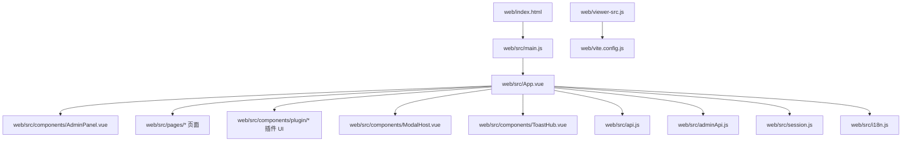

**图示来源**
- [web/src/main.js:1-6](https://github.com/YimingZhanshen/skin-nexus/blob/797ae1a/web/src/main.js#L1-L6)
- [web/src/App.vue:1-40](https://github.com/YimingZhanshen/skin-nexus/blob/797ae1a/web/src/App.vue#L1-L40)
- [web/vite.config.js:1-43](https://github.com/YimingZhanshen/skin-nexus/blob/797ae1a/web/vite.config.js#L1-L43)
- [web/viewer-src.js:1-20](https://github.com/YimingZhanshen/skin-nexus/blob/797ae1a/web/viewer-src.js#L1-L20)

### 关键目录职责
| 路径 | 职责 |
|---|---|
| `web/src/main.js` | 创建 Vue 应用、挂载根组件、注册 i18n、加载全局样式 |
| `web/src/App.vue` | 应用外壳：登录态、站点能力、导航、视图分发、全局上下文注入 |
| `web/src/pages` | 玩家侧页面：仪表盘、衣柜、角色、资料、通知、授权应用等 |
| `web/src/components/admin` | 管理面板各功能视图 |
| `web/src/components/plugin` | 插件 iframe 宿主与字段容器 |
| `web/src/components` | 全局组件：弹窗、提示、皮肤预览、分页器、表单等 |
| `web/src/api.js` | 玩家 Web API 与上传封装 |
| `web/src/adminApi.js` | 管理 API 共享 fetch；同源会话传输、剥离机器令牌并清理旧存储 |
| `web/src/session.js` | 全局 401 未授权回调与守卫 |
| `web/src/i18n.js` | vue-i18n 初始化与语言 cookie/localStorage 同步 |
| `web/src/net.js` | 带超时的 fetch 包装 |
| `web/src/errors.js` | 后端错误码到用户消息的统一翻译 |
| `web/viewer-src.js` | 纹理详情页渐进增强的 3D 预览与交互 |
| `web/vite.config.js` | Vite 开发服务器、代理、多入口与产物命名 |

**章节来源**
- [web/src/main.js:1-6](https://github.com/YimingZhanshen/skin-nexus/blob/797ae1a/web/src/main.js#L1-L6)
- [web/package.json:1-22](https://github.com/YimingZhanshen/skin-nexus/blob/797ae1a/web/package.json#L1-L22)

## 核心组件
- **App.vue**：应用根组件。负责启动引导、会话读取、站点能力拉取、导航分组、异步页面懒加载、插件 UI 注册、以及向子组件注入用户、站点配置和跳转函数。
- **AdminPanel.vue**：管理面板外壳，包含侧边栏、动态可见项（邀请码、Union、Server Access）、URL 深链同步、插件页嵌入与权限派生的禁止访问提示。
- **DashboardPage.vue**：玩家仪表盘，承载公告 Markdown 渲染、上传、纹理列表、衣柜操作、进度与确认对话框。
- **PluginPage.vue / PluginFrame.vue**：插件 iframe 页面宿主；当前版本支持 `iframe` 渲染类型，schema 渲染标记为暂不支持。
- **ModalHost.vue**：全局弹窗宿主，由 `dialog.js` 驱动，支持提示、确认和文本输入三种形态。
- **ToastHub.vue**：全局 Toast 通知中心，监听自定义 `skin-toast` 事件，最多保留最近三条，自动消失。

**章节来源**
- [web/src/App.vue:1-120](https://github.com/YimingZhanshen/skin-nexus/blob/797ae1a/web/src/App.vue#L1-L120)
- [web/src/components/AdminPanel.vue:1-60](https://github.com/YimingZhanshen/skin-nexus/blob/797ae1a/web/src/components/AdminPanel.vue#L1-L60)
- [web/src/pages/DashboardPage.vue:1-40](https://github.com/YimingZhanshen/skin-nexus/blob/797ae1a/web/src/pages/DashboardPage.vue#L1-L40)
- [web/src/components/plugin/PluginPage.vue:1-39](https://github.com/YimingZhanshen/skin-nexus/blob/797ae1a/web/src/components/plugin/PluginPage.vue#L1-L39)
- [web/src/components/ModalHost.vue:1-53](https://github.com/YimingZhanshen/skin-nexus/blob/797ae1a/web/src/components/ModalHost.vue#L1-L53)
- [web/src/components/ToastHub.vue:1-79](https://github.com/YimingZhanshen/skin-nexus/blob/797ae1a/web/src/components/ToastHub.vue#L1-L79)

## 架构总览
应用采用“单壳 + 异步页面”的架构：`main.js` 只挂载 `App.vue`，所有页面和 admin 面板都通过 `defineAsyncComponent` 按需加载，避免登录卡片或小型页面下载无关代码。

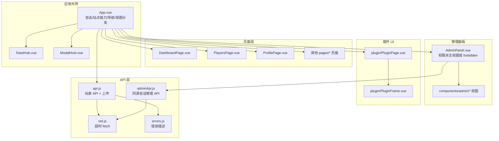

**图示来源**
- [web/src/App.vue:1-40](https://github.com/YimingZhanshen/skin-nexus/blob/797ae1a/web/src/App.vue#L1-L40)
- [web/src/components/AdminPanel.vue:1-60](https://github.com/YimingZhanshen/skin-nexus/blob/797ae1a/web/src/components/AdminPanel.vue#L1-L60)
- [web/src/api.js:1-40](https://github.com/YimingZhanshen/skin-nexus/blob/797ae1a/web/src/api.js#L1-L40)
- [web/src/adminApi.js:1-32](https://github.com/YimingZhanshen/skin-nexus/blob/797ae1a/web/src/adminApi.js#L1-L32)
- [web/src/net.js:1-23](https://github.com/YimingZhanshen/skin-nexus/blob/797ae1a/web/src/net.js#L1-L23)
- [web/src/errors.js:1-35](https://github.com/YimingZhanshen/skin-nexus/blob/797ae1a/web/src/errors.js#L1-L35)

## 详细组件分析

### 应用外壳与视图组合：App.vue
`App.vue` 是整站控制面。它做以下事情：
- 定义异步页面加载器，为每个页面设置 `PageLoading` 占位与延迟。
- 通过 `provide('sessionUser', user)` 和 `provide('siteConfig', siteConf)` 将会话与站点能力注入全树。
- 根据 `/api/v1/me` 返回的 `permission` 判断是否显示管理面板入口；已登录用户直接打开 `/admin` 深链时，由 `AdminPanel.vue` 的 `ready` 派生结果决定渲染视图或禁止访问提示。
- 计算导航分组，包括内置页面、通知徽标、Union 入口、插件菜单和管理面板入口。
- 处理邮箱验证门、邀请码、邮件配置、上传限制等站点能力。
- 管理移动端抽屉菜单、认证锁屏倒计时、外部插件路径。

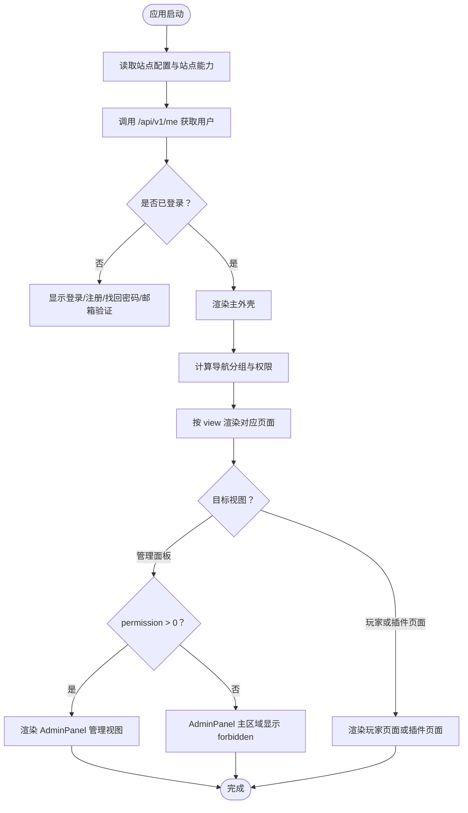

**图示来源**
- [web/src/App.vue:1-120](https://github.com/YimingZhanshen/skin-nexus/blob/797ae1a/web/src/App.vue#L1-L120)

**章节来源**
- [web/src/App.vue:1-200](https://github.com/YimingZhanshen/skin-nexus/blob/797ae1a/web/src/App.vue#L1-L200)

### 管理面板：AdminPanel.vue
管理面板以侧边栏为主，按模块切换视图，并通过 URL 段同步状态，使刷新、分享和后退前进保持激活项。其关键行为：
- 根据站点能力隐藏邀请码、Union、Server Access 等可选模块；Server Access 还要求 `permission=2`。
- `myPerm` 来自当前会话用户，`ready = myPerm > 0`；权限变化会立即卸载全部管理子视图与插件页。
- 权限不足时主区域只显示 `errors.common.forbidden`，不提供机器令牌输入或持久化入口。
- 管理面板内嵌插件页面，复用按 `myPerm` 过滤的 `navPages('admin')` 清单。
- 模块初始化时清理旧 `admin_token` 存储键；管理请求由 `adminApi.js` 只发送同源 Cookie。

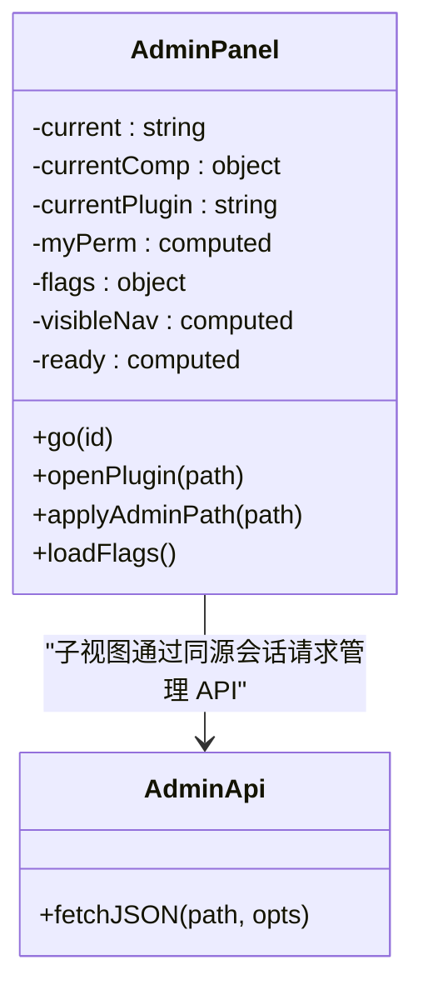

**图示来源**
- [web/src/components/AdminPanel.vue:1-120](https://github.com/YimingZhanshen/skin-nexus/blob/797ae1a/web/src/components/AdminPanel.vue#L1-L120)
- [web/src/adminApi.js:1-32](https://github.com/YimingZhanshen/skin-nexus/blob/797ae1a/web/src/adminApi.js#L1-L32)

**章节来源**
- [web/src/components/AdminPanel.vue:1-200](https://github.com/YimingZhanshen/skin-nexus/blob/797ae1a/web/src/components/AdminPanel.vue#L1-L200)
- [web/src/adminApi.js:1-32](https://github.com/YimingZhanshen/skin-nexus/blob/797ae1a/web/src/adminApi.js#L1-L32)

### 玩家侧页面与仪表盘：DashboardPage.vue
仪表盘承担大量玩家日常操作：公告渲染、上传材质、查看纹理列表、入柜、重命名、删除、选择穿戴目标等。它体现的常见模式是：
- 服务端分页 + 客户端搜索筛选。
- 行级并发保护：用 `rowBusy` Set 防止重复提交。
- 结合 `detectSkinModel` 在上传前预览手臂模型。
- 通过 `guard401` 统一处理未授权。
- 使用 `confirmDialog` 触发全局弹窗。

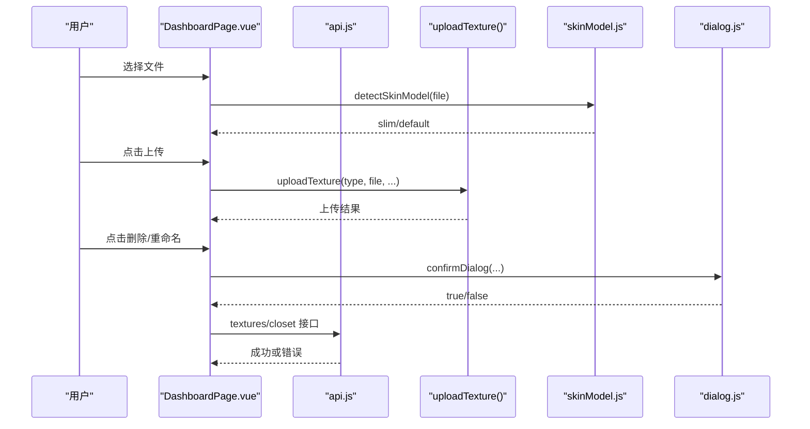

**图示来源**
- [web/src/pages/DashboardPage.vue:1-80](https://github.com/YimingZhanshen/skin-nexus/blob/797ae1a/web/src/pages/DashboardPage.vue#L1-L80)
- [web/src/api.js:120-161](https://github.com/YimingZhanshen/skin-nexus/blob/797ae1a/web/src/api.js#L120-L161)
- [web/src/skinModel.js:1-41](https://github.com/YimingZhanshen/skin-nexus/blob/797ae1a/web/src/skinModel.js#L1-L41)

**章节来源**
- [web/src/pages/DashboardPage.vue:1-120](https://github.com/YimingZhanshen/skin-nexus/blob/797ae1a/web/src/pages/DashboardPage.vue#L1-L120)

### 插件 iframe 宿主：PluginPage.vue 与 PluginFrame.vue
插件 UI 当前以 iframe 方式嵌入。主机通过 manifest 声明页面路径、渲染类型和导航标签，`PluginPage.vue` 根据 `pageByPath` 解析后渲染 `<PluginFrame>`。若渲染类型不是 `iframe`，则显示“暂不支持”提示。

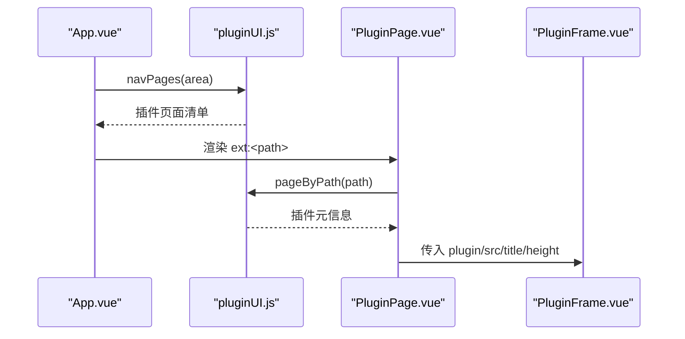

**图示来源**
- [web/src/components/plugin/PluginPage.vue:1-39](https://github.com/YimingZhanshen/skin-nexus/blob/797ae1a/web/src/components/plugin/PluginPage.vue#L1-L39)

**章节来源**
- [web/src/components/plugin/PluginPage.vue:1-39](https://github.com/YimingZhanshen/skin-nexus/blob/797ae1a/web/src/components/plugin/PluginPage.vue#L1-L39)

### 全局弹窗宿主：ModalHost.vue
全局弹窗由 `dialog.js` 的状态驱动，`ModalHost.vue` 只负责展示三种形态：
- alert：仅关闭按钮。
- prompt：带输入框。
- confirm：确认/取消。

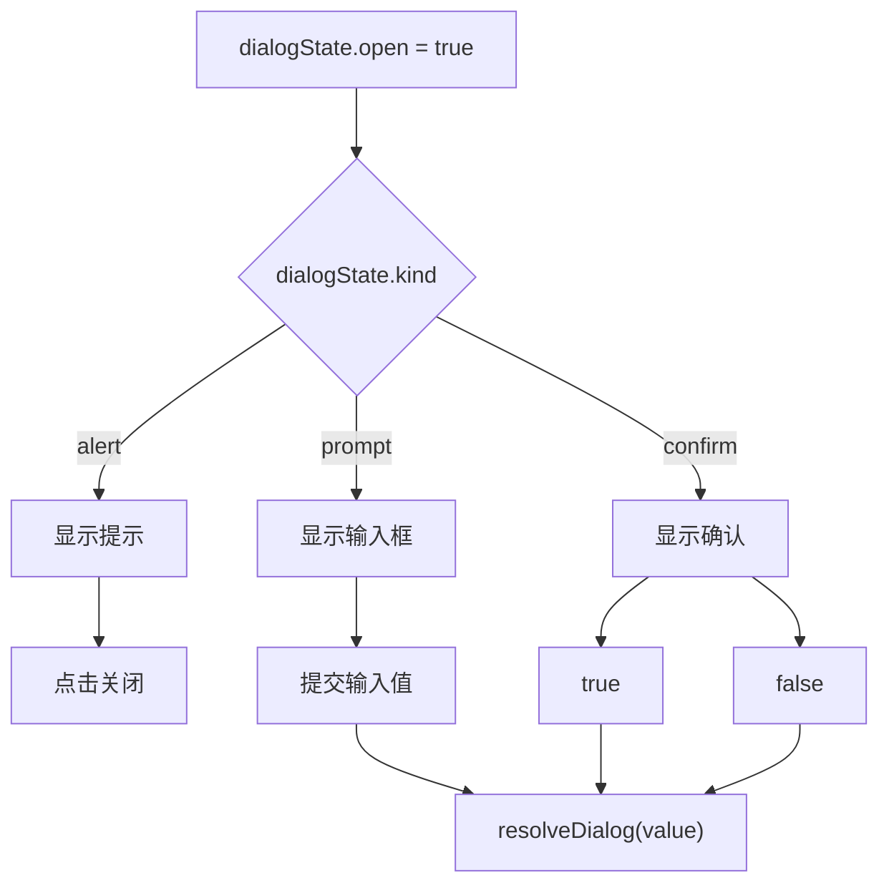

**图示来源**
- [web/src/components/ModalHost.vue:1-53](https://github.com/YimingZhanshen/skin-nexus/blob/797ae1a/web/src/components/ModalHost.vue#L1-L53)

**章节来源**
- [web/src/components/ModalHost.vue:1-53](https://github.com/YimingZhanshen/skin-nexus/blob/797ae1a/web/src/components/ModalHost.vue#L1-L53)

### 全局通知：ToastHub.vue
ToastHub 订阅 `window.skin-toast` 事件，最多保留最近三条通知，每条默认 4.2 秒后自动移除。它提供 `role="status"` 和 `aria-live="polite"`，便于屏幕阅读器播报。

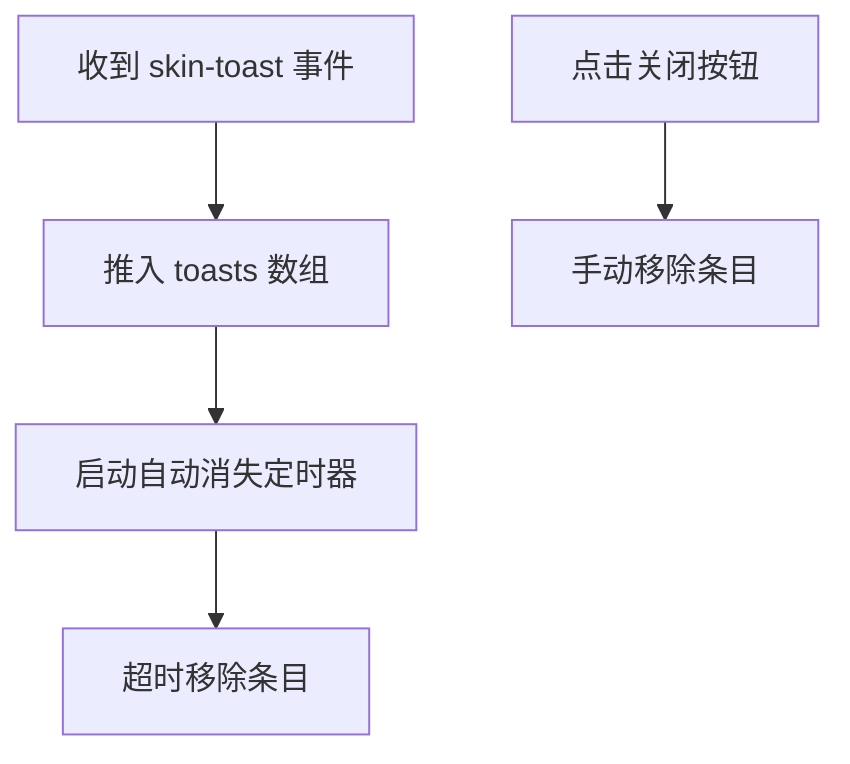

**图示来源**
- [web/src/components/ToastHub.vue:1-79](https://github.com/YimingZhanshen/skin-nexus/blob/797ae1a/web/src/components/ToastHub.vue#L1-L79)

**章节来源**
- [web/src/components/ToastHub.vue:1-79](https://github.com/YimingZhanshen/skin-nexus/blob/797ae1a/web/src/components/ToastHub.vue#L1-L79)

### API 客户端分层

#### 玩家 API：api.js
`api.js` 暴露三类能力：
- 通用请求函数 `req`：设置 JSON 头、处理 204、解析 JSON、包装非 2xx 错误、透传 `status` 和结构化 `data`。
- 玩家接口集合：登录、注册、登出、修改密码、找回/重置密码、邮箱验证、通知、衣柜、角色、头像、个人档案、皮肤库点赞/收藏/编辑等。
- OIDC 设备流程与 Union 成员接口。
- 独立的 `uploadTexture`：使用 `XMLHttpRequest` 上传 `FormData`，支持进度回调、超时和凭据发送。

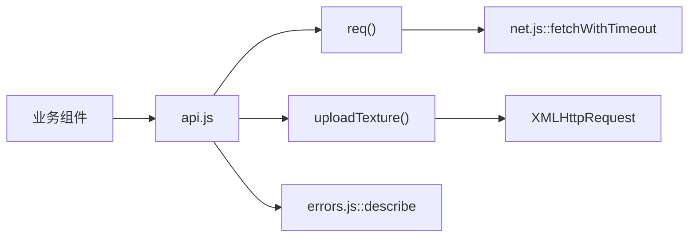

**图示来源**
- [web/src/api.js:1-161](https://github.com/YimingZhanshen/skin-nexus/blob/797ae1a/web/src/api.js#L1-L161)
- [web/src/net.js:1-23](https://github.com/YimingZhanshen/skin-nexus/blob/797ae1a/web/src/net.js#L1-L23)
- [web/src/errors.js:1-35](https://github.com/YimingZhanshen/skin-nexus/blob/797ae1a/web/src/errors.js#L1-L35)

**章节来源**
- [web/src/api.js:1-161](https://github.com/YimingZhanshen/skin-nexus/blob/797ae1a/web/src/api.js#L1-L161)

#### 管理 API：adminApi.js
管理 API 单独封装，用于 `AdminPanel.vue` 及其子视图。特点：
- 使用 `credentials: 'same-origin'`，只发送同源 `skin_session` Cookie。
- 清理旧 `admin_token` 存储键，并剥离调用方传入的任何大小写形式的 `X-Admin-Token`。
- HTTP 401 或 HTTP 403 + `admin.token_invalid` 经 `guard401` 通知应用外壳清理会话；其他 403 不触发会话清理，也不显示令牌卡。
- 所有错误携带 `status` 和 `data`，调用方可区分“模块未启用”“会话失效”“资源冲突”等情况。
- 默认超时 20 秒；响应 JSON 解析失败时回退为空对象。

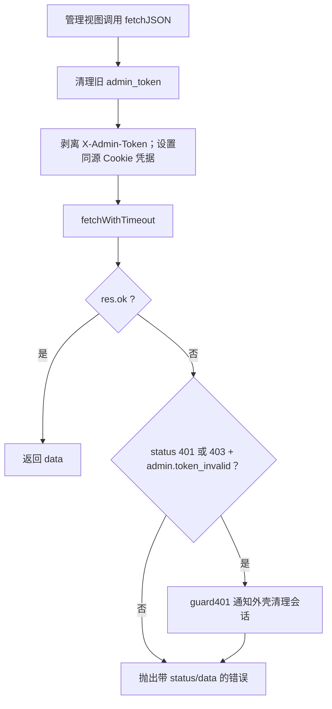

**图示来源**
- [web/src/adminApi.js:1-32](https://github.com/YimingZhanshen/skin-nexus/blob/797ae1a/web/src/adminApi.js#L1-L32)

**章节来源**
- [web/src/adminApi.js:1-32](https://github.com/YimingZhanshen/skin-nexus/blob/797ae1a/web/src/adminApi.js#L1-L32)

#### 会话与未授权处理：session.js
`session.js` 提供：
- `setUnauthorizedHandler(fn)`：注册全局未授权处理器，`App.vue` 在启动时设置为回到登录页。
- `notifyUnauthorized()`：通知所有消费者。
- `guard401(e)`：页面级 catch 中快速判断 401，避免重复提示。

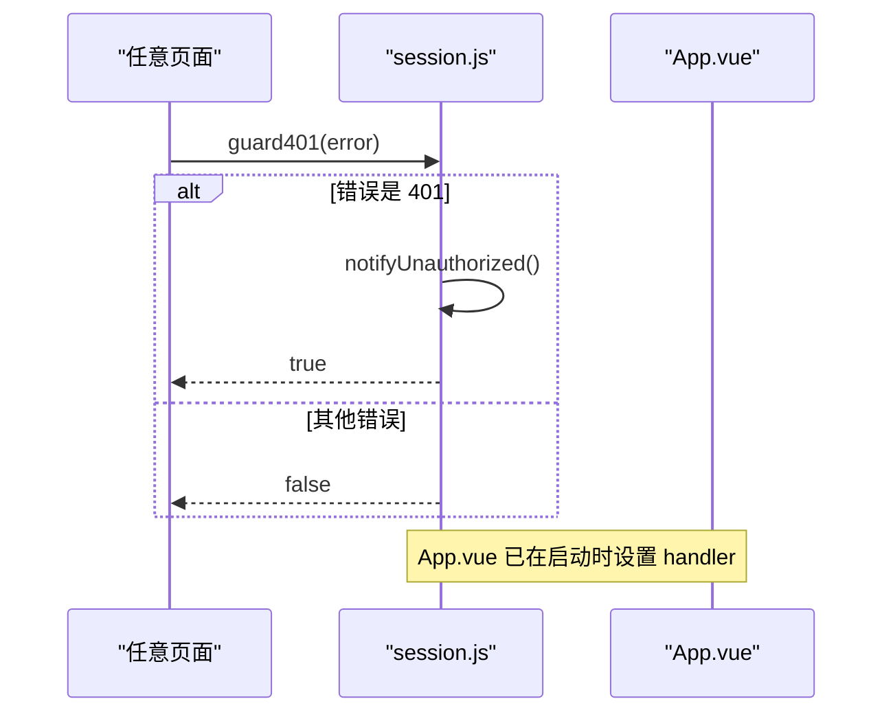

**图示来源**
- [web/src/session.js:1-13](https://github.com/YimingZhanshen/skin-nexus/blob/797ae1a/web/src/session.js#L1-L13)

**章节来源**
- [web/src/session.js:1-13](https://github.com/YimingZhanshen/skin-nexus/blob/797ae1a/web/src/session.js#L1-L13)

#### 领域模型：skinModel.js
`skinModel.js` 实现客户端手臂模型检测，逻辑对齐后端 `server/internal/texture/model.go`：
- 仅对宽高相等且宽度为 64 倍数的图片进行分析。
- 使用 `OffscreenCanvas` 采样右臂第一层的两个透明区域。
- 发现透明像素即判定为 `slim`，否则回退为 `default`。
- 浏览器不支持时直接降级为 `default`，不影响存储侧决策。

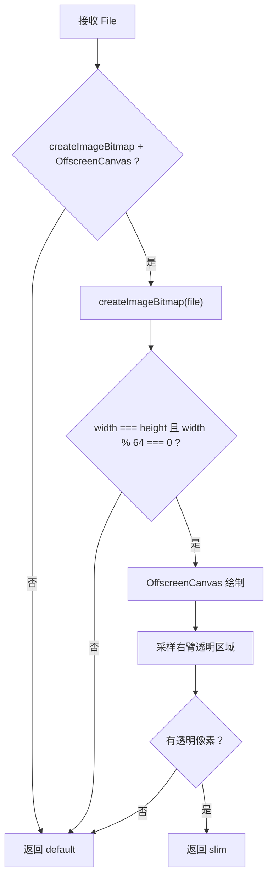

**图示来源**
- [web/src/skinModel.js:1-41](https://github.com/YimingZhanshen/skin-nexus/blob/797ae1a/web/src/skinModel.js#L1-L41)

**章节来源**
- [web/src/skinModel.js:1-41](https://github.com/YimingZhanshen/skin-nexus/blob/797ae1a/web/src/skinModel.js#L1-L41)

### 国际化：i18n.js 与 locales
`i18n.js` 使用 vue-i18n，语言优先级为：
1. `skin_lang` cookie
2. `localStorage.skin_lang`
3. `navigator.language`
4. 默认 `zh-CN`

语言切换会同步更新：
- `document.documentElement.lang`
- `localStorage.skin_lang`
- `skin_lang` cookie（SameSite=Lax，HTTPS 下加 Secure，一年有效期）

后端 SSR 也读写同一 cookie，因此 SPA 与 SSR 的语言选择保持一致。本地语言包位于 `web/src/locales/en.json` 和 `web/src/locales/zh-CN.json`。

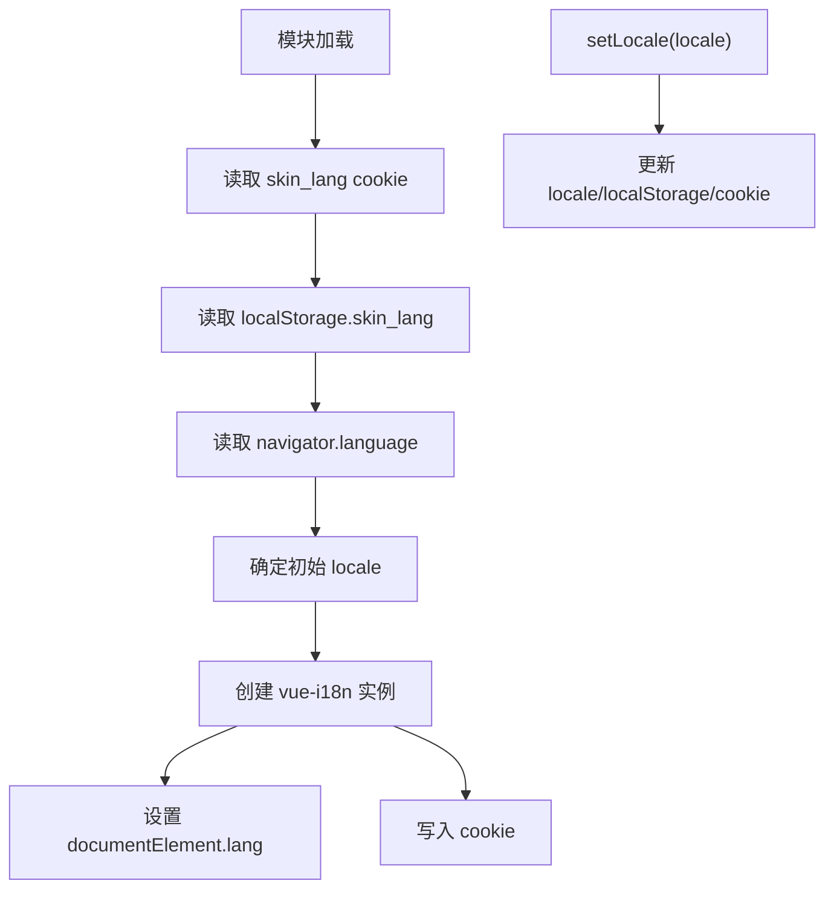

**图示来源**
- [web/src/i18n.js:1-68](https://github.com/YimingZhanshen/skin-nexus/blob/797ae1a/web/src/i18n.js#L1-L68)

**章节来源**
- [web/src/i18n.js:1-68](https://github.com/YimingZhanshen/skin-nexus/blob/797ae1a/web/src/i18n.js#L1-L68)

### 3D 预览集成：viewer-src.js
`viewer-src.js` 是 Vite 固定入口 `viewer`，产出 `/assets/viewer.js`，专供后端 SSR 纹理详情页增强：
- 渐进增强：先渲染静态 ``，JS 可用时再升级为 `skinview3d` canvas。
- WebGL 探测失败时保留静态内容，不破坏 SEO。
- 动态导入 `skinview3d`，仅在需要且环境支持时加载约 500KB 的代码块。
- 文案来自后端注入的 `window.__SKIN_I18N__`，保证前后端语言一致。
- 处理点赞、举报、编辑等交互，401 时跳转到 `/login?next=...` 保留上下文。

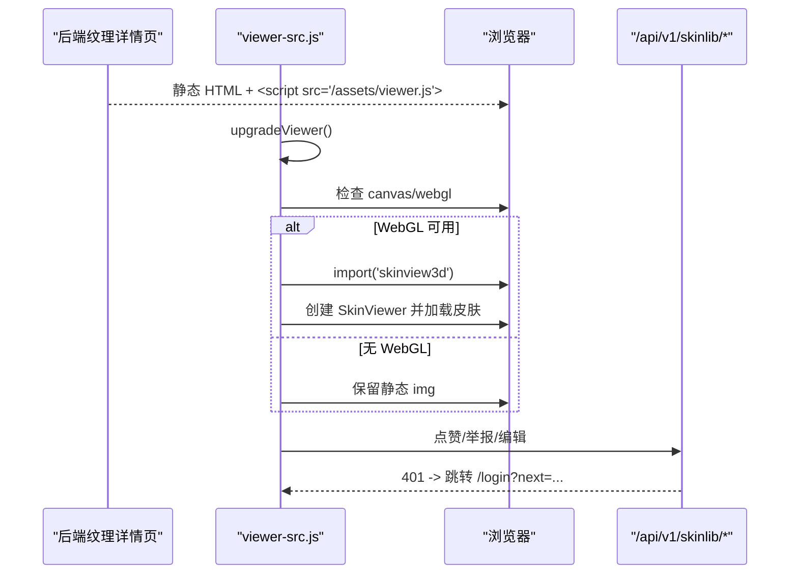

**图示来源**
- [web/viewer-src.js:1-182](https://github.com/YimingZhanshen/skin-nexus/blob/797ae1a/web/viewer-src.js#L1-L182)
- [web/vite.config.js:20-43](https://github.com/YimingZhanshen/skin-nexus/blob/797ae1a/web/vite.config.js#L20-L43)

**章节来源**
- [web/viewer-src.js:1-182](https://github.com/YimingZhanshen/skin-nexus/blob/797ae1a/web/viewer-src.js#L1-L182)

## 依赖关系分析
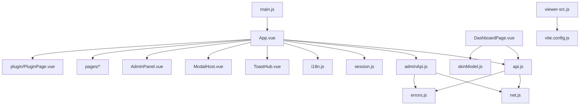

**图示来源**
- [web/src/main.js:1-6](https://github.com/YimingZhanshen/skin-nexus/blob/797ae1a/web/src/main.js#L1-L6)
- [web/src/App.vue:1-40](https://github.com/YimingZhanshen/skin-nexus/blob/797ae1a/web/src/App.vue#L1-L40)
- [web/src/api.js:1-40](https://github.com/YimingZhanshen/skin-nexus/blob/797ae1a/web/src/api.js#L1-L40)
- [web/src/adminApi.js:1-32](https://github.com/YimingZhanshen/skin-nexus/blob/797ae1a/web/src/adminApi.js#L1-L32)
- [web/src/pages/DashboardPage.vue:1-40](https://github.com/YimingZhanshen/skin-nexus/blob/797ae1a/web/src/pages/DashboardPage.vue#L1-L40)
- [web/viewer-src.js:1-20](https://github.com/YimingZhanshen/skin-nexus/blob/797ae1a/web/viewer-src.js#L1-L20)
- [web/vite.config.js:1-20](https://github.com/YimingZhanshen/skin-nexus/blob/797ae1a/web/vite.config.js#L1-L20)

**章节来源**
- [web/src/main.js:1-6](https://github.com/YimingZhanshen/skin-nexus/blob/797ae1a/web/src/main.js#L1-L6)
- [web/src/App.vue:1-40](https://github.com/YimingZhanshen/skin-nexus/blob/797ae1a/web/src/App.vue#L1-L40)
- [web/src/api.js:1-40](https://github.com/YimingZhanshen/skin-nexus/blob/797ae1a/web/src/api.js#L1-L40)
- [web/src/adminApi.js:1-32](https://github.com/YimingZhanshen/skin-nexus/blob/797ae1a/web/src/adminApi.js#L1-L32)
- [web/viewer-src.js:1-20](https://github.com/YimingZhanshen/skin-nexus/blob/797ae1a/web/viewer-src.js#L1-L20)

## 性能与构建
- **代码分割与懒加载**：所有页面和 admin 面板都通过 `defineAsyncComponent` 懒加载，减少首屏体积。
- **CSS 拆分关闭**：`cssCodeSplit: false` 保证主题样式表优先于异步页面样式注入，避免覆盖顺序问题。
- **固定 viewer 入口**：`viewer` 输出文件名固定为 `assets/viewer.js`，满足后端 SSR 的契约。
- **skinview3d 动态导入**：只在 canvas 存在且 WebGL 可用时才加载 3D 库。
- **开发代理**：Vite 将 `/api` 和 `/textures` 代理到 `http://localhost:8080`，方便本地联调。
- **网络超时**：`fetchWithTimeout` 使用 `AbortController`，将长时间无响应的 CDN 边缘节点转为可重试的网络错误。

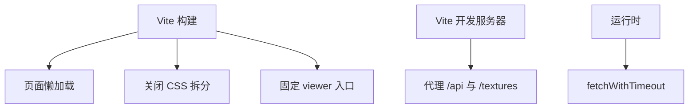

**图示来源**
- [web/vite.config.js:1-43](https://github.com/YimingZhanshen/skin-nexus/blob/797ae1a/web/vite.config.js#L1-L43)
- [web/src/net.js:1-23](https://github.com/YimingZhanshen/skin-nexus/blob/797ae1a/web/src/net.js#L1-L23)
- [web/src/App.vue:1-20](https://github.com/YimingZhanshen/skin-nexus/blob/797ae1a/web/src/App.vue#L1-L20)

**章节来源**
- [web/vite.config.js:1-43](https://github.com/YimingZhanshen/skin-nexus/blob/797ae1a/web/vite.config.js#L1-L43)
- [web/package.json:1-22](https://github.com/YimingZhanshen/skin-nexus/blob/797ae1a/web/package.json#L1-L22)

## 开发工作流
- 安装依赖后运行 `npm run dev` 启动 Vite，端口 5173。
- 后端服务需在 `http://localhost:8080` 运行，以便代理 `/api` 和 `/textures`。
- 构建产物输出到 `web/dist`，预览使用 `npm run preview`。
- 新增页面或组件后无需改动 `main.js`，只需在 `App.vue` 中添加异步页面映射并加入导航。

**章节来源**
- [web/package.json:1-22](https://github.com/YimingZhanshen/skin-nexus/blob/797ae1a/web/package.json#L1-L22)
- [web/vite.config.js:1-20](https://github.com/YimingZhanshen/skin-nexus/blob/797ae1a/web/vite.config.js#L1-L20)

## 指南：新增页面、组件与 API

### 新增页面
1. 在 `web/src/pages` 新建 Vue 组件，例如 `NewFeaturePage.vue`。
2. 在 `web/src/App.vue` 中使用 `asyncPage(() => import('./pages/NewFeaturePage.vue'))` 注册异步组件。
3. 在导航分组中加入新项，确保 labelKey 指向 i18n 文案。
4. 如果页面需要用户数据，使用 `inject('sessionUser')`；如果需要站点配置，使用 `inject('siteConfig')`。
5. 如需跳转，使用 `inject('gotoView')` 或直接操作 `view` 状态所在的父作用域约定。

**章节来源**
- [web/src/App.vue:1-120](https://github.com/YimingZhanshen/skin-nexus/blob/797ae1a/web/src/App.vue#L1-L120)

### 新增组件
1. 在 `web/src/components` 下创建组件文件。
2. 如果是全局通知，发布 `new CustomEvent('skin-toast', { detail })`，由 `ToastHub.vue` 消费。
3. 如果需要用户确认，调用 `dialog.js` 提供的 `confirmDialog`，由 `ModalHost.vue` 渲染。
4. 如果组件依赖用户会话，使用 `inject('sessionUser')`，避免从 props 层层传递。

**章节来源**
- [web/src/components/ToastHub.vue:1-79](https://github.com/YimingZhanshen/skin-nexus/blob/797ae1a/web/src/components/ToastHub.vue#L1-L79)
- [web/src/components/ModalHost.vue:1-53](https://github.com/YimingZhanshen/skin-nexus/blob/797ae1a/web/src/components/ModalHost.vue#L1-L53)

### 新增 API
1. 在 `web/src/api.js` 中新增方法，遵循现有 `req` 风格：设置 method、path、body，并返回 Promise。
2. 如果接口属于管理后台，放在 `web/src/adminApi.js` 并通过 `fetchJSON` 调用。
3. 如果涉及文件上传，参考 `uploadTexture` 使用 `FormData` 和 `XMLHttpRequest`，带上 `withCredentials` 和进度回调。
4. 在页面中引入并使用，捕获错误时使用 `guard401` 统一处理未授权。
5. 如需后端新增路由，请同步更新后端 `server/internal/webapi` 或 `server/internal/adminapi` 路由与校验逻辑。

**章节来源**
- [web/src/api.js:1-161](https://github.com/YimingZhanshen/skin-nexus/blob/797ae1a/web/src/api.js#L1-L161)
- [web/src/adminApi.js:1-32](https://github.com/YimingZhanshen/skin-nexus/blob/797ae1a/web/src/adminApi.js#L1-L32)
- [web/src/session.js:1-13](https://github.com/YimingZhanshen/skin-nexus/blob/797ae1a/web/src/session.js#L1-L13)

## 可访问性与响应式布局
- **可访问性**
  - `ToastHub.vue` 使用 `role="status"` 与 `aria-live="polite"`，并提供关闭按钮的 `aria-label`。
  - `ModalHost.vue` 在 prompt 打开后聚焦输入框，支持回车确认。
  - 错误消息通过 `errors.js` 统一翻译，避免硬编码字符串导致语言错乱。
- **响应式布局**
  - `App.vue` 维护移动端顶部抽屉菜单开关 `menuOpen`，在窄屏使用汉堡菜单。
  - `ToastHub.vue` 对触控设备放大关闭按钮尺寸，并限制最大宽度。
  - 导航图标使用一致的 SVG 线宽，保持视觉一致性。
- **动画偏好**
  - Toast 动画遵循 `prefers-reduced-motion: reduce`，减少动效对用户的影响。

**章节来源**
- [web/src/components/ToastHub.vue:40-79](https://github.com/YimingZhanshen/skin-nexus/blob/797ae1a/web/src/components/ToastHub.vue#L40-L79)
- [web/src/components/ModalHost.vue:1-53](https://github.com/YimingZhanshen/skin-nexus/blob/797ae1a/web/src/components/ModalHost.vue#L1-L53)
- [web/src/App.vue:1-120](https://github.com/YimingZhanshen/skin-nexus/blob/797ae1a/web/src/App.vue#L1-L120)

## 故障排查
| 现象 | 可能原因 | 处理建议 |
|---|---|---|
| 登录后立即回到登录页 | 会话过期或 401 | 检查 `session.js` 的 `guard401`，确认 `App.vue` 设置了未授权处理器 |
| 管理面板显示禁止访问 | 当前会话 `permission <= 0`，或权限已被撤销 | 用管理员账号重新登录；面板不使用 `X-Admin-Token` 回退 |
| 上传进度不更新 | 未传入 `onProgress` 或后端未返回长度 | 检查 `uploadTexture` 的 `meta.onProgress` 和响应体 |
| 纹理详情页无 3D 预览 | 无 WebGL 或 canvas 不存在 | 检查 `viewer-src.js` 的 WebGL 探测逻辑 |
| 语言切换无效 | cookie/localStorage 被阻止或拼写错误 | 检查 `skin_lang` cookie 与 `KNOW_LOCALES` |
| 网络请求永久等待 | CDN 或后端无响应 | 查看 `net.js` 的 `AbortController` 超时时间 |
| 错误消息中文出现在英文界面 | 未在 `errors.js` 或 i18n 字典中注册 code | 补充 `errors.*` 翻译或后端返回已知 `code` |

**章节来源**
- [web/src/session.js:1-13](https://github.com/YimingZhanshen/skin-nexus/blob/797ae1a/web/src/session.js#L1-L13)
- [web/src/adminApi.js:1-32](https://github.com/YimingZhanshen/skin-nexus/blob/797ae1a/web/src/adminApi.js#L1-L32)
- [web/src/api.js:120-161](https://github.com/YimingZhanshen/skin-nexus/blob/797ae1a/web/src/api.js#L120-L161)
- [web/viewer-src.js:1-60](https://github.com/YimingZhanshen/skin-nexus/blob/797ae1a/web/viewer-src.js#L1-L60)
- [web/src/i18n.js:1-68](https://github.com/YimingZhanshen/skin-nexus/blob/797ae1a/web/src/i18n.js#L1-L68)
- [web/src/net.js:1-23](https://github.com/YimingZhanshen/skin-nexus/blob/797ae1a/web/src/net.js#L1-L23)
- [web/src/errors.js:1-35](https://github.com/YimingZhanshen/skin-nexus/blob/797ae1a/web/src/errors.js#L1-L35)

## 结论
SkinNexus 前端以 `App.vue` 为单一控制点，配合异步页面、全局弹窗、Toast、会话守卫和双层 API 客户端，形成清晰的分层结构。玩家侧与管理侧通过权限隔离，插件 UI 通过 iframe 沙箱嵌入，3D 预览通过固定入口与渐进增强兼容旧环境。国际化在 cookie、localStorage、SSR 与 SPA 之间保持一致，Vite 构建在保证主题样式顺序的同时，对大体积 3D 库进行懒加载。新增功能应优先扩展页面、组件和 API 层，避免绕过统一的错误、会话和国际化机制。
