# 协议与外部集成

**本文引用的文件**
- [service.go](https://github.com/YimingZhanshen/skin-nexus/blob/797ae1a/server/internal/ygg/service.go)
- [http.go](https://github.com/YimingZhanshen/skin-nexus/blob/797ae1a/server/internal/ygg/http.go)
- [fallback.go](https://github.com/YimingZhanshen/skin-nexus/blob/797ae1a/server/internal/ygg/fallback.go)
- [models.go](https://github.com/YimingZhanshen/skin-nexus/blob/797ae1a/server/internal/ygg/models.go)
- [ttl_test.go](https://github.com/YimingZhanshen/skin-nexus/blob/797ae1a/server/internal/ygg/ttl_test.go)
- [inbound.go](https://github.com/YimingZhanshen/skin-nexus/blob/797ae1a/server/internal/union/inbound.go)
- [outbound.go](https://github.com/YimingZhanshen/skin-nexus/blob/797ae1a/server/internal/union/outbound.go)
- [signer.go](https://github.com/YimingZhanshen/skin-nexus/blob/797ae1a/server/internal/union/signer.go)
- [membernames.go](https://github.com/YimingZhanshen/skin-nexus/blob/797ae1a/server/internal/union/membernames.go)
- [provider.go](https://github.com/YimingZhanshen/skin-nexus/blob/797ae1a/server/internal/oidc/provider.go)
- [userapi.go](https://github.com/YimingZhanshen/skin-nexus/blob/797ae1a/server/internal/oidc/userapi.go)
- [mailer.go](https://github.com/YimingZhanshen/skin-nexus/blob/797ae1a/server/internal/mailer/mailer.go)
- [retry.go](https://github.com/YimingZhanshen/skin-nexus/blob/797ae1a/server/internal/mailer/retry.go)
- [mail.go](https://github.com/YimingZhanshen/skin-nexus/blob/797ae1a/server/internal/webi18n/mail.go)
- [email_verify.go](https://github.com/YimingZhanshen/skin-nexus/blob/797ae1a/server/internal/store/email_verify.go)
- [outbound.go](https://github.com/YimingZhanshen/skin-nexus/blob/797ae1a/server/internal/outbound/outbound.go)

## 目录
1. [引言](#引言)
2. [项目结构](#项目结构)
3. [核心组件](#核心组件)
4. [架构总览](#架构总览)
5. [详细组件分析](#详细组件分析)
6. [依赖关系分析](#依赖关系分析)
7. [性能与容量特性](#性能与容量特性)
8. [联调与排错清单](#联调与排错清单)
9. [结论](#结论)

## 引言
本文面向需要对接 Yggdrasil、MUA Union、OIDC、邮件服务以及出站请求封装的运维与开发者。文档重点说明：
- Yggdrasil 协议实现如何兼容 authlib-injector 和 Mojang 官方端点；
- MUA Union 成员站的三头验签、成员站名解析、安全级别徽章、跨站绑定、同步与出站请求；
- OIDC 作为第三方登录提供者的角色，以及与外部身份提供方（企业微信、飞书等）的对接方式；
- 邮件服务的 SMTP 发送、重试、失败审计与模板国际化；
- outbound 出站封装的安全限制；
- 各协议的 curl 或伪客户端示例，以及联调排错清单。

## 项目结构
本仓库后端以 Go 包组织在 `server/internal` 下，按能力划分模块：
- `ygg`：Yggdrasil 认证与会话服务器接口，包含元数据、鉴权、会话校验、Mojang fallback、TTL 窗口、签名与模型组装；
- `union`：Union 成员站模块，负责 Hub 到 Member 的入站签名路由、Member 到 Hub 的出站 API、纹理签名密钥轮换、成员站名缓存；
- `oidc`：基于 zitadel/oidc 实现的 OpenID Connect 提供者，暴露 discovery、userinfo、device flow、token 撤销等；
- `mailer`：基于标准库 SMTP 的通知发送器，含单次预算、可选重试、提交后不可重试语义；
- `webi18n`：邮件模板与多语言文案；
- `store`：数据库层，包含邮箱验证令牌、邀请码、玩家、OIDC 等表操作；
- `outbound`：通用受控出站 GET 客户端，用于皮肤市场、主题市场和成员站名解析等场景。

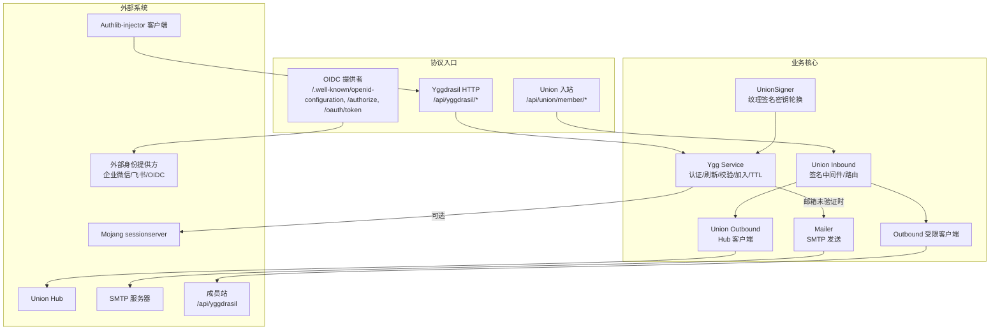

图表来源
- [http.go:56-103](https://github.com/YimingZhanshen/skin-nexus/blob/797ae1a/server/internal/ygg/http.go#L56-L103)
- [outbound.go:20-40](https://github.com/YimingZhanshen/skin-nexus/blob/797ae1a/server/internal/union/outbound.go#L20-L40)
- [signer.go:24-46](https://github.com/YimingZhanshen/skin-nexus/blob/797ae1a/server/internal/union/signer.go#L24-L46)
- [provider.go:23-39](https://github.com/YimingZhanshen/skin-nexus/blob/797ae1a/server/internal/oidc/provider.go#L23-L39)
- [mailer.go:19-38](https://github.com/YimingZhanshen/skin-nexus/blob/797ae1a/server/internal/mailer/mailer.go#L19-L38)
- [outbound.go:12-23](https://github.com/YimingZhanshen/skin-nexus/blob/797ae1a/server/internal/outbound/outbound.go#L12-L23)

章节来源
- [http.go:56-103](https://github.com/YimingZhanshen/skin-nexus/blob/797ae1a/server/internal/ygg/http.go#L56-L103)
- [outbound.go:20-40](https://github.com/YimingZhanshen/skin-nexus/blob/797ae1a/server/internal/union/outbound.go#L20-L40)
- [signer.go:24-46](https://github.com/YimingZhanshen/skin-nexus/blob/797ae1a/server/internal/union/signer.go#L24-L46)
- [provider.go:23-39](https://github.com/YimingZhanshen/skin-nexus/blob/797ae1a/server/internal/oidc/provider.go#L23-L39)
- [mailer.go:19-38](https://github.com/YimingZhanshen/skin-nexus/blob/797ae1a/server/internal/mailer/mailer.go#L19-L38)
- [outbound.go:12-23](https://github.com/YimingZhanshen/skin-nexus/blob/797ae1a/server/internal/outbound/outbound.go#L12-L23)

## 核心组件
- Yggdrasil 协议层：提供 `/api/yggdrasil/{authserver,sessionserver,api}` 系列端点，返回 legacy 兼容 JSON，支持 metadata、authenticate、refresh、validate、invalidate、signout、join、hasJoined、profile、bulk profile lookup。
- Mojang Fallback：本地 miss 时尝试 Mojang sessionserver，但严格限制目标、重定向、地址族、响应大小与 JSON 合理性。
- TTL 双窗口：对 token 执行“软窗口”和“硬窗口”，validate/join 在软过期后拒绝，refresh 仍可在硬窗口内续期。
- Union 入站：所有 hub→member 请求经签名中间件校验，再路由至更新列表、更新私钥、同步、UUID remap、诊断、邮箱查询等。
- Union 出站：带 member key 的请求访问 Hub，涵盖 serverlist、privatekey、sync、bind、security level、OAuth2 backend key、黑名单代理等。
- UnionSigner：可热切换 hub 下发的纹理签名密钥，保留 local fallback，并具备自动轮换、异常暂停、每日变更预算审计。
- 成员站名解析：从每个成员的 `/api/yggdrasil` 读取 `meta.serverName`，带 TTL、失败窗口、并发 worker、Sweep 清理。
- OIDC 提供者：提供 discovery、userinfo、device flow、token 管理，注入共享 client、scope 与 claim 契约。
- 邮件服务：纯标准库 SMTP，支持隐式 TLS、STARTTLS、PLAIN 认证、预算窗口、一次回退重试、提交后禁止重复投递。
- 受限出站客户端：仅允许 HTTPS/HTTP、指定端口、白名单主机、无 userinfo、无重定向、响应大小上限、公共 IP 拨号。

章节来源
- [http.go:56-103](https://github.com/YimingZhanshen/skin-nexus/blob/797ae1a/server/internal/ygg/http.go#L56-L103)
- [fallback.go:17-38](https://github.com/YimingZhanshen/skin-nexus/blob/797ae1a/server/internal/ygg/fallback.go#L17-L38)
- [ttl_test.go:12-27](https://github.com/YimingZhanshen/skin-nexus/blob/797ae1a/server/internal/ygg/ttl_test.go#L12-L27)
- [inbound.go:22-44](https://github.com/YimingZhanshen/skin-nexus/blob/797ae1a/server/internal/union/inbound.go#L22-L44)
- [outbound.go:20-40](https://github.com/YimingZhanshen/skin-nexus/blob/797ae1a/server/internal/union/outbound.go#L20-L40)
- [signer.go:24-46](https://github.com/YimingZhanshen/skin-nexus/blob/797ae1a/server/internal/union/signer.go#L24-L46)
- [membernames.go:14-38](https://github.com/YimingZhanshen/skin-nexus/blob/797ae1a/server/internal/union/membernames.go#L14-L38)
- [provider.go:23-39](https://github.com/YimingZhanshen/skin-nexus/blob/797ae1a/server/internal/oidc/provider.go#L23-L39)
- [mailer.go:19-38](https://github.com/YimingZhanshen/skin-nexus/blob/797ae1a/server/internal/mailer/mailer.go#L19-L38)
- [outbound.go:12-23](https://github.com/YimingZhanshen/skin-nexus/blob/797ae1a/server/internal/outbound/outbound.go#L12-L23)

## 架构总览
下图展示客户端与外部系统之间的主要交互路径：

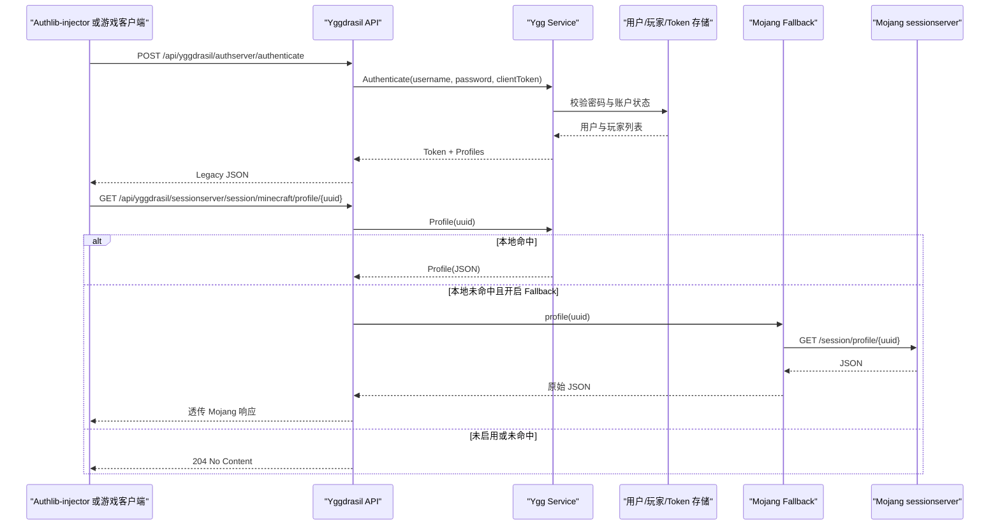

图表来源
- [http.go:56-103](https://github.com/YimingZhanshen/skin-nexus/blob/797ae1a/server/internal/ygg/http.go#L56-L103)
- [http.go:240-340](https://github.com/YimingZhanshen/skin-nexus/blob/797ae1a/server/internal/ygg/http.go#L240-L340)
- [http.go:430-500](https://github.com/YimingZhanshen/skin-nexus/blob/797ae1a/server/internal/ygg/http.go#L430-L500)
- [fallback.go:78-135](https://github.com/YimingZhanshen/skin-nexus/blob/797ae1a/server/internal/ygg/fallback.go#L78-L135)

## 详细组件分析

### Yggdrasil 协议与 Mojang Fallback
Yggdrasil API 将 legacy 行为冻结为稳定契约：错误体统一为 `{error, errorMessage, cause?}`，缺失资源使用 204，非 JSON POST 返回 200 + 错误体，而不是直接 4xx。Authenticate 与 Refresh 还叠加了 IP 滑动窗口限流与同用户名最小间隔保护。

Mojang Fallback 是 A2 最小兼容集：当本地没有对应 profile 或 join 信息时，才向 Mojang sessionserver 发起请求。其防护包括：
- BaseURL 固定，仅允许相同 scheme/host；
- UUID 必须为 32 位小写十六进制；
- 用户名必须符合 Mojang 字符集；
- 不跟随重定向；
- 只拨号公网 IP，拒绝环回、RFC1918、CGNAT、未指定地址；
- 响应最大 1 MiB；
- 响应必须能反序列化为带 `id` 和 `name` 的 JSON 对象。

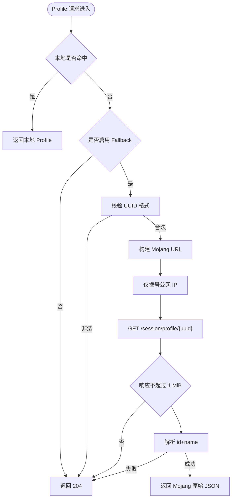

图表来源
- [fallback.go:78-135](https://github.com/YimingZhanshen/skin-nexus/blob/797ae1a/server/internal/ygg/fallback.go#L78-L135)
- [fallback.go:137-200](https://github.com/YimingZhanshen/skin-nexus/blob/797ae1a/server/internal/ygg/fallback.go#L137-L200)

#### 协议示例
- 获取元数据：
  ```
  curl -s https://your-site.example.com/api/yggdrasil | jq .
  ```
- 登录：
  ```
  curl -X POST https://your-site.example.com/api/yggdrasil/authserver/authenticate \
    -H "Content-Type: application/json" \
    -d '{"username":"Steve","password":"secret","clientToken":"ct","requestUser":true}'
  ```
- 刷新：
  ```
  curl -X POST https://your-site.example.com/api/yggdrasil/authserver/refresh \
    -H "Content-Type: application/json" \
    -d '{"accessToken":"at","clientToken":"ct","requestUser":false}'
  ```
- 校验：
  ```
  curl -v -X POST https://your-site.example.com/api/yggdrasil/authserver/validate \
    -H "Content-Type: application/json" \
    -d '{"accessToken":"at","clientToken":"ct"}'
  ```
- 加入服务器：
  ```
  curl -X POST https://your-site.example.com/api/yggdrasil/authserver/session/minecraft/join \
    -H "Content-Type: application/json" \
    -d '{"accessToken":"at","selectedProfile":{"id":"uuid"},"serverId":"sid"}'
  ```
- 查询 profile：
  ```
  curl -s https://your-site.example.com/api/yggdrasil/sessionserver/session/minecraft/profile/{uuid}
  ```
- 批量查询：
  ```
  curl -X POST https://your-site.example.com/api/yggdrasil/api/profiles/minecraft \
    -H "Content-Type: application/json" \
    -d '["Steve","Alex"]'
  ```

章节来源
- [http.go:56-103](https://github.com/YimingZhanshen/skin-nexus/blob/797ae1a/server/internal/ygg/http.go#L56-L103)
- [http.go:201-260](https://github.com/YimingZhanshen/skin-nexus/blob/797ae1a/server/internal/ygg/http.go#L201-L260)
- [http.go:240-340](https://github.com/YimingZhanshen/skin-nexus/blob/797ae1a/server/internal/ygg/http.go#L240-L340)
- [http.go:430-500](https://github.com/YimingZhanshen/skin-nexus/blob/797ae1a/server/internal/ygg/http.go#L430-L500)
- [fallback.go:78-135](https://github.com/YimingZhanshen/skin-nexus/blob/797ae1a/server/internal/ygg/fallback.go#L78-L135)
- [fallback.go:137-200](https://github.com/YimingZhanshen/skin-nexus/blob/797ae1a/server/internal/ygg/fallback.go#L137-L200)

### TTL 缓存与诊断
Ygg 的 Token 双 TTL 策略遵循上游 Passport 语义：
- 小于软窗口：validate/join/refresh 均通过；
- 软窗口到硬窗口之间：validate/join 拒绝，refresh 仍可签发新 token；
- 超过硬窗口：两者都拒绝；
- 被标记 invalidated 的 token 始终失效；
- CreatedAt 为零且已软过期的 token 无法恢复；
- 改名 squeeze 会把 expires_at 压缩到改名时刻，使 validate 失败但 refresh 仍有恢复窗口。

诊断方面，Ygg API 通过 accesslog 记录 authenticate、refresh、validate、join、hasJoined、profile 等请求，支持最佳努力 capture，只在超级管理员诊断窗口打开时携带敏感详情。

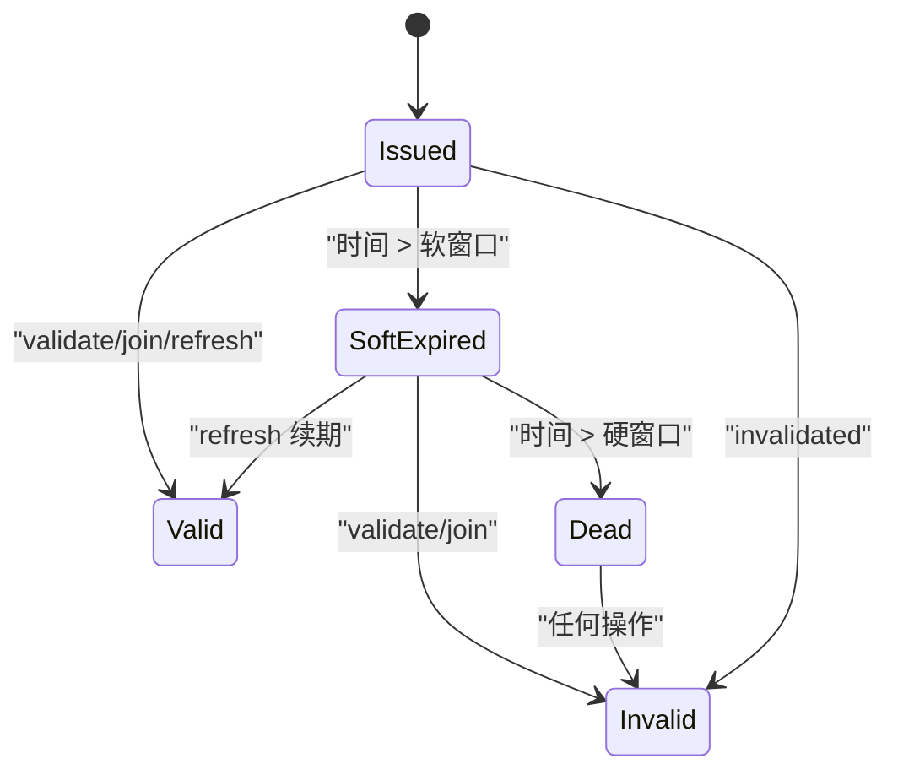

图表来源
- [ttl_test.go:12-27](https://github.com/YimingZhanshen/skin-nexus/blob/797ae1a/server/internal/ygg/ttl_test.go#L12-L27)
- [ttl_test.go:60-120](https://github.com/YimingZhanshen/skin-nexus/blob/797ae1a/server/internal/ygg/ttl_test.go#L60-L120)

章节来源
- [ttl_test.go:12-27](https://github.com/YimingZhanshen/skin-nexus/blob/797ae1a/server/internal/ygg/ttl_test.go#L12-L27)
- [ttl_test.go:60-120](https://github.com/YimingZhanshen/skin-nexus/blob/797ae1a/server/internal/ygg/ttl_test.go#L60-L120)
- [http.go:56-103](https://github.com/YimingZhanshen/skin-nexus/blob/797ae1a/server/internal/ygg/http.go#L56-L103)

### 纹理与 PNG 解析、UUID/PNG 生命周期
Ygg 的 textures property 由 `AssembleTextures` 构造：
- 输出 `textures` 字段永远不是 null，空地图会序列化为 `{}`；
- SKIN 可附带 `metadata.model`，区分 default 与 slim；
- CAPE 单独条目；
- value 是 base64 编码的 JSON；
- hasJoined 和 unsigned=false 请求会附加 RSA-SHA1 签名；
- uploadableTextures 值镜像 legacy 行为；
- UUID 在模型中保持 32 位小写十六进制，不含连字符。

PNG 解析本身不在该文件中展开，但 textures 的 value 通常承载 skin.png 与 texture.json 的 base64 数据；服务端会在 account/texture 管线中完成解码、去重与存储，而 Ygg 层只做序列化与签名。

章节来源
- [models.go:1-105](https://github.com/YimingZhanshen/skin-nexus/blob/797ae1a/server/internal/ygg/models.go#L1-L105)
- [service.go:24-74](https://github.com/YimingZhanshen/skin-nexus/blob/797ae1a/server/internal/ygg/service.go#L24-L74)

### MUA Union 成员站模块

#### 三头验签入站
Union 入站 API 将所有 hub→member 请求交给签名中间件校验。受保护路由包括 updateList、updatePrivateKey、updateBackendKey、sync、remapUUID、diagnose、queryEmail 和预留的 updatePlugin。自检描述路由 `/api/union/member` 及其无斜杠形式公开可用，供跨站浏览器读取。

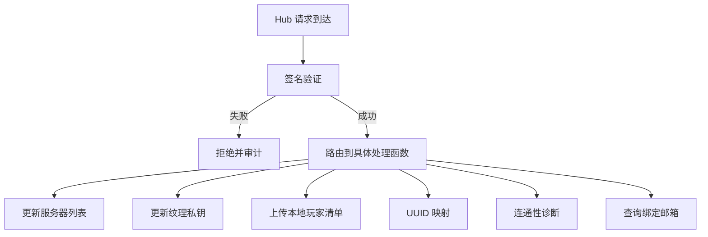

图表来源
- [inbound.go:60-110](https://github.com/YimingZhanshen/skin-nexus/blob/797ae1a/server/internal/union/inbound.go#L60-L110)
- [inbound.go:112-200](https://github.com/YimingZhanshen/skin-nexus/blob/797ae1a/server/internal/union/inbound.go#L112-L200)

章节来源
- [inbound.go:22-44](https://github.com/YimingZhanshen/skin-nexus/blob/797ae1a/server/internal/union/inbound.go#L22-L44)
- [inbound.go:60-110](https://github.com/YimingZhanshen/skin-nexus/blob/797ae1a/server/internal/union/inbound.go#L60-L110)
- [inbound.go:112-200](https://github.com/YimingZhanshen/skin-nexus/blob/797ae1a/server/internal/union/inbound.go#L112-L200)

#### 成员站名解析
Hub 的 serverlist 中 name 可能为空，因此成员显示名称由本端后台向每个成员的 `/api/yggdrasil` 拉取。该过程：
- 只请求固定路径 `/api/yggdrasil`，不会拼接用户输入的路径；
- 通过受限出站客户端访问，要求公网 IP、白名单主机、端口 80/443、无重定向、响应大小限制；
- 结果按 host 缓存，默认 TTL 24 小时，失败结果缓存 30 分钟；
- 并发 worker 默认 6，整体 Sweep 超时默认 90 秒；
- 成员名称最多 120 个 rune，防止长文本污染页面；
- 如果关闭功能，已学到的名称也不再继续服务。

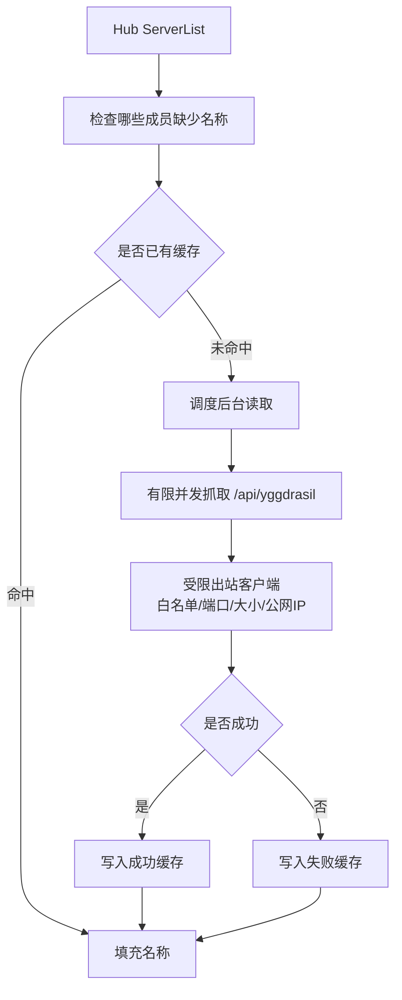

图表来源
- [membernames.go:14-38](https://github.com/YimingZhanshen/skin-nexus/blob/797ae1a/server/internal/union/membernames.go#L14-L38)
- [membernames.go:74-140](https://github.com/YimingZhanshen/skin-nexus/blob/797ae1a/server/internal/union/membernames.go#L74-L140)
- [membernames.go:142-200](https://github.com/YimingZhanshen/skin-nexus/blob/797ae1a/server/internal/union/membernames.go#L142-L200)
- [outbound.go:12-23](https://github.com/YimingZhanshen/skin-nexus/blob/797ae1a/server/internal/outbound/outbound.go#L12-L23)

章节来源
- [membernames.go:14-38](https://github.com/YimingZhanshen/skin-nexus/blob/797ae1a/server/internal/union/membernames.go#L14-L38)
- [membernames.go:74-140](https://github.com/YimingZhanshen/skin-nexus/blob/797ae1a/server/internal/union/membernames.go#L74-L140)
- [membernames.go:142-200](https://github.com/YimingZhanshen/skin-nexus/blob/797ae1a/server/internal/union/membernames.go#L142-L200)

#### 安全级别徽章
安全级别由两步决定：
1. 用当前 member key 换取短 code；
2. 用 code 查询 `/backend/{code}/security/level`。

解析器同时容忍 hub 返回数字或字符串形式的级别，但不能解析或为空时会报错，而不是降级为 0。零级代表“未在联盟黑名单上”，并非“未知”。

章节来源
- [outbound.go:520-620](https://github.com/YimingZhanshen/skin-nexus/blob/797ae1a/server/internal/union/outbound.go#L520-L620)

#### 跨站绑定
跨站绑定流程：
- 发起方调用 `/profile/bind` 获得 2 分钟有效 token；
- 接收方调用 `/profile/bindto` 完成绑定；
- 支持 `/profile/unbind` 解绑；
- 支持 `/profile/remapuuid` 跨联盟 UUID 重映射；
- 支持 `/profile/unmapped/byname/{name}` 列出名称冲突候选；
- 支持 `/profile/detail/{uuid}` 查看绑定详情；
- 部分字段保持 json.RawMessage，避免 hub 侧字段漂移破坏解析。

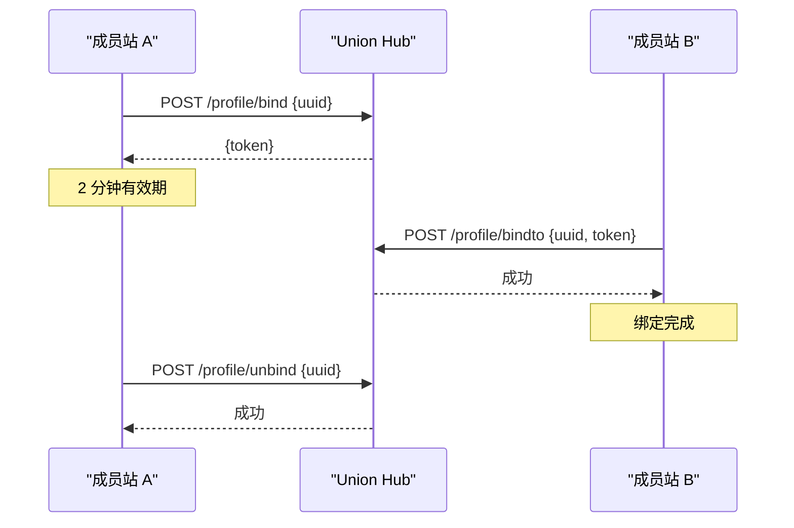

图表来源
- [outbound.go:600-660](https://github.com/YimingZhanshen/skin-nexus/blob/797ae1a/server/internal/union/outbound.go#L600-L660)

章节来源
- [outbound.go:600-660](https://github.com/YimingZhanshen/skin-nexus/blob/797ae1a/server/internal/union/outbound.go#L600-L660)

#### 同步与出站请求
成员站需要把本地玩家清单同步给 Hub，并在玩家创建、改名、删除时上报事件。Outbound 还提供 serverlist、privatekey、host public key、diagnose、OAuth2 backend key、黑名单代理等能力。所有出站请求都带 `X-Union-Member-Key`，并由 `doJSON`/`roundTrip` 统一封装，带超时、日志与错误包装。

章节来源
- [outbound.go:20-40](https://github.com/YimingZhanshen/skin-nexus/blob/797ae1a/server/internal/union/outbound.go#L20-L40)
- [outbound.go:300-380](https://github.com/YimingZhanshen/skin-nexus/blob/797ae1a/server/internal/union/outbound.go#L300-L380)
- [outbound.go:480-520](https://github.com/YimingZhanshen/skin-nexus/blob/797ae1a/server/internal/union/outbound.go#L480-L520)

#### 纹理签名密钥轮换
UnionSigner 支持三种模式：
- disabled：完全禁用；
- local：使用本地 fallback 签名；
- union-managed：使用 Hub 下发的私钥签名。

轮换策略：
- 每 10 到 15 分钟加抖动轮询 `/privatekey`；
- 指纹变化才切换；
- 每天超过 3 次变更自动暂停轮换；
- 可通过面板恢复轮换；
- 支持手动 SetKey、RestoreKey、ForceRotation；
- 每次切换审计版本与指纹；
- 持久化失败也审计，但不阻止密钥生效。

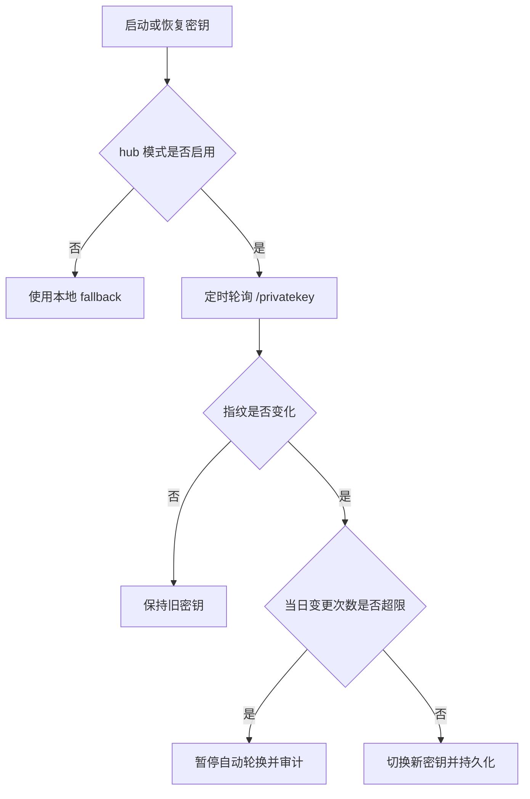

图表来源
- [signer.go:24-46](https://github.com/YimingZhanshen/skin-nexus/blob/797ae1a/server/internal/union/signer.go#L24-L46)
- [signer.go:200-270](https://github.com/YimingZhanshen/skin-nexus/blob/797ae1a/server/internal/union/signer.go#L200-L270)
- [signer.go:300-444](https://github.com/YimingZhanshen/skin-nexus/blob/797ae1a/server/internal/union/signer.go#L300-L444)

章节来源
- [signer.go:24-46](https://github.com/YimingZhanshen/skin-nexus/blob/797ae1a/server/internal/union/signer.go#L24-L46)
- [signer.go:200-270](https://github.com/YimingZhanshen/skin-nexus/blob/797ae1a/server/internal/union/signer.go#L200-L270)
- [signer.go:300-444](https://github.com/YimingZhanshen/skin-nexus/blob/797ae1a/server/internal/union/signer.go#L300-L444)

### OIDC 作为第三方登录提供者
OIDC Provider 基于 zitadel/oidc 实现，职责包括：
- 发布 discovery 文档，注入 shared_client_id、scopes_supported、claims_supported；
- 暴露 authorize、token、introspect、revoke、end_session、keys、device_authorization；
- 提供 /userinfo 与 yggc/userinfo；
- 支持 device flow，配置设备表单路径、有效期与轮询间隔；
- 维护客户端、授权记录、access_token、refresh_token；
- 提供 /api/v1/oidc/tokens 查询与撤销界面。

与传统 OAuth2/OIDC 对接企业微信、飞书等外部身份提供方时，通常由外部 IdP 充当 OIDC 上游，本系统作为 OP 暴露给 launcher 或客户端。若外部 IdP 不直接支持 OIDC，则需要在更上层做协议适配；本仓库中的 oidc 模块更适合作为本系统的身份中心，再由外部 IdP 与本系统对接。

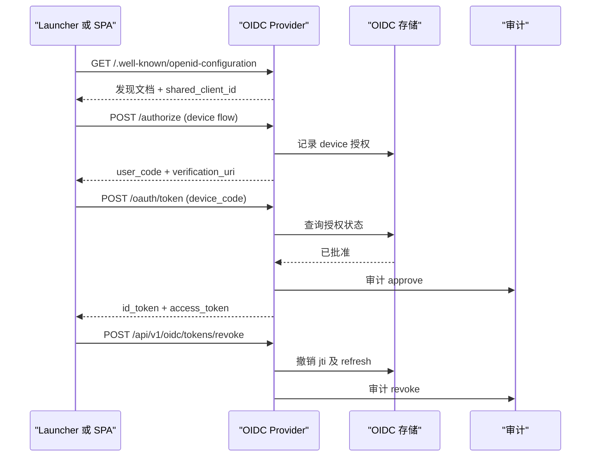

图表来源
- [provider.go:23-39](https://github.com/YimingZhanshen/skin-nexus/blob/797ae1a/server/internal/oidc/provider.go#L23-L39)
- [provider.go:140-200](https://github.com/YimingZhanshen/skin-nexus/blob/797ae1a/server/internal/oidc/provider.go#L140-L200)
- [userapi.go:16-124](https://github.com/YimingZhanshen/skin-nexus/blob/797ae1a/server/internal/oidc/userapi.go#L16-L124)

章节来源
- [provider.go:23-39](https://github.com/YimingZhanshen/skin-nexus/blob/797ae1a/server/internal/oidc/provider.go#L23-L39)
- [provider.go:140-200](https://github.com/YimingZhanshen/skin-nexus/blob/797ae1a/server/internal/oidc/provider.go#L140-L200)
- [userapi.go:16-124](https://github.com/YimingZhanshen/skin-nexus/blob/797ae1a/server/internal/oidc/userapi.go#L16-L124)

### 邮件通知、邀请码与邮箱验证
邮件服务通过 SMTP 发送三类信：
- 密码重置；
- 邮箱验证；
- 管理面板测试邮件。

发送流程：
- 根据 SiteName 生成 subject；
- 使用 webi18n 生成多语言 text/html 内容；
- 选择隐式 TLS 或 STARTTLS；
- 使用 PLAIN 认证；
- 设置 dial window 与 session budget；
- 第一次失败后，若仍在预算内且错误可重试，等待 500ms 回退重试一次；
- 一旦 server 接受 DATA，不再重试，防止重复投递；
- 失败分类区分 DNS 临时错误、网络超时、连接中断、灰色列表等。

邮箱验证令牌：
- 只存 digest，不存明文；
- 单用户同一时刻只有一个未使用令牌；
- 过期与已使用行定期清理；
- Consume 原子更新 used_at，并返回 uid；
- 未知、过期、已使用统一返回 NotFound，避免状态预言机。

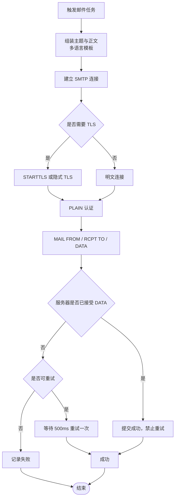

图表来源
- [mailer.go:60-120](https://github.com/YimingZhanshen/skin-nexus/blob/797ae1a/server/internal/mailer/mailer.go#L60-L120)
- [mailer.go:120-200](https://github.com/YimingZhanshen/skin-nexus/blob/797ae1a/server/internal/mailer/mailer.go#L120-L200)
- [retry.go:1-63](https://github.com/YimingZhanshen/skin-nexus/blob/797ae1a/server/internal/mailer/retry.go#L1-L63)
- [mail.go:20-120](https://github.com/YimingZhanshen/skin-nexus/blob/797ae1a/server/internal/webi18n/mail.go#L20-L120)
- [email_verify.go:12-79](https://github.com/YimingZhanshen/skin-nexus/blob/797ae1a/server/internal/store/email_verify.go#L12-L79)

章节来源
- [mailer.go:60-120](https://github.com/YimingZhanshen/skin-nexus/blob/797ae1a/server/internal/mailer/mailer.go#L60-L120)
- [mailer.go:120-200](https://github.com/YimingZhanshen/skin-nexus/blob/797ae1a/server/internal/mailer/mailer.go#L120-L200)
- [retry.go:1-63](https://github.com/YimingZhanshen/skin-nexus/blob/797ae1a/server/internal/mailer/retry.go#L1-L63)
- [mail.go:20-120](https://github.com/YimingZhanshen/skin-nexus/blob/797ae1a/server/internal/webi18n/mail.go#L20-L120)
- [email_verify.go:12-79](https://github.com/YimingZhanshen/skin-nexus/blob/797ae1a/server/internal/store/email_verify.go#L12-L79)

### 出站请求封装 outbound 的安全限制
受限出站客户端主要用于主题市场、皮肤市场和成员站名解析等受控下载场景，核心限制如下：
- 方法仅限 GET；
- 仅允许 http 与 https；
- 不允许 userinfo；
- 仅允许 80 与 443；
- 主机必须在白名单中，支持通配子域；
- 不跟随重定向；
- 响应长度先检查 Content-Length，再用 LimitReader 读一个字节验证；
- 拨号前解析全部 IP，只允许全局单播地址，拒绝环回、链路本地、私有网段、CGNAT、6to4、Teredo；
- 关闭 keep-alive，设置 TLS 握手与响应头超时。

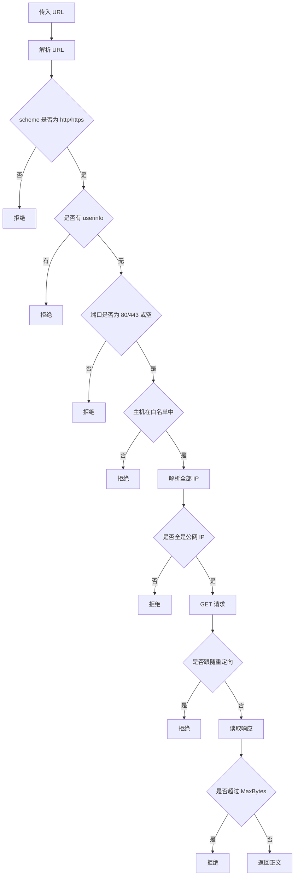

图表来源
- [outbound.go:12-23](https://github.com/YimingZhanshen/skin-nexus/blob/797ae1a/server/internal/outbound/outbound.go#L12-L23)
- [outbound.go:30-80](https://github.com/YimingZhanshen/skin-nexus/blob/797ae1a/server/internal/outbound/outbound.go#L30-L80)
- [outbound.go:80-167](https://github.com/YimingZhanshen/skin-nexus/blob/797ae1a/server/internal/outbound/outbound.go#L80-L167)

章节来源
- [outbound.go:12-23](https://github.com/YimingZhanshen/skin-nexus/blob/797ae1a/server/internal/outbound/outbound.go#L12-L23)
- [outbound.go:30-80](https://github.com/YimingZhanshen/skin-nexus/blob/797ae1a/server/internal/outbound/outbound.go#L30-L80)
- [outbound.go:80-167](https://github.com/YimingZhanshen/skin-nexus/blob/797ae1a/server/internal/outbound/outbound.go#L80-L167)

## 依赖关系分析
Ygg 层依赖存储抽象、限流器、verifygate 与插件钩子；Union 入站依赖签名者、Outbound、Grantor、Hooks 与审计；UnionSigner 依赖 Outbound 与 ygg.Signer；OIDC Provider 依赖 zitadel/oidc、存储后端与审计；Mailer 依赖标准库 net/smtp；Outbound 受限客户端独立于其他协议，被多个子系统复用。

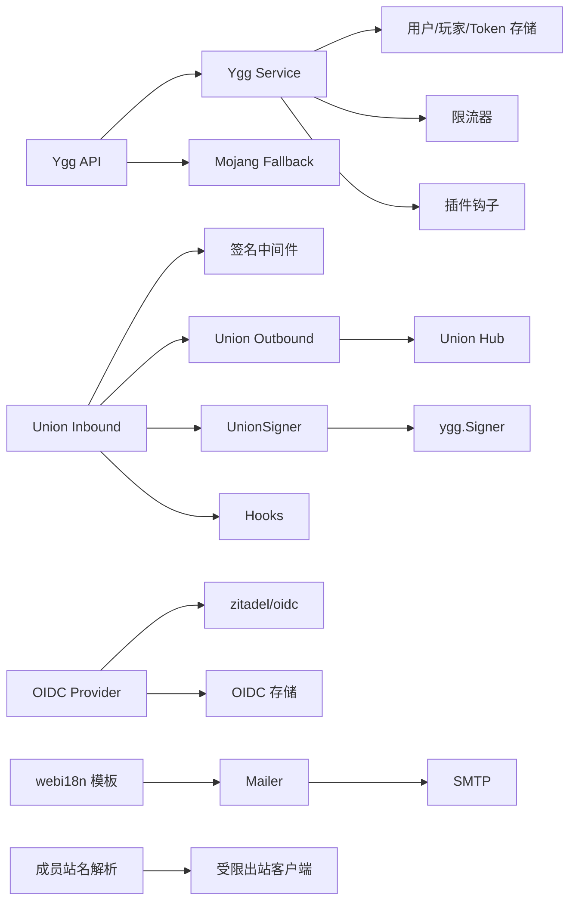

图表来源
- [service.go:24-74](https://github.com/YimingZhanshen/skin-nexus/blob/797ae1a/server/internal/ygg/service.go#L24-L74)
- [http.go:56-103](https://github.com/YimingZhanshen/skin-nexus/blob/797ae1a/server/internal/ygg/http.go#L56-L103)
- [inbound.go:22-44](https://github.com/YimingZhanshen/skin-nexus/blob/797ae1a/server/internal/union/inbound.go#L22-L44)
- [outbound.go:20-40](https://github.com/YimingZhanshen/skin-nexus/blob/797ae1a/server/internal/union/outbound.go#L20-L40)
- [signer.go:24-46](https://github.com/YimingZhanshen/skin-nexus/blob/797ae1a/server/internal/union/signer.go#L24-L46)
- [provider.go:23-39](https://github.com/YimingZhanshen/skin-nexus/blob/797ae1a/server/internal/oidc/provider.go#L23-L39)
- [mailer.go:19-38](https://github.com/YimingZhanshen/skin-nexus/blob/797ae1a/server/internal/mailer/mailer.go#L19-L38)
- [outbound.go:12-23](https://github.com/YimingZhanshen/skin-nexus/blob/797ae1a/server/internal/outbound/outbound.go#L12-L23)

章节来源
- [service.go:24-74](https://github.com/YimingZhanshen/skin-nexus/blob/797ae1a/server/internal/ygg/service.go#L24-L74)
- [http.go:56-103](https://github.com/YimingZhanshen/skin-nexus/blob/797ae1a/server/internal/ygg/http.go#L56-L103)
- [inbound.go:22-44](https://github.com/YimingZhanshen/skin-nexus/blob/797ae1a/server/internal/union/inbound.go#L22-L44)
- [outbound.go:20-40](https://github.com/YimingZhanshen/skin-nexus/blob/797ae1a/server/internal/union/outbound.go#L20-L40)
- [signer.go:24-46](https://github.com/YimingZhanshen/skin-nexus/blob/797ae1a/server/internal/union/signer.go#L24-L46)
- [provider.go:23-39](https://github.com/YimingZhanshen/skin-nexus/blob/797ae1a/server/internal/oidc/provider.go#L23-L39)
- [mailer.go:19-38](https://github.com/YimingZhanshen/skin-nexus/blob/797ae1a/server/internal/mailer/mailer.go#L19-L38)
- [outbound.go:12-23](https://github.com/YimingZhanshen/skin-nexus/blob/797ae1a/server/internal/outbound/outbound.go#L12-L23)

## 性能与容量特性
- Ygg 认证接口建议开启 IP 滑动窗口与同用户名 gap throttle，避免暴力破解；search profile 默认上限 5，可配置。
- Join Session TTL 为 120 秒，符合 legacy 部署。
- Mojang Fallback 单次请求超时 4 秒，响应最大 1 MiB，空闲连接池每主机 4，空闲超时 30 秒。
- UnionSigner 轮换周期 10-15 分钟加抖动，日变更超 3 次自动暂停。
- 成员站名解析默认 6 个 worker，TTL 24 小时，失败 TTL 30 分钟，Sweep 90 秒。
- Mailer 默认 dial 10 秒、session 30 秒，可配置 Budget；失败最多回退一次。
- 受限出站客户端默认超时 4 秒、最大响应 1 MiB，关闭 keep-alive。

[本节为通用指导，不直接分析具体代码片段]

## 联调与排错清单

### Yggdrasil 联调
- 确认 `/api/yggdrasil` 元数据返回 `signaturePublickey` 与 `skinDomains`；
- 检查 authenticate 是否返回 ForbiddenOperationException 或 TooManyRequests；
- 检查 refresh 是否接受 `{id}` 与 bare UUID 两种 selectedProfile 形式；
- 检查 validate 与 invalidate 是否返回 204；
- 检查 join 是否因邮箱未验证或 player mismatch 返回 ForbiddenOperationException；
- 检查 profile 是否返回 204、本地 JSON 或 Mojang Fallback 透传；
- 开启 accesslog 诊断窗口，观察 authenticate/refresh/validate/join/profile 的 Outcome、Who、Detail；
- 若启用 Mojang Fallback，确认开关、BaseURL、UUID 格式、用户名字符集、公网 IP 拨号、1 MiB 限制与 JSON 合理性。

### Union 成员站联调
- 确认 `/api/union/member` 自检文档可被浏览器跨域读取；
- 确认 updateList、updatePrivateKey、updateBackendKey、sync、remapuuid、diagnose、queryemail 均经过签名中间件；
- 确认 privatekey 轮换后，Texture URL 签名使用新密钥，旧签名仍然有效；
- 确认 daily rotation 超过 3 次后自动暂停，需要人工 ResumeRotation；
- 确认 SecurityLevelNow 先换 code 再查 level，不能把 hub 不可达误判为 0 级；
- 确认 bind/bindto/unbind/remapuuid/unmapped/detail 路径参数正确转义；
- 使用 diagnose 端点检查 hub 连通性、TLS、时钟差异与原因分类。

### OIDC 联调
- 确认 `/.well-known/openid-configuration` 返回 shared_client_id、RS256、scopes 与 claims；
- 确认 authorize、token、userinfo、revoke、end_session、keys、device_authorization 均可访问；
- 确认 device flow 的用户码、轮询间隔、表单路径与过期时间符合预期；
- 使用 `/api/v1/oidc/tokens` 查看授权应用，使用 revoke 撤销单个或全部；
- 对外部 IdP 对接时，优先确认 IdP 是否原生支持 OIDC；若不支持，应先在外部做协议桥接。

### 邮件服务联调
- 确认 Host、Port、User、Pass、From、SiteName 配置完整；
- 确认 465 走隐式 TLS，其他端口走 STARTTLS；
- 确认 Subject 与正文使用当前语言；
- 确认失败时是否出现可重试错误；
- 确认服务器接受 DATA 后不会重复投递；
- 检查邮箱验证令牌是否只存 digest，是否单用户单活令牌，是否按时清理。

### 受限出站联调
- 确认只允许白名单主机；
- 确认不支持非 80/443 端口；
- 确认 userinfo 被拒绝；
- 确认重定向被拒绝；
- 确认响应大小超过 MaxBytes 被拒绝；
- 确认域名解析后所有 IP 都是全局单播。

章节来源
- [http.go:56-103](https://github.com/YimingZhanshen/skin-nexus/blob/797ae1a/server/internal/ygg/http.go#L56-L103)
- [http.go:240-500](https://github.com/YimingZhanshen/skin-nexus/blob/797ae1a/server/internal/ygg/http.go#L240-L500)
- [fallback.go:78-200](https://github.com/YimingZhanshen/skin-nexus/blob/797ae1a/server/internal/ygg/fallback.go#L78-L200)
- [inbound.go:60-200](https://github.com/YimingZhanshen/skin-nexus/blob/797ae1a/server/internal/union/inbound.go#L60-L200)
- [outbound.go:480-620](https://github.com/YimingZhanshen/skin-nexus/blob/797ae1a/server/internal/union/outbound.go#L480-L620)
- [signer.go:200-444](https://github.com/YimingZhanshen/skin-nexus/blob/797ae1a/server/internal/union/signer.go#L200-L444)
- [provider.go:140-200](https://github.com/YimingZhanshen/skin-nexus/blob/797ae1a/server/internal/oidc/provider.go#L140-L200)
- [userapi.go:16-124](https://github.com/YimingZhanshen/skin-nexus/blob/797ae1a/server/internal/oidc/userapi.go#L16-L124)
- [mailer.go:60-200](https://github.com/YimingZhanshen/skin-nexus/blob/797ae1a/server/internal/mailer/mailer.go#L60-L200)
- [retry.go:1-63](https://github.com/YimingZhanshen/skin-nexus/blob/797ae1a/server/internal/mailer/retry.go#L1-L63)
- [email_verify.go:12-79](https://github.com/YimingZhanshen/skin-nexus/blob/797ae1a/server/internal/store/email_verify.go#L12-L79)
- [outbound.go:30-167](https://github.com/YimingZhanshen/skin-nexus/blob/797ae1a/server/internal/outbound/outbound.go#L30-L167)

## 结论
Yggdrasil 实现以 frozen legacy contract 为核心，保证 authlib-injector 与原版 Minecraft 客户端都能接入；Mojang Fallback 仅在本地 miss 时谨慎探活，绝不改变本地命中行为。MUA Union 通过三头验签、受限出站、密钥轮换与安全级别查询，把成员站与 Hub 的连接控制在可观测、可审计、可恢复的范围。OIDC 在本系统中作为身份提供者，对外暴露标准化 discovery 与 token 能力；邮件服务以标准库 SMTP 实现最小依赖发送，配合 webi18n 模板与 store 令牌机制完成通知与验证。outbound 受限客户端则为皮肤、主题与成员站名解析提供统一的 SSRF 与体积防护。联调时应优先检查协议入口、签名与限流、TTL 与 Fallback、Hub 连通性与 SMTP 配置，再逐步定位下游存储与外部 IdP。
