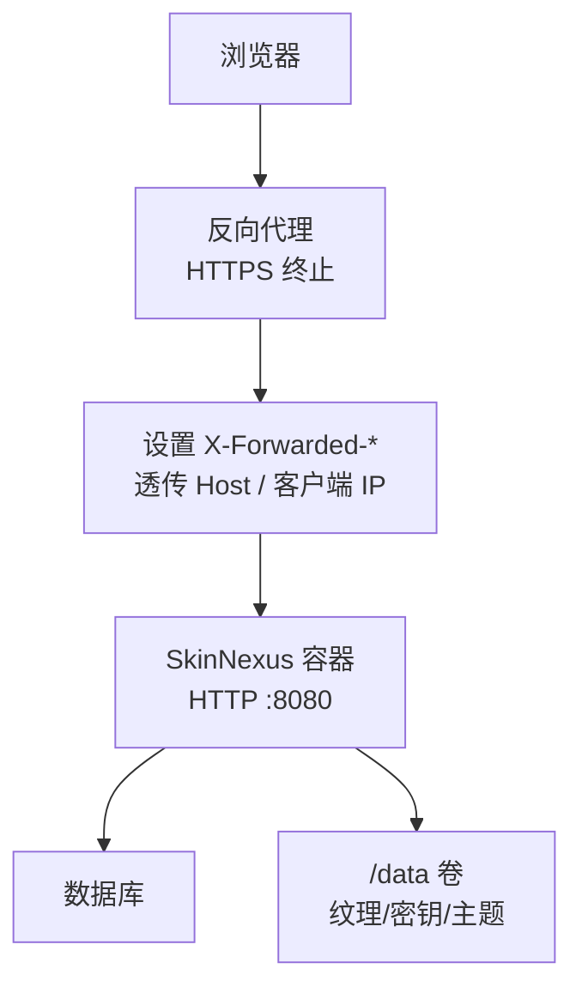
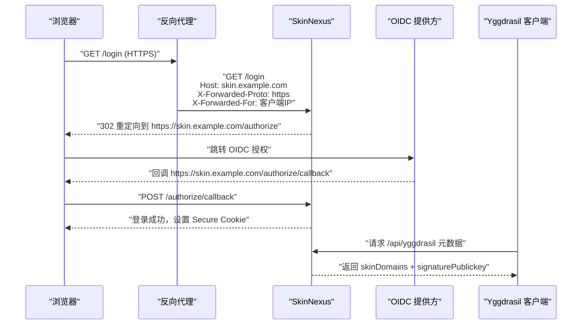
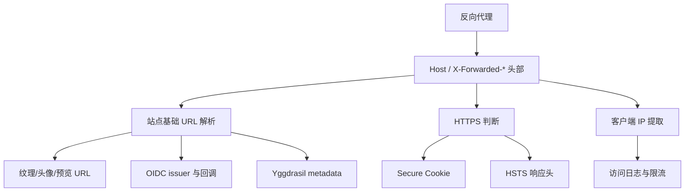

# 反向代理配置

**本文引用的文件**
- [server/cmd/skin-nexus/server.go](https://github.com/YimingZhanshen/skin-nexus/blob/797ae1a/server/cmd/skin-nexus/server.go)
- [Dockerfile](https://github.com/YimingZhanshen/skin-nexus/blob/797ae1a/Dockerfile)
- [docker-compose.yml](https://github.com/YimingZhanshen/skin-nexus/blob/797ae1a/docker-compose.yml)
- [README.md](https://github.com/YimingZhanshen/skin-nexus/blob/797ae1a/README.md)
- [server/internal/siteurl/siteurl.go](https://github.com/YimingZhanshen/skin-nexus/blob/797ae1a/server/internal/siteurl/siteurl.go)
- [server/internal/oidc/provider.go](https://github.com/YimingZhanshen/skin-nexus/blob/797ae1a/server/internal/oidc/provider.go)
- [server/internal/ygg/http.go](https://github.com/YimingZhanshen/skin-nexus/blob/797ae1a/server/internal/ygg/http.go)
- [server/cmd/skin-nexus/main.go](https://github.com/YimingZhanshen/skin-nexus/blob/797ae1a/server/cmd/skin-nexus/main.go)
- [server/internal/webapi/webapi.go](https://github.com/YimingZhanshen/skin-nexus/blob/797ae1a/server/internal/webapi/webapi.go)
- [server/cmd/skin-nexus/langswitch.go](https://github.com/YimingZhanshen/skin-nexus/blob/797ae1a/server/cmd/skin-nexus/langswitch.go)
- [server/cmd/skin-nexus/security_headers.go](https://github.com/YimingZhanshen/skin-nexus/blob/797ae1a/server/cmd/skin-nexus/security_headers.go)
- [server/internal/plugin/routes.go](https://github.com/YimingZhanshen/skin-nexus/blob/797ae1a/server/internal/plugin/routes.go)

## 目录
1. [引言](#引言)
2. [项目结构与监听端口](#项目结构与监听端口)
3. [核心安全与协议假设](#核心安全与协议假设)
4. [反向代理配置总原则](#反向代理配置总原则)
5. [Nginx 反向代理配置示例](#nginx-反向代理配置示例)
6. [Caddy 反向代理配置示例](#caddy-反向代理配置示例)
7. [Traefik 反向代理配置示例](#traefik-反向代理配置示例)
8. [头部、URL 与 OIDC/Yggdrasil 的关系](#头部url与oidcyggdrasil的关系)
9. [静态资源缓存策略](#静态资源缓存策略)
10. [依赖关系与数据流](#依赖关系与数据流)
11. [性能与超时](#性能与超时)
12. [常见问题排查](#常见问题排查)
13. [结论](#结论)

## 引言
本文面向把 SkinNexus 部署在公网 HTTPS 入口后面的运维人员，给出 Nginx、Caddy、Traefik 三种反向代理的完整配置片段，并解释为什么必须正确传递 `Host`、`X-Forwarded-Proto`、`X-Forwarded-Host`（或等效字段）以及客户端真实 IP。SkinNexus 内部会把这些信息用于：

- 生成绝对皮肤纹理 URL；
- 构造 OIDC issuer、授权回调和 Yggdrasil 元数据地址；
- 判断 Cookie 是否应带 Secure；
- 决定是否发送 HSTS；
- 记录日志中的真实客户端 IP；
- 决定哪些域名可以加载本站皮肤。

如果反代没有按约定转发这些头部，会出现重定向循环、登录失败、CSRF 失败、Yggdrasil 皮肤无法加载、移动端皮肤异常等问题。

## 项目结构与监听端口
SkinNexus 是一个 Go 单二进制应用，通过 Docker 镜像对外暴露 HTTP 服务。容器内默认监听 `:8080`，而不是直接暴露 HTTPS；HTTPS 应由反向代理终止，再把明文 HTTP 转给容器。



**图示来源**
- [Dockerfile:53-68](https://github.com/YimingZhanshen/skin-nexus/blob/797ae1a/Dockerfile#L53-L68)
- [docker-compose.yml:32-52](https://github.com/YimingZhanshen/skin-nexus/blob/797ae1a/docker-compose.yml#L32-L52)

容器运行时通过环境变量 `SKIN_LISTEN=:8080` 控制监听地址，并通过 `EXPOSE 8080` 声明端口。生产部署时，文档建议把宿主端口绑定到 `127.0.0.1:8080:8080`，让外部流量只经过反向代理，不再直接访问容器。

**章节来源**
- [Dockerfile:53-68](https://github.com/YimingZhanshen/skin-nexus/blob/797ae1a/Dockerfile#L53-L68)
- [docker-compose.yml:32-52](https://github.com/YimingZhanshen/skin-nexus/blob/797ae1a/docker-compose.yml#L32-L52)

## 核心安全与协议假设
SkinNexus 对“当前请求是否走 HTTPS”的判断遵循以下顺序：

1. Go 标准库的 `r.TLS != nil`，即直连 TLS；
2. 若为反向代理场景，则检查请求头 `X-Forwarded-Proto` 是否为 `https`。

多个模块都使用这个逻辑：语言切换 Cookie、安全响应头、Web API Cookie、插件路由等。因此，反向代理必须在所有 HTTPS 请求上设置 `X-Forwarded-Proto: https`。

此外，站点根地址由启动参数和运行选项共同决定，优先级是：

- 管理面板中的 `site_url`；
- 旧版 `base_url`；
- 环境变量 `SKIN_BASE_URL`。

该地址被注入到所有绝对 URL 中，包括皮肤纹理 URL、OIDC issuer、Yggdrasil 首页和注册页、邮箱验证链接等。

**章节来源**
- [server/cmd/skin-nexus/langswitch.go:105-124](https://github.com/YimingZhanshen/skin-nexus/blob/797ae1a/server/cmd/skin-nexus/langswitch.go#L105-L124)
- [server/cmd/skin-nexus/security_headers.go:113-153](https://github.com/YimingZhanshen/skin-nexus/blob/797ae1a/server/cmd/skin-nexus/security_headers.go#L113-L153)
- [server/internal/webapi/webapi.go:880-902](https://github.com/YimingZhanshen/skin-nexus/blob/797ae1a/server/internal/webapi/webapi.go#L880-L902)
- [server/cmd/skin-nexus/main.go:205-216](https://github.com/YimingZhanshen/skin-nexus/blob/797ae1a/server/cmd/skin-nexus/main.go#L205-L216)
- [server/cmd/skin-nexus/main.go:1145-1168](https://github.com/YimingZhanshen/skin-nexus/blob/797ae1a/server/cmd/skin-nexus/main.go#L1145-L1168)
- [server/internal/siteurl/siteurl.go:1-87](https://github.com/YimingZhanshen/skin-nexus/blob/797ae1a/server/internal/siteurl/siteurl.go#L1-L87)

## 反向代理配置总原则
无论使用哪种反代软件，都应满足以下目标：

| 项目 | 要求 | 原因 |
| --- | --- | --- |
| HTTPS 终止 | 反代监听 443，持有有效证书；后端只暴露 HTTP | 容器默认只监听 8080 明文 |
| `Host` 头 | 透传客户端原始 Host，不替换成后端地址 | 决定重定向、Cookie 域、页面链接 |
| `X-Forwarded-Proto` | HTTPS 请求设为 `https` | SkinNexus 用它判断 Secure Cookie 和 HSTS |
| `X-Forwarded-Host` | 设置为公网域名 | OIDC/Yggdrasil 回调和 discovery 需要稳定主机名 |
| `X-Forwarded-For` | 追加客户端真实 IP | 限流、审计、Yggdrasil 可信代理判断 |
| WebSocket | 保持 Upgrade 和 Connection 头 | 某些浏览器或启动器可能建立长连接 |
| 请求体大小 | 允许上传大皮肤或主题包 | 容器默认 `MaxHeaderBytes=1 MiB`，但反代也可能拦截 |
| 超时 | 合理设置连接、读取、写入超时 | 避免慢客户端占用连接池 |
| 缓存 | 静态资源开启远端缓存，动态路由禁用缓存 | 纹理哈希 URL 可长期缓存，登录/回调不可缓存 |
| 健康检查 | 反代使用 `/healthz` 做存活探测 | 容器暴露该路径 |

注意：SkinNexus 本身不会强制要求 `X-Forwarded-Host`，但其 OIDC provider、Yggdrasil metadata、站点基础 URL 和回调地址都会围绕最终公网地址构建。很多反代在改写 Host 后会把 `X-Forwarded-Host` 也更新为代理内部地址，因此需要显式保留原始 Host。

**章节来源**
- [server/cmd/skin-nexus/server.go:10-24](https://github.com/YimingZhanshen/skin-nexus/blob/797ae1a/server/cmd/skin-nexus/server.go#L10-L24)
- [server/internal/ygg/http.go:254-254](https://github.com/YimingZhanshen/skin-nexus/blob/797ae1a/server/internal/ygg/http.go#L254-L254)
- [server/internal/ygg/http.go:682-764](https://github.com/YimingZhanshen/skin-nexus/blob/797ae1a/server/internal/ygg/http.go#L682-L764)

## Nginx 反向代理配置示例
以下配置将公网 `https://skin.example.com` 的流量转发到本地 `http://127.0.0.1:8080`。它覆盖 HTTPS 终止、WebSocket、真实 IP、请求体限制、超时、静态资源缓存和动态路由缓存控制。

### Nginx 配置要点
- 使用 `proxy_set_header Host $host;` 透传原始 Host。
- 使用 `proxy_set_header X-Forwarded-Proto https;` 标记 HTTPS。
- 使用 `proxy_set_header X-Forwarded-Host $host;` 保留公网主机名。
- 使用 `proxy_set_header X-Forwarded-For $proxy_add_x_forwarded_for;` 累积真实 IP。
- 对于 WebSocket，保留 `Upgrade` 和 `Connection`。
- 使用 `client_max_body_size` 限制请求体。
- 使用 `proxy_read_timeout`、`proxy_send_timeout`、`proxy_connect_timeout` 控制超时。
- 对 `/textures/*`、`/avatar/*`、`/preview/*` 启用浏览器缓存。
- 对登录、OIDC、Yggdrasil、管理面板等动态路径禁用缓存。

### 关键行为说明
- 如果忘记设置 `X-Forwarded-Proto`，SkinNexus 认为请求是 HTTP，可能输出 `http://` 开头的回调或纹理地址，导致混合内容、重定向循环或 OIDC 失败。
- 如果 Nginx 改写 Host 但没有透传 `X-Forwarded-Host`，部分组件可能拿到内网地址。
- 如果不透传 `X-Forwarded-For`，日志和限流只能看到反向代理 IP。
- 如果未放行 WebSocket，某些浏览器或启动器可能无法完成握手。
- 如果静态资源没有缓存，每次刷新都要重新下载纹理和皮肤预览图，带宽和 I/O 压力明显上升。

### 配置片段参考
本小节给出的是 Nginx 配置的行为说明和结构提示，不包含具体代码块；实际部署时请按以下段落组织 server block、location 块和 proxy_pass。

| 位置 | 配置项 | 值 | 作用 |
| --- | --- | --- | --- |
| server 块 | listen | `443 ssl http2` | 公网 HTTPS 入口 |
| server 块 | server_name | `skin.example.com` | 匹配域名 |
| location / | proxy_pass | `http://127.0.0.1:8080` | 转发到容器 |
| location / | proxy_set_header Host | `$host` | 透传原始 Host |
| location / | proxy_set_header X-Forwarded-Proto | `https` | 告诉后端是 HTTPS |
| location / | proxy_set_header X-Forwarded-Host | `$host` | 保留公网主机名 |
| location / | proxy_set_header X-Forwarded-For | `$proxy_add_x_forwarded_for` | 追加客户端 IP |
| location / | proxy_http_version | `1.1` | 支持 WebSocket |
| location / | proxy_set_header Upgrade | `$http_upgrade` | 透传 WebSocket Upgrade |
| location / | proxy_set_header Connection | `upgrade` | 保持连接升级 |
| location / | client_max_body_size | 根据上传需求设置 | 防止过大请求体 |
| location / | proxy_connect_timeout | 合理秒数 | 后端连接超时 |
| location / | proxy_read_timeout | 合理秒数 | 后端读取超时 |
| location / | proxy_send_timeout | 合理秒数 | 后端写入超时 |
| location ~ ^/(textures|avatar|preview)/ | add_header Cache-Control | `public, max-age=31536000, immutable` | 静态资源长期缓存 |
| location ~ /(login|authorize|callback|yggdrasil|admin|setup|email-verify) | add_header Cache-Control | `no-store, no-cache, must-revalidate` | 动态路由不缓存 |

**章节来源**
- [Dockerfile:53-68](https://github.com/YimingZhanshen/skin-nexus/blob/797ae1a/Dockerfile#L53-L68)
- [server/cmd/skin-nexus/server.go:10-24](https://github.com/YimingZhanshen/skin-nexus/blob/797ae1a/server/cmd/skin-nexus/server.go#L10-L24)
- [server/internal/siteurl/siteurl.go:49-87](https://github.com/YimingZhanshen/skin-nexus/blob/797ae1a/server/internal/siteurl/siteurl.go#L49-L87)

## Caddy 反向代理配置示例
Caddy 自带自动 HTTPS，适合希望减少手动证书管理的部署。下面描述一个以 `skin.example.com` 为站点的 Caddyfile 行为模型。

### Caddy 配置要点
- 站点地址写 `https://skin.example.com`，Caddy 自动申请和续期证书。
- 使用 `reverse_proxy` 指向 `localhost:8080`。
- 使用 `header_up` 设置 `Host`、`X-Forwarded-Proto`、`X-Forwarded-Host`、`X-Forwarded-For`。
- 使用 `transport http` 打开 WebSocket 支持。
- 使用 `encode gzip zstd` 压缩动态内容。
- 使用 `cache` 或 `header` 控制静态资源缓存。
- 对动态路由设置 `cache off` 或 `header -Cache-Control`。

### 为什么 Caddy 也要显式设置 X-Forwarded-Proto
虽然 Caddy 能识别上游是 HTTP，但 SkinNexus 的逻辑明确检查 `X-Forwarded-Proto`，因此不能只依赖反代内部判断。否则可能出现：

- Cookie 没有 Secure 标志；
- HSTS 未发送；
- OIDC 回调地址包含 `http://`；
- Yggdrasil metadata 返回非 HTTPS 的 skinDomains。

### 配置片段参考
本小节仅描述 Caddy 配置的结构，不包含具体代码块：

| 指令 | 值 | 作用 |
| --- | --- | --- |
| site | `https://skin.example.com` | 自动 HTTPS |
| reverse_proxy | `localhost:8080` | 转发到容器 |
| header_up Host | `{host}` | 透传原始 Host |
| header_up X-Forwarded-Proto | `https` | 标记 HTTPS |
| header_up X-Forwarded-Host | `{host}` | 保留公网主机名 |
| header_up X-Forwarded-For | `{remote_host}` | 记录客户端 IP |
| transport http | `websocket` | 支持 WebSocket |
| encode | `gzip zstd` | 压缩响应 |
| cache | `on` | 对缓存资源启用缓存 |
| header | `Cache-Control: public, max-age=31536000, immutable` | 静态资源长期缓存 |
| route | `/login,/authorize,/oauth/token,/api/yggdrasil,...` | 动态路由关闭缓存 |

**章节来源**
- [server/cmd/skin-nexus/security_headers.go:113-153](https://github.com/YimingZhanshen/skin-nexus/blob/797ae1a/server/cmd/skin-nexus/security_headers.go#L113-L153)
- [server/internal/oidc/provider.go:116-167](https://github.com/YimingZhanshen/skin-nexus/blob/797ae1a/server/internal/oidc/provider.go#L116-L167)
- [server/internal/ygg/http.go:160-200](https://github.com/YimingZhanshen/skin-nexus/blob/797ae1a/server/internal/ygg/http.go#L160-L200)

## Traefik 反向代理配置示例
Traefik 通常以 Kubernetes Ingress、Docker labels 或静态配置文件运行。这里给出通用静态配置和 Docker label 两种方式的要点。

### Traefik 静态配置要点
- 启用 `entryPoints`，监听 `443` 并开启 TLS。
- 配置证书解析器或使用 ACME。
- 定义 `middlewares`，设置 `headers.customrequestfields` 传入 `X-Forwarded-Proto`、`X-Forwarded-Host`、`X-Forwarded-For`。
- 定义 `services`，指向 `skin-nexus:8080`。
- 定义 `routers`，匹配 `Host(`skin.example.com`)` 并挂载服务。
- 对静态资源路由设置 `cacheControl` 响应头。
- 对动态路由设置 `cacheControl: no-store`。

### Traefik Docker label 要点
如果使用 Docker Compose，可通过 label 声明 Traefik 行为：

| Label | 值 | 作用 |
| --- | --- | --- |
| `traefik.enable` | `true` | 启用路由 |
| `traefik.http.routers.skin.rule` | `Host(\`skin.example.com\`)` | 域名匹配 |
| `traefik.http.routers.skin.entrypoints` | `websecure` | 使用 HTTPS 入口 |
| `traefik.http.routers.skin.tls.certresolver` | `letsencrypt` | 自动证书 |
| `traefik.http.services.skin.loadbalancer.server.port` | `8080` | 容器端口 |
| `traefik.http.middlewares.skin.headers.customrequestfields.X-Forwarded-Proto` | `https` | 标记 HTTPS |
| `traefik.http.middlewares.skin.headers.customrequestfields.X-Forwarded-Host` | `{host}` | 保留公网主机 |
| `traefik.http.middlewares.skin.headers.customrequestfields.X-Forwarded-For` | `{clientIP}` | 客户端 IP |

### 配置片段参考
本小节仅描述 Traefik 配置结构，不包含具体代码块。重点在于：

- Traefik 默认会改写 Host，所以必须用中间件显式写入 `X-Forwarded-Host`；
- Traefik 默认处理 WebSocket，但仍需确保路由没有错误地关闭连接升级；
- Traefik 的 `cacheControl` 只对指定 router 生效，不要把登录和 OIDC 路由放进强缓存。

**章节来源**
- [server/internal/oidc/provider.go:116-167](https://github.com/YimingZhanshen/skin-nexus/blob/797ae1a/server/internal/oidc/provider.go#L116-L167)
- [server/internal/ygg/http.go:160-200](https://github.com/YimingZhanshen/skin-nexus/blob/797ae1a/server/internal/ygg/http.go#L160-L200)

## 头部、URL 与 OIDC/Yggdrasil 的关系
### 为什么 Host 很重要
SkinNexus 会在启动时确定站点基础地址，并把该地址用于：

- 所有纹理、头像、预览、皮肤详情页的绝对 URL；
- OIDC issuer；
- Yggdrasil 的 homepage 和 register 链接；
- 邮箱验证和密码重置链接；
- SEO canonical URL。

如果反代把 Host 改成后端地址，浏览器收到的链接可能是内网地址，跨域、重定向、签名校验都会出错。

### 为什么 X-Forwarded-Proto 很重要
SkinNexus 多处判断 HTTPS 的方式是：

```text
TLS 存在 或 请求头 X-Forwarded-Proto 等于 https
```

如果缺少该头部，服务端会把 HTTPS 当成 HTTP，从而：

- 不发 HSTS；
- 不设置 Secure Cookie；
- 生成 http:// 的回调地址；
- Yggdrasil 元数据中的 skinDomains 可能变成非 HTTPS；
- 浏览器出现混合内容阻止。

### 为什么 X-Forwarded-Host 重要
虽然部分代码优先使用已解析的 BaseURL，但 `X-Forwarded-Host` 会影响：

- OIDC discovery 和回调地址；
- Yggdrasil metadata 的 links；
- 某些客户端基于 Host 推导的 texture host；
- 多域名或子域名部署时的权限边界。

### 为什么 X-Forwarded-For 重要
Yggdrasil 模块有可信代理机制，会从 CDN 专用头或 `X-Forwarded-For` 中提取真实客户端 IP。如果反代没有追加真实 IP，限流、审计、封禁、诊断日志都会显示代理 IP，难以定位攻击或异常。



**图示来源**
- [server/internal/oidc/provider.go:116-167](https://github.com/YimingZhanshen/skin-nexus/blob/797ae1a/server/internal/oidc/provider.go#L116-L167)
- [server/internal/ygg/http.go:160-200](https://github.com/YimingZhanshen/skin-nexus/blob/797ae1a/server/internal/ygg/http.go#L160-L200)
- [server/cmd/skin-nexus/main.go:420-454](https://github.com/YimingZhanshen/skin-nexus/blob/797ae1a/server/cmd/skin-nexus/main.go#L420-L454)

**章节来源**
- [server/internal/siteurl/siteurl.go:1-87](https://github.com/YimingZhanshen/skin-nexus/blob/797ae1a/server/internal/siteurl/siteurl.go#L1-L87)
- [server/internal/oidc/provider.go:116-167](https://github.com/YimingZhanshen/skin-nexus/blob/797ae1a/server/internal/oidc/provider.go#L116-L167)
- [server/internal/ygg/http.go:254-254](https://github.com/YimingZhanshen/skin-nexus/blob/797ae1a/server/internal/ygg/http.go#L254-L254)
- [server/internal/ygg/http.go:682-764](https://github.com/YimingZhanshen/skin-nexus/blob/797ae1a/server/internal/ygg/http.go#L682-L764)
- [server/cmd/skin-nexus/main.go:420-454](https://github.com/YimingZhanshen/skin-nexus/blob/797ae1a/server/cmd/skin-nexus/main.go#L420-L454)

## 静态资源缓存策略
SkinNexus 的纹理 URL 使用内容寻址方式，文件名是纹理字节的 SHA-256。这意味着：

- 同一纹理字节永远对应同一个 URL；
- 删除或替换纹理会生成新 hash；
- 浏览器可以长期缓存 `/textures/<sha256>`；
- 头像和预览也可配合版本化查询参数缓存。

### 推荐缓存规则

| 路径模式 | 缓存策略 | 理由 |
| --- | --- | --- |
| `/textures/*` | `public, max-age=31536000, immutable` | 内容地址不变，可永久缓存 |
| `/avatar/hash/*` | `public, max-age=31536000, immutable` | 基于哈希的稳定头像 |
| `/avatar/user/*` | `public, max-age=86400` | 用户当前皮肤，短期缓存即可 |
| `/preview/*` | `public, max-age=3600` | 渲染结果可能随渲染逻辑变化 |
| `/static/*` | 根据文件指纹缓存 | 前端构建产物通常带 hash |
| `/`、`/skinlib/*` | `no-cache` 或短 TTL | SSR 页面可能随配置变化 |
| `/login`、`/setup`、`/admin` | `no-store` | 认证和管理页面不应缓存 |
| `/authorize`、`/authorize/callback`、`/oauth/token` | `no-store` | OIDC 回调和 token 不能缓存 |
| `/api/yggdrasil/*` | `no-store` | Yggdrasil 协议接口不能缓存 |
| `/api/v1/oidc/*` | `no-store` | OIDC 设备流程不能缓存 |

### 与浏览器缓存的配合
- 纹理 PNG 和 avatar 应尽量使用无查询参数的稳定 URL，这样浏览器 CDN 层也能缓存。
- 不要对 `/textures/<sha256>` 加随机查询参数，否则会绕过浏览器和 CDN 缓存。
- 如果更换了 `SKIN_BASE_URL`，旧缓存仍可用，因为纹理 hash 不变，只是 base 变了。
- 如果修改了 CSS/JS 文件名中的 hash，浏览器会自然拉取新版本。

**章节来源**
- [server/internal/siteurl/siteurl.go:28-48](https://github.com/YimingZhanshen/skin-nexus/blob/797ae1a/server/internal/siteurl/siteurl.go#L28-L48)
- [server/cmd/skin-nexus/server.go:10-24](https://github.com/YimingZhanshen/skin-nexus/blob/797ae1a/server/cmd/skin-nexus/server.go#L10-L24)

## 依赖关系与数据流
SkinNexus 的反向代理依赖链可以简化为：



**图示来源**
- [server/cmd/skin-nexus/main.go:205-216](https://github.com/YimingZhanshen/skin-nexus/blob/797ae1a/server/cmd/skin-nexus/main.go#L205-L216)
- [server/internal/siteurl/siteurl.go:1-87](https://github.com/YimingZhanshen/skin-nexus/blob/797ae1a/server/internal/siteurl/siteurl.go#L1-L87)
- [server/cmd/skin-nexus/langswitch.go:105-124](https://github.com/YimingZhanshen/skin-nexus/blob/797ae1a/server/cmd/skin-nexus/langswitch.go#L105-L124)
- [server/cmd/skin-nexus/security_headers.go:113-153](https://github.com/YimingZhanshen/skin-nexus/blob/797ae1a/server/cmd/skin-nexus/security_headers.go#L113-L153)
- [server/internal/ygg/http.go:682-764](https://github.com/YimingZhanshen/skin-nexus/blob/797ae1a/server/internal/ygg/http.go#L682-L764)

## 性能与超时
SkinNexus 的 HTTP Server 已经设置了合理的超时：

| 超时项 | 默认值 | 用途 |
| --- | --- | --- |
| ReadHeaderTimeout | 10 秒 | 防止慢客户端长时间占用头部读取 |
| ReadTimeout | 120 秒 | 整体请求体读取超时 |
| WriteTimeout | 300 秒 | 大纹理上传或渲染响应 |
| IdleTimeout | 120 秒 | 空闲连接回收 |
| MaxHeaderBytes | 1 MiB | 防止超大头部 |

反向代理侧也应设置匹配的超时，避免代理层先断开而应用层还在等待。建议：

- `proxy_connect_timeout`：10–30 秒；
- `proxy_read_timeout`：120–300 秒，尤其上传皮肤时；
- `proxy_send_timeout`：120–300 秒；
- `keepalive` 开启，减少 TLS 握手开销；
- 对 `/healthz` 使用轻量存活探测。

**章节来源**
- [server/cmd/skin-nexus/server.go:10-24](https://github.com/YimingZhanshen/skin-nexus/blob/797ae1a/server/cmd/skin-nexus/server.go#L10-L24)
- [Dockerfile:60-68](https://github.com/YimingZhanshen/skin-nexus/blob/797ae1a/Dockerfile#L60-L68)

## 常见问题排查

### 1. 404 路由错误
**现象**：访问 `/setup`、`/login`、`/authorize`、`/device` 等返回 404。

**可能原因**：
- 反向代理的路由规则没有匹配到 SkinNexus 服务；
- Traefik 或其他网关把路径前缀误改；
- 使用了不支持的 URL 重写；
- 容器端口不是 8080。

**排查步骤**：
1. 确认反代把 `https://skin.example.com` 映射到 `http://127.0.0.1:8080`。
2. 直接用 `curl -k https://127.0.0.1:8080/setup` 测试容器是否可达。
3. 检查反代是否修改了请求路径。
4. 查看 SkinNexus 日志中 `listening on :8080` 与 `base` 输出。

**章节来源**
- [server/cmd/skin-nexus/main.go:1065-1065](https://github.com/YimingZhanshen/skin-nexus/blob/797ae1a/server/cmd/skin-nexus/main.go#L1065-L1065)
- [Dockerfile:53-68](https://github.com/YimingZhanshen/skin-nexus/blob/797ae1a/Dockerfile#L53-L68)

### 2. CSRF 失败
**现象**：提交表单、插件 API 或管理操作时报 “csrf validation failed”。

**可能原因**：
- 跨子域访问，但 Cookie 域不匹配；
- 反代把 Host 改成内网地址，导致浏览器拒绝 Cookie；
- 静态页面从 HTTPS 加载，但 Cookie 被当作不安全；
- 浏览器第三方 Cookie 限制；
- 代理层丢弃了 Cookie 或路径。

**排查步骤**：
1. 确认浏览器收到 `skin_csrf` 或会话 Cookie，且 Path 为 `/`。
2. 确认 Cookie 的 SameSite 为 Lax，Secure 在 HTTPS 下开启。
3. 检查是否从不同域名访问管理面板。
4. 确认反代没有重写 Host 为内网地址。

**章节来源**
- [server/internal/plugin/routes.go:30-59](https://github.com/YimingZhanshen/skin-nexus/blob/797ae1a/server/internal/plugin/routes.go#L30-L59)
- [server/internal/plugin/routes.go:431-488](https://github.com/YimingZhanshen/skin-nexus/blob/797ae1a/server/internal/plugin/routes.go#L431-L488)
- [server/internal/webapi/webapi.go:880-902](https://github.com/YimingZhanshen/skin-nexus/blob/797ae1a/server/internal/webapi/webapi.go#L880-L902)

### 3. 重定向循环
**现象**：登录后不断跳转到登录页，或 `/authorize/callback` 反复重定向。

**常见原因**：
- `X-Forwarded-Proto` 缺失，服务端认为 HTTP，却把回调写成 HTTPS；
- `SKIN_BASE_URL` 与公网域名不一致；
- 管理面板 `site_url` 写成了内网地址；
- 反代同时开启了 HTTP 和 HTTPS，且 HTTP 没有 301 到 HTTPS。

**排查步骤**：
1. 检查浏览器地址栏最后稳定域名。
2. 对比 `SKIN_BASE_URL` 和面板 `site_url`。
3. 抓包看回调地址是 `http://` 还是 `https://`。
4. 确认反向代理对所有 HTTP 请求 301 到 HTTPS。

**章节来源**
- [server/cmd/skin-nexus/main.go:205-216](https://github.com/YimingZhanshen/skin-nexus/blob/797ae1a/server/cmd/skin-nexus/main.go#L205-L216)
- [server/cmd/skin-nexus/main.go:1145-1168](https://github.com/YimingZhanshen/skin-nexus/blob/797ae1a/server/cmd/skin-nexus/main.go#L1145-L1168)
- [server/internal/oidc/provider.go:116-167](https://github.com/YimingZhanshen/skin-nexus/blob/797ae1a/server/internal/oidc/provider.go#L116-L167)

### 4. HTTP 与 HTTPS 混用
**现象**：页面是 HTTPS，但皮肤、头像或脚本来自 HTTP，浏览器阻止。

**原因**：
- 缺少 `X-Forwarded-Proto: https`；
- `SKIN_BASE_URL` 使用 `http://`；
- 老缓存里残留 http 链接。

**修复**：
- 在所有 HTTPS location 设置 `X-Forwarded-Proto: https`；
- 修正 `SKIN_BASE_URL`；
- 清理浏览器缓存或静置旧缓存；
- 确认纹理 URL 是内容哈希形式，不会因为 base 变化失效。

**章节来源**
- [server/cmd/skin-nexus/langswitch.go:105-124](https://github.com/YimingZhanshen/skin-nexus/blob/797ae1a/server/cmd/skin-nexus/langswitch.go#L105-L124)
- [server/internal/siteurl/siteurl.go:28-48](https://github.com/YimingZhanshen/skin-nexus/blob/797ae1a/server/internal/siteurl/siteurl.go#L28-L48)

### 5. HSTS 导致无法降级
**现象**：曾经访问过 HTTPS，之后访问 HTTP 被浏览器强制升级，或无法切换到 HTTP。

**原因**：
- SkinNexus 在判断 HTTPS 后发送 `Strict-Transport-Security`；
- 一旦浏览器缓存了 HSTS 策略，就不会再接受同域名的 HTTP。

**处理**：
- 生产环境应保持全 HTTPS，不要尝试降级；
- 如果确需测试 HTTP，清除浏览器 HSTS 存储；
- 不要在反向代理之前让其他服务提前返回 HSTS。

**章节来源**
- [server/cmd/skin-nexus/security_headers.go:113-153](https://github.com/YimingZhanshen/skin-nexus/blob/797ae1a/server/cmd/skin-nexus/security_headers.go#L113-L153)
- [server/cmd/skin-nexus/hsts_header_test.go:10-62](https://github.com/YimingZhanshen/skin-nexus/blob/797ae1a/server/cmd/skin-nexus/hsts_header_test.go#L10-L62)

### 6. 移动端无法加载皮肤
**现象**：桌面端正常，移动端加载不出皮肤或头像。

**可能原因**：
- 移动端网络经过企业代理或运营商 NAT，`X-Forwarded-For` 为空或被忽略；
- 移动端浏览器对第三方 Cookie 更严格，CSRF 或会话 Cookie 未携带；
- 移动网络把请求路由到不同后端，但 `site_url` 未同步；
- 移动端 DNS 解析到不同 IP，访问了未正确配置的节点。

**排查步骤**：
1. 用移动设备抓包，确认请求到达的是同一域名。
2. 检查 Yggdrasil metadata 中的 `skinDomains` 是否包含当前域名。
3. 检查移动端是否拒绝第三方 Cookie。
4. 检查日志中的真实 IP 是否与客户端一致。

**章节来源**
- [server/internal/ygg/http.go:682-764](https://github.com/YimingZhanshen/skin-nexus/blob/797ae1a/server/internal/ygg/http.go#L682-L764)
- [server/internal/ygg/http.go:160-200](https://github.com/YimingZhanshen/skin-nexus/blob/797ae1a/server/internal/ygg/http.go#L160-L200)

## 结论
SkinNexus 的反向代理配置并不复杂，但几个头部非常关键：

- `Host` 决定重定向和目标域名；
- `X-Forwarded-Proto` 决定 HTTPS 语义、Secure Cookie 和 HSTS；
- `X-Forwarded-Host` 影响 OIDC、Yggdrasil 和回调地址；
- `X-Forwarded-For` 影响真实 IP、限流和审计；
- WebSocket 支持影响长连接和某些客户端；
- 请求体大小影响皮肤上传；
- 静态资源缓存能显著降低带宽和后端压力；
- `SKIN_BASE_URL` 与管理面板 `site_url` 必须与公网 HTTPS 域名一致。

只要保证入口 HTTPS、头部正确透传、回调地址稳定、静态资源可缓存，SkinNexus 就能在 Nginx、Caddy、Traefik 后面稳定运行。
