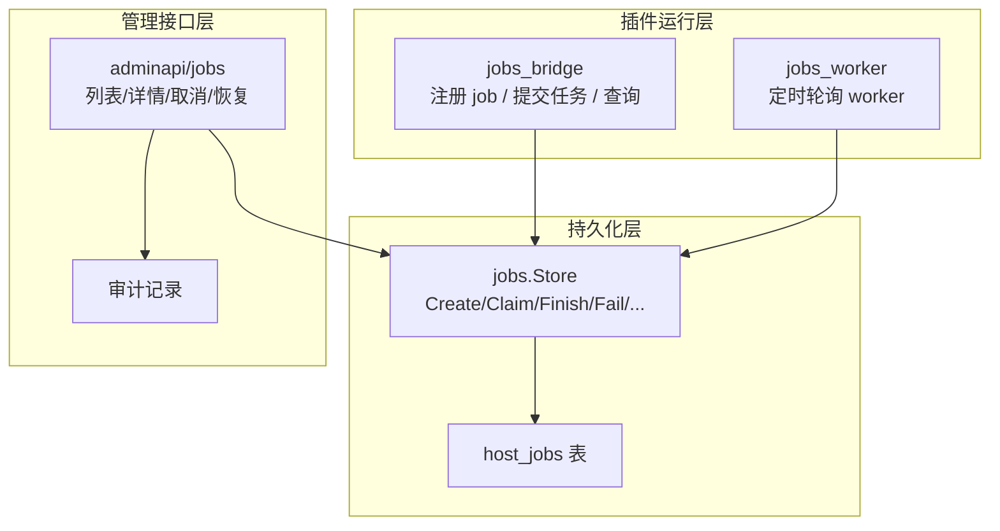
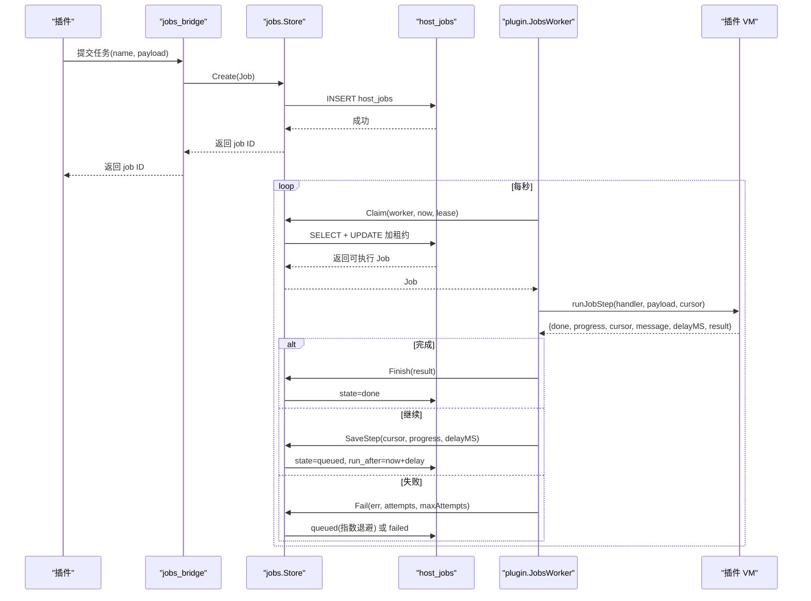
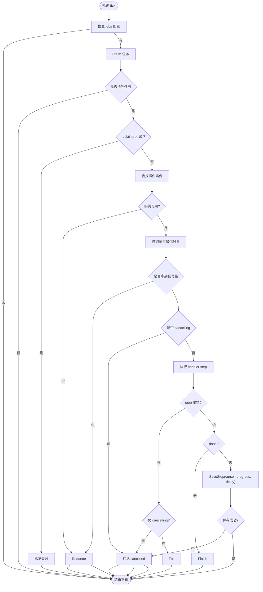
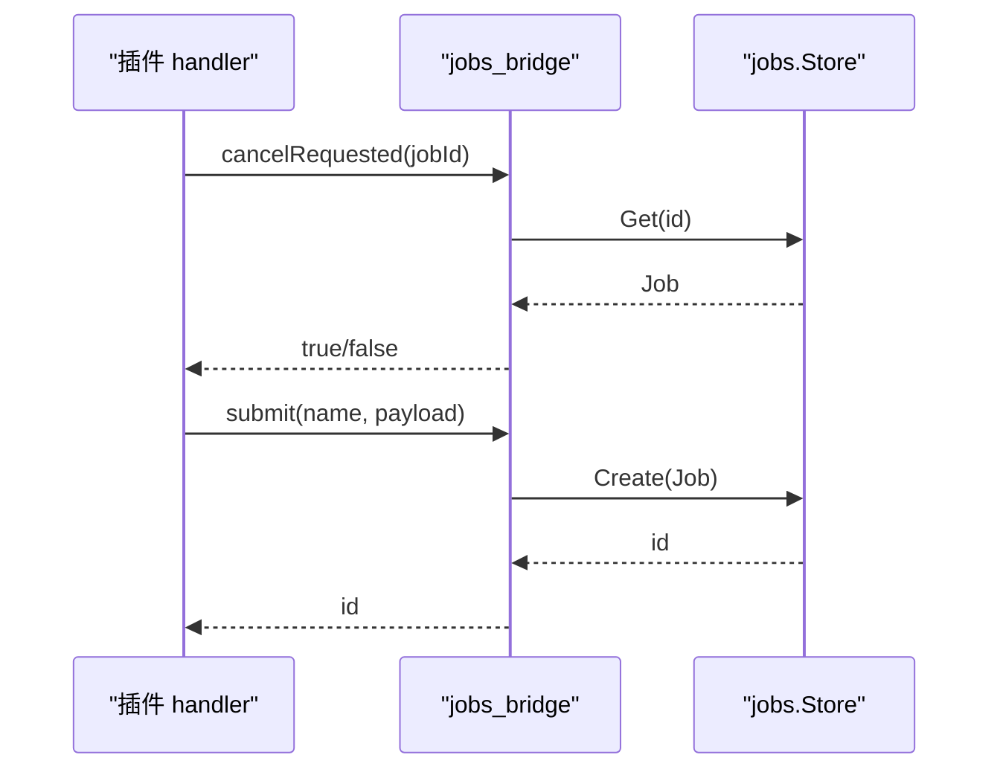
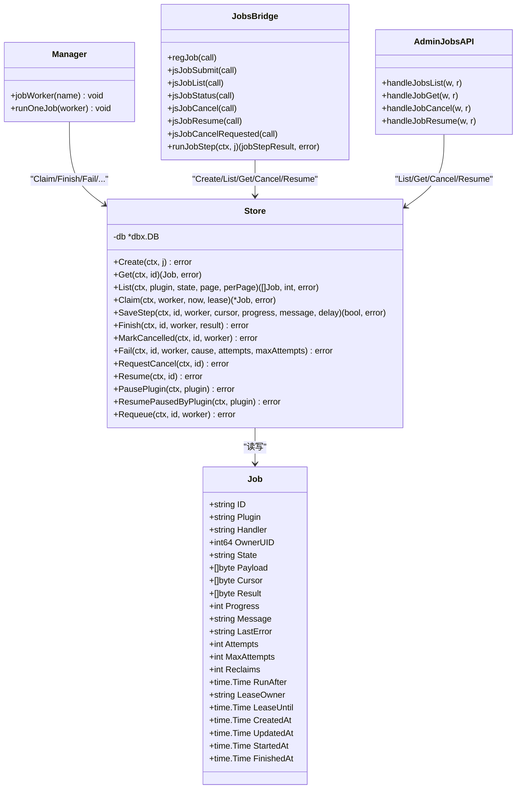

# 后台任务模块

**本文引用的文件**
- [store.go](https://github.com/YimingZhanshen/skin-nexus/blob/797ae1a/server/internal/jobs/store.go)
- [jobs_bridge.go](https://github.com/YimingZhanshen/skin-nexus/blob/797ae1a/server/internal/plugin/jobs_bridge.go)
- [jobs_worker.go](https://github.com/YimingZhanshen/skin-nexus/blob/797ae1a/server/internal/plugin/jobs_worker.go)
- [adminapi/jobs.go](https://github.com/YimingZhanshen/skin-nexus/blob/797ae1a/server/internal/adminapi/jobs.go)
- [adminapi/jobs_test.go](https://github.com/YimingZhanshen/skin-nexus/blob/797ae1a/server/internal/adminapi/jobs_test.go)
- [0016_plugin_jobs.sql（SQLite）](https://github.com/YimingZhanshen/skin-nexus/blob/797ae1a/server/migrations/sqlite/0016_plugin_jobs.sql)
- [0016_plugin_jobs.sql（MySQL）](https://github.com/YimingZhanshen/skin-nexus/blob/797ae1a/server/migrations/mysql/0016_plugin_jobs.sql)
- [0016_plugin_jobs.sql（PostgreSQL）](https://github.com/YimingZhanshen/skin-nexus/blob/797ae1a/server/migrations/postgres/0016_plugin_jobs.sql)

## 目录
1. [简介](#简介)
2. [项目结构](#项目结构)
3. [核心组件](#核心组件)
4. [架构总览](#架构总览)
5. [详细组件分析](#详细组件分析)
6. [依赖关系分析](#依赖关系分析)
7. [性能与调度最佳实践](#性能与调度最佳实践)
8. [常见问题排查](#常见问题排查)
9. [结论](#结论)

## 简介
后台任务模块为插件提供“可持久化、可重试、可分步执行”的任务队列。其职责边界清晰：
- `jobs.Store` 负责任务在数据库中的持久化、租约（lease）、状态流转和分页查询。
- `plugin.JobsWorker` 是宿主内按固定周期轮询的 worker，负责从 store 拉取任务并在插件专属 VM 中执行单个 job handler step。
- `adminapi/jobs` 暴露管理端查看、取消、恢复任务的接口，并把关键操作写入审计表。
- 插件通过 `jobs_bridge` 提交任务、查询自身任务、检查取消请求；handler 返回 `done`、`cursor`、`progress`、`message`、`delayMS`、`result` 等字段控制下一步行为。

典型调用路径：
插件通过 `jobs_bridge` 提交任务 → `store.Create` 落库 → `worker` 每秒轮询 → `store.Claim` 加租约 → 执行一个 step → 根据返回值决定 `Finish`、`SaveStep` 或 `Fail` → 最终状态为 `done`、`failed` 或 `cancelled`。

## 项目结构
后台任务相关代码分布在四个层次：

**图表来源**
- [jobs_bridge.go:1-300](https://github.com/YimingZhanshen/skin-nexus/blob/797ae1a/server/internal/plugin/jobs_bridge.go#L1-L300)
- [jobs_worker.go:1-97](https://github.com/YimingZhanshen/skin-nexus/blob/797ae1a/server/internal/plugin/jobs_worker.go#L1-L97)
- [store.go:1-320](https://github.com/YimingZhanshen/skin-nexus/blob/797ae1a/server/internal/jobs/store.go#L1-L320)
- [adminapi/jobs.go:1-101](https://github.com/YimingZhanshen/skin-nexus/blob/797ae1a/server/internal/adminapi/jobs.go#L1-L101)

**章节来源**
- [store.go:1-40](https://github.com/YimingZhanshen/skin-nexus/blob/797ae1a/server/internal/jobs/store.go#L1-L40)
- [jobs_bridge.go:1-40](https://github.com/YimingZhanshen/skin-nexus/blob/797ae1a/server/internal/plugin/jobs_bridge.go#L1-L40)
- [jobs_worker.go:1-25](https://github.com/YimingZhanshen/skin-nexus/blob/797ae1a/server/internal/plugin/jobs_worker.go#L1-L25)
- [adminapi/jobs.go:1-25](https://github.com/YimingZhanshen/skin-nexus/blob/797ae1a/server/internal/adminapi/jobs.go#L1-L25)

## 核心组件

### `jobs.Job` 数据模型
`Job` 是任务在内存和数据库之间的统一结构，关键字段包括：
- 标识与归属：`ID`、`Plugin`、`Handler`、`OwnerUID`。
- 执行元数据：`Payload`（原始参数）、`Cursor`（分步游标）、`Result`（最终结果）。
- 进度与诊断：`Progress`、`Message`、`LastError`。
- 重试预算：`Attempts`、`MaxAttempts`。
- 调度与租约：`RunAfter`、`LeaseOwner`、`LeaseUntil`、`Reclaims`。
- 生命周期时间戳：`CreatedAt`、`UpdatedAt`、`StartedAt`、`FinishedAt`。
- 状态：`queued`、`running`、`done`、`failed`、`cancelled`、`cancelling`、`paused`。

**章节来源**
- [store.go:12-39](https://github.com/YimingZhanshen/skin-nexus/blob/797ae1a/server/internal/jobs/store.go#L12-L39)

### 数据库表 `host_jobs`
三套迁移都定义同一张 `host_jobs` 表，区别在于 JSON 类型和时区列类型：
- SQLite：`TEXT` 存 JSON，DATETIME。
- MySQL：`JSON` 列，DATETIME(3)，InnoDB。
- PostgreSQL：`TEXT` 存 JSON，TIMESTAMPTZ。

核心索引：
- `idx_host_jobs_claim(state, run_after)`：加速 worker 抢任务。
- `idx_host_jobs_plugin(plugin, state)`：加速按插件过滤。
- `idx_host_jobs_owner(owner_uid)`：加速按用户维度统计。

**章节来源**
- [0016_plugin_jobs.sql（SQLite）:1-30](https://github.com/YimingZhanshen/skin-nexus/blob/797ae1a/server/migrations/sqlite/0016_plugin_jobs.sql#L1-L30)
- [0016_plugin_jobs.sql（MySQL）:1-28](https://github.com/YimingZhanshen/skin-nexus/blob/797ae1a/server/migrations/mysql/0016_plugin_jobs.sql#L1-L28)
- [0016_plugin_jobs.sql（PostgreSQL）:1-30](https://github.com/YimingZhanshen/skin-nexus/blob/797ae1a/server/migrations/postgres/0016_plugin_jobs.sql#L1-L30)

### 权限与身份
- 插件提交任务和访问 admin jobs 需要 `schedule:jobs` 权限。
- 提交任务还要求当前路由具有管理员身份；否则抛出 `jobs.forbidden`。
- 插件 handler 内部以 `jobUser` 身份执行，权限值被设置为较低权限，避免 handler 直接获得完整管理员能力。

**章节来源**
- [jobs_bridge.go:20-35](https://github.com/YimingZhanshen/skin-nexus/blob/797ae1a/server/internal/plugin/jobs_bridge.go#L20-L35)
- [jobs_bridge.go:47-65](https://github.com/YimingZhanshen/skin-nexus/blob/797ae1a/server/internal/plugin/jobs_bridge.go#L47-L65)
- [jobs_bridge.go:218-240](https://github.com/YimingZhanshen/skin-nexus/blob/797ae1a/server/internal/plugin/jobs_bridge.go#L218-L240)

## 架构总览

**图表来源**
- [jobs_bridge.go:60-115](https://github.com/YimingZhanshen/skin-nexus/blob/797ae1a/server/internal/plugin/jobs_bridge.go#L60-L115)
- [store.go:104-199](https://github.com/YimingZhanshen/skin-nexus/blob/797ae1a/server/internal/jobs/store.go#L104-L199)
- [jobs_worker.go:12-97](https://github.com/YimingZhanshen/skin-nexus/blob/797ae1a/server/internal/plugin/jobs_worker.go#L12-L97)

## 详细组件分析

### `jobs.Store`：持久化、租约与状态机

#### 主要方法
| 方法 | 输入 | 行为 | 状态变化 |
|---|---|---|---|
| `Create` | `Job` | 校验并插入 `host_jobs`，默认 `run_after` 为当前毫秒时间 | `queued` |
| `Get` | `id` | 按主键读取 | 无 |
| `List` | `plugin`, `state`, `page`, `perPage` | 条件分页查询，`perPage` 上限 100 | 无 |
| `Claim` | `worker`, `now`, `lease` | 事务内先 SELECT 候选行，再 WHERE 重判条件 UPDATE 加租约 | `queued→running` 或 `running(reclaim)` |
| `SaveStep` | `id`, `worker`, `cursor`, `progress`, `message`, `delay` | 释放租约，重置 `attempts`，设置下一次 `run_after` | `running→queued` |
| `Finish` | `id`, `worker`, `result` | 标记完成、写入结果、设置 `finished_at` | `running→done` |
| `Fail` | `id`, `worker`, `cause`, `attempts`, `maxAttempts` | 未耗尽则指数退避排队；耗尽则标记失败 | `running→queued` 或 `failed` |
| `RequestCancel` | `id` | 立即取消未完成；运行中改为 `cancelling` | `queued/paused→cancelled`，`running→cancelling` |
| `Resume` | `id` | 把已终止或暂停任务重新入队，重置 `attempts` | `cancelled/failed/paused/cancelling→queued` |
| `PausePlugin` | `plugin` | 暂停某插件所有 `queued` 任务 | `queued→paused` |
| `ResumePausedByPlugin` | `plugin` | 插件启用后恢复之前暂停的任务 | `paused→queued` |
| `Requeue` | `id`, `worker` | 非业务失败的释放租约回队 | `running→queued` |

#### 幂等性设计
- `Claim` 使用“SELECT + 带相同谓词的 UPDATE”实现无锁竞争：只有第一个成功更新状态的 worker 能拿到任务，其余返回空。
- `SaveStep`、`Finish`、`MarkCancelled`、`Fail` 都要求 `state='running'` 且 `lease_owner=?`，防止其他 worker 覆盖正在执行的任务。
- `RequestCancel` 对 `running` 任务只写 `cancelling`，由 worker 下一轮发现并转为 `cancelled`。
- `Resume` 允许对 `cancelled` 任务重启，并重置 `attempts`，使管理员恢复的任务拥有完整重试预算。

#### 重试策略
`Fail` 使用指数退避：
- 第 `n` 次失败延迟为 `2^(n) × 2` 秒。
- 当 `attempts < maxAttempts` 时重新入队。
- 超过 `maxAttempts` 后状态变为 `failed`。
- 默认 `MaxAttempts` 为 3；若插件未声明，submit 侧会保底设为 3。

**章节来源**
- [store.go:41-103](https://github.com/YimingZhanshen/skin-nexus/blob/797ae1a/server/internal/jobs/store.go#L41-L103)
- [store.go:104-199](https://github.com/YimingZhanshen/skin-nexus/blob/797ae1a/server/internal/jobs/store.go#L104-L199)
- [store.go:201-320](https://github.com/YimingZhanshen/skin-nexus/blob/797ae1a/server/internal/jobs/store.go#L201-L320)
- [jobs_bridge.go:80-115](https://github.com/YimingZhanshen/skin-nexus/blob/797ae1a/server/internal/plugin/jobs_bridge.go#L80-L115)

### `plugin.JobsWorker`：轮询与单步执行

Worker 的生命周期：
1. 每个插件实例启动一个 goroutine，使用 1 秒 ticker 轮询。
2. 每次轮询调用 `runOneJob(worker)`，worker 名称包含随机后缀，避免多实例冲突。
3. 如果配置中没有 jobs store，直接跳过。
4. 调用 `Store.Claim`，租约长度为 90 秒，大于 job handler 最大超时 30 秒，避免双跑。
5. 如果 `Reclaims > 10`，认为租约反复丢失，直接标记失败。
6. 查找插件实例；若实例未加载或未启用，回队。
7. 使用 `inst.jobSem` 串行化同一插件实例上的 job step，防止共享 VM 并发竞争。
8. 执行前检查是否被取消；执行后根据返回值决定 finish、save step 或 fail。
9. 保存 step 失败或任务被取消时，标记为 `cancelled`，避免悬挂在 `cancelling`。

**图表来源**
- [jobs_worker.go:12-97](https://github.com/YimingZhanshen/skin-nexus/blob/797ae1a/server/internal/plugin/jobs_worker.go#L12-L97)

**章节来源**
- [jobs_worker.go:1-97](https://github.com/YimingZhanshen/skin-nexus/blob/797ae1a/server/internal/plugin/jobs_worker.go#L1-L97)

### `plugin.jobs_bridge`：插件侧 API

插件侧暴露三类能力：

1. **注册 job handler**
   - 校验 `schedule:jobs` 权限。
   - 校验 handler 名称在 `plugin.json` 中声明。
   - 将 handler 函数与 `JobSpec` 绑定到运行时。

2. **提交任务**
   - 同样要求 `schedule:jobs` 权限。
   - 要求当前路由用户是管理员。
   - 校验 handler 名称。
   - 序列化 payload。
   - 生成随机 13 字节 ID。
   - 默认 `MaxAttempts` 为 3。
   - 调用 `Store.Create`，返回 job ID。

3. **插件侧任务管理**
   - `jsJobList`：列出本插件的任务，最多 50 条。
   - `jsJobStatus`：查询指定 job，必须属于本插件。
   - `jsJobCancel`：请求取消本插件任务。
   - `jsJobResume`：恢复本插件任务。
   - `jsJobCancelRequested`：handler 内部查询当前 job 状态，判断是否应停止。

**图表来源**
- [jobs_bridge.go:20-115](https://github.com/YimingZhanshen/skin-nexus/blob/797ae1a/server/internal/plugin/jobs_bridge.go#L20-L115)
- [jobs_bridge.go:218-300](https://github.com/YimingZhanshen/skin-nexus/blob/797ae1a/server/internal/plugin/jobs_bridge.go#L218-L300)

**章节来源**
- [jobs_bridge.go:1-115](https://github.com/YimingZhanshen/skin-nexus/blob/797ae1a/server/internal/plugin/jobs_bridge.go#L1-L115)
- [jobs_bridge.go:218-300](https://github.com/YimingZhanshen/skin-nexus/blob/797ae1a/server/internal/plugin/jobs_bridge.go#L218-L300)

### `adminapi/jobs`：管理端接口

管理端提供以下接口（基于 handler 命名推断）：

| 接口 | 方法 | 路径模式 | 功能 | 审计动作 |
|---|---|---|---|---|
| 任务列表 | GET | `/api/admin/v1/jobs` | 支持 `plugin`、`state`、`page`、`perPage` 过滤 | 无 |
| 任务详情 | GET | `/api/admin/v1/jobs/{id}` | 返回任务视图 | 无 |
| 取消任务 | POST | `/api/admin/v1/jobs/{id}/cancel` | 调用 `RequestCancel` | `plugin_job_cancel` |
| 恢复任务 | POST | `/api/admin/v1/jobs/{id}/resume` | 调用 `Resume` | `plugin_job_resume` |

响应结构使用 `jobView`，将二进制 payload、cursor、result 反序列化为 JSON 对象，并格式化 RFC3339 时间。

#### 状态变更测试约束
测试明确验证：
- 取消 `queued` 任务应直接进入 `cancelled`。
- 恢复 `cancelled` 任务应进入 `queued`，并重置 `attempts`。
- 恢复 `done` 任务应返回 409，错误码携带 `job.not_resumable`。
- 列表可按插件和状态过滤，且 payload 不应丢失。
- 每次 cancel/resume 都应产生一条对应审计记录。

**章节来源**
- [adminapi/jobs.go:1-101](https://github.com/YimingZhanshen/skin-nexus/blob/797ae1a/server/internal/adminapi/jobs.go#L1-L101)
- [adminapi/jobs_test.go:1-164](https://github.com/YimingZhanshen/skin-nexus/blob/797ae1a/server/internal/adminapi/jobs_test.go#L1-L164)

## 依赖关系分析

**图表来源**
- [store.go:12-320](https://github.com/YimingZhanshen/skin-nexus/blob/797ae1a/server/internal/jobs/store.go#L12-L320)
- [jobs_worker.go:12-97](https://github.com/YimingZhanshen/skin-nexus/blob/797ae1a/server/internal/plugin/jobs_worker.go#L12-L97)
- [jobs_bridge.go:20-300](https://github.com/YimingZhanshen/skin-nexus/blob/797ae1a/server/internal/plugin/jobs_bridge.go#L20-L300)
- [adminapi/jobs.go:1-101](https://github.com/YimingZhanshen/skin-nexus/blob/797ae1a/server/internal/adminapi/jobs.go#L1-L101)

**章节来源**
- [store.go:1-320](https://github.com/YimingZhanshen/skin-nexus/blob/797ae1a/server/internal/jobs/store.go#L1-L320)
- [jobs_worker.go:1-97](https://github.com/YimingZhanshen/skin-nexus/blob/797ae1a/server/internal/plugin/jobs_worker.go#L1-L97)
- [jobs_bridge.go:1-300](https://github.com/YimingZhanshen/skin-nexus/blob/797ae1a/server/internal/plugin/jobs_bridge.go#L1-L300)
- [adminapi/jobs.go:1-101](https://github.com/YimingZhanshen/skin-nexus/blob/797ae1a/server/internal/adminapi/jobs.go#L1-L101)

## 性能与调度最佳实践

### 避免阻塞请求
- 插件不要直接在 HTTP handler 中做耗时工作；应通过 `jobs_bridge.submit` 提交后台任务。
- 提交任务后立即返回 job ID，由前端轮询状态或由事件通知下游。

### 合理设置超时
- job handler 的超时来自 `JobSpec.TimeoutMS`，未设置时默认为 10 秒。
- worker 的租约为 90 秒，大于 handler 最大超时，避免两个 worker 同时执行同一步。
- handler 中应避免超过 30 秒的长耗时操作；如需更长处理，应拆分为多个 step，并通过 `cursor` 保存中间状态。

### 防止重复执行
- handler 应基于 `payload` 中的业务唯一键做幂等判断，例如外部订单号、资源 ID。
- `cursor` 可用于断点续跑；多次提交相同业务语义的任务应由上游保证唯一性。
- 插件实例级别使用 `jobSem` 串行化同一个插件实例的 step，避免共享 VM 并发竞争。

### 分步执行与延迟
- 如果 job 需要分批处理，返回 `done=false` 并提供 `cursor`、`progress`、`message`。
- 使用 `delayMS` 让 handler 主动让出 VM；系统限制 0~60000 毫秒，避免长时间占用。
- `SaveStep` 会释放租约并重置 `attempts`，因此一次成功保存的 step 不会消耗重试次数。

### 失败与告警
- 自动重试采用指数退避：第 n 次失败延迟约 `2^n × 2` 秒。
- 超过 `maxAttempts` 后任务进入 `failed`，可通过管理面板查看 `lastError`。
- 建议在生产环境中监控 `failed` 任务数量、`reclaims` 异常升高、以及 `cancelled` 比例。

### 取消与恢复
- 取消 `queued` 任务会直接进入 `cancelled`。
- 取消 `running` 任务会进入 `cancelling`，由 worker 下一轮转成 `cancelled`。
- 恢复任务会重置 `attempts`，适合管理员修复问题后重试。
- 已完成 `done` 的任务不允许恢复，返回冲突错误。

[本节为通用指导，不直接分析具体源码]

## 常见问题排查

### 任务堆积
**现象**：大量 `queued` 任务长期不执行。
**可能原因**：
- worker goroutine 未启动或插件实例未启用。
- 任务 `run_after` 在未来。
- 数据库连接异常导致 `Claim` 失败。
- 插件未加载，worker 调用 `Requeue`。

**排查步骤**：
1. 通过 `/api/admin/v1/jobs?state=queued` 确认存在积压。
2. 检查插件是否已安装并启用。
3. 检查是否有任务因 `run_after` 延迟。
4. 检查 worker 日志是否出现 `jobs.unknown` 或 `Requeue`。
5. 检查数据库连接和 `host_jobs` 索引是否正常。

### worker 未启动
**现象**：已提交任务但状态始终为 `queued`。
**可能原因**：
- 插件 manager 未初始化 jobs worker。
- `Manager.cfg.Jobs` 为空。
- 插件实例未创建 `jobRt`。

**排查步骤**：
1. 确认插件 manifest 中启用了 jobs。
2. 确认插件实例已加载并处于 enabled 状态。
3. 观察 worker 是否每秒尝试 `Claim`。
4. 如 `Reclaims` 持续增长，说明租约反复丢失，可能是 handler 超时过长或数据库慢。

### 插件权限不足
**现象**：插件调用 `submit` 或 `adminJobs` 时报错。
**可能原因**：
- 插件缺少 `schedule:jobs` 权限。
- 当前路由不是管理员身份。
- 插件未声明该 job handler。

**排查步骤**：
1. 检查插件 manifest 的 permissions。
2. 确认调用发生在管理员上下文中。
3. 检查 `plugin.json` 是否声明了 handler 名称。
4. 注意 handler 内部不能直接使用管理员权限；系统会以低权限 `jobUser` 执行。

### 任务反复被 reclaim
**现象**：`reclaims` 不断上升。
**可能原因**：
- handler 执行时间接近或超过 90 秒租约。
- 数据库写入慢，导致 `SaveStep` 无法及时释放租约。
- 插件实例不可用，worker 回队后又被其他 worker 抢走。

**排查步骤**：
1. 检查 handler 超时和最长执行时间。
2. 检查 `SaveStep` 是否成功返回。
3. 检查插件实例是否可用。
4. 如果 `reclaims > 10`，任务会被直接标记失败，需检查错误信息。

### 任务被卡住或悬挂
**现象**：任务停留在 `cancelling` 或 `running`。
**可能原因**：
- 取消发生在 step 执行期间，需要下一轮 tick 才转成 `cancelled`。
- worker 进程退出，没有机会清理租约。
- `SaveStep` 失败时，worker 会尝试标记 `cancelled`。

**排查步骤**：
1. 等待下一个 tick，通常会在 1 秒内完成状态收敛。
2. 如果 worker 已退出，可通过 `Resume` 重新入队。
3. 检查 `lastError` 和 `message` 定位最后一步的错误。

### 删除任务
仓库未提供直接删除任务的管理接口。若需要物理清理：
- 对已完成或失败的任务，可通过数据库运维手段清理历史数据。
- 不建议直接删除 `running` 或 `cancelling` 任务，应先通过管理接口取消或恢复后再清理。

[本节基于现有接口与状态行为总结，不涉及未实现的删除 API]

## 结论
后台任务模块以 `host_jobs` 表为核心，围绕 `jobs.Store` 实现了幂等的任务持久化、租约机制、指数退避重试和分步执行；`plugin.JobsWorker` 提供稳定轮询执行；`jobs_bridge` 为插件提供安全可控的提交与管理入口；`adminapi/jobs` 提供可审计的管理操作。

开发插件时应遵循：
- 使用后台任务代替同步阻塞逻辑。
- 用 `cursor` 实现幂等分步处理。
- 设置合理的 `TimeoutMS` 和 `MaxAttempts`。
- 通过 `cancelRequested` 支持优雅取消。
- 对外部副作用做幂等保护。
- 监控 `failed`、`cancelled`、`reclaims` 等关键指标。
