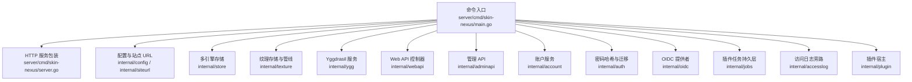
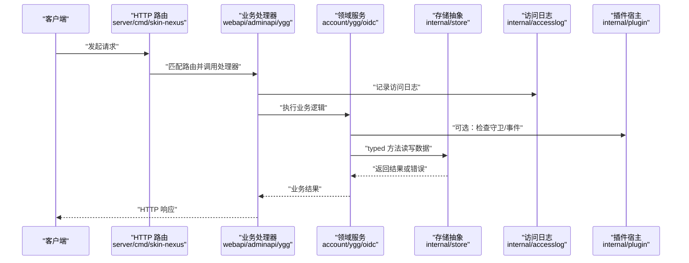
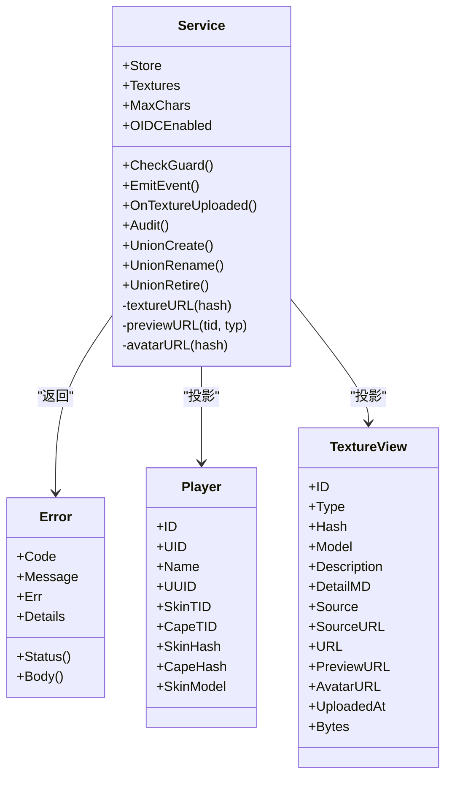
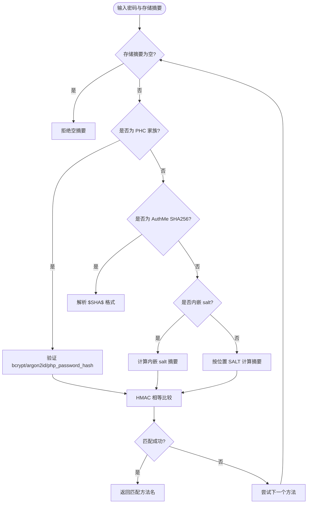
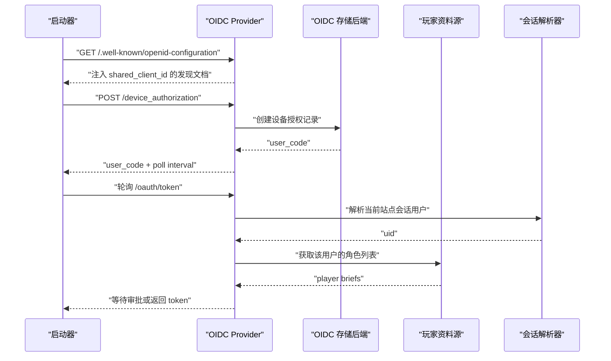
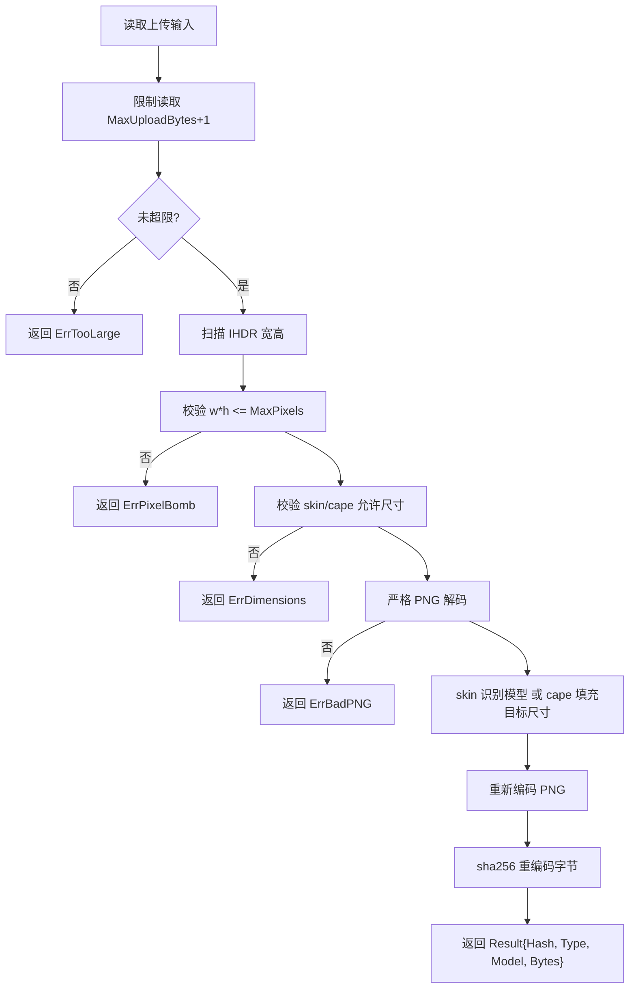
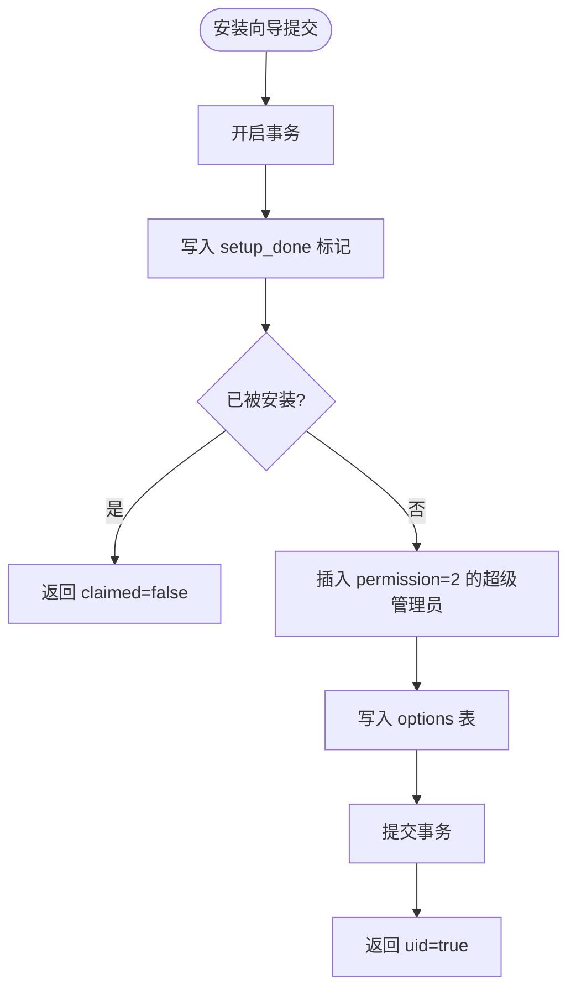
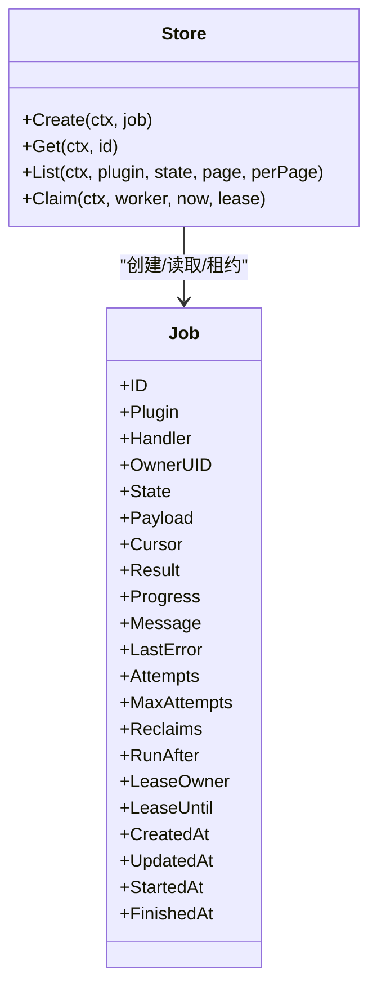
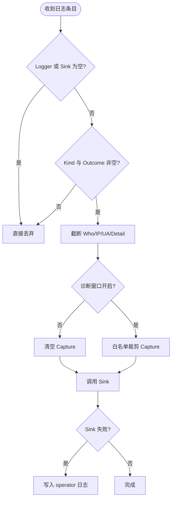
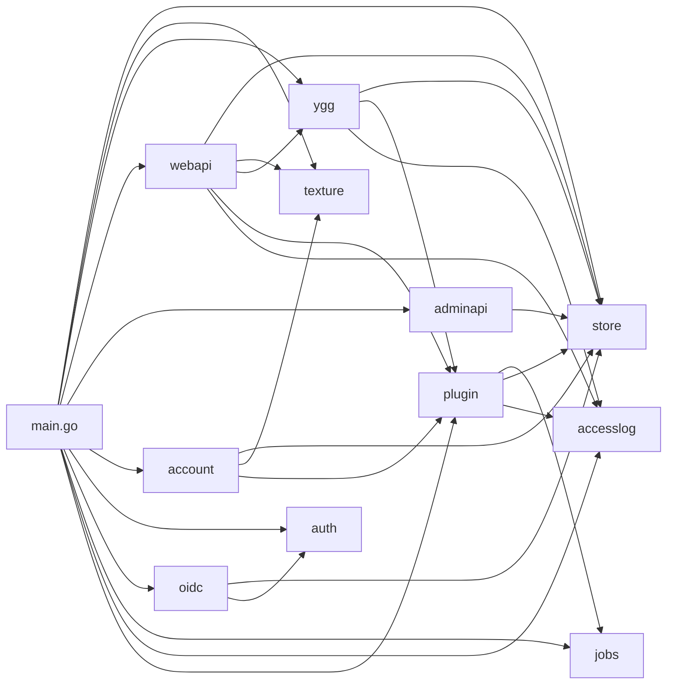

# 后端核心模块

**本文引用的文件**
- [main.go](https://github.com/YimingZhanshen/skin-nexus/blob/797ae1a/server/cmd/skin-nexus/main.go)
- [server.go](https://github.com/YimingZhanshen/skin-nexus/blob/797ae1a/server/cmd/skin-nexus/server.go)
- [service.go](https://github.com/YimingZhanshen/skin-nexus/blob/797ae1a/server/internal/account/service.go)
- [password.go](https://github.com/YimingZhanshen/skin-nexus/blob/797ae1a/server/internal/auth/password.go)
- [provider.go](https://github.com/YimingZhanshen/skin-nexus/blob/797ae1a/server/internal/oidc/provider.go)
- [pipeline.go](https://github.com/YimingZhanshen/skin-nexus/blob/797ae1a/server/internal/texture/pipeline.go)
- [setup.go](https://github.com/YimingZhanshen/skin-nexus/blob/797ae1a/server/internal/store/setup.go)
- [web.go](https://github.com/YimingZhanshen/skin-nexus/blob/797ae1a/server/internal/store/web.go)
- [store.go](https://github.com/YimingZhanshen/skin-nexus/blob/797ae1a/server/internal/jobs/store.go)
- [accesslog.go](https://github.com/YimingZhanshen/skin-nexus/blob/797ae1a/server/internal/accesslog/accesslog.go)
- [service.go](https://github.com/YimingZhanshen/skin-nexus/blob/797ae1a/server/internal/ygg/service.go)

## 目录
1. [引言](#引言)
2. [项目结构](#项目结构)
3. [核心组件](#核心组件)
4. [架构总览](#架构总览)
5. [详细组件分析](#详细组件分析)
6. [依赖关系分析](#依赖关系分析)
7. [性能与扩展建议](#性能与扩展建议)
8. [故障排查指南](#故障排查指南)
9. [结论](#结论)

## 引言
本文面向 SkinNexus 后端开发者，说明内部核心包如何按职责拆分、如何通过构造函数注入依赖实现解耦，以及请求从路由进入处理器到最终写入存储的完整数据流。重点覆盖以下模块：

- **account（账户生命周期）**：角色/纹理上传的生命周期、所有权校验、事件与审计桥接。
- **auth（密码哈希）**：兼容旧版 Blessing/AuthMe 迁移策略，并提供现代 PHC 哈希。
- **oidc（OIDC 提供者）**：基于 zitadel OIDC 引擎封装设备授权、发现文档、用户信息与审计。
- **texture（纹理处理管线）**：大小、像素数、尺寸、PNG 解码、重编码与内容寻址存储。
- **store（多引擎存储抽象）**：通过 `*dbx.DB` 暴露 typed 方法，承担用户、会话、纹理、访问日志等持久化。
- **jobs（后台任务）**：插件任务队列的持久层与租约领取逻辑。
- **accesslog（访问日志）**：对登录、Yggdrasil、Union 和插件调用的可观测旁路记录。

这些模块共同支撑皮肤上传、角色管理、认证登录、联盟接入、审计追踪等业务功能；扩展新业务时，应遵循“构造函数注入依赖”“通过 typed store 方法访问数据”“通过事件总线与插件系统交互”的约定。

## 项目结构
服务器入口位于 `server/cmd/skin-nexus`，负责加载配置、初始化存储、运行迁移、装配各内部模块并启动 HTTP 监听器。`server/internal/*` 为领域内部包，不直接暴露给外部进程。

**图表来源**
- [main.go:201-550](https://github.com/YimingZhanshen/skin-nexus/blob/797ae1a/server/cmd/skin-nexus/main.go#L201-L550)
- [server.go:1-24](https://github.com/YimingZhanshen/skin-nexus/blob/797ae1a/server/cmd/skin-nexus/server.go#L1-L24)

**章节来源**
- [main.go:1-200](https://github.com/YimingZhanshen/skin-nexus/blob/797ae1a/server/cmd/skin-nexus/main.go#L1-L200)
- [server.go:1-24](https://github.com/YimingZhanshen/skin-nexus/blob/797ae1a/server/cmd/skin-nexus/server.go#L1-L24)

## 核心组件
本节按职责简述每个核心模块的职责、关键类型与对外接口，并指出它们在典型业务中的位置。

| 模块 | 主要职责 | 关键类型/字段 | 对外接口或协作点 |
|---|---|---|---|
| account | 玩家与纹理生命周期、错误码映射、URL 生成、插件钩子与审计桥接 | `Service`、`Player`、`TextureView`、`Error`、`CallMeta`、`UploadMeta` | 被 webapi/adminapi 调用；写入 store；触发插件事件与 Union 公告 |
| auth | 兼容旧哈希验证、PHC 哈希与 rehash 判断 | `LegacyVerifier`、`MethodSalt`、`HashArgon2id`、`VerifyPHC` | 被 main 构建 legacy verifier，被 oidc 设置客户端密钥验证器 |
| oidc | OIDC 发现、授权、设备表单、userinfo、审计事件 | `Provider`、`Config`、`Wrap`、`SeedSharedClient` | 挂载标准 OIDC 路径；依赖 store、profile source、session resolver |
| texture | PNG 安全解码、尺寸与像素限制、模型识别、重编码与内容寻址保存 | `Store`、`Result`、`Process`、`Path` | 被 account/webapi 用于上传；提供 `Open` 供静态资源读取 |
| store | 用户、会话、权限、纹理、选项、访问日志、OIDC、Union 等 typed 持久化 | `Mysql`、`SetupSpec`、`CreateUser`、`ClaimSetup`、`InsertAccessLog` | 所有业务模块的唯一数据库访问面 |
| jobs | 插件任务创建、查询、分页、租约领取 | `Job`、`Store`、`Create`、`List`、`Claim` | 被 plugin host 调度；由 adminapi 展示 |
| accesslog | 最佳努力记录访问日志，诊断模式裁剪敏感信息 | `Logger`、`Entry`、`Sink`、`Diagnostic` | 被 ygg/webapi/union/plugin 调用，永不影响主响应路径 |

**章节来源**
- [service.go:1-269](https://github.com/YimingZhanshen/skin-nexus/blob/797ae1a/server/internal/account/service.go#L1-L269)
- [password.go:1-200](https://github.com/YimingZhanshen/skin-nexus/blob/797ae1a/server/internal/auth/password.go#L1-L200)
- [provider.go:1-200](https://github.com/YimingZhanshen/skin-nexus/blob/797ae1a/server/internal/oidc/provider.go#L1-L200)
- [pipeline.go:1-200](https://github.com/YimingZhanshen/skin-nexus/blob/797ae1a/server/internal/texture/pipeline.go#L1-L200)
- [setup.go:1-105](https://github.com/YimingZhanshen/skin-nexus/blob/797ae1a/server/internal/store/setup.go#L1-L105)
- [web.go:1-200](https://github.com/YimingZhanshen/skin-nexus/blob/797ae1a/server/internal/store/web.go#L1-L200)
- [store.go:1-200](https://github.com/YimingZhanshen/skin-nexus/blob/797ae1a/server/internal/jobs/store.go#L1-L200)
- [accesslog.go:1-134](https://github.com/YimingZhanshen/skin-nexus/blob/797ae1a/server/internal/accesslog/accesslog.go#L1-L134)

## 架构总览
SkinNexus 的核心运行流程可以概括为：**命令入口 → 配置与存储初始化 → 各模块组装 → HTTP 路由分发 → 业务处理器 → store 持久化**。其中：

- `main.go` 是装配中心，把 `store.Mysql`、`texture.Store`、`ygg.Service`、`webapi`、`adminapi`、`plugin.Host`、`accesslog.Logger`、`oidc.Provider` 串起来。
- `server.go` 仅负责带超时的 HTTP Server，避免慢客户端耗尽连接。
- `store` 是唯一的数据访问抽象，其他模块不应直接操作 SQL。
- `accesslog` 作为旁路观察者，所有关键入口都可挂接。
- `plugin` 通过构造函数注入的回调观察生命周期、纹理上传和鉴权阶段，但不改变协议响应。

**图表来源**
- [main.go:201-550](https://github.com/YimingZhanshen/skin-nexus/blob/797ae1a/server/cmd/skin-nexus/main.go#L201-L550)
- [server.go:1-24](https://github.com/YimingZhanshen/skin-nexus/blob/797ae1a/server/cmd/skin-nexus/server.go#L1-L24)
- [accesslog.go:1-134](https://github.com/YimingZhanshen/skin-nexus/blob/797ae1a/server/internal/accesslog/accesslog.go#L1-L134)

**章节来源**
- [main.go:201-550](https://github.com/YimingZhanshen/skin-nexus/blob/797ae1a/server/cmd/skin-nexus/main.go#L201-L550)
- [server.go:1-24](https://github.com/YimingZhanshen/skin-nexus/blob/797ae1a/server/cmd/skin-nexus/server.go#L1-L24)

## 详细组件分析

### account（账户生命周期）
`account.Service` 是浏览器 API 与插件账户桥接共享的领域服务。它不信任调用方传入的用户 ID，而是要求调用者显式传递已认证的 uid，并在内部统一进行所有权校验、错误码映射、URL 生成、插件事件与审计桥接。

关键设计要点：

- **错误模型**：`Error` 携带稳定代码、消息、原始错误和详情，并通过 `Status()` 将业务错误映射为固定 HTTP 状态码；未知代码回退为 500，避免误判客户端错误。
- **URL 生成**：纹理 URL、预览 URL、头像 URL 都来自 `siteurl`，而不是构造时捕获的值，保证运行时站点基础地址变化后签名与链接一致。
- **生命周期回调**：通过 `CheckGuard`、`EmitEvent`、`OnTextureUploaded`、`Audit` 等函数字段与插件系统解耦；Union 相关动作通过 `UnionCreate/Rename/Retire` 回调桥接。
- **类型投影**：`Player`、`TextureView`、`PlayerView`、`AccountView` 是跨传输层的轻量视图，避免直接把数据库行暴露给 API。

典型调用路径：

1. 浏览器上传皮肤 → webapi 解析身份 → account 校验所有权 → texture 管道处理 → store 写入纹理与角色 → account 触发插件事件与审计 → 返回投影结果。
2. 管理员修改角色 → adminapi 校验权限 → account 校验所有权与规则 → store 更新 → audit 记录。

**图表来源**
- [service.go:1-269](https://github.com/YimingZhanshen/skin-nexus/blob/797ae1a/server/internal/account/service.go#L1-L269)

**章节来源**
- [service.go:1-269](https://github.com/YimingZhanshen/skin-nexus/blob/797ae1a/server/internal/account/service.go#L1-L269)

### auth（密码哈希与迁移）
`auth` 包承担两类职责：

1. **遗留哈希兼容**：`LegacyVerifier` 按配置的 `PASSWORD_METHODS` 与 `SALT` 顺序尝试 MD5、SHA256、SHA512、salted 变体、AuthMe 布局、bcrypt、argon2i、PHP default 等算法，保留原 PHP 实现的字节级比较语义。
2. **现代哈希升级**：提供 `HashArgon2id` 与 `VerifyPHC`，配合 store 的 `RehashPassword` 在首次成功登录后懒升级。

关键行为：

- `VerifyLegacy` 会遍历所有方法，返回匹配的 method 名称，便于上层决定是否需要 rehash。
- `NeedsRehash` 用于区分是否已是 argon2id/bcrypt/php_default。
- 空摘要不等于“无密码”，迁移兼容性测试中保留了特定脏行的容忍逻辑。

**图表来源**
- [password.go:1-200](https://github.com/YimingZhanshen/skin-nexus/blob/797ae1a/server/internal/auth/password.go#L1-L200)

**章节来源**
- [password.go:1-200](https://github.com/YimingZhanshen/skin-nexus/blob/797ae1a/server/internal/auth/password.go#L1-L200)
- [web.go:1-200](https://github.com/YimingZhanshen/skin-nexus/blob/797ae1a/server/internal/store/web.go#L1-L200)

### oidc（OIDC 提供者）
`oidc.Provider` 是对 zitadel OIDC 引擎的封装，负责：

- 构建 discovery 文档并注入 launcher 需要的 `shared_client_id`、scopes、claims。
- 挂载 `/authorize`、`/oauth/token`、`/userinfo`、`/device_authorization`、`/keys` 等路径。
- 提供设备授权流程的 HTML 表单与 JSON API。
- 通过 `SessionResolver` 把站点会话映射为用户 ID。
- 通过 `Audit` 回调记录设备批准、拒绝、撤销等安全事件。

关键契约：

- `New(backend, profiles, cfg)` 构建 provider，`Wrap(next)` 接管 OIDC 路径并把其余请求交给 SPA。
- `SeedSharedClient` 在首次启动时确保公共 launcher 客户端存在。
- `DiscoveryHandler` 修正被转发到 Yggdrasil API 根时的 discovery 路径问题。
- `UserinfoHandler` 保持与旧版一致的 401 + WWW-Authenticate 契约。

**图表来源**
- [provider.go:1-200](https://github.com/YimingZhanshen/skin-nexus/blob/797ae1a/server/internal/oidc/provider.go#L1-L200)
- [provider.go:200-400](https://github.com/YimingZhanshen/skin-nexus/blob/797ae1a/server/internal/oidc/provider.go#L200-L400)

**章节来源**
- [provider.go:1-200](https://github.com/YimingZhanshen/skin-nexus/blob/797ae1a/server/internal/oidc/provider.go#L1-L200)
- [provider.go:200-400](https://github.com/YimingZhanshen/skin-nexus/blob/797ae1a/server/internal/oidc/provider.go#L200-L400)
- [main.go:201-550](https://github.com/YimingZhanshen/skin-nexus/blob/797ae1a/server/cmd/skin-nexus/main.go#L201-L550)

### texture（纹理处理管线）
`texture` 包是皮肤上传的安全边界。其管线明确分为多个阶段：

1. 限制读取字节数，超过 `MaxUploadBytes` 直接拒绝。
2. IHDR 预检宽高与像素数，防止像素炸弹。
3. 校验 skin 与 cape 的尺寸族。
4. 严格解码 PNG，拒绝非 PNG 多态载荷。
5. 根据类型识别 skin 模型或为 cape 填充透明边框。
6. 重新编码 PNG，丢弃辅助块。
7. 对重编码后的字节计算 sha256，得到内容地址。
8. `Store.Save` 以 hash 为文件名幂等写入磁盘。

重要约束：

- 历史迁移文件不会重写，只按字节原样服务，因此维度填充只作用于新上传。
- `Path` 使用正则严格校验 64 位十六进制 hash，防止路径穿越。
- `IsContentAddress` 与 `Path` 共用同一校验，避免两者漂移。

**图表来源**
- [pipeline.go:1-200](https://github.com/YimingZhanshen/skin-nexus/blob/797ae1a/server/internal/texture/pipeline.go#L1-L200)

**章节来源**
- [pipeline.go:1-200](https://github.com/YimingZhanshen/skin-nexus/blob/797ae1a/server/internal/texture/pipeline.go#L1-L200)

### store（多引擎存储抽象）
`store` 包是所有业务数据的 typed 访问层。它没有把 SQL 语句暴露给上层，而是提供语义明确的函数，例如：

- 用户注册：`CreateUser`、`CreateUserAdmin`。
- 安装向导原子提交：`ClaimSetup`，在一个事务中写入 setup marker、超级管理员和选项。
- 会话：`CreateSession`、`SessionUser`、`DeleteSession`、`DeleteUserSessionsExcept`。
- 密码：`SetPasswordHash`、`RehashPassword`、`UserPasswordAlgo`。
- 权限与限制：`UserPermission`、`UserPlayerLimit`、`WeakHashCount`。
- 访问日志：`InsertAccessLog`、`PurgeAccessLogs`、`PurgeAccessDetails`。

关键设计：

- `SetupSpec` 表达安装向导的一次提交。
- `insertUser` 由普通注册与安装事务共用，时间戳由应用时钟提供，避免数据库时钟与应用时钟不一致。
- `ClaimSetup` 使用忽略插入保证并发下只有一个调用者成为安装者。
- `EnsureSuperAdmin` 在已有超级管理员时幂等返回，否则提升最老的 admin。

**图表来源**
- [setup.go:1-105](https://github.com/YimingZhanshen/skin-nexus/blob/797ae1a/server/internal/store/setup.go#L1-L105)

**章节来源**
- [setup.go:1-105](https://github.com/YimingZhanshen/skin-nexus/blob/797ae1a/server/internal/store/setup.go#L1-L105)
- [web.go:1-200](https://github.com/YimingZhanshen/skin-nexus/blob/797ae1a/server/internal/store/web.go#L1-L200)

### jobs（后台任务）
`jobs.Store` 是插件任务队列的持久层，表名为 `host_jobs`。它不负责执行 JS 插件逻辑，只负责：

- 创建任务：`Create`，包含 handler、payload、重试次数、最大尝试次数、下次运行时间等。
- 查询任务：`Get`、`List`，支持按插件与状态过滤、分页。
- 租约领取：`Claim`，支持抢占排队任务，或收回过期租约的运行中任务。

并发安全关键点：

- `Claim` 使用 SELECT + UPDATE WHERE 双重条件，WHERE 中的 claimable 条件与查询完全一致。
- 先选一行，再更新状态、lease_owner、lease_until 和 started_at；RowsAffected 为 0 表示另一个 worker 先抢到。
- `run_after` 被截断到毫秒，避免数据库四舍五入导致同瞬间任务不可见。

**图表来源**
- [store.go:1-200](https://github.com/YimingZhanshen/skin-nexus/blob/797ae1a/server/internal/jobs/store.go#L1-L200)

**章节来源**
- [store.go:1-200](https://github.com/YimingZhanshen/skin-nexus/blob/797ae1a/server/internal/jobs/store.go#L1-L200)

### accesslog（访问日志）
`accesslog.Logger` 是一个 best-effort 的旁路记录器。它的关键契约是：**记录失败不得影响请求路径**。

- 零值 Logger 与 nil sink 都安全。
- `Kind` 与 `Outcome` 必须非空才会记录。
- Who/IP/UA/Detail 会被截断为 UTF-8 安全的字节长度。
- 诊断模式下才允许写入 `Capture`；窗口关闭时直接丢弃。
- sink 报错只写 operator log，不做重试，不转为响应错误。

常用 kind：

- `web_login`、`web_register`、`web_verify_gate`
- `ygg_authenticate`、`ygg_refresh`、`ygg_validate`、`ygg_join`、`ygg_hasjoined`、`ygg_profile`
- `union_in`、`union_out`、`plugin`

常用 outcome：

- `ok`、`fail`、`denied`、`miss`、`error`

**图表来源**
- [accesslog.go:1-134](https://github.com/YimingZhanshen/skin-nexus/blob/797ae1a/server/internal/accesslog/accesslog.go#L1-L134)

**章节来源**
- [accesslog.go:1-134](https://github.com/YimingZhanshen/skin-nexus/blob/797ae1a/server/internal/accesslog/accesslog.go#L1-L134)

## 依赖关系分析
整体依赖方向是自上而下：命令入口装配 HTTP 路由、业务处理器、领域服务、存储、文件系统与插件系统。核心模块之间尽量通过函数字段或构造参数耦合，避免循环依赖。

**图表来源**
- [main.go:201-550](https://github.com/YimingZhanshen/skin-nexus/blob/797ae1a/server/cmd/skin-nexus/main.go#L201-L550)
- [service.go:1-269](https://github.com/YimingZhanshen/skin-nexus/blob/797ae1a/server/internal/account/service.go#L1-L269)
- [provider.go:1-200](https://github.com/YimingZhanshen/skin-nexus/blob/797ae1a/server/internal/oidc/provider.go#L1-L200)
- [pipeline.go:1-200](https://github.com/YimingZhanshen/skin-nexus/blob/797ae1a/server/internal/texture/pipeline.go#L1-L200)
- [store.go:1-200](https://github.com/YimingZhanshen/skin-nexus/blob/797ae1a/server/internal/jobs/store.go#L1-L200)
- [accesslog.go:1-134](https://github.com/YimingZhanshen/skin-nexus/blob/797ae1a/server/internal/accesslog/accesslog.go#L1-L134)

**章节来源**
- [main.go:201-550](https://github.com/YimingZhanshen/skin-nexus/blob/797ae1a/server/cmd/skin-nexus/main.go#L201-L550)

## 性能与扩展建议

### 性能特性
- **HTTP 超时保护**：`newHTTPServer` 设置了读头、读体、写体和空闲超时，防止慢客户端耗尽 goroutine 和文件描述符。
- **纹理上传安全且高效**：先限读再解码，先 IHDR 再像素限制，最后才做 PNG 解码与重编码，减少恶意大图的 CPU 与内存压力。
- **访问日志旁路**：记录失败不阻塞主流程，避免审计拖慢登录与 Yggdrasil 接口。
- **任务租约防竞争**：jobs 使用带条件的 UPDATE 保证同一时刻只有一个 worker 拿到任务。
- **清理后台任务**：main 中定时清理 90 天前的访问日志、诊断详情、凭据与 join session。

### 扩展新业务的约定
1. **新增业务放在 `internal/*` 包中**，不要直接在 `cmd` 里写业务逻辑。
2. **通过构造函数注入依赖**：如 `account.Service`、`oidc.Provider`、`ygg.Service`、`plugin.NewHost` 都接收 store、textures、audit、event 回调。
3. **所有数据库访问走 `store.Mysql` 的 typed 方法**，不要在业务层拼 SQL。
4. **可观测性通过 `accesslog` 与插件事件**：新增关键入口应记录 kind/outcome，并考虑 `Audit` 回调。
5. **异步工作走 `jobs.Store`**：不要在新业务中直接启协程写数据库。
6. **对外协议不变原则**：Yggdrasil、OIDC、WebAPI 的 wire 形状优先稳定；变更应在版本层或适配器层完成。
7. **URL 与站点地址通过 `siteurl` 生成**，禁止硬编码绝对路径。
8. **错误模型优先使用领域错误**：account 的 `Error` 就是范例；新增 API 也应返回可映射的稳定错误码。

[本节为通用指导，不直接分析具体代码行]

## 故障排查指南

| 现象 | 可能原因 | 排查建议 |
|---|---|---|
| 登录成功但提示仍需升级密码 | 用户仍使用 legacy 哈希 | 检查 store 的 `UserPasswordAlgo` 与 `WeakHashCount`，确认 lazy rehash 是否执行 |
| OIDC 客户端无法发现 | issuer、shared_client_id、scopes 不匹配 | 检查 `oidc.Config`、`SeedSharedClient` 与 discovery 文档 |
| 皮肤上传报像素过大 | PNG 实际像素超过 `MaxPixels` | 检查上传尺寸与 pipeline 的 IHDR 检查 |
| 纹理读取失败 | hash 不是 64 位十六进制 | 检查 `texture.Store.Path` 的正则校验 |
| 插件任务始终不被执行 | run_after 未来、lease 未过期或 worker 未 claim | 检查 `jobs.List` 与 `jobs.Claim` 的条件 |
| 访问日志缺失 | sink 为 nil、kind/outcome 为空、sink 报错 | 检查 `accesslog.Logger` 构造与 `SetDiagnostic` |
| 安装向导重复创建管理员 | 并发 ClaimSetup | 确认 `ClaimSetup` 的事务隔离与 setup_done 标记 |

**章节来源**
- [server.go:1-24](https://github.com/YimingZhanshen/skin-nexus/blob/797ae1a/server/cmd/skin-nexus/server.go#L1-L24)
- [pipeline.go:1-200](https://github.com/YimingZhanshen/skin-nexus/blob/797ae1a/server/internal/texture/pipeline.go#L1-L200)
- [store.go:1-200](https://github.com/YimingZhanshen/skin-nexus/blob/797ae1a/server/internal/jobs/store.go#L1-L200)
- [accesslog.go:1-134](https://github.com/YimingZhanshen/skin-nexus/blob/797ae1a/server/internal/accesslog/accesslog.go#L1-L134)
- [setup.go:1-105](https://github.com/YimingZhanshen/skin-nexus/blob/797ae1a/server/internal/store/setup.go#L1-L105)

## 结论
SkinNexus 的后端核心通过清晰的模块边界和构造函数注入实现了高内聚低耦合：`store` 收敛数据库访问，`texture` 收敛上传安全，`account` 收敛角色与纹理生命周期，`auth` 收敛密码迁移，`oidc` 封装 OIDC 协议，`jobs` 承载插件任务持久化，`accesslog` 提供稳定的可观测旁路。

开发新业务时，最稳妥的路径是：在 `internal` 中新建包，用 typed store 方法读写数据，通过 `accesslog` 与插件事件总线记录与通知，必要时借助 `jobs` 执行异步任务，并让 `main.go` 在启动阶段完成依赖装配。这样既能保持 Yggdrasil 与 WebAPI 协议的稳定性，又能让皮肤上传、角色管理、认证登录、审计追踪等功能继续协同演进。
