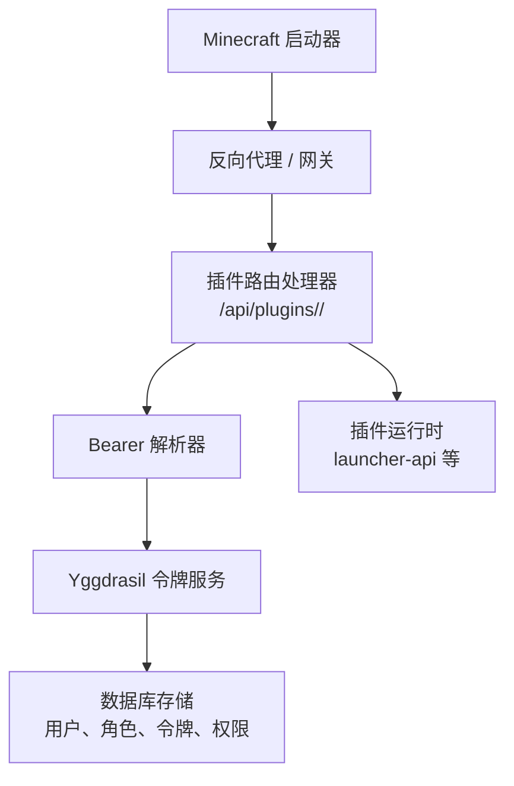
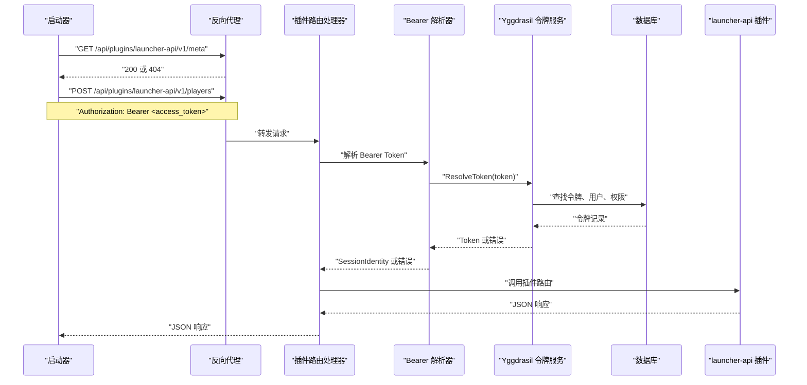
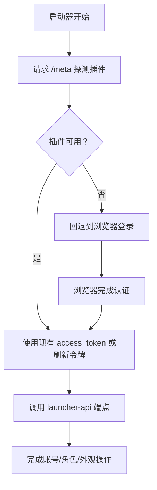
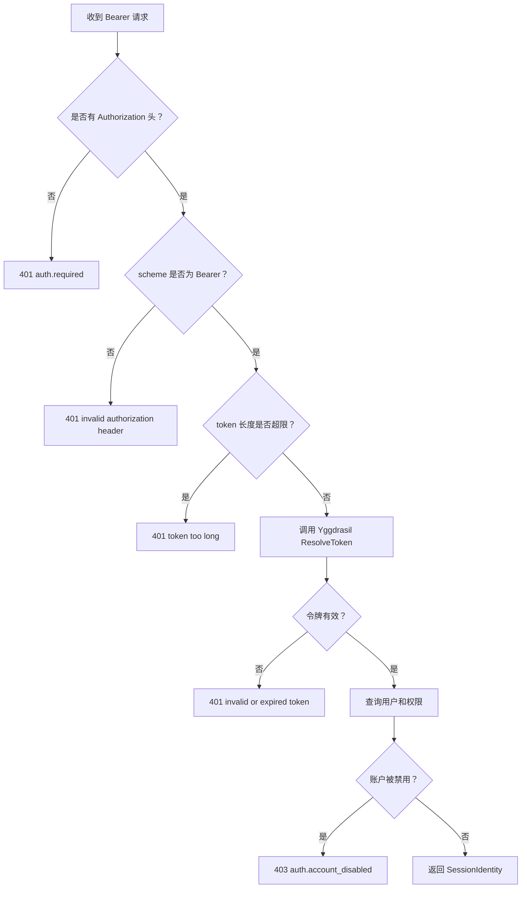
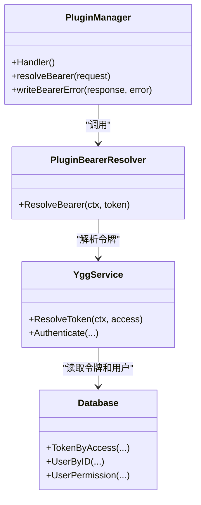
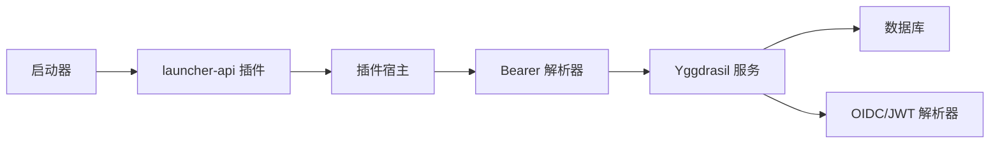

# 启动器 Bearer API

**本文引用的文件**
- [server/cmd/skin-nexus/pluginbearer.go](https://github.com/YimingZhanshen/skin-nexus/blob/797ae1a/server/cmd/skin-nexus/pluginbearer.go)
- [server/cmd/skin-nexus/main.go](https://github.com/YimingZhanshen/skin-nexus/blob/797ae1a/server/cmd/skin-nexus/main.go)
- [server/internal/plugin/routes.go](https://github.com/YimingZhanshen/skin-nexus/blob/797ae1a/server/internal/plugin/routes.go)
- [server/internal/plugin/routes_bearer_test.go](https://github.com/YimingZhanshen/skin-nexus/blob/797ae1a/server/internal/plugin/routes_bearer_test.go)
- [docs/launcher-api.md](https://github.com/YimingZhanshen/skin-nexus/blob/797ae1a/docs/launcher-api.md)
- [server/internal/ygg/service.go](https://github.com/YimingZhanshen/skin-nexus/blob/797ae1a/server/internal/ygg/service.go)

## 目录
1. [简介](#简介)
2. [项目结构](#项目结构)
3. [核心组件](#核心组件)
4. [架构总览](#架构总览)
5. [详细组件分析](#详细组件分析)
6. [依赖关系分析](#依赖关系分析)
7. [性能与可用性](#性能与可用性)
8. [故障排查](#故障排查)
9. [结论](#结论)
10. [附录：部署与安全边界](#附录部署与安全边界)

## 简介
SkinNexus 的“启动器 Bearer API”并不是一个独立的 HTTP 端点集合，而是 SkinNexus 插件路由层为“启用 Bearer 鉴权的插件路由”提供的一套通用认证机制。它让 Minecraft 启动器在无需玩家再次输入密码的情况下，复用 Yggdrasil 或 OIDC 颁发的访问令牌，直接调用由官方 `launcher-api` 插件暴露的账号、角色、外观和纹理管理接口，从而完成自动登录并免密进服。

该能力的核心要点包括：
- 启动器使用现有的 Yggdrasil Connect OIDC 设备码流程获取 `access_token`，或在密码登录后复用 Yggdrasil `accessToken`。
- 启动器后续请求通过 `Authorization: Bearer <token>` 携带令牌，不依赖 Cookie 或 CSRF。
- SkinNexus 服务将 Bearer Token 交由 Yggdrasil 令牌账本解析，再映射到本地用户身份和权限。
- 只有被标记为 `bearer` 等级的插件路由才走这套 Bearer 鉴权；普通会话路由仍使用 Cookie + CSRF。
- 错误响应统一采用 `{ "error": "...", "message": "..." }` 格式，限流返回 `429 Retry-After`。

**章节来源**
- [docs/launcher-api.md:1-43](https://github.com/YimingZhanshen/skin-nexus/blob/797ae1a/docs/launcher-api.md#L1-L43)

## 项目结构
从 SkinNexus 源码看，Bearer 认证相关代码分布在三个层次：
- 入口与装配：`main.go` 负责构建 Yggdrasil 服务、OIDC 提供者、插件宿主，并将 Bearer 解析器注入插件管理器。
- 插件路由层：`internal/plugin/routes.go` 负责 `/api/plugins/<name>/...` 的路由分发、鉴权等级判断、Body 限制、CSRF 校验以及 Bearer 解析。
- Bearer 解析桥接：`cmd/skin-nexus/pluginbearer.go` 把 Yggdrasil 令牌解析结果转换为插件系统内部的身份对象，同时检查账户状态和权限。



**图示来源**
- [server/internal/plugin/routes.go:150-205](https://github.com/YimingZhanshen/skin-nexus/blob/797ae1a/server/internal/plugin/routes.go#L150-L205)
- [server/cmd/skin-nexus/pluginbearer.go:1-39](https://github.com/YimingZhanshen/skin-nexus/blob/797ae1a/server/cmd/skin-nexus/pluginbearer.go#L1-L39)
- [server/cmd/skin-nexus/main.go:360-395](https://github.com/YimingZhanshen/skin-nexus/blob/797ae1a/server/cmd/skin-nexus/main.go#L360-L395)

**章节来源**
- [server/cmd/skin-nexus/main.go:360-395](https://github.com/YimingZhanshen/skin-nexus/blob/797ae1a/server/cmd/skin-nexus/main.go#L360-L395)
- [server/internal/plugin/routes.go:150-205](https://github.com/YimingZhanshen/skin-nexus/blob/797ae1a/server/internal/plugin/routes.go#L150-L205)
- [server/cmd/skin-nexus/pluginbearer.go:1-39](https://github.com/YimingZhanshen/skin-nexus/blob/797ae1a/server/cmd/skin-nexus/pluginbearer.go#L1-L39)

## 核心组件
### 1. 插件路由处理器
插件路由处理器是所有 `/api/plugins/<name>/...` 请求的统一入口。对于非公开路由，它会先判断鉴权等级：
- `public`：无需鉴权。
- `bearer`：要求 `Authorization: Bearer`。
- `session`、`admin`、`super-admin`：要求 Cookie 会话，并对管理员等级做额外权限校验。

Bearer 路由不会使用 Cookie，也不会执行 CSRF 校验；这是与 Web 表单登录路径的关键差异。

**章节来源**
- [server/internal/plugin/routes.go:1-120](https://github.com/YimingZhanshen/skin-nexus/blob/797ae1a/server/internal/plugin/routes.go#L1-L120)

### 2. Bearer 解析器
Bearer 解析器实现了一个简单但关键的身份转换过程：
1. 调用 Yggdrasil 服务的 `ResolveToken`，把令牌字符串解析为带过期时间、失效标志和用户 ID 的令牌记录。
2. 校验令牌是否有效：不能为空、未失效、未过期。
3. 根据用户 ID 查询本地用户记录。
4. 查询用户权限。
5. 如果账户被禁用（权限小于 0），返回 403。
6. 成功时返回包含用户 ID、昵称和权限的 `SessionIdentity`。

**章节来源**
- [server/cmd/skin-nexus/pluginbearer.go:1-39](https://github.com/YimingZhanshen/skin-nexus/blob/797ae1a/server/cmd/skin-nexus/pluginbearer.go#L1-L39)

### 3. Yggdrasil 令牌解析
Yggdrasil 服务暴露了 `ResolveToken`，默认基于内部存储读取访问令牌。文档中说明，Phase-2 支持双态解析：既接受不透明令牌，也接受经过 OIDC 层注入的 JWT。因此，启动器既可以使用传统 Yggdrasil `accessToken`，也可以使用 OIDC access token。

**章节来源**
- [server/internal/ygg/service.go:370-385](https://github.com/YimingZhanshen/skin-nexus/blob/797ae1a/server/internal/ygg/service.go#L370-L385)

### 4. 启动器 API 规范
官方 `launcher-api` 插件定义了面向桌面启动器的账号与角色管理接口。其基址是站点下的 `/api/plugins/launcher-api/v1`，除 `/meta` 外，所有端点都要求 `Authorization: Bearer <token>`。

**章节来源**
- [docs/launcher-api.md:1-43](https://github.com/YimingZhanshen/skin-nexus/blob/797ae1a/docs/launcher-api.md#L1-L43)

## 架构总览
下图展示从启动器发起请求，到 SkinNexus 插件路由、Bearer 解析、Yggdrasil 令牌验证、最终落到插件业务逻辑的完整链路。



**图示来源**
- [server/internal/plugin/routes.go:150-205](https://github.com/YimingZhanshen/skin-nexus/blob/797ae1a/server/internal/plugin/routes.go#L150-L205)
- [server/cmd/skin-nexus/pluginbearer.go:1-39](https://github.com/YimingZhanshen/skin-nexus/blob/797ae1a/server/cmd/skin-nexus/pluginbearer.go#L1-L39)
- [server/internal/ygg/service.go:370-385](https://github.com/YimingZhanshen/skin-nexus/blob/797ae1a/server/internal/ygg/service.go#L370-L385)
- [docs/launcher-api.md:1-43](https://github.com/YimingZhanshen/skin-nexus/blob/797ae1a/docs/launcher-api.md#L1-L43)

## 详细组件分析

### Bearer Token 获取流程
根据 launcher-api 文档，启动器有两种主要获取方式：
- 使用 Yggdrasil Connect OIDC 设备码流程，客户端标识为 `2`，scope 包含 `openid offline_access Yggdrasil.PlayerProfiles.Select Yggdrasil.Server.Join`，取得 `access_token`。
- 复用已有密码登录拿到的 Yggdrasil `accessToken`。

随后启动器调 `/api/plugins/launcher-api/v1/meta` 探测插件是否安装和启用；若返回 404，则回退到浏览器登录流程。



**图示来源**
- [docs/launcher-api.md:1-43](https://github.com/YimingZhanshen/skin-nexus/blob/797ae1a/docs/launcher-api.md#L1-L43)

**章节来源**
- [docs/launcher-api.md:1-43](https://github.com/YimingZhanshen/skin-nexus/blob/797ae1a/docs/launcher-api.md#L1-L43)

### Token 签发来源
Bearer Token 的最终信任来源是 SkinNexus 的 Yggdrasil/OIDC 令牌体系：
- 不透明令牌：来自传统 Yggdrasil 认证流程。
- JWT 令牌：来自 OIDC Provider，由 SkinNexus 自身签名或联合 MUA Union 的密钥体系签发。
- 两者最终都通过 Yggdrasil 层的 `ResolveToken` 进行解析，并共享同一份用户与角色数据。

服务端在启动时还会尝试对已存储的 session 和 launcher token 进行摘要迁移，以保护数据库中令牌的安全。

**章节来源**
- [server/cmd/skin-nexus/main.go:180-210](https://github.com/YimingZhanshen/skin-nexus/blob/797ae1a/server/cmd/skin-nexus/main.go#L180-L210)
- [server/internal/ygg/service.go:370-385](https://github.com/YimingZhanshen/skin-nexus/blob/797ae1a/server/internal/ygg/service.go#L370-L385)

### 服务端校验方式
Bearer 校验分为两层：
1. **路由层校验**：
   - 必须存在 `Authorization` 头。
   - scheme 必须是 `Bearer`。
   - token 不能为空且长度不超过 4096。
   - 如果没有配置 BearerResolver，返回 503。
2. **解析层校验**：
   - 调用 Yggdrasil 解析令牌。
   - 检查用户是否存在、权限是否正常、账户是否被禁用。
   - 检查令牌是否失效、过期。

当缺少 token 时，响应会带上 `WWW-Authenticate: Bearer realm="skin-nexus"`；当 token 无效时，带上 `error="invalid_token"`。



**图示来源**
- [server/internal/plugin/routes.go:150-205](https://github.com/YimingZhanshen/skin-nexus/blob/797ae1a/server/internal/plugin/routes.go#L150-L205)
- [server/cmd/skin-nexus/pluginbearer.go:1-39](https://github.com/YimingZhanshen/skin-nexus/blob/797ae1a/server/cmd/skin-nexus/pluginbearer.go#L1-L39)

**章节来源**
- [server/internal/plugin/routes.go:150-205](https://github.com/YimingZhanshen/skin-nexus/blob/797ae1a/server/internal/plugin/routes.go#L150-L205)
- [server/cmd/skin-nexus/pluginbearer.go:1-39](https://github.com/YimingZhanshen/skin-nexus/blob/797ae1a/server/cmd/skin-nexus/pluginbearer.go#L1-L39)

### 与 Yggdrasil 认证的关系
Bearer API 并不重新实现一次完整的 Yggdrasil 登录握手；它复用已经签发的访问令牌。不过，它与 Yggdrasil 的关系非常紧密：
- Bearer 解析依赖 `ygg.Service.ResolveToken`。
- OIDC 层会在 Phase-2 中注入 JWT 解析能力，使 OIDC access token 也能作为 Bearer Token 使用。
- launcher-api 文档明确要求 scope 包含 `Yggdrasil.Server.Join`，以便启动器后续能用于服务器加入流程。
- Yggdrasil 服务还负责 join session、profile 签名、TTL、限流、邮箱验证门控等与“免密进服”相关的行为。



**图示来源**
- [server/internal/plugin/routes.go:150-205](https://github.com/YimingZhanshen/skin-nexus/blob/797ae1a/server/internal/plugin/routes.go#L150-L205)
- [server/cmd/skin-nexus/pluginbearer.go:1-39](https://github.com/YimingZhanshen/skin-nexus/blob/797ae1a/server/cmd/skin-nexus/pluginbearer.go#L1-L39)
- [server/internal/ygg/service.go:370-385](https://github.com/YimingZhanshen/skin-nexus/blob/797ae1a/server/internal/ygg/service.go#L370-L385)

**章节来源**
- [server/internal/ygg/service.go:370-420](https://github.com/YimingZhanshen/skin-nexus/blob/797ae1a/server/internal/ygg/service.go#L370-L420)
- [server/cmd/skin-nexus/main.go:360-395](https://github.com/YimingZhanshen/skin-nexus/blob/797ae1a/server/cmd/skin-nexus/main.go#L360-L395)

### 安全边界
Bearer Token 的安全边界可以总结为：
- **传输安全**：必须通过 HTTPS 或受信任的反向代理转发，避免明文令牌泄露。
- **最小权限**：Bearer Token 只允许访问标记为 `bearer` 的插件路由，不等同于 Cookie 会话权限。
- **账户级控制**：即使 token 有效，账户被禁用也会返回 403。
- **令牌有效性**：服务端会检查令牌是否失效、过期。
- **头部长度限制**：Bearer token 最大长度为 4096，防止超长头部攻击。
- **错误信息收敛**：认证失败统一返回稳定错误码和消息，避免泄露过多实现细节。
- **日志脱敏**：皮肤站点的访问日志和审计模块具备脱敏能力，应避免在生产日志中输出完整 token。

**章节来源**
- [server/internal/plugin/routes.go:150-205](https://github.com/YimingZhanshen/skin-nexus/blob/797ae1a/server/internal/plugin/routes.go#L150-L205)
- [server/cmd/skin-nexus/pluginbearer.go:1-39](https://github.com/YimingZhanshen/skin-nexus/blob/797ae1a/server/cmd/skin-nexus/pluginbearer.go#L1-L39)
- [server/cmd/skin-nexus/main.go:180-210](https://github.com/YimingZhanshen/skin-nexus/blob/797ae1a/server/cmd/skin-nexus/main.go#L180-L210)

## 依赖关系分析
Bearer API 的依赖链如下：
- 启动器依赖 launcher-api 插件暴露的 REST 语义。
- launcher-api 插件依赖 SkinNexus 插件宿主提供的 Bearer 鉴权、Body 限制、速率限制和 JSON 序列化。
- 插件宿主依赖 Bearer 解析器。
- Bearer 解析器依赖 Yggdrasil 服务和本地数据库。
- Yggdrasil 服务依赖存储层、签名器和可选的 OIDC/JWT 解析器。



**图示来源**
- [docs/launcher-api.md:1-43](https://github.com/YimingZhanshen/skin-nexus/blob/797ae1a/docs/launcher-api.md#L1-L43)
- [server/internal/plugin/routes.go:150-205](https://github.com/YimingZhanshen/skin-nexus/blob/797ae1a/server/internal/plugin/routes.go#L150-L205)
- [server/cmd/skin-nexus/pluginbearer.go:1-39](https://github.com/YimingZhanshen/skin-nexus/blob/797ae1a/server/cmd/skin-nexus/pluginbearer.go#L1-L39)
- [server/internal/ygg/service.go:370-385](https://github.com/YimingZhanshen/skin-nexus/blob/797ae1a/server/internal/ygg/service.go#L370-L385)

**章节来源**
- [docs/launcher-api.md:1-43](https://github.com/YimingZhanshen/skin-nexus/blob/797ae1a/docs/launcher-api.md#L1-L43)
- [server/internal/plugin/routes.go:150-205](https://github.com/YimingZhanshen/skin-nexus/blob/797ae1a/server/internal/plugin/routes.go#L150-L205)
- [server/cmd/skin-nexus/pluginbearer.go:1-39](https://github.com/YimingZhanshen/skin-nexus/blob/797ae1a/server/cmd/skin-nexus/pluginbearer.go#L1-L39)

## 性能与可用性
- **令牌解析开销**：每次 Bearer 请求都会调用 Yggdrasil 的 `ResolveToken`，可能触发数据库查询。集成方应缓存有效的 access_token，避免频繁刷新。
- **Body 大小限制**：插件路由对请求体有默认上限和二进制体上限，防止插件返回过大或接收恶意大请求。
- **响应大小限制**：插件响应体最大约 1MB，超过会返回存储不足类错误。
- **速率限制**：插件路由支持按 spec 配置的限流，限流时会返回 `Retry-After`。
- **可用性错误**：未配置 BearerResolver 时返回 503，表示认证基础设施不可用。

**章节来源**
- [server/internal/plugin/routes.go:1-120](https://github.com/YimingZhanshen/skin-nexus/blob/797ae1a/server/internal/plugin/routes.go#L1-L120)
- [server/internal/plugin/routes.go:150-205](https://github.com/YimingZhanshen/skin-nexus/blob/797ae1a/server/internal/plugin/routes.go#L150-L205)

## 故障排查
常见问题和对应行为如下：

| 现象 | 可能原因 | 服务端行为 | 处理建议 |
|---|---|---|---|
| 401 且 body 含 `auth.required` | 缺少 `Authorization` 头 | 设置 `WWW-Authenticate: Bearer realm="skin-nexus"` | 确保启动器始终发送 Bearer token |
| 401 且 body 含 `auth.invalid_token` | scheme 不是 Bearer、token 为空、过长、无效或过期 | 设置 `WWW-Authenticate: Bearer realm="skin-nexus", error="invalid_token"` | 检查 token 来源、有效期和 scope |
| 403 且 body 含 `auth.account_disabled` | 账户被禁用 | 不设置 `WWW-Authenticate` | 检查账户状态，恢复后可重新登录 |
| 503 且 body 含 `auth.unavailable` | 未配置 BearerResolver | 无 `WWW-Authenticate` | 检查 SkinNexus 版本和插件宿主初始化 |
| 429 | 达到插件路由限流 | 返回 `Retry-After` | 遵守重试策略，降低频率 |
| 404 | 插件未安装或未启用 | 返回 `plugin.not_found` | 安装并启用 `launcher-api` 插件 |
| 405 | 方法不被允许 | 返回 `Allow` 头 | 使用插件定义的 HTTP 方法 |

测试用例覆盖了以下关键场景：
- 正确 Bearer token 可访问 bearer 路由。
- scheme 不区分大小写。
- 缺失 token 返回 `auth.required`。
- 无效 token 返回 `auth.invalid_token`。
- 被禁用账户返回 `auth.account_disabled`。
- 未配置 resolver 返回 `auth.unavailable`。

**章节来源**
- [server/internal/plugin/routes_bearer_test.go:1-104](https://github.com/YimingZhanshen/skin-nexus/blob/797ae1a/server/internal/plugin/routes_bearer_test.go#L1-L104)
- [server/internal/plugin/routes.go:150-205](https://github.com/YimingZhanshen/skin-nexus/blob/797ae1a/server/internal/plugin/routes.go#L150-L205)

## 结论
SkinNexus 的启动器 Bearer API 是一个围绕插件路由展开的轻量认证通道。它不独立定义一套登录协议，而是把已有的 Yggdrasil/OIDC access_token 安全地映射到本地用户身份，从而让启动器在不交互密码的前提下调用 launcher-api，完成角色管理、外观上传、纹理库操作，并最终通过 Yggdrasil 能力实现免密进服。

对集成方而言，最关键的是：
- 使用正确的 scope 获取 access_token。
- 在所有非公开 launcher-api 请求中携带 `Authorization: Bearer`。
- 正确处理 401、403、429 和 503。
- 不在日志中泄露完整 token。
- 通过反向代理和 HTTPS 保护传输层。

## 附录：部署与安全边界

### 反向代理转发
建议将 SkinNexus 放在 Nginx、Caddy、Cloudflare Tunnel 或其他可信反向代理之后：
- 强制 HTTPS。
- 透传 `Host`、`X-Forwarded-Proto`、`X-Real-IP` 等头部。
- 限制上游仅监听本地或内网地址。
- 对 `/api/plugins/launcher-api/v1` 开启访问控制和请求体大小限制。

### 日志脱敏
SkinNexus 提供了访问日志和审计子系统，其中包含脱敏相关实现。生产环境应避免：
- 打印完整 Authorization 头。
- 在结构化日志中记录原始 token。
- 将 token 写入前端控制台、崩溃报告或外部监控平台。

**章节来源**
- [server/internal/accesslog/detail_scrub.go](https://github.com/YimingZhanshen/skin-nexus/blob/797ae1a/server/internal/accesslog/detail_scrub.go)

### 与 MUA Union 的协作方式
SkinNexus 的 MUA Union 模块会在启动时组装联合签名栈；当启用后，Yggdrasil 签名可切换为 hub 密钥并保留本地 fallback。虽然 Bearer API 文档本身聚焦 launcher-api，但联合模式会影响令牌签发和签名行为，从而影响启动器能否信任服务端返回的 profile 和 join 结果。

部署时应注意：
- 明确 hub key 与 local key 的信任范围。
- 关闭 union 时，签名行为回退到本地 key，保持零表面语义。
- 通过管理面板热开关 union 功能，无需重启服务。

**章节来源**
- [server/cmd/skin-nexus/main.go:360-395](https://github.com/YimingZhanshen/skin-nexus/blob/797ae1a/server/cmd/skin-nexus/main.go#L360-L395)

### curl 示例：从启动器到服务器的完整握手
以下为概念性示例，实际字段以 launcher-api 插件 OpenAPI 为准：

1. 探测插件元信息：
```text
curl --request GET \
  --url https://你的站点/api/plugins/launcher-api/v1/meta \
  --header "Accept: application/json"
```

2. 携带 Bearer Token 调用受保护端点（例如创建角色）：
```text
curl --request POST \
  --url https://你的站点/api/plugins/launcher-api/v1/players \
  --header "Content-Type: application/json" \
  --header "Authorization: Bearer <access_token>" \
  --data '{"name":"玩家名","model":"classic"}'
```

3. 处理 401 时的刷新或重新认证：
```text
curl --request GET \
  --url https://你的站点/api/plugins/launcher-api/v1/meta \
  --header "Authorization: Bearer <过期或无效的token>"
```

期望行为：
- 401 且 body 包含 `auth.required`：补充 token。
- 401 且 body 包含 `auth.invalid_token`：刷新 OIDC/Yggdrasil token。
- 403 且 body 包含 `auth.account_disabled`：联系管理员恢复账户。
- 429：等待 `Retry-After` 秒后重试。
- 503：检查 SkinNexus 是否正常运行并配置了 Bearer 解析器。

### Token 生命周期、刷新策略、IP 绑定、防重放
- **生命周期**：Bearer Token 来源于 Yggdrasil/OIDC，服务端会检查过期时间和失效标志；launcher-api 文档指出 401 时应刷新或重新认证。
- **刷新策略**：启动器应在 401 时尝试刷新 OIDC token；改名或删除角色后，旧游戏 token 可能失效。
- **IP 绑定**：当前 Bearer 解析实现未发现对客户端 IP 的强绑定逻辑；安全依赖 HTTPS、token 保密性和账户级控制。
- **防重放**：Bearer Token 本身是可重复使用的访问凭证；防重放主要靠传输层加密、短 TTL、服务端失效机制和启动器侧缓存策略。
- **Scope 约束**：文档要求 token 包含 `Yggdrasil.Server.Join`，否则不能作为 Yggdrasil 令牌参与服务器加入流程。

**章节来源**
- [docs/launcher-api.md:1-43](https://github.com/YimingZhanshen/skin-nexus/blob/797ae1a/docs/launcher-api.md#L1-L43)
- [server/cmd/skin-nexus/pluginbearer.go:1-39](https://github.com/YimingZhanshen/skin-nexus/blob/797ae1a/server/cmd/skin-nexus/pluginbearer.go#L1-L39)
- [server/internal/ygg/service.go:370-385](https://github.com/YimingZhanshen/skin-nexus/blob/797ae1a/server/internal/ygg/service.go#L370-L385)
