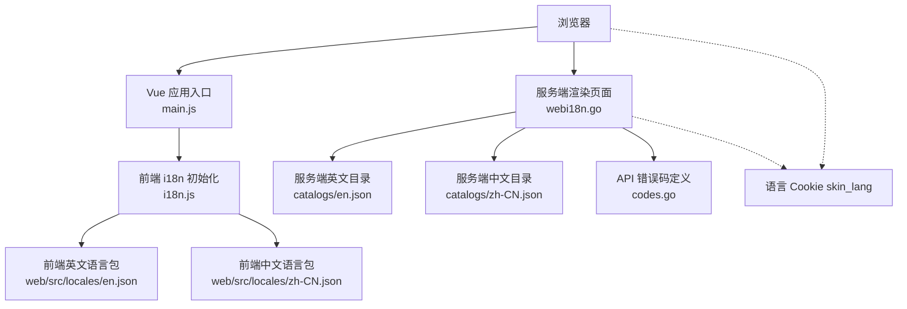
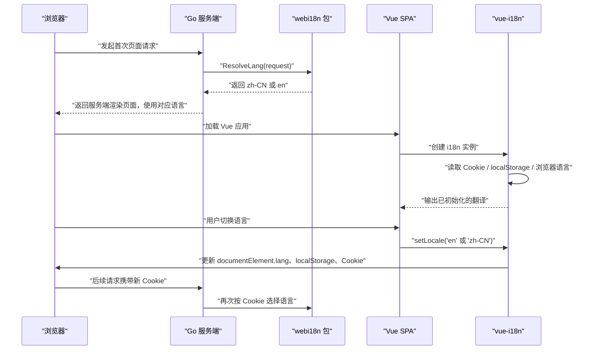
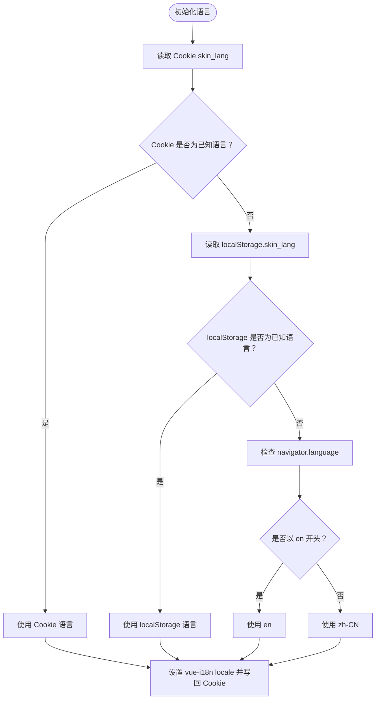
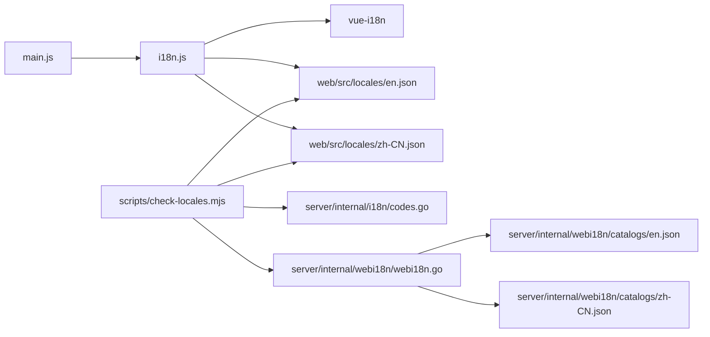

# 国际化

**本文引用的文件**
- [i18n.js](https://github.com/YimingZhanshen/skin-nexus/blob/797ae1a/web/src/i18n.js)
- [main.js](https://github.com/YimingZhanshen/skin-nexus/blob/797ae1a/web/src/main.js)
- [en.json](https://github.com/YimingZhanshen/skin-nexus/blob/797ae1a/web/src/locales/en.json)
- [zh-CN.json](https://github.com/YimingZhanshen/skin-nexus/blob/797ae1a/web/src/locales/zh-CN.json)
- [package.json](https://github.com/YimingZhanshen/skin-nexus/blob/797ae1a/web/package.json)
- [check-locales.mjs](https://github.com/YimingZhanshen/skin-nexus/blob/797ae1a/scripts/check-locales.mjs)
- [webi18n.go](https://github.com/YimingZhanshen/skin-nexus/blob/797ae1a/server/internal/webi18n/webi18n.go)
- [en.json（服务端）](https://github.com/YimingZhanshen/skin-nexus/blob/797ae1a/server/internal/webi18n/catalogs/en.json)
- [zh-CN.json（服务端）](https://github.com/YimingZhanshen/skin-nexus/blob/797ae1a/server/internal/webi18n/catalogs/zh-CN.json)
- [codes.go](https://github.com/YimingZhanshen/skin-nexus/blob/797ae1a/server/internal/i18n/codes.go)

## 目录
1. [简介](#简介)
2. [项目结构](#项目结构)
3. [核心组件](#核心组件)
4. [架构总览](#架构总览)
5. [详细组件分析](#详细组件分析)
6. [依赖关系分析](#依赖关系分析)
7. [性能与兼容性考虑](#性能与兼容性考虑)
8. [常见问题排查](#常见问题排查)
9. [结论](#结论)
10. [附录：新增翻译键的操作流程](#附录新增翻译键的操作流程)

## 简介
本项目的前端使用 `vue-i18n` 提供中英文双语界面，语言偏好通过浏览器 Cookie 和 `localStorage` 持久化，并与后端服务端渲染语言保持一致。后端同时维护两套文案来源：

- **SPA 前端语言包**：位于 `web/src/locales`，由 `vue-i18n` 加载，包含页面文案、错误码消息、通用 UI 文案等。
- **服务端渲染语言包**：位于 `server/internal/webi18n/catalogs`，用于纹理详情页、落地页、设备授权页、邮件模板等直接由 Go 渲染的 HTML。

两者通过相同的语言代码 `en` 与 `zh-CN` 以及同一 Cookie `skin_lang` 协同工作，确保用户无论从服务端页面跳转进入 SPA，还是直接在 SPA 内切换语言，体验一致。

## 项目结构
国际化相关的主要文件和职责如下：

| 路径 | 职责 |
|---|---|
| `web/src/i18n.js` | 初始化 `vue-i18n`，解析语言偏好，导出 `i18n` 实例和 `setLocale` |
| `web/src/main.js` | Vue 应用入口，注册 `i18n` 插件 |
| `web/src/locales/en.json` | 英文前端语言包 |
| `web/src/locales/zh-CN.json` | 中文前端语言包 |
| `web/package.json` | 声明 `vue-i18n` 依赖 |
| `server/internal/webi18n/webi18n.go` | 服务端语言选择、嵌入并解析服务端语言包 |
| `server/internal/webi18n/catalogs/en.json` | 服务端英文文案 |
| `server/internal/webi18n/catalogs/zh-CN.json` | 服务端中文文案 |
| `server/internal/i18n/codes.go` | API 错误码常量，是前端 `errors.*` 翻译的权威来源之一 |
| `scripts/check-locales.mjs` | 本地化完整性检查脚本 |

**图示来源**
- [main.js:1-6](https://github.com/YimingZhanshen/skin-nexus/blob/797ae1a/web/src/main.js#L1-L6)
- [i18n.js:1-68](https://github.com/YimingZhanshen/skin-nexus/blob/797ae1a/web/src/i18n.js#L1-L68)
- [webi18n.go:1-238](https://github.com/YimingZhanshen/skin-nexus/blob/797ae1a/server/internal/webi18n/webi18n.go#L1-L238)

**章节来源**
- [main.js:1-6](https://github.com/YimingZhanshen/skin-nexus/blob/797ae1a/web/src/main.js#L1-L6)
- [i18n.js:1-68](https://github.com/YimingZhanshen/skin-nexus/blob/797ae1a/web/src/i18n.js#L1-L68)
- [package.json:1-22](https://github.com/YimingZhanshen/skin-nexus/blob/797ae1a/web/package.json#L1-L22)

## 核心组件
### 前端 `i18n.js`
该模块负责以下事项：

- 导入 `vue-i18n` 提供的 `createI18n`。
- 静态导入两个语言包：`web/src/locales/zh-CN.json` 与 `web/src/locales/en.json`。
- 定义语言 Cookie 名称 `skin_lang` 与已知语言集合 `['zh-CN', 'en']`。
- 实现 Cookie 读写函数，Cookie 配置为：
  - `Path=/`
  - `Max-Age=31536000`（一年）
  - `SameSite=Lax`
  - HTTPS 下附加 `Secure`
- 按优先级解析初始语言：
  1. Cookie 中的 `skin_lang`
  2. `localStorage.skin_lang`
  3. `navigator.language` 中以 `en` 开头的浏览器语言
  4. 默认回退到 `zh-CN`
- 创建 `vue-i18n` 实例，配置：
  - `legacy: false`
  - `locale` 为解析出的初始语言
  - `fallbackLocale: 'zh-CN'`
  - `messages` 中绑定 `zh-CN` 和 `en`
- 将 `document.documentElement.lang` 同步为当前语言，并写回 Cookie。
- 导出 `setLocale(locale)`，用于运行时切换语言。

这意味着：

- 如果用户在服务端页面点击“中文”或“English”，服务端写入 Cookie；SPA 启动时优先读取该 Cookie，从而与服务端渲染语言保持一致。
- 如果浏览器拒绝 Cookie，则回退到 `localStorage`。
- 如果既没有 Cookie 也没有 `localStorage`，则根据浏览器语言决定英文或中文，最终兜底为中文。
- 所有语言切换都会同时更新 `documentElement.lang`、`localStorage` 和 Cookie，保证后续请求和服务端仍可识别最新偏好。

**章节来源**
- [i18n.js:1-68](https://github.com/YimingZhanshen/skin-nexus/blob/797ae1a/web/src/i18n.js#L1-L68)

### Vue 应用入口
`main.js` 只做两件事：

- 创建 Vue 应用。
- 通过 `.use(i18n)` 注册 `vue-i18n`。

因此，任何组件都可以通过 `vue-i18n` 提供的组合式或模板 API 访问翻译，而不需要再自行初始化国际化。

**章节来源**
- [main.js:1-6](https://github.com/YimingZhanshen/skin-nexus/blob/797ae1a/web/src/main.js#L1-L6)

### 前端语言包结构
前端语言包由 `en.json` 和 `zh-CN.json` 组成，目前仓库只要求这两个文件保持键集完全一致。其结构不是单一扁平对象，而是按语义分组的多层对象，主要包括：

| 顶层命名空间 | 含义 |
|---|---|
| `errors` | API 错误消息，对应后端返回的错误码 |
| `common` | 通用 UI 文案，如登录、退出、保存、取消、加载中、分页、面包屑等 |
| 其他业务命名空间 | 如设置项、审计动作、皮肤库、插件、角色、主题等 |

由于两个语言包必须保持键集一致，新增或移除键时，应同时在 `en.json` 和 `zh-CN.json` 中修改。

**章节来源**
- [en.json:1-1409](https://github.com/YimingZhanshen/skin-nexus/blob/797ae1a/web/src/locales/en.json#L1-L1409)
- [zh-CN.json:1-1409](https://github.com/YimingZhanshen/skin-nexus/blob/797ae1a/web/src/locales/zh-CN.json#L1-L1409)

## 架构总览
前后端国际化的整体交互可以概括为：**共享语言偏好、双语言包、统一校验**。

**图示来源**
- [i18n.js:1-68](https://github.com/YimingZhanshen/skin-nexus/blob/797ae1a/web/src/i18n.js#L1-L68)
- [webi18n.go:1-238](https://github.com/YimingZhanshen/skin-nexus/blob/797ae1a/server/internal/webi18n/webi18n.go#L1-L238)

## 详细组件分析

### 前端语言初始化与 Cookie 行为
`i18n.js` 的语言解析逻辑可理解为以下流程：

关键点：

- Cookie 是首选，因为服务端渲染页面也能写入它，SPA 必须优先继承上一次选择。
- Cookie 不是 HttpOnly，否则 SPA 无法读取和更新语言偏好。
- `SameSite=Lax` 允许启动器打开 `/device.html` 这类顶级导航仍携带 Cookie。
- `Secure` 仅在 HTTPS 下生效，避免明文传输敏感偏好。
- 默认语言固定为 `zh-CN`，因此即使后端和用户偏好不一致，也不会出现空语言。

**图示来源**
- [i18n.js:12-47](https://github.com/YimingZhanshen/skin-nexus/blob/797ae1a/web/src/i18n.js#L12-L47)

**章节来源**
- [i18n.js:1-68](https://github.com/YimingZhanshen/skin-nexus/blob/797ae1a/web/src/i18n.js#L1-L68)

### 后端语言解析与 SSR 语言包
`server/internal/webi18n/webi18n.go` 的职责包括：

- 使用 Go 的 `embed` 将 `catalogs/en.json` 和 `catalogs/zh-CN.json` 嵌入程序。
- 启动时解析 JSON 为 `map[string]string`。
- 启动阶段做简单 parity 检查：如果英文目录存在某个键而中文目录缺失，直接 panic，避免上线后只看到裸键。
- 提供 `T(lang, key)`：按语言查找键，找不到时回退到中文，若中文也没有则返回裸键本身。
- 提供 `F(lang, key, kv...)`：用 `{name}` 占位符进行字符串替换。
- 提供 `ViewerPayload(lang)`：把 progressive-enhancement viewer 需要的键注入为 `window.__SKIN_I18N__`。
- 提供 `ExplicitLang` 和 `ResolveLang`：
  - URL 查询参数 `?hl=en` 或 `?hl=zh-CN` 具有最高优先级，便于爬虫和 hreflang。
  - 其次读取 Cookie `skin_lang`。
  - 然后解析 `Accept-Language`。
  - 最后默认返回 `zh-CN`。

服务端语言包的键必须是扁平字符串，且不得放在 `errors.*` 命名空间；页面文案使用 `page.`、`ui.`、`detail.`、`lib.`、`edit.`、`report.`、`notfound.`、`seo.`、`viewer.`、`landing.`、`device.`、`mail.` 等命名空间。

**章节来源**
- [webi18n.go:1-238](https://github.com/YimingZhanshen/skin-nexus/blob/797ae1a/server/internal/webi18n/webi18n.go#L1-L238)
- [en.json（服务端）:1-131](https://github.com/YimingZhanshen/skin-nexus/blob/797ae1a/server/internal/webi18n/catalogs/en.json#L1-L131)
- [zh-CN.json（服务端）:1-131](https://github.com/YimingZhanshen/skin-nexus/blob/797ae1a/server/internal/webi18n/catalogs/zh-CN.json#L1-L131)

### 错误码与前端的 `errors.*` 命名空间
后端 API 错误响应采用稳定机器可读 `code` 加人类可读 `message` 的结构。`server/internal/i18n/codes.go` 是所有非 2xx 错误的权威声明位置，约定：

- 错误码形如 `<area>.<reason>`，全小写、点分隔。
- 每个错误码对应前端语言包中 `errors.<area>.<reason>`。
- 错误码是 API 契约的一部分，不应随意重命名；废弃时应保留旧码并停止使用，而不是重新赋值。
- 前端在显示错误时优先翻译 `code`，只有当后端返回未知 code 时才回退到后端原文。

因此，新增错误码时，必须先在 Go 侧声明，再在前端 `web/src/locales/en.json` 和 `zh-CN.json` 的 `errors.*` 下补充对应文案。

**章节来源**
- [codes.go:1-198](https://github.com/YimingZhanshen/skin-nexus/blob/797ae1a/server/internal/i18n/codes.go#L1-L198)

### 复数形式、插值参数与动态文案
#### 复数形式
当前仓库的 `vue-i18n` 初始化未显式启用复数规则，也没有在 `i18n.js` 中注册复数处理器。现有语言包中可见：

- 英文 `detail.likesUnit` 为空字符串。
- 中文 `detail.likesUnit` 为“人”。
- 英文 `lib.count` 使用 “{n} public textures”。
- 中文 `lib.count` 使用 “公开材质 {n} 个”。

这说明项目目前没有依赖 `vue-i18n` 的复数规则，而是通过单独字段或自然语序处理数量词。如果需要更复杂的复数规则，应在 `createI18n` 配置中引入复数处理器，并在语言包中使用受支持的复数语法。

#### 插值参数
两种语言包中都大量使用花括号插值，例如：

- `{name}`
- `{kind}`
- `{site}`
- `{who}`
- `{likes}`
- `{n}`
- `{ttl}`
- `{host}`
- `{port}`
- `{sender}`
- `{theme}`
- `{lang}`
- `{err}`
- `{width}`
- `{height}`
- `{playerCount}`
- `{players}`
- `{closets}`
- `{avatars}`
- `{url}`

这些插值参数来自服务端数据或前端运行时变量，语言包只负责模板和顺序。

#### 动态文案
前端动态构建翻译键的模式被 `check-locales.mjs` 检测，包括：

- 字面量调用 `t('admin.kind.${row.kind}')`。
- 拼接调用 `t('admin.diag.' + x)`。
- 前置变量模式 `const key = \`admin.settingsGroup.${g}\`; t(key)`。

对于这些动态键，检查脚本不要求枚举出每一个叶子键，但要求静态前缀对应的父命名空间至少有一个真实条目，以避免整族枚举全部缺失。

**章节来源**
- [en.json:1-1409](https://github.com/YimingZhanshen/skin-nexus/blob/797ae1a/web/src/locales/en.json#L1-L1409)
- [zh-CN.json:1-1409](https://github.com/YimingZhanshen/skin-nexus/blob/797ae1a/web/src/locales/zh-CN.json#L1-L1409)
- [check-locales.mjs:201-526](https://github.com/YimingZhanshen/skin-nexus/blob/797ae1a/scripts/check-locales.mjs#L201-L526)

### 命名空间约定
#### 前端语言包
- `errors.*`：API 错误码消息。
- `common.*`：通用 UI 文案。
- 其他业务命名空间：settings、audit、plugin、texture、player、report、skinlib、union、user、theme、market、oidc、setup、mail 等。
- 命名空间应保持语义清晰，新增命名空间时建议遵循已有风格，并确保 `en.json` 与 `zh-CN.json` 同步。

#### 服务端语言包
服务端语言包是扁平键值对象，命名空间包括：

| 命名空间 | 用途 |
|---|---|
| `detail.*` | 纹理详情页文案 |
| `device.*` | 设备授权页文案 |
| `edit.*` | 编辑材质资料文案 |
| `landing.*` | 落地页文案 |
| `lib.*` | 皮肤库列表文案 |
| `notfound.*` | 404 类文案 |
| `page.*` | 站点级导航和辅助文案 |
| `report.*` | 举报表单文案 |
| `seo.*` | SEO 标题、描述、站点名 |
| `viewer.*` | viewer 运行时提示 |
| `ui.*` | 通用 UI 按钮和控件文案 |
| `mail.*` | 邮件模板文案 |

服务端语言包不允许出现 `errors.*`，因为该命名空间专属于错误码。

**章节来源**
- [en.json（服务端）:1-131](https://github.com/YimingZhanshen/skin-nexus/blob/797ae1a/server/internal/webi18n/catalogs/en.json#L1-L131)
- [zh-CN.json（服务端）:1-131](https://github.com/YimingZhanshen/skin-nexus/blob/797ae1a/server/internal/webi18n/catalogs/zh-CN.json#L1-L131)
- [webi18n.go:1-238](https://github.com/YimingZhanshen/skin-nexus/blob/797ae1a/server/internal/webi18n/webi18n.go#L1-L238)

## 依赖关系分析

**图示来源**
- [main.js:1-6](https://github.com/YimingZhanshen/skin-nexus/blob/797ae1a/web/src/main.js#L1-L6)
- [i18n.js:1-68](https://github.com/YimingZhanshen/skin-nexus/blob/797ae1a/web/src/i18n.js#L1-L68)
- [package.json:1-22](https://github.com/YimingZhanshen/skin-nexus/blob/797ae1a/web/package.json#L1-L22)
- [check-locales.mjs:1-692](https://github.com/YimingZhanshen/skin-nexus/blob/797ae1a/scripts/check-locales.mjs#L1-L692)
- [codes.go:1-198](https://github.com/YimingZhanshen/skin-nexus/blob/797ae1a/server/internal/i18n/codes.go#L1-L198)
- [webi18n.go:1-238](https://github.com/YimingZhanshen/skin-nexus/blob/797ae1a/server/internal/webi18n/webi18n.go#L1-L238)

### 耦合与内聚
- `i18n.js` 与前端语言包强耦合：新增键必须成对出现在两个 JSON 文件中。
- `webi18n.go` 与 `catalogs/*.json` 强耦合：JSON 结构必须为扁平字符串映射。
- `check-locales.mjs` 是跨层协调者：连接前端语言包、后端错误码、服务端语言包和 Go 源码中的引用。
- 前后端共享语言代码 `en` 和 `zh-CN`，并通过 Cookie `skin_lang` 共享语言偏好。

### 潜在循环依赖
- 前端语言包是静态资源，不被 Go 代码直接导入。
- 服务端语言包通过 `embed` 嵌入，也不被前端导入。
- 唯一双向约束来自 `check-locales.mjs` 和语言契约，而非运行时 import。

**章节来源**
- [check-locales.mjs:1-692](https://github.com/YimingZhanshen/skin-nexus/blob/797ae1a/scripts/check-locales.mjs#L1-L692)
- [webi18n.go:1-238](https://github.com/YimingZhanshen/skin-nexus/blob/797ae1a/server/internal/webi18n/webi18n.go#L1-L238)

## 性能与兼容性考虑
### 性能特性
- 前端语言包是静态导入，打包时会被 Vite 处理；当前仓库未拆分按需加载语言包。
- 服务端语言包通过 `embed` 嵌入二进制，启动时一次性解析 JSON，不会每次请求重读磁盘。
- `resolveLang` 仅做 Cookie、URL 查询参数和 `Accept-Language` 解析，复杂度低。

### 兼容性与边界情况
- Cookie 值未经解码后再比较，只接受精确匹配的 `zh-CN` 或 `en`；手改 Cookie 出错会回退到下一层解析或默认语言。
- `navigator.language` 是小写比较，并以 `en` 开头判断英文，其余走中文默认。
- `Accept-Language` 支持带质量因子的多标签，并按前缀匹配 `en-*` 和 `zh-*`。
- 未知语言一律归一化为 `zh-CN`，避免无效语言影响渲染。
- `document.documentElement.lang` 随语言切换更新，有利于无障碍工具和搜索引擎识别文档语言。

**章节来源**
- [i18n.js:12-68](https://github.com/YimingZhanshen/skin-nexus/blob/797ae1a/web/src/i18n.js#L12-L68)
- [webi18n.go:150-238](https://github.com/YimingZhanshen/skin-nexus/blob/797ae1a/server/internal/webi18n/webi18n.go#L150-L238)

## 常见问题排查

### 常见本地化陷阱
1. **缺少对应语言的键**
   `vue-i18n` 会使用 `fallbackLocale`，即中文。因此英文面板可能静默显示中文文案，而不是报错。`check-locales.mjs` 会检测 `en.json` 与 `zh-CN.json` 的键集差异。

2. **后端错误码没有翻译**
   如果后端新增错误码但没有在前端 `errors.*` 中补充，前端会显示后端原始消息，导致英文面板出现中文。

3. **语言包中存在多余键**
   服务端语言包会检查死文案；前端也会检查 UI 键总数下限，防止无意义删除。

4. **裸 `@` 字符导致 `vue-i18n` 抛出异常**
   `vue-i18n` 把 `@` 当作链接消息起始符号。邮箱地址中的 `@` 必须写成 `{'@'}`，否则会报“无效的链接格式”，表现为面板空白。

5. **服务端模板中残留中文**
   服务端渲染模板必须使用语言包，不能硬编码中文。检查脚本会扫描模板字符串中的汉字。

6. **动态键族为空**
   动态键如 `admin.kind.${x}` 要求父命名空间至少有一个真实条目，否则枚举场景会全部渲染为裸路径。

7. **设置项说明缺少“不回显”提示**
   密码等写-only 字段必须在说明中指出不会回显，否则检查脚本会失败。

8. **服务端语言包混入 `errors.*`**
   该命名空间专属于错误码，服务端文案不得使用。

9. **服务端语言包键未在服务端代码中被引用**
   检查脚本会报告“死文案”，说明某个键从未被 Go 源码使用。

10. **URL 参数 `?hl=` 指定了不支持的语言**
    该语言被视为无偏好，不会强制锁定错误语言。

**章节来源**
- [check-locales.mjs:1-692](https://github.com/YimingZhanshen/skin-nexus/blob/797ae1a/scripts/check-locales.mjs#L1-L692)
- [i18n.js:1-68](https://github.com/YimingZhanshen/skin-nexus/blob/797ae1a/web/src/i18n.js#L1-L68)
- [webi18n.go:1-238](https://github.com/YimingZhanshen/skin-nexus/blob/797ae1a/server/internal/webi18n/webi18n.go#L1-L238)

### RTL 语言和未来扩展多语言注意事项
当前系统只支持 `en` 和 `zh-CN`。未来扩展多语言时需注意：

- `i18n.js` 中的 `KNOWN_LOCALES` 需要新增语言代码。
- `initialLocale` 的浏览器语言分支需要覆盖新语言。
- `webi18n.go` 的 `matchLang`、`normalize`、`ResolveLang` 和 `parseAcceptLanguage` 都需要支持新语言。
- 新增语言时必须同时添加 `web/src/locales/<lang>.json` 和 `server/internal/webi18n/catalogs/<lang>.json`。
- `check-locales.mjs` 的 `LOCALES` 数组需要加入新语言，否则多语言间一致性检查不完整。
- 如果新增阿拉伯语等从右到左语言，还需考虑 CSS 方向、图标镜像、布局翻转和无障碍属性。
- Cookie 和 URL 参数 `?hl=` 必须能正确传递新语言代码。
- 服务端语言包应保持扁平结构，不要混入 `errors.*`。
- 前端语言包仍需保持所有语言文件的键集一致。

[本节为概念性指导，不直接分析具体代码行]

## 结论
本项目的国际化方案以 `vue-i18n` 为核心，结合 Cookie、`localStorage` 和 `navigator.language` 确定前端语言，并由后端 `webi18n` 包以相同语言代码解析服务端渲染语言。前后端语言包通过 `check-locales.mjs` 严格校验，避免“一个有键另一个缺失”“后端错误码缺少翻译”“服务端模板残留中文”“动态键族为空”等典型问题。

最佳实践是：

- 永远通过翻译键访问文案，不在模板中硬编码用户可见字符串。
- 新增错误码先改 Go，再同步前端 `errors.*`。
- 新增页面文案先确认是否需要服务端渲染；如果是，则更新 `server/internal/webi18n/catalogs`。
- 新增普通前端文案则更新 `web/src/locales` 下的两个语言文件。
- 始终运行 `scripts/check-locales.mjs`，确保 CI 和本地开发都能发现遗漏。

**章节来源**
- [i18n.js:1-68](https://github.com/YimingZhanshen/skin-nexus/blob/797ae1a/web/src/i18n.js#L1-L68)
- [check-locales.mjs:1-692](https://github.com/YimingZhanshen/skin-nexus/blob/797ae1a/scripts/check-locales.mjs#L1-L692)
- [webi18n.go:1-238](https://github.com/YimingZhanshen/skin-nexus/blob/797ae1a/server/internal/webi18n/webi18n.go#L1-L238)

## 附录：新增翻译键的操作流程

### 新增普通前端文案
1. 在 `web/src/locales/en.json` 和 `zh-CN.json` 的合适命名空间下添加键。
2. 在 Vue 组件或 JS 中通过 `t('namespace.key')` 或 `vue-i18n` 模板指令使用。
3. 运行 `scripts/check-locales.mjs`，确认没有缺失键、裸 `@`、动态键族为空等问题。

**章节来源**
- [en.json:1-1409](https://github.com/YimingZhanshen/skin-nexus/blob/797ae1a/web/src/locales/en.json#L1-L1409)
- [zh-CN.json:1-1409](https://github.com/YimingZhanshen/skin-nexus/blob/797ae1a/web/src/locales/zh-CN.json#L1-L1409)
- [check-locales.mjs:201-526](https://github.com/YimingZhanshen/skin-nexus/blob/797ae1a/scripts/check-locales.mjs#L201-L526)

### 新增后端错误码
1. 在 `server/internal/i18n/codes.go` 中新增错误码常量，遵循 `<area>.<reason>` 命名。
2. 在 `web/src/locales/en.json` 和 `zh-CN.json` 的 `errors.<area>.<reason>` 下添加对应文案。
3. 确认前端错误处理逻辑使用该 `code` 进行翻译，而不是直接显示后端 message。
4. 运行 `check-locales.mjs`，确保后端声明的每个错误码都有对应翻译。

**章节来源**
- [codes.go:1-198](https://github.com/YimingZhanshen/skin-nexus/blob/797ae1a/server/internal/i18n/codes.go#L1-L198)
- [check-locales.mjs:100-170](https://github.com/YimingZhanshen/skin-nexus/blob/797ae1a/scripts/check-locales.mjs#L100-L170)

### 新增服务端渲染文案
1. 在 `server/internal/webi18n/catalogs/en.json` 和 `zh-CN.json` 中添加同名键。
2. 在 Go 源码中使用 `webi18n.T` 或 `webi18n.F` 获取文案。
3. 不要使用 `errors.*` 命名空间。
4. 运行 `check-locales.mjs`，确保：
   - 两个服务端语言包键集一致。
   - 所有被引用的键都存在。
   - 没有被引用但存在于语言包中的死文案。
   - 模板中没有未翻译的中文。

**章节来源**
- [en.json（服务端）:1-131](https://github.com/YimingZhanshen/skin-nexus/blob/797ae1a/server/internal/webi18n/catalogs/en.json#L1-L131)
- [zh-CN.json（服务端）:1-131](https://github.com/YimingZhanshen/skin-nexus/blob/797ae1a/server/internal/webi18n/catalogs/zh-CN.json#L1-L131)
- [webi18n.go:1-238](https://github.com/YimingZhanshen/skin-nexus/blob/797ae1a/server/internal/webi18n/webi18n.go#L1-L238)
- [check-locales.mjs:201-526](https://github.com/YimingZhanshen/skin-nexus/blob/797ae1a/scripts/check-locales.mjs#L201-L526)
