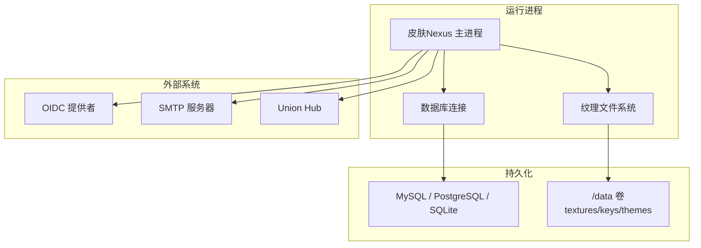
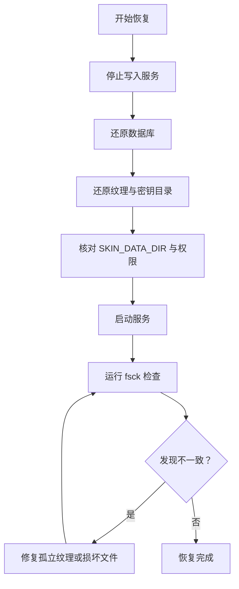
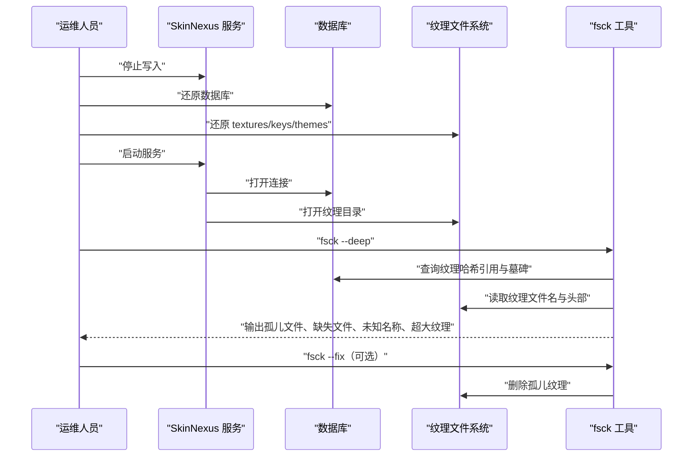
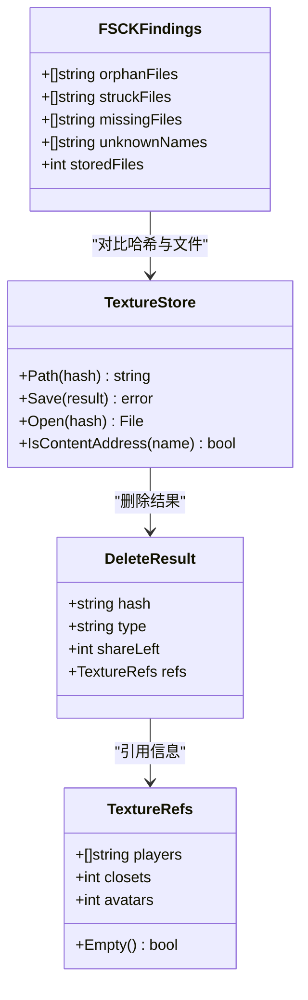
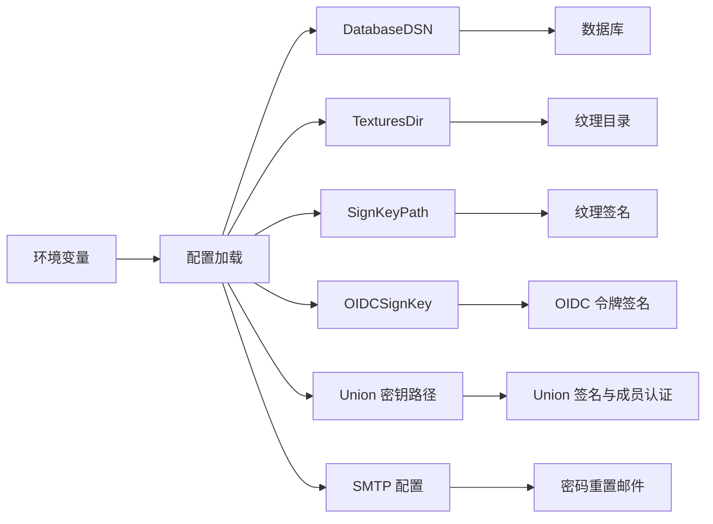
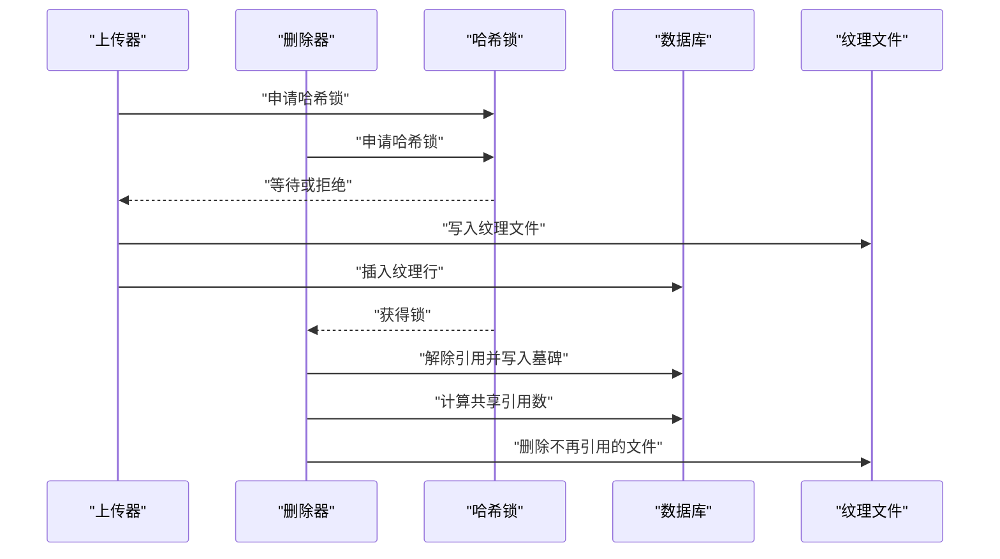

# 备份与恢复

**本文引用的文件**
- [server/cmd/skin-nexus/main.go](https://github.com/YimingZhanshen/skin-nexus/blob/797ae1a/server/cmd/skin-nexus/main.go)
- [server/cmd/skin-nexus/fsck.go](https://github.com/YimingZhanshen/skin-nexus/blob/797ae1a/server/cmd/skin-nexus/fsck.go)
- [server/internal/config/config.go](https://github.com/YimingZhanshen/skin-nexus/blob/797ae1a/server/internal/config/config.go)
- [server/internal/store/fsck.go](https://github.com/YimingZhanshen/skin-nexus/blob/797ae1a/server/internal/store/fsck.go)
- [server/internal/store/texdelete.go](https://github.com/YimingZhanshen/skin-nexus/blob/797ae1a/server/internal/store/texdelete.go)
- [server/internal/texture/pipeline.go](https://github.com/YimingZhanshen/skin-nexus/blob/797ae1a/server/internal/texture/pipeline.go)
- [server/internal/oidc/keyfile.go](https://github.com/YimingZhanshen/skin-nexus/blob/797ae1a/server/internal/oidc/keyfile.go)
- [server/internal/union/signer.go](https://github.com/YimingZhanshen/skin-nexus/blob/797ae1a/server/internal/union/signer.go)
- [server/internal/mailer/config.go](https://github.com/YimingZhanshen/skin-nexus/blob/797ae1a/server/internal/mailer/config.go)
- [Dockerfile](https://github.com/YimingZhanshen/skin-nexus/blob/797ae1a/Dockerfile)
- [docker-compose.yml](https://github.com/YimingZhanshen/skin-nexus/blob/797ae1a/docker-compose.yml)

## 目录
1. [简介](#简介)
2. [项目结构](#项目结构)
3. [核心组件](#核心组件)
4. [架构总览](#架构总览)
5. [详细组件分析](#详细组件分析)
6. [依赖关系分析](#依赖关系分析)
7. [性能与容量规划](#性能与容量规划)
8. [故障排查指南](#故障排查指南)
9. [结论](#结论)

## 简介
本指南面向 SkinNexus 的运维人员，说明需要备份的数据范围、不同部署方式的备份策略、恢复流程、一致性校验方法，以及增量备份、RPO/RTO 目标、灾难恢复演练和常见恢复问题的修复方案。SkinNexus 的核心数据包括：数据库、纹理内容存储、主题与插件签名密钥、OIDC/JWK 密钥材料、SMTP 配置、Union 成员密钥及签名密钥等。服务启动时通过环境变量加载配置，默认将纹理、密钥、主题等统一放在 `SKIN_DATA_DIR`（容器镜像中为 `/data`）下；数据库由 `SKIN_DATABASE_DSN` 指向外部或内置 MySQL。

## 项目结构
从备份视角看，SkinNexus 可抽象为四层：

- **运行时入口层**：命令行参数解析、子命令分发、服务启动。
- **配置层**：从环境变量加载监听地址、数据库 DSN、文本目录、密钥路径、Union/OIDC/SMTP 等配置。
- **持久化层**：MySQL/PostgreSQL/SQLite 数据库，以及按内容寻址的纹理文件目录。
- **安全与集成层**：纹理签名密钥、OIDC/JWK 密钥、Union 签名密钥、主题/插件信任密钥、SMTP 配置。

**图表来源**
- [server/cmd/skin-nexus/main.go:60-140](https://github.com/YimingZhanshen/skin-nexus/blob/797ae1a/server/cmd/skin-nexus/main.go#L60-L140)
- [server/internal/config/config.go:1-120](https://github.com/YimingZhanshen/skin-nexus/blob/797ae1a/server/internal/config/config.go#L1-L120)
- [Dockerfile:40-68](https://github.com/YimingZhanshen/skin-nexus/blob/797ae1a/Dockerfile#L40-L68)
- [docker-compose.yml:1-86](https://github.com/YimingZhanshen/skin-nexus/blob/797ae1a/docker-compose.yml#L1-L86)

**章节来源**
- [server/cmd/skin-nexus/main.go:60-140](https://github.com/YimingZhanshen/skin-nexus/blob/797ae1a/server/cmd/skin-nexus/main.go#L60-L140)
- [server/internal/config/config.go:1-120](https://github.com/YimingZhanshen/skin-nexus/blob/797ae1a/server/internal/config/config.go#L1-L120)
- [Dockerfile:40-68](https://github.com/YimingZhanshen/skin-nexus/blob/797ae1a/Dockerfile#L40-L68)
- [docker-compose.yml:1-86](https://github.com/YimingZhanshen/skin-nexus/blob/797ae1a/docker-compose.yml#L1-L86)

## 核心组件
本节聚焦备份与恢复直接相关的配置项、存储模型和工具命令。

| 类别 | 关键配置或路径 | 备份要求 | 说明 |
|---|---|---|---|
| 数据库 | `SKIN_DATABASE_DSN` | 必须备份 | 支持 MySQL、PostgreSQL、SQLite；内置 compose 示例使用 MySQL 8.0 数据卷。 |
| 纹理目录 | `SKIN_TEXTURES_DIR`，默认 `<DataDir>/textures` | 必须备份 | 内容寻址目录，文件名即 PNG 重编码后的 SHA-256。 |
| 数据根目录 | `SKIN_DATA_DIR`，默认 `./data` | 建议整体快照 | 默认包含 textures、sign-key.pem、oidc-key.pem、themes、plugins 等。 |
| 纹理签名密钥 | `SKIN_SIGN_KEY`，默认 `<DataDir>/sign-key.pem` | 必须备份 | 丢失后所有已上传纹理签名失效。 |
| OIDC 签名密钥 | `SKIN_OIDC_SIGN_KEY`，默认 `<DataDir>/oidc-key.pem` | 必须备份 | 丢失后 OIDC refresh token 无法签发，用户会反复被要求重新授权。 |
| Union 成员密钥 | `SKIN_UNION_MEMBER_KEY` | 必须备份 | 成员身份与通信凭据。 |
| Union 主机公钥 | `SKIN_UNION_HOST_PUBKEY`，默认 `<DataDir>/union-host-pubkey.pem` | 建议备份 | 用于验证对端。 |
| Union OAuth2 签名私钥 | `SKIN_UNION_OAUTH2_SIG_KEY`，默认 `<DataDir>/union-oauth2-sig.pem` | 必须备份 | 历史请求验签依赖该密钥；变更会导致旧签名不可信。 |
| SMTP 配置 | `smtp_host/smtp_port/smtp_user/smtp_pass/smtp_from` | 建议备份 | 密码重置邮件依赖此配置；缺失则重置接口返回不可用状态。 |
| 主题与插件信任密钥 | `SKIN_PLUGIN_TRUST_KEYS`、`SKIN_THEME_TRUST_KEYS` | 建议备份 | 自定义市场或离线部署时尤为关键。 |

**章节来源**
- [server/internal/config/config.go:1-200](https://github.com/YimingZhanshen/skin-nexus/blob/797ae1a/server/internal/config/config.go#L1-L200)
- [server/internal/config/config.go:200-306](https://github.com/YimingZhanshen/skin-nexus/blob/797ae1a/server/internal/config/config.go#L200-L306)
- [server/internal/oidc/keyfile.go:1-48](https://github.com/YimingZhanshen/skin-nexus/blob/797ae1a/server/internal/oidc/keyfile.go#L1-L48)
- [server/internal/mailer/config.go:1-43](https://github.com/YimingZhanshen/skin-nexus/blob/797ae1a/server/internal/mailer/config.go#L1-L43)

## 架构总览
下图展示备份与恢复的关键对象及其关系。纹理采用内容寻址，文件名即哈希；删除操作先写墓碑记录，再在引用计数归零后移除文件。fsck 负责对比数据库与文件系统的一致性；texdelete 负责在事务内解除玩家、衣柜、头像引用并写入墓碑。

**图表来源**
- [server/cmd/skin-nexus/fsck.go:1-200](https://github.com/YimingZhanshen/skin-nexus/blob/797ae1a/server/cmd/skin-nexus/fsck.go#L1-L200)
- [server/internal/store/fsck.go:1-168](https://github.com/YimingZhanshen/skin-nexus/blob/797ae1a/server/internal/store/fsck.go#L1-L168)
- [server/internal/store/texdelete.go:1-200](https://github.com/YimingZhanshen/skin-nexus/blob/797ae1a/server/internal/store/texdelete.go#L1-L200)

**章节来源**
- [server/cmd/skin-nexus/fsck.go:1-200](https://github.com/YimingZhanshen/skin-nexus/blob/797ae1a/server/cmd/skin-nexus/fsck.go#L1-L200)
- [server/internal/store/fsck.go:1-168](https://github.com/YimingZhanshen/skin-nexus/blob/797ae1a/server/internal/store/fsck.go#L1-L168)
- [server/internal/store/texdelete.go:1-200](https://github.com/YimingZhanshen/skin-nexus/blob/797ae1a/server/internal/store/texdelete.go#L1-L200)

## 详细组件分析

### 备份范围与策略

#### 必须备份的内容
1. **数据库**：根据部署方式选择对应备份工具。
   - 内置 MySQL：备份 `skin-db` 命名卷对应的 `/var/lib/mysql`。
   - 外部 MySQL：使用 `mysqldump` 全量导出。
   - PostgreSQL：使用 `pg_dump` 全量导出。
   - SQLite：复制数据库文件或执行 `.dump`。
2. **纹理目录**：`SKIN_TEXTURES_DIR`，默认 `<DataDir>/textures`。
3. **密钥与主题目录**：`SKIN_DATA_DIR`，默认 `./data`，包含纹理签名密钥、OIDC 密钥、Union 密钥、主题与插件目录。
4. **SMTP 配置**：若使用密码重置邮件，需记录 `smtp_host`、`smtp_port`、`smtp_user`、`smtp_pass`、`smtp_from`。
5. **Union 密钥材料**：`SKIN_UNION_MEMBER_KEY`、`SKIN_UNION_HOST_PUBKEY`、`SKIN_UNION_OAUTH2_SIG_KEY`。

#### 不同部署方式的备份策略

| 部署方式 | 数据库备份 | 纹理与密钥备份 | 注意事项 |
|---|---|---|---|
| Docker Compose 内置 MySQL | 对 `skin-db` 卷做快照或 `docker cp` 出 `/var/lib/mysql` | 对 `skin-data` 卷做快照或 `docker cp` 出 `/data` | 同时备份两个卷；日志中可能暴露安装令牌，不要公开归档。 |
| 外部 MySQL | `mysqldump --single-transaction` 或云厂商快照 | 备份 `SKIN_DATA_DIR` | 确保字符集与排序规则一致；生产库建议冷备或只读副本。 |
| 外部 PostgreSQL | `pg_dump` 或云厂商快照 | 备份 `SKIN_DATA_DIR` | 注意多租户与扩展是否启用。 |
| SQLite | 复制 `.db` 文件或执行 `.dump` | 备份 `SKIN_DATA_DIR` | 必须先停止服务，否则 SQLite 可能锁住文件。 |
| 对象存储后端 | 不适用（数据库仍由 DSN 指定） | 纹理目录可迁移到对象存储前，应先确认当前实现仍使用本地文件系统 | 当前配置显示纹理目录是本地路径，不是对象存储键空间。 |

#### 增量备份建议
- **数据库**：优先使用云厂商或数据库引擎提供的增量快照；若无增量能力，可采用每日全量 + binlog/WAL 归档。
- **纹理目录**：纹理文件数量可能很大，建议使用支持增量同步的文件系统快照或对象存储版本化。
- **密钥**：密钥属于敏感小文件，应单独加密归档并异地保存。
- **RPO/RTO 目标**：
  - RPO：建议不超过一次数据库快照间隔，例如 15–60 分钟。
  - RTO：建议以“停止写入 → 恢复数据库 → 恢复 `/data` → 启动 → fsck”作为标准流程，控制在 15–60 分钟内完成非关键业务恢复。
- **灾难恢复演练**：至少每季度执行一次，包括完整恢复、部分恢复（仅恢复某个玩家或某批纹理）、密钥丢失恢复和 Union 密钥轮换失败回滚。

**章节来源**
- [Dockerfile:40-68](https://github.com/YimingZhanshen/skin-nexus/blob/797ae1a/Dockerfile#L40-L68)
- [docker-compose.yml:1-86](https://github.com/YimingZhanshen/skin-nexus/blob/797ae1a/docker-compose.yml#L1-L86)
- [server/internal/config/config.go:1-200](https://github.com/YimingZhanshen/skin-nexus/blob/797ae1a/server/internal/config/config.go#L1-L200)

### 恢复流程

推荐的标准恢复顺序如下：

1. **停止写入服务**
   在恢复数据库与纹理目录期间，必须停止所有写入皮肤、删除纹理、修改设置和登录鉴权的请求。对于 SQLite，必须完全停止进程，因为 SQLite 不支持跨进程 advisory lock。

2. **还原数据库**
   - MySQL：导入 mysqldump 或使用云厂商快照恢复。
   - PostgreSQL：导入 pg_dump 或使用 WAL 恢复点。
   - SQLite：替换数据库文件后启动。

3. **还原纹理与密钥目录**
   将备份中的 `SKIN_DATA_DIR` 恢复到目标路径，并确保运行用户对 `textures` 目录有读写权限，对密钥文件有只读权限。

4. **校验纹理文件完整性**
   使用 `fsck --deep` 校验已存储纹理是否与文件名一致，并扫描超大纹理。

5. **启动服务**
   使用与生产一致的 `SKIN_DATA_DIR`、`SKIN_DATABASE_DSN`、密钥路径和 Union/OIDC/SMTP 配置启动。

6. **运行 fsck 检查**
   先运行只读模式，再根据需要运行修复模式。修复模式会删除“既无数据库行引用、也无墓碑记录的孤立纹理”。

**图表来源**
- [server/cmd/skin-nexus/fsck.go:1-200](https://github.com/YimingZhanshen/skin-nexus/blob/797ae1a/server/cmd/skin-nexus/fsck.go#L1-L200)
- [server/internal/store/fsck.go:1-168](https://github.com/YimingZhanshen/skin-nexus/blob/797ae1a/server/internal/store/fsck.go#L1-L168)
- [server/internal/texture/pipeline.go:1-120](https://github.com/YimingZhanshen/skin-nexus/blob/797ae1a/server/internal/texture/pipeline.go#L1-L120)

**章节来源**
- [server/cmd/skin-nexus/fsck.go:1-200](https://github.com/YimingZhanshen/skin-nexus/blob/797ae1a/server/cmd/skin-nexus/fsck.go#L1-L200)
- [server/internal/store/fsck.go:1-168](https://github.com/YimingZhanshen/skin-nexus/blob/797ae1a/server/internal/store/fsck.go#L1-L168)
- [server/internal/texture/pipeline.go:1-120](https://github.com/YimingZhanshen/skin-nexus/blob/797ae1a/server/internal/texture/pipeline.go#L1-L120)

### fsck 与 texdelete 的一致性检查作用

fsck 和 texdelete 分别承担“审计诊断”和“事务性删除”的职责。

- **fsck 的作用**：
  - 统计数据库中的纹理行数、墓碑行数、未关闭报告数。
  - 统计每个内容哈希的使用次数。
  - 列出墓碑哈希集合，避免误删被标记删除但仍有证据意义的文件。
  - 检测回收槽：Tombstone 指向的 ID 已被新纹理占用且内容不同。
  - 检测衣柜重复条目、衣柜引用缺失纹理、站点地图覆盖情况。
  - 检测凭证 digest 迁移状态，判断备份中是否存在明文会话或刷新令牌。
  - 可选深度模式：校验每个内容寻址文件的哈希是否等于文件名，并扫描超过渲染上限的纹理。

- **texdelete 的作用**：
  - 在事务中解除玩家皮肤、披风、头像、衣柜中对纹理的引用。
  - 写入墓碑记录，保留删除证据。
  - 计算共享剩余引用数，决定是否可安全删除文件。
  - 使用内容哈希锁串行化同一纹理的并发写入与删除。

**图表来源**
- [server/internal/texture/pipeline.go:1-120](https://github.com/YimingZhanshen/skin-nexus/blob/797ae1a/server/internal/texture/pipeline.go#L1-L120)
- [server/internal/store/texdelete.go:1-200](https://github.com/YimingZhanshen/skin-nexus/blob/797ae1a/server/internal/store/texdelete.go#L1-L200)
- [server/cmd/skin-nexus/fsck.go:1-200](https://github.com/YimingZhanshen/skin-nexus/blob/797ae1a/server/cmd/skin-nexus/fsck.go#L1-L200)

**章节来源**
- [server/cmd/skin-nexus/fsck.go:1-200](https://github.com/YimingZhanshen/skin-nexus/blob/797ae1a/server/cmd/skin-nexus/fsck.go#L1-L200)
- [server/internal/store/fsck.go:1-168](https://github.com/YimingZhanshen/skin-nexus/blob/797ae1a/server/internal/store/fsck.go#L1-L168)
- [server/internal/store/texdelete.go:1-200](https://github.com/YimingZhanshen/skin-nexus/blob/797ae1a/server/internal/store/texdelete.go#L1-L200)
- [server/internal/texture/pipeline.go:1-120](https://github.com/YimingZhanshen/skin-nexus/blob/797ae1a/server/internal/texture/pipeline.go#L1-L120)

### 识别孤立纹理、损坏 PNG 与缺失哈希文件

| 问题类型 | 表现 | 定位方式 | 处理建议 |
|---|---|---|---|
| 孤立纹理 | 磁盘上有文件，但没有数据库行引用，也没有墓碑记录 | fsck 输出 “orphan” | 只读模式确认；必要时用 `--fix` 删除。 |
| 墓碑残留文件 | 文件存在，但有墓碑记录 | fsck 输出 “struck” | 不要自动删除；它是删除证据。 |
| 缺失哈希文件 | 数据库引用了某个哈希，但磁盘上没有对应文件 | fsck 输出 “missing” | 检查备份是否遗漏；必要时触发重新上传或从上游同步。 |
| 未知名称文件 | 纹理目录下存在不符合内容寻址命名的文件 | fsck 输出 “unknown” | 人工检查是否为遗留迁移文件或非皮肤资产。 |
| 损坏 PNG | 文件可读但内容与文件名不匹配，或 IHDR 异常 | fsck `--deep` 输出 “content mismatch” | 删除坏文件并重新上传；不要直接改文件名。 |
| 超大纹理 | 声明像素数超过渲染上限 | fsck `--deep` 输出 “oversized” | 工具只报告不自动重采样；需管理员决定如何处理该玩家的纹理。 |

**章节来源**
- [server/cmd/skin-nexus/fsck.go:1-200](https://github.com/YimingZhanshen/skin-nexus/blob/797ae1a/server/cmd/skin-nexus/fsck.go#L1-L200)
- [server/cmd/skin-nexus/fsck.go:201-286](https://github.com/YimingZhanshen/skin-nexus/blob/797ae1a/server/cmd/skin-nexus/fsck.go#L201-L286)
- [server/internal/texture/pipeline.go:1-120](https://github.com/YimingZhanshen/skin-nexus/blob/797ae1a/server/internal/texture/pipeline.go#L1-L120)

## 依赖关系分析

### 配置到持久化的依赖
SkinNexus 启动时首先加载配置，然后打开数据库连接，并根据 `SKIN_AUTO_MIGRATE` 应用迁移。纹理目录、密钥路径、Union/OIDC/SMTP 配置都来自环境变量或默认数据根目录。

**图表来源**
- [server/cmd/skin-nexus/main.go:60-140](https://github.com/YimingZhanshen/skin-nexus/blob/797ae1a/server/cmd/skin-nexus/main.go#L60-L140)
- [server/internal/config/config.go:1-200](https://github.com/YimingZhanshen/skin-nexus/blob/797ae1a/server/internal/config/config.go#L1-L200)

**章节来源**
- [server/cmd/skin-nexus/main.go:60-140](https://github.com/YimingZhanshen/skin-nexus/blob/797ae1a/server/cmd/skin-nexus/main.go#L60-L140)
- [server/internal/config/config.go:1-200](https://github.com/YimingZhanshen/skin-nexus/blob/797ae1a/server/internal/config/config.go#L1-L200)

### 删除与一致性锁依赖
texdelete 使用内容哈希锁保证同一纹理的并发写入与删除不会交错；fsck 在 `--fix` 模式下也会尝试获取相同锁。SQLite 没有跨进程 advisory lock，因此必须停止服务后再执行修复。

**图表来源**
- [server/internal/store/texdelete.go:1-200](https://github.com/YimingZhanshen/skin-nexus/blob/797ae1a/server/internal/store/texdelete.go#L1-L200)
- [server/cmd/skin-nexus/fsck.go:201-286](https://github.com/YimingZhanshen/skin-nexus/blob/797ae1a/server/cmd/skin-nexus/fsck.go#L201-L286)

**章节来源**
- [server/internal/store/texdelete.go:1-200](https://github.com/YimingZhanshen/skin-nexus/blob/797ae1a/server/internal/store/texdelete.go#L1-L200)
- [server/cmd/skin-nexus/fsck.go:201-286](https://github.com/YimingZhanshen/skin-nexus/blob/797ae1a/server/cmd/skin-nexus/fsck.go#L201-L286)

## 性能与容量规划
- 纹理文件是 PNG 重编码后的固定大小内容，典型皮肤小于 2 MiB，但大量皮肤会累积到 GB 级。备份时应优先考虑增量快照。
- 数据库表包含纹理、墓碑、玩家、衣柜、OIDC 刷新令牌、访问日志等，恢复时间受索引大小影响。
- fsck 深度模式会逐个打开纹理文件并读取头部，数据量大时会增加 I/O 压力，建议在低峰期执行。
- 如果站点公共皮肤数量超过站点地图限制，fsck 会报告省略的页面数量，这是预期行为，不代表数据丢失。

[本节为通用指导，不直接分析具体代码文件]

## 故障排查指南

### 数据库字符集不一致
**现象**：导入后中文乱码、排序规则异常、索引比较行为不同。
**原因**：外部数据库或备份导出时使用了不同的字符集或排序规则。
**处理**：
1. 确认目标数据库实例的默认字符集与 collation。
2. 使用 `charset=utf8mb4` 等正确参数连接。
3. 如已有错误数据，先在测试环境重建库并重新导入。

**章节来源**
- [server/internal/config/config.go:1-120](https://github.com/YimingZhanshen/skin-nexus/blob/797ae1a/server/internal/config/config.go#L1-L120)
- [docker-compose.yml:1-86](https://github.com/YimingZhanshen/skin-nexus/blob/797ae1a/docker-compose.yml#L1-L86)

### 纹理目录权限错误
**现象**：服务启动正常，但上传失败、读取纹理失败、fsck 报告无法打开文件。
**原因**：`SKIN_DATA_DIR` 或 `textures` 目录对运行用户不可写或不可读。
**处理**：
1. 确认 `SKIN_DATA_DIR` 指向真实路径。
2. 确保运行用户对 `/data/textures` 有读写权限。
3. 密钥文件至少对服务进程可读，对外部用户只读。

**章节来源**
- [server/internal/config/config.go:1-200](https://github.com/YimingZhanshen/skin-nexus/blob/797ae1a/server/internal/config/config.go#L1-L200)
- [server/internal/texture/pipeline.go:1-120](https://github.com/YimingZhanshen/skin-nexus/blob/797ae1a/server/internal/texture/pipeline.go#L1-L120)

### JWK/OIDC 密钥丢失导致 refresh token 失效
**现象**：用户频繁被要求重新登录；OIDC refresh token 无法签发。
**原因**：`SKIN_OIDC_SIGN_KEY` 对应的密钥文件丢失或被替换。
**处理**：
1. 从备份恢复 `oidc-key.pem`。
2. 重启服务后，现有用户可能需要重新授权。
3. 不要在恢复过程中生成新密钥，否则会破坏历史令牌链。

**章节来源**
- [server/internal/config/config.go:120-200](https://github.com/YimingZhanshen/skin-nexus/blob/797ae1a/server/internal/config/config.go#L120-L200)
- [server/internal/oidc/keyfile.go:1-48](https://github.com/YimingZhanshen/skin-nexus/blob/797ae1a/server/internal/oidc/keyfile.go#L1-L48)

### Union 签名密钥变更导致历史请求无法验签
**现象**：Union 相关请求验签失败，或面板显示签名密钥来源异常。
**原因**：Union OAuth2 签名私钥或成员密钥被更换，而历史签名仍由旧密钥生成。
**处理**：
1. 从备份恢复 `union-oauth2-sig.pem` 与 `union-host-pubkey.pem`。
2. 恢复 `SKIN_UNION_MEMBER_KEY`。
3. 如果确实需要轮换，应保留旧密钥并在过渡期内允许旧签名通过。
4. 变更后运行 fsck 和服务健康检查，确认 Union 模块状态。

**章节来源**
- [server/internal/config/config.go:120-200](https://github.com/YimingZhanshen/skin-nexus/blob/797ae1a/server/internal/config/config.go#L120-L200)
- [server/internal/union/signer.go:1-200](https://github.com/YimingZhanshen/skin-nexus/blob/797ae1a/server/internal/union/signer.go#L1-L200)

### SMTP 配置缺失导致密码重置不可用
**现象**：密码重置接口返回不可用，或发送失败。
**原因**：缺少 `smtp_host`，或缺少 `smtp_from` 与 `smtp_user`。
**处理**：
1. 补全 `smtp_host`、`smtp_port`、`smtp_user`、`smtp_pass`、`smtp_from`。
2. 确保 `smtp_from` 不为空；若为空，配置会被视为不可用。
3. 使用管理面板的邮件诊断功能验证连通性。

**章节来源**
- [server/internal/mailer/config.go:1-43](https://github.com/YimingZhanshen/skin-nexus/blob/797ae1a/server/internal/mailer/config.go#L1-L43)

### fsck 报告回收槽异常
**现象**：fsck 输出回收槽信息，提示墓碑与当前纹理内容不一致。
**原因**：数据库在 AUTOINCREMENT 修复前曾复用已删除行的 ID。
**处理**：
1. 不要手动删除墓碑或纹理。
2. 将报告作为审计输入，结合业务判断是否需要重建受影响纹理。
3. 后续升级应保留完整的数据库迁移历史。

**章节来源**
- [server/internal/store/fsck.go:1-168](https://github.com/YimingZhanshen/skin-nexus/blob/797ae1a/server/internal/store/fsck.go#L1-L168)
- [server/cmd/skin-nexus/fsck.go:201-286](https://github.com/YimingZhanshen/skin-nexus/blob/797ae1a/server/cmd/skin-nexus/fsck.go#L201-L286)

## 结论
SkinNexus 的备份与恢复应以“数据库 + 纹理目录 + 密钥 + 配置”为一个完整单元。生产环境建议采用数据库增量快照与纹理目录增量同步相结合的策略，并将密钥单独加密归档。恢复时务必先停止写入，再依次还原数据库与 `/data`，最后通过 `fsck` 与 `fsck --deep` 校验一致性；只有在确认孤儿文件确属冗余后，才使用 `fsck --fix` 清理。密钥类数据一旦丢失或变更，影响远超普通数据损坏，必须纳入最高优先级备份与灾难恢复演练。
