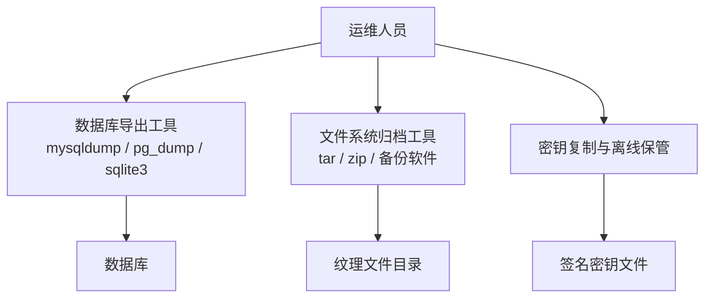
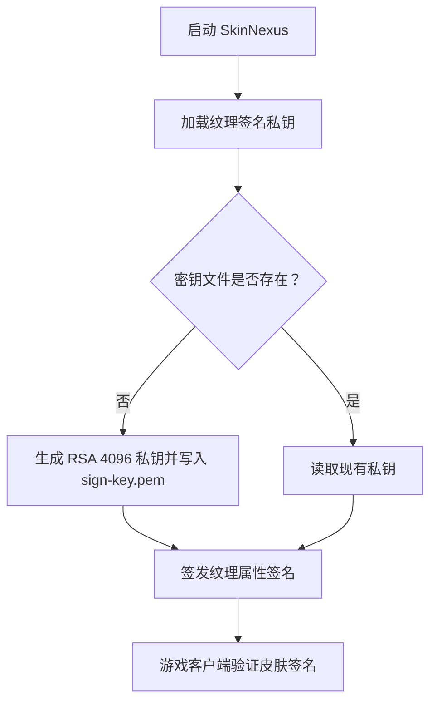
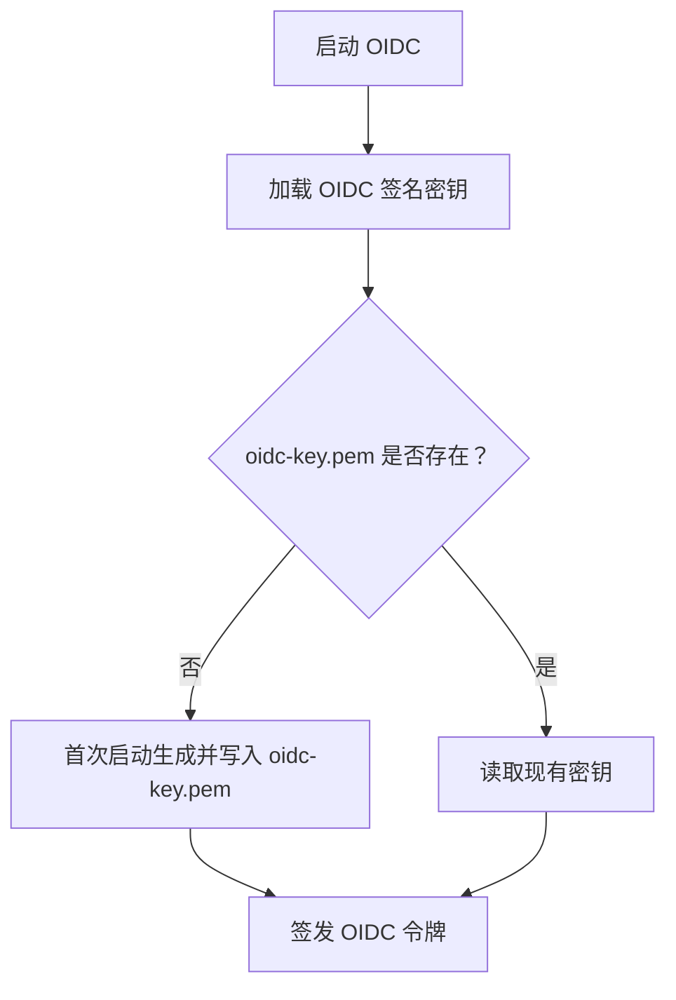
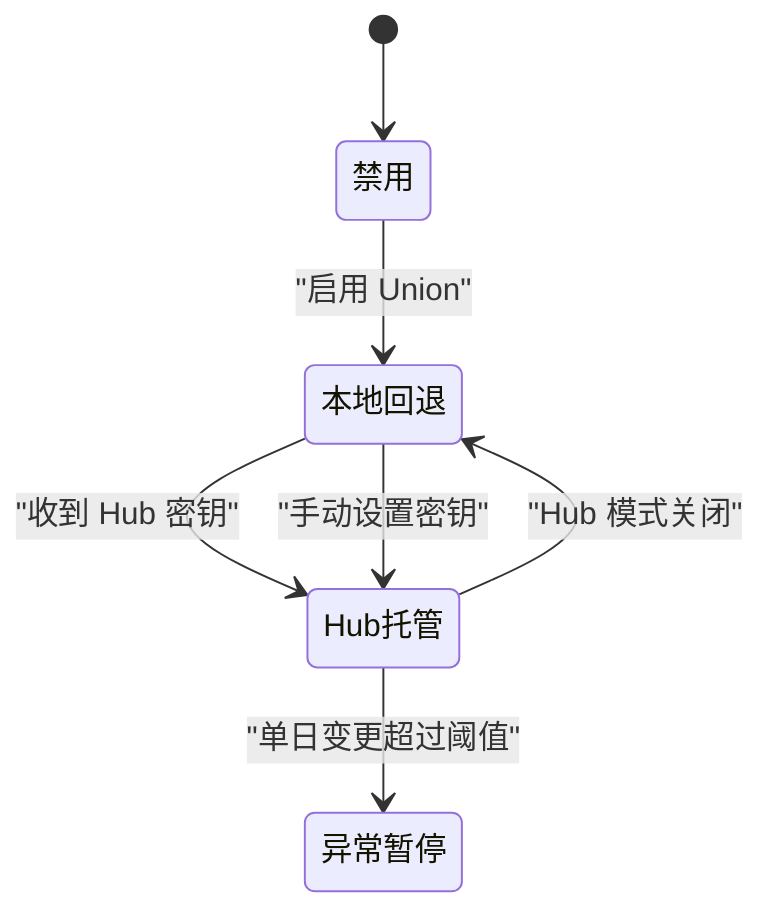
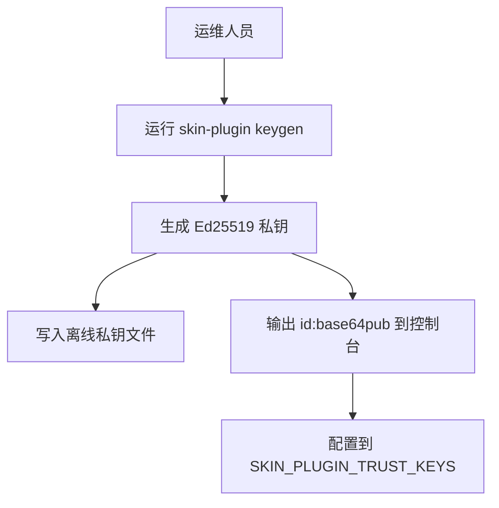
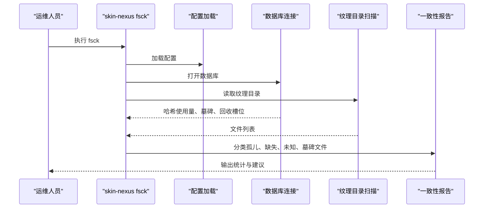

# 备份与灾难恢复

**本文引用的文件**
- [main.go](https://github.com/YimingZhanshen/skin-nexus/blob/797ae1a/server/cmd/skin-nexus/main.go)
- [fsck.go](https://github.com/YimingZhanshen/skin-nexus/blob/797ae1a/server/cmd/skin-nexus/fsck.go)
- [config.go](https://github.com/YimingZhanshen/skin-nexus/blob/797ae1a/server/internal/config/config.go)
- [dbx.go](https://github.com/YimingZhanshen/skin-nexus/blob/797ae1a/server/internal/dbx/dbx.go)
- [mysql.go](https://github.com/YimingZhanshen/skin-nexus/blob/797ae1a/server/internal/store/mysql.go)
- [oidc.go](https://github.com/YimingZhanshen/skin-nexus/blob/797ae1a/server/internal/store/oidc.go)
- [plugin.go](https://github.com/YimingZhanshen/skin-nexus/blob/797ae1a/server/internal/store/plugin.go)
- [union.go](https://github.com/YimingZhanshen/skin-nexus/blob/797ae1a/server/internal/store/union.go)
- [keyfile.go](https://github.com/YimingZhanshen/skin-nexus/blob/797ae1a/server/internal/oidc/keyfile.go)
- [signer.go](https://github.com/YimingZhanshen/skin-nexus/blob/797ae1a/server/internal/ygg/signer.go)
- [keygen.go](https://github.com/YimingZhanshen/skin-nexus/blob/797ae1a/server/cmd/skin-plugin/keygen.go)
- [docker-compose.yml](https://github.com/YimingZhanshen/skin-nexus/blob/797ae1a/docker-compose.yml)

## 目录
1. [引言](#引言)
2. [需要备份的数据范围](#需要备份的数据范围)
3. [数据库导出命令](#数据库导出命令)
4. [纹理文件归档方法](#纹理文件归档方法)
5. [签名密钥与信任材料](#签名密钥与信任材料)
6. [灾难恢复流程](#灾难恢复流程)
7. [定期备份策略](#定期备份策略)
8. [常见问题与排错](#常见问题与排错)
9. [结论](#结论)

## 引言
本手册面向 SkinNexus 的运维人员，说明在发生磁盘损坏、数据库故障、误删数据或站点迁移时，如何安全地备份并恢复三类关键数据：数据库、纹理文件目录和签名密钥。文档同时给出 MySQL、PostgreSQL、SQLite 的导出建议，以及恢复后使用内置 `fsck` 工具校验一致性的步骤。

SkinNexus 启动时会加载配置、连接数据库、应用迁移、初始化纹理目录、加载纹理签名密钥和可选的 OIDC/Union 密钥，随后对外暴露 Yggdrasil 皮肤 API、Web 管理面板及插件、主题市场等能力。因此，任何恢复都必须保证“数据库 + 纹理目录 + 密钥”三者版本一致且路径正确。

**章节来源**
- [main.go:1-100](https://github.com/YimingZhanshen/skin-nexus/blob/797ae1a/server/cmd/skin-nexus/main.go#L1-L100)
- [config.go:1-120](https://github.com/YimingZhanshen/skin-nexus/blob/797ae1a/server/internal/config/config.go#L1-L120)

## 需要备份的数据范围
SkinNexus 至少需要备份以下三类对象：

| 类别 | 包含内容 | 为什么必须备份 |
|---|---|---|
| 数据库 | 用户、角色、玩家映射、材质元数据、OIDC 会话与客户端、插件状态、Union 同步记录、访问日志、审核记录、通知等 | 这是站点身份、权限、登录态、已安装插件、皮肤库索引和 Union 成员映射的唯一权威来源 |
| 纹理文件目录 | 上传的皮肤原图、披风原图及衍生头像；文件名通常按内容地址命名 | 数据库只保存纹理哈希和引用，真实图片不在数据库中；丢失文件会导致皮肤无法加载 |
| 签名密钥 | 纹理签名私钥、OIDC 令牌签名私钥、Union OAuth2 签名私钥、插件信任 Ed25519 私钥 | 密钥丢失不会让数据库行消失，但会让对应签名失效，导致某些已安装主题或插件不可信，或现有皮肤签名不被客户端接受 |

### 数据库中的关键实体
- **用户与会话**：用户名、邮箱、密码摘要、加入服务器权限、创建时间等。
- **玩家映射**：Minecraft 用户名、UUID、皮肤哈希、披风哈希。
- **材质表**：皮肤/披风的哈希、模型类型、公开标记、公共库去重字段、删除墓碑。
- **OIDC 会话**：授权请求、刷新令牌、Web 会话、客户端注册信息。
- **插件状态**：插件清单、配置、状态、错误、签名、信任标识、KV 存储。
- **Union 同步**：UUID 映射、成员名称、OAuth2 Grant、入站/出站同步记录。

这些实体的读写入口统一经过 Store 层，并由 dbx 层根据 DSN 自动识别 MySQL、PostgreSQL 或 SQLite。



**图表来源**
- [mysql.go:1-80](https://github.com/YimingZhanshen/skin-nexus/blob/797ae1a/server/internal/store/mysql.go#L1-L80)
- [dbx.go:1-80](https://github.com/YimingZhanshen/skin-nexus/blob/797ae1a/server/internal/dbx/dbx.go#L1-L80)
- [config.go:100-160](https://github.com/YimingZhanshen/skin-nexus/blob/797ae1a/server/internal/config/config.go#L100-L160)

**章节来源**
- [mysql.go:1-120](https://github.com/YimingZhanshen/skin-nexus/blob/797ae1a/server/internal/store/mysql.go#L1-L120)
- [oidc.go:1-120](https://github.com/YimingZhanshen/skin-nexus/blob/797ae1a/server/internal/store/oidc.go#L1-L120)
- [plugin.go:1-120](https://github.com/YimingZhanshen/skin-nexus/blob/797ae1a/server/internal/store/plugin.go#L1-L120)
- [union.go:1-80](https://github.com/YimingZhanshen/skin-nexus/blob/797ae1a/server/internal/store/union.go#L1-L80)
- [dbx.go:1-60](https://github.com/YimingZhanshen/skin-nexus/blob/797ae1a/server/internal/dbx/dbx.go#L1-L60)

## 数据库导出命令
请根据实际部署选择对应的引擎。命令仅为操作示例，具体主机名、端口、用户名、数据库名、文件路径需替换为生产环境值。

### MySQL
推荐使用 mysqldump 进行逻辑备份：

```bash
mysqldump \
  --single-transaction \
  --routines \
  --triggers \
  --events \
  --set-gtid-purged=OFF \
  -u 数据库用户名 \
  -p \
  -h 数据库主机 \
  -P 端口 \
  目标数据库名 \
  > skin-nexus-mysql-$(date +%F).sql
```

要点：
- `--single-transaction` 在 InnoDB 上提供一致性快照，适合在线备份。
- 若站点启用审计日志、定时任务或触发器，应保留 routines、triggers、events。
- GTID 仅在有主从复制需求时按需调整；普通单实例恢复可关闭以避免不必要的元数据。
- 备份完成后建议压缩并复制到异地副本。

### PostgreSQL
推荐使用 pg_dump：

```bash
pg_dump \
  --no-owner \
  --no-privileges \
  --format=custom \
  -U 数据库用户名 \
  -h 数据库主机 \
  -p 端口 \
  目标数据库名 \
  > skin-nexus-postgres-$(date +%F).dump
```

要点：
- `--format=custom` 便于选择性恢复和并行恢复。
- 如果使用了扩展（如全文搜索、JSONB 相关扩展），确保目标库也安装了相同扩展。
- 外部 PostgreSQL 部署时，注意网络连通性与防火墙规则。

### SQLite
SQLite 是单文件数据库，通常位于 SKIN_DATA_DIR 下。可使用 sqlite3 直接导出 SQL，或直接拷贝文件：

```bash
sqlite3 "$SKIN_DATA_DIR/skin-nexus.db" ".dump" > skin-nexus-sqlite-$(date +%F).sql
```

更稳妥的冷备方式是停止服务后直接拷贝数据库文件：

```bash
cp "$SKIN_DATA_DIR/skin-nexus.db" skin-nexus-sqlite-$(date +%F).db
```

要点：
- SQLite 没有事务锁表机制，热拷贝可能产生不一致视图；生产环境优先停服备份。
- 如果 SQLite 运行在容器内，应先确认数据卷挂载到宿主机再拷贝。

**章节来源**
- [dbx.go:1-80](https://github.com/YimingZhanshen/skin-nexus/blob/797ae1a/server/internal/dbx/dbx.go#L1-L80)
- [mysql.go:1-80](https://github.com/YimingZhanshen/skin-nexus/blob/797ae1a/server/internal/store/mysql.go#L1-L80)

## 纹理文件归档方法
纹理目录由 `TexturesDir` 决定，默认位于数据根目录下的 `textures` 子目录。该目录下存放所有皮肤、披风原图以及衍生头像，文件名通常基于内容哈希，以便通过文件名验证内容完整性。

### 确定纹理目录位置
查看当前运行配置中的纹理目录：

```bash
grep TEXTURES_DIR <环境变量配置文件>
echo $SKIN_TEXTURES_DIR
```

或在 Docker Compose 中确认数据卷：

```yaml
volumes:
  - skin-data:/data
```

其中 `/data/textures` 即为默认纹理目录。

### 归档命令
推荐使用 tar 进行增量或全量归档：

```bash
tar -czf textures-backup-$(date +%F).tar.gz -C "$SKIN_TEXTURES_DIR" .
```

如果需要排除临时文件或中间产物，可加入排除规则：

```bash
tar -czf textures-backup-$(date +%F).tar.gz \
  --exclude='*.tmp' \
  --exclude='.*' \
  -C "$SKIN_TEXTURES_DIR" .
```

### 归档校验
归档完成后建议生成校验和：

```bash
sha256sum textures-backup-$(date +%F).tar.gz > checksums.txt
```

并将 `checksums.txt` 与备份一起保存到异地副本。

**章节来源**
- [config.go:100-160](https://github.com/YimingZhanshen/skin-nexus/blob/797ae1a/server/internal/config/config.go#L100-L160)
- [docker-compose.yml:1-40](https://github.com/YimingZhanshen/skin-nexus/blob/797ae1a/docker-compose.yml#L1-L40)

## 签名密钥与信任材料
SkinNexus 涉及多组密钥，它们不是普通的配置值，而是长期有效的信任根。丢失或替换密钥可能导致“数据存在但不可信”。

### 纹理签名密钥
- 默认路径：`$SKIN_DATA_DIR/sign-key.pem`
- 算法：RSA 4096，PKCS#8 PEM
- 用途：对 Yggdrasil 协议中的 textures 属性签名，使客户端能验证皮肤来源



**图表来源**
- [signer.go:1-108](https://github.com/YimingZhanshen/skin-nexus/blob/797ae1a/server/internal/ygg/signer.go#L1-L108)
- [config.go:100-160](https://github.com/YimingZhanshen/skin-nexus/blob/797ae1a/server/internal/config/config.go#L100-L160)

### OIDC 令牌签名密钥
- 默认路径：`$SKIN_DATA_DIR/oidc-key.pem`
- 算法：RSA 4096，PKCS#8 PEM
- 用途：签发 OIDC 访问令牌和刷新令牌
- 重要约束：与纹理签名密钥分离，允许独立轮换



**图表来源**
- [keyfile.go:1-48](https://github.com/YimingZhanshen/skin-nexus/blob/797ae1a/server/internal/oidc/keyfile.go#L1-L48)
- [config.go:120-200](https://github.com/YimingZhanshen/skin-nexus/blob/797ae1a/server/internal/config/config.go#L120-L200)

### Union 签名密钥
- 默认路径：`$SKIN_DATA_DIR/union-oauth2-sig.pem`
- 用途：Union 模块的 OAuth2 签名私钥；也可由 Hub 下发密钥进行轮换
- 行为：支持本地 fallback 与 Hub 分发两种模式，切换后新签名使用新密钥，旧签名仍有效



**图表来源**
- [signer.go:1-120](https://github.com/YimingZhanshen/skin-nexus/blob/797ae1a/server/internal/union/signer.go#L1-L120)
- [config.go:160-220](https://github.com/YimingZhanshen/skin-nexus/blob/797ae1a/server/internal/config/config.go#L160-L220)

### 插件信任密钥
- 生成方式：使用 `skin-plugin keygen`
- 算法：Ed25519，PKCS#8 PEM
- 用途：用于插件市场的信任链；私钥需离线保存，公钥以 `id:base64pub` 形式配置到 `SKIN_PLUGIN_TRUST_KEYS`



**图表来源**
- [keygen.go:1-59](https://github.com/YimingZhanshen/skin-nexus/blob/797ae1a/server/cmd/skin-plugin/keygen.go#L1-L59)
- [config.go:200-306](https://github.com/YimingZhanshen/skin-nexus/blob/797ae1a/server/internal/config/config.go#L200-L306)

### 密钥丢失的影响
- **纹理签名密钥丢失**：客户端可能拒绝加载由旧密钥签名的皮肤。
- **OIDC 密钥丢失**：现有刷新令牌和会话可能失效，依赖该发行者的集成服务会认证失败。
- **Union 密钥丢失**：Union 成员之间的签名校验失败，已安装的共享主题或插件可能被视为不可信。
- **插件信任密钥丢失**：重新生成的密钥会改变信任根，之前用旧密钥签名的插件将不再被信任，除非重新签名或更新信任列表。

**章节来源**
- [signer.go:1-108](https://github.com/YimingZhanshen/skin-nexus/blob/797ae1a/server/internal/ygg/signer.go#L1-L108)
- [keyfile.go:1-48](https://github.com/YimingZhanshen/skin-nexus/blob/797ae1a/server/internal/oidc/keyfile.go#L1-L48)
- [signer.go:1-200](https://github.com/YimingZhanshen/skin-nexus/blob/797ae1a/server/internal/union/signer.go#L1-L200)
- [keygen.go:1-59](https://github.com/YimingZhanshen/skin-nexus/blob/797ae1a/server/cmd/skin-plugin/keygen.go#L1-L59)
- [config.go:100-306](https://github.com/YimingZhanshen/skin-nexus/blob/797ae1a/server/internal/config/config.go#L100-L306)

## 灾难恢复流程
恢复时应严格按顺序执行，避免部分恢复导致的状态不一致。

### 恢复前准备
1. 确认备份可用：检查数据库导出文件大小、纹理归档完整性、密钥文件可读。
2. 准备干净的目标环境：同版本或兼容版本的 SkinNexus。
3. 确认数据库引擎与 DSN 一致：MySQL、PostgreSQL、SQLite 不能混用。
4. 停止所有正在运行的 SkinNexus 进程。

### 第一步：停止服务
```bash
# Docker Compose
docker compose stop skin-nexus

# 或 systemd
sudo systemctl stop skin-nexus
```

若使用外部数据库，不要先停止数据库服务；只有完成全部恢复后再重启服务。

### 第二步：恢复数据库
#### MySQL
```bash
mysql -u 数据库用户名 -p 目标数据库名 < skin-nexus-mysql-日期.sql
```

#### PostgreSQL
```bash
pg_restore --dbname 目标数据库名 --clean --if-exists skin-nexus-postgres-日期.dump
```

#### SQLite
```bash
cp skin-nexus-sqlite-日期.db "$SKIN_DATA_DIR/skin-nexus.db"
```

恢复后确认数据库可连接，并检查是否有迁移错误。

### 第三步：恢复纹理目录
```bash
mkdir -p "$SKIN_TEXTURES_DIR"
tar -xzf textures-backup-日期.tar.gz -C "$SKIN_TEXTURES_DIR"
```

确保目录权限与运行 SkinNexus 的用户一致。

### 第四步：恢复密钥
将以下密钥恢复到对应路径：
- `$SKIN_DATA_DIR/sign-key.pem`
- `$SKIN_DATA_DIR/oidc-key.pem`
- `$SKIN_DATA_DIR/union-oauth2-sig.pem`
- 插件信任 Ed25519 私钥（离线保存）

注意：
- 密钥文件权限应为 `0600`。
- 不要覆盖不同站点或不同环境的密钥。
- 如果密钥确实丢失，请参考“密钥重新生成注意事项”。

### 第五步：启动服务
```bash
# Docker Compose
docker compose up -d skin-nexus

# 或 systemd
sudo systemctl start skin-nexus
```

观察启动日志，确认：
- 配置加载成功
- 数据库连接成功
- 迁移执行成功
- 纹理目录可访问
- 纹理签名密钥加载成功

### 第六步：运行 fsck 校验
SkinNexus 提供内置 `fsck` 子命令，用于比对数据库与纹理目录的一致性。

```bash
docker exec -it skin-nexus skin-nexus fsck
```

可选参数：
- `--fix`：删除既无数据库行引用、也无删除墓碑的文件；仅在确认无误后使用。
- `--deep`：对每个存储文件重新计算哈希并与文件名比较。

典型输出字段包括：
- 引擎类型
- 行数、地址数、墓碑数
- 文件总数、孤儿文件、被剔除文件、缺失文件、未知文件名
- 回收槽位、衣柜重复项、未列出公共皮肤、凭据摘要迁移状态



**图表来源**
- [fsck.go:1-200](https://github.com/YimingZhanshen/skin-nexus/blob/797ae1a/server/cmd/skin-nexus/fsck.go#L1-L200)
- [store/fsck.go:1-168](https://github.com/YimingZhanshen/skin-nexus/blob/797ae1a/server/internal/store/fsck.go#L1-L168)
- [config.go:100-160](https://github.com/YimingZhanshen/skin-nexus/blob/797ae1a/server/internal/config/config.go#L100-L160)

### 第七步：验证皮肤可加载
1. 访问管理面板，检查“运行状态”是否正常。
2. 随机选择几个公开皮肤，确认预览图和下载链接可加载。
3. 使用游戏客户端或测试脚本调用 Yggdrasil 接口，验证皮肤签名有效。
4. 如果启用了 Union，检查成员皮肤是否可被远端站点拉取。
5. 如果启用了插件市场，检查已安装插件是否能正常加载。

**章节来源**
- [fsck.go:1-200](https://github.com/YimingZhanshen/skin-nexus/blob/797ae1a/server/cmd/skin-nexus/fsck.go#L1-L200)
- [main.go:1-120](https://github.com/YimingZhanshen/skin-nexus/blob/797ae1a/server/cmd/skin-nexus/main.go#L1-L120)
- [docker-compose.yml:1-40](https://github.com/YimingZhanshen/skin-nexus/blob/797ae1a/docker-compose.yml#L1-L40)

## 定期备份策略
### 推荐频率
| 数据类型 | 最小频率 | 建议频率 | 保留周期 |
|---|---|---|---|
| 数据库 | 每天一次 | 每小时一次（高活跃站点） | 至少 30 天 |
| 纹理目录 | 每天一次 | 每次上传高峰后追加备份 | 至少 30 天 |
| 密钥 | 生成后立即备份 | 每次轮换后备份 | 永久离线保存 |

### Cron 示例
```bash
# 每天凌晨两点执行
0 2 * * * /opt/skin-nexus/scripts/backup.sh >> /var/log/skin-nexus-backup.log 2>&1
```

`backup.sh` 可封装：
- 数据库导出
- 纹理目录归档
- 密钥复制
- 校验和生成
- 异地同步

### 异地副本
- 至少保留一份异地副本，例如对象存储、NAS 或另一机房。
- 异地副本应加密，密钥与备份分离保管。
- 定期检测异地副本的可读性。

### 恢复演练频率
- 小型站点：每季度一次恢复演练。
- 中型站点：每月一次恢复演练。
- 大型或合规站点：每两周一次恢复演练。
- 演练目标不仅是“能恢复”，还包括：
  - 恢复耗时是否符合 RTO
  - 数据丢失量是否符合 RPO
  - 密钥恢复是否可控
  - 新用户能否正常登录
  - 皮肤能否正常加载
  - 插件和主题是否可信

**章节来源**
- [docker-compose.yml:1-40](https://github.com/YimingZhanshen/skin-nexus/blob/797ae1a/docker-compose.yml#L1-L40)
- [config.go:100-160](https://github.com/YimingZhanshen/skin-nexus/blob/797ae1a/server/internal/config/config.go#L100-L160)

## 常见问题与排错
### 问题一：恢复后皮肤无法加载
可能原因：
- 纹理目录路径配置错误。
- 纹理文件丢失或权限不足。
- 纹理签名密钥被替换。
- 数据库与纹理目录来自不同时间点。

排查步骤：
1. 检查 `SKIN_TEXTURES_DIR` 与实际目录一致。
2. 运行 `fsck` 查看缺失文件和孤儿文件。
3. 对比备份时间与恢复时间。
4. 确认 `sign-key.pem` 未被覆盖。

### 问题二：恢复后 OIDC 登录失败
可能原因：
- `oidc-key.pem` 丢失或被替换。
- 第三方集成服务缓存了旧的 OIDC 公钥。
- 刷新令牌已被轮换，而旧密钥已丢失。

处理建议：
- 恢复原始 `oidc-key.pem`。
- 清理受影响的刷新令牌或引导用户重新登录。
- 如需轮换密钥，先在测试环境验证第三方集成兼容性。

### 问题三：插件或主题显示不可信
可能原因：
- 插件信任密钥已轮换。
- 重新生成了 Ed25519 密钥但未更新 `SKIN_PLUGIN_TRUST_KEYS`。
- 备份的是旧密钥，恢复到了新站点。

处理建议：
- 恢复原始信任密钥。
- 如需重新生成，请先导出旧密钥的 `id:base64pub`，再决定是否迁移信任链。
- 对需要继续信任的插件，重新用新密钥签名或保留旧信任列表。

### 问题四：fsck 报告大量孤儿文件
孤儿文件指数据库中没有引用、也没有删除墓碑的文件。可能是历史上传残留或清理不完整。

处理建议：
1. 先查看列表，确认是否为可清理文件。
2. 使用 `fsck --fix` 前务必确认没有误删风险。
3. 若不确定，先手动移动到隔离目录观察一段时间。

### 问题五：fsck 报告缺失文件
缺失文件指数据库引用了某个哈希，但纹理目录中没有对应文件。

处理建议：
1. 从最近一次纹理备份中恢复缺失文件。
2. 若文件不可恢复，评估是否需要重新上传或从上游源站补全。
3. 修复后再次运行 `fsck`。

### 问题六：恢复后数据库连接失败
可能原因：
- DSN 写错主机、端口、用户名或密码。
- MySQL 字符集或时区不一致。
- SQLite 文件损坏或未正确拷贝。

处理建议：
- 核对 `SKIN_DATABASE_DSN`。
- 检查数据库服务健康状态。
- 对 SQLite，优先使用停服后的文件拷贝备份。

**章节来源**
- [fsck.go:1-200](https://github.com/YimingZhanshen/skin-nexus/blob/797ae1a/server/cmd/skin-nexus/fsck.go#L1-L200)
- [store/fsck.go:1-168](https://github.com/YimingZhanshen/skin-nexus/blob/797ae1a/server/internal/store/fsck.go#L1-L168)
- [keyfile.go:1-48](https://github.com/YimingZhanshen/skin-nexus/blob/797ae1a/server/internal/oidc/keyfile.go#L1-L48)
- [signer.go:1-108](https://github.com/YimingZhanshen/skin-nexus/blob/797ae1a/server/internal/ygg/signer.go#L1-L108)
- [keygen.go:1-59](https://github.com/YimingZhanshen/skin-nexus/blob/797ae1a/server/cmd/skin-plugin/keygen.go#L1-L59)

## 结论
SkinNexus 的备份与恢复不是单纯的数据库导入导出，而是“数据库 + 纹理目录 + 密钥”三位一体的工程。最佳实践是：
- 将数据库、纹理目录、密钥纳入统一的备份系统。
- 对密钥实行离线、加密、异地、长期保留。
- 定期执行恢复演练，不仅验证数据可恢复，还要验证皮肤可加载、用户可登录、插件可信。
- 使用 `fsck` 作为恢复后的强制校验步骤，而不是仅依赖“服务启动成功”。

只要这三类数据保持完整、一致且可追溯，SkinNexus 就能在灾难后快速回到可运营状态。
