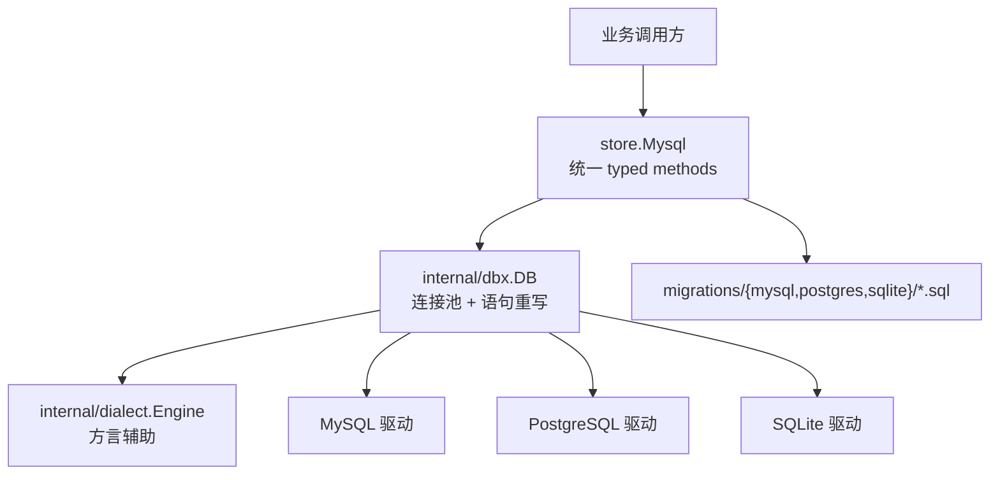
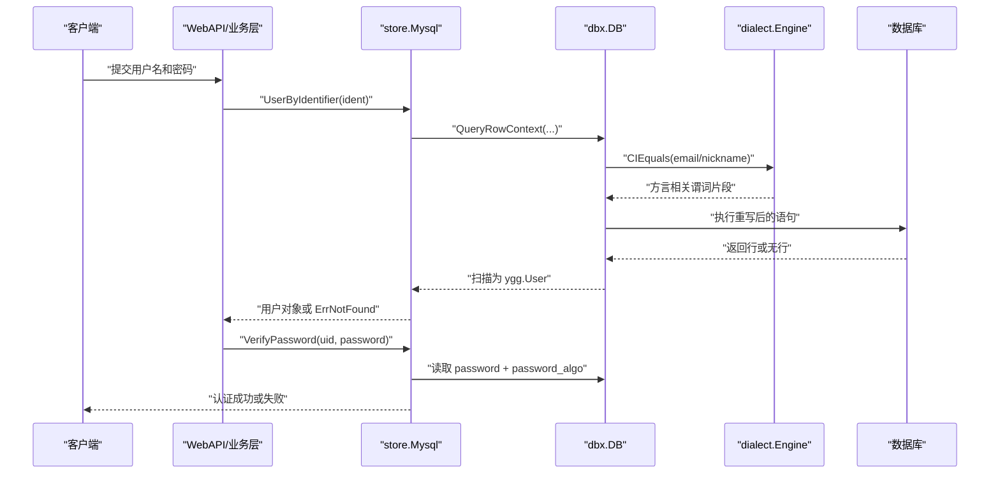
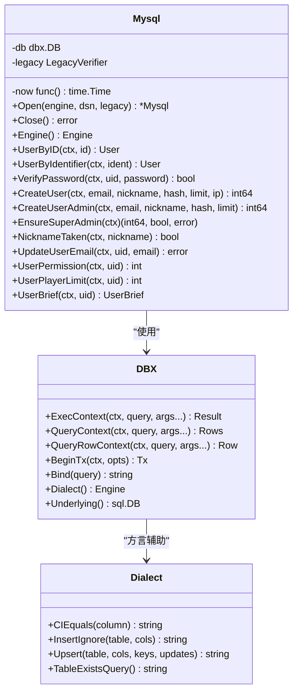
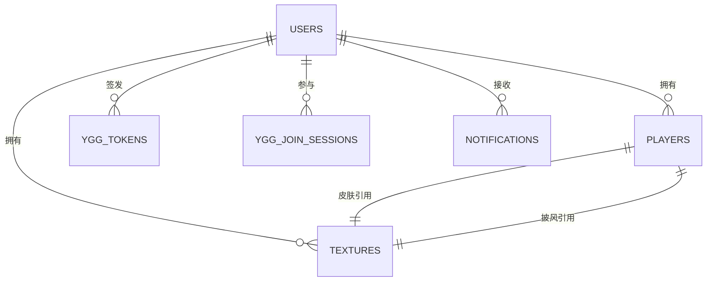
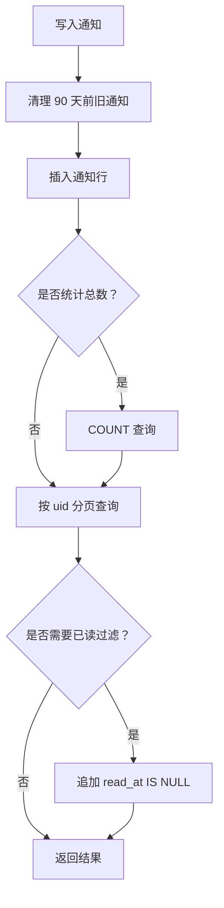
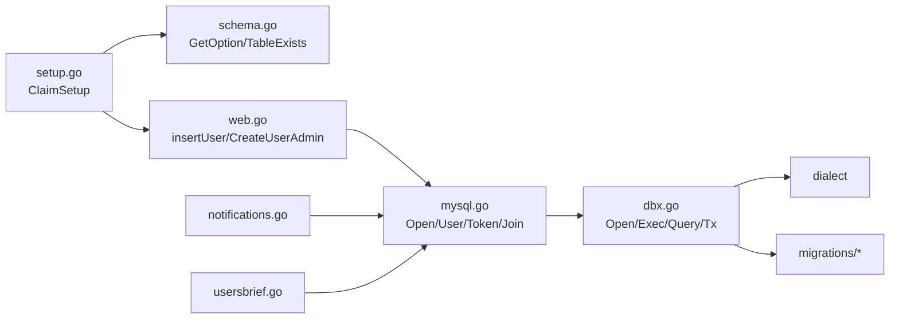
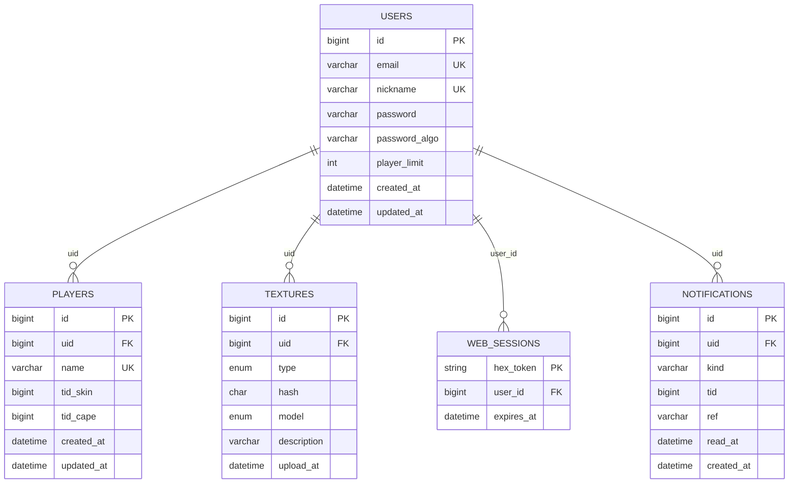

# 多引擎存储抽象模块

**本文引用的文件**
- [server/internal/store/setup.go](https://github.com/YimingZhanshen/skin-nexus/blob/797ae1a/server/internal/store/setup.go)
- [server/internal/store/schema.go](https://github.com/YimingZhanshen/skin-nexus/blob/797ae1a/server/internal/store/schema.go)
- [server/internal/store/mysql.go](https://github.com/YimingZhanshen/skin-nexus/blob/797ae1a/server/internal/store/mysql.go)
- [server/internal/store/web.go](https://github.com/YimingZhanshen/skin-nexus/blob/797ae1a/server/internal/store/web.go)
- [server/internal/store/notifications.go](https://github.com/YimingZhanshen/skin-nexus/blob/797ae1a/server/internal/store/notifications.go)
- [server/internal/store/usersbrief.go](https://github.com/YimingZhanshen/skin-nexus/blob/797ae1a/server/internal/store/usersbrief.go)
- [server/internal/dbx/dbx.go](https://github.com/YimingZhanshen/skin-nexus/blob/797ae1a/server/internal/dbx/dbx.go)
- [server/migrations/mysql/0001_init.sql](https://github.com/YimingZhanshen/skin-nexus/blob/797ae1a/server/migrations/mysql/0001_init.sql)
- [server/migrations/postgres/0001_init.sql](https://github.com/YimingZhanshen/skin-nexus/blob/797ae1a/server/migrations/postgres/0001_init.sql)
- [server/migrations/sqlite/0001_init.sql](https://github.com/YimingZhanshen/skin-nexus/blob/797ae1a/server/migrations/sqlite/0001_init.sql)
- [server/migrations/mysql/0021_notifications.sql](https://github.com/YimingZhanshen/skin-nexus/blob/797ae1a/server/migrations/mysql/0021_notifications.sql)

## 目录
1. [引言](#引言)
2. [项目结构](#项目结构)
3. [核心组件](#核心组件)
4. [架构总览](#架构总览)
5. [详细组件分析](#详细组件分析)
6. [依赖关系分析](#依赖关系分析)
7. [性能与连接池](#性能与连接池)
8. [故障排查](#故障排查)
9. [结论](#结论)
10. [附录：迁移编号与表关系](#附录迁移编号与表关系)

## 引言
本模块为皮肤站后端提供统一的数据库访问抽象，对外暴露 typed methods（按业务语义命名的方法），对内屏蔽 MySQL、PostgreSQL、SQLite 三种方言差异。所有 SQL 通过 `dbx` 层进行参数占位符重写和参数数量校验，并通过 `dialect` 提供跨引擎兼容函数；实际建表和索引由三套 `migrations/*/*.sql` 维护。扩展新业务时，应新增 typed method，而不是在调用方直接写 SQL，以保证跨引擎一致性和可测试性。

## 项目结构
`store` 包围绕一个名为 `Mysql` 的结构体组织，尽管名称保留历史来源，它实际是“多引擎存储门面”：内部持有 `dbx.DB`，根据运行时的引擎选择 MySQL、PostgreSQL 或 SQLite。关键文件职责如下：

| 文件 | 职责 |
|---|---|
| `setup.go` | 首次安装事务、唯一标记写入、超级管理员创建 |
| `schema.go` | 空库引导：`DB()`、`DBX()`、`TableExists`、`NeedsSetup` |
| `mysql.go` | 连接打开、用户认证、玩家、Yggdrasil token、join session 等主逻辑 |
| `web.go` | Web 注册、会话、权限、密码算法、用户字段更新等 |
| `notifications.go` | 站内通知写入、分页、已读状态与未读数 |
| `usersbrief.go` | OIDC 声明所需的简短用户信息 |
| `dbx.go` | 驱动注册、DSN 规范化、参数占位符重写、偏移量保护、事务封装 |
| `migrations/*` | 三套方言的增量迁移脚本 |

**图示来源**
- [server/internal/store/mysql.go:35-58](https://github.com/YimingZhanshen/skin-nexus/blob/797ae1a/server/internal/store/mysql.go#L35-L58)
- [server/internal/dbx/dbx.go:1-60](https://github.com/YimingZhanshen/skin-nexus/blob/797ae1a/server/internal/dbx/dbx.go#L1-L60)

**章节来源**
- [server/internal/store/mysql.go:1-58](https://github.com/YimingZhanshen/skin-nexus/blob/797ae1a/server/internal/store/mysql.go#L1-L58)
- [server/internal/dbx/dbx.go:1-60](https://github.com/YimingZhanshen/skin-nexus/blob/797ae1a/server/internal/dbx/dbx.go#L1-L60)

## 核心组件
### 1. 连接与引擎选择
`Open(engine, dsn, legacy)` 是 store 的入口：
- 调用 `dbx.Open` 完成驱动选择、DSN 转换、连接池调优和 Ping。
- `engine` 可为空：此时从 DSN scheme 推断，若仍无法确定则回退到 MySQL，保证现有部署不中断。
- 返回的 `*Mysql` 持有 `dbx.DB`、旧密码验证器和一个时间源，便于测试注入。

`dbx.Open` 的关键行为：
- 支持 MySQL、PostgreSQL、SQLite 三种驱动。
- 对空 engine 做 DSN 推断，非法 engine 立即报错。
- 对空 DSN 报错。
- 设置超时并 Ping 数据库，失败时关闭连接。
- 返回的 `DB` 暴露 `Underlying()` 给迁移工具使用原始 `*sql.DB`。

**章节来源**
- [server/internal/store/mysql.go:35-58](https://github.com/YimingZhanshen/skin-nexus/blob/797ae1a/server/internal/store/mysql.go#L35-L58)
- [server/internal/dbx/dbx.go:61-120](https://github.com/YimingZhanshen/skin-nexus/blob/797ae1a/server/internal/dbx/dbx.go#L61-L120)

### 2. 空库引导与安装门控
`schema.go` 提供安装向导所需能力：
- `DB()`：返回底层 `*sql.DB`，仅用于迁移扫描等原生路径。
- `DBX()`：返回带占位符重写的 `*dbx.DB`，供需要自行拼接 SQL 但又要保持参数安全的子系统使用。
- `TableExists(ctx, name)`：用方言提供的表存在查询判断基础表是否存在。
- `NeedsSetup(ctx)`：若 `users` 表不存在，或 `options.setup_done` 不是 `"1"`，且 `users` 无记录，则判定站点未初始化。

**章节来源**
- [server/internal/store/schema.go:1-53](https://github.com/YimingZhanshen/skin-nexus/blob/797ae1a/server/internal/store/schema.go#L1-L53)

### 3. 首次安装事务
`setup.go` 中的 `ClaimSetup(ctx, spec)` 是一个原子操作：
- 在单个事务中写入 `options.k='setup_done'` 的唯一标记。
- 插入超级管理员用户（`permission=2`）。
- 可选地批量 upsert 站点选项，键名排序保证不同引擎生成稳定语句顺序。
- 并发竞争下只有一个调用能成功写入标记；其余调用返回 `claimed=false`，不视为错误。
- 若已有记录，`RowsAffected==0` 即快速返回，避免重复安装。

该设计解决了“先检查再安装”的竞态问题：唯一标记与管理员账号在同一事务中写入，要么全部成功，要么全部回滚。

**章节来源**
- [server/internal/store/setup.go:1-105](https://github.com/YimingZhanshen/skin-nexus/blob/797ae1a/server/internal/store/setup.go#L1-L105)

## 架构总览
下图展示一次典型的用户登录流程如何穿过 typed method、`dbx` 重写层和方言层：

**图示来源**
- [server/internal/store/mysql.go:60-120](https://github.com/YimingZhanshen/skin-nexus/blob/797ae1a/server/internal/store/mysql.go#L60-L120)
- [server/internal/dbx/dbx.go:121-200](https://github.com/YimingZhanshen/skin-nexus/blob/797ae1a/server/internal/dbx/dbx.go#L121-L200)

## 详细组件分析

### 用户实体与访问模式
| 场景 | 主要方法 | 数据表 | 说明 |
|---|---|---|---|
| 按 ID 查询 | `UserByID` | `users` | 返回昵称、邮箱是否验证、能否加入服务器、创建时间 |
| 按标识符查询 | `UserByIdentifier` | `users` | 兼容 email 或 nickname，使用方言大小写无关比较 |
| 密码验证 | `VerifyPassword` | `users` | 区分现代 PHC 哈希与 legacy 系列，必要时走旧链 |
| 注册普通用户 | `CreateUser` | `users` | 写入 argon2id，默认 player_limit |
| 注册超级管理员 | `CreateUserAdmin` | `users` | permission=2，供管理面板与插件安装 |
| 确保超级管理员 | `EnsureSuperAdmin` | `users` | 将最老的 admin 升级到 permission=2，幂等 |
| 昵称冲突检测 | `NicknameTaken` | `users` | 使用方言折叠匹配，与登录语义一致 |
| 修改邮箱 | `UpdateUserEmail` | `users` | 变更邮箱会清除已验证标记 |
| 获取权限 | `UserPermission` | `users` | 返回 permission，供面板鉴权 |
| 获取玩家上限 | `UserPlayerLimit` | `users` | 注册/setup 时写入；创建角色时强制校验（`internal/account/players.go` 的 `CreatePlayer` 超限返 `player.limit`） |
| 获取 OIDC 简述 | `UserBrief` | `users` | 提供 id、nickname、email、email_verified |

**图示来源**
- [server/internal/store/mysql.go:1-120](https://github.com/YimingZhanshen/skin-nexus/blob/797ae1a/server/internal/store/mysql.go#L1-L120)
- [server/internal/store/web.go:1-120](https://github.com/YimingZhanshen/skin-nexus/blob/797ae1a/server/internal/store/web.go#L1-L120)
- [server/internal/dbx/dbx.go:1-120](https://github.com/YimingZhanshen/skin-nexus/blob/797ae1a/server/internal/dbx/dbx.go#L1-L120)

**章节来源**
- [server/internal/store/mysql.go:60-120](https://github.com/YimingZhanshen/skin-nexus/blob/797ae1a/server/internal/store/mysql.go#L60-L120)
- [server/internal/store/web.go:1-120](https://github.com/YimingZhanshen/skin-nexus/blob/797ae1a/server/internal/store/web.go#L1-L120)
- [server/internal/store/usersbrief.go:1-21](https://github.com/YimingZhanshen/skin-nexus/blob/797ae1a/server/internal/store/usersbrief.go#L1-L21)

### 纹理实体与访问模式
纹理的核心字段包括类型、SHA-256 哈希、模型、描述与上传时间。公共纹理通过 `(type, hash)` 去重，私有副本允许同内容但不同归属。常用访问模式：
- 按用户和类型列出纹理。
- 按哈希查询公共纹理。
- 删除或标记废弃纹理。
- 关联玩家皮肤/披风引用。

**图示来源**
- [server/migrations/mysql/0001_init.sql:1-103](https://github.com/YimingZhanshen/skin-nexus/blob/797ae1a/server/migrations/mysql/0001_init.sql#L1-L103)
- [server/migrations/postgres/0001_init.sql:1-100](https://github.com/YimingZhanshen/skin-nexus/blob/797ae1a/server/migrations/postgres/0001_init.sql#L1-L100)
- [server/migrations/sqlite/0001_init.sql:1-104](https://github.com/YimingZhanshen/skin-nexus/blob/797ae1a/server/migrations/sqlite/0001_init.sql#L1-L104)

**章节来源**
- [server/migrations/mysql/0001_init.sql:1-103](https://github.com/YimingZhanshen/skin-nexus/blob/797ae1a/server/migrations/mysql/0001_init.sql#L1-L103)
- [server/migrations/postgres/0001_init.sql:1-100](https://github.com/YimingZhanshen/skin-nexus/blob/797ae1a/server/migrations/postgres/0001_init.sql#L1-L100)
- [server/migrations/sqlite/0001_init.sql:1-104](https://github.com/YimingZhanshen/skin-nexus/blob/797ae1a/server/migrations/sqlite/0001_init.sql#L1-L104)

### 会话与令牌
| 实体 | 用途 | 关键约束 |
|---|---|---|
| `web_sessions` | Web 登录会话 | token 列存哈希，过期后失效 |
| `ygg_tokens` | Yggdrasil access_token 与 client_token | access_token 存哈希，有唯一索引和用户索引 |
| `ygg_join_sessions` | 120 秒游戏加入会话 | 按 expires_at 清理 |

实现要点：
- Web 会话 token 以 SHA-256 十六进制形式存储，防止泄露明文。
- Yggdrasil access_token 同样以哈希形式存储，调用方必须传入原值以便计算相同摘要。
- 每个用户的活跃 token 超过限制时，按自增 id 淘汰最早签发的 token，并记录审计日志。
- join session 只保留有效窗口内的记录，过期后批量删除。

**章节来源**
- [server/internal/store/web.go:60-120](https://github.com/YimingZhanshen/skin-nexus/blob/797ae1a/server/internal/store/web.go#L60-L120)
- [server/internal/store/mysql.go:201-360](https://github.com/YimingZhanshen/skin-nexus/blob/797ae1a/server/internal/store/mysql.go#L201-L360)

### 通知实体
`notifications` 表用于向用户推送三类事件：举报结果、纹理审查、封禁状态变化。特点：
- `kind` 是闭集常量，如 `report.resolved`、`texture.hidden`、`account.banned` 等。
- 每次写入前清理 90 天前的旧通知，无需定时任务。
- 分页查询支持“仅未读”过滤，size 上限为 100，默认 20。
- 未读数、已读标记、单条标记和全部已读均提供 typed method。
- 如果纹理已被删除，显示名称回退为空字符串，由客户端渲染 kind 文本。

**图示来源**
- [server/internal/store/notifications.go:1-125](https://github.com/YimingZhanshen/skin-nexus/blob/797ae1a/server/internal/store/notifications.go#L1-L125)

**章节来源**
- [server/internal/store/notifications.go:1-125](https://github.com/YimingZhanshen/skin-nexus/blob/797ae1a/server/internal/store/notifications.go#L1-L125)

## 依赖关系分析

**图示来源**
- [server/internal/store/setup.go:1-105](https://github.com/YimingZhanshen/skin-nexus/blob/797ae1a/server/internal/store/setup.go#L1-L105)
- [server/internal/store/schema.go:1-53](https://github.com/YimingZhanshen/skin-nexus/blob/797ae1a/server/internal/store/schema.go#L1-L53)
- [server/internal/store/web.go:1-120](https://github.com/YimingZhanshen/skin-nexus/blob/797ae1a/server/internal/store/web.go#L1-L120)
- [server/internal/store/notifications.go:1-125](https://github.com/YimingZhanshen/skin-nexus/blob/797ae1a/server/internal/store/notifications.go#L1-L125)
- [server/internal/store/mysql.go:1-120](https://github.com/YimingZhanshen/skin-nexus/blob/797ae1a/server/internal/store/mysql.go#L1-L120)
- [server/internal/dbx/dbx.go:1-120](https://github.com/YimingZhanshen/skin-nexus/blob/797ae1a/server/internal/dbx/dbx.go#L1-L120)

**章节来源**
- [server/internal/store/setup.go:1-105](https://github.com/YimingZhanshen/skin-nexus/blob/797ae1a/server/internal/store/setup.go#L1-L105)
- [server/internal/store/schema.go:1-53](https://github.com/YimingZhanshen/skin-nexus/blob/797ae1a/server/internal/store/schema.go#L1-L53)
- [server/internal/store/mysql.go:1-120](https://github.com/YimingZhanshen/skin-nexus/blob/797ae1a/server/internal/store/mysql.go#L1-L120)
- [server/internal/dbx/dbx.go:1-120](https://github.com/YimingZhanshen/skin-nexus/blob/797ae1a/server/internal/dbx/dbx.go#L1-L120)

## 性能与连接池
### 连接池建议
`dbx.Open` 会调用 Go 标准库 `sql.DB` 的连接池调优函数（代码中通过 `tune(db)` 完成）。部署时应关注以下指标：
- **最大空闲连接数**：与并发请求数和数据库实例容量匹配。
- **最大连接数**：避免超过数据库连接上限。
- **空闲连接存活时间**：长连接适合生产数据库，短连接适合托管 PaaS。
- **连接等待超时**：连接池耗尽时应快速失败，而不是阻塞整个请求。

由于 `dbx.Open` 已经包含 Ping 超时，启动阶段就能发现不可达的数据库，减少冷启动后的随机失败。

### 事务策略
- 首次安装使用单事务保证“唯一标记 + 超级管理员 + 站点选项”原子写入。
- `dbx.BeginTx` 包装了 `sql.Tx`，并在事务上继续提供占位符重写，避免手写 SQL 绕过安全检查。
- 长时间运行的事务应避免：事务锁、游标、外部网络调用都会增加锁持有时间。

### 备份恢复要点
- 优先使用各数据库厂商原生备份工具导出完整快照。
- 注意 `web_sessions`、`ygg_join_sessions`、`audit_log`、`notifications` 等高频写入表可能频繁增长，备份策略应与保留策略一致。
- 迁移版本号与迁移脚本需保持一致；恢复后应先运行迁移工具确认 schema 版本。
- PostgreSQL 的 `BIGSERIAL` 序列在导入显式 id 时需要重新同步序列。

**章节来源**
- [server/internal/dbx/dbx.go:61-120](https://github.com/YimingZhanshen/skin-nexus/blob/797ae1a/server/internal/dbx/dbx.go#L61-L120)
- [server/internal/store/setup.go:45-105](https://github.com/YimingZhanshen/skin-nexus/blob/797ae1a/server/internal/store/setup.go#L45-L105)
- [server/migrations/postgres/0001_init.sql:1-20](https://github.com/YimingZhanshen/skin-nexus/blob/797ae1a/server/migrations/postgres/0001_init.sql#L1-L20)

## 故障排查

### 方言不兼容
常见症状：
- 某引擎报占位符数量不匹配。
- 大小写比较在 PostgreSQL 上失败。
- 子查询或 `LIMIT` 语法在 SQLite/PostgreSQL 上不生效。

根因：
- 直接拼接方言片段时改变了最终语句的占位符数量。
- 没有使用 `db.Dialect().CIEquals(...)` 等方言辅助函数。
- 使用了 MySQL 扩展语法（例如 `UPDATE ... ORDER BY ... LIMIT`）而没有适配其他引擎。

处理建议：
- 始终通过 `db.Bind` 或 `db.ExecContext` / `db.QueryContext` 提交语句。
- 使用 `dialect.CIEquals`、`dialect.InsertIgnore`、`dialect.Upsert` 等辅助方法。
- 若确需方言差异，应在 `dialect` 层集中实现，而不是散落在 store 调用方。

**章节来源**
- [server/internal/dbx/dbx.go:121-200](https://github.com/YimingZhanshen/skin-nexus/blob/797ae1a/server/internal/dbx/dbx.go#L121-L200)
- [server/internal/store/mysql.go:80-120](https://github.com/YimingZhanshen/skin-nexus/blob/797ae1a/server/internal/store/mysql.go#L80-L120)

### 索引缺失
常见问题：
- 按用户列表页查询慢。
- 按通知 uid 分页慢。
- 按 texture 哈希查找慢。
- 按玩家 uid 关联 textures 慢。

对应索引：
- `idx_players_uid`：玩家按用户查询。
- `idx_textures_uid_type`、`idx_textures_hash`：纹理按用户+类型、哈希查找。
- `idx_notif_uid`、`idx_notif_unread`：通知按用户分页和未读过滤。
- `uq_users_email`、`uq_users_nickname`、`uq_players_name`：唯一约束对应的索引。

修复方式：
- 通过迁移脚本添加缺失索引。
- 不要跳过迁移编号，否则线上环境不会自动应用。

**章节来源**
- [server/migrations/mysql/0001_init.sql:20-103](https://github.com/YimingZhanshen/skin-nexus/blob/797ae1a/server/migrations/mysql/0001_init.sql#L20-L103)
- [server/migrations/mysql/0021_notifications.sql:1-21](https://github.com/YimingZhanshen/skin-nexus/blob/797ae1a/server/migrations/mysql/0021_notifications.sql#L1-L21)

### 事务超时
症状：
- 首次安装出现并发安装失败。
- 后台任务长时间占用连接。
- 管理面板操作卡顿并伴随数据库连接泄漏。

排查步骤：
1. 检查是否在事务中执行外部 HTTP 请求或大量内存计算。
2. 检查 `ClaimSetup` 是否被异常逻辑多次触发。
3. 检查是否有长事务未提交或未回滚。
4. 检查数据库端锁等待和慢查询日志。

**章节来源**
- [server/internal/store/setup.go:1-44](https://github.com/YimingZhanshen/skin-nexus/blob/797ae1a/server/internal/store/setup.go#L1-L44)
- [server/internal/dbx/dbx.go:180-200](https://github.com/YimingZhanshen/skin-nexus/blob/797ae1a/server/internal/dbx/dbx.go#L180-L200)

### 扩展新业务的规范
推荐做法：
1. 在 `migrations/{mysql,postgres,sqlite}` 中添加同名迁移文件。
2. 在 `store` 包新增 typed method，如 `GetXxx`、`CreateXxx`、`UpdateXxx`。
3. 所有 SQL 通过 `dbx` 层提交。
4. 如需大小写无关比较，使用 `db.Dialect().CIEquals`。
5. 如需跨引擎插入或更新，使用 `InsertIgnore` 或 `Upsert`。
6. 不要直接写原生 SQL 绕过 `dbx`，否则会丢失参数安全检查和占位符一致性。

**章节来源**
- [server/internal/dbx/dbx.go:1-60](https://github.com/YimingZhanshen/skin-nexus/blob/797ae1a/server/internal/dbx/dbx.go#L1-L60)
- [server/internal/store/setup.go:45-105](https://github.com/YimingZhanshen/skin-nexus/blob/797ae1a/server/internal/store/setup.go#L45-L105)

## 结论
`store` 包通过 `Mysql` 门面、`dbx` 重写层和三方方言迁移脚本，为 MySQL、PostgreSQL、SQLite 提供了统一的 typed method 接口。它把跨引擎差异收敛在 `dialect` 和迁移脚本中，使业务层只关心用户、纹理、会话、通知等业务语义。扩展新能力时，应优先新增 typed method 并配套迁移脚本，而不是在调用方散落原生 SQL。这样既能保证一致性，也能让单元测试更容易替换真实数据库。

## 附录：迁移编号与表关系

| 迁移编号 | 含义 | 涉及表 | 备注 |
|---|---|---|---|
| `0001_init.sql` | 初始 schema | `users`、`players`、`textures`、`uuid_map`、`options`、`ygg_tokens`、`ygg_join_sessions`、`audit_log` | 三套方言结构对齐 |
| `0021_notifications.sql` | 站内通知 | `notifications` | 90 天保留，uid + id 与 uid + read_at 索引 |
| 后续编号 | 按需扩展 | 具体表取决于业务迁移 | 应保持 mysql/postgres/sqlite 三套同名 |

**图示来源**
- [server/migrations/mysql/0001_init.sql:1-103](https://github.com/YimingZhanshen/skin-nexus/blob/797ae1a/server/migrations/mysql/0001_init.sql#L1-L103)
- [server/migrations/postgres/0001_init.sql:1-100](https://github.com/YimingZhanshen/skin-nexus/blob/797ae1a/server/migrations/postgres/0001_init.sql#L1-L100)
- [server/migrations/sqlite/0001_init.sql:1-104](https://github.com/YimingZhanshen/skin-nexus/blob/797ae1a/server/migrations/sqlite/0001_init.sql#L1-L104)
- [server/migrations/mysql/0021_notifications.sql:1-21](https://github.com/YimingZhanshen/skin-nexus/blob/797ae1a/server/migrations/mysql/0021_notifications.sql#L1-L21)
