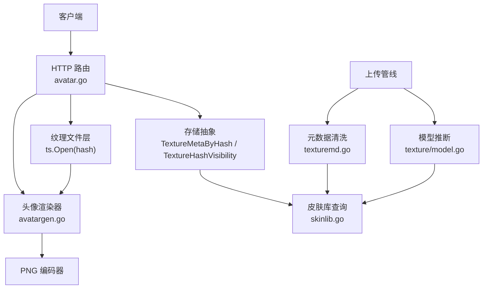
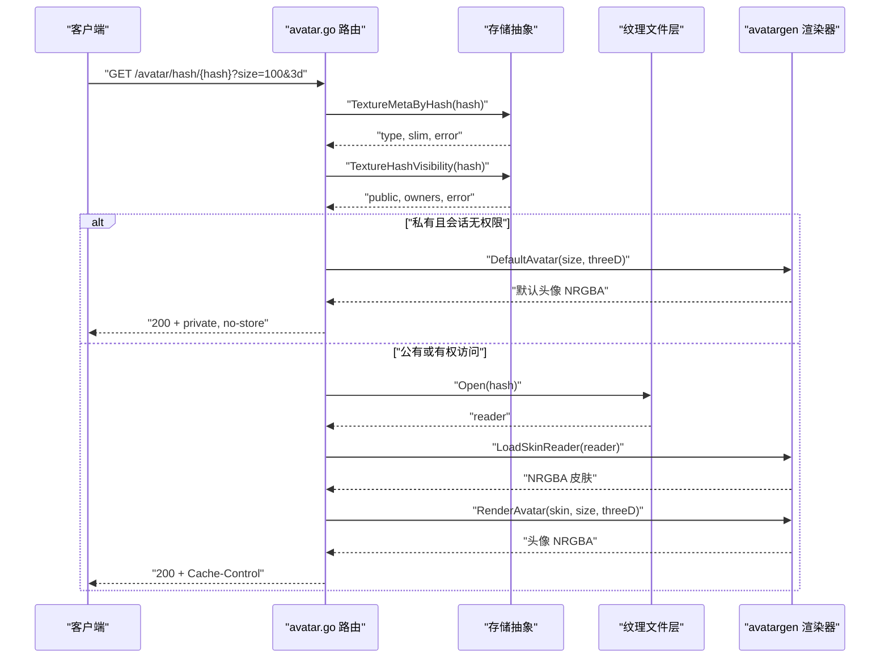
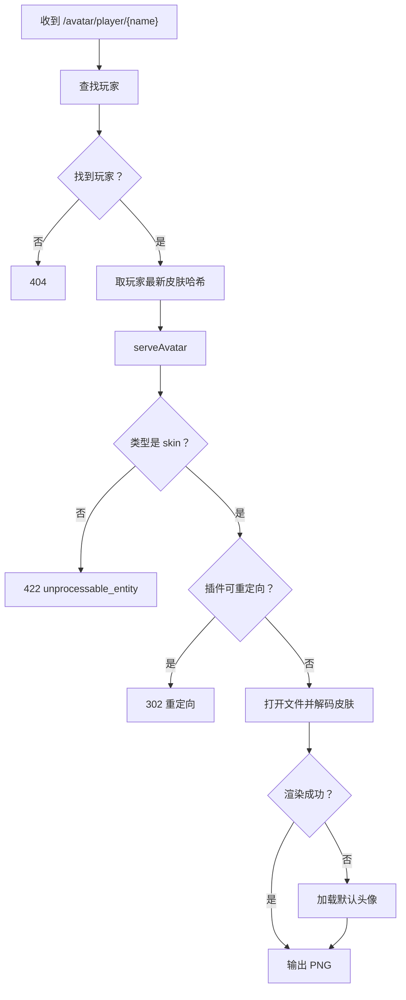
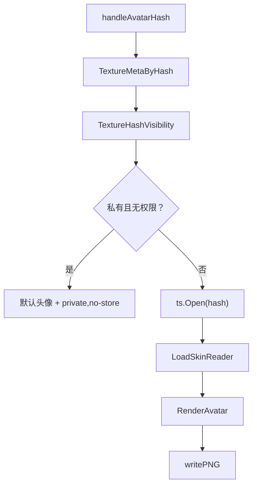
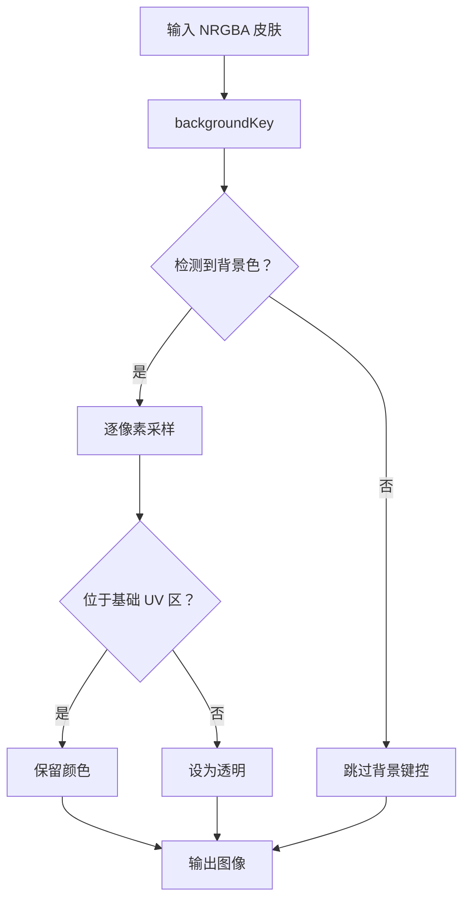
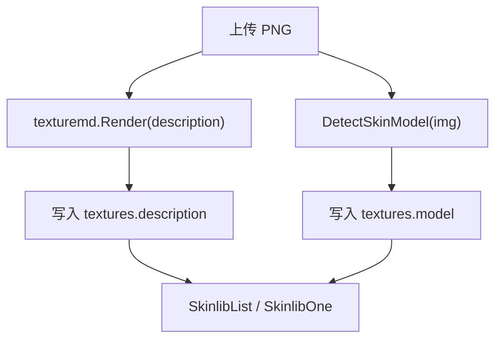
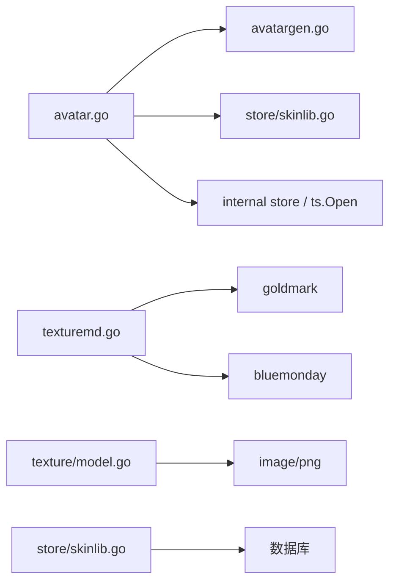

# 头像生成与材质元数据

**本文引用的文件**
- [avatar.go](https://github.com/YimingZhanshen/skin-nexus/blob/797ae1a/server/cmd/skin-nexus/avatar.go)
- [avatargen.go](https://github.com/YimingZhanshen/skin-nexus/blob/797ae1a/server/internal/avatargen/avatargen.go)
- [texturemd.go](https://github.com/YimingZhanshen/skin-nexus/blob/797ae1a/server/internal/texturemd/texturemd.go)
- [model.go](https://github.com/YimingZhanshen/skin-nexus/blob/797ae1a/server/internal/texture/model.go)
- [skinlib.go](https://github.com/YimingZhanshen/skin-nexus/blob/797ae1a/server/internal/store/skinlib.go)
- [texmodel.go](https://github.com/YimingZhanshen/skin-nexus/blob/797ae1a/server/internal/store/texmodel.go)
- [avatar_preview_test.go](https://github.com/YimingZhanshen/skin-nexus/blob/797ae1a/server/cmd/skin-nexus/avatar_preview_test.go)
- [avatar_hash_gate_test.go](https://github.com/YimingZhanshen/skin-nexus/blob/797ae1a/server/cmd/skin-nexus/avatar_hash_gate_test.go)

## 目录
1. [引言](#引言)
2. [项目结构](#项目结构)
3. [核心组件](#核心组件)
4. [架构总览](#架构总览)
5. [详细组件分析](#详细组件分析)
6. [依赖关系分析](#依赖关系分析)
7. [性能与安全建议](#性能与安全建议)
8. [故障排查指南](#故障排查指南)
9. [结论](#结论)

## 引言
本文聚焦皮肤库服务中「头像生成」和「材质元数据」两条关键路径：

- **头像生成**：`avatargen` 从原始 Minecraft 皮肤 PNG 解码、按标准 UV 表提取头部区域，并在 2D 正面或 3D 四十五度视角下渲染默认头像；HTTP 层 `avatar.go` 暴露兼容旧站点的 `/skin/{player}.png` 等接口，以及新版内容地址直出路径 `/avatars/{hash}`。
- **材质元数据**：`texturemd` 解析用户提供的描述 Markdown，做严格白名单清洗，再将其注入纹理模型的 `description` 字段；上传管线会同时解析材质文件的模型类型（Steve/Alex），并写入 `source` / `description` 等字段，供公开列表展示。

文档将说明请求到响应的完整流程、缓存策略、门禁规则、错误语义，以及测试覆盖的关键场景。

## 项目结构
与本主题直接相关的代码分布在三个层次：

| 层次 | 文件 | 职责 |
|---|---|---|
| HTTP 路由层 | `server/cmd/skin-nexus/avatar.go` | 处理 `/avatar/*`、`/preview/*`、`/viewer/texture` 等请求，完成鉴权、可见性判断、缓存头设置与 PNG 输出 |
| 图像渲染层 | `server/internal/avatargen/avatargen.go` | 解码皮肤、检测背景色、投影绘制、裁剪缩放、导出默认头像 |
| 元数据处理层 | `server/internal/texturemd/texturemd.go`、`server/internal/texture/model.go`、`server/internal/store/skinlib.go` | 清洗描述 Markdown、推断 Steve/Slim 模型、对外暴露皮肤库查询 |

**图示来源**
- [avatar.go:1-120](https://github.com/YimingZhanshen/skin-nexus/blob/797ae1a/server/cmd/skin-nexus/avatar.go#L1-L120)
- [avatargen.go:1-120](https://github.com/YimingZhanshen/skin-nexus/blob/797ae1a/server/internal/avatargen/avatargen.go#L1-L120)
- [texturemd.go:1-66](https://github.com/YimingZhanshen/skin-nexus/blob/797ae1a/server/internal/texturemd/texturemd.go#L1-L66)
- [skinlib.go:1-120](https://github.com/YimingZhanshen/skin-nexus/blob/797ae1a/server/internal/store/skinlib.go#L1-L120)

**章节来源**
- [avatar.go:1-120](https://github.com/YimingZhanshen/skin-nexus/blob/797ae1a/server/cmd/skin-nexus/avatar.go#L1-L120)
- [avatargen.go:1-120](https://github.com/YimingZhanshen/skin-nexus/blob/797ae1a/server/internal/avatargen/avatargen.go#L1-L120)

## 核心组件

### 头像渲染器 `avatargen`
`avatargen` 是纯图像处理包，负责把标准 Minecraft 皮肤像素映射成头像或预览图：

| 能力 | 行为 |
|---|---|
| 解码皮肤 | `LoadSkinReader` 限制最大字节数与最大像素数，防止超大 PNG 导致内存耗尽 |
| 背景色识别 | `backgroundKey` 通过左上角 8×8 全同不透明块识别“背景色”，用于丢弃非基础 UV 区域的背景像素 |
| 头部建模 | `headOnlyParts` 定义头与可选头盔的六面 UV 矩形 |
| 3D 投影 | `render` 对立方体面进行仿射逆变换采样，按深度排序后合成 |
| 默认头像 | `DefaultAvatar` 从嵌入资源读取 2D/3D 默认头像 PNG，并按目标尺寸最近邻缩放 |
| 版本化 | `RenderVersion` 随渲染逻辑变更递增，供预览 URL 做不可变缓存 |

关键常量与函数路径：

- 渲染版本：`RenderVersion`
- 解码上限：`MaxSkinPixels`、`MaxSkinBytes`
- 头部部件：`headOnlyParts`
- 渲染入口：`RenderAvatar`、`RenderPreviewAt`
- 默认头像：`DefaultAvatar`
- 安全解码：`LoadSkinReader`

**章节来源**
- [avatargen.go:1-120](https://github.com/YimingZhanshen/skin-nexus/blob/797ae1a/server/internal/avatargen/avatargen.go#L1-L120)
- [avatargen.go:201-594](https://github.com/YimingZhanshen/skin-nexus/blob/797ae1a/server/internal/avatargen/avatargen.go#L201-L594)

### 材质元数据 `texturemd`
`texturemd` 不直接读写数据库，而是提供安全的 Markdown 渲染工具：

| 函数 | 输入 | 输出 | 语义 |
|---|---|---|---|
| `Render` | 原始描述字符串 | 清洗后的 HTML | 允许 GFM、表格、代码块、http(s) 链接，拒绝图片、iframe、样式等远程资源 |
| `Excerpt` | 描述字符串与截断长度 | 纯文本摘要 | 用于页面 meta 标签与卡片预览 |

策略要点：

- 使用 Goldmark 渲染 GFM。
- 使用 Bluemonday 白名单仅允许 `<a>`、标题、段落、列表、表格等元素。
- 所有链接强制 `rel="nofollow"` 与 `referrerpolicy="no-referrer"`。
- 渲染失败回退为空字符串，避免把用户恶意 Markdown 原样输出。

**章节来源**
- [texturemd.go:1-66](https://github.com/YimingZhanshen/skin-nexus/blob/797ae1a/server/internal/texturemd/texturemd.go#L1-L66)

### 模型类型推断 `texture/model.go`
模型类型决定皮肤手臂宽度与 3D 显示效果：

| 常量 | 含义 |
|---|---|
| `ModelDefault` | Steve 型宽臂 |
| `ModelSlim` | Alex 型窄臂 |

推断规则：

- 仅当正方形且边长是 64 的倍数时，才具备 Slim 判定信息。
- 检查右臂特定区域是否透明：若存在透明像素，则视为 Slim。
- 该判断基于像素，不信任上传者声明，保证 `/avatar`、`/preview`、皮肤库过滤一致。

**章节来源**
- [model.go:1-68](https://github.com/YimingZhanshen/skin-nexus/blob/797ae1a/server/internal/texture/model.go#L1-L68)

## 架构总览

**图示来源**
- [avatar.go:201-340](https://github.com/YimingZhanshen/skin-nexus/blob/797ae1a/server/cmd/skin-nexus/avatar.go#L201-L340)
- [avatargen.go:500-594](https://github.com/YimingZhanshen/skin-nexus/blob/797ae1a/server/internal/avatargen/avatargen.go#L500-L594)

## 详细组件分析

### 头像 HTTP 接口

#### 兼容接口族
`avatar.go` 注释明确列出兼容旧站点的语义：

| 路径 | 缺失时的行为 | 特殊规则 |
|---|---|---|
| `GET /avatar/player/{name}` | 玩家不存在返回 404；没有皮肤或文件解码失败则回退默认头像 | 身份类接口公开，便于启动器、Union 列表渲染 |
| `GET /avatar/user/{uid}` | 用户或头像未设置回退默认头像 | 无效 uid 走兼容分支直接返回默认头像 |
| `GET /avatar/{tid}` | 纹理缺失回退默认头像 | 必须校验 `TextureIsPublic`，私有且非本人时返回 404 |
| `GET /avatar/hash/{hash}` | 未知哈希回退默认头像 | 内容地址不是权限，必须校验 `TextureHashVisibility` |
| `GET /preview/{tid}` | 纹理或文件缺失返回 404 | 不允许披风进入全身渲染 |
| `GET /preview/hash/{hash}` | 同左 | 仅支持公开纹理 |

参数语义：

- `size`：默认 100，范围钳制在 8 到 1024；非法值回退默认值。
- `3d`：参数存在即启用 45° 头部立方体视图。
- `png`：作为无操作参数保留，因为输出始终是 PNG。

#### 遗留兼容接口的具体实现

**图示来源**
- [avatar.go:201-260](https://github.com/YimingZhanshen/skin-nexus/blob/797ae1a/server/cmd/skin-nexus/avatar.go#L201-L260)

**章节来源**
- [avatar.go:1-120](https://github.com/YimingZhanshen/skin-nexus/blob/797ae1a/server/cmd/skin-nexus/avatar.go#L1-L120)
- [avatar.go:201-340](https://github.com/YimingZhanshen/skin-nexus/blob/797ae1a/server/cmd/skin-nexus/avatar.go#L201-L340)

#### 新版 `/avatars/{hash}` 直出路径
实际路由名为 `/avatar/hash/{hash}`，其核心目标是：**内容地址不能替代权限**。

关键流程：

1. 根据哈希查询纹理元数据，得到类型与 slim 标记。
2. 查询哈希可见性：`public`、`privateOwners`、以及不可读时的错误。
3. 若为私有且当前会话不在所有者集合中，也不具备管理权限，则返回默认头像。
4. 否则按真实哈希渲染头像。
5. 私有响应必须设置 `Cache-Control: private, no-store`，禁止 CDN 共享缓存。

测试覆盖的场景包括：

- 所有者会话拿到真实头像，且不可缓存。
- 匿名用户拿到默认头像，且仍然标记为 `private, no-store`。
- 匿名响应与所有者响应字节不同，避免泄露私有头像。
- 其他会话同样拿到默认头像。
- 管理员可以查看任意私有哈希。
- 公开哈希保持 `public, max-age=86400`。
- 未知哈希仍回退默认头像。

**图示来源**
- [avatar.go:300-360](https://github.com/YimingZhanshen/skin-nexus/blob/797ae1a/server/cmd/skin-nexus/avatar.go#L300-L360)
- [avatar_hash_gate_test.go:1-109](https://github.com/YimingZhanshen/skin-nexus/blob/797ae1a/server/cmd/skin-nexus/avatar_hash_gate_test.go#L1-L109)

**章节来源**
- [avatar.go:300-360](https://github.com/YimingZhanshen/skin-nexus/blob/797ae1a/server/cmd/skin-nexus/avatar.go#L300-L360)
- [avatar_hash_gate_test.go:1-109](https://github.com/YimingZhanshen/skin-nexus/blob/797ae1a/server/cmd/skin-nexus/avatar_hash_gate_test.go#L1-L109)

### 头像渲染内部流程

#### 头部区域提取与缩放
`RenderAvatar` 的工作流如下：

1. 调用 `HasLayer2` 判断是否为 64×64 带第二层的皮肤。
2. 选择 `headOnlyParts`，只包含头部与头盔。
3. 3D 模式使用 yaw -45°、pitch 22°，匹配旧站探针输出。
4. 计算投影宽高并确定比例。
5. `render` 按面深度排序、背面剔除、仿射逆变换采样。
6. `tightBounds` 裁剪掉透明外边距。
7. `resizeNearest` 缩放到 `size × size`。

#### 背景色处理
背景色处理遵循旧版渲染器的“异常渲染修复”：

- 如果左上角 8×8 像素是全同且不透明颜色，则该颜色被当作“背景色”。
- 不在基础 UV 区域且等于背景色的像素会被置透明。
- 白色头盔图层因此被丢弃，而属于头部的白色像素不会被误删。
- `NormalizeBackground` 对 WebGL 查看器单独应用相同逻辑，但不会修改已存储文件。

**图示来源**
- [avatargen.go:201-420](https://github.com/YimingZhanshen/skin-nexus/blob/797ae1a/server/internal/avatargen/avatargen.go#L201-L420)

**章节来源**
- [avatargen.go:201-594](https://github.com/YimingZhanshen/skin-nexus/blob/797ae1a/server/internal/avatargen/avatargen.go#L201-L594)

### 缓存策略

| 场景 | `Cache-Control` | 原因 |
|---|---|---|
| 公共头像 | `public, max-age=86400` | 默认头像与公有纹理可短期缓存 |
| 私有头像 | `private, no-store` | 会话相关结果不能进入共享 CDN |
| 公共预览 | `public, max-age=31536000, immutable` | 预览 URL 携带渲染版本，适合一年期不可变缓存 |
| 私有预览 | `private, no-store` | 可能包含私人纹理 |
| 插件重定向头像 | 公共 60s 或私有 no-store | 委托给外部插件服务时的中间缓存策略 |

预览与头像还设置 `Vary: Cookie`，确保不同会话的私有渲染不被共享缓存混淆。

**章节来源**
- [avatar.go:120-200](https://github.com/YimingZhanshen/skin-nexus/blob/797ae1a/server/cmd/skin-nexus/avatar.go#L120-L200)
- [avatar.go:340-420](https://github.com/YimingZhanshen/skin-nexus/blob/797ae1a/server/cmd/skin-nexus/avatar.go#L340-L420)

### 材质元数据注入流程

上传管线会经历以下阶段：

1. 保存原始 PNG 并计算内容哈希。
2. 使用 `texturemd.Render` 清洗用户描述 Markdown。
3. 使用 `texture/model.go` 推断 Steve 或 Slim 模型。
4. 将清洗后的描述注入 `description` 字段。
5. 将 `source` 与 `source_url` 等元数据写入纹理记录。
6. 皮肤库查询通过 `SkinlibList` / `SkinlibOne` 对外暴露这些字段。

皮肤库查询特别注意：

- `description` 用于关键词搜索。
- SQL 使用 `COALESCE(t.description,'')`，避免迁移后 NULL 字段破坏扫描。
- 可见性先于关键词与排序过滤，防止私有纹理通过搜索侧信道泄漏。

**图示来源**
- [texturemd.go:1-66](https://github.com/YimingZhanshen/skin-nexus/blob/797ae1a/server/internal/texturemd/texturemd.go#L1-L66)
- [model.go:1-68](https://github.com/YimingZhanshen/skin-nexus/blob/797ae1a/server/internal/texture/model.go#L1-L68)
- [skinlib.go:120-200](https://github.com/YimingZhanshen/skin-nexus/blob/797ae1a/server/internal/store/skinlib.go#L120-L200)

**章节来源**
- [texturemd.go:1-66](https://github.com/YimingZhanshen/skin-nexus/blob/797ae1a/server/internal/texturemd/texturemd.go#L1-L66)
- [model.go:1-68](https://github.com/YimingZhanshen/skin-nexus/blob/797ae1a/server/internal/texture/model.go#L1-L68)
- [skinlib.go:1-200](https://github.com/YimingZhanshen/skin-nexus/blob/797ae1a/server/internal/store/skinlib.go#L1-L200)

## 依赖关系分析

**图示来源**
- [avatar.go:1-120](https://github.com/YimingZhanshen/skin-nexus/blob/797ae1a/server/cmd/skin-nexus/avatar.go#L1-L120)
- [texturemd.go:1-66](https://github.com/YimingZhanshen/skin-nexus/blob/797ae1a/server/internal/texturemd/texturemd.go#L1-L66)
- [model.go:1-68](https://github.com/YimingZhanshen/skin-nexus/blob/797ae1a/server/internal/texture/model.go#L1-L68)
- [skinlib.go:1-120](https://github.com/YimingZhanshen/skin-nexus/blob/797ae1a/server/internal/store/skinlib.go#L1-L120)

耦合特点：

- `avatar.go` 与 `avatargen` 强耦合：头像路径直接调用渲染器。
- `avatar.go` 通过抽象接口与存储交互，便于测试伪造。
- `texturemd` 与渲染引擎解耦，只产出清洗后的 HTML。
- 模型推断独立于元数据清洗，分别作用于上传与渲染两个维度。

**章节来源**
- [avatar.go:1-120](https://github.com/YimingZhanshen/skin-nexus/blob/797ae1a/server/cmd/skin-nexus/avatar.go#L1-L120)
- [texturemd.go:1-66](https://github.com/YimingZhanshen/skin-nexus/blob/797ae1a/server/internal/texturemd/texturemd.go#L1-L66)
- [skinlib.go:1-120](https://github.com/YimingZhanshen/skin-nexus/blob/797ae1a/server/internal/store/skinlib.go#L1-L120)

## 性能与安全建议

### 性能建议

1. **限制头像分辨率**
   `avatarSize` 已将 `size` 钳制在 8–1024；渲染器以目标尺寸缩放头部，避免生成过大 PNG。建议前端默认请求 64 或 100，不要盲目放大。

2. **启用 CDN 缓存**
   - 公共头像可使用 `max-age=86400`。
   - 公共预览应使用带 `v=` 参数的不可变缓存。
   - 私有头像和预览必须保持 `private, no-store`，不能让 CDN 缓存。

3. **对超大 PNG 快速拒绝**
   `LoadSkinReader` 已经限制：
   - 最大字节数：约 16 MiB。
   - 最大像素数：约 8 MiP。
   这能防止 8192×8192 等畸形 PNG 占用数百 MB 堆内存。

4. **减少重复解码**
   渲染器每次都会重新解码 PNG；若后端有高频访问热点，可在应用层引入基于哈希的短时内存缓存，但要区分公有与私有内容。

5. **避免不必要的 3D 渲染**
   3D 头像需要额外相机变换与更多三角面采样，普通头像列表建议使用 2D。

**章节来源**
- [avatar.go:120-180](https://github.com/YimingZhanshen/skin-nexus/blob/797ae1a/server/cmd/skin-nexus/avatar.go#L120-L180)
- [avatargen.go:500-594](https://github.com/YimingZhanshen/skin-nexus/blob/797ae1a/server/internal/avatargen/avatargen.go#L500-L594)

### 安全建议

1. **内容地址不是能力**
   `/avatar/hash/{hash}` 必须验证会话是否属于所有者或管理员；否则已知哈希可泄露他人头像。

2. **禁止共享缓存私有响应**
   私有头像和预览必须设置 `private, no-store`，并设置 `Vary: Cookie`。

3. **限制 PNG 输入大小**
   上传路径已有 `MaxUploadBytes`，渲染路径另有 `MaxSkinBytes` 与 `MaxSkinPixels`；两者共同防御上传绕过与历史导入攻击。

4. **拒绝披风进入身体渲染**
   `/preview` 对非 skin 类型返回 404，避免披风纹理被当成身体预览渲染。

5. **元数据必须清洗**
   描述 Markdown 只能允许白名单元素和 http(s) 链接，杜绝远程图片、iframe、脚本与样式。

**章节来源**
- [avatar.go:300-420](https://github.com/YimingZhanshen/skin-nexus/blob/797ae1a/server/cmd/skin-nexus/avatar.go#L300-L420)
- [avatargen.go:500-594](https://github.com/YimingZhanshen/skin-nexus/blob/797ae1a/server/internal/avatargen/avatargen.go#L500-L594)
- [texturemd.go:1-66](https://github.com/YimingZhanshen/skin-nexus/blob/797ae1a/server/internal/texturemd/texturemd.go#L1-L66)

## 故障排查指南

### 头像请求常见状态码

| 请求 | 典型响应 | 原因 |
|---|---|---|
| `GET /avatar/player/{name}`，玩家不存在 | `404 Not Found` | 玩家查找返回 `ErrNotFound` |
| `GET /avatar/player/{name}`，数据库错误 | `500 Internal Server Error` | 数据库查询失败 |
| `GET /avatar/{tid}`，纹理缺失 | `200` + 默认头像 | 旧站语义：纹理缺失回退默认头像 |
| `GET /avatar/{tid}`，纹理私有且无权 | `404 Not Found` | 可见性检查失败 |
| `GET /avatar/hash/{hash}`，未知哈希 | `200` + 默认头像 | 内容地址不存在时走默认头像 |
| `GET /avatar/hash/{hash}`，私有且无权 | `200` + 默认头像 + `private, no-store` | 安全回退，不泄露真实头像 |
| `GET /preview/{tid}`，纹理缺失 | `404 Not Found` | 预览不支持默认头像回退 |
| `GET /preview/hash/{hash}`，非公开 | `404 Not Found` | 预览 hash 仅公开 |

### 头像门禁失败示例

假设私有纹理哈希为 `aaaa...`，所有者用户 ID 为 7：

| 请求 | 期望响应 | 说明 |
|---|---|---|
| `GET /avatar/hash/aaaa...`，无 Cookie | `200` + 默认头像 | 匿名用户不应看到私有头像 |
| `GET /avatar/hash/aaaa...`，Cookie=7 | `200` + 真实头像 | 所有者有权查看 |
| `GET /avatar/hash/aaaa...`，Cookie=99 | `200` + 默认头像 | 其他用户不得查看 |
| `GET /avatar/hash/aaaa...`，管理员 Cookie | `200` + 真实头像 | 管理权限可查看所有私有内容 |

**章节来源**
- [avatar_hash_gate_test.go:1-109](https://github.com/YimingZhanshen/skin-nexus/blob/797ae1a/server/cmd/skin-nexus/avatar_hash_gate_test.go#L1-L109)

### 非法 PNG 与元数据缺失

| 场景 | 处理方式 |
|---|---|
| 皮肤 PNG 超过 16 MiB | `LoadSkinReader` 返回解码错误，头像回退默认头像 |
| 皮肤 PNG 声明像素超过 8 MiP | `LoadSkinReader` 拒绝解码 |
| PNG 无法解码 | 头像路径回退默认头像；预览路径返回 404 |
| 材质描述为空 | `texturemd.Render` 返回空字符串 |
| 材质描述渲染失败 | 降级为空字符串，不输出原始 Markdown |
| 材质缺少模型信息 | 上传管线后续通过 `DetectSkinModel` 推断，或保留默认值 |

**章节来源**
- [avatargen.go:500-594](https://github.com/YimingZhanshen/skin-nexus/blob/797ae1a/server/internal/avatargen/avatargen.go#L500-L594)
- [texturemd.go:1-66](https://github.com/YimingZhanshen/skin-nexus/blob/797ae1a/server/internal/texturemd/texturemd.go#L1-L66)
- [model.go:1-68](https://github.com/YimingZhanshen/skin-nexus/blob/797ae1a/server/internal/texture/model.go#L1-L68)

### 测试覆盖关键点

#### `avatar_preview_test.go`
覆盖预览隐私判断与缓存头：

- 匿名用户不可预览私有纹理。
- 失效会话不可预览。
- 纹理所有者可预览。
- 管理员可预览。
- 超级管理员可预览。
- 非所有者用户不可预览。
- 所有者在权限查询失败时仍可预览。
- 所有者在纹理拥有者查询失败时不可预览。
- 私有预览缓存头必须是 `private, no-store`。
- 公共预览缓存头必须是 `public, max-age=31536000, immutable`。

**章节来源**
- [avatar_preview_test.go:1-70](https://github.com/YimingZhanshen/skin-nexus/blob/797ae1a/server/cmd/skin-nexus/avatar_preview_test.go#L1-L70)

#### `avatar_hash_gate_test.go`
覆盖内容地址门禁的核心安全属性：

- 所有者会话拿到真实头像，且不可缓存。
- 匿名用户拿到默认头像，而不是别人皮肤。
- 匿名响应与所有者响应字节不同。
- 其他会话也拿到默认头像。
- 管理员可查看私有哈希。
- 公开哈希保持可缓存。
- 未知哈希回退默认头像。

**章节来源**
- [avatar_hash_gate_test.go:1-109](https://github.com/YimingZhanshen/skin-nexus/blob/797ae1a/server/cmd/skin-nexus/avatar_hash_gate_test.go#L1-L109)

## 结论

`avatargen` 与 `avatar.go` 共同实现了从 Minecraft 皮肤 PNG 到头像 PNG 的完整链路：解码、UV 映射、背景色处理、头部裁剪、2D/3D 渲染、默认头像回退，以及严格的公开/私有缓存策略。`/avatar/hash/{hash}` 的安全修复表明，内容地址本身不能作为访问凭证，必须结合会话与可见性门禁。

`texturemd` 与 `texture/model.go` 则从元数据角度补充了材质信息的可信展示：Markdown 经过严格白名单清洗，模型类型基于像素推断而非上传者声明。两者共同保障皮肤库对外暴露的名称、描述、作者与外观一致性。

部署时应重点关注：

- 对头像与预览启用差异化的 CDN 缓存策略。
- 对所有 PNG 输入执行字节与像素双重上限检查。
- 对私有头像严格使用 `private, no-store`。
- 对元数据渲染保持最小白名单。
- 在前端控制头像分辨率，避免无意义的高清放大。
