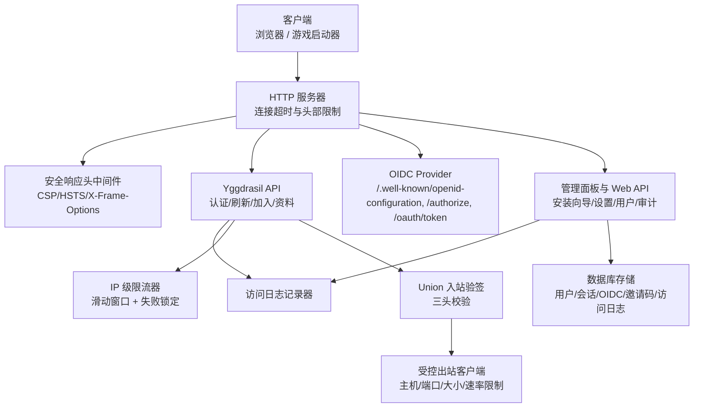
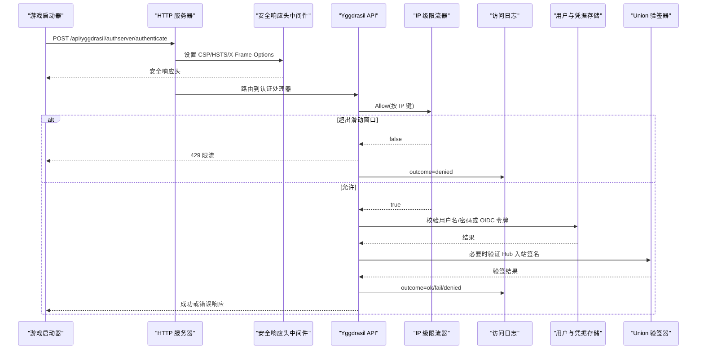
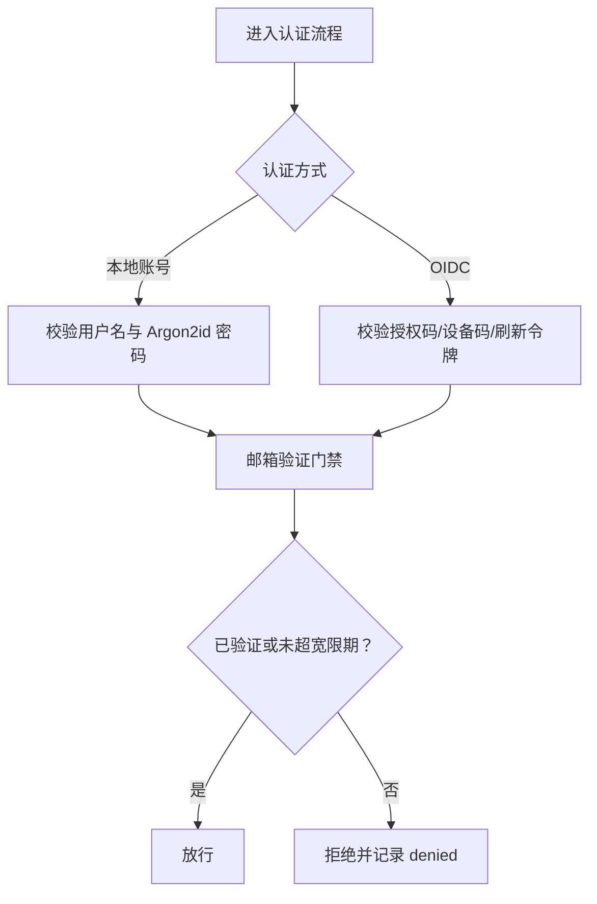
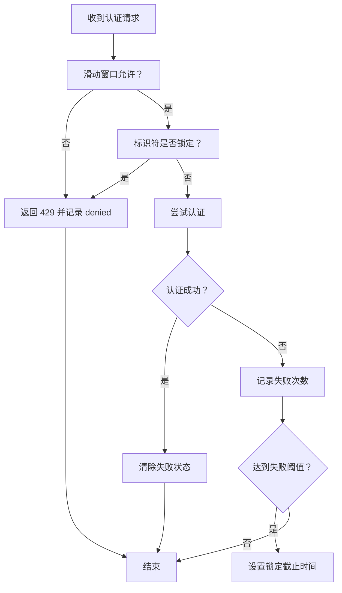
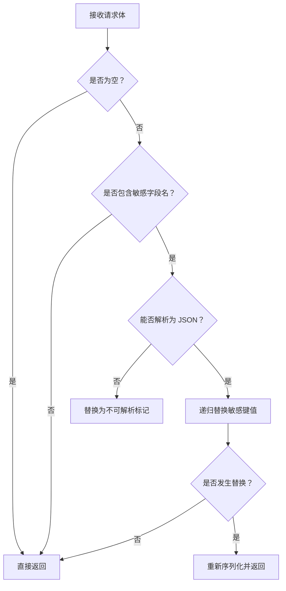
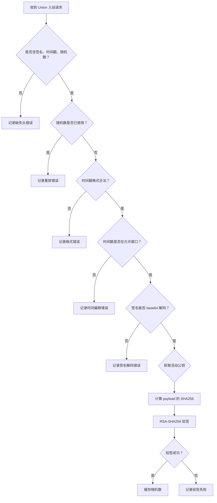
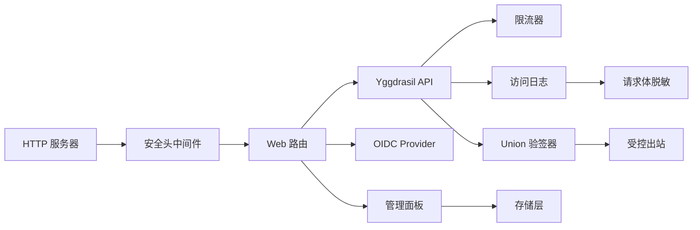

# 安全与合规

**本文引用的文件**
- [security_headers.go](https://github.com/YimingZhanshen/skin-nexus/blob/797ae1a/server/cmd/skin-nexus/security_headers.go)
- [limiter.go](https://github.com/YimingZhanshen/skin-nexus/blob/797ae1a/server/internal/ratelimit/limiter.go)
- [detail_scrub.go](https://github.com/YimingZhanshen/skin-nexus/blob/797ae1a/server/internal/accesslog/detail_scrub.go)
- [redact.go](https://github.com/YimingZhanshen/skin-nexus/blob/797ae1a/server/internal/redact/redact.go)
- [signer.go](https://github.com/YimingZhanshen/skin-nexus/blob/797ae1a/server/internal/union/signer.go)
- [verify.go](https://github.com/YimingZhanshen/skin-nexus/blob/797ae1a/server/internal/union/verify.go)
- [config.go](https://github.com/YimingZhanshen/skin-nexus/blob/797ae1a/server/internal/config/config.go)
- [server.go](https://github.com/YimingZhanshen/skin-nexus/blob/797ae1a/server/cmd/skin-nexus/server.go)
- [provider.go](https://github.com/YimingZhanshen/skin-nexus/blob/797ae1a/server/internal/oidc/provider.go)
- [setup.go](https://github.com/YimingZhanshen/skin-nexus/blob/797ae1a/server/internal/webapi/setup.go)
- [email_verify.go](https://github.com/YimingZhanshen/skin-nexus/blob/797ae1a/server/internal/store/email_verify.go)
- [verifygate.go](https://github.com/YimingZhanshen/skin-nexus/blob/797ae1a/server/internal/verifygate/verifygate.go)
- [csrf_stability_test.go](https://github.com/YimingZhanshen/skin-nexus/blob/797ae1a/server/internal/plugin/csrf_stability_test.go)
- [http.go](https://github.com/YimingZhanshen/skin-nexus/blob/797ae1a/server/internal/ygg/http.go)
- [scoped.go](https://github.com/YimingZhanshen/skin-nexus/blob/797ae1a/server/internal/outbound/scoped.go)
- [accesslog.go](https://github.com/YimingZhanshen/skin-nexus/blob/797ae1a/server/internal/accesslog/accesslog.go)

## 目录
1. [引言](#引言)
2. [项目结构](#项目结构)
3. [核心组件](#核心组件)
4. [架构总览](#架构总览)
5. [详细组件分析](#详细组件分析)
6. [依赖关系分析](#依赖关系分析)
7. [性能与安全权衡](#性能与安全权衡)
8. [故障排查指南](#故障排查指南)
9. [结论](#结论)
10. [附录：加固清单与合规要点](#附录加固清单与合规要点)

## 引言
本文面向 SkinNexus 的运维人员、安全工程师和合规审计者，系统性说明其认证与授权模型、IP 级限流、安全响应头、敏感信息脱敏、XSS/CSRF/上传校验、Union 三头验签等能力，并给出可操作的加固清单、漏洞报告流程与常见误配排查路径。文档既覆盖“本地账号 + OIDC + 角色权限 + 邀请码 + 邮箱验证门禁”的组合决策，也覆盖服务器运行时层面的防护边界，帮助部署者在可用性、可观测性与安全性之间做出明确取舍。

## 项目结构
SkinNexus 的安全能力分布在以下层次：
- Web 层：HTTP Server 超时、全局安全头、CSP 白名单扩展、HSTS 条件启用。
- 认证与授权层：本地密码、OIDC Provider、Yggdrasil 兼容接口、安装向导门禁、邮箱验证门禁。
- 访问控制层：基于角色的管理面板、插件信任链、Outbound 出站限制。
- 可观测性层：访问日志、审计日志、诊断模式下的请求体脱敏。
- Union 协作层：签名轮换、Hub 公钥来源、三头验签与防重放。

**图示来源**
- [server.go:10-24](https://github.com/YimingZhanshen/skin-nexus/blob/797ae1a/server/cmd/skin-nexus/server.go#L10-L24)
- [security_headers.go:118-168](https://github.com/YimingZhanshen/skin-nexus/blob/797ae1a/server/cmd/skin-nexus/security_headers.go#L118-L168)
- [http.go:100-180](https://github.com/YimingZhanshen/skin-nexus/blob/797ae1a/server/internal/ygg/http.go#L100-L180)
- [provider.go:40-140](https://github.com/YimingZhanshen/skin-nexus/blob/797ae1a/server/internal/oidc/provider.go#L40-L140)
- [accesslog.go:15-134](https://github.com/YimingZhanshen/skin-nexus/blob/797ae1a/server/internal/accesslog/accesslog.go#L15-L134)
- [limiter.go:1-187](https://github.com/YimingZhanshen/skin-nexus/blob/797ae1a/server/internal/ratelimit/limiter.go#L1-L187)
- [verify.go:1-120](https://github.com/YimingZhanshen/skin-nexus/blob/797ae1a/server/internal/union/verify.go#L1-L120)
- [scoped.go:1-200](https://github.com/YimingZhanshen/skin-nexus/blob/797ae1a/server/internal/outbound/scoped.go#L1-L200)

**章节来源**
- [server.go:10-24](https://github.com/YimingZhanshen/skin-nexus/blob/797ae1a/server/cmd/skin-nexus/server.go#L10-L24)
- [security_headers.go:1-168](https://github.com/YimingZhanshen/skin-nexus/blob/797ae1a/server/cmd/skin-nexus/security_headers.go#L1-L168)
- [http.go:100-180](https://github.com/YimingZhanshen/skin-nexus/blob/797ae1a/server/internal/ygg/http.go#L100-L180)
- [provider.go:40-140](https://github.com/YimingZhanshen/skin-nexus/blob/797ae1a/server/internal/oidc/provider.go#L40-L140)
- [accesslog.go:15-134](https://github.com/YimingZhanshen/skin-nexus/blob/797ae1a/server/internal/accesslog/accesslog.go#L15-L134)
- [limiter.go:1-187](https://github.com/YimingZhanshen/skin-nexus/blob/797ae1a/server/internal/ratelimit/limiter.go#L1-L187)
- [verify.go:1-120](https://github.com/YimingZhanshen/skin-nexus/blob/797ae1a/server/internal/union/verify.go#L1-L120)
- [scoped.go:1-200](https://github.com/YimingZhanshen/skin-nexus/blob/797ae1a/server/internal/outbound/scoped.go#L1-L200)

## 核心组件
本节聚焦安全相关核心模块的职责与交互，不展开具体实现代码，而是说明配置项、触发条件和输出行为。

- 安全响应头中间件：为所有响应强制注入 `X-Content-Type-Options`、`Referrer-Policy`、`X-Frame-Options`、`Content-Security-Policy`、`Permissions-Policy`；在 HTTPS 或代理转发 `X-Forwarded-Proto: https` 时再注入 `Strict-Transport-Security`。CSP 默认禁止外部脚本与对象嵌入，仅允许站内 `script-src` 与 `style-src` 内联，并通过环境变量严格校验扩展来源。
- IP 级限流器：维护两套独立键空间——按 IP 的滑动请求窗口、按标识符的连续失败锁定。阈值来自配置，支持 `Allow`、`Fail`、`Succeed`、`Locked`、`RetryAfter` 与后台清理。
- 访问日志与脱敏：记录 Web 登录、Yggdrasil 流量、Union 流量与插件事件；诊断模式下采集请求详情，但会在写入前对敏感字段进行 JSON 树遍历替换或整段丢弃。
- 个人信息脱红：邮箱以首字符加星号保留域名，用户名原样保留；避免把地址变成永久个人数据副本。
- OIDC Provider：提供标准发现、授权码、设备授权、令牌、撤销、密钥端点；支持共享客户端与 Yggdrasil 所需范围。
- 安装向导门禁：未初始化站点必须通过一次性安装流程；可选强制 `SKIN_SETUP_TOKEN`，使用常量时间比较防止时序攻击。
- 邮箱验证门禁：统一由 `Blocks` 函数判定是否阻止未验证账户加入；支持宽限期与立即强制两种策略。
- Union 签名与验签：出方向使用 RSA 私钥签发纹理属性值；入方向对 Hub 请求执行消息签名、时间窗与随机数三重校验，支持固定公钥与动态拉取回退。
- 出站受限：插件出站只允许 http(s)、指定主机、80/443 端口，禁用重定向、Cookie 与 Authorization，限制响应体大小与单主机速率。

**章节来源**
- [security_headers.go:1-168](https://github.com/YimingZhanshen/skin-nexus/blob/797ae1a/server/cmd/skin-nexus/security_headers.go#L1-L168)
- [limiter.go:1-187](https://github.com/YimingZhanshen/skin-nexus/blob/797ae1a/server/internal/ratelimit/limiter.go#L1-L187)
- [accesslog.go:15-134](https://github.com/YimingZhanshen/skin-nexus/blob/797ae1a/server/internal/accesslog/accesslog.go#L15-L134)
- [detail_scrub.go:1-125](https://github.com/YimingZhanshen/skin-nexus/blob/797ae1a/server/internal/accesslog/detail_scrub.go#L1-L125)
- [redact.go:1-39](https://github.com/YimingZhanshen/skin-nexus/blob/797ae1a/server/internal/redact/redact.go#L1-L39)
- [provider.go:1-200](https://github.com/YimingZhanshen/skin-nexus/blob/797ae1a/server/internal/oidc/provider.go#L1-L200)
- [setup.go:1-173](https://github.com/YimingZhanshen/skin-nexus/blob/797ae1a/server/internal/webapi/setup.go#L1-L173)
- [verifygate.go:1-48](https://github.com/YimingZhanshen/skin-nexus/blob/797ae1a/server/internal/verifygate/verifygate.go#L1-L48)
- [signer.go:1-200](https://github.com/YimingZhanshen/skin-nexus/blob/797ae1a/server/internal/union/signer.go#L1-L200)
- [verify.go:1-200](https://github.com/YimingZhanshen/skin-nexus/blob/797ae1a/server/internal/union/verify.go#L1-L200)
- [scoped.go:1-200](https://github.com/YimingZhanshen/skin-nexus/blob/797ae1a/server/internal/outbound/scoped.go#L1-L200)

## 架构总览
下图展示一次典型 Yggdrasil 认证请求如何经过安全中间件、限流、日志、身份存储与 Union 校验。

**图示来源**
- [http.go:100-180](https://github.com/YimingZhanshen/skin-nexus/blob/797ae1a/server/internal/ygg/http.go#L100-L180)
- [limiter.go:60-120](https://github.com/YimingZhanshen/skin-nexus/blob/797ae1a/server/internal/ratelimit/limiter.go#L60-L120)
- [accesslog.go:60-134](https://github.com/YimingZhanshen/skin-nexus/blob/797ae1a/server/internal/accesslog/accesslog.go#L60-L134)
- [verify.go:120-200](https://github.com/YimingZhanshen/skin-nexus/blob/797ae1a/server/internal/union/verify.go#L120-L200)

## 详细组件分析

### 认证与授权模型：本地账号、OIDC、角色、邀请码、邮箱验证门禁
SkinNexus 采用组合式认证入口，而不是单一通道：
- 本地账号：通过 Argon2id 哈希存储密码，安装向导要求最小长度并进行输入校验。
- OIDC：内部 Provider 暴露标准端点，支持授权码、设备授权、刷新令牌与撤销；同时向 launcher 暴露 Yggdrasil 所需 scope。
- 角色与权限：管理面板中的管理员权限决定能否操作插件市场、用户、审计日志、Union 与设置；普通玩家无法访问这些面。
- 邀请码：可通过配置开启注册时必须提供有效邀请码；已提供的邀请码会被验证并消耗。
- 邮箱验证门禁：当启用 `require_verification` 后，未验证邮箱且超过宽限期的账户会被拒绝加入或访问受限功能；该判断由统一门控函数决定，避免 Web 与服务端逻辑不一致。

**图示来源**
- [setup.go:1-173](https://github.com/YimingZhanshen/skin-nexus/blob/797ae1a/server/internal/webapi/setup.go#L1-L173)
- [provider.go:40-140](https://github.com/YimingZhanshen/skin-nexus/blob/797ae1a/server/internal/oidc/provider.go#L40-L140)
- [verifygate.go:1-48](https://github.com/YimingZhanshen/skin-nexus/blob/797ae1a/server/internal/verifygate/verifygate.go#L1-L48)

**章节来源**
- [setup.go:1-173](https://github.com/YimingZhanshen/skin-nexus/blob/797ae1a/server/internal/webapi/setup.go#L1-L173)
- [provider.go:40-140](https://github.com/YimingZhanshen/skin-nexus/blob/797ae1a/server/internal/oidc/provider.go#L40-L140)
- [verifygate.go:1-48](https://github.com/YimingZhanshen/skin-nexus/blob/797ae1a/server/internal/verifygate/verifygate.go#L1-L48)
- [config.go:1-200](https://github.com/YimingZhanshen/skin-nexus/blob/797ae1a/server/internal/config/config.go#L1-L200)

### IP 级限流 limiter：配置、触发条件与封禁行为
Limiter 提供两个相互独立的保护维度：
- 滑动窗口：每个 IP 键在指定窗口内的请求数达到阈值则拒绝。
- 失败锁定：每个业务标识符连续失败达到阈值后进入锁定期；成功尝试会清除失败计数。

关键行为包括：
- `Allow(key)`：检查滑动窗口并记录允许时间戳。
- `Fail(key)`：累计失败，超过阈值后设置 `lockedUntil`。
- `Locked(key)`：判断当前是否处于锁定期。
- `RetryAfter(key)`：返回剩余锁定秒数，用于 429 响应头的 Retry-After。
- 后台清扫：定时清理过期时间戳与失效失败记录，保持内存有界。

**图示来源**
- [limiter.go:60-160](https://github.com/YimingZhanshen/skin-nexus/blob/797ae1a/server/internal/ratelimit/limiter.go#L60-L160)

**章节来源**
- [limiter.go:1-187](https://github.com/YimingZhanshen/skin-nexus/blob/797ae1a/server/internal/ratelimit/limiter.go#L1-L187)
- [config.go:120-200](https://github.com/YimingZhanshen/skin-nexus/blob/797ae1a/server/internal/config/config.go#L120-L200)

### 安全头策略：CORS、HSTS、CSP、X-Frame-Options
安全响应头中间件在任意 handler 之前注入基线头部：
- `X-Content-Type-Options: nosniff`：防止 MIME 嗅探。
- `Referrer-Policy: same-origin`：减少跨站泄露。
- `X-Frame-Options`：非插件资源默认 `DENY`，插件资产允许同源嵌入。
- `Content-Security-Policy`：默认 `default-src 'self'`，脚本与样式允许内联但禁止外部源；`object-src none`、`base-uri self`、`form-action self`。
- `Permissions-Policy`：关闭地理位置、麦克风、摄像头、支付、USB、兴趣群组等权限。
- `Strict-Transport-Security`：仅在 HTTPS 或代理声明 HTTPS 时生效，避免明文站点被 HSTS 锁定。
- CSP 扩展来源通过环境变量传入，并在启动阶段用正则严格校验，拒绝分号、引号、路径等危险字符。

注意：Yggdrasil 元数据端点在浏览器侧需要跨域读取联盟成员名称，因此对该端点单独设置 `Access-Control-Allow-Origin: *`，这属于公开 API 的兼容性需求，不应泛化到其他写端点。

**章节来源**
- [security_headers.go:1-168](https://github.com/YimingZhanshen/skin-nexus/blob/797ae1a/server/cmd/skin-nexus/security_headers.go#L1-L168)
- [http.go:140-180](https://github.com/YimingZhanshen/skin-nexus/blob/797ae1a/server/internal/ygg/http.go#L140-L180)
- [config.go:60-120](https://github.com/YimingZhanshen/skin-nexus/blob/797ae1a/server/internal/config/config.go#L60-L120)

### 敏感信息脱 redact 机制：访问日志细节、错误信息与日志审计
敏感信息防护分为三层：
1. **访问日志主体脱敏**：`ScrubBody` 检测请求体中是否存在敏感字段名；若可解析为 JSON，则递归替换匹配键的值；若不可解析但仍包含敏感字段名，则整段替换为标记文本，绝不保留原始凭证。
2. **个人信息脱红**：邮箱地址脱红保留首字符与完整域名；用户名若无 `@` 则原样保留，避免把昵称误判为邮箱。
3. **诊断模式开关**：只有诊断模式打开时才写入带 Capture 的请求详情；否则即使收集了头部与正文片段也会丢弃，避免长期留存明文凭证。

**图示来源**
- [detail_scrub.go:40-125](https://github.com/YimingZhanshen/skin-nexus/blob/797ae1a/server/internal/accesslog/detail_scrub.go#L40-L125)

**章节来源**
- [detail_scrub.go:1-125](https://github.com/YimingZhanshen/skin-nexus/blob/797ae1a/server/internal/accesslog/detail_scrub.go#L1-L125)
- [redact.go:1-39](https://github.com/YimingZhanshen/skin-nexus/blob/797ae1a/server/internal/redact/redact.go#L1-L39)
- [accesslog.go:60-134](https://github.com/YimingZhanshen/skin-nexus/blob/797ae1a/server/internal/accesslog/accesslog.go#L60-L134)

### XSS 防护：bluemonday HTML 过滤与页面沙箱
仓库中可见的安全策略集中在 CSP、X-Frame-Options、Permissions-Policy 与插件 UI 沙箱上。关于 bluemonday HTML 过滤，当前仓库快照未直接出现对应实现引用；因此不能断言服务端对所有富文本都使用了该库。应优先依赖 CSP 的 `script-src`、`object-src`、`frame-src` 限制与 `form-action self`，并结合上游模板渲染器的转义机制。

对于插件 UI 页面，系统会对 HTML 内容附加 `Sandbox: allow-scripts allow-forms`，使插件页面作为顶层导航时运行于不透明来源，减少 Cookie 与同源存储泄漏风险。

**章节来源**
- [security_headers.go:118-168](https://github.com/YimingZhanshen/skin-nexus/blob/797ae1a/server/cmd/skin-nexus/security_headers.go#L118-L168)

### CSRF 防护：双提交 Cookie 与稳定性保证
插件路由的 CSRF 防护采用双提交机制：
- 前端从 `_csrf` 端点获取 token，并携带同名 Cookie。
- 写请求需同时发送 Cookie 与 `X-CSRF-Token`。
- 测试保证同一站点多个插件页共享一个 CSRF Cookie，不会因第二个页面加载而让第一个页面的缓存 token 失效。
- 不接受伪造的 64 位十六进制以外的 Cookie 值。

这降低了跨站伪造修改请求的风险，但需注意：CSP 的 `connect-src` 与 `script-src` 仍会影响哪些第三方脚本能发起请求。

**章节来源**
- [csrf_stability_test.go:1-92](https://github.com/YimingZhanshen/skin-nexus/blob/797ae1a/server/internal/plugin/csrf_stability_test.go#L1-L92)

### 上传文件格式校验与体积限制
仓库中与上传相关的校验分散在皮肤纹理管道、插件包体积限制与主题/插件市场信任链中。由于本仓库快照未直接展示通用上传格式校验器实现，安全建议如下：
- 对用户上传的文件类型使用白名单校验，而非仅依赖后缀名。
- 对二进制内容做魔数检测，防止伪装。
- 限制最大体积，避免耗尽磁盘与内存。
- 将上传内容与可执行脚本隔离，避免在 Web 根目录直接暴露可执行内容。
- 对插件包与主题包使用签名校验与受信任密钥环，已在配置中体现。

**章节来源**
- [config.go:160-306](https://github.com/YimingZhanshen/skin-nexus/blob/797ae1a/server/internal/config/config.go#L160-L306)

### Union 三头验签：签名、时间戳与随机数
Union 入站验签器验证三个头部：
- `X-Message-Signature`：base64 编码的 RSA-SHA256 PKCS#1 v1.5 签名。
- `X-Message-Timestamp`：Unix 秒级时间戳，必须在过去与未来容差范围内。
- `X-Message-Nonce`：60 秒内防重放缓存。

验签过程顺序为：缺失头 → 重放检查 → 时间戳格式 → 时间窗 → base64 解码 → 解析公钥 → SHA256 摘要 → RSA 验签 → 成功后才缓存 nonce。公钥来源支持固定 PEM 与动态拉取，拉取失败可回退到上次已知公钥或固定公钥。

**图示来源**
- [verify.go:120-200](https://github.com/YimingZhanshen/skin-nexus/blob/797ae1a/server/internal/union/verify.go#L120-L200)

**章节来源**
- [verify.go:1-200](https://github.com/YimingZhanshen/skin-nexus/blob/797ae1a/server/internal/union/verify.go#L1-L200)
- [signer.go:1-200](https://github.com/YimingZhanshen/skin-nexus/blob/797ae1a/server/internal/union/signer.go#L1-L200)

### 出站安全：反爬虫与出站限制
插件出站客户端实施强约束：
- 只允许 http(s)。
- 不允许 userinfo、非 80/443 端口。
- 不允许 IP 字面量与私有循环地址（测试除外）。
- 不允许重定向。
- 不发送 Cookie 与 Authorization。
- 限制响应体大小。
- 单主机每秒最多 2 次，突发 4 次。
- 主机白名单与用户路径白名单结合，防止开放 URL 被滥用。

这既是反爬虫的基础，也是 SSRF 防护的关键边界。

**章节来源**
- [scoped.go:1-200](https://github.com/YimingZhanshen/skin-nexus/blob/797ae1a/server/internal/outbound/scoped.go#L1-L200)

## 依赖关系分析
安全相关模块之间的耦合关系如下：
- Web 服务器提供连接超时与头部上限，降低慢客户端与 slowloris 风险。
- 安全头中间件包裹路由，确保任何 handler 都无法绕过基线策略。
- Yggdrasil API 依赖访问日志、限流器与 Union 验签器。
- OIDC Provider 依赖后端存储与会话解析器。
- 安装向导依赖常量时间比较与事务性创建超级管理员。
- 邮箱验证门禁是纯函数门控，避免服务状态漂移。
- 访问日志依赖诊断开关与脱敏逻辑。
- Union 验签器依赖公钥来源与审计回调。

**图示来源**
- [server.go:10-24](https://github.com/YimingZhanshen/skin-nexus/blob/797ae1a/server/cmd/skin-nexus/server.go#L10-L24)
- [security_headers.go:118-168](https://github.com/YimingZhanshen/skin-nexus/blob/797ae1a/server/cmd/skin-nexus/security_headers.go#L118-L168)
- [http.go:100-180](https://github.com/YimingZhanshen/skin-nexus/blob/797ae1a/server/internal/ygg/http.go#L100-L180)
- [provider.go:100-180](https://github.com/YimingZhanshen/skin-nexus/blob/797ae1a/server/internal/oidc/provider.go#L100-L180)
- [accesslog.go:60-134](https://github.com/YimingZhanshen/skin-nexus/blob/797ae1a/server/internal/accesslog/accesslog.go#L60-L134)
- [detail_scrub.go:40-125](https://github.com/YimingZhanshen/skin-nexus/blob/797ae1a/server/internal/accesslog/detail_scrub.go#L40-L125)
- [verify.go:120-200](https://github.com/YimingZhanshen/skin-nexus/blob/797ae1a/server/internal/union/verify.go#L120-L200)
- [scoped.go:120-200](https://github.com/YimingZhanshen/skin-nexus/blob/797ae1a/server/internal/outbound/scoped.go#L120-L200)

**章节来源**
- [server.go:10-24](https://github.com/YimingZhanshen/skin-nexus/blob/797ae1a/server/cmd/skin-nexus/server.go#L10-L24)
- [security_headers.go:118-168](https://github.com/YimingZhanshen/skin-nexus/blob/797ae1a/server/cmd/skin-nexus/security_headers.go#L118-L168)
- [http.go:100-180](https://github.com/YimingZhanshen/skin-nexus/blob/797ae1a/server/internal/ygg/http.go#L100-L180)
- [provider.go:100-180](https://github.com/YimingZhanshen/skin-nexus/blob/797ae1a/server/internal/oidc/provider.go#L100-L180)
- [accesslog.go:60-134](https://github.com/YimingZhanshen/skin-nexus/blob/797ae1a/server/internal/accesslog/accesslog.go#L60-L134)
- [detail_scrub.go:40-125](https://github.com/YimingZhanshen/skin-nexus/blob/797ae1a/server/internal/accesslog/detail_scrub.go#L40-L125)
- [verify.go:120-200](https://github.com/YimingZhanshen/skin-nexus/blob/797ae1a/server/internal/union/verify.go#L120-L200)
- [scoped.go:120-200](https://github.com/YimingZhanshen/skin-nexus/blob/797ae1a/server/internal/outbound/scoped.go#L120-L200)

## 性能与安全权衡
- 连接超时：读头、读体、写体与空闲超时兼顾纹理上传与大 NAT 链路，但过度宽松会增加慢客户端占用。
- CSP 允许内联脚本：这是为了兼容自定义 CSS/JS、主题包与插件包；代价是失去严格的 nonce/script-src 白名单，应配合最小权限策略与可信来源。
- 限流窗口与失败锁定：共享 NAT 出口会导致同 IP 多用户共享桶，需根据实际用户分布调整阈值。
- 访问日志：诊断模式提供强大排障能力，但默认不应长期开启；普通日志行本身也需要脱敏与保留策略。
- Union 验签：固定公钥更安全，动态拉取更灵活；生产环境建议固定公钥为主，动态拉取仅作为故障恢复手段。

[本节为通用指导，不直接分析具体文件]

## 故障排查指南

### 安全头相关问题
- 站点被点击劫持：检查非插件资源是否返回 `X-Frame-Options: DENY` 或 CSP `frame-ancestors 'none'`。
- 第三方脚本不工作：确认已通过环境变量添加受信任的 script/connect 来源，并确保值符合 CSP source 正则。
- HSTS 导致站点不可达：如果站点是明文 HTTP，不要启用 HSTS；应先完成 TLS 终止。

**章节来源**
- [security_headers.go:60-168](https://github.com/YimingZhanshen/skin-nexus/blob/797ae1a/server/cmd/skin-nexus/security_headers.go#L60-L168)

### 限流与封禁问题
- 大量用户被 429：检查是否共享 NAT 出口导致 IP 桶被多人共用；适当提高滑动窗口阈值或拆分限流键。
- 密码猜解后账号被锁定：确认失败锁定针对的是业务标识符而非 IP；成功登录后应调用成功清除接口。
- Retry-After 不正确：检查锁定期与当前时间的毫秒精度处理。

**章节来源**
- [limiter.go:60-160](https://github.com/YimingZhanshen/skin-nexus/blob/797ae1a/server/internal/ratelimit/limiter.go#L60-L160)

### 访问日志与脱敏问题
- 日志中出现明文密码：确认诊断模式是否正确开启；确认请求体确实被 ScrubBody 处理。
- 审计记录看不到邮箱：检查 Identifier 是否把邮箱正确脱红；确认未把地址原样写入 Detail。
- 诊断模式未写入详情：确认 Logger 的诊断开关已启用，且 Capture 未被提前丢弃。

**章节来源**
- [detail_scrub.go:1-125](https://github.com/YimingZhanshen/skin-nexus/blob/797ae1a/server/internal/accesslog/detail_scrub.go#L1-L125)
- [redact.go:1-39](https://github.com/YimingZhanshen/skin-nexus/blob/797ae1a/server/internal/redact/redact.go#L1-L39)
- [accesslog.go:60-134](https://github.com/YimingZhanshen/skin-nexus/blob/797ae1a/server/internal/accesslog/accesslog.go#L60-L134)

### Union 验签失败
- 提示缺少签名头：检查上游是否发送 `X-Message-Signature`、`X-Message-Timestamp`、`X-Message-Nonce`。
- 提示重放：检查 nonce 是否重复；确认客户端每次请求生成新 nonce。
- 提示时间偏移：校准服务器时钟；检查时间窗是否过窄。
- 提示签名无效：核对私钥/公钥、算法与 payload 拼接顺序。

**章节来源**
- [verify.go:120-200](https://github.com/YimingZhanshen/skin-nexus/blob/797ae1a/server/internal/union/verify.go#L120-L200)

### 安装向导与初始权限
- 首次安装被拒绝：确认是否设置了 `SKIN_SETUP_TOKEN`，并使用常量时间比较的保护值。
- 数据库尚未建表：先启用自动迁移或手动执行迁移。
- 管理员密码不符合要求：确保密码至少 8 位。

**章节来源**
- [setup.go:1-173](https://github.com/YimingZhanshen/skin-nexus/blob/797ae1a/server/internal/webapi/setup.go#L1-L173)

### 邮箱验证门禁异常
- 新用户仍可加入但控制台显示未验证：检查 `require_verification` 是否启用，以及宽限期是否过长。
- 更换邮箱后旧链接仍有效：确认已调用失效接口删除未使用的旧 token。

**章节来源**
- [verifygate.go:1-48](https://github.com/YimingZhanshen/skin-nexus/blob/797ae1a/server/internal/verifygate/verifygate.go#L1-L48)
- [email_verify.go:1-79](https://github.com/YimingZhanshen/skin-nexus/blob/797ae1a/server/internal/store/email_verify.go#L1-L79)

## 结论
SkinNexus 的安全模型以“多层防御 + 可观测性”为核心：安全头提供浏览器侧基线，限流器抵御暴力破解与资源滥用，访问日志与脱敏机制保障审计可用且不泄露凭证，Union 验签确保联盟间通信真实可靠。部署者应在 HTTPS、最小权限、密钥轮换、反爬与限流、出站白名单等方面建立制度化配置，并通过审计日志与告警持续验证策略有效性。

[本节为总结性内容，不直接分析具体文件]

## 附录：加固清单与合规要点

### 安全加固清单
- 强制 HTTPS：使用反向代理终止 TLS，确保 `X-Forwarded-Proto` 正确；仅在 HTTPS 场景启用 HSTS。
- 最小权限数据库账户：应用账户只授予必要 schema 的读写权限，禁止 root/admin 直连。
- 定期轮换签名密钥：Union 与 OIDC 签名密钥应分离；Union 支持自动轮换与审计异常，OIDC 密钥应独立存储并版本化管理。
- 启用访问日志：至少记录摘要；诊断模式仅短期开启，并限制访问者权限。
- 配置反爬虫与限流：合理设置 `SKIN_RATE_LIMIT_AUTH` 与 `SKIN_LOGIN_FAIL_LIMIT`；对上传、Union 接口、插件出站分别评估阈值。
- 收紧 CSP：仅添加必要的第三方来源；避免 `unsafe-eval`；逐步引入 nonce 替代内联脚本。
- 出站白名单：插件市场、主题市场与联盟成员主机应显式配置，禁用内网与回环访问。
- 上传校验：使用类型白名单、魔数检测、体积限制与隔离存储。
- CSRF 与同源策略：确保写端点校验 CSRF，避免将敏感 Cookie 设为 Site-wide 而不配合 SameSite。
- 密钥与 Token 管理：`SKIN_SETUP_TOKEN`、数据库 DSN、SMTP 密码、签名密钥不得进入普通日志或版本库。

### 漏洞报告流程
1. 不要公开披露未修复漏洞。
2. 通过项目维护渠道私下提交漏洞摘要、复现步骤、影响范围与修复建议。
3. 维护者评估严重等级后分配优先级并通知报告者。
4. 修复后发布更新并致谢报告者。
5. 对涉及凭证泄露、权限提升、SSRF、RCE 的漏洞进行专项回归测试。

### 合规要求
- 数据最小化：日志中不保留明文密码、令牌、完整邮箱；访问日志保留期应符合隐私政策。
- 访问控制：管理面板与审计接口仅对高权限管理员开放。
- 审计追踪：记录安装、用户变更、Union 接入、插件安装与审计日志访问。
- 加密传输：TLS 1.2+，禁用弱密码套件；对外 API 使用签名或双向认证。
- 第三方依赖：使用依赖更新工具跟踪 CVE；插件与主题市场使用可信密钥环。

### 常见安全误配排查
- CSP 扩展来源写错：字符串中包含分号或路径导致策略失效或被拒绝。
- HSTS 误启：明文站点启用 HSTS 后无法继续访问。
- 限流阈值过低：共享 NAT 出口导致正常用户集体 429。
- 诊断模式长期开启：日志中残留凭证或敏感请求体。
- Union 公钥未固定：动态拉取失败时没有回退策略。
- 出站允许回环或内网：插件恶意 URL 可探测内网服务。
- 安装令牌缺失：未设置 `SKIN_SETUP_TOKEN` 导致首次安装窗口被抢占。

**章节来源**
- [security_headers.go:60-168](https://github.com/YimingZhanshen/skin-nexus/blob/797ae1a/server/cmd/skin-nexus/security_headers.go#L60-L168)
- [limiter.go:60-160](https://github.com/YimingZhanshen/skin-nexus/blob/797ae1a/server/internal/ratelimit/limiter.go#L60-L160)
- [accesslog.go:60-134](https://github.com/YimingZhanshen/skin-nexus/blob/797ae1a/server/internal/accesslog/accesslog.go#L60-L134)
- [detail_scrub.go:40-125](https://github.com/YimingZhanshen/skin-nexus/blob/797ae1a/server/internal/accesslog/detail_scrub.go#L40-L125)
- [verify.go:120-200](https://github.com/YimingZhanshen/skin-nexus/blob/797ae1a/server/internal/union/verify.go#L120-L200)
- [scoped.go:120-200](https://github.com/YimingZhanshen/skin-nexus/blob/797ae1a/server/internal/outbound/scoped.go#L120-L200)
- [setup.go:1-173](https://github.com/YimingZhanshen/skin-nexus/blob/797ae1a/server/internal/webapi/setup.go#L1-L173)
- [config.go:1-306](https://github.com/YimingZhanshen/skin-nexus/blob/797ae1a/server/internal/config/config.go#L1-L306)
