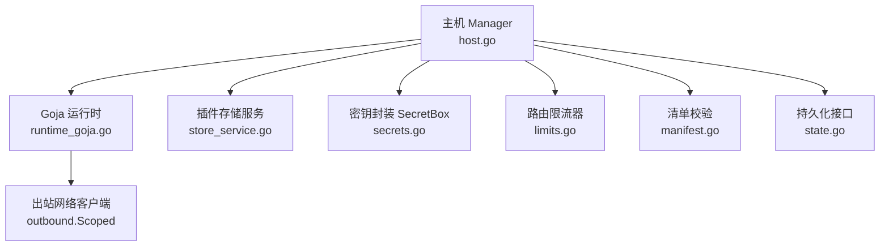
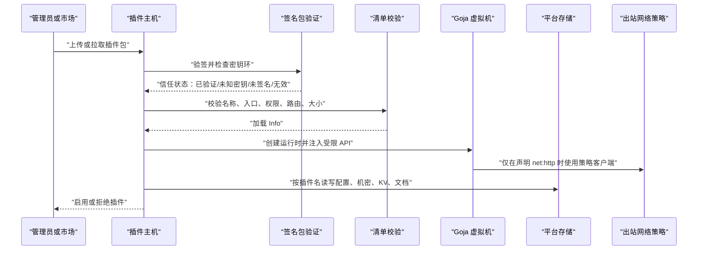
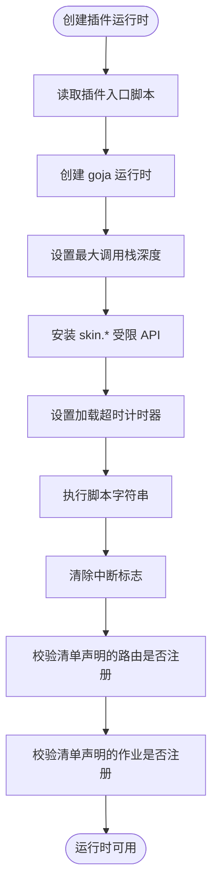
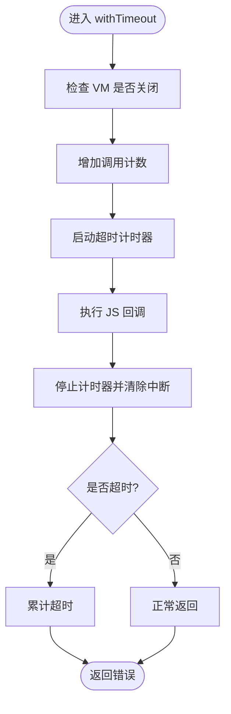
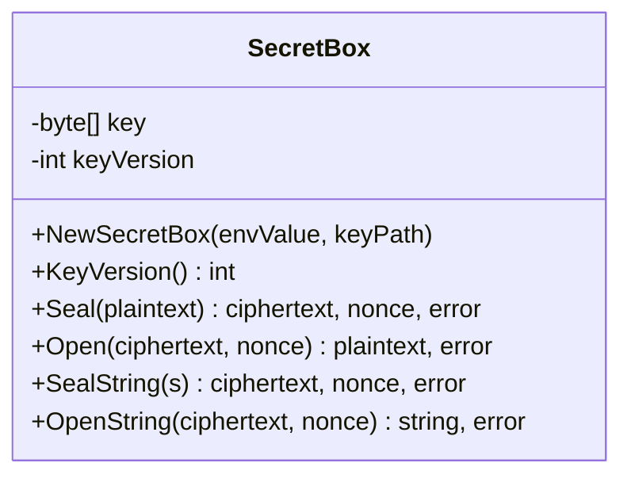
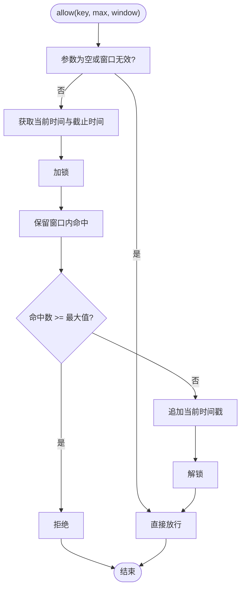
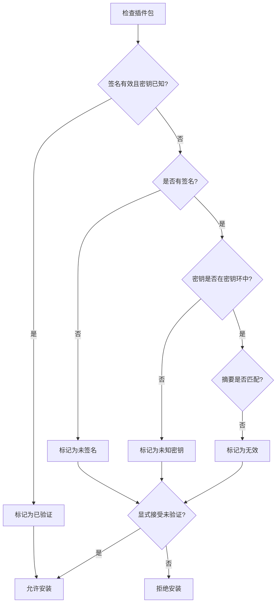
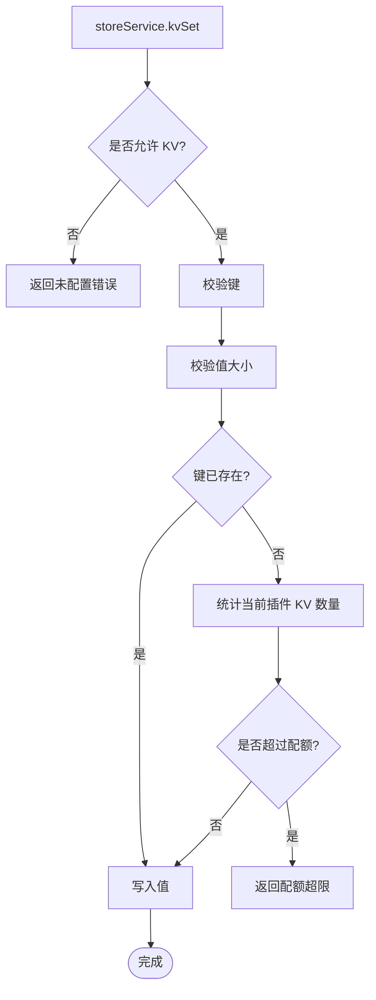
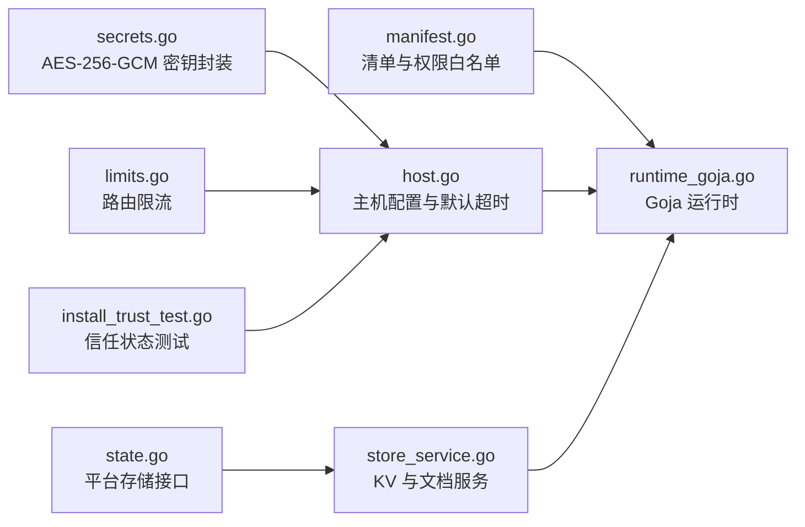

# 安全模型与沙箱限制

**本文引用的文件**
- [runtime_goja.go](https://github.com/YimingZhanshen/skin-nexus/blob/797ae1a/server/internal/plugin/runtime_goja.go)
- [secrets.go](https://github.com/YimingZhanshen/skin-nexus/blob/797ae1a/server/internal/plugin/secrets.go)
- [limits.go](https://github.com/YimingZhanshen/skin-nexus/blob/797ae1a/server/internal/plugin/limits.go)
- [manifest.go](https://github.com/YimingZhanshen/skin-nexus/blob/797ae1a/server/internal/plugin/manifest.go)
- [host.go](https://github.com/YimingZhanshen/skin-nexus/blob/797ae1a/server/internal/plugin/host.go)
- [state.go](https://github.com/YimingZhanshen/skin-nexus/blob/797ae1a/server/internal/plugin/state.go)
- [store_service.go](https://github.com/YimingZhanshen/skin-nexus/blob/797ae1a/server/internal/plugin/store_service.go)
- [install_trust_test.go](https://github.com/YimingZhanshen/skin-nexus/blob/797ae1a/server/internal/plugin/install_trust_test.go)

## 目录
1. [引言](#引言)
2. [项目结构](#项目结构)
3. [核心组件](#核心组件)
4. [架构总览](#架构总览)
5. [详细组件分析](#详细组件分析)
6. [依赖关系分析](#依赖关系分析)
7. [性能与安全权衡](#性能与安全权衡)
8. [故障排查指南](#故障排查指南)
9. [结论](#结论)
10. [附录：攻击面与最佳实践](#附录攻击面与最佳实践)

## 引言
本文面向插件系统的安全设计与运行时约束，重点解释以下内容：
- Goja 虚拟机的初始化参数、调用栈限制、执行超时与中断机制。
- 插件密钥如何通过 AES-256-GCM 加密存储。
- 主机层面对路由限流、请求体大小、脚本大小与清单大小的限制。
- 插件信任签名体系：为什么需要可信签名包、如何标记未信任插件、未信任插件被拒绝的路径。
- 命名空间 KV 存储的隔离性、配置项可见性与跨插件不可见原则。
- 安全最佳实践与典型攻击面分析，包括原型链污染、定时器滥用和内存耗尽。

## 项目结构
本项目的插件安全相关逻辑集中在 `server/internal/plugin` 目录中，关键文件职责如下：

| 文件 | 主要职责 |
|---|---|
| `runtime_goja.go` | 创建并运行 Goja 虚拟机，暴露受限 API，注册钩子、路由、事件、作业等，施加超时与中断。 |
| `secrets.go` | 提供基于环境或文件的 32 字节密钥，使用 AES-256-GCM 密封与打开插件机密。 |
| `limits.go` | 按键统计最近一小时内请求次数，实现 O(1) 协程数量的路由级限流。 |
| `manifest.go` | 解析并校验插件清单，限制脚本大小、路由数量、权限白名单、入口路径等。 |
| `host.go` | 构建插件主机、默认超时、上传上限、事件队列与工作协程。 |
| `state.go` | 定义平台存储接口，要求所有访问都带插件名、集合名等命名空间前缀。 |
| `store_service.go` | 实现插件可访问的 KV 与文档存储 API，强制配额、键校验、超时与集合白名单。 |
| `install_trust_test.go` | 验证已签名、未签名、未知密钥、篡改包的信任状态与安装行为。 |

**图示来源**
- [host.go:1-200](https://github.com/YimingZhanshen/skin-nexus/blob/797ae1a/server/internal/plugin/host.go#L1-L200)
- [runtime_goja.go:1-200](https://github.com/YimingZhanshen/skin-nexus/blob/797ae1a/server/internal/plugin/runtime_goja.go#L1-L200)
- [store_service.go:1-200](https://github.com/YimingZhanshen/skin-nexus/blob/797ae1a/server/internal/plugin/store_service.go#L1-L200)
- [secrets.go:1-113](https://github.com/YimingZhanshen/skin-nexus/blob/797ae1a/server/internal/plugin/secrets.go#L1-L113)
- [limits.go:1-103](https://github.com/YimingZhanshen/skin-nexus/blob/797ae1a/server/internal/plugin/limits.go#L1-L103)
- [manifest.go:1-200](https://github.com/YimingZhanshen/skin-nexus/blob/797ae1a/server/internal/plugin/manifest.go#L1-L200)
- [state.go:1-108](https://github.com/YimingZhanshen/skin-nexus/blob/797ae1a/server/internal/plugin/state.go#L1-L108)

**章节来源**
- [host.go:1-200](https://github.com/YimingZhanshen/skin-nexus/blob/797ae1a/server/internal/plugin/host.go#L1-L200)
- [runtime_goja.go:1-200](https://github.com/YimingZhanshen/skin-nexus/blob/797ae1a/server/internal/plugin/runtime_goja.go#L1-L200)
- [store_service.go:1-200](https://github.com/YimingZhanshen/skin-nexus/blob/797ae1a/server/internal/plugin/store_service.go#L1-L200)
- [secrets.go:1-113](https://github.com/YimingZhanshen/skin-nexus/blob/797ae1a/server/internal/plugin/secrets.go#L1-L113)
- [limits.go:1-103](https://github.com/YimingZhanshen/skin-nexus/blob/797ae1a/server/internal/plugin/limits.go#L1-L103)
- [manifest.go:1-200](https://github.com/YimingZhanshen/skin-nexus/blob/797ae1a/server/internal/plugin/manifest.go#L1-L200)
- [state.go:1-108](https://github.com/YimingZhanshen/skin-nexus/blob/797ae1a/server/internal/plugin/state.go#L1-L108)

## 核心组件
本节从安全视角总结关键设计点。

### Goja 虚拟机与执行预算
- 每个插件拥有独立 Goja 实例，并通过互斥锁串行化 VM 操作，避免并发破坏 VM 内部状态。
- 通过设置最大调用栈深度限制递归爆炸风险。
- 加载阶段为脚本执行设置超时计时器；若超过加载超时，会向 VM 注入中断错误。
- 钩子、认证回调、头像过滤、用户生命周期回调与路由处理器统一通过带超时的包装函数执行，并在超时后调用 VM 中断。
- 路由处理器的超时在清单声明范围与主机默认值之间取交集，同时限制最小 100 毫秒、最大 10 秒。

**章节来源**
- [runtime_goja.go:1-200](https://github.com/YimingZhanshen/skin-nexus/blob/797ae1a/server/internal/plugin/runtime_goja.go#L1-L200)
- [runtime_goja.go:201-450](https://github.com/YimingZhanshen/skin-nexus/blob/797ae1a/server/internal/plugin/runtime_goja.go#L201-L450)
- [runtime_goja.go:451-745](https://github.com/YimingZhanshen/skin-nexus/blob/797ae1a/server/internal/plugin/runtime_goja.go#L451-L745)
- [host.go:1-200](https://github.com/YimingZhanshen/skin-nexus/blob/797ae1a/server/internal/plugin/host.go#L1-L200)

### 受限 API 与变量白名单
插件只能通过宿主暴露的全局对象访问能力，而不是直接访问 Go 全局变量、文件系统或进程信息。当前暴露的能力包括：
- `skin.hooks.*`：插件钩子注册，如个人资料过滤、纹理 URL 过滤、上传通知、用户生命周期、认证阶段、头像过滤。
- `skin.route`：注册只读路由，受清单声明、路由层级权限、路径清理与重复检查保护。
- `skin.log`：日志输出，长度有界。
- `skin.config.get/all`：读取插件配置，需声明 `config` 权限。
- `skin.store`：KV 与文档存储，需声明相应权限且受配额限制。
- `skin.events.on` / `skin.guards.on`：事件订阅与守卫。
- `skin.host.info/hasPlugin`：主机信息，需 `plugins:read` 权限。
- `skin.net.get`：受限出站 HTTP，需 `net:http` 权限并由策略客户端控制目标主机、用户域名、路径、最大字节数与超时。
- `skin.jobs.*`：作业注册与提交、查询、取消、恢复。
- `skin.account.*`、`skin.players.*`、`skin.textures.*`、`skin.library.*`：宿主桥接 API。

未被显式暴露的对象不会被注入到插件上下文，因此插件无法直接读取任意 Go 变量。

**章节来源**
- [runtime_goja.go:201-450](https://github.com/YimingZhanshen/skin-nexus/blob/797ae1a/server/internal/plugin/runtime_goja.go#L201-L450)

### 原生模块与文件系统访问
代码中没有向插件暴露 Node.js 风格的 `require`、`fs`、`process` 等原生模块或文件系统 API。插件只能使用宿主通过 `skin.*` 暴露的方法。文件系统访问发生在宿主侧：
- 清单解析时限制脚本大小。
- 入口路径必须位于插件目录内，不允许符号链接逃逸。
- 启动脚本由宿主读取后交给 VM 执行。

这意味着插件不能自由读取任意路径，也不能加载外部原生二进制或 Node 模块。

**章节来源**
- [manifest.go:1-200](https://github.com/YimingZhanshen/skin-nexus/blob/797ae1a/server/internal/plugin/manifest.go#L1-L200)
- [runtime_goja.go:1-200](https://github.com/YimingZhanshen/skin-nexus/blob/797ae1a/server/internal/plugin/runtime_goja.go#L1-L200)

### 配置与密钥存储
- 插件配置通过宿主保存，其中格式为 `secret` 的配置字段不会以明文返回给前端，而是显示掩码值。
- 实际密钥不直接保存在普通配置 JSON 中，而是由 `SecretBox` 使用 AES-256-GCM 密封，并连同 nonce 与密钥版本一起写入平台存储。
- 密钥来源优先级为环境变量、数据目录旁的密钥文件；若不存在则生成随机 32 字节密钥，并以严格权限写入。
- 丢失密钥只会丢失插件机密，不会丢失用户数据或纹理。

**章节来源**
- [secrets.go:1-113](https://github.com/YimingZhanshen/skin-nexus/blob/797ae1a/server/internal/plugin/secrets.go#L1-L113)
- [config_host_test.go:1-200](https://github.com/YimingZhanshen/skin-nexus/blob/797ae1a/server/internal/plugin/config_host_test.go#L1-L200)

### 资源限制
| 限制类型 | 位置 | 行为 |
|---|---|---|
| 脚本大小 | `manifest.go` | 单个插件脚本最大约 1 MiB。 |
| 清单大小 | `manifest.go` | 单个插件清单最大约 64 KiB。 |
| 插件总数 | `manifest.go` | 最多 64 个插件。 |
| 每插件路由数 | `manifest.go` | 最多 32 条。 |
| 总路由数 | `manifest.go` | 最多 64 条。 |
| 调用栈深度 | `runtime_goja.go` | 设置为固定上限。 |
| 钩子超时 | `host.go` / `runtime_goja.go` | 默认 100 毫秒，可由插件收紧但不能放宽。 |
| 认证回调超时 | `host.go` / `runtime_goja.go` | 默认 50 毫秒。 |
| 路由处理超时 | `host.go` / `runtime_goja.go` | 默认 1 秒，清单范围限制在 100 毫秒到 10 秒之间。 |
| 脚本加载超时 | `host.go` / `runtime_goja.go` | 默认 2 秒。 |
| 路由限流窗口 | `limits.go` | 按键统计最近一小时内的命中次数，每分钟清理过期记录。 |
| 插件 KV 单值大小 | `store_service.go` | 最大 64 KiB。 |
| 插件 KV 文档大小 | `store_service.go` | 最大 256 KiB，集合可进一步缩小。 |
| 插件 KV 键数 | `store_service.go` | 默认 1000，硬上限 50000。 |
| 文档集合行数 | `store_service.go` | 每集合最多 10000，可进一步缩小。 |
| 存储操作超时 | `store_service.go` | 每次 KV/文档操作自带约 800 毫秒上下文超时。 |
| 管理端包上传上限 | `host.go` | 默认 64 MiB。 |

**章节来源**
- [manifest.go:1-200](https://github.com/YimingZhanshen/skin-nexus/blob/797ae1a/server/internal/plugin/manifest.go#L1-L200)
- [runtime_goja.go:1-200](https://github.com/YimingZhanshen/skin-nexus/blob/797ae1a/server/internal/plugin/runtime_goja.go#L1-L200)
- [runtime_goja.go:451-745](https://github.com/YimingZhanshen/skin-nexus/blob/797ae1a/server/internal/plugin/runtime_goja.go#L451-L745)
- [limits.go:1-103](https://github.com/YimingZhanshen/skin-nexus/blob/797ae1a/server/internal/plugin/limits.go#L1-L103)
- [store_service.go:1-200](https://github.com/YimingZhanshen/skin-nexus/blob/797ae1a/server/internal/plugin/store_service.go#L1-L200)
- [host.go:1-200](https://github.com/YimingZhanshen/skin-nexus/blob/797ae1a/server/internal/plugin/host.go#L1-L200)

## 架构总览
下图展示插件从安装到执行的完整安全路径：清单校验、签名验证、信任状态、受限 VM 初始化、API 暴露、资源限制、存储隔离与出站网络策略。

**图示来源**
- [host.go:1-200](https://github.com/YimingZhanshen/skin-nexus/blob/797ae1a/server/internal/plugin/host.go#L1-L200)
- [manifest.go:1-200](https://github.com/YimingZhanshen/skin-nexus/blob/797ae1a/server/internal/plugin/manifest.go#L1-L200)
- [runtime_goja.go:1-200](https://github.com/YimingZhanshen/skin-nexus/blob/797ae1a/server/internal/plugin/runtime_goja.go#L1-L200)
- [install_trust_test.go:1-130](https://github.com/YimingZhanshen/skin-nexus/blob/797ae1a/server/internal/plugin/install_trust_test.go#L1-L130)

## 详细组件分析

### Goja 运行时安全模型
Goja 是 JavaScript 引擎宿主，这里的关键不是“完全阻止 JS 执行”，而是“让 JS 只能做宿主允许的事”。

#### 初始化流程

**图示来源**
- [runtime_goja.go:1-200](https://github.com/YimingZhanshen/skin-nexus/blob/797ae1a/server/internal/plugin/runtime_goja.go#L1-L200)

#### 执行超时与中断
所有用户可控回调都经过统一包装：
- 记录调用次数。
- 启动定时中断。
- 执行 JS 回调。
- 停止定时器并清除中断。
- 区分普通错误与超时错误，分别累计错误数和超时数。

**图示来源**
- [runtime_goja.go:201-450](https://github.com/YimingZhanshen/skin-nexus/blob/797ae1a/server/internal/plugin/runtime_goja.go#L201-L450)

#### 变量与 API 白名单
插件能看到的对象全部来自 `installAPI` 中显式挂载的键：
- 钩子、路由、日志、配置、存储、事件、守卫、主机信息、网络、作业、账户、玩家、纹理、库。
- 其他任何全局变量都不会被注入。
- 敏感能力均需要权限检查，例如读取配置需要 `config` 权限，访问网络需要 `net:http` 权限，查看其他插件需要 `plugins:read` 权限。

**章节来源**
- [runtime_goja.go:201-450](https://github.com/YimingZhanshen/skin-nexus/blob/797ae1a/server/internal/plugin/runtime_goja.go#L201-L450)

### 插件密钥加密存储
`SecretBox` 的职责是把“插件配置中的敏感字段”与“普通配置”分离开来。

**图示来源**
- [secrets.go:1-113](https://github.com/YimingZhanshen/skin-nexus/blob/797ae1a/server/internal/plugin/secrets.go#L1-L113)

关键点：
- 密钥长度为固定的 32 字节，支持十六进制或 Base64 环境变量形式。
- 若没有环境变量也没有密钥文件，则生成随机密钥并写入权限严格的目录与文件。
- 加密使用 AES-256-GCM，附带随机 nonce。
- 解密失败时不会静默返回空值，而是返回错误，便于上层判断是否密钥损坏或 nonce 无效。
- 配置界面会对 `format: secret` 字段进行掩码显示，防止管理员面板泄露明文。

**章节来源**
- [secrets.go:1-113](https://github.com/YimingZhanshen/skin-nexus/blob/797ae1a/server/internal/plugin/secrets.go#L1-L113)
- [config_host_test.go:1-200](https://github.com/YimingZhanshen/skin-nexus/blob/797ae1a/server/internal/plugin/config_host_test.go#L1-L200)

### 路由限流与请求体大小
`routeLimits` 是一个全局的 O(1) 协程限流器，不使用每个路由一个 goroutine 的方案。它维护每个键在最近一小时内的时间戳列表，每分钟扫描并删除旧记录。

**图示来源**
- [limits.go:1-103](https://github.com/YimingZhanshen/skin-nexus/blob/797ae1a/server/internal/plugin/limits.go#L1-L103)

请求体大小限制并不在插件脚本内部，而是在管理端上传插件包时由主机配置限制，默认 64 MiB。此外，清单和脚本本身也有更严格的硬上限。

**章节来源**
- [limits.go:1-103](https://github.com/YimingZhanshen/skin-nexus/blob/797ae1a/server/internal/plugin/limits.go#L1-L103)
- [host.go:1-200](https://github.com/YimingZhanshen/skin-nexus/blob/797ae1a/server/internal/plugin/host.go#L1-L200)
- [manifest.go:1-200](https://github.com/YimingZhanshen/skin-nexus/blob/797ae1a/server/internal/plugin/manifest.go#L1-L200)

### 信任机制与未信任插件拒绝路径
插件包在安装前会经过签名检查。测试覆盖了四种典型情况：
1. **已验证**：签名有效且密钥在密钥环中。
2. **未签名**：默认拒绝安装。
3. **未知密钥**：签名有效但密钥未钉住，默认拒绝安装。
4. **无效签名**：包被篡改，信任状态为无效。

未信任插件可以安装的唯一条件是显式接受未验证插件，并且提供预期的 ZIP SHA 摘要，用于绑定具体包内容。

**图示来源**
- [install_trust_test.go:1-130](https://github.com/YimingZhanshen/skin-nexus/blob/797ae1a/server/internal/plugin/install_trust_test.go#L1-L130)

信任状态会随插件元数据持久化，并在主机重启后重新加载。

**章节来源**
- [install_trust_test.go:1-130](https://github.com/YimingZhanshen/skin-nexus/blob/797ae1a/server/internal/plugin/install_trust_test.go#L1-L130)
- [state.go:1-108](https://github.com/YimingZhanshen/skin-nexus/blob/797ae1a/server/internal/plugin/state.go#L1-L108)

### 命名空间 KV 存储隔离
KV 存储通过 `storeService` 暴露给插件，其核心隔离原则是：
- 所有 KV 访问都包含插件名。
- 命名空间参数在插件侧始终为空字符串，插件无法选择其他命名空间。
- 键必须通过 `checkStoreKey` 校验。
- 值大小限制为 64 KiB。
- 新键写入前检查当前插件的 KV 计数，超过配额则拒绝。
- 所有数据库访问带有上下文超时。
- 文档存储还要求集合在清单中声明，并对文档大小、每集合行数进行限制。

**图示来源**
- [store_service.go:1-200](https://github.com/YimingZhanshen/skin-nexus/blob/797ae1a/server/internal/plugin/store_service.go#L1-L200)

**章节来源**
- [store_service.go:1-200](https://github.com/YimingZhanshen/skin-nexus/blob/797ae1a/server/internal/plugin/store_service.go#L1-L200)
- [state.go:1-108](https://github.com/YimingZhanshen/skin-nexus/blob/797ae1a/server/internal/plugin/state.go#L1-L108)

### 配置项可见性与跨插件不可见
- 插件只能读取自己的配置，宿主通过 `GetPluginConfig(name)` 按插件名检索。
- 配置视图中的 `secret` 字段会被掩码显示。
- 如果插件启用了 `config` 权限，可通过 `skin.config.get` 读取配置，但底层仍是按插件名隔离。
- 插件密钥不通过普通配置 API 返回，而是通过 `GetPluginSecret(plugin, key)` 单独存取。
- 不同插件之间无法互相读取配置或密钥。

**章节来源**
- [config_host_test.go:1-200](https://github.com/YimingZhanshen/skin-nexus/blob/797ae1a/server/internal/plugin/config_host_test.go#L1-L200)
- [state.go:1-108](https://github.com/YimingZhanshen/skin-nexus/blob/797ae1a/server/internal/plugin/state.go#L1-L108)

## 依赖关系分析

**图示来源**
- [manifest.go:1-200](https://github.com/YimingZhanshen/skin-nexus/blob/797ae1a/server/internal/plugin/manifest.go#L1-L200)
- [runtime_goja.go:1-200](https://github.com/YimingZhanshen/skin-nexus/blob/797ae1a/server/internal/plugin/runtime_goja.go#L1-L200)
- [host.go:1-200](https://github.com/YimingZhanshen/skin-nexus/blob/797ae1a/server/internal/plugin/host.go#L1-L200)
- [secrets.go:1-113](https://github.com/YimingZhanshen/skin-nexus/blob/797ae1a/server/internal/plugin/secrets.go#L1-L113)
- [state.go:1-108](https://github.com/YimingZhanshen/skin-nexus/blob/797ae1a/server/internal/plugin/state.go#L1-L108)
- [store_service.go:1-200](https://github.com/YimingZhanshen/skin-nexus/blob/797ae1a/server/internal/plugin/store_service.go#L1-L200)
- [limits.go:1-103](https://github.com/YimingZhanshen/skin-nexus/blob/797ae1a/server/internal/plugin/limits.go#L1-L103)
- [install_trust_test.go:1-130](https://github.com/YimingZhanshen/skin-nexus/blob/797ae1a/server/internal/plugin/install_trust_test.go#L1-L130)

**章节来源**
- [manifest.go:1-200](https://github.com/YimingZhanshen/skin-nexus/blob/797ae1a/server/internal/plugin/manifest.go#L1-L200)
- [runtime_goja.go:1-200](https://github.com/YimingZhanshen/skin-nexus/blob/797ae1a/server/internal/plugin/runtime_goja.go#L1-L200)
- [host.go:1-200](https://github.com/YimingZhanshen/skin-nexus/blob/797ae1a/server/internal/plugin/host.go#L1-L200)
- [secrets.go:1-113](https://github.com/YimingZhanshen/skin-nexus/blob/797ae1a/server/internal/plugin/secrets.go#L1-L113)
- [state.go:1-108](https://github.com/YimingZhanshen/skin-nexus/blob/797ae1a/server/internal/plugin/state.go#L1-L108)
- [store_service.go:1-200](https://github.com/YimingZhanshen/skin-nexus/blob/797ae1a/server/internal/plugin/store_service.go#L1-L200)
- [limits.go:1-103](https://github.com/YimingZhanshen/skin-nexus/blob/797ae1a/server/internal/plugin/limits.go#L1-L103)
- [install_trust_test.go:1-130](https://github.com/YimingZhanshen/skin-nexus/blob/797ae1a/server/internal/plugin/install_trust_test.go#L1-L130)

## 性能与安全权衡
- **超时优先于无限阻塞**：钩子、认证回调、路由处理都有超时，避免恶意或错误 JS 长期占用事件循环。
- **中断优先于进程隔离**：通过 VM 中断快速终止长时间执行，代价是 JS 中异步定时器可能仍持有堆对象，因此仍需配合大小限制与配额。
- **O(1) 协程限流**：路由限流使用单协程定期清理，避免为每个路由启动一个 goroutine。
- **清单硬上限**：脚本、清单、插件数量、路由数量都在加载阶段截断，防止宿主资源被少量大插件拖垮。
- **存储上下文超时**：KV 与文档操作都有约 800 毫秒超时，降低慢后端对插件调用的影响。
- **上传上限**：管理端插件包上传默认 64 MiB，避免恶意大包挤占磁盘或内存。

[本节为通用指导，不直接分析具体代码行]

## 故障排查指南
| 现象 | 可能原因 | 排查建议 |
|---|---|---|
| 插件加载失败 | 入口脚本超时、权限缺失、路由未注册、作业未注册 | 检查加载超时、清单权限、路由与作业声明。 |
| 钩子无响应或变慢 | 钩子执行超时、外部请求阻塞、无限循环 | 查看钩子超时配置，缩短耗时逻辑，添加超时保护。 |
| 路由返回 503 | 路由处理器抛出异常或被中断 | 查看插件错误日志与最后错误消息。 |
| 配置中的秘密字段始终显示掩码 | 该字段被识别为 `secret` 格式 | 这是预期行为；确认实际密钥已正确保存到秘密存储。 |
| 插件无法访问网络 | 未声明 `net:http` 权限或未配置出站策略 | 检查清单权限与 `net.http` 配置。 |
| KV 写入失败 | 键非法、值过大、配额超限、存储未配置 | 检查键格式、值大小、配额设置与存储开关。 |
| 插件被拒绝安装 | 未签名、未知密钥或签名无效 | 检查签名包、密钥环与预期摘要。 |
| 插件重启后信任状态丢失 | 元数据未持久化或密钥环变化 | 检查插件状态存储与密钥环配置。 |

**章节来源**
- [runtime_goja.go:1-200](https://github.com/YimingZhanshen/skin-nexus/blob/797ae1a/server/internal/plugin/runtime_goja.go#L1-L200)
- [runtime_goja.go:451-745](https://github.com/YimingZhanshen/skin-nexus/blob/797ae1a/server/internal/plugin/runtime_goja.go#L451-L745)
- [secrets.go:1-113](https://github.com/YimingZhanshen/skin-nexus/blob/797ae1a/server/internal/plugin/secrets.go#L1-L113)
- [store_service.go:1-200](https://github.com/YimingZhanshen/skin-nexus/blob/797ae1a/server/internal/plugin/store_service.go#L1-L200)
- [install_trust_test.go:1-130](https://github.com/YimingZhanshen/skin-nexus/blob/797ae1a/server/internal/plugin/install_trust_test.go#L1-L130)

## 结论
该插件安全模型的核心思想是：**不信任插件代码，但允许它在最小能力范围内运行**。
- 通过 Goja 虚拟机与互斥锁隔离执行。
- 通过显式 API 暴露实现变量白名单。
- 通过清单校验、脚本大小、路由数量、调用栈深度和执行超时控制资源。
- 通过 AES-256-GCM 加密插件密钥。
- 通过签名包与密钥环建立信任链，未信任插件默认拒绝。
- 通过命名空间 KV 与集合白名单实现数据存储隔离。
- 通过出站网络策略限制目标、大小与超时。

这些机制共同构成了一道纵深防御边界，即使插件存在漏洞或实现缺陷，也不应轻易获得主机进程、任意文件系统、其他插件数据或不受控的外部网络访问权。

[本节为总结，不直接分析具体代码行]

## 附录：攻击面与最佳实践

### 典型攻击面
| 攻击面 | 风险 | 现有防护 | 补充建议 |
|---|---|---|---|
| 原型链污染 | 修改宿主注入对象的默认行为，可能绕过权限检查 | 宿主注入的是简单 map 与函数，但未显式冻结原型链 | 在 VM 层面冻结 `Object.prototype` 或其他关键原型；审计新增 API 是否可能被原型覆盖。 |
| `setTimeout` 滥用 | 定时器累积导致内存增长或 CPU 饥饿 | 主调用路径有超时与中断；定时器本身不一定被中断 | 限制插件内活跃定时器数量；避免在钩子中创建长期任务；改用宿主作业队列。 |
| 大量分配导致 OOM | 构造超大字符串、数组或对象 | 脚本大小有限制；调用栈有限制；KV/文档有大小限制 | 监控 VM 内存使用；对输入做长度与结构限制；避免一次性复制整个响应体。 |
| 无限递归 | 栈溢出或长时间执行 | 调用栈深度限制；超时中断 | 对递归算法加深度参数；优先迭代实现。 |
| 外部请求放大 | 利用服务器带宽与远端资源 | 出站网络需权限、可配置主机、路径、大小、超时 | 最小化允许域名；禁用重定向；限制响应体大小；避免下载大文件。 |
| 配置泄漏 | 管理员面板或日志泄露密钥 | `secret` 字段掩码显示；密钥走独立存储 | 确保密钥文件权限严格；轮换密钥；不在日志中打印原始配置。 |
| 存储膨胀 | 某插件写满 KV 或文档表 | 配额、大小、行数限制 | 定期检查配额接近上限的插件；设置告警与自动清理策略。 |
| 未信任插件逃逸 | 恶意包直接执行 | 默认拒绝未签名、未知密钥、无效签名 | 生产环境关闭 `AcceptUnverified`；仅允许已验证来源。 |

### 插件开发安全最佳实践
1. **不要将敏感信息硬编码到插件脚本或清单中**
   使用宿主提供的配置与秘密存储机制。

2. **避免无限循环与阻塞调用**
   钩子和路由必须在超时内返回；不要用死循环轮询外部服务。

3. **使用事件或作业，而非高频轮询**
   优先订阅宿主事件或使用作业队列，减少定时器和长连接。

4. **对输入做长度与格式校验**
   对用户 ID、文件名、URL、JSON 字段进行边界检查。

5. **不假设宿主对象不可变**
   不要把宿主注入对象当作稳定原型；避免依赖全局原型链行为。

6. **最小权限原则**
   只在清单中申请必要权限，尤其是 `net:http`、`config`、`store`、`plugins:read`。

7. **不下载大体积数据**
   网络响应体应按业务需要截断，避免把整个响应加载进 JS 堆。

8. **谨慎处理外部 URL**
   对外部响应内容不要直接渲染到页面或写入文件系统，除非已通过宿主安全通道。

9. **记录结构化日志，但不记录敏感值**
   使用 `skin.log` 记录诊断信息，避免打印密钥、令牌或完整请求体。

10. **遵循清单契约**
    声明的路由、作业、权限应与实现一致，否则会在加载阶段失败。

[本节为通用指导，不直接分析具体代码行]
