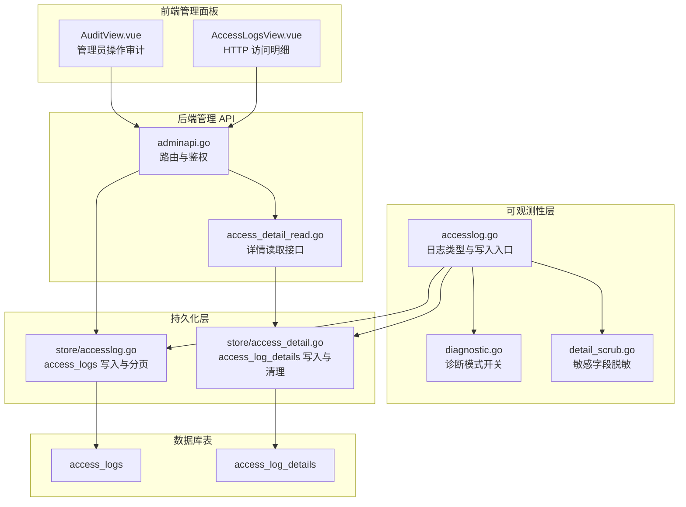
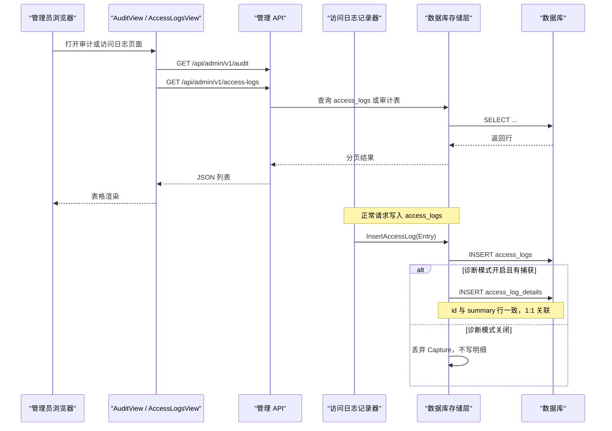
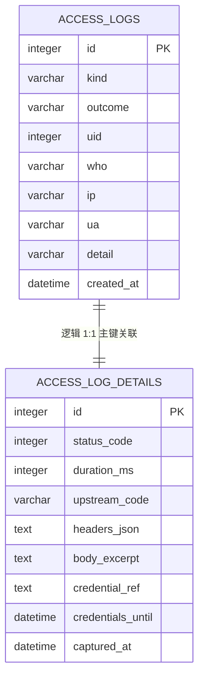
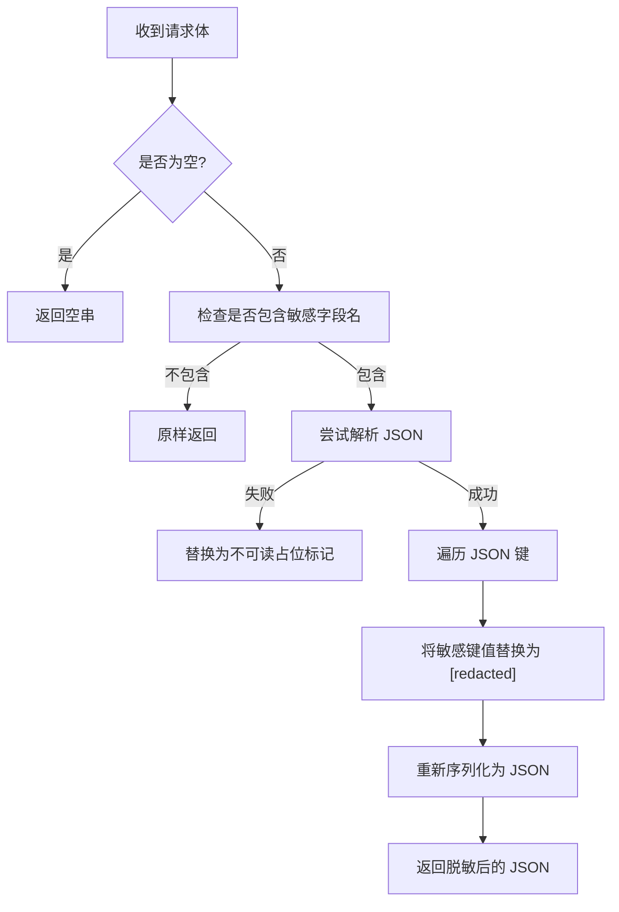
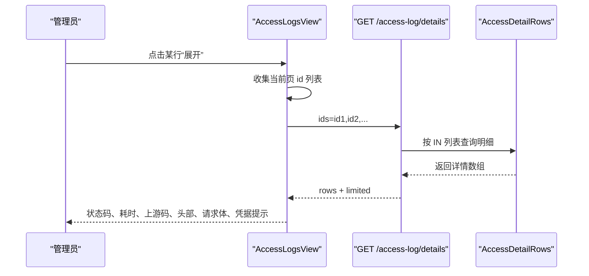

# 审计与访问日志

**本文引用的文件**
- [AuditView.vue](https://github.com/YimingZhanshen/skin-nexus/blob/797ae1a/web/src/components/admin/AuditView.vue)
- [AccessLogsView.vue](https://github.com/YimingZhanshen/skin-nexus/blob/797ae1a/web/src/components/admin/AccessLogsView.vue)
- [accesslog.go](https://github.com/YimingZhanshen/skin-nexus/blob/797ae1a/server/internal/accesslog/accesslog.go)
- [diagnostic.go](https://github.com/YimingZhanshen/skin-nexus/blob/797ae1a/server/internal/accesslog/diagnostic.go)
- [detail_scrub.go](https://github.com/YimingZhanshen/skin-nexus/blob/797ae1a/server/internal/accesslog/detail_scrub.go)
- [accesslog.go](https://github.com/YimingZhanshen/skin-nexus/blob/797ae1a/server/internal/store/accesslog.go)
- [access_detail.go](https://github.com/YimingZhanshen/skin-nexus/blob/797ae1a/server/internal/store/access_detail.go)
- [adminapi.go](https://github.com/YimingZhanshen/skin-nexus/blob/797ae1a/server/internal/adminapi/adminapi.go)
- [access_detail_read.go](https://github.com/YimingZhanshen/skin-nexus/blob/797ae1a/server/internal/adminapi/access_detail_read.go)
- [0011_access_logs.sql](https://github.com/YimingZhanshen/skin-nexus/blob/797ae1a/server/migrations/sqlite/0011_access_logs.sql)
- [0029_access_log_details.sql](https://github.com/YimingZhanshen/skin-nexus/blob/797ae1a/server/migrations/sqlite/0029_access_log_details.sql)

## 目录

1. [引言](#引言)
2. [项目结构定位](#项目结构定位)
3. [核心视图职责](#核心视图职责)
4. [系统架构总览](#系统架构总览)
5. [后端存储结构与关系](#后端存储结构与关系)
6. [脱敏、保留与清理策略](#脱敏保留与清理策略)
7. [查询能力与界面行为](#查询能力与界面行为)
8. [典型运维分析场景](#典型运维分析场景)
9. [隐私与安全注意事项](#隐私与安全注意事项)
10. [故障排查建议](#故障排查建议)
11. [结论](#结论)

## 引言

本文件面向管理员与运维人员，说明审计日志与访问日志在管理面板中的用途、后端存储结构、数据脱敏规则、保留策略、查询方式以及常见分析场景。

- **审计日志**：记录管理面板中“谁做了什么”，用于追踪管理员操作轨迹。
- **访问日志**：记录 Web 登录、注册、验证门禁、Yggdrasil 认证流量、Union 同步等请求的摘要；在诊断模式下还可展开单次请求的状态码、耗时、用户代理、请求头片段和请求体片段。

两者都服务于同一目标：**让运维能在不直接翻服务器进程日志的情况下，快速定位登录异常、上传失败、Union 同步问题和恶意扫描**。

## 项目结构定位

与审计和访问日志相关的代码分布在前端 Vue 组件、后端可观测性包、数据库存储层、管理 API 路由及迁移脚本中：

**图表来源**
- [auditview.vue:1-154](https://github.com/YimingZhanshen/skin-nexus/blob/797ae1a/web/src/components/admin/AuditView.vue#L1-L154)
- [accesslogsview.vue:1-353](https://github.com/YimingZhanshen/skin-nexus/blob/797ae1a/web/src/components/admin/AccessLogsView.vue#L1-L353)
- [adminapi.go:100-140](https://github.com/YimingZhanshen/skin-nexus/blob/797ae1a/server/internal/adminapi/adminapi.go#L100-L140)
- [accesslog.go:1-134](https://github.com/YimingZhanshen/skin-nexus/blob/797ae1a/server/internal/accesslog/accesslog.go#L1-L134)
- [diagnostic.go:1-140](https://github.com/YimingZhanshen/skin-nexus/blob/797ae1a/server/internal/accesslog/diagnostic.go#L1-L140)
- [detail_scrub.go:1-125](https://github.com/YimingZhanshen/skin-nexus/blob/797ae1a/server/internal/accesslog/detail_scrub.go#L1-L125)
- [accesslog.go:1-131](https://github.com/YimingZhanshen/skin-nexus/blob/797ae1a/server/internal/store/accesslog.go#L1-L131)
- [access_detail.go:1-200](https://github.com/YimingZhanshen/skin-nexus/blob/797ae1a/server/internal/store/access_detail.go#L1-L200)

**章节来源**
- [auditview.vue:1-154](https://github.com/YimingZhanshen/skin-nexus/blob/797ae1a/web/src/components/admin/AuditView.vue#L1-L154)
- [accesslogsview.vue:1-353](https://github.com/YimingZhanshen/skin-nexus/blob/797ae1a/web/src/components/admin/AccessLogsView.vue#L1-L353)
- [adminapi.go:100-140](https://github.com/YimingZhanshen/skin-nexus/blob/797ae1a/server/internal/adminapi/adminapi.go#L100-L140)

## 核心视图职责

### 审计视图：`AuditView.vue`

`AuditView.vue` 是**管理员操作审计**页面，用于回答“某个管理员或系统账号在什么时候执行了什么操作”。

它主要展示以下列：

| 列 | 含义 |
|---|---|
| 时间 | 审计记录的创建时间，按数据库墙钟显示 |
| 操作者 | 账号 UID，或系统标识 |
| 动作 | 机器可读的动作名称，并尝试映射为本地化标签 |
| 详情 | 写入器附带的 JSON 详情字符串 |

交互特性包括：

- 支持按关键词搜索。
- 支持按动作类型过滤。
- 支持分页加载，默认每页 100 条。
- 搜索输入会防抖，避免对不断增长的审计表产生频繁 LIKE 查询。
- 旧版本构建写入的动作名如果没有本地化标签，则原样显示原始值。
- 无账号的操作者（UID 为 0）显示为系统操作者，而不是误标成某个具体人。

该页面调用 `/api/admin/v1/audit`，属于管理面板审计接口的一部分。

**章节来源**
- [auditview.vue:1-154](https://github.com/YimingZhanshen/skin-nexus/blob/797ae1a/web/src/components/admin/AuditView.vue#L1-L154)

### 访问日志视图：`AccessLogsView.vue`

`AccessLogsView.vue` 是**HTTP 访问明细**页面，面向运维观察当前正在发生什么，而不是仅看一次错误堆栈。

它主要展示以下信息：

| 字段 | 含义 |
|---|---|
| 时间 | 请求记录创建时间 |
| 类型 | 如 Web 登录、Ygg 认证、Union 入站/出站、插件等 |
| 结果 | ok、miss、denied、fail、error |
| 主体 | 用户名、昵称、UUID 或目标路径 |
| IP | 客户端地址 |
| UA | 用户代理 |
| 详情 | 写入时附加的原因、状态、延迟等摘要 |
| 访问详情 | 诊断模式下展开的单次请求详情 |

关键交互特性：

- 支持按日志类型过滤，包括 `web_login`、`web_register`、`web_verify_gate`、`ygg_authenticate`、`ygg_refresh`、`ygg_validate`、`ygg_join`、`ygg_hasjoined`、`ygg_profile`、`union_in`、`union_out`、`plugin`。
- 支持全文检索，匹配主体、IP、详情三列。
- 默认每页 50 条，按时间倒序。
- 首次展开某行时才批量拉取该行所属的详情。
- 切换页面或筛选条件时清空已缓存详情，避免新旧数据错位。
- 诊断模式由超级管理员控制，可查看状态码、耗时、上游状态码、白名单请求头和请求体片段。

**章节来源**
- [accesslogsview.vue:1-200](https://github.com/YimingZhanshen/skin-nexus/blob/797ae1a/web/src/components/admin/AccessLogsView.vue#L1-L200)
- [accesslogsview.vue:201-353](https://github.com/YimingZhanshen/skin-nexus/blob/797ae1a/web/src/components/admin/AccessLogsView.vue#L201-L353)

## 系统架构总览

审计与访问日志的整体流程分为两条线：

1. **审计日志**：管理面板操作写入审计表，前端通过审计接口分页列出。
2. **访问日志**：业务请求经过可观测性日志器，写入 `access_logs`；若开启诊断模式，还会写入 `access_log_details`，前端按需展开。

**图表来源**
- [auditview.vue:1-154](https://github.com/YimingZhanshen/skin-nexus/blob/797ae1a/web/src/components/admin/AuditView.vue#L1-L154)
- [accesslogsview.vue:1-200](https://github.com/YimingZhanshen/skin-nexus/blob/797ae1a/web/src/components/admin/AccessLogsView.vue#L1-L200)
- [accesslog.go:1-134](https://github.com/YimingZhanshen/skin-nexus/blob/797ae1a/server/internal/accesslog/accesslog.go#L1-L134)
- [accesslog.go:1-131](https://github.com/YimingZhanshen/skin-nexus/blob/797ae1a/server/internal/store/accesslog.go#L1-L131)
- [access_detail.go:1-200](https://github.com/YimingZhanshen/skin-nexus/blob/797ae1a/server/internal/store/access_detail.go#L1-L200)

**章节来源**
- [adminapi.go:100-140](https://github.com/YimingZhanshen/skin-nexus/blob/797ae1a/server/internal/adminapi/adminapi.go#L100-L140)
- [accesslog.go:1-134](https://github.com/YimingZhanshen/skin-nexus/blob/797ae1a/server/internal/accesslog/accesslog.go#L1-L134)

## 后端存储结构与关系

### `access_logs`：访问日志摘要表

`access_logs` 保存每次请求的一条轻量摘要行，关键字段如下：

| 字段 | 类型 | 含义 |
|---|---|---|
| `id` | 主键 | 自增 ID |
| `kind` | VARCHAR(24) | 日志类型 |
| `outcome` | VARCHAR(16) | 结果类别 |
| `uid` | INTEGER NULL | 账号 UID，无账号时为 NULL |
| `who` | VARCHAR(64) | 用户名、昵称、UUID 或目标路径 |
| `ip` | VARCHAR(45) | 客户端 IP |
| `ua` | VARCHAR(255) | 用户代理 |
| `detail` | VARCHAR(255) | 写入器附加的短摘要 |
| `created_at` | DATETIME | 创建时间 |

索引包括按 `kind + created_at`、`who`、`uid`、`created_at` 的组合索引，便于按类型和时间范围查询。

### `access_log_details`：诊断明细表

`access_log_details` 只在诊断模式开启时写入，保存单次请求的诊断细节：

| 字段 | 类型 | 含义 |
|---|---|---|
| `id` | 主键 | 与 `access_logs.id` 相同的值，形成 1:1 关系 |
| `status_code` | INTEGER | 响应状态码 |
| `duration_ms` | INTEGER | 请求耗时毫秒 |
| `upstream_code` | VARCHAR(64) | 上游状态码 |
| `headers_json` | TEXT | 白名单请求头 JSON |
| `body_excerpt` | TEXT | 请求体片段 |
| `credential_ref` | TEXT | 凭据引用，过期后被清空 |
| `credentials_until` | DATETIME | 凭据过期时间 |
| `captured_at` | DATETIME | 明细捕获时间 |

两表的关系不是传统外键约束，而是**逻辑 1:1 关联**：明细表的 `id` 就是摘要表的 `id`。这样设计的原因是明细写入发生在摘要插入内部，且明细失败不能影响摘要行。

**图表来源**
- [0011_access_logs.sql:1-16](https://github.com/YimingZhanshen/skin-nexus/blob/797ae1a/server/migrations/sqlite/0011_access_logs.sql#L1-L16)
- [0029_access_log_details.sql:1-20](https://github.com/YimingZhanshen/skin-nexus/blob/797ae1a/server/migrations/sqlite/0029_access_log_details.sql#L1-L20)
- [accesslog.go:1-131](https://github.com/YimingZhanshen/skin-nexus/blob/797ae1a/server/internal/store/accesslog.go#L1-L131)
- [access_detail.go:1-200](https://github.com/YimingZhanshen/skin-nexus/blob/797ae1a/server/internal/store/access_detail.go#L1-L200)

**章节来源**
- [0011_access_logs.sql:1-16](https://github.com/YimingZhanshen/skin-nexus/blob/797ae1a/server/migrations/sqlite/0011_access_logs.sql#L1-L16)
- [0029_access_log_details.sql:1-20](https://github.com/YimingZhanshen/skin-nexus/blob/797ae1a/server/migrations/sqlite/0029_access_log_details.sql#L1-L20)
- [accesslog.go:1-131](https://github.com/YimingZhanshen/skin-nexus/blob/797ae1a/server/internal/store/accesslog.go#L1-L131)
- [access_detail.go:1-200](https://github.com/YimingZhanshen/skin-nexus/blob/797ae1a/server/internal/store/access_detail.go#L1-L200)

## 脱敏、保留与清理策略

### 字段截断

写入摘要前，日志器会对可能过长的字段做字节级截断，防止超出数据库列长度：

| 字段 | 上限 |
|---|---|
| `who` | 64 字节 |
| `ip` | 45 字节 |
| `ua` | 255 字节 |
| `detail` | 255 字节 |

截断过程保证 UTF-8 编码不会在边界处被切断，从而避免 MySQL utf8mb4 strict mode 报错。

### 请求体脱敏

诊断模式下，如果请求体包含敏感字段名，系统会执行结构化脱敏：

- 敏感字段名包括密码类、令牌类、授权类、OAuth 相关字段等，例如 `password`、`accessToken`、`refreshToken`、`token`、`authorization`、`client_secret`、`code` 等。
- 如果请求体能解析为 JSON，则只替换匹配键的值，保持数据结构方便调试。
- 如果请求体无法解析但命中敏感字段名，整个请求体会被替换为占位标记，而不是把明文带出来。
- 脱敏结果是幂等的：重复处理不会继续改变已经脱敏的输出。

**图表来源**
- [detail_scrub.go:1-125](https://github.com/YimingZhanshen/skin-nexus/blob/797ae1a/server/internal/accesslog/detail_scrub.go#L1-L125)

### 诊断模式开关

诊断模式由一个未来时间的 RFC3339 配置项控制：

- 当配置值仍大于当前 Go 侧 UTC 时间时，诊断模式开启。
- 诊断模式开启后，才会写入 `access_log_details`。
- 诊断模式关闭后，现有明细行不会被立即删除，但不会再写入新明细。
- 默认保留期为 90 天，可通过设置项调整，但有最大上限，防止负数窗口导致误删。

### 保留策略

系统存在两套清理逻辑：

| 对象 | 保留依据 | 说明 |
|---|---|---|
| `access_logs` | 固定保留期（默认 90 天） | 清理早于阈值的摘要行 |
| `access_log_details.captured_at` | 诊断保留窗口（默认 90 天） | 清理较早捕获的明细行 |
| `access_log_details.credentials_until` | 固定 24 小时 | 凭据到期后立即清除，不受 90 天保留期影响 |

这意味着：**日志可以保留较长时间，但真实凭据不能长期留存**。即使管理员把明细保留期设为 90 天，凭据也必须在捕获后约 24 小时内被清理。

**章节来源**
- [accesslog.go:60-134](https://github.com/YimingZhanshen/skin-nexus/blob/797ae1a/server/internal/accesslog/accesslog.go#L60-L134)
- [detail_scrub.go:1-125](https://github.com/YimingZhanshen/skin-nexus/blob/797ae1a/server/internal/accesslog/detail_scrub.go#L1-L125)
- [diagnostic.go:1-140](https://github.com/YimingZhanshen/skin-nexus/blob/797ae1a/server/internal/accesslog/diagnostic.go#L1-L140)
- [accesslog.go:90-131](https://github.com/YimingZhanshen/skin-nexus/blob/797ae1a/server/internal/store/accesslog.go#L90-L131)
- [access_detail.go:1-200](https://github.com/YimingZhanshen/skin-nexus/blob/797ae1a/server/internal/store/access_detail.go#L1-L200)

## 查询能力与界面行为

### 审计日志查询

审计接口支持：

- 关键词搜索：匹配审计内容。
- 动作类型过滤：从后端返回的动作集合中选择。
- 分页：默认每页 100 条。
- 时间格式化：直接显示数据库时间字符串，不做浏览器时区转换，避免部署机与浏览器时区不一致导致行偏移。

注意：审计日志的前端实现没有提供按时间范围、IP、状态码的过滤器；这些过滤应通过后端审计接口扩展完成。

### 访问日志查询

访问日志接口支持：

| 过滤维度 | 前端参数 | 后端语义 |
|---|---|---|
| 日志类型 | `kind` | 精确匹配，空表示全部 |
| 文本检索 | `q` | 对 `who`、`ip`、`detail` 做大小写不敏感子串匹配 |
| 分页 | `page` | 最新记录优先，默认每页 50 条，上限 200 条 |
| 排序 | 固定 | 按主键倒序，等价于最近写入优先 |

目前前端未提供按时间范围、用户 UID、路径、状态码、IP 的高级过滤表单，但后端 `ListAccessLogs` 允许传入 `kind`、`q`、`page`、`size`。更精细的过滤可以通过新增查询参数在后端扩展。

### 详情展开与 JSON 折叠

访问日志的详情展开遵循以下规则：

- 点击“展开”后，前端收集当前页所有行的 `id`，一次性调用 `/api/admin/v1/access-log/details?ids=...`。
- 后端限制单次最多处理 200 个 ID，超出部分会返回 `limited=true`，前端提示只显示了部分。
- 每个详情的请求头以 JSON 形式返回，前端只渲染白名单头部；如果格式异常则降级为空列表。
- 详情中的请求体片段以等宽字体展示，便于阅读。
- 如果某行没有明细记录，前端显示“不存在明细”，而不是空白单元格。
- 如果凭证已存在，前端显示警告提示，但不会输出凭证值。

**图表来源**
- [accesslogsview.vue:1-200](https://github.com/YimingZhanshen/skin-nexus/blob/797ae1a/web/src/components/admin/AccessLogsView.vue#L1-L200)
- [access_detail_read.go:1-92](https://github.com/YimingZhanshen/skin-nexus/blob/797ae1a/server/internal/adminapi/access_detail_read.go#L1-L92)
- [access_detail.go:150-200](https://github.com/YimingZhanshen/skin-nexus/blob/797ae1a/server/internal/store/access_detail.go#L150-L200)

**章节来源**
- [accesslog.go:60-131](https://github.com/YimingZhanshen/skin-nexus/blob/797ae1a/server/internal/store/accesslog.go#L60-L131)
- [access_detail_read.go:1-92](https://github.com/YimingZhanshen/skin-nexus/blob/797ae1a/server/internal/adminapi/access_detail_read.go#L1-L92)
- [accesslogsview.vue:1-353](https://github.com/YimingZhanshen/skin-nexus/blob/797ae1a/web/src/components/admin/AccessLogsView.vue#L1-L353)

## 典型运维分析场景

### 场景一：排查某用户多次登录失败

1. 打开“访问日志”页面。
2. 在“类型”中选择 `web_login`。
3. 在搜索框中输入用户名、UID 或 IP。
4. 查看结果列中的“结果”字段：
   - `fail`：通常表示业务拒绝，例如密码错误、会话无效。
   - `denied`：通常表示守卫拒绝，例如频率限制、锁定、模块禁用。
   - `ok`：登录成功。
   - `miss`：未知会话或资料。
   - `error`：内部错误，需要进一步查服务日志。
5. 如需确认请求携带了什么，开启诊断模式后展开对应行，查看状态码、耗时、请求体和凭据提示。

这个流程适合定位：

- 单个用户连续输错密码。
- 某个 IP 持续尝试登录。
- 登录成功但后续功能失败。

**章节来源**
- [accesslogsview.vue:1-200](https://github.com/YimingZhanshen/skin-nexus/blob/797ae1a/web/src/components/admin/AccessLogsView.vue#L1-L200)
- [accesslog.go:20-60](https://github.com/YimingZhanshen/skin-nexus/blob/797ae1a/server/internal/accesslog/accesslog.go#L20-L60)

### 场景二：查找慢查询接口

1. 打开“访问日志”。
2. 选择对应类型，如 `ygg_authenticate`、`ygg_validate`、`union_out`。
3. 按时间顺序查看最近请求。
4. 展开有明细的行，查看 `duration_ms`。
5. 如果耗时异常高，结合 `status_code`、`upstream_code`、`body_excerpt` 判断：
   - 上游超时。
   - 上游返回错误。
   - 请求体过大。
   - 网络或第三方服务异常。

**章节来源**
- [accesslogsview.vue:201-353](https://github.com/YimingZhanshen/skin-nexus/blob/797ae1a/web/src/components/admin/AccessLogsView.vue#L201-L353)
- [access_detail.go:100-200](https://github.com/YimingZhanshen/skin-nexus/blob/797ae1a/server/internal/store/access_detail.go#L100-L200)

### 场景三：排查 Union 同步问题

Union 相关日志类型包括：

- `union_in`：Union 入站事件。
- `union_out`：向 Union 发起出站请求。

运维可分别过滤这两种类型，观察：

- 是否大量 `denied` 或 `fail`。
- 是否有 `error`。
- 明细中的上游状态码是否与预期一致。
- 请求体是否包含需要同步的成员信息或密钥轮换上下文。

**章节来源**
- [accesslog.go:20-60](https://github.com/YimingZhanshen/skin-nexus/blob/797ae1a/server/internal/accesslog/accesslog.go#L20-L60)
- [accesslogsview.vue:1-200](https://github.com/YimingZhanshen/skin-nexus/blob/797ae1a/web/src/components/admin/AccessLogsView.vue#L1-L200)

### 场景四：发现恶意扫描

恶意扫描通常表现为：

- 单一 IP 高频访问多个路径。
- 大量 `deny`、`fail` 或 `error`。
- 请求体中包含探测 payload。
- 用户代理异常或频繁变化。

可在访问日志中按 IP 搜索，并结合“结果”和“详情”快速识别异常流量。

**章节来源**
- [accesslog.go:20-60](https://github.com/YimingZhanshen/skin-nexus/blob/797ae1a/server/internal/accesslog/accesslog.go#L20-L60)
- [accesslogsview.vue:1-353](https://github.com/YimingZhanshen/skin-nexus/blob/797ae1a/web/src/components/admin/AccessLogsView.vue#L1-L353)

## 隐私与安全注意事项

### 敏感请求体必须脱敏

诊断模式会捕获请求体片段，因此必须确保：

- 密码、令牌、授权头、刷新令牌、OAuth code 等敏感字段始终被替换为 `[redacted]`。
- 非 JSON 请求体若包含敏感字段名，不应暴露明文。
- 明细导出权限不能等同于凭据导出权限。

### 日志导出需严格权限控制

当前设计中：

- 访问日志摘要接口对所有管理员开放。
- 诊断模式读取接口也对管理员开放，但不会返回凭据值，只返回是否存在凭据的标志。
- 真正的凭据只存在于 `access_log_details.credential_ref`，并且会在 24 小时后自动清空。
- 因此，“能看日志”不等于“能长期持有可用令牌”。

### 磁盘占用监控

由于访问日志可能持续增长，运维应关注：

- `access_logs` 表的增长速度。
- `access_log_details` 表是否因诊断模式长期开启而膨胀。
- 保留策略是否正确生效。
- 清理任务是否正常运行。
- 是否需要缩小分页大小或缩短诊断窗口。

### 时间与时区安全

系统在前端渲染时间时，刻意避免使用浏览器 `Date()` 解释带 Z 的时间戳，因为驱动会把时间标记为 UTC，但前端运行环境可能是其他时区。统一按数据库墙钟数字显示，可降低跨时区部署造成的时间错位风险。

**章节来源**
- [detail_scrub.go:1-125](https://github.com/YimingZhanshen/skin-nexus/blob/797ae1a/server/internal/accesslog/detail_scrub.go#L1-L125)
- [access_detail_read.go:1-92](https://github.com/YimingZhanshen/skin-nexus/blob/797ae1a/server/internal/adminapi/access_detail_read.go#L1-L92)
- [access_detail.go:1-200](https://github.com/YimingZhanshen/skin-nexus/blob/797ae1a/server/internal/store/access_detail.go#L1-L200)
- [accesslogsview.vue:150-200](https://github.com/YimingZhanshen/skin-nexus/blob/797ae1a/web/src/components/admin/AccessLogsView.vue#L150-L200)
- [auditview.vue:100-154](https://github.com/YimingZhanshen/skin-nexus/blob/797ae1a/web/src/components/admin/AuditView.vue#L100-L154)

## 故障排查建议

### 现象：详情页一直加载中

可能原因：

- 诊断模式未开启，因此没有明细行。
- 当前页没有有效 ID。
- 后端返回的明细数量被限制到 200。
- 明细是懒加载的：只有展开某一行时才会发详情请求（`AccessLogsView.vue` 的 `toggleDetail` 首次展开即拉取），没点开的行本来就没有请求在途。

处理建议：

- 先确认诊断模式处于开启状态。
- 查看前端是否提示“仅显示前 N 条”。
- 确认展开按钮确实触发了详情请求。

**章节来源**
- [accesslogsview.vue:1-200](https://github.com/YimingZhanshen/skin-nexus/blob/797ae1a/web/src/components/admin/AccessLogsView.vue#L1-L200)
- [access_detail_read.go:1-92](https://github.com/YimingZhanshen/skin-nexus/blob/797ae1a/server/internal/adminapi/access_detail_read.go#L1-L92)

### 现象：展开详情后显示“不存在明细”

可能原因：

- 该请求发生时诊断模式关闭。
- 该请求没有附带可捕获的明细。
- 明细已被保留策略清理。
- 明细写入失败，但摘要行已成功写入。

处理建议：

- 临时开启诊断模式复现问题。
- 检查捕获时间与保留窗口。
- 确认写入明细时的主键冲突是否被正确处理。

**章节来源**
- [accesslog.go:80-134](https://github.com/YimingZhanshen/skin-nexus/blob/797ae1a/server/internal/accesslog/accesslog.go#L80-L134)
- [access_detail.go:1-200](https://github.com/YimingZhanshen/skin-nexus/blob/797ae1a/server/internal/store/access_detail.go#L1-L200)

### 现象：审计日志搜索缓慢

可能原因：

- 审计表持续增长。
- 每次按键都触发全表 LIKE。
- 后端审计接口未优化时间范围过滤。

处理建议：

- 尽量使用动作类型过滤缩小范围。
- 避免对长尾关键词实时搜索。
- 必要时在后端增加时间范围、动作枚举和索引优化。

**章节来源**
- [auditview.vue:1-100](https://github.com/YimingZhanshen/skin-nexus/blob/797ae1a/web/src/components/admin/AuditView.vue#L1-L100)

## 结论

审计日志与访问日志共同构成了管理面板的可观测面：

- **审计日志**回答“管理员做了什么”，适合合规与责任追溯。
- **访问日志**回答“系统刚才发生了什么”，适合登录异常、上传失败、Union 同步、慢接口和恶意扫描的快速定位。
- 摘要表 `access_logs` 适合日常浏览；明细表 `access_log_details` 适合诊断模式下的深度分析。
- 脱敏规则、凭据 24 小时清理和固定保留策略共同构成隐私保护基线。
- 运维应避免让“能读日志”变成“能长期持有凭据”，并持续监控磁盘增长与清理任务健康度。
