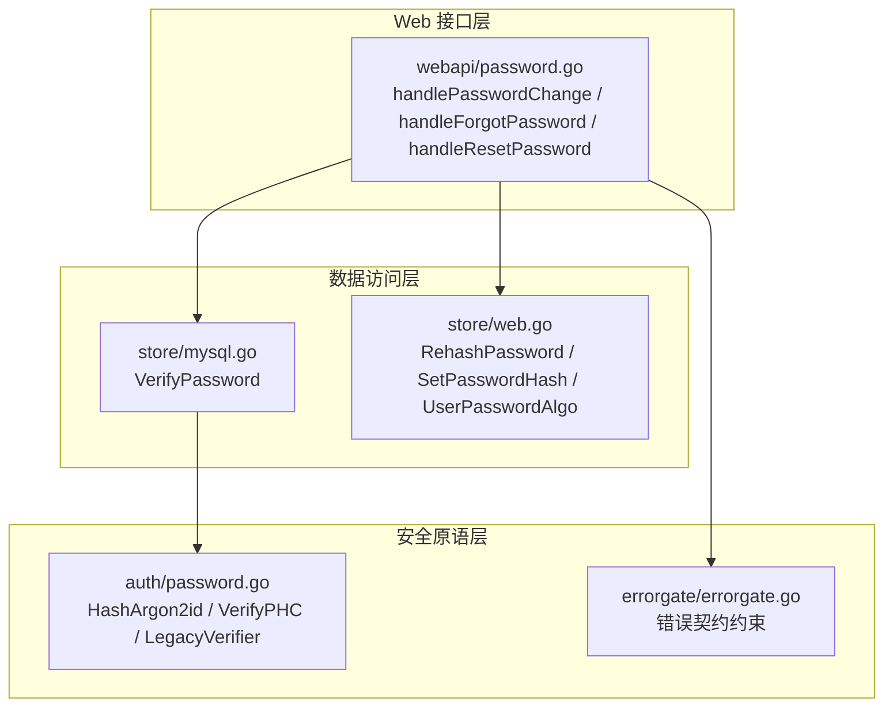
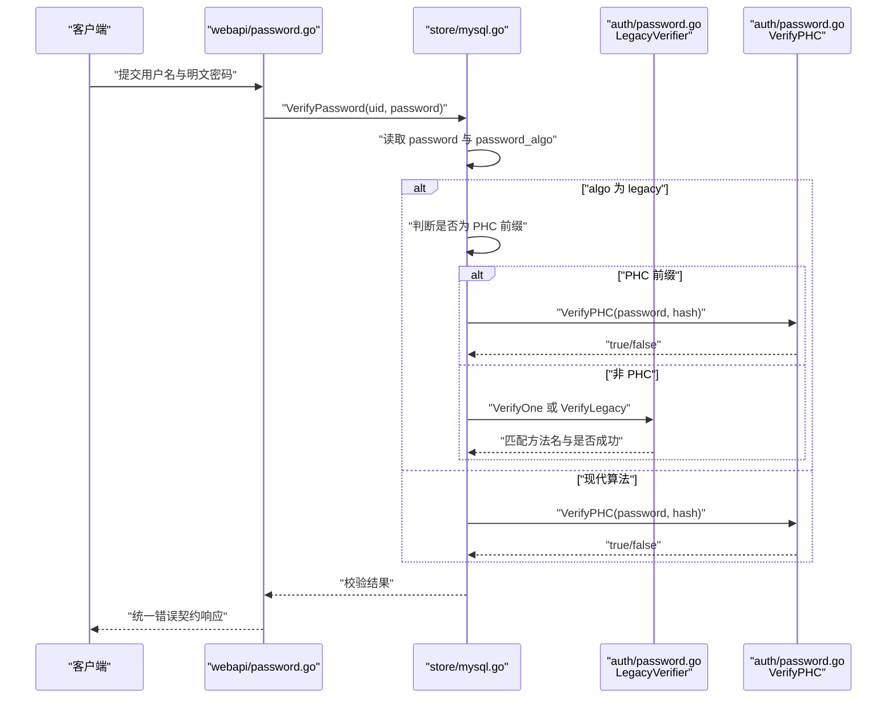
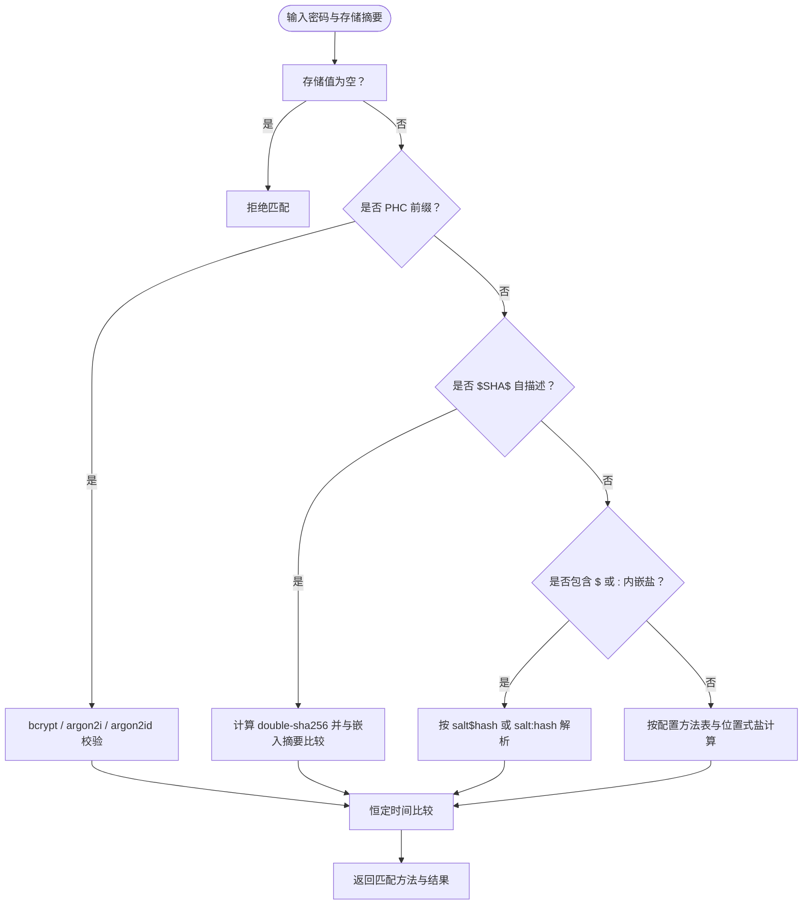
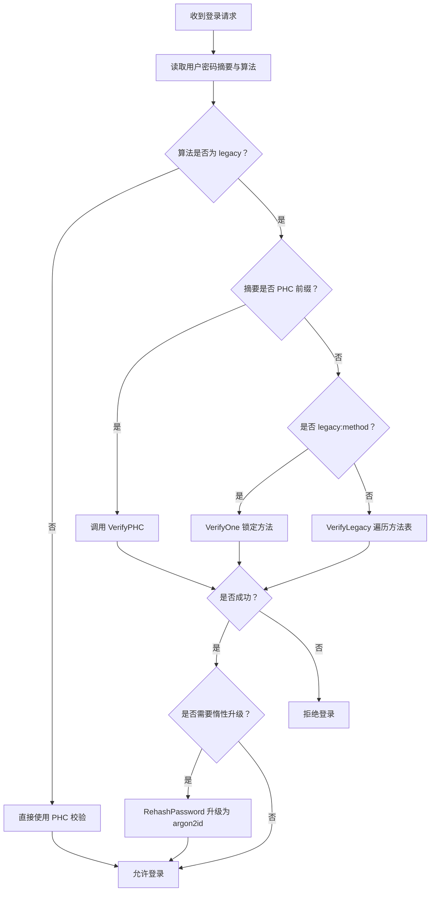
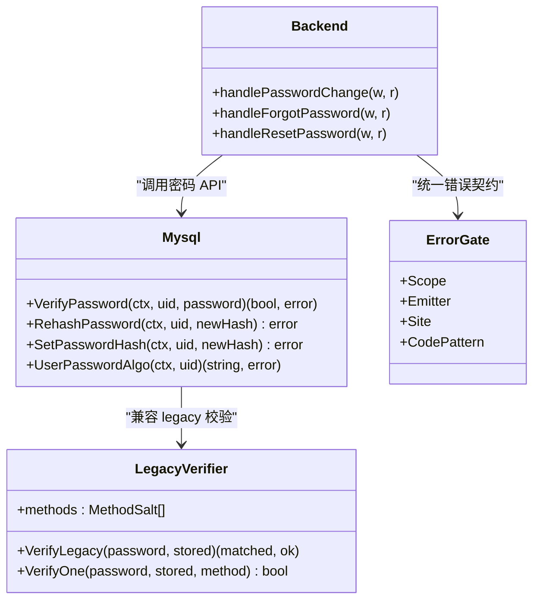

# 密码与认证模块

**本文引用的文件**
- [server/internal/auth/password.go](https://github.com/YimingZhanshen/skin-nexus/blob/797ae1a/server/internal/auth/password.go)
- [server/internal/auth/password_test.go](https://github.com/YimingZhanshen/skin-nexus/blob/797ae1a/server/internal/auth/password_test.go)
- [server/internal/auth/empty_stored_test.go](https://github.com/YimingZhanshen/skin-nexus/blob/797ae1a/server/internal/auth/empty_stored_test.go)
- [server/internal/auth/legacy_scheme_vectors_test.go](https://github.com/YimingZhanshen/skin-nexus/blob/797ae1a/server/internal/auth/legacy_scheme_vectors_test.go)
- [server/internal/store/mysql.go](https://github.com/YimingZhanshen/skin-nexus/blob/797ae1a/server/internal/store/mysql.go)
- [server/internal/store/web.go](https://github.com/YimingZhanshen/skin-nexus/blob/797ae1a/server/internal/store/web.go)
- [server/internal/webapi/password.go](https://github.com/YimingZhanshen/skin-nexus/blob/797ae1a/server/internal/webapi/password.go)
- [server/internal/errorgate/errorgate.go](https://github.com/YimingZhanshen/skin-nexus/blob/797ae1a/server/internal/errorgate/errorgate.go)

## 目录
1. [引言](#引言)
2. [项目结构](#项目结构)
3. [核心组件](#核心组件)
4. [架构总览](#架构总览)
5. [详细组件分析](#详细组件分析)
6. [依赖关系分析](#依赖关系分析)
7. [性能与安全考量](#性能与安全考量)
8. [故障排查指南](#故障排查指南)
9. [结论](#结论)

## 引言
本模块负责用户密码的哈希、校验、旧格式兼容与懒迁移，以及围绕密码变更与找回的 Web API。核心原则是：
- 新密码使用 Argon2id PHC 字符串存储。
- 旧系统（Blessing Skin / AuthMe）遗留哈希通过 `LegacyVerifier` 按位对齐方法表进行兼容验证。
- 成功登录或重置后，可触发惰性升级，把旧算法替换为 Argon2id。
- 错误必须通过统一 errorgate 契约返回，不得暴露原始密码。
- 空存储值在 legacy 分支中不是“无密码”，而是“匹配失败”；测试已明确覆盖该边界。

## 项目结构
与密码和认证直接相关的代码分布在三层：
- 安全原语层：`server/internal/auth/password.go` 提供哈希、PHC 校验、legacy 兼容与重哈希策略。
- 数据访问层：`server/internal/store/mysql.go`、`server/internal/store/web.go` 封装凭据读取、密码校验、哈希写入与惰性迁移。
- Web 接口层：`server/internal/webapi/password.go` 实现修改密码、找回密码、重置密码等 HTTP 流程。

**图表来源**
- [server/internal/webapi/password.go:30-120](https://github.com/YimingZhanshen/skin-nexus/blob/797ae1a/server/internal/webapi/password.go#L30-L120)
- [server/internal/store/mysql.go:120-140](https://github.com/YimingZhanshen/skin-nexus/blob/797ae1a/server/internal/store/mysql.go#L120-L140)
- [server/internal/store/web.go:125-153](https://github.com/YimingZhanshen/skin-nexus/blob/797ae1a/server/internal/store/web.go#L125-L153)
- [server/internal/auth/password.go:201-280](https://github.com/YimingZhanshen/skin-nexus/blob/797ae1a/server/internal/auth/password.go#L201-L280)
- [server/internal/errorgate/errorgate.go:1-80](https://github.com/YimingZhanshen/skin-nexus/blob/797ae1a/server/internal/errorgate/errorgate.go#L1-L80)

**章节来源**
- [server/internal/webapi/password.go:30-120](https://github.com/YimingZhanshen/skin-nexus/blob/797ae1a/server/internal/webapi/password.go#L30-L120)
- [server/internal/store/mysql.go:120-140](https://github.com/YimingZhanshen/skin-nexus/blob/797ae1a/server/internal/store/mysql.go#L120-L140)
- [server/internal/store/web.go:125-153](https://github.com/YimingZhanshen/skin-nexus/blob/797ae1a/server/internal/store/web.go#L125-L153)
- [server/internal/auth/password.go:1-80](https://github.com/YimingZhanshen/skin-nexus/blob/797ae1a/server/internal/auth/password.go#L1-L80)

## 核心组件
### 哈希与校验
- `HashArgon2id`：生成 PHP 兼容的 `$argon2id$` PHC 字符串，包含随机 salt、内存参数、时间成本与线程数。
- `VerifyPHC`：支持 bcrypt `$2y$` / `$2a$`、argon2i、argon2id，并把 PHP 前缀归一化后再比较。
- `NeedsRehash`：除 bcrypt、argon2i、PHP 默认算法外，其余 legacy 方法都标记为需要惰性升级。

**章节来源**
- [server/internal/auth/password.go:180-200](https://github.com/YimingZhanshen/skin-nexus/blob/797ae1a/server/internal/auth/password.go#L180-L200)
- [server/internal/auth/password.go:201-280](https://github.com/YimingZhanshen/skin-nexus/blob/797ae1a/server/internal/auth/password.go#L201-L280)
- [server/internal/auth/password_test.go:87-142](https://github.com/YimingZhanshen/skin-nexus/blob/797ae1a/server/internal/auth/password_test.go#L87-L142)

### Legacy 兼容验证器
`LegacyVerifier` 维护一组 `(Method, Salt)` 对，按顺序尝试：
1. PHC 前缀优先：以 `$2` 或 `$argon2` 开头的存储值走 PHC 分支。
2. AuthMe SHA256：识别 `$SHA$<salt>$<hash>` 自描述格式。
3. 内嵌盐格式：识别 `salt$hash` 或 `salt:hash`。
4. 位置式盐：按配置的方法表逐位取 salt 计算摘要。
5. 空存储值：显式拒绝，避免未知 method 回退到空串相等。

关键行为：
- 比较使用恒定时间比较，防止时序侧信道。
- 大小写敏感：legacy 摘要必须是小写十六进制。
- 未来新增但未实现的 method 不会导致空串放行。

**章节来源**
- [server/internal/auth/password.go:81-179](https://github.com/YimingZhanshen/skin-nexus/blob/797ae1a/server/internal/auth/password.go#L81-L179)
- [server/internal/auth/empty_stored_test.go:1-38](https://github.com/YimingZhanshen/skin-nexus/blob/797ae1a/server/internal/auth/empty_stored_test.go#L1-L38)

### 数据访问与惰性迁移
- `VerifyPassword`：读取用户的 password 与 password_algo；若为 legacy，则先尝试 PHC，再按 pinned 方法或全量方法表验证。
- `SetPasswordHash`：无条件写入新哈希并设置 `password_algo = 'argon2id'`，用于用户主动改密。
- `RehashPassword`：仅当旧行存在时才更新，用于惰性升级场景。
- `UserPasswordAlgo`：暴露算法标记，供上层决定是否需要懒迁移。

**章节来源**
- [server/internal/store/mysql.go:120-140](https://github.com/YimingZhanshen/skin-nexus/blob/797ae1a/server/internal/store/mysql.go#L120-L140)
- [server/internal/store/web.go:125-153](https://github.com/YimingZhanshen/skin-nexus/blob/797ae1a/server/internal/store/web.go#L125-L153)

### Web API 密码流程
- 修改密码：校验当前密码 → 检查新密码长度与差异 → 生成 Argon2id 哈希 → 无条件写入 → 撤销令牌与会话。
- 忘记密码：限流 → 校验邮箱 → 不存在也返回相同成功形状 → 生成 32 字节 token → 存储 SHA-256 digest → 异步发邮件。
- 重置密码：token 预检 → 消费一次性 token → 生成 Argon2id 哈希 → 无条件写入 → 撤销令牌与会话。

**章节来源**
- [server/internal/webapi/password.go:30-120](https://github.com/YimingZhanshen/skin-nexus/blob/797ae1a/server/internal/webapi/password.go#L30-L120)
- [server/internal/webapi/password.go:120-200](https://github.com/YimingZhanshen/skin-nexus/blob/797ae1a/server/internal/webapi/password.go#L120-L200)
- [server/internal/webapi/password.go:201-305](https://github.com/YimingZhanshen/skin-nexus/blob/797ae1a/server/internal/webapi/password.go#L201-L305)

## 架构总览
下图展示一次普通密码登录时，从 Web 请求到 legacy 兼容校验的数据流。

**图表来源**
- [server/internal/webapi/password.go:30-120](https://github.com/YimingZhanshen/skin-nexus/blob/797ae1a/server/internal/webapi/password.go#L30-L120)
- [server/internal/store/mysql.go:120-140](https://github.com/YimingZhanshen/skin-nexus/blob/797ae1a/server/internal/store/mysql.go#L120-L140)
- [server/internal/auth/password.go:81-179](https://github.com/YimingZhanshen/skin-nexus/blob/797ae1a/server/internal/auth/password.go#L81-L179)
- [server/internal/auth/password.go:201-280](https://github.com/YimingZhanshen/skin-nexus/blob/797ae1a/server/internal/auth/password.go#L201-L280)

## 详细组件分析

### 哈希算法与安全策略
- 新哈希：`HashArgon2id` 固定使用 argon2id，内存 64 KiB，时间成本 4，并行度 1，密钥长度 32 字节。
- PHC 兼容：bcrypt 支持 `$2y$` 与 `$2a$`；argon2 同时支持 i 与 id 变体；版本严格限定为当前 `argon2.Version`。
- 参数守卫：argon2 解析时对 memory、time、threads、输出长度做防御性检查，防止畸形 PHC 导致 panic。
- Legacy 算法：MD5、SHA256、SHA512、带盐双哈希、AuthMe 特定格式均保留，但仅用于兼容迁移，不应作为新哈希策略。

**图表来源**
- [server/internal/auth/password.go:81-179](https://github.com/YimingZhanshen/skin-nexus/blob/797ae1a/server/internal/auth/password.go#L81-L179)
- [server/internal/auth/password.go:201-280](https://github.com/YimingZhanshen/skin-nexus/blob/797ae1a/server/internal/auth/password.go#L201-L280)

**章节来源**
- [server/internal/auth/password.go:180-280](https://github.com/YimingZhanshen/skin-nexus/blob/797ae1a/server/internal/auth/password.go#L180-L280)
- [server/internal/auth/password_test.go:87-142](https://github.com/YimingZhanshen/skin-nexus/blob/797ae1a/server/internal/auth/password_test.go#L87-L142)

### 兼容性迁移逻辑
- 当 `password_algo` 以 `legacy` 开头时，`VerifyPassword` 进入 legacy 分支。
- 若存储摘要本身是 PHC 前缀，则直接走 `VerifyPHC`，不再依赖配置方法表。
- 若 `password_algo` 形如 `legacy:<method>`，则用 `VerifyOne` 锁定方法。
- 否则按配置的 `MethodSalt` 列表顺序逐一尝试，成功后可触发惰性升级。
- 惰性升级由 `RehashPassword` 完成，只更新 `password_algo LIKE 'legacy%'` 的行。
- 用户主动修改密码时使用 `SetPasswordHash`，无条件写入新哈希，避免历史 bug 导致的零行更新。

**图表来源**
- [server/internal/store/mysql.go:120-140](https://github.com/YimingZhanshen/skin-nexus/blob/797ae1a/server/internal/store/mysql.go#L120-L140)
- [server/internal/store/web.go:125-153](https://github.com/YimingZhanshen/skin-nexus/blob/797ae1a/server/internal/store/web.go#L125-L153)
- [server/internal/auth/password.go:81-179](https://github.com/YimingZhanshen/skin-nexus/blob/797ae1a/server/internal/auth/password.go#L81-L179)

**章节来源**
- [server/internal/store/mysql.go:120-140](https://github.com/YimingZhanshen/skin-nexus/blob/797ae1a/server/internal/store/mysql.go#L120-L140)
- [server/internal/store/web.go:125-153](https://github.com/YimingZhanshen/skin-nexus/blob/797ae1a/server/internal/store/web.go#L125-L153)
- [server/internal/auth/password.go:81-179](https://github.com/YimingZhanshen/skin-nexus/blob/797ae1a/server/internal/auth/password.go#L81-L179)

### 空存储值与旧格式向量测试
- 空存储值测试确保任何 legacy method 遇到空摘要都不会放行任意密码。
- 旧格式向量测试使用独立 Python hashlib 与 argon2 KAT 向量，保证公式与第三方实现一致。
- 位置式盐测试确保 method[i] 与 salt[i] 对齐，错位不能误验。
- 大小写敏感测试确保大写十六进制摘要不匹配，避免双重规范化漏洞。
- bcrypt 前缀适配测试确保 PHP 的 `$2y$` 能被 Go 的 `$2a$` 适配器接受。
- argon2i 参考向量测试确保外部 KAT 可直接验证。

**章节来源**
- [server/internal/auth/empty_stored_test.go:1-38](https://github.com/YimingZhanshen/skin-nexus/blob/797ae1a/server/internal/auth/empty_stored_test.go#L1-L38)
- [server/internal/auth/password_test.go:1-86](https://github.com/YimingZhanshen/skin-nexus/blob/797ae1a/server/internal/auth/password_test.go#L1-L86)
- [server/internal/auth/legacy_scheme_vectors_test.go:1-200](https://github.com/YimingZhanshen/skin-nexus/blob/797ae1a/server/internal/auth/legacy_scheme_vectors_test.go#L1-L200)

### Web 层调用示例与接口约定
服务层调用密码校验的标准路径是：
1. 从请求中提取用户身份与明文密码。
2. 调用 `Store.VerifyPassword(ctx, uid, password)`。
3. 若返回错误或未成功，使用 `writeErrCode` 或统一错误构造函数返回 401。
4. 若成功且用户仍为 legacy 算法，可调用 `RehashPassword` 执行惰性升级。
5. 所有错误必须携带稳定 code，不得输出原始密码。

新增第三方认证方式时应遵循：
- 不在 Web 层直接比较明文密码。
- 将第三方凭据转换为用户 ID 后，复用 session/OIDC/yggdrasil 令牌体系。
- 如需存储第三方凭据，使用独立的 provider 字段，不要混入 `password` 列。
- 错误码遵循 `<area>.<reason>` 小写点分命名，例如 `auth.provider_invalid`。
- 错误消息通过 i18n code 翻译，禁止在错误正文中硬编码中文。

**章节来源**
- [server/internal/webapi/password.go:30-120](https://github.com/YimingZhanshen/skin-nexus/blob/797ae1a/server/internal/webapi/password.go#L30-L120)
- [server/internal/errorgate/errorgate.go:1-80](https://github.com/YimingZhanshen/skin-nexus/blob/797ae1a/server/internal/errorgate/errorgate.go#L1-L80)

## 依赖关系分析

**图表来源**
- [server/internal/auth/password.go:41-80](https://github.com/YimingZhanshen/skin-nexus/blob/797ae1a/server/internal/auth/password.go#L41-L80)
- [server/internal/store/mysql.go:120-140](https://github.com/YimingZhanshen/skin-nexus/blob/797ae1a/server/internal/store/mysql.go#L120-L140)
- [server/internal/store/web.go:125-153](https://github.com/YimingZhanshen/skin-nexus/blob/797ae1a/server/internal/store/web.go#L125-L153)
- [server/internal/webapi/password.go:30-120](https://github.com/YimingZhanshen/skin-nexus/blob/797ae1a/server/internal/webapi/password.go#L30-L120)
- [server/internal/errorgate/errorgate.go:1-80](https://github.com/YimingZhanshen/skin-nexus/blob/797ae1a/server/internal/errorgate/errorgate.go#L1-L80)

**章节来源**
- [server/internal/auth/password.go:41-80](https://github.com/YimingZhanshen/skin-nexus/blob/797ae1a/server/internal/auth/password.go#L41-L80)
- [server/internal/store/mysql.go:120-140](https://github.com/YimingZhanshen/skin-nexus/blob/797ae1a/server/internal/store/mysql.go#L120-L140)
- [server/internal/store/web.go:125-153](https://github.com/YimingZhanshen/skin-nexus/blob/797ae1a/server/internal/store/web.go#L125-L153)
- [server/internal/webapi/password.go:30-120](https://github.com/YimingZhanshen/skin-nexus/blob/797ae1a/server/internal/webapi/password.go#L30-L120)
- [server/internal/errorgate/errorgate.go:1-80](https://github.com/YimingZhanshen/skin-nexus/blob/797ae1a/server/internal/errorgate/errorgate.go#L1-L80)

## 性能与安全考量
- 性能：
  - 新哈希使用 argon2id，适合在线校验；legacy MD5/SHA 仅用于历史数据兼容，不应用于新注册。
  - PHC 校验先按前缀分流，减少不必要的 bcrypt/argon2 开销。
  - 惰性升级在首次成功登录后执行，避免批量强制重算。
- 安全：
  - 明文密码不持久化，只存储 PHC 摘要。
  - 对比使用恒定时间比较，降低时序攻击面。
  - 修改密码会撤销 yggdrasil 令牌、OIDC/launcher 授权、除当前会话外的其他 web 会话。
  - 忘记/重置密码接口采用速率限制与无枚举设计。
  - argon2 参数有下限保护，防止恶意 PHC 导致运行时异常。

[本节为通用指导，不直接分析具体文件]

## 故障排查指南

### 常见故障一：密码无法登录
可能原因：
- 新密码长度不足 8 字符，或在修改流程中被当作无效输入。
- 当前密码不正确，但错误响应应使用统一 code，不应暴露“密码错误”的具体细节给枚举攻击者。
- 用户仍使用 legacy 算法，但服务器未正确配置 `MethodSalt` 列表。
- 数据库连接或事务失败，应检查 store 层返回的内部错误。

排查步骤：
1. 确认 Web 层调用的是 `Store.VerifyPassword`，而不是直接比较明文。
2. 检查 `password_algo` 是否为 legacy，若是，确认对应 method 与 salt 已配置。
3. 查看审计日志中是否出现 token 撤销失败或会话清理失败。
4. 使用独立向量测试验证 legacy 公式是否与 PHP 实现一致。

**章节来源**
- [server/internal/webapi/password.go:30-120](https://github.com/YimingZhanshen/skin-nexus/blob/797ae1a/server/internal/webapi/password.go#L30-L120)
- [server/internal/store/mysql.go:120-140](https://github.com/YimingZhanshen/skin-nexus/blob/797ae1a/server/internal/store/mysql.go#L120-L140)
- [server/internal/auth/legacy_scheme_vectors_test.go:1-200](https://github.com/YimingZhanshen/skin-nexus/blob/797ae1a/server/internal/auth/legacy_scheme_vectors_test.go#L1-L200)

### 常见故障二：迁移后哈希不匹配
可能原因：
- 期望把 legacy 哈希直接改为 Argon2id，但中间跳过了 `VerifyPassword` 的成功路径，导致没有触发惰性升级。
- 使用了 `RehashPassword` 而非 `SetPasswordHash`，但用户已经是 modern 算法，UPDATE 条件不匹配。
- legacy 方法表配置错位，method[i] 与 salt[i] 不对齐。
- 存储摘要包含 `$` 或 `:`，被误判为内嵌盐格式。

排查步骤：
1. 确认主动改密使用 `SetPasswordHash`，它无条件写入 `argon2id`。
2. 确认惰性升级使用 `RehashPassword`，且仅在 legacy 行上执行。
3. 检查 `MethodSalt` 列表是否完整且顺序正确。
4. 用 `TestPositionalSalts` 与 `TestG10EmbeddedSaltBeatsPositionalSalt` 的行为对照定位问题。

**章节来源**
- [server/internal/store/web.go:125-153](https://github.com/YimingZhanshen/skin-nexus/blob/797ae1a/server/internal/store/web.go#L125-L153)
- [server/internal/auth/password_test.go:58-86](https://github.com/YimingZhanshen/skin-nexus/blob/797ae1a/server/internal/auth/password_test.go#L58-L86)
- [server/internal/auth/legacy_scheme_vectors_test.go:150-200](https://github.com/YimingZhanshen/skin-nexus/blob/797ae1a/server/internal/auth/legacy_scheme_vectors_test.go#L150-L200)

### 常见故障三：测试失败
可能原因：
- 改动 legacy 公式后未同步更新外部向量测试，导致 G10/E4 向量失败。
- 把空存储值测试断言放松，使任意密码通过空摘要绕过。
- 误认为大写十六进制摘要也能匹配，破坏 `hash_equals` 语义。
- 假设 `$2y$` 不被 Go 接受，忽略 bcrypt 前缀适配。
- 假设 argon2 版本可任意，忽略 v=19 门控。

修复建议：
- 修改公式时，先运行独立 Python 命令生成向量，再更新 `legacy_scheme_vectors_test.go`。
- 保持 `empty_stored_test.go` 中“空存储不匹配”的断言。
- 保持大小写敏感、bcrypt 前缀适配、argon2 版本门控不变。
- 若确实要放宽行为，应记录为已知特性并补充回归用例，而不是隐藏风险。

**章节来源**
- [server/internal/auth/empty_stored_test.go:1-38](https://github.com/YimingZhanshen/skin-nexus/blob/797ae1a/server/internal/auth/empty_stored_test.go#L1-L38)
- [server/internal/auth/password_test.go:1-86](https://github.com/YimingZhanshen/skin-nexus/blob/797ae1a/server/internal/auth/password_test.go#L1-L86)
- [server/internal/auth/legacy_scheme_vectors_test.go:1-200](https://github.com/YimingZhanshen/skin-nexus/blob/797ae1a/server/internal/auth/legacy_scheme_vectors_test.go#L1-L200)

### 升级行为差异说明
- 旧版本：可能直接使用明文、MD5、SHA 或早期 bcrypt/argon2i。
- 当前版本：
  - 新密码一律生成 `$argon2id$`。
  - legacy 哈希仍可登录，但建议在首次成功后惰性升级。
  - 用户主动改密或重置密码都会无条件写入新哈希。
  - 错误响应统一为 `{error, code, message}` 形式，code 符合命名模式。
  - 空存储摘要不会成为万能通行证。

**章节来源**
- [server/internal/webapi/password.go:30-120](https://github.com/YimingZhanshen/skin-nexus/blob/797ae1a/server/internal/webapi/password.go#L30-L120)
- [server/internal/webapi/password.go:201-305](https://github.com/YimingZhanshen/skin-nexus/blob/797ae1a/server/internal/webapi/password.go#L201-L305)
- [server/internal/errorgate/errorgate.go:1-80](https://github.com/YimingZhanshen/skin-nexus/blob/797ae1a/server/internal/errorgate/errorgate.go#L1-L80)

## 结论
密码与认证模块的核心价值在于：在不破坏历史用户的前提下，逐步把凭证迁移到 Argon2id PHC；通过 `LegacyVerifier` 精确还原 PHP 时代的哈希语义；通过 store 层隔离算法细节；通过 Web API 统一处理权限、限流、令牌撤销与会话清理；并通过 errorgate 保证错误契约稳定、可翻译、不可泄露敏感信息。扩展第三方认证时，应沿用这一分层约定，不把原始凭据下沉到密码列，也不在 Web 层直接比较明文。
