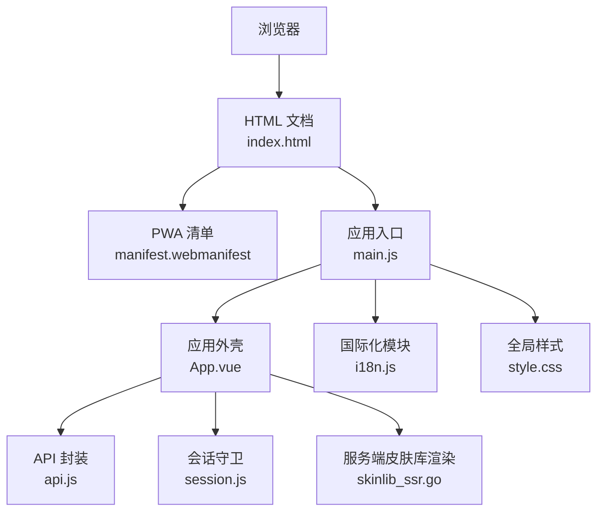
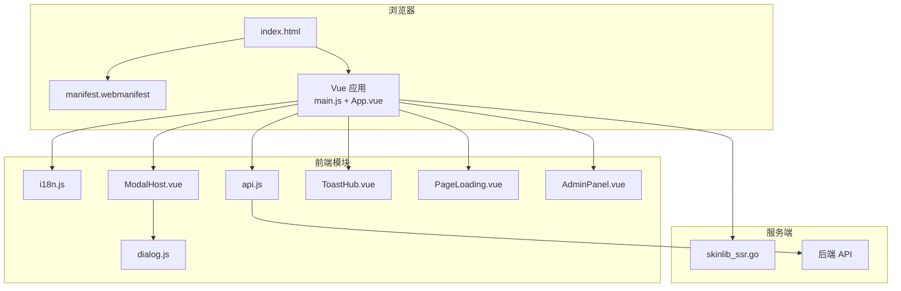
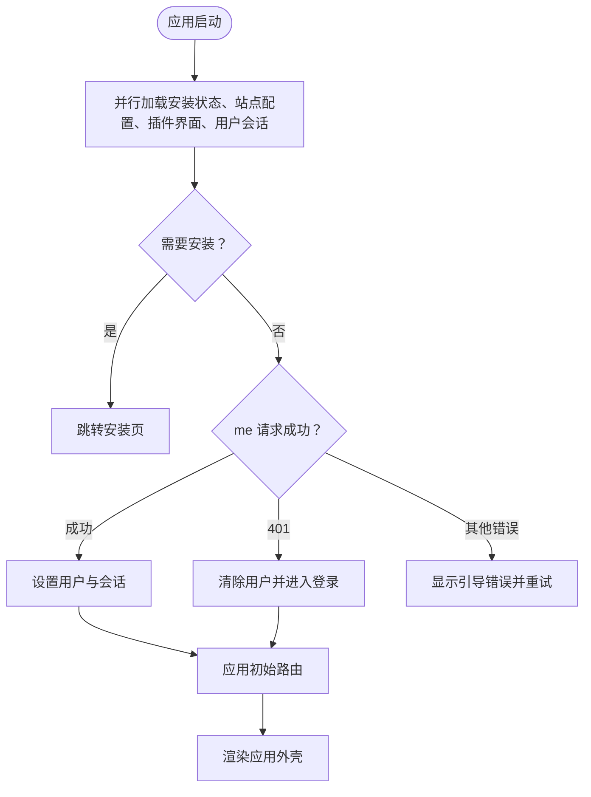
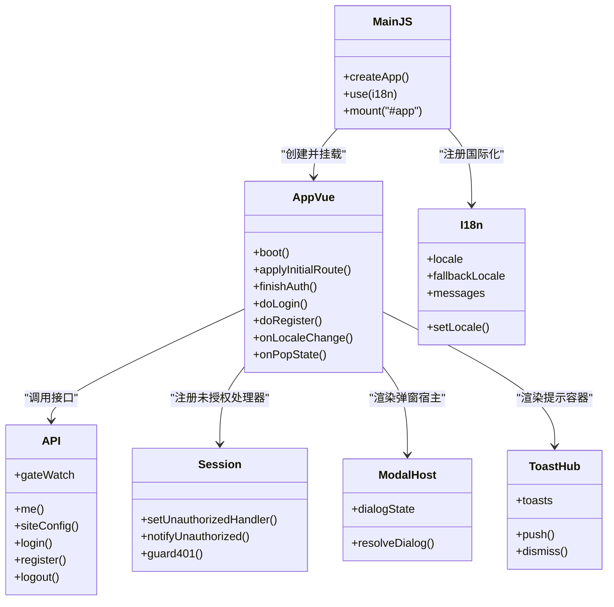

# 应用入口与外壳

**本文引用的文件**
- [web/src/main.js](https://github.com/YimingZhanshen/skin-nexus/blob/797ae1a/web/src/main.js)
- [web/index.html](https://github.com/YimingZhanshen/skin-nexus/blob/797ae1a/web/index.html)
- [web/public/manifest.webmanifest](https://github.com/YimingZhanshen/skin-nexus/blob/797ae1a/web/public/manifest.webmanifest)
- [web/src/App.vue](https://github.com/YimingZhanshen/skin-nexus/blob/797ae1a/web/src/App.vue)
- [web/src/i18n.js](https://github.com/YimingZhanshen/skin-nexus/blob/797ae1a/web/src/i18n.js)
- [web/src/session.js](https://github.com/YimingZhanshen/skin-nexus/blob/797ae1a/web/src/session.js)
- [web/src/dialog.js](https://github.com/YimingZhanshen/skin-nexus/blob/797ae1a/web/src/dialog.js)
- [web/src/components/AdminPanel.vue](https://github.com/YimingZhanshen/skin-nexus/blob/797ae1a/web/src/components/AdminPanel.vue)
- [web/src/components/ModalHost.vue](https://github.com/YimingZhanshen/skin-nexus/blob/797ae1a/web/src/components/ModalHost.vue)
- [web/src/components/PageLoading.vue](https://github.com/YimingZhanshen/skin-nexus/blob/797ae1a/web/src/components/PageLoading.vue)
- [web/src/components/ToastHub.vue](https://github.com/YimingZhanshen/skin-nexus/blob/797ae1a/web/src/components/ToastHub.vue)
- [web/src/api.js](https://github.com/YimingZhanshen/skin-nexus/blob/797ae1a/web/src/api.js)
- [web/src/style.css](https://github.com/YimingZhanshen/skin-nexus/blob/797ae1a/web/src/style.css)
- [server/cmd/skin-nexus/skinlib_ssr.go](https://github.com/YimingZhanshen/skin-nexus/blob/797ae1a/server/cmd/skin-nexus/skinlib_ssr.go)

## 目录
1. [简介](#简介)
2. [项目结构](#项目结构)
3. [核心组件](#核心组件)
4. [架构总览](#架构总览)
5. [详细组件分析](#详细组件分析)
6. [依赖关系分析](#依赖关系分析)
7. [性能注意事项](#性能注意事项)
8. [故障排查指南](#故障排查指南)
9. [结论](#结论)

## 简介
本文聚焦前端应用的启动过程与应用外壳职责，围绕以下目标展开：
- 说明 `web/src/main.js` 如何创建并挂载 Vue 3 应用。
- 解释 `index.html` 与 `manifest.webmanifest` 在站点元信息和渐进式 Web 应用中的作用。
- 详细说明 `App.vue` 作为应用外壳的职责：加载会话、注入国际化、渲染路由视图、组合管理面板、插件 iframe 宿主、弹窗宿主、全局提示和页面加载中容器。
- 描述服务端渲染期间语言包、站点 URL、主题 token、登录态和诊断数据如何传入单页应用。
- 明确客户端与服务端之间的数据契约、初始 JSON、错误边界和回退行为。
- 提供新增全局样式、全局中间件逻辑以及扩展 App.vue 布局的示例路径。
- 指出根组件相关的性能注意事项，避免首屏重计算阻塞渲染。

## 项目结构
本项目的 SPA 前端位于 `web` 目录，关键文件包括：
- `web/index.html`：浏览器加载的 HTML 骨架，定义应用挂载点、PWA manifest、主题色和启动占位。
- `web/public/manifest.webmanifest`：PWA 清单，声明应用名称、启动地址、显示模式和图标。
- `web/src/main.js`：Vue 3 应用入口，创建应用实例、注册国际化、引入全局样式并挂载到 DOM。
- `web/src/App.vue`：应用外壳，负责会话引导、路由视图切换、全局 UI 容器组合和首屏引导状态。
- `web/src/i18n.js`：vue-i18n 初始化、语言解析策略和本地化设置。
- `web/src/style.css`：全站基础样式，导入服务器提供的主题 token 文件。
- `web/src/api.js`：统一 API 请求封装、会话守卫回调钩子和业务接口集合。
- `web/src/session.js`：401 未授权事件通知与守卫。
- `web/src/dialog.js`：替代原生对话框的全局弹窗状态机。
- `web/src/components/*`：管理面板、弹窗宿主、页面加载中、全局提示等全局 UI 容器。
- `server/cmd/skin-nexus/skinlib_ssr.go`：服务端为皮肤库列表注入可爬取内容，并将内容写入 `#app` 标记区域。

**图表来源**
- [web/index.html:1-43](https://github.com/YimingZhanshen/skin-nexus/blob/797ae1a/web/index.html#L1-L43)
- [web/public/manifest.webmanifest:1-14](https://github.com/YimingZhanshen/skin-nexus/blob/797ae1a/web/public/manifest.webmanifest#L1-L14)
- [web/src/main.js:1-6](https://github.com/YimingZhanshen/skin-nexus/blob/797ae1a/web/src/main.js#L1-L6)
- [web/src/App.vue:1-200](https://github.com/YimingZhanshen/skin-nexus/blob/797ae1a/web/src/App.vue#L1-L200)
- [web/src/i18n.js:1-68](https://github.com/YimingZhanshen/skin-nexus/blob/797ae1a/web/src/i18n.js#L1-L68)
- [web/src/style.css:1-200](https://github.com/YimingZhanshen/skin-nexus/blob/797ae1a/web/src/style.css#L1-L200)
- [web/src/api.js:1-161](https://github.com/YimingZhanshen/skin-nexus/blob/797ae1a/web/src/api.js#L1-L161)
- [web/src/session.js:1-13](https://github.com/YimingZhanshen/skin-nexus/blob/797ae1a/web/src/session.js#L1-L13)
- [server/cmd/skin-nexus/skinlib_ssr.go:1-200](https://github.com/YimingZhanshen/skin-nexus/blob/797ae1a/server/cmd/skin-nexus/skinlib_ssr.go#L1-L200)

**章节来源**
- [web/index.html:1-43](https://github.com/YimingZhanshen/skin-nexus/blob/797ae1a/web/index.html#L1-L43)
- [web/public/manifest.webmanifest:1-14](https://github.com/YimingZhanshen/skin-nexus/blob/797ae1a/web/public/manifest.webmanifest#L1-L14)
- [web/src/main.js:1-6](https://github.com/YimingZhanshen/skin-nexus/blob/797ae1a/web/src/main.js#L1-L6)
- [web/src/App.vue:1-200](https://github.com/YimingZhanshen/skin-nexus/blob/797ae1a/web/src/App.vue#L1-L200)

## 核心组件
### 应用入口 main.js
`web/src/main.js` 是 Vue 3 应用的唯一入口，职责非常集中：
- 从 Vue 创建应用实例。
- 导入根组件 `App.vue`。
- 导入并注册国际化实例 `i18n`。
- 引入全局样式 `style.css`。
- 将应用挂载到 `index.html` 中的 `#app` 节点。

这意味着所有后续初始化都发生在 `App.vue` 中，`main.js` 只承担最小化的装配职责。

**章节来源**
- [web/src/main.js:1-6](https://github.com/YimingZhanshen/skin-nexus/blob/797ae1a/web/src/main.js#L1-L6)

### HTML 骨架与 PWA 清单
`index.html` 定义了以下内容：
- 文档语言设为中文。
- 引入 favicon、Apple touch icon 和 PWA manifest。
- 设置 `theme-color` 用于移动端浏览器状态栏。
- 保留服务端可替换标记，供服务端注入皮肤库列表等 SSR 内容。
- 在 `#app` 内提供静态启动占位动画，使 SPA bundle 尚未到达时用户也能看到反馈。
- 以模块方式加载 `/src/main.js`。

`manifest.webmanifest` 则定义：
- 应用名称与短名称。
- 应用描述。
- 启动地址。
- 显示模式为独立窗口。
- 背景色与主题色。
- SVG 与 PNG 图标集。

这两个文件共同构成站点元信息、SEO 可见性和 PWA 安装能力的基础。

**章节来源**
- [web/index.html:1-43](https://github.com/YimingZhanshen/skin-nexus/blob/797ae1a/web/index.html#L1-L43)
- [web/public/manifest.webmanifest:1-14](https://github.com/YimingZhanshen/skin-nexus/blob/797ae1a/web/public/manifest.webmanifest#L1-L14)

### 国际化 i18n
`web/src/i18n.js` 使用 vue-i18n 初始化多语言支持，语言优先级如下：
1. `skin_lang` Cookie。
2. `localStorage.skin_lang`。
3. `navigator.language`。
4. 默认中文。

它还会：
- 同步 `document.documentElement.lang`。
- 持久化 Cookie 与 localStorage。
- 暴露 `setLocale` 供顶部语言选择器调用。
- 将中英文消息对象直接注册为 messages。

该模块与 App.vue 的语言下拉框协作，保证跨刷新后的语言偏好一致。

**章节来源**
- [web/src/i18n.js:1-68](https://github.com/YimingZhanshen/skin-nexus/blob/797ae1a/web/src/i18n.js#L1-L68)

### API 封装与中间件钩子
`web/src/api.js` 提供统一的 `req` 方法，负责：
- 发起同域请求。
- 处理非 JSON 响应。
- 包装错误对象，附带 HTTP 状态码和后端数据。
- 当后端返回邮箱验证必需错误时，通过 `gateWatch.onVerifyRequired` 通知外壳重新读取会话。

它还导出：
- `api` 对象，包含登录、注册、资料、衣柜、材质、通知、皮肤库、OIDC、Union 等接口。
- `gateWatch`，作为客户端与后端校验门控之间的轻量中间件通道。

**章节来源**
- [web/src/api.js:1-161](https://github.com/YimingZhanshen/skin-nexus/blob/797ae1a/web/src/api.js#L1-L161)

### 会话与 401 守卫
`web/src/session.js` 暴露：
- `setUnauthorizedHandler`：由 App.vue 注册“已登出”处理器。
- `notifyUnauthorized`：任意页面捕获 401 后统一触发。
- `guard401`：判断错误是否属于会话失效，帮助页面决定是否阻止重复提示。

App.vue 在启动阶段将该处理器设置为清空用户、跳转登录页。

**章节来源**
- [web/src/session.js:1-13](https://github.com/YimingZhanshen/skin-nexus/blob/797ae1a/web/src/session.js#L1-L13)
- [web/src/App.vue:451-768](https://github.com/YimingZhanshen/skin-nexus/blob/797ae1a/web/src/App.vue#L451-L768)

## 架构总览
下面的架构图展示了浏览器、HTML、Vue 应用、API、服务端渲染和全局 UI 容器之间的关系：

**图表来源**
- [web/src/main.js:1-6](https://github.com/YimingZhanshen/skin-nexus/blob/797ae1a/web/src/main.js#L1-L6)
- [web/src/App.vue:1-200](https://github.com/YimingZhanshen/skin-nexus/blob/797ae1a/web/src/App.vue#L1-L200)
- [web/src/i18n.js:1-68](https://github.com/YimingZhanshen/skin-nexus/blob/797ae1a/web/src/i18n.js#L1-L68)
- [web/src/api.js:1-161](https://github.com/YimingZhanshen/skin-nexus/blob/797ae1a/web/src/api.js#L1-L161)
- [web/src/dialog.js:1-51](https://github.com/YimingZhanshen/skin-nexus/blob/797ae1a/web/src/dialog.js#L1-L51)
- [web/src/components/ModalHost.vue:1-53](https://github.com/YimingZhanshen/skin-nexus/blob/797ae1a/web/src/components/ModalHost.vue#L1-L53)
- [web/src/components/ToastHub.vue:1-79](https://github.com/YimingZhanshen/skin-nexus/blob/797ae1a/web/src/components/ToastHub.vue#L1-L79)
- [web/src/components/PageLoading.vue:1-22](https://github.com/YimingZhanshen/skin-nexus/blob/797ae1a/web/src/components/PageLoading.vue#L1-L22)
- [web/src/components/AdminPanel.vue:1-200](https://github.com/YimingZhanshen/skin-nexus/blob/797ae1a/web/src/components/AdminPanel.vue#L1-L200)
- [server/cmd/skin-nexus/skinlib_ssr.go:1-200](https://github.com/YimingZhanshen/skin-nexus/blob/797ae1a/server/cmd/skin-nexus/skinlib_ssr.go#L1-L200)

## 详细组件分析

### App.vue：应用外壳
`App.vue` 是整个 SPA 的控制中心，职责远不止“渲染一个页面”。其核心职责包括：

#### 1. 初始化与引导
- 维护 `booting`、`bootErr` 表示引导状态和引导失败信息。
- 并行发起四个关键请求：
  - `/api/v1/setup/status`：检测是否需要安装引导。
  - `api.siteConfig()`：站点配置，控制邀请码、邮件开关、Union 开关、上传限制和底部链接。
  - `loadPluginUI()`：加载插件界面与导航。
  - `api.me()`：当前用户会话。
- 如果安装未完成，直接跳转到安装视图。
- 如果 `me` 请求出现网络或超时错误，不视为注销，而是展示可重试的错误边界。
- 如果是真正的 401，则将用户置空并进入登录流程。

#### 2. 会话状态与权限
- 保存当前用户对象 `user`。
- 根据 `permission` 判断是否为管理员。
- 向子组件提供 `sessionUser` 与 `siteConfig`。
- 通过 `gotoView` 实现无刷新跳转，避免整页刷新丢失引导状态。

#### 3. 路由与视图切换
- 使用内部 `view` 字符串驱动不同视图：登录、注册、找回密码、重置密码、邮箱验证、设备页、仪表板、衣柜、玩家、资料、应用、Union、管理面板、插件页面、帮助页等。
- 将内部视图映射到 URL，例如 `/user/dashboard`、`/user/closet`、`/admin`、`/skinlib`、`/help`。
- 监听 `popstate`，实现浏览器前进后退与视图同步。
- 支持待登录后恢复的目标视图，避免用户被卡在登录卡之后看不到原始页面。

#### 4. 国际化注入
- 使用 `useI18n` 获取翻译函数和当前语言。
- 顶部语言选择器调用 `setLocale`，更新语言、Cookie 和 `html lang`。
- 所有文案使用 `t('...')`，包括错误提示、按钮文本、导航标签和页面标题。

#### 5. 全局 UI 容器组合
- **AdminPanel**：异步加载的管理面板外壳，按权限和控制台配置决定可见项。
- **PluginSlot / PluginFields**：插件 iframe 宿主和表单字段扩展点。
- **ModalHost**：全局弹窗宿主，承载 `dialog.js` 定义的 prompt、confirm、alert。
- **ToastHub**：全局提示容器，订阅 `window.skin-toast` 事件，自动消失。
- **PageLoading**：异步视图加载时的占位组件。

#### 6. 错误边界与回退
- 引导阶段失败时展示带重试按钮的错误界面。
- 401 错误通过 `session.js` 统一回到登录页。
- 邮箱验证门控关闭时，通过 `gateWatch.onVerifyRequired` 重新读取会话。
- 登录失败可能携带锁定期，客户端用倒计时防止用户反复提交。

**图表来源**
- [web/src/App.vue:1-200](https://github.com/YimingZhanshen/skin-nexus/blob/797ae1a/web/src/App.vue#L1-L200)
- [web/src/App.vue:451-768](https://github.com/YimingZhanshen/skin-nexus/blob/797ae1a/web/src/App.vue#L451-L768)

**章节来源**
- [web/src/App.vue:1-200](https://github.com/YimingZhanshen/skin-nexus/blob/797ae1a/web/src/App.vue#L1-L200)
- [web/src/App.vue:201-450](https://github.com/YimingZhanshen/skin-nexus/blob/797ae1a/web/src/App.vue#L201-L450)
- [web/src/App.vue:451-768](https://github.com/YimingZhanshen/skin-nexus/blob/797ae1a/web/src/App.vue#L451-L768)

### AdminPanel：管理面板外壳
`AdminPanel.vue` 是管理侧的二级外壳，职责包括：
- 接收来自 App.vue 的 `user`、`siteConf`、`confLoaded`。
- 根据用户权限决定是否需要机器令牌。
- 渲染左侧导航和右侧管理视图。
- 支持管理面板内的深链，如 `/admin/users`、`/admin/plugin/<id>`。
- 将已启用的站点配置过滤进导航项。
- 复用插件系统，允许管理员扩展管理面板。

该组件强调“不要重复拉取 App.vue 已经加载过的数据”，以减少串行往返延迟。

**章节来源**
- [web/src/components/AdminPanel.vue:1-200](https://github.com/YimingZhanshen/skin-nexus/blob/797ae1a/web/src/components/AdminPanel.vue#L1-L200)

### ModalHost：弹窗宿主
`ModalHost.vue` 是全局弹窗的唯一宿主，负责：
- 消费 `dialog.js` 中的 `dialogState`。
- 区分 alert、confirm、prompt 三种弹窗形态。
- 调用 `resolveDialog` 完成 Promise 结果。
- 对 prompt 类型自动聚焦输入框。

它与 `dialog.js` 形成“状态源 + 宿主视图”的解耦结构，避免每个页面重复实现确认框。

**章节来源**
- [web/src/components/ModalHost.vue:1-53](https://github.com/YimingZhanshen/skin-nexus/blob/797ae1a/web/src/components/ModalHost.vue#L1-L53)
- [web/src/dialog.js:1-51](https://github.com/YimingZhanshen/skin-nexus/blob/797ae1a/web/src/dialog.js#L1-L51)

### ToastHub：全局提示容器
`ToastHub.vue` 订阅 `window.skin-toast` 事件，负责：
- 接收插件或宿主代码发送的 toast。
- 归一化消息内容和级别。
- 最多保留最近三条。
- 每条约 4.2 秒自动消失。
- 支持手动关闭。

它是插件系统与宿主 UI 之间的重要桥接点。

**章节来源**
- [web/src/components/ToastHub.vue:1-79](https://github.com/YimingZhanshen/skin-nexus/blob/797ae1a/web/src/components/ToastHub.vue#L1-L79)

### PageLoading：页面加载中容器
`PageLoading.vue` 是一个极简占位组件，用于：
- 异步路由懒加载期间的视觉反馈。
- 配合 `defineAsyncComponent` 的 `loadingComponent`。
- 使用国际化文案显示加载中。

**章节来源**
- [web/src/components/PageLoading.vue:1-22](https://github.com/YimingZhanshen/skin-nexus/blob/797ae1a/web/src/components/PageLoading.vue#L1-L22)

### 服务端渲染与 SPA 接管
`server/cmd/skin-nexus/skinlib_ssr.go` 说明：
- 皮肤库是公开页面，但纯 SPA 无法让爬虫抓取正文。
- 服务端首次渲染皮肤库列表，并将其插入 `#app` 内部的标记区间。
- Vue 挂载后替换 `#app` 内容，因此第一次绘制的是可爬取的静态内容，而不是空白。
- 爬虫可见内容与后续客户端交互仍由前端 SPA 负责。

这构成一种“SSR 提供 SEO 与首屏内容，SPA 接管交互”的混合模式。

**章节来源**
- [server/cmd/skin-nexus/skinlib_ssr.go:1-200](https://github.com/YimingZhanshen/skin-nexus/blob/797ae1a/server/cmd/skin-nexus/skinlib_ssr.go#L1-L200)

## 依赖关系分析

**图表来源**
- [web/src/main.js:1-6](https://github.com/YimingZhanshen/skin-nexus/blob/797ae1a/web/src/main.js#L1-L6)
- [web/src/App.vue:1-200](https://github.com/YimingZhanshen/skin-nexus/blob/797ae1a/web/src/App.vue#L1-L200)
- [web/src/i18n.js:1-68](https://github.com/YimingZhanshen/skin-nexus/blob/797ae1a/web/src/i18n.js#L1-L68)
- [web/src/api.js:1-161](https://github.com/YimingZhanshen/skin-nexus/blob/797ae1a/web/src/api.js#L1-L161)
- [web/src/session.js:1-13](https://github.com/YimingZhanshen/skin-nexus/blob/797ae1a/web/src/session.js#L1-L13)
- [web/src/components/ModalHost.vue:1-53](https://github.com/YimingZhanshen/skin-nexus/blob/797ae1a/web/src/components/ModalHost.vue#L1-L53)
- [web/src/components/ToastHub.vue:1-79](https://github.com/YimingZhanshen/skin-nexus/blob/797ae1a/web/src/components/ToastHub.vue#L1-L79)

### 客户端与服务端数据契约
| 数据类别 | 传输方式 | 客户端用途 | 失败或缺失时的行为 |
|---|---|---|---|
| 语言偏好 | Cookie、localStorage、navigator.language | i18n 初始化语言 | 回退到中文 |
| 站点配置 | `/api/v1/site-config` | 控制邀请码、邮件、Union、底部链接 | 保持默认值，不阻断引导 |
| 用户会话 | `/api/v1/me` | 显示用户名、权限、通知数、邮箱验证状态 | 401 视为未登录；网络错误保留已有界面并提示重试 |
| 安装状态 | `/api/v1/setup/status` | 判断是否进入安装流程 | 失败不影响其他数据继续加载 |
| 插件界面 | `loadPluginUI()` | 扩展导航和表单字段 | 不应影响核心登录流程 |
| SSR 内容 | HTML 中的 `#app` 标记区间 | 给爬虫提供皮肤库列表 | Vue 挂载后替换为动态内容 |
| 主题 token | 服务器 CSS 文件通过 `style.css` 导入 | 全局颜色、字体、间距、阴影 | 缺少时应降级到基础可读样式 |
| 诊断数据 | 诊断相关逻辑主要在服务端和管理面板 | 不在本入口直接注入 SPA | 诊断问题应通过管理面板或日志定位 |

**章节来源**
- [web/src/i18n.js:1-68](https://github.com/YimingZhanshen/skin-nexus/blob/797ae1a/web/src/i18n.js#L1-L68)
- [web/src/App.vue:1-200](https://github.com/YimingZhanshen/skin-nexus/blob/797ae1a/web/src/App.vue#L1-L200)
- [web/src/App.vue:451-768](https://github.com/YimingZhanshen/skin-nexus/blob/797ae1a/web/src/App.vue#L451-L768)
- [web/src/api.js:1-161](https://github.com/YimingZhanshen/skin-nexus/blob/797ae1a/web/src/api.js#L1-L161)
- [server/cmd/skin-nexus/skinlib_ssr.go:1-200](https://github.com/YimingZhanshen/skin-nexus/blob/797ae1a/server/cmd/skin-nexus/skinlib_ssr.go#L1-L200)

## 性能注意事项
### 根组件应避免的重计算
`App.vue` 在引导阶段执行大量副作用：
- 并发请求安装状态、站点配置、插件界面和用户信息。
- 解析 URL、历史状态和登录回调。
- 计算管理员权限、导航分组、站点名称和底部链接。
- 处理锁定期倒计时、语言切换、插件导航和错误边界。

新增逻辑时应遵循以下原则：
- 不要在 `computed` 中发起网络请求。
- 不要把昂贵计算放在模板表达式中。
- 不要无条件增加新的顶层状态，除非它确实参与渲染。
- 不要在每次渲染中创建新数组或新对象，除非必要。
- 对于仅用于调试或管理面板的数据，放在局部状态或懒加载模块中。
- 对长列表、图片预览、材质解析等重任务，使用异步组件、懒加载或离屏处理。

### 首屏优化现状
代码已经做了若干优化：
- 使用 `Promise.allSettled` 并行加载多个独立资源。
- 为重要路由使用 `defineAsyncComponent` 和 `PageLoading`。
- 管理员视图按需加载。
- 语言切换不刷新页面。
- 引导失败提供重试按钮，避免误判为会话丢失。

### 进一步建议
- 若新增全局中间件逻辑，优先放在 `api.js` 的请求层或 `session.js` 的事件层，而不是 App.vue。
- 若新增全局样式，优先放入 `web/src/style.css`，并通过主题 token 覆盖。
- 若新增全局 UI 容器，优先以独立组件形式挂载在 App.vue 中，并保持低耦合。
- 对插件 iframe 宿主和弹窗宿主，尽量复用现有 `PluginSlot`、`PluginFields`、`ModalHost`、`dialog.js`。

[本节为通用性能指导，不直接分析具体代码行]

## 故障排查指南

### 应用白屏或一直显示启动旋转
检查：
- `index.html` 中是否存在 `#app`。
- `main.js` 是否正确挂载到 `#app`。
- `App.vue` 是否在引导阶段抛出未捕获异常。
- 网络请求是否被拦截或跨域失败。

参考位置：
- [web/index.html:1-43](https://github.com/YimingZhanshen/skin-nexus/blob/797ae1a/web/index.html#L1-L43)
- [web/src/main.js:1-6](https://github.com/YimingZhanshen/skin-nexus/blob/797ae1a/web/src/main.js#L1-L6)
- [web/src/App.vue:1-200](https://github.com/YimingZhanshen/skin-nexus/blob/797ae1a/web/src/App.vue#L1-L200)

### 登录后仍停留在登录页
检查：
- `finishAuth` 是否被 `?next=`、设备页、插件外链或管理面板深链占用。
- `pendingView` 是否在登录后正确清空。
- 登录成功后是否尝试补充 `/me` 以获取完整会话。

参考位置：
- [web/src/App.vue:451-768](https://github.com/YimingZhanshen/skin-nexus/blob/797ae1a/web/src/App.vue#L451-L768)

### 401 未授权后没有回到登录页
检查：
- 页面是否调用 `notifyUnauthorized`。
- App.vue 是否已通过 `setUnauthorizedHandler` 注册处理器。
- 错误对象是否包含 `status === 401`。

参考位置：
- [web/src/session.js:1-13](https://github.com/YimingZhanshen/skin-nexus/blob/797ae1a/web/src/session.js#L1-L13)
- [web/src/App.vue:451-768](https://github.com/YimingZhanshen/skin-nexus/blob/797ae1a/web/src/App.vue#L451-L768)

### 语言切换无效
检查：
- `setLocale` 是否更新了 `i18n.global.locale`。
- Cookie 是否被写入。
- `document.documentElement.lang` 是否同步。
- 浏览器是否拒绝 Cookie，导致回落到 localStorage 或 navigator。

参考位置：
- [web/src/i18n.js:1-68](https://github.com/YimingZhanshen/skin-nexus/blob/797ae1a/web/src/i18n.js#L1-L68)

### 弹窗不显示或被原生对话框干扰
检查：
- 是否使用 `dialog.js` 的 `promptDialog`、`confirmDialog`、`alertDialog`。
- `ModalHost` 是否挂载在应用外壳中。
- 是否在沙箱插件 iframe 中误用原生 `window.confirm`。

参考位置：
- [web/src/dialog.js:1-51](https://github.com/YimingZhanshen/skin-nexus/blob/797ae1a/web/src/dialog.js#L1-L51)
- [web/src/components/ModalHost.vue:1-53](https://github.com/YimingZhanshen/skin-nexus/blob/797ae1a/web/src/components/ModalHost.vue#L1-L53)

### 提示不显示或一直堆积
检查：
- 是否派发 `window.skin-toast` 事件。
- ToastHub 是否已挂载。
- 消息是否为空字符串。
- 定时器是否在组件卸载时清理。

参考位置：
- [web/src/components/ToastHub.vue:1-79](https://github.com/YimingZhanshen/skin-nexus/blob/797ae1a/web/src/components/ToastHub.vue#L1-L79)

### 爬虫看不到皮肤库内容
检查：
- 服务端是否启用皮肤库 SSR。
- HTML 中 `#app` 内部是否包含 SSR 生成的皮肤列表。
- Vue 挂载后是否覆盖了 SSR 内容。

参考位置：
- [server/cmd/skin-nexus/skinlib_ssr.go:1-200](https://github.com/YimingZhanshen/skin-nexus/blob/797ae1a/server/cmd/skin-nexus/skinlib_ssr.go#L1-L200)
- [web/index.html:1-43](https://github.com/YimingZhanshen/skin-nexus/blob/797ae1a/web/index.html#L1-L43)

## 结论
`web/src/main.js` 承担最小化的 Vue 应用装配职责，真正的应用状态、路由、会话、国际化、权限和全局 UI 集中在 `App.vue`。`index.html` 提供 PWA 与站点元信息，`manifest.webmanifest` 提供安装能力，而服务端 SSR 则为爬虫提供可索引的皮肤库内容。

App.vue 的核心价值在于：
- 在引导阶段协调安装状态、站点配置、插件界面和用户会话。
- 把会话、权限、站点能力和导航状态提供给子组件。
- 统一管理登录、注册、找回密码、邮箱验证、设备页、仪表板和插件入口。
- 组合管理面板、弹窗宿主、提示容器和加载中占位。
- 处理 401、网络超时、邮箱验证门控和锁定期等边界情况。

新增功能时，推荐：
- 全局样式放入 `style.css`。
- 全局中间件逻辑放入 `api.js` 或 `session.js`。
- 全局 UI 容器以独立组件形式挂载到 App.vue。
- 避免在根组件中进行阻塞性重计算。
- 保持与服务端的数据契约稳定，特别是会话、站点配置和语言偏好。
