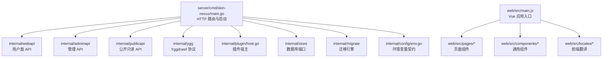
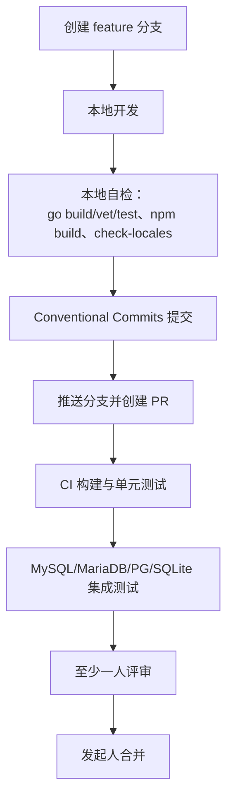
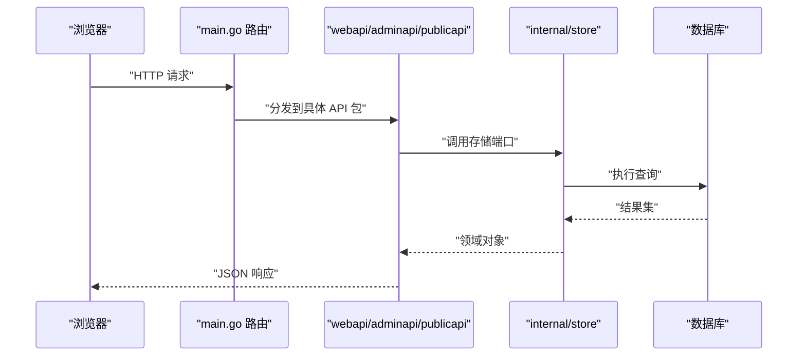
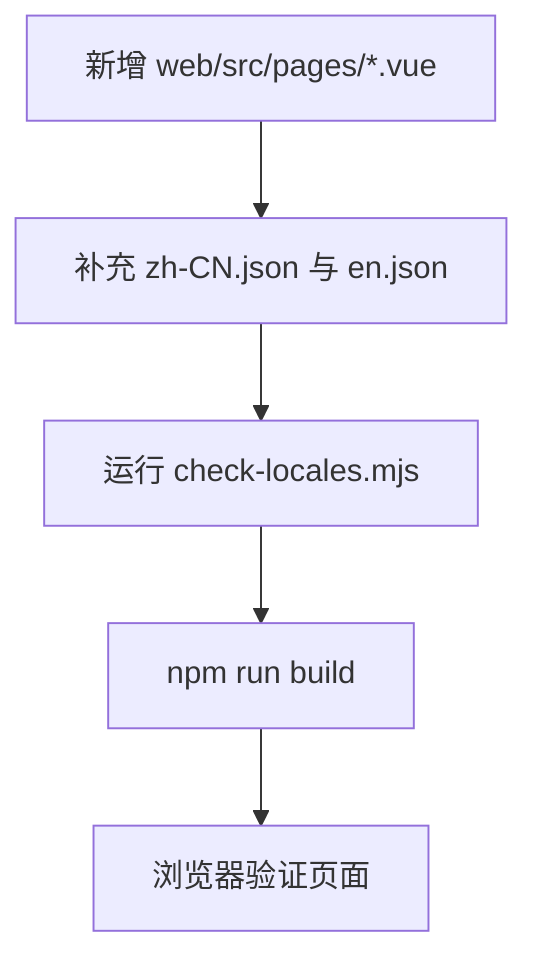
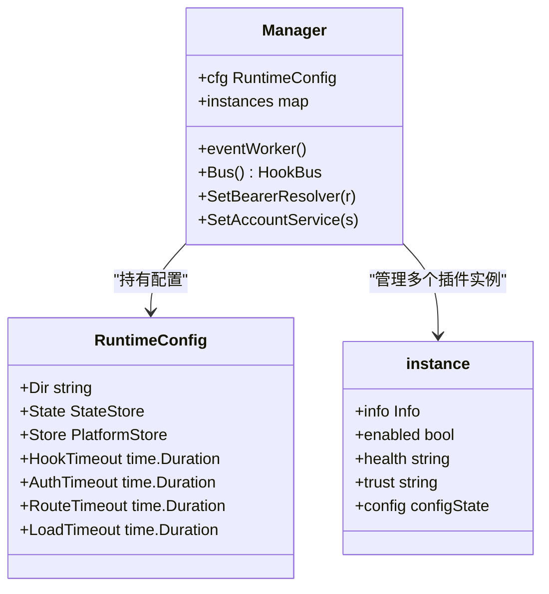
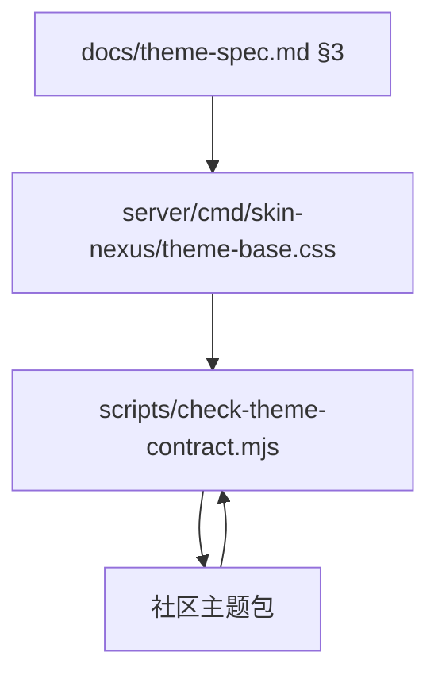
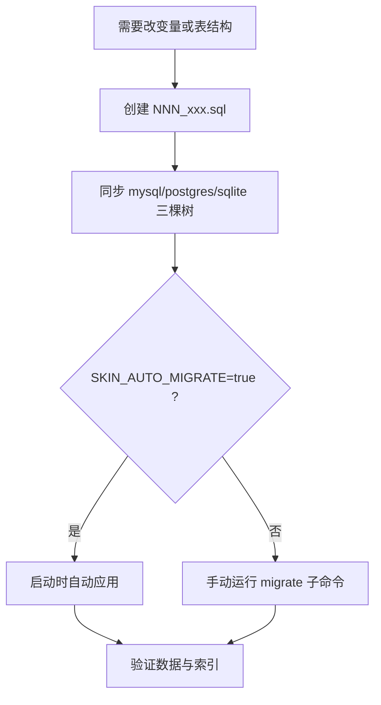

# 开发指南

**本文引用的文件**
- [CONTRIBUTING.md](https://github.com/YimingZhanshen/skin-nexus/blob/797ae1a/CONTRIBUTING.md)
- [AGENTS.md](https://github.com/YimingZhanshen/skin-nexus/blob/797ae1a/AGENTS.md)
- [CODE_OF_CONDUCT.md](https://github.com/YimingZhanshen/skin-nexus/blob/797ae1a/CODE_OF_CONDUCT.md)
- [README.md](https://github.com/YimingZhanshen/skin-nexus/blob/797ae1a/README.md)
- [docker-compose.yml](https://github.com/YimingZhanshen/skin-nexus/blob/797ae1a/docker-compose.yml)
- [.github/workflows/ci.yml](https://github.com/YimingZhanshen/skin-nexus/blob/797ae1a/.github/workflows/ci.yml)
- [.github/pull_request_template.md](https://github.com/YimingZhanshen/skin-nexus/blob/797ae1a/.github/pull_request_template.md)
- [server/cmd/skin-nexus/main.go](https://github.com/YimingZhanshen/skin-nexus/blob/797ae1a/server/cmd/skin-nexus/main.go)
- [server/internal/config/env.go](https://github.com/YimingZhanshen/skin-nexus/blob/797ae1a/server/internal/config/env.go)
- [server/internal/migrate/cli.go](https://github.com/YimingZhanshen/skin-nexus/blob/797ae1a/server/internal/migrate/cli.go)
- [server/internal/plugin/host.go](https://github.com/YimingZhanshen/skin-nexus/blob/797ae1a/server/internal/plugin/host.go)
- [scripts/check-locales.mjs](https://github.com/YimingZhanshen/skin-nexus/blob/797ae1a/scripts/check-locales.mjs)
- [scripts/check-theme-contract.mjs](https://github.com/YimingZhanshen/skin-nexus/blob/797ae1a/scripts/check-theme-contract.mjs)
- [web/package.json](https://github.com/YimingZhanshen/skin-nexus/blob/797ae1a/web/package.json)
- [web/src/main.js](https://github.com/YimingZhanshen/skin-nexus/blob/797ae1a/web/src/main.js)

## 目录

1. [简介](#简介)
2. [环境搭建](#环境搭建)
3. [项目结构与代码组织约定](#项目结构与代码组织约定)
4. [提交流程与质量门禁](#提交流程与质量门禁)
5. [常见开发任务](#常见开发任务)
6. [调试技巧](#调试技巧)
7. [AI 辅助开发与贡献者行为规范](#ai-辅助开发与贡献者行为规范)
8. [故障排查清单](#故障排查清单)
9. [结论](#结论)

## 简介

SkinNexus 是一个自托管的 Minecraft 皮肤站，后端用 Go 构建单二进制，前端用 Vue 3 + Vite。数据库可选 MySQL、MariaDB、PostgreSQL 或 SQLite；默认通过 Docker Compose 启动一个内置 MySQL 服务，也可以通过环境变量指向外部数据库。项目采用 AGPL-3.0 许可，治理为 BDFL：日常改动走 Pull Request，合并权归发起人。

本指南面向贡献者，覆盖本地开发环境搭建、仓库结构、分支与提交规范、PR 模板与 CI 检查项，以及新增路由、页面、插件、主题和迁移脚本的标准流程。

## 环境搭建

### 所需工具

| 组件 | 最低要求 | 说明 |
|---|---:|---|
| Go | 1.26 | CI 使用 `setup-go@v7` 并固定版本 |
| Node.js | 22 | 前端依赖安装与构建 |
| 数据库 | MySQL 5.7/8.0、MariaDB、PostgreSQL 或 SQLite | 集成测试需要可达的数据库实例 |
| Git | 任意现代版本 | 拉取仓库与创建分支 |
| Docker（可选） | 支持 Compose | 快速拉起后端与内置 MySQL |

### 克隆仓库

```bash
git clone https://github.com/YimingZhanshen/skin-nexus.git
cd skin-nexus
```

### 启动后端

#### 方式一：源码直接运行

进入后端模块目录后执行构建与测试三连：

```bash
cd server
go build ./...
go vet ./...
go test ./...
```

如果只需要启动进程而不跑完整测试，可以只执行 `go build ./...`，然后运行生成的二进制。二进制支持以下子命令：

- `version`：输出当前版本号
- `migrate`：执行数据迁移前检查、UUID 清洗与导入
- `redetect-models`：重新检测材质模型
- `fsck`：文件系统一致性检查

启动时若配置了 `SKIN_AUTO_MIGRATE=true`，程序会扫描 `server/migrations/` 下的迁移文件并应用到数据库。

#### 方式二：Docker Compose

项目根目录提供推荐部署编排：

```bash
docker compose -f docker-compose.quickstart.yml up -d
```

该编排会：

- 拉取 GHCR 上的生产镜像
- 启动一个 MySQL 容器
- 把站点端口映射到宿主 `8080`
- 初始化签名密钥与数据卷

首次启动后打开 `/setup` 完成站点名、管理员账号、皮肤域和安装令牌。

### 启动前端开发服务器

前端位于 `web/`，使用 Vite：

```bash
cd web
npm ci
npm run dev
```

Vite 开发服务器默认监听本地端口，配合反向代理或直接访问其端口进行开发。生产构建命令是 `npm run build`，产物输出到 `web/dist`。

### 数据库直连

后端在启动阶段通过 DSN 连接数据库，DSN 格式由底层驱动决定：SQLite 使用 `sqlite:` 前缀，PostgreSQL 使用 `postgres://`，MySQL/MariaDB 使用传统 TCP DSN。可通过 `SKIN_DATABASE_DSN` 控制连接目标，也可让 Docker Compose 自动传入内部 MySQL 地址。

对于本地集成测试，需要设置：

```bash
export SKIN_TEST_DSN='user:pass@tcp(127.0.0.1:3306)/skin_nexus_test?parseTime=true'
go test -tags integration ./internal/store/
```

CI 会在 MySQL 5.7、8.0、MariaDB、PostgreSQL 和 SQLite 上分别运行同一套集成测试，因此本地至少应保证 MySQL 或 SQLite 可用。

**章节来源**
- [README.md:1-114](https://github.com/YimingZhanshen/skin-nexus/blob/797ae1a/README.md#L1-L114)
- [docker-compose.yml:1-86](https://github.com/YimingZhanshen/skin-nexus/blob/797ae1a/docker-compose.yml#L1-L86)
- [server/cmd/skin-nexus/main.go:1-120](https://github.com/YimingZhanshen/skin-nexus/blob/797ae1a/server/cmd/skin-nexus/main.go#L1-L120)
- [server/internal/config/env.go:1-104](https://github.com/YimingZhanshen/skin-nexus/blob/797ae1a/server/internal/config/env.go#L1-L104)
- [web/package.json:1-22](https://github.com/YimingZhanshen/skin-nexus/blob/797ae1a/web/package.json#L1-L22)
- [CONTRIBUTING.md:75-105](https://github.com/YimingZhanshen/skin-nexus/blob/797ae1a/CONTRIBUTING.md#L75-L105)

## 项目结构与代码组织约定

### 顶层目录职责

| 目录 | 职责 | 贡献者注意 |
|---|---|---|
| `server/` | Go 后端模块 | 所有后端业务逻辑、路由、数据库实现、插件宿主都在这里 |
| `server/cmd/skin-nexus/` | 后端入口与 HTTP 路由组装 | 新 API 路由通常在此注册 |
| `server/internal/` | 内部包：配置、存储、API、插件、主题、国际化等 | 对外不导出；新功能优先扩展已有接口而非散落 SQL |
| `server/migrations/` | 数据库迁移脚本 | 必须同步 MySQL、PostgreSQL、SQLite 三棵树 |
| `examples/plugins/` | 示例插件 | 用于验证插件宿主行为，改动需保持 `go test ./internal/plugin/` 全绿 |
| `web/` | Vue 3 + Vite 前端 | SPA 页面、管理面板、插件 UI 插槽、国际化文案 |
| `web/src/pages/` | 用户与管理页面组件 | 新增页面在此添加对应 `.vue` 文件 |
| `web/src/components/` | 可复用组件 | 按功能分组，如 `admin/`、`plugin/` |
| `web/src/locales/` | 前端多语言词典 | zh-CN 是键基准，en 是完整样例 |
| `docs/` | 仓库内公开文档 | 接口、部署、迁移、兼容矩阵、插件与主题规范 |
| `scripts/` | 自检脚本 | 本地 PR 前应运行关键门禁 |
| `.github/` | CI 工作流与 PR 模板 | 变更可能触发构建、测试、兼容性检查 |



**图表来源**
- [server/cmd/skin-nexus/main.go:1-120](https://github.com/YimingZhanshen/skin-nexus/blob/797ae1a/server/cmd/skin-nexus/main.go#L1-L120)
- [server/internal/plugin/host.go:1-120](https://github.com/YimingZhanshen/skin-nexus/blob/797ae1a/server/internal/plugin/host.go#L1-L120)
- [server/internal/config/env.go:1-104](https://github.com/YimingZhanshen/skin-nexus/blob/797ae1a/server/internal/config/env.go#L1-L104)
- [web/src/main.js:1-6](https://github.com/YimingZhanshen/skin-nexus/blob/797ae1a/web/src/main.js#L1-L6)

**章节来源**
- [AGENTS.md:1-99](https://github.com/YimingZhanshen/skin-nexus/blob/797ae1a/AGENTS.md#L1-L99)
- [CONTRIBUTING.md:75-138](https://github.com/YimingZhanshen/skin-nexus/blob/797ae1a/CONTRIBUTING.md#L75-L138)

## 提交流程与质量门禁

### 分支命名

项目采用 trunk-based 模型，从 `main` 拉出短生命周期分支：

- `feat/<scope>-<desc>`：新功能
- `fix/<scope>-<desc>`：缺陷修复
- `docs/<scope>-<desc>`：文档改进
- `refactor/<scope>-<desc>`：重构
- `test/<scope>-<desc>`：测试相关
- `chore/<scope>-<desc>`：杂务

scope 应尽量使用现有模块名，例如 `auth`、`texture`、`ygg`、`migrate`、`web`、`plugin`。

### 提交信息风格

遵循 Conventional Commits：

```
<type>(<scope>): <摘要>
```

type 包括 `feat`、`fix`、`docs`、`refactor`、`test`、`chore`。摘要可用中文或英文，但必须能让人一眼理解改动范围。涉及数据库结构变动的提交必须附带迁移脚本。

### PR 模板

PR 模板要求填写三部分：

1. **变更**：说明做了什么、为什么做，关联 issue 使用 `Closes #编号`
2. **验证**：贴真实命令输出、测试结果、curl 响应或浏览器操作步骤
3. **检查清单**：确认已读铁律、文档已同步、测试与构建通过、无隐私泄露、界面改动已验证、AI 辅助已披露



**图表来源**
- [.github/workflows/ci.yml:1-200](https://github.com/YimingZhanshen/skin-nexus/blob/797ae1a/.github/workflows/ci.yml#L1-L200)
- [.github/pull_request_template.md:1-20](https://github.com/YimingZhanshen/skin-nexus/blob/797ae1a/.github/pull_request_template.md#L1-L20)
- [CONTRIBUTING.md:75-138](https://github.com/YimingZhanshen/skin-nexus/blob/797ae1a/CONTRIBUTING.md#L75-L138)

### CI 检查项

CI 包含以下主要作业：

| 作业 | 检查内容 |
|---|---|
| `server` | Go 格式化、构建、vet、单元测试、覆盖率地板、插件工具测试 |
| `integration` | MySQL 5.7 与 8.0 双矩阵集成测试 |
| `integration-mariadb` | MariaDB 11.4 与 10.11 集成测试 |
| `integration-portable` | PostgreSQL 与 SQLite 集成测试 |
| `web` | Node 依赖安装、前端构建、前后端错误码与国际化文案对齐检查 |

覆盖率不是随意阈值，而是“地板值”：当某个包的测试覆盖率降到零或新增未测试包时，即使总覆盖率变化很小也会失败。这是为了防止“最后一行测试消失但总数没跌”的假阳性。

### 文档与变更日志同步

贡献指南明确要求：

- 接口或行为变更先改 `docs/`，再改代码
- 修改完成后同步 README 状态行与 `docs/CHANGELOG.md`
- 受影响的部署、迁移、兼容矩阵等文档都应更新
- 过时文档会污染后续开发记忆，属于仓库硬要求

协作纪律进一步强调：每轮开发收尾同步文档状态，不得留下待办口吻的死条目。

**章节来源**
- [CONTRIBUTING.md:75-138](https://github.com/YimingZhanshen/skin-nexus/blob/797ae1a/CONTRIBUTING.md#L75-L138)
- [.github/pull_request_template.md:1-20](https://github.com/YimingZhanshen/skin-nexus/blob/797ae1a/.github/pull_request_template.md#L1-L20)
- [.github/workflows/ci.yml:1-200](https://github.com/YimingZhanshen/skin-nexus/blob/797ae1a/.github/workflows/ci.yml#L1-L200)
- [AGENTS.md:1-99](https://github.com/YimingZhanshen/skin-nexus/blob/797ae1a/AGENTS.md#L1-L99)

## 常见开发任务

### 新增后端路由

后端路由在 `server/cmd/skin-nexus/main.go` 中统一组装，注释明确列出各路径族：

- `/api/yggdrasil/*`：Yggdrasil 协议
- `/api/v1/*`：SPA 后端
- `/api/public/v1/*`：公开只读 API
- `/textures/{hash}`：纹理文件分发
- `/*`：SPA 静态资源

新增路由时应遵循以下原则：

1. 路由归属清晰：用户面放 `internal/webapi`，管理面放 `internal/adminapi`，公开只读放 `internal/publicapi`
2. 查询通过 `internal/store` 暴露的端口进行，不要直接散落 SQL
3. 认证与限流逻辑放在中间层或路由守卫中
4. 错误返回使用稳定 code，便于前端与国际化门面对齐
5. 如果涉及数据库表或字段，必须配套迁移脚本



**图表来源**
- [server/cmd/skin-nexus/main.go:1-120](https://github.com/YimingZhanshen/skin-nexus/blob/797ae1a/server/cmd/skin-nexus/main.go#L1-L120)

**章节来源**
- [server/cmd/skin-nexus/main.go:1-120](https://github.com/YimingZhanshen/skin-nexus/blob/797ae1a/server/cmd/skin-nexus/main.go#L1-L120)
- [AGENTS.md:1-99](https://github.com/YimingZhanshen/skin-nexus/blob/797ae1a/AGENTS.md#L1-L99)

### 新增前端页面

前端基于 Vue 3 与 vue-i18n：

1. 在 `web/src/pages/` 新增页面组件
2. 如果需要路由，应在前端路由配置中注册（仓库当前结构表明路由集中在入口附近）
3. 新增用户可见文案必须加入 `web/src/locales/zh-CN.json` 与 `web/src/locales/en.json`
4. 如果新增语言，还需修改 `web/src/i18n.js` 的白名单与 App 下拉列表
5. 运行 `node scripts/check-locales.mjs` 校验中英键集是否对齐
6. 运行 `npm run build` 确保前端构建通过



**图表来源**
- [web/src/main.js:1-6](https://github.com/YimingZhanshen/skin-nexus/blob/797ae1a/web/src/main.js#L1-L6)
- [scripts/check-locales.mjs:1-200](https://github.com/YimingZhanshen/skin-nexus/blob/797ae1a/scripts/check-locales.mjs#L1-L200)
- [CONTRIBUTING.md:12-74](https://github.com/YimingZhanshen/skin-nexus/blob/797ae1a/CONTRIBUTING.md#L12-L74)

**章节来源**
- [web/src/main.js:1-6](https://github.com/YimingZhanshen/skin-nexus/blob/797ae1a/web/src/main.js#L1-L6)
- [CONTRIBUTING.md:12-74](https://github.com/YimingZhanshen/skin-nexus/blob/797ae1a/CONTRIBUTING.md#L12-L74)
- [scripts/check-locales.mjs:1-200](https://github.com/YimingZhanshen/skin-nexus/blob/797ae1a/scripts/check-locales.mjs#L1-L200)

### 新增插件

插件在服务进程内的 goja VM 中运行，规范以 `server/internal/plugin/contract.go` 为准，当前仅支持 `hookApi: 2`。

新增插件建议分两步：

1. 先在 `examples/plugins/` 下复制一个示例插件，调整 `plugin.json` 与入口逻辑
2. 通过管理面板上传或使用市场机制安装；本地上传允许未签名包，但超级管理员需显式确认风险

插件宿主提供以下能力：

- 配置与密钥
- 命名空间数据
- 三档路由
- 事件与 guard
- iframe UI
- 带超时与并发限制的执行环境
- 已启用/禁用/错误状态与健康度记录
- 信任等级：verified、unknown-key、unsigned、invalid



**图表来源**
- [server/internal/plugin/host.go:1-200](https://github.com/YimingZhanshen/skin-nexus/blob/797ae1a/server/internal/plugin/host.go#L1-L200)

**章节来源**
- [CONTRIBUTING.md:45-74](https://github.com/YimingZhanshen/skin-nexus/blob/797ae1a/CONTRIBUTING.md#L45-L74)
- [server/internal/plugin/host.go:1-200](https://github.com/YimingZhanshen/skin-nexus/blob/797ae1a/server/internal/plugin/host.go#L1-L200)

### 新增主题

主题包遵循 `theme.json` + `style.css` + 可选 JS 的契约。贡献者应优先覆盖 CSS 变量，而不是改写复杂选择器。

项目通过脚本校验主题契约：

- 文档中的主题令牌默认值必须与实际 `theme-base.css` 一致
- 主题包中引用的 CSS 变量必须在主机定义中存活，避免发布后出现死变量

新增或修改主题契约时，应同时更新：

1. `docs/theme-spec.md`
2. `server/cmd/skin-nexus/theme-base.css`
3. `scripts/check-theme-contract.mjs` 的逻辑（如需）



**图表来源**
- [scripts/check-theme-contract.mjs:1-130](https://github.com/YimingZhanshen/skin-nexus/blob/797ae1a/scripts/check-theme-contract.mjs#L1-L130)

**章节来源**
- [CONTRIBUTING.md:36-44](https://github.com/YimingZhanshen/skin-nexus/blob/797ae1a/CONTRIBUTING.md#L36-L44)
- [scripts/check-theme-contract.mjs:1-130](https://github.com/YimingZhanshen/skin-nexus/blob/797ae1a/scripts/check-theme-contract.mjs#L1-L130)

### 新增迁移脚本

数据库迁移脚本位于 `server/migrations/`，并按引擎分为：

- `mysql/`
- `postgres/`
- `sqlite/`

每个引擎目录下都是按序号命名的 DDL 文件，例如 `0001_init.sql`、`0002_web_sessions.sql`。迁移由 `internal/migrate` 引擎追踪，文件名不会随引擎差异而强对齐，但同一形状下的引擎专有写法允许只出现在一棵树里。

新增迁移脚本的流程：

1. 确定下一个序号
2. 在三个引擎目录中写出等价 DDL
3. 如有引擎方言差异，只在相应目录写入
4. 编写或更新对应的测试
5. 如果使用自动迁移，确保 `SKIN_AUTO_MIGRATE=true` 能安全应用
6. 对从老站迁移的场景，必要时通过 `internal/migrate` 提供无损导入适配



**图表来源**
- [server/internal/migrate/cli.go:1-200](https://github.com/YimingZhanshen/skin-nexus/blob/797ae1a/server/internal/migrate/cli.go#L1-L200)
- [server/cmd/skin-nexus/main.go:120-220](https://github.com/YimingZhanshen/skin-nexus/blob/797ae1a/server/cmd/skin-nexus/main.go#L120-L220)

**章节来源**
- [CONTRIBUTING.md:75-138](https://github.com/YimingZhanshen/skin-nexus/blob/797ae1a/CONTRIBUTING.md#L75-L138)
- [server/internal/migrate/cli.go:1-200](https://github.com/YimingZhanshen/skin-nexus/blob/797ae1a/server/internal/migrate/cli.go#L1-L200)
- [AGENTS.md:1-99](https://github.com/YimingZhanshen/skin-nexus/blob/797ae1a/AGENTS.md#L1-L99)

## 调试技巧

### Go 日志

Go 后端使用标准库 `log` 输出关键启动与异常信息。常见问题定位点包括：

- 配置加载失败：`config: ...`
- 数据库连接失败：`store: ...`
- 迁移失败：`schema: ...`
- 未知环境变量警告：启动时会打印未被任何 Go 代码读取的 `SKIN_*` 变量
- 插件加载失败：插件宿主会记录健康状态与最近错误

如果怀疑环境变量拼写错误，可对照 `server/internal/config/env.go` 中的 `KnownEnv` 列表，或通过 Docker Compose 的 `ComposeEnv` 注释了解哪些变量仅供编排层使用。

### 浏览器 Network 面板

前端通过 `web/src/api.js`、`web/src/adminApi.js`、`web/src/net.js` 等模块发起请求。调试时可关注：

- 请求路径是否匹配预期路由
- 状态码是否为后端稳定错误契约定义的响应
- 响应体是否包含 `{error, errorMessage}` 等结构
- 跨域、CSRF、会话 Cookie 是否正确传递
- 管理面板 API 是否需要管理员权限或机器 token

### 插件控制台

插件 UI 以 sandbox iframe 形式嵌入。调试插件时应关注：

- 插件是否处于 `ok`、`degraded`、`error` 或 `disabled` 状态
- 插件信任等级是否为 `verified`、`unknown-key`、`unsigned` 或 `invalid`
- 插件路由是否被正确挂载
- 插件执行是否命中 hook 超时、auth 超时、route 超时或 load 超时
- 插件事件队列是否积压

### 数据库直连查询

调试存储问题时，可直接连接数据库查看：

- `schema_migrations` 中已应用的迁移标记
- 核心表结构是否与迁移脚本一致
- 旧密码哈希是否仍保留 12 种算式
- 纹理文件目录与数据库引用是否一致
- 是否存在重复 UUID 或丢失外键

集成测试通过 `SKIN_TEST_DSN` 指向独立测试库，避免污染开发数据。

**章节来源**
- [server/internal/config/env.go:1-104](https://github.com/YimingZhanshen/skin-nexus/blob/797ae1a/server/internal/config/env.go#L1-L104)
- [server/internal/plugin/host.go:1-200](https://github.com/YimingZhanshen/skin-nexus/blob/797ae1a/server/internal/plugin/host.go#L1-L200)
- [server/internal/migrate/cli.go:1-200](https://github.com/YimingZhanshen/skin-nexus/blob/797ae1a/server/internal/migrate/cli.go#L1-L200)

## AI 辅助开发与贡献者行为规范

### AGENTS.md 中的关键约定

AGENTS.md 是仓库地图与铁律的入口，重点包括：

1. **Yggdrasil 路径语义不可破坏**：204 清单、错误体、空 textures 对象、毫秒时间戳、PEM 格式必须原样兼容
2. **玩家 UUID 零漂移**：改名不重算，OfflineUUID 逐字节复刻旧公式
3. **取证实测优先**：官方文档可能过时，以源码与线上 curl 为准
4. **隐私约束**：不得出现真实姓名，署名统一为 `YMZS (YimingZhanshen)`
5. **每轮收尾同步文档**：README 状态行、CHANGELOG、必要部署文档
6. **wire 契约冻结区零改动**：`internal/union` 与 `internal/plugin` 的契约冻结
7. **数据兼容铁律**：持久化数据必须与 blessing-skin-server 同构可直迁，或由迁移引擎提供无损导入适配

### 协作纪律

人类贡献者与 AI agent 同等遵守：

- 一个 agent 一个 PR 级任务，write scope 不重叠
- 结论附文件或命令输出，不存在类结论必须穷尽检索
- 每步贴真实输出，失败即停，最多重试一次
- 不以“应该可以”代替验证
- 协议与接口变更先改文档再改代码
- 重大选型走多 AI 独立评析 → 分歧对齐 → 发起人终裁

### 贡献者行为准则

CODE_OF_CONDUCT.md 要求：

- 尊重不同经验水平、身份、语言与部署场景
- 讨论就事论事，不攻击个人
- 提交可验证信息，不夸大、不伪造结论
- 保护隐私，不在公开讨论粘贴密钥、token、玩家数据或未脱敏日志
- 不接受骚扰、跟踪、威胁、恶意破坏或绕过插件沙箱的行为
- 违规处理分级：提醒、警告、限制参与、永久禁止

**章节来源**
- [AGENTS.md:1-99](https://github.com/YimingZhanshen/skin-nexus/blob/797ae1a/AGENTS.md#L1-L99)
- [CODE_OF_CONDUCT.md:1-58](https://github.com/YimingZhanshen/skin-nexus/blob/797ae1a/CODE_OF_CONDUCT.md#L1-L58)
- [CONTRIBUTING.md:1-74](https://github.com/YimingZhanshen/skin-nexus/blob/797ae1a/CONTRIBUTING.md#L1-L74)

## 故障排查清单

| 现象 | 可能原因 | 排查步骤 |
|---|---|---|
| 后端启动成功但配置无效 | 环境变量拼写错误或未在 `KnownEnv` 中声明 | 检查启动日志中的未知变量警告，对照 `env.go` |
| 前端显示中文回退 | 新增语言未加入 i18n 白名单或缺少键 | 运行 `check-locales.mjs`，补齐缺失键 |
| 后端错误码在前端无文案 | 错误码变更后未同步字典 | 运行 `check-locales.mjs`，补全 `errors.<code>` |
| 主题颜色与文档不一致 | `theme-spec.md` 与 `theme-base.css` 不同步 | 运行 `check-theme-contract.mjs` |
| 迁移在 MySQL 5.7 通过但在 8.0 失败 | 使用了引擎方言特性 | 检查 CI 的 MySQL 双矩阵集成测试 |
| 插件安装后状态为 error | 签名校验失败、入口超时、依赖缺失 | 查看插件健康状态、信任等级与最近错误 |
| 本地测试无法连接数据库 | `SKIN_TEST_DSN` 未设置或不可达 | 启动 MySQL/MariaDB/PG/SQLite 并设置 DSN |
| PR 被 CI 拒绝但未看到测试失败 | 覆盖率地板或 0% 包集合发生变化 | 查看 coverage.out 与 zero-got.txt 对比 |

**章节来源**
- [server/internal/config/env.go:1-104](https://github.com/YimingZhanshen/skin-nexus/blob/797ae1a/server/internal/config/env.go#L1-L104)
- [scripts/check-locales.mjs:1-200](https://github.com/YimingZhanshen/skin-nexus/blob/797ae1a/scripts/check-locales.mjs#L1-L200)
- [scripts/check-theme-contract.mjs:1-130](https://github.com/YimingZhanshen/skin-nexus/blob/797ae1a/scripts/check-theme-contract.mjs#L1-L130)
- [.github/workflows/ci.yml:1-200](https://github.com/YimingZhanshen/skin-nexus/blob/797ae1a/.github/workflows/ci.yml#L1-L200)

## 结论

贡献 SkinNexus 的核心思路是：**小分支、小提交、可验证、文档先行**。后端以 `cmd/skin-nexus/main.go` 为入口，业务逻辑下沉到 `internal/` 包；前端以 `web/src/main.js` 为入口，页面与组件按功能划分；插件与主题通过规范与契约扩展系统，而不是直接侵入主仓分发。

贡献者应始终记住三条底线：

1. 不破坏冻结协议与数据兼容
2. 不泄露隐私
3. 不提交未经真实验证的输出

只要遵循本指南中的环境搭建、目录约定、提交流程与调试方法，大多数新增路由、页面、插件、主题和迁移任务都能以可维护的方式完成。
