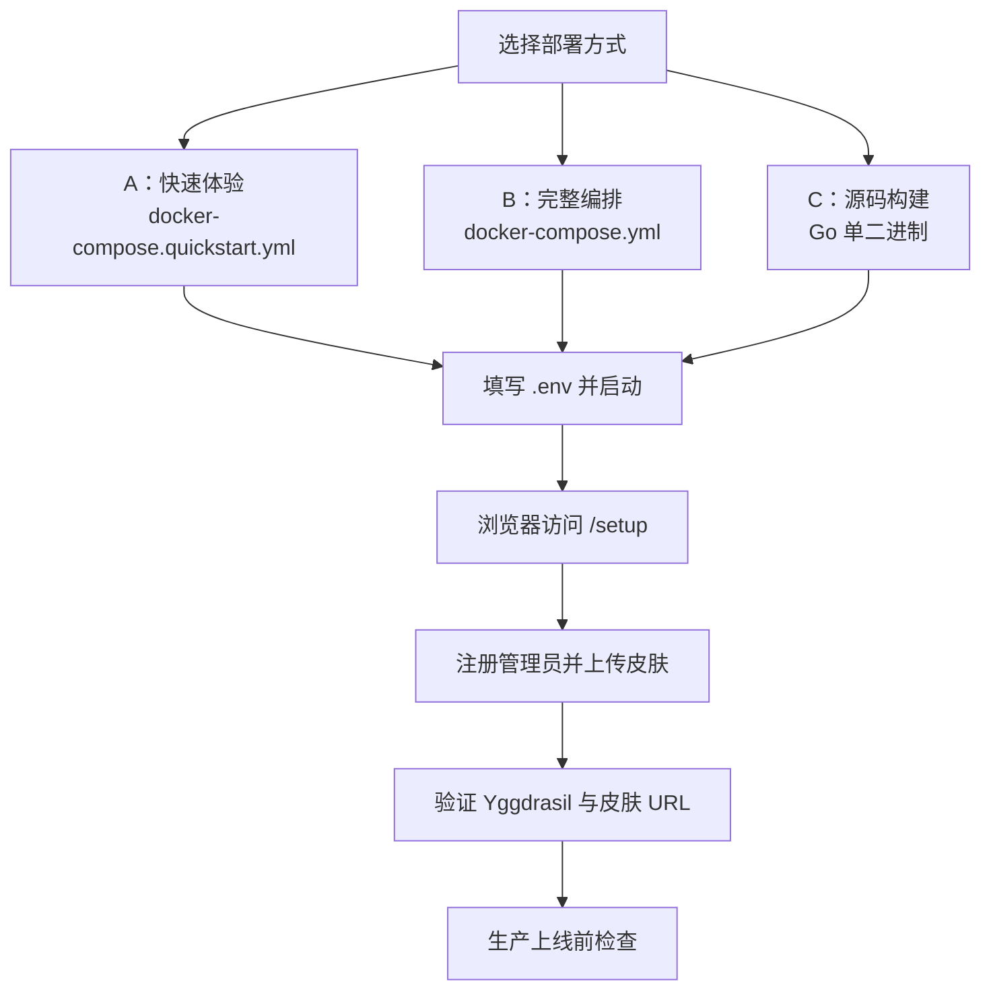
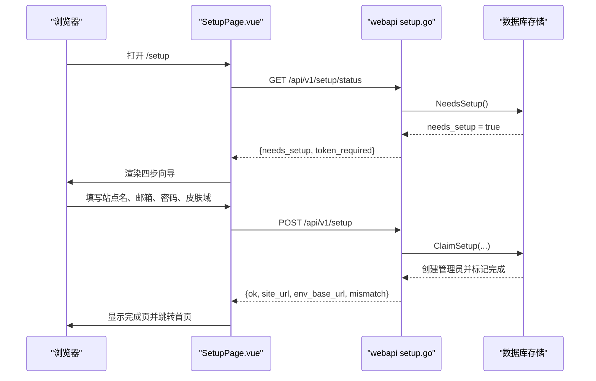
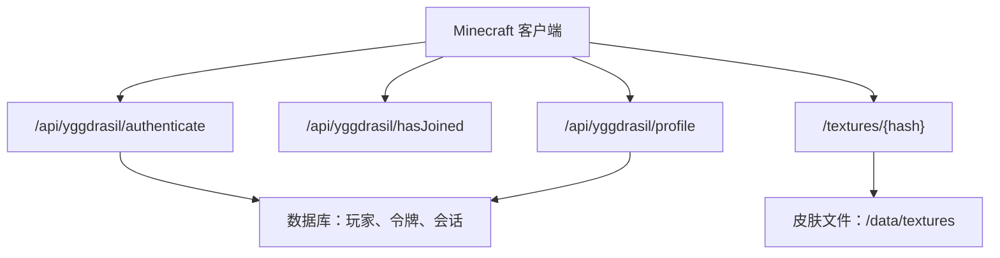
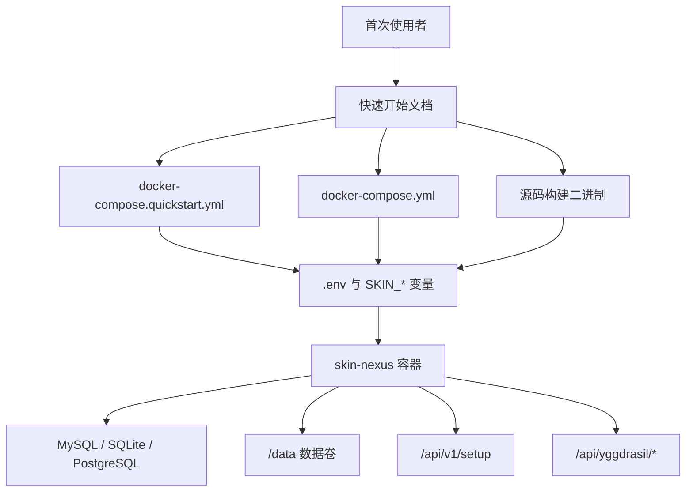

# 快速开始

**本文引用的文件**
- [README.md](https://github.com/YimingZhanshen/skin-nexus/blob/797ae1a/README.md)
- [docker-compose.quickstart.yml](https://github.com/YimingZhanshen/skin-nexus/blob/797ae1a/docker-compose.quickstart.yml)
- [docker-compose.yml](https://github.com/YimingZhanshen/skin-nexus/blob/797ae1a/docker-compose.yml)
- [Dockerfile](https://github.com/YimingZhanshen/skin-nexus/blob/797ae1a/Dockerfile)
- [main.go](https://github.com/YimingZhanshen/skin-nexus/blob/797ae1a/server/cmd/skin-nexus/main.go)
- [env.go](https://github.com/YimingZhanshen/skin-nexus/blob/797ae1a/server/internal/config/env.go)
- [SetupPage.vue](https://github.com/YimingZhanshen/skin-nexus/blob/797ae1a/web/src/pages/SetupPage.vue)
- [setup.go](https://github.com/YimingZhanshen/skin-nexus/blob/797ae1a/server/internal/webapi/setup.go)
- [service.go](https://github.com/YimingZhanshen/skin-nexus/blob/797ae1a/server/internal/ygg/service.go)
- [deploy.md](https://github.com/YimingZhanshen/skin-nexus/blob/797ae1a/docs/deploy.md)

## 目录
1. [简介](#简介)
2. [部署方式总览](#部署方式总览)
3. [最小环境变量清单](#最小环境变量清单)
4. [三种启动方式](#三种启动方式)
5. [初始化流程：访问 /setup](#初始化流程访问-setup)
6. [验证 Yggdrasil 端点](#验证-yggdrasil-端点)
7. [注册第一个玩家并上传皮肤](#注册第一个玩家并上传皮肤)
8. [常见启动失败与排查](#常见启动失败与排查)
9. [生产上线前检查](#生产上线前检查)
10. [附录：关键实现映射](#附录关键实现映射)

## 简介
SkinNexus 是一个自托管的 Minecraft 皮肤站。它把玩家账号、纹理文件和签名密钥都放在你自己控制的机器上；游戏客户端通过兼容的 Yggdrasil 接口直接登录，站长通过 Web 面板管理皮肤、主题、插件和联盟成员站。

对于首次使用者，推荐顺序是：先用 `docker-compose.quickstart.yml` 零编辑体验，再切到 `docker-compose.yml` 做正式部署，最后才考虑源码构建二进制。

**章节来源**
- [README.md:1-40](https://github.com/YimingZhanshen/skin-nexus/blob/797ae1a/README.md#L1-L40)

## 部署方式总览

| 方式 | 适合谁 | 核心命令 | 数据持久化 | 典型端口 |
|---|---|---|---|---|
| A. 零依赖快速体验 | 第一次运行、本地测试 | `docker compose -f docker-compose.quickstart.yml up -d` | `skin-data`、`skin-db` 两个命名卷 | 宿主机 `8080` |
| B. 完整编排部署 | 生产环境或需要外部数据库 | `docker compose up -d`（需先改 `.env` 或 compose） | `skin-data`、`skin-db` 或外部库 | 默认 `8080` |
| C. 源码构建 + 二进制 | 无 Docker 的主机、定制镜像 | `go build ./cmd/skin-nexus` 后运行 | `/data` 目录 | 默认 `:8080` |



[本图为概念流程图，不直接映射具体源码文件]

**章节来源**
- [README.md:24-40](https://github.com/YimingZhanshen/skin-nexus/blob/797ae1a/README.md#L24-L40)
- [docker-compose.quickstart.yml:1-20](https://github.com/YimingZhanshen/skin-nexus/blob/797ae1a/docker-compose.quickstart.yml#L1-L20)
- [docker-compose.yml:1-20](https://github.com/YimingZhanshen/skin-nexus/blob/797ae1a/docker-compose.yml#L1-L20)

## 最小环境变量清单

对快速体验和大多数生产部署来说，真正“最少能跑”的变量是：

| 变量 | 必填性 | 作用 | 示例值 |
|---|---|---|---|
| `SKIN_BASE_URL` | 必填 | 站点公开地址，影响纹理 URL、OIDC issuer、SEO 等 | `https://skin.example.com` |
| `SKIN_DB_PASSWORD` | 分模式必填 | 内置 MySQL 的用户密码；compose quickstart 中还会被插进 DSN | `openssl rand -hex 16` 输出 |
| `SKIN_DB_ROOT_PASSWORD` | 分模式必填 | 内置 MySQL root 密码 | `openssl rand -hex 16` 输出 |
| `SKIN_ADMIN_TOKEN` | 必填（quickstart） | 无 Cookie 机器/API 客户端的管理凭据；面板使用管理员账号会话 | `openssl rand -hex 32` 输出 |
| `SKIN_SETUP_TOKEN` | 可选但强烈建议 | 安装向导的一次性令牌，防止空库阶段任何人提交超管表单 | 随机字符串 |

其余重要变量按用途分组如下：

| 类别 | 变量 | 说明 |
|---|---|---|
| 监听 | `SKIN_LISTEN` | 进程监听地址，容器内保持 `:8080`；反代场景可把宿主机端口绑定改为 `127.0.0.1:8080:8080` |
| 数据库 | `SKIN_DATABASE_DSN` | 外部数据库时必填；内置库模式下由 quickstart 自动拼接 |
| 站点 | `SKIN_SITE_NAME`、`SKIN_SERVER_NAME`、`SKIN_SKIN_DOMAINS` | 站点名、Yggdrasil 服务器显示名、皮肤域白名单；多数可在面板设置 |
| 邮件 SMTP | `SKIN_SMTP_HOST`、`SKIN_SMTP_PORT`、`SKIN_SMTP_USER`、`SKIN_SMTP_PASS`、`SKIN_SMTP_FROM` | 找回密码与邮箱验证所需；非必填，但不配则无法发邮件 |
| 安全 | `SKIN_TRUSTED_PROXIES`、`SKIN_SIGN_KEY`、`SKIN_CSP_SCRIPT_EXTRA_SOURCES`、`SKIN_CSP_CONNECT_EXTRA_SOURCES` | 反向代理信任段、签名密钥、第三方脚本与连接源白名单 |
| 扩展 | `SKIN_PLUGIN_MARKET_URL`、`SKIN_THEME_MARKET_URL`、`SKIN_UNION_ENABLED` 等 | 插件市场、主题市场、MUA Union 等高级功能 |

注意：`.env` 里写了变量不代表容器进程一定能看到；只有 compose 文件的 `environment:` 段显式列出的键才会传入容器。仓库中的两份 compose 示例已经列出常用键，自定义 compose 不要只改 `.env`。

**章节来源**
- [docker-compose.quickstart.yml:1-71](https://github.com/YimingZhanshen/skin-nexus/blob/797ae1a/docker-compose.quickstart.yml#L1-L71)
- [docker-compose.yml:1-86](https://github.com/YimingZhanshen/skin-nexus/blob/797ae1a/docker-compose.yml#L1-L86)
- [env.go:1-104](https://github.com/YimingZhanshen/skin-nexus/blob/797ae1a/server/internal/config/env.go#L1-L104)
- [deploy.md:120-173](https://github.com/YimingZhanshen/skin-nexus/blob/797ae1a/docs/deploy.md#L120-L173)

## 三种启动方式

### 方式一：使用 `docker-compose.quickstart.yml` 的零依赖快速体验

这是最轻的路径：不需要提前写配置文件，也不需要准备外部数据库。它会拉起一个 MySQL 8.0 容器和一个 SkinNexus 容器，并把皮肤数据与数据库文件分别挂到 `skin-data` 和 `skin-db` 两个命名卷。

操作步骤：

1. 创建目录并拉取快速编排文件：
   ```bash
   mkdir skin-nexus && cd skin-nexus
   curl -fsSLO https://raw.githubusercontent.com/YimingZhanshen/skin-nexus/main/docker-compose.quickstart.yml
   ```
2. 生成最小环境变量：
   ```bash
   cat > .env <<EOF
   SKIN_BASE_URL=https://skin.example.com
   SKIN_DB_PASSWORD=$(openssl rand -hex 16)
   SKIN_DB_ROOT_PASSWORD=$(openssl rand -hex 16)
   SKIN_ADMIN_TOKEN=$(openssl rand -hex 32)
   SKIN_SETUP_TOKEN=$(openssl rand -hex 16)
   EOF
   ```
3. 启动服务：
   ```bash
   docker compose -f docker-compose.quickstart.yml up -d
   ```
4. 等待数据库健康检查通过后访问：
   ```
   http://本机IP:8080/setup
   ```

如果提示端口冲突，说明宿主机 `8080` 已被占用。可以修改 `.env` 中的 `SKIN_PORT`，例如 `SKIN_PORT=8081`，然后重启：

```bash
docker compose -f docker-compose.quickstart.yml down
docker compose -f docker-compose.quickstart.yml up -d
```

**章节来源**
- [README.md:24-40](https://github.com/YimingZhanshen/skin-nexus/blob/797ae1a/README.md#L24-L40)
- [docker-compose.quickstart.yml:1-71](https://github.com/YimingZhanshen/skin-nexus/blob/797ae1a/docker-compose.quickstart.yml#L1-L71)

### 方式二：使用 `docker-compose.yml` 的完整编排部署

完整编排更适合生产环境，支持固定镜像 tag、外部 MySQL、更清晰的可读注释和更多可选模块开关。

推荐步骤：

1. 在部署主机创建目录：
   ```bash
   mkdir -p /opt/skin-nexus && cd /opt/skin-nexus
   ```
2. 复制仓库中的 `docker-compose.yml`。
3. 至少修改以下位置：
   - `SKIN_BASE_URL`：改成你的真实域名。
   - `SKIN_DATABASE_DSN`：如果是外部 MySQL，把 `CHANGE_ME` 替换为真实密码；如果是内置 MySQL，保留默认结构但必须改掉两处 `CHANGE_ME` 对应的密码。
   - `SKIN_ADMIN_TOKEN`：用 `openssl rand -hex 32` 生成。
   - `MYSQL_PASSWORD`、`MYSQL_ROOT_PASSWORD`：与 DSN 中的用户密码保持一致。
4. 启动：
   ```bash
   docker compose up -d
   ```
5. 升级时：
   ```bash
   docker compose pull
   docker compose up -d
   ```
   数据卷不会被覆盖，升级只替换容器层。

如果你只想跳过内置数据库，注释掉 `db` 服务和 `depends_on`，并把 `SKIN_DATABASE_DSN` 指向已有 MySQL/MariaDB/PostgreSQL/SQLite。

**章节来源**
- [docker-compose.yml:1-86](https://github.com/YimingZhanshen/skin-nexus/blob/797ae1a/docker-compose.yml#L1-L86)
- [docs/deploy.md:1-119](https://github.com/YimingZhanshen/skin-nexus/blob/797ae1a/docs/deploy.md#L1-L119)

### 方式三：从源码构建并运行二进制

当你没有 Docker，或者需要把前端资源与 Go 二进制一起打包到系统服务时，走源码构建路径。

构建过程：

1. 安装 Go 与 Node.js（镜像中使用的是较新版本的 Go 工具链和 Node 22）。
2. 进入服务端目录并下载依赖：
   ```bash
   cd server
   go mod download
   ```
3. 构建前端（构建产物会嵌入最终二进制）：
   ```bash
   cd ../web
   npm ci
   npm run build
   ```
4. 回到服务端目录并编译二进制：
   ```bash
   cd ../server
   CGO_ENABLED=0 go build -o ../bin/skin-nexus ./cmd/skin-nexus
   ```
5. 在宿主运行二进制前，准备好：
   - 数据目录：例如 `/data`，确保运行用户有读写权限。
   - 迁移目录：源码构建时，二进制会从 `migrations` 子目录读取 SQL 迁移；也可以把 `server/migrations` 复制到二进制同级目录，并通过 `SKIN_MIGRATIONS_DIR` 指定。
   - 环境变量：至少设置 `SKIN_BASE_URL`、`SKIN_DATABASE_DSN`、`SKIN_DATA_DIR`、`SKIN_AUTO_MIGRATE=true`。
6. 启动：
   ```bash
   export SKIN_BASE_URL=https://skin.example.com
   export SKIN_DATABASE_DSN='sqlite:/var/lib/skin-nexus/skin.db'
   export SKIN_DATA_DIR=/data
   export SKIN_AUTO_MIGRATE=true
   ./bin/skin-nexus
   ```

二进制默认监听 `:8080`，可通过 `SKIN_LISTEN` 修改。若使用 SQLite，请确保数据库文件落在持久磁盘，并且只有一个进程写入同一份库文件。

**章节来源**
- [Dockerfile:1-68](https://github.com/YimingZhanshen/skin-nexus/blob/797ae1a/Dockerfile#L1-L68)
- [main.go:90-140](https://github.com/YimingZhanshen/skin-nexus/blob/797ae1a/server/cmd/skin-nexus/main.go#L90-L140)
- [docs/deploy.md:1-119](https://github.com/YimingZhanshen/skin-nexus/blob/797ae1a/docs/deploy.md#L1-L119)

## 初始化流程：访问 /setup

首次启动且数据库为空时，浏览器会自动进入安装向导。向导是一扇门：一旦完成，`/api/v1/setup` 永久返回 404，不能再重复提交。

### 向导包含的步骤

| 步骤 | 输入项 | 说明 |
|---|---|---|
| 1. 站点信息 | 站点名称、站点地址、安装令牌 | 站点地址必须是 `http://` 或 `https://` 开头的绝对地址 |
| 2. 管理员账户 | 昵称、邮箱、密码、确认密码 | 昵称必填，密码不少于 8 位 |
| 3. 皮肤域 | 每行一个皮肤域名 | 用于 Yggdrasil 与客户端解析皮肤资源 |
| 4. 完成 | 实际使用的站点地址、是否与 `SKIN_BASE_URL` 不一致 | 如果不一致，需要修正环境变量并重启 |

### 安装令牌的作用

当 `SKIN_SETUP_TOKEN` 未设置时，每次启动都会生成一个临时令牌并打印到日志。这就是为什么 README 的快速开始也建议设置它：空库阶段如果站点直接对外暴露，任何拿到页面的人都有可能抢先成为超级管理员。

如果你设置了 `SKIN_SETUP_TOKEN`，则必须在向导界面填入完全相同的值；填错会收到禁止访问错误，不会写入任何数据。

### 成功后的反馈

完成后，向导会告诉你：

- 本次写入的 `site_url`。
- 当前环境变量中的 `SKIN_BASE_URL`。
- 两者是否不一致。如果不一致，应统一成最终域名并重启容器或进程。



**图表来源**
- [SetupPage.vue:1-159](https://github.com/YimingZhanshen/skin-nexus/blob/797ae1a/web/src/pages/SetupPage.vue#L1-L159)
- [setup.go:1-173](https://github.com/YimingZhanshen/skin-nexus/blob/797ae1a/server/internal/webapi/setup.go#L1-L173)

**章节来源**
- [README.md:30-40](https://github.com/YimingZhanshen/skin-nexus/blob/797ae1a/README.md#L30-L40)
- [SetupPage.vue:1-159](https://github.com/YimingZhanshen/skin-nexus/blob/797ae1a/web/src/pages/SetupPage.vue#L1-L159)
- [setup.go:1-173](https://github.com/YimingZhanshen/skin-nexus/blob/797ae1a/server/internal/webapi/setup.go#L1-L173)

## 验证 Yggdrasil 端点

Yggdrasil 是 Minecraft 启动器用来认证玩家和查询皮肤的协议接口。SkinNexus 提供全端点兼容，客户端无需修改配置即可接入。

你可以用以下方式验证基础连通性：

1. 查看健康探针：
   ```bash
   curl -s http://localhost:8080/healthz
   ```
   正常响应应为 HTTP 200。

2. 检查 Yggdrasil 根端点：
   ```bash
   curl -s http://localhost:8080/api/yggdrasil
   ```
   未认证时通常返回空列表或空对象，这表示端点已就绪而不是 404。

3. 注册玩家后，验证玩家资料端点：
   ```bash
   curl -s 'http://localhost:8080/api/yggdrasil/profile/<玩家UUID>?unsigned=true'
   ```
   如果返回包含玩家昵称、UUID 和皮肤 URL 的 JSON，说明 Yggdrasil 链路已通。

4. 如果客户端仍报错，重点检查：
   - 反向代理是否正确透传 `X-Forwarded-Proto` 和 `X-Forwarded-For`。
   - 站点地址是否为 HTTPS。
   - 皮肤域是否包含客户端请求的皮肤 URL 所属域名。
   - 签名密钥是否保存在 `skin-data` 卷中。



**图表来源**
- [main.go:1-25](https://github.com/YimingZhanshen/skin-nexus/blob/797ae1a/server/cmd/skin-nexus/main.go#L1-L25)
- [service.go:1-60](https://github.com/YimingZhanshen/skin-nexus/blob/797ae1a/server/internal/ygg/service.go#L1-L60)

**章节来源**
- [README.md:41-70](https://github.com/YimingZhanshen/skin-nexus/blob/797ae1a/README.md#L41-L70)
- [main.go:1-25](https://github.com/YimingZhanshen/skin-nexus/blob/797ae1a/server/cmd/skin-nexus/main.go#L1-L25)
- [service.go:1-60](https://github.com/YimingZhanshen/skin-nexus/blob/797ae1a/server/internal/ygg/service.go#L1-L60)

## 注册第一个玩家并上传皮肤

### 第一步：注册管理员

1. 打开 `http://本机IP:8080/setup`。
2. 填写站点名称、站点地址和管理员邮箱。
3. 设置不少于 8 位的密码。
4. 如果启用了安装令牌，粘贴 `SKIN_SETUP_TOKEN`。
5. 填写皮肤域，例如 `skin.example.com`。
6. 点击完成。

完成后你会被重定向到登录页。

### 第二步：上传一张皮肤

1. 使用刚注册的管理员账号登录。
2. 进入玩家页面或皮肤上传入口。
3. 拖放或选择一张 PNG 格式的皮肤图片。
4. 等待预览加载成功，保存后可以在皮肤库中看到该材质。

上传成功后，客户端应该能通过皮肤域解析到的 URL 获取纹理。若客户端报皮肤加载失败，优先检查：

- 皮肤 URL 是否能从浏览器直接访问。
- 反向代理是否允许静态资源访问。
- CSP 是否拦截了第三方脚本或连接源。
- 站点地址与面板中的 `site_url` 是否一致。

**章节来源**
- [SetupPage.vue:1-159](https://github.com/YimingZhanshen/skin-nexus/blob/797ae1a/web/src/pages/SetupPage.vue#L1-L159)
- [README.md:41-70](https://github.com/YimingZhanshen/skin-nexus/blob/797ae1a/README.md#L41-L70)

## 常见启动失败与排查

### 1. 端口冲突

**现象：**
- 启动时报端口占用。
- 容器状态 healthy，但浏览器打不开。

**原因：**
- 宿主机 `8080` 已被其他程序占用。
- 在 bridge 网络下把 `SKIN_LISTEN` 改成 `127.0.0.1:8080`，导致端口映射无效。

**排查命令：**
```bash
docker compose ps
ss -tlnp | grep 8080
curl -v http://127.0.0.1:8080/healthz
```

**处理：**
- 快速体验：修改 `.env` 中的 `SKIN_PORT`，例如 `8081`。
- 生产反代：保持 `SKIN_LISTEN=:8080`，把宿主机端口绑定改为 `127.0.0.1:8080:8080`。
- 仅本机访问：改用 `network_mode: host`，并同步调整 healthcheck。

**章节来源**
- [docker-compose.quickstart.yml:18-28](https://github.com/YimingZhanshen/skin-nexus/blob/797ae1a/docker-compose.quickstart.yml#L18-L28)
- [docker-compose.yml:20-30](https://github.com/YimingZhanshen/skin-nexus/blob/797ae1a/docker-compose.yml#L20-L30)
- [docs/deploy.md:140-173](https://github.com/YimingZhanshen/skin-nexus/blob/797ae1a/docs/deploy.md#L140-L173)

### 2. 数据库不可达

**现象：**
- 日志中出现 store 连接失败、access denied。
- 容器反复重启。
- 外部数据库模式下 DSN 能连，但建表失败。

**排查命令：**
```bash
docker compose logs skin-nexus
docker compose logs db
mysqladmin ping -h localhost
```

**原因：**
- `SKIN_DATABASE_DSN` 中的密码与 `MYSQL_PASSWORD` 不一致。
- 外部 MySQL 的地址不可从容器内部访问。
- 缺少 `parseTime=true`。
- SQLite 文件没有持久化或同时被多个进程写入。

**处理：**
- 内置 MySQL：确保 DSN 中的密码等于 `MYSQL_PASSWORD`。
- 外部 MySQL：使用 `network_mode: host` 或通过 docker 网桥 IP 访问宿主机。
- SQLite：把 `sqlite:/绝对路径/skin.db` 挂在持久卷，并确保单一写进程。
- 首次空库：确保 `SKIN_AUTO_MIGRATE=true`。

**章节来源**
- [docker-compose.yml:31-86](https://github.com/YimingZhanshen/skin-nexus/blob/797ae1a/docker-compose.yml#L31-L86)
- [docs/deploy.md:80-119](https://github.com/YimingZhanshen/skin-nexus/blob/797ae1a/docs/deploy.md#L80-L119)

### 3. 权限不足

**现象：**
- 容器启动后立即退出。
- 日志中报告无法写入 `/data`、无法打开数据库文件或迁移目录。

**排查命令：**
```bash
docker compose logs skin-nexus
ls -la /data
stat /path/to/sqlite/file.db
docker exec -it <container> id
```

**原因：**
- `/data` 目录存在但属主不是容器内运行用户。
- SQLite 文件受宿主机权限限制。
- 自定义挂载覆盖了容器内的 `/app/migrations`。

**处理：**
- 给 `/data` 赋予读写权限。
- SQLite 文件建议使用宿主用户生成的目录，并在 compose 中挂载为卷。
- 源码运行时确认 `SKIN_MIGRATIONS_DIR` 指向包含 `migrations/mysql`、`migrations/postgres`、`migrations/sqlite` 的目录。

**章节来源**
- [Dockerfile:49-68](https://github.com/YimingZhanshen/skin-nexus/blob/797ae1a/Dockerfile#L49-L68)
- [main.go:110-140](https://github.com/YimingZhanshen/skin-nexus/blob/797ae1a/server/cmd/skin-nexus/main.go#L110-L140)

### 4. 安装向导被绕过或令牌失效

**现象：**
- 忘记设置 `SKIN_SETUP_TOKEN`，空库被他人抢先注册。
- 设置令牌后，向导提示令牌不正确。
- 日志出现安装向导未受保护的警告。

**排查命令：**
```bash
docker compose logs skin-nexus | grep -i "install token"
docker compose logs skin-nexus | grep -i "guarded"
```

**处理：**
- 如果已有人抢占，不再使用 `/setup`；进入面板重新创建管理员或使用管理 API。
- 下次部署前设置 `SKIN_SETUP_TOKEN`。
- 如果日志出现“安装向导未受保护”，立即停止对外暴露，直到令牌生效。

**章节来源**
- [setup.go:1-40](https://github.com/YimingZhanshen/skin-nexus/blob/797ae1a/server/internal/webapi/setup.go#L1-L40)
- [env.go:60-104](https://github.com/YimingZhanshen/skin-nexus/blob/797ae1a/server/internal/config/env.go#L60-L104)

### 5. 邮件发不出去

**现象：**
- 邮箱验证或找回密码失败。
- 管理面板显示发信计数异常。

**排查命令：**
```bash
docker compose logs skin-nexus | grep -i smtp
docker compose logs skin-nexus | grep -i mail
```

**处理：**
- 至少配置 `SKIN_SMTP_HOST`、`SKIN_SMTP_PORT`、`SKIN_SMTP_USER`、`SKIN_SMTP_PASS`、`SKIN_SMTP_FROM`。
- 如果使用企业邮箱，可能需要开启 SSL/TLS 或专用授权码。
- 邮件失败会落审计并尝试重试一次，但仍需修复 SMTP 配置。

**章节来源**
- [env.go:30-55](https://github.com/YimingZhanshen/skin-nexus/blob/797ae1a/server/internal/config/env.go#L30-L55)
- [README.md:41-70](https://github.com/YimingZhanshen/skin-nexus/blob/797ae1a/README.md#L41-L70)

## 生产上线前检查

### 反向代理要求

上线前必须让反向代理透传：

- `X-Forwarded-Proto`
- `X-Forwarded-For`

否则协议判断错误，全站可能共用一个限流桶，HTTPS 流量可能被当成 HTTP，登录态和 OIDC 也会出问题。

### 备份签名密钥

签名密钥位于 `skin-data` 卷中的 `/data/sign-key.pem`。丢失它会导致已下发皮肤的签名全部失效。备份策略应包含：

- `skin-data` 卷。
- `skin-db` 卷（内置 MySQL 模式）。
- 外部数据库的完整备份。
- `SKIN_SETUP_TOKEN` 或安装时的临时令牌记录。
- `SKIN_ADMIN_TOKEN`。

### 站点地址一致性

检查向导返回的 `site_url` 与 `SKIN_BASE_URL` 是否一致。如果不一致，修改环境变量或面板设置后重启，使所有纹理 URL、OIDC issuer 和 SEO 元数据统一。

### 最小健康检查

上线后可定期执行：

```bash
curl -s -o /dev/null -w "%{http_code}" http://localhost:8080/healthz
curl -s -o /dev/null -w "%{http_code}" http://localhost:8080/api/yggdrasil
```

两者都应返回 200 或预期空体响应。

**章节来源**
- [README.md:36-40](https://github.com/YimingZhanshen/skin-nexus/blob/797ae1a/README.md#L36-L40)
- [Dockerfile:60-68](https://github.com/YimingZhanshen/skin-nexus/blob/797ae1a/Dockerfile#L60-L68)
- [setup.go:120-173](https://github.com/YimingZhanshen/skin-nexus/blob/797ae1a/server/internal/webapi/setup.go#L120-L173)

## 附录：关键实现映射

| 需求 | 对应实现 |
|---|---|
| 环境变量白名单与拼写警告 | `server/internal/config/env.go` |
| 快速编排默认值 | `docker-compose.quickstart.yml` |
| 完整编排与外部库说明 | `docker-compose.yml` |
| 多阶段镜像构建与二进制入口 | `Dockerfile`、`server/cmd/skin-nexus/main.go` |
| 安装向导前端 | `web/src/pages/SetupPage.vue` |
| 安装向导后端 API | `server/internal/webapi/setup.go` |
| Yggdrasil 协议层 | `server/internal/ygg/service.go` |
| 部署手册与变量表 | `docs/deploy.md` |



[本图为概念架构关系图，不直接映射具体源码文件]

**章节来源**
- [env.go:1-104](https://github.com/YimingZhanshen/skin-nexus/blob/797ae1a/server/internal/config/env.go#L1-L104)
- [docker-compose.quickstart.yml:1-71](https://github.com/YimingZhanshen/skin-nexus/blob/797ae1a/docker-compose.quickstart.yml#L1-L71)
- [docker-compose.yml:1-86](https://github.com/YimingZhanshen/skin-nexus/blob/797ae1a/docker-compose.yml#L1-L86)
- [Dockerfile:1-68](https://github.com/YimingZhanshen/skin-nexus/blob/797ae1a/Dockerfile#L1-L68)
- [main.go:1-25](https://github.com/YimingZhanshen/skin-nexus/blob/797ae1a/server/cmd/skin-nexus/main.go#L1-L25)
- [setup.go:1-173](https://github.com/YimingZhanshen/skin-nexus/blob/797ae1a/server/internal/webapi/setup.go#L1-L173)
- [service.go:1-60](https://github.com/YimingZhanshen/skin-nexus/blob/797ae1a/server/internal/ygg/service.go#L1-L60)
- [deploy.md:1-173](https://github.com/YimingZhanshen/skin-nexus/blob/797ae1a/docs/deploy.md#L1-L173)
