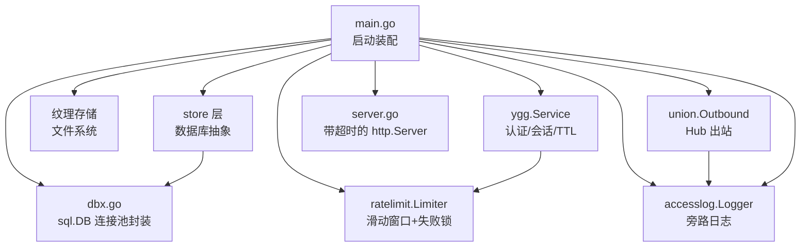
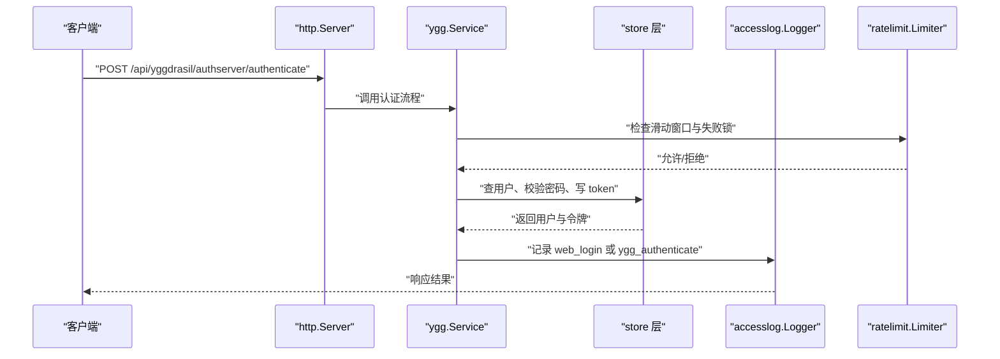
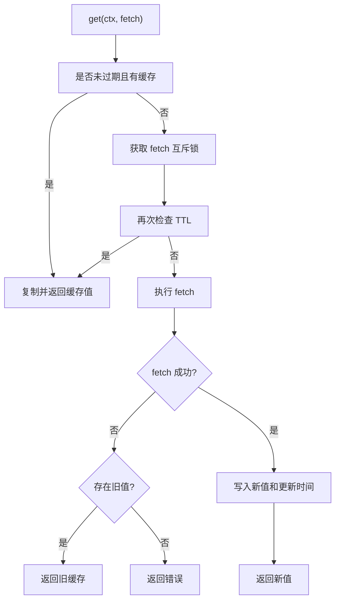
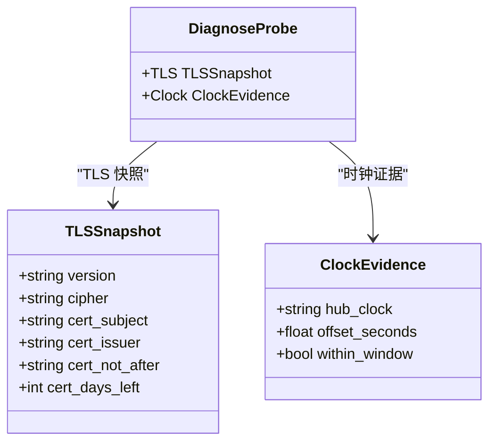
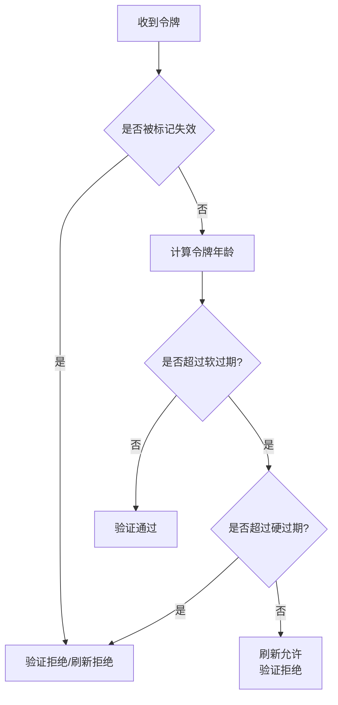
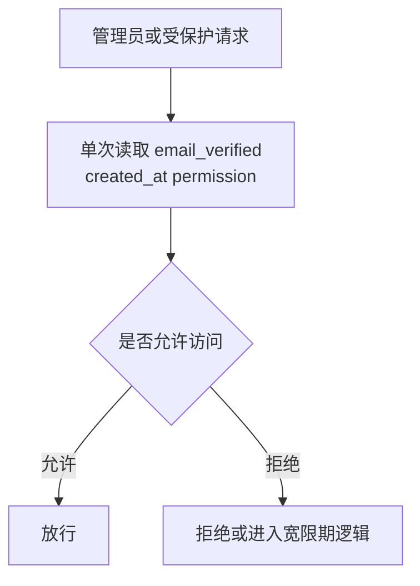
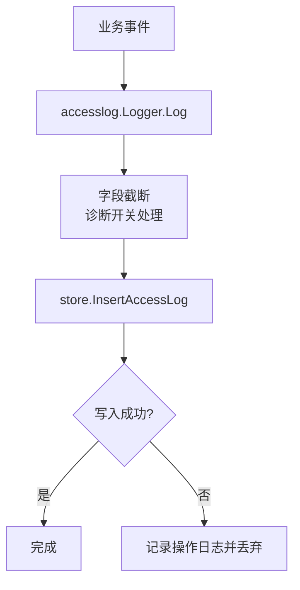
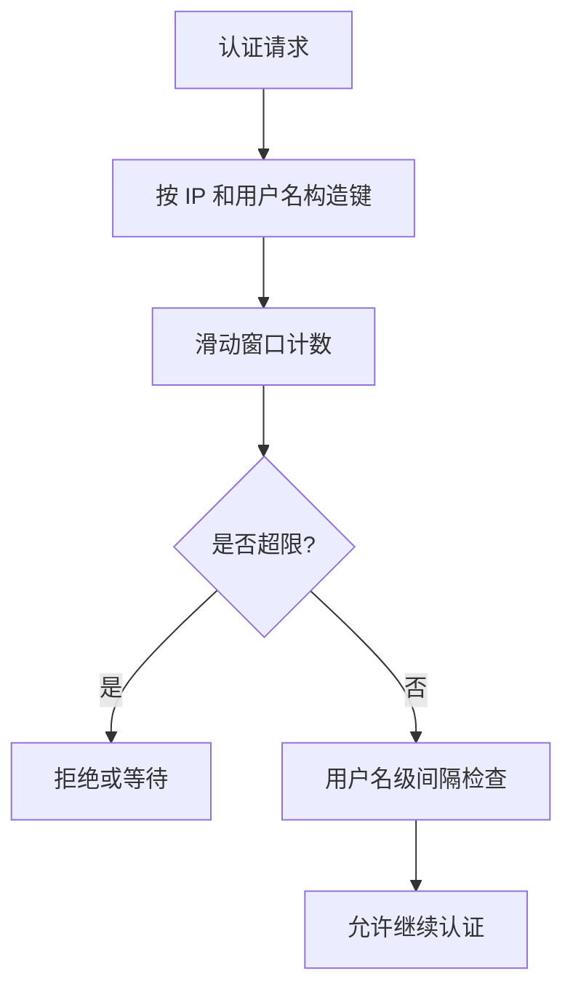
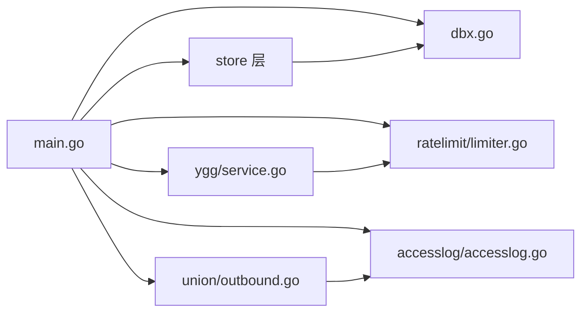
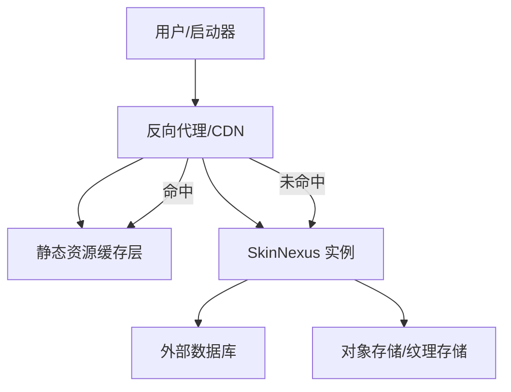

# 性能与可扩展性

**本文引用的文件**
- [main.go](https://github.com/YimingZhanshen/skin-nexus/blob/797ae1a/server/cmd/skin-nexus/main.go)
- [landing_cache.go](https://github.com/YimingZhanshen/skin-nexus/blob/797ae1a/server/cmd/skin-nexus/landing_cache.go)
- [server.go](https://github.com/YimingZhanshen/skin-nexus/blob/797ae1a/server/cmd/skin-nexus/server.go)
- [gate_state.go](https://github.com/YimingZhanshen/skin-nexus/blob/797ae1a/server/internal/store/gate_state.go)
- [dbx.go](https://github.com/YimingZhanshen/skin-nexus/blob/797ae1a/server/internal/dbx/dbx.go)
- [accesslog.go](https://github.com/YimingZhanshen/skin-nexus/blob/797ae1a/server/internal/accesslog/accesslog.go)
- [limiter.go](https://github.com/YimingZhanshen/skin-nexus/blob/797ae1a/server/internal/ratelimit/limiter.go)
- [outbound.go](https://github.com/YimingZhanshen/skin-nexus/blob/797ae1a/server/internal/outbound/outbound.go)
- [diagnose_probe.go](https://github.com/YimingZhanshen/skin-nexus/blob/797ae1a/server/internal/union/diagnose_probe.go)
- [ttl_test.go](https://github.com/YimingZhanshen/skin-nexus/blob/797ae1a/server/internal/ygg/ttl_test.go)
- [service.go](https://github.com/YimingZhanshen/skin-nexus/blob/797ae1a/server/internal/ygg/service.go)
- [accesslog_integration_test.go](https://github.com/YimingZhanshen/skin-nexus/blob/797ae1a/server/internal/store/accesslog_integration_test.go)

## 目录
1. [引言](#引言)
2. [项目结构与性能边界](#项目结构与性能边界)
3. [核心瓶颈组件](#核心瓶颈组件)
4. [架构总览](#架构总览)
5. [关键组件深度分析](#关键组件深度分析)
6. [依赖关系与耦合分析](#依赖关系与耦合分析)
7. [性能基准与观察指标](#性能基准与观察指标)
8. [水平扩展与静态资源缓存](#水平扩展与静态资源缓存)
9. [扩容、压测与问题复现指南](#扩容压测与问题复现指南)
10. [结论](#结论)

## 引言
SkinNexus 是一个以 Go 编写的 Minecraft 皮肤与身份服务，承担 Yggdrasil 兼容接口、Web 管理面板、Union 联盟出站、纹理存储、插件宿主和访问日志等职责。从性能角度看，它不是单一热点，而是由数据库读写、静态纹理、落地页聚合统计、认证令牌 TTL 校验、Union 诊断探针、出站请求限流以及访问日志写入等多个子系统共同构成负载面。

本文的目标是：
- 定位不同负载下的真实瓶颈；
- 解释落地页缓存、single-flight、TTL 双窗口、状态门控和访问日志旁路的设计如何避免雪崩；
- 给出多实例共享外部数据库和对象存储的扩展方案；
- 明确反向代理如何缓存静态资源；
- 提供数据库连接数、磁盘 IO、CPU、内存、带宽等基准指标；
- 输出可执行的扩容步骤、压测方法、慢查询定位、缓存命中率分析和复现清单。

## 项目结构与性能边界
命令入口 `server/cmd/skin-nexus/main.go` 负责加载配置、打开数据库、执行迁移、初始化纹理存储、SEO、主题市场、插件宿主、Yggdrasil 服务、Union 模块、Web API、管理 API、访问日志清理定时任务等。HTTP 监听器在 `server/cmd/skin-nexus/server.go` 中构建，设置了读头超时、读超时、写超时、空闲超时和最大头部大小，防止慢客户端耗尽 goroutine 或文件描述符。

**图表来源**
- [main.go:1-200](https://github.com/YimingZhanshen/skin-nexus/blob/797ae1a/server/cmd/skin-nexus/main.go#L1-L200)
- [server.go:1-24](https://github.com/YimingZhanshen/skin-nexus/blob/797ae1a/server/cmd/skin-nexus/server.go#L1-L24)
- [dbx.go:1-120](https://github.com/YimingZhanshen/skin-nexus/blob/797ae1a/server/internal/dbx/dbx.go#L1-L120)

**章节来源**
- [main.go:1-200](https://github.com/YimingZhanshen/skin-nexus/blob/797ae1a/server/cmd/skin-nexus/main.go#L1-L200)
- [server.go:1-24](https://github.com/YimingZhanshen/skin-nexus/blob/797ae1a/server/cmd/skin-nexus/server.go#L1-L24)

## 核心瓶颈组件
| 组件 | 主要负载特征 | 当前保护机制 | 潜在风险 |
|---|---|---|---|
| 数据库连接池 | 登录、注册、玩家查询、纹理元数据、Union 同步、管理查询、访问日志写入 | dbx 包装 `database/sql`；GateState 单行读取；AccessLogs 定期清理 | 连接数不足、慢查询、事务竞争、分页参数溢出 |
| 静态纹理分发 | `/textures/{hash}`、皮肤预览、主题资源 | 文件系统直出；服务端有写超时和头部大小限制 | 大文件上传阻塞、磁盘 IO 饱和、带宽打满 |
| 落地页统计缓存 | 用户数、玩家数、纹理数、热门库排序 | 60s TTL + single-flight + 旧值回退 | 全表排序导致单次请求成本过高 |
| Union 诊断探针 | 调用 Hub `/diagnose`，记录 TLS 握手和时钟偏差 | 独立探针结构、TLS 快照、Date 头时间差判断 | 网络抖动、证书过期、时钟漂移 |
| 出站请求限流 | 同用户名认证间隔、令牌数量上限、搜索上限 | ratelimit 滑动窗口 + 失败锁；ygg 服务解析器热更新阈值 | 单机内存键空间膨胀、跨实例不一致 |
| 访问日志写入 | Web 登录、Yggdrasil 流量、Union 出入站、插件事件 | Logger 零值安全、字段截断、失败不返回错误、后台清表 | 日志写入阻塞主流程、明细窗口泄漏敏感信息 |

**章节来源**
- [dbx.go:1-120](https://github.com/YimingZhanshen/skin-nexus/blob/797ae1a/server/internal/dbx/dbx.go#L1-L120)
- [landing_cache.go:1-68](https://github.com/YimingZhanshen/skin-nexus/blob/797ae1a/server/cmd/skin-nexus/landing_cache.go#L1-L68)
- [diagnose_probe.go:1-99](https://github.com/YimingZhanshen/skin-nexus/blob/797ae1a/server/internal/union/diagnose_probe.go#L1-L99)
- [limiter.go:1-187](https://github.com/YimingZhanshen/skin-nexus/blob/797ae1a/server/internal/ratelimit/limiter.go#L1-L187)
- [accesslog.go:1-134](https://github.com/YimingZhanshen/skin-nexus/blob/797ae1a/server/internal/accesslog/accesslog.go#L1-L134)

## 架构总览
SkinNexus 的请求路径可以划分为五类：
1. **认证与会话**：Yggdrasil authenticate / refresh / join / hasJoined / profile。
2. **纹理与静态资源**：皮肤图片、主题静态文件、管理面板前端。
3. **业务 API**：Web API、公开 API、管理 API。
4. **Union 联盟通信**：成员站点到 Hub 的出站请求。
5. **观测面**：访问日志、审计、诊断报告。

**图表来源**
- [main.go:200-500](https://github.com/YimingZhanshen/skin-nexus/blob/797ae1a/server/cmd/skin-nexus/main.go#L200-L500)
- [service.go:1-200](https://github.com/YimingZhanshen/skin-nexus/blob/797ae1a/server/internal/ygg/service.go#L1-L200)
- [accesslog.go:1-134](https://github.com/YimingZhanshen/skin-nexus/blob/797ae1a/server/internal/accesslog/accesslog.go#L1-L134)
- [limiter.go:1-187](https://github.com/YimingZhanshen/skin-nexus/blob/797ae1a/server/internal/ratelimit/limiter.go#L1-L187)

**章节来源**
- [main.go:200-500](https://github.com/YimingZhanshen/skin-nexus/blob/797ae1a/server/cmd/skin-nexus/main.go#L200-L500)
- [service.go:1-200](https://github.com/YimingZhanshen/skin-nexus/blob/797ae1a/server/internal/ygg/service.go#L1-L200)

## 关键组件深度分析

### 落地页统计缓存与 single-flight
落地页聚合统计包含三个 COUNT 和一个按点赞数排序的热门纹理列表。注释明确指出，S23 压测发现热门库排序会对整个公共库进行排序，因此每次请求都重新计算会非常昂贵。实现采用一个短 TTL 加 single-flight 的结构：
- 普通命中只复制一份轻量结构并返回，不持有写锁。
- 冷路径通过 `fetchMu` 串行化一次 fetch，避免突发请求重复计算。
- fetch 失败时，如果已有旧值则返回旧值，保证“过期的数字”优于“空白页面”。

**图表来源**
- [landing_cache.go:1-68](https://github.com/YimingZhanshen/skin-nexus/blob/797ae1a/server/cmd/skin-nexus/landing_cache.go#L1-L68)

**章节来源**
- [landing_cache.go:1-68](https://github.com/YimingZhanshen/skin-nexus/blob/797ae1a/server/cmd/skin-nexus/landing_cache.go#L1-L68)

### Union 诊断探针
Union 的诊断报告不仅要说明 Hub 是否可达，还要记录本实例对 Hub 的实际连接情况。`diagnose_probe.go` 从已经发生的响应中提取 TLS 版本、加密套件、证书主体、签发者、过期时间和剩余天数，并从 Date 头解析 Hub 时钟与本地时钟的偏移量。这样操作面板不会把“握手不可用”和“证书过期”混为一谈，也不会因为无法解析 Date 头而误判为时钟完全同步。

**图表来源**
- [diagnose_probe.go:1-99](https://github.com/YimingZhanshen/skin-nexus/blob/797ae1a/server/internal/union/diagnose_probe.go#L1-L99)

**章节来源**
- [diagnose_probe.go:1-99](https://github.com/YimingZhanshen/skin-nexus/blob/797ae1a/server/internal/union/diagnose_probe.go#L1-L99)

### Ygg TTL 测试反映的认证响应缓存思路
`ttl_test.go` 描述了双 TTL 窗口语义：
- 小于软过期：验证和刷新均通过。
- 软过期但小于硬过期：验证拒绝，但刷新仍可生成新令牌。
- 超过硬过期：两者均拒绝，需要重新登录。
- 被标记为失效的令牌：无论年龄，验证和刷新都拒绝。
- CreatedAt 为零且已软过期：刷新走 fail-closed，不能恢复。
- 可通过 resolver 覆盖默认软/硬窗口，使配置热生效。

这体现了一个重要性能原则：**不要缓存错误的认证决策**。TTL 校验是实时计算，但可以通过配置 resolver 和令牌存储组合，让高频路径尽量命中“快速失败”或“快速通过”，而不是每次都去外部系统做完整重放。

**图表来源**
- [ttl_test.go:1-211](https://github.com/YimingZhanshen/skin-nexus/blob/797ae1a/server/internal/ygg/ttl_test.go#L1-L211)

**章节来源**
- [ttl_test.go:1-211](https://github.com/YimingZhanshen/skin-nexus/blob/797ae1a/server/internal/ygg/ttl_test.go#L1-L211)

### GateState 状态门控避免雪崩
`gate_state.go` 强调：Web 面板需要同时知道邮箱是否已验证、宽限期起点和用户权限，这三个值必须来自一次单行读取。如果拆成三次读取，可能在两次读取之间发生邮箱验证变更，导致一个请求既被视为“刚刚验证”，又被判定“仍被阻止”。这种一致性缺陷正是雪崩式误判的来源。

**图表来源**
- [gate_state.go:1-60](https://github.com/YimingZhanshen/skin-nexus/blob/797ae1a/server/internal/store/gate_state.go#L1-L60)

**章节来源**
- [gate_state.go:1-60](https://github.com/YimingZhanshen/skin-nexus/blob/797ae1a/server/internal/store/gate_state.go#L1-L60)

### 访问日志写入的旁路设计
`accesslog.go` 明确声明：记录行为绝不改变请求路径。Logger 零值安全；sink 错误只记录到操作日志并被丢弃；字段按列长度截断；诊断模式关闭时 capture 字段直接丢弃；上下文被分离以避免客户端断开后日志丢失。后台定时任务每 6 小时清理 90 天前的访问日志，并单独清理诊断明细中的凭据。

**图表来源**
- [accesslog.go:1-134](https://github.com/YimingZhanshen/skin-nexus/blob/797ae1a/server/internal/accesslog/accesslog.go#L1-L134)
- [main.go:500-840](https://github.com/YimingZhanshen/skin-nexus/blob/797ae1a/server/cmd/skin-nexus/main.go#L500-L840)

**章节来源**
- [accesslog.go:1-134](https://github.com/YimingZhanshen/skin-nexus/blob/797ae1a/server/internal/accesslog/accesslog.go#L1-L134)
- [main.go:500-840](https://github.com/YimingZhanshen/skin-nexus/blob/797ae1a/server/cmd/skin-nexus/main.go#L500-L840)
- [accesslog_integration_test.go:1-106](https://github.com/YimingZhanshen/skin-nexus/blob/797ae1a/server/internal/store/accesslog_integration_test.go#L1-L106)

### 出站请求限流与外部出站防护
`ratelimit/limiter.go` 提供基于 IP 的滑动窗口和基于标识符的连续失败锁。`ygg/service.go` 将认证间隔、令牌数量上限、搜索上限暴露为 per-request resolver，从而支持管理面板热更新。`outbound/outbound.go` 是市场下载客户端，限制仅 GET、禁止非公网地址、禁止重定向、限制响应大小，并关闭连接复用，避免被恶意下游拖垮。

**图表来源**
- [limiter.go:1-187](https://github.com/YimingZhanshen/skin-nexus/blob/797ae1a/server/internal/ratelimit/limiter.go#L1-L187)
- [service.go:1-200](https://github.com/YimingZhanshen/skin-nexus/blob/797ae1a/server/internal/ygg/service.go#L1-L200)
- [outbound.go:1-167](https://github.com/YimingZhanshen/skin-nexus/blob/797ae1a/server/internal/outbound/outbound.go#L1-L167)

**章节来源**
- [limiter.go:1-187](https://github.com/YimingZhanshen/skin-nexus/blob/797ae1a/server/internal/ratelimit/limiter.go#L1-L187)
- [service.go:1-200](https://github.com/YimingZhanshen/skin-nexus/blob/797ae1a/server/internal/ygg/service.go#L1-L200)
- [outbound.go:1-167](https://github.com/YimingZhanshen/skin-nexus/blob/797ae1a/server/internal/outbound/outbound.go#L1-L167)

## 依赖关系与耦合分析

- **松耦合点**：accesslog 通过 sink 注入 store 层，不影响业务响应；Union Outbound 通过原子值热切换启用状态、API Root 和成员密钥；Ygg Service 通过 resolver 热更新 TTL、速率限制和搜索上限。
- **紧耦合点**：main.go 集中装配所有子系统；store 层直接依赖 dbx 的 SQL 改写和连接池；Ygg Service 依赖 limiter 的状态，而 limiter 是进程内内存结构，横向扩展时需要在多个实例间保持一致策略。

**图表来源**
- [main.go:1-200](https://github.com/YimingZhanshen/skin-nexus/blob/797ae1a/server/cmd/skin-nexus/main.go#L1-L200)
- [dbx.go:1-120](https://github.com/YimingZhanshen/skin-nexus/blob/797ae1a/server/internal/dbx/dbx.go#L1-L120)
- [service.go:1-200](https://github.com/YimingZhanshen/skin-nexus/blob/797ae1a/server/internal/ygg/service.go#L1-L200)
- [limiter.go:1-187](https://github.com/YimingZhanshen/skin-nexus/blob/797ae1a/server/internal/ratelimit/limiter.go#L1-L187)

**章节来源**
- [main.go:1-200](https://github.com/YimingZhanshen/skin-nexus/blob/797ae1a/server/cmd/skin-nexus/main.go#L1-L200)
- [dbx.go:1-120](https://github.com/YimingZhanshen/skin-nexus/blob/797ae1a/server/internal/dbx/dbx.go#L1-L120)
- [limiter.go:1-187](https://github.com/YimingZhanshen/skin-nexus/blob/797ae1a/server/internal/ratelimit/limiter.go#L1-L187)

## 性能基准与观察指标
建议在生产环境建立以下基线，并按负载类型分别采集：

| 维度 | 推荐观察指标 | 解读与建议 |
|---|---|---|
| 数据库连接池 | 活跃连接数、等待连接数、连接创建/销毁次数、最大连接数、慢查询率 | 若活跃连接长期接近上限，应增加最大连接数或优化慢查询；若连接频繁创建销毁，需检查连接复用和事务粒度 |
| 磁盘 IO | 吞吐、IOPS、队列长度、延迟、纹理目录扫描耗时 | 纹理目录扫描用于仪表盘容量统计，高并发下可能放大 IO；考虑缓存或直接使用对象存储元数据 |
| CPU | 用户态/内核态 CPU、goroutine 数量、GC 暂停 | 大量 goroutine 且 CPU 不高，可能是 I/O 或锁竞争；GC 暂停长需关注大对象分配和日志 capture |
| 内存 | RSS、堆使用、map 容量、leak 趋势 | limiter 的 requests/fails map 和 accesslog 内存态数据需随键空间增长监控 |
| 带宽 | 入站/出站带宽、连接数、TLS 握手次数、响应体大小分布 | 静态纹理通常主导带宽；Union 诊断和 fallback 请求应限制频率和响应大小 |
| 应用指标 | 各端点 P50/P95/P99 延迟、错误率、缓存命中率、日志写入延迟 | 落地页 TTL 命中率、Ygg TTL 分支比例、Union 探针成功率是关键健康信号 |

具体实践中，压测时应区分：
- 登录峰值：重点看 limiter、数据库密码校验、token 写入。
- 纹理下载峰值：重点看带宽、磁盘顺序读、反向代理缓存命中。
- 管理面板刷新：重点看纹理目录扫描、Union 诊断、TTL 配置读取。
- Union 诊断风暴：重点看 Hub 连通性、TLS 证书、时钟偏差。

## 水平扩展与静态资源缓存

### 多实例共享外部数据库
每个 SkinNexus 实例运行独立进程，但共享同一个外部数据库。这意味着：
- 数据库是真正的共享状态源；
- 认证、会话、用户、纹理元数据、访问日志、Union 状态都必须持久化；
- 进程内 limiter、landingStatsCache、诊断临时状态不能作为跨实例一致源；
- 连接池大小应按实例数乘以每实例最大并发连接数来规划，并设置数据库侧最大连接数上限。

建议在部署配置中固定：
- 每实例数据库最大连接数；
- 每实例 idle 连接数；
- 连接超时；
- 查询超时；
- 慢查询阈值；
- 数据库引擎的最大事务数和最大语句数。

**章节来源**
- [dbx.go:1-120](https://github.com/YimingZhanshen/skin-nexus/blob/797ae1a/server/internal/dbx/dbx.go#L1-L120)
- [main.go:1-200](https://github.com/YimingZhanshen/skin-nexus/blob/797ae1a/server/cmd/skin-nexus/main.go#L1-L200)

### 对象存储替代本地纹理目录
当纹理规模变大时，本地文件系统的目录扫描和随机读会成为瓶颈。可将纹理目录迁移到对象存储（如 S3、MinIO、OSS），并在 SkinNexus 中接入只读对象存储 SDK：
- 纹理上传改为写入对象存储；
- 纹理下载改为对象存储预签名 URL 或流式读取；
- 管理面板容量统计改为对象存储列表 API，不再 walk 本地目录；
- 保留本地缓存盘作为热点纹理二级缓存，设置合理 TTL 和淘汰策略。

### 反向代理缓存静态资源
静态纹理和 SPA 前端适合放在反向代理或 CDN 前：
- 使用强缓存和不变 URL：纹理哈希路径天然适合 immutable cache。
- 为 HTML 和动态 JSON 设置较短缓存或 no-store。
- 为 `/textures/*` 开启上游缓存，并根据后端返回的 Cache-Control 决定是否缓存。
- 利用反向代理的连接复用减少 SkinNexus 的 TCP/TLS 开销。
- 对大体积纹理启用分块传输和范围请求，避免单个连接长时间占用。

[此图为概念图，不对应具体源码文件]

## 扩容、压测与问题复现指南

### 扩容步骤
1. **确认数据库能力**：先评估现有数据库的最大连接数、慢查询阈值、索引覆盖率和备份恢复时间。
2. **确定每实例并发模型**：根据 goroutine 数量和 CPU 核数估算每实例 QPS。
3. **设置连接池上限**：确保 `(实例数 × 每实例最大连接数) ≤ 数据库最大连接数`。
4. **启用访问日志清理**：确认后台任务每 6 小时清理 90 天前日志，并清理诊断明细凭据。
5. **逐步上线实例**：先 1 个实例压测，再增加到 2 个，最后达到目标规模。
6. **观察跨实例一致性**：确认 limiter 行为只在单实例内生效；如果需要全局防刷，应前置网关层限流。
7. **迁移纹理存储**：如需对象存储，先在只读模式下验证下载路径，再切写路径。

**章节来源**
- [main.go:500-840](https://github.com/YimingZhanshen/skin-nexus/blob/797ae1a/server/cmd/skin-nexus/main.go#L500-L840)
- [accesslog.go:1-134](https://github.com/YimingZhanshen/skin-nexus/blob/797ae1a/server/internal/accesslog/accesslog.go#L1-L134)

### 压测方法
| 场景 | 压测工具建议 | 输入参数 | 成功标准 |
|---|---|---|---|
| 登录峰值 | 并发 POST authenticate | 用户数、密码错误比例、IP 分布 | P95 延迟稳定、错误率低于阈值、limiter 触发符合预期 |
| 纹理下载 | 并发 GET textures/hash | 文件数量、文件大小、带宽上限 | 带宽利用率达标、代理缓存命中率高于目标 |
| 管理面板 | 低频高复杂度请求 | 文本库排序、Union 诊断、选项读取 | 无慢查询、目录扫描不阻塞 |
| Union 诊断 | 控制频率探测 Hub | 超时、重试、证书有效期 | 探针报告含 TLS 和时钟证据，错误原因可区分 |
| 访问日志写入 | 混合业务 + 日志写入 | 日志种类、capture 开关、清理周期 | 日志不阻塞主请求，90 天后自动清理 |

### 慢查询定位
1. 开启数据库慢查询日志，阈值设为略高于 P95 延迟。
2. 优先排查：
   - 落地页热门纹理排序；
   - 访问日志列表模糊搜索；
   - Union 同步或删除回调；
   - 纹理元数据批量查询；
   - 用户权限和邮箱验证门控查询。
3. 使用 explain 查看是否命中唯一索引、是否全表扫描、是否回表过多。
4. 对分页查询注意 `dbx.Offset` 的整数溢出保护，避免超大页码产生异常 OFFSET。

**章节来源**
- [dbx.go:120-200](https://github.com/YimingZhanshen/skin-nexus/blob/797ae1a/server/internal/dbx/dbx.go#L120-L200)
- [accesslog_integration_test.go:1-106](https://github.com/YimingZhanshen/skin-nexus/blob/797ae1a/server/internal/store/accesslog_integration_test.go#L1-L106)

### 缓存命中率分析
| 缓存项 | 命中条件 | 未命中影响 | 监控建议 |
|---|---|---|---|
| 落地页统计缓存 | 60s 内相同聚合查询 | 每次冷路径执行三次 COUNT 和热门排序 | 记录冷路径调用次数、fetch 错误率、旧值回退次数 |
| Ygg TTL 校验 | 本地令牌 + 双窗口计算 | 不依赖外部缓存，但可优化 resolver 读取 | 观察 soft/hard/dead 三类令牌比例 |
| 反向代理静态缓存 | 不变 URL + 正确 Cache-Control | 全部回源到 SkinNexus | 代理层统计命中/未命中、上游延迟 |
| 对象存储热缓存 | 本地二级缓存 TTL | 回源对象存储 | 统计对象存储请求数、延迟、带宽 |

### 问题复现清单
遇到性能问题时，按以下清单收集信息：
1. **负载类型**：登录、纹理、管理面板、Union 诊断、日志写入。
2. **时间范围**：问题开始时间、持续时间、是否周期性。
3. **实例数量**：单实例还是多实例。
4. **数据库指标**：连接数、慢查询、锁等待、复制延迟。
5. **磁盘指标**：纹理目录大小、IO 延迟、对象存储请求量。
6. **CPU 与内存**：goroutine 数量、GC 暂停、heap size。
7. **网络指标**：带宽、TLS 握手失败、Hub 连通性、证书有效期。
8. **缓存状态**：落地页 TTL 是否过期、代理缓存是否命中、limiter 是否锁住用户名。
9. **日志证据**：access_logs 中对应 kind 和 outcome；Union diagnose report 中的 cause 和 probe。
10. **最小复现**：是否能用少量用户、少量纹理、固定 IP 和固定请求序列复现。

**章节来源**
- [diagnose_probe.go:1-99](https://github.com/YimingZhanshen/skin-nexus/blob/797ae1a/server/internal/union/diagnose_probe.go#L1-L99)
- [accesslog.go:1-134](https://github.com/YimingZhanshen/skin-nexus/blob/797ae1a/server/internal/accesslog/accesslog.go#L1-L134)
- [limiter.go:1-187](https://github.com/YimingZhanshen/skin-nexus/blob/797ae1a/server/internal/ratelimit/limiter.go#L1-L187)
- [landing_cache.go:1-68](https://github.com/YimingZhanshen/skin-nexus/blob/797ae1a/server/cmd/skin-nexus/landing_cache.go#L1-L68)

## 结论
SkinNexus 的性能设计围绕“避免雪崩、降低冷路径成本、保持协议响应不受观测副作用影响”展开：
- 落地页统计用短 TTL 和 single-flight 把突发计算收敛为一次；
- GateState 用单行读取避免验证状态在多次读取间不一致；
- Ygg TTL 用双窗口和 fail-closed 保证认证决策清晰可控；
- Union 诊断探针把 TLS 和时钟差异显式化，帮助区分证书、网络和时钟问题；
- 访问日志始终旁路写入，失败不破坏业务响应；
- 限流使用进程内滑动窗口和失败锁，适合单实例保护，但横向扩展时需要网关层补充。

真正支撑水平扩展的关键是：**外部数据库和对象存储作为唯一事实源，反向代理承载静态缓存，应用实例无状态或仅保存短暂本地状态**。在此基础上，通过连接池调优、慢查询治理、缓存命中率监控和结构化压测，才能持续识别瓶颈并安全扩容。
