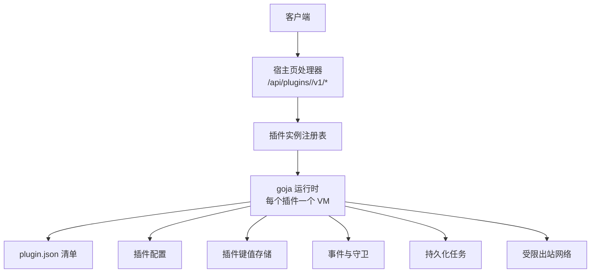
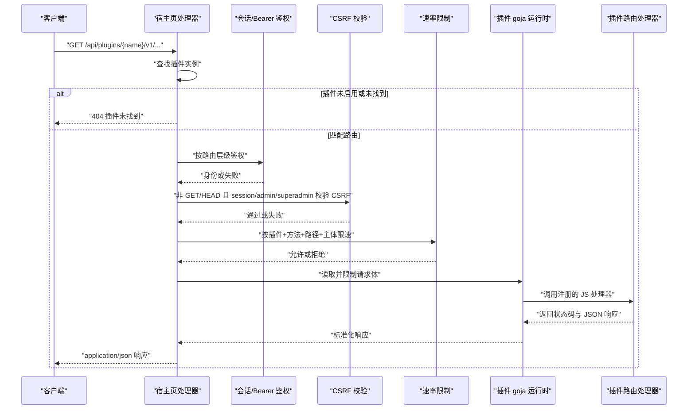
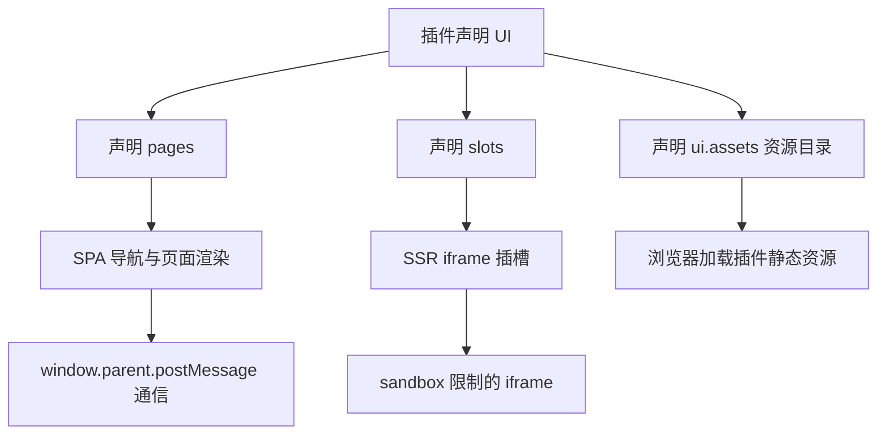
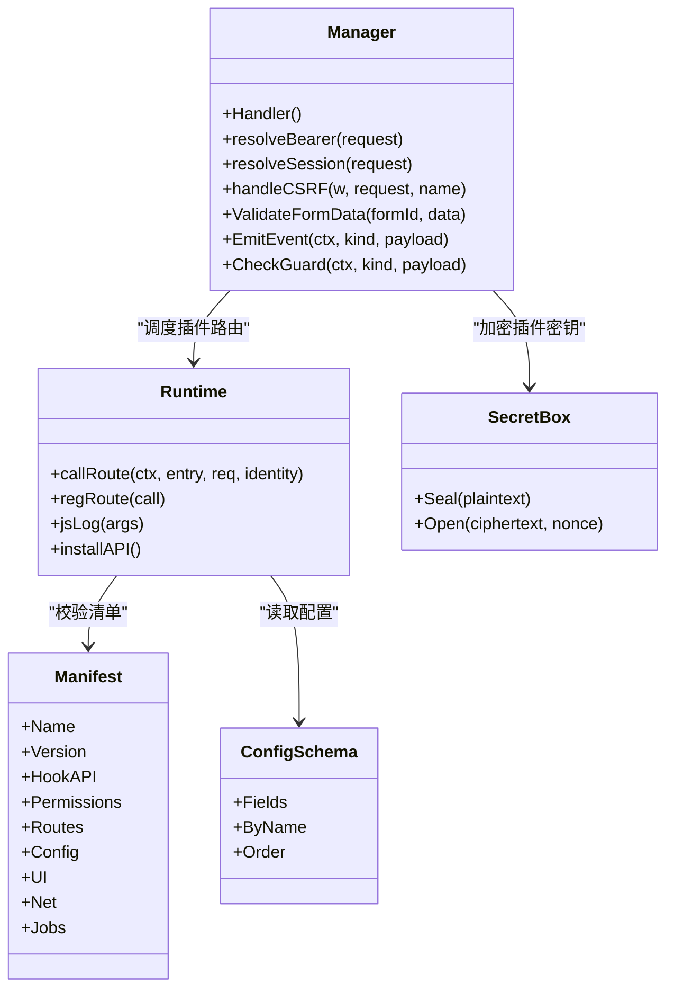

# 插件 API（/api/plugins/*/v1）

**本文引用的文件**
- [contract.go](https://github.com/YimingZhanshen/skin-nexus/blob/797ae1a/server/internal/plugin/contract.go)
- [routes.go](https://github.com/YimingZhanshen/skin-nexus/blob/797ae1a/server/internal/plugin/routes.go)
- [runtime_goja.go](https://github.com/YimingZhanshen/skin-nexus/blob/797ae1a/server/internal/plugin/runtime_goja.go)
- [manifest.go](https://github.com/YimingZhanshen/skin-nexus/blob/797ae1a/server/internal/plugin/manifest.go)
- [config.go](https://github.com/YimingZhanshen/skin-nexus/blob/797ae1a/server/internal/plugin/config.go)
- [events.go](https://github.com/YimingZhanshen/skin-nexus/blob/797ae1a/server/internal/plugin/events.go)
- [secrets.go](https://github.com/YimingZhanshen/skin-nexus/blob/797ae1a/server/internal/plugin/secrets.go)
- [ui.go](https://github.com/YimingZhanshen/skin-nexus/blob/797ae1a/server/internal/plugin/ui.go)
- [forms.go](https://github.com/YimingZhanshen/skin-nexus/blob/797ae1a/server/internal/plugin/forms.go)
- [index.js](https://github.com/YimingZhanshen/skin-nexus/blob/797ae1a/examples/plugins/hello-world/index.js)
- [plugin.json](https://github.com/YimingZhanshen/skin-nexus/blob/797ae1a/examples/plugins/hello-ui/plugin.json)
- [hello.html](https://github.com/YimingZhanshen/skin-nexus/blob/797ae1a/examples/plugins/hello-ui/ui/hello.html)

## 目录
1. [简介](#简介)
2. [项目结构](#项目结构)
3. [核心组件](#核心组件)
4. [架构总览](#架构总览)
5. [详细组件分析](#详细组件分析)
6. [依赖关系分析](#依赖关系分析)
7. [性能与沙箱限制](#性能与沙箱限制)
8. [故障排查指南](#故障排查指南)
9. [结论](#结论)

## 简介
本文面向插件开发者，说明基于 `/api/plugins/{pluginName}/v1/*` 的插件 HTTP API。插件通过 `plugin.json` 声明路由、权限、配置和 UI；宿主在启用后为每个插件提供独立的 goja JavaScript 运行时，并通过 `skin.*` API 暴露钩子、配置、存储、事件、网络访问、任务、账户和玩家等能力。

插件路由分为三档：
- `http.routes`：公开 GET/HEAD 路由，无需登录。
- `http.routes.bearer`：需要 Bearer Token 认证，通常用于外部系统或程序化调用。
- `http.routes.form`：表单提交语义，实际对应 session/admin/superadmin 路由中的 POST/PUT/PATCH/DELETE 场景，受 CSRF 保护。

命名空间隔离、插件密钥、配置项和事件钩子的使用方式也将在本文展开。

## 项目结构
本功能由服务端插件子系统实现，示例插件位于 `examples/plugins` 目录：
- `hello-world`：零权限最小插件，仅加载时输出日志。
- `hello-ui`：演示 iframe 页面、插槽、国际化与资源路径。
- `jobs-fixture`：演示 job 注册和 route 组合，用于任务队列调试。

**图表来源**
- [routes.go:1-200](https://github.com/YimingZhanshen/skin-nexus/blob/797ae1a/server/internal/plugin/routes.go#L1-L200)
- [runtime_goja.go:1-200](https://github.com/YimingZhanshen/skin-nexus/blob/797ae1a/server/internal/plugin/runtime_goja.go#L1-L200)
- [manifest.go:1-120](https://github.com/YimingZhanshen/skin-nexus/blob/797ae1a/server/internal/plugin/manifest.go#L1-L120)

**章节来源**
- [manifest.go:1-120](https://github.com/YimingZhanshen/skin-nexus/blob/797ae1a/server/internal/plugin/manifest.go#L1-L120)

## 核心组件
- 插件清单 `Manifest`：定义名称、版本、入口脚本、权限、路由、UI、网络、任务等元数据。
- 路由层级 `RouteTier`：public、session、admin、superadmin、bearer。
- 插件运行时 `runtime`：封装单个 goja 实例、钩子集合、已注册路由、超时计数、日志和错误。
- 插件管理器 `Manager`：负责请求分发、鉴权、CSRF、限流、访问日志、事件广播和守卫检查。
- 配置子系统：解析 JSON Schema 子集，生成管理面板字段，并在运行时提供 `skin.config.get/all`。
- 安全存储：使用 AES-256-GCM 加密插件 secret 配置。
- UI 子系统：导出插件页面、插槽和表单 schema，供 SPA 和 SSR 渲染。

**章节来源**
- [contract.go:1-200](https://github.com/YimingZhanshen/skin-nexus/blob/797ae1a/server/internal/plugin/contract.go#L1-L200)
- [runtime_goja.go:1-200](https://github.com/YimingZhanshen/skin-nexus/blob/797ae1a/server/internal/plugin/runtime_goja.go#L1-L200)
- [config.go:1-120](https://github.com/YimingZhanshen/skin-nexus/blob/797ae1a/server/internal/plugin/config.go#L1-L120)
- [secrets.go:1-113](https://github.com/YimingZhanshen/skin-nexus/blob/797ae1a/server/internal/plugin/secrets.go#L1-L113)
- [ui.go:1-138](https://github.com/YimingZhanshen/skin-nexus/blob/797ae1a/server/internal/plugin/ui.go#L1-L138)

## 架构总览
插件 API 的请求处理流程如下：

**图表来源**
- [routes.go:1-200](https://github.com/YimingZhanshen/skin-nexus/blob/797ae1a/server/internal/plugin/routes.go#L1-L200)
- [routes.go:201-497](https://github.com/YimingZhanshen/skin-nexus/blob/797ae1a/server/internal/plugin/routes.go#L201-L497)
- [runtime_goja.go:560-745](https://github.com/YimingZhanshen/skin-nexus/blob/797ae1a/server/internal/plugin/runtime_goja.go#L560-L745)

## 详细组件分析

### 插件路由模型与 URL 模式
插件路由以 `/api/plugins/{pluginName}` 为根，插件自身注册的路径必须以 `/v1/...` 开头，例如：
- 公开接口：`/api/plugins/{pluginName}/v1/public/hello`
- Bearer 接口：`/api/plugins/{pluginName}/v1/bearer/resource`
- 表单接口：`/api/plugins/{pluginName}/v1/form/update`

插件通过 `skin.route(method, path, handler)` 注册路由，其中 `path` 必须与 `plugin.json` 中 `routes[*].path` 完全一致。路径支持：
- 精确匹配：`/v1/items`
- 单段参数：`/v1/items/{id}`
- 尾段贪婪参数：`/v1/files/{path...}`

路由优先级按静态片段数量排序，越具体越优先。若方法不匹配但路径匹配，会返回 `Allow` 头列出允许的方法。

| 类型 | 声明方式 | URL 模式 | 认证机制 | 典型用途 |
|---|---|---|---|---|
| 公开路由 | `permissions: ["http:routes"]`，`tier: "public"` | `/api/plugins/{name}/v1/public/*` | 无 | 健康检查、公开查询 |
| Bearer 路由 | `permissions: ["http:routes:bearer"]`，`tier: "bearer"` | `/api/plugins/{name}/v1/bearer/*` | `Authorization: Bearer <token>` | 外部系统集成 |
| 表单路由 | 使用 session/admin/superadmin tier 的 POST/PUT/PATCH/DELETE | `/api/plugins/{name}/v1/form/*` | Cookie 会话 + CSRF | 表单提交、写操作 |

**章节来源**
- [routes.go:1-200](https://github.com/YimingZhanshen/skin-nexus/blob/797ae1a/server/internal/plugin/routes.go#L1-L200)
- [routes.go:201-497](https://github.com/YimingZhanshen/skin-nexus/blob/797ae1a/server/internal/plugin/routes.go#L201-L497)
- [runtime_goja.go:560-745](https://github.com/YimingZhanshen/skin-nexus/blob/797ae1a/server/internal/plugin/runtime_goja.go#L560-L745)

### 公开路由：`http.routes`
- 权限：`http:routes`。
- 默认层级：`public`。
- 请求：任意来源均可访问，适合只读、公开信息。
- 响应：统一为 `application/json`。
- 限制：响应体最大 1 MiB；处理器超时由 manifest 指定或宿主默认值控制。

示例：`hello-world` 插件虽然本身没有公开路由，但其清单和入口展示了零权限插件的最小形态。

**章节来源**
- [manifest.go:1-120](https://github.com/YimingZhanshen/skin-nexus/blob/797ae1a/server/internal/plugin/manifest.go#L1-L120)
- [index.js:1-1](https://github.com/YimingZhanshen/skin-nexus/blob/797ae1a/examples/plugins/hello-world/index.js#L1-L1)

### Bearer 路由：`http.routes.bearer`
Bearer 路由要求请求头包含有效的 `Authorization: Bearer <token>`。宿主通过 Yggdrasil token ledger 解析 token，并返回安全的 `SessionIdentity`，包括用户 ID、昵称和权限级别。

请求约定：
- 必须设置 `Authorization: Bearer <token>`。
- Token 为空、格式错误或过期时返回未授权错误。
- 超长 token 会被拒绝。
- 响应中包含可诊断的错误码和消息。

常见错误：
- 缺少 Authorization 头：`auth.required`。
- 非 Bearer scheme 或 token 为空：`auth.invalid_token`。
- 解析失败或无效身份：`auth.invalid_token`。
- Bearer 解析器未配置：`auth.unavailable`。

最佳实践：
- 仅在必要场景使用 Bearer 路由。
- 不要在 client 端硬编码 token。
- 对敏感写操作继续叠加业务层权限校验。

**章节来源**
- [routes.go:1-200](https://github.com/YimingZhanshen/skin-nexus/blob/797ae1a/server/internal/plugin/routes.go#L1-L200)
- [routes.go:201-497](https://github.com/YimingZhanshen/skin-nexus/blob/797ae1a/server/internal/plugin/routes.go#L201-L497)
- [contract.go:1-200](https://github.com/YimingZhanshen/skin-nexus/blob/797ae1a/server/internal/plugin/contract.go#L1-L200)

### 表单路由：`http.routes.form`
“表单路由”不是独立路由层级，而是指 session/admin/superadmin 层级的写操作。这些路由需要：
- 有效 Cookie 会话。
- 非 GET/HEAD 请求必须携带正确的 CSRF token。
- admin/superadmin 路由还需要对应权限等级。
- 可选：邮箱验证守卫可能阻止未验证用户。

CSRF 机制：
- 插件可通过 `/_csrf` 获取 CSRF token。
- Cookie 名称为 `skin_csrf`，Path 为 `/`，HttpOnly，SameSite Lax。
- 表单请求需同时设置 Header `X-CSRF-Token`，其值必须与 cookie 值相等。
- Origin 校验严格：Origin 必须与 Host 相同。

请求体约定：
- 默认最大 64 KiB。
- base64 二进制模式最大 4 MiB。
- JSON 请求体会被解码为数字对象，避免浮点精度丢失。
- 非 JSON 文本会作为字符串传递。

**章节来源**
- [routes.go:201-497](https://github.com/YimingZhanshen/skin-nexus/blob/797ae1a/server/internal/plugin/routes.go#L201-L497)

### 命名空间隔离与插件密钥
每个插件拥有独立命名空间：
- 插件名来自目录名，必须匹配 `plugin.json` 中的 name。
- 插件清单、入口脚本、资源、配置和存储都按插件名隔离。
- 插件无法直接访问其他插件的文件、配置或存储。
- 插件间通信应通过事件、任务、宿主 API 或显式 API 调用边界，而不是共享内存。

插件密钥：
- 通过 `SKIN_PLUGIN_SECRET_KEY` 环境变量或 data 目录下生成的 32 字节文件提供。
- 使用 AES-256-GCM 加密插件 secret 配置。
- 密钥丢失只会丢失加密后的插件 secret，不会泄露用户数据或纹理。
- 密钥长度、格式和权限均有严格校验。

**章节来源**
- [manifest.go:1-120](https://github.com/YimingZhanshen/skin-nexus/blob/797ae1a/server/internal/plugin/manifest.go#L1-L120)
- [secrets.go:1-113](https://github.com/YimingZhanshen/skin-nexus/blob/797ae1a/server/internal/plugin/secrets.go#L1-L113)

### 配置项与热更新
插件可在 `plugin.json` 中声明 `config`，使用 JSON Schema 子集描述字段类型、标题、默认值、枚举、必填、嵌套对象和数组。宿主会：
- 校验 schema。
- 禁止 secret 字段有默认值。
- 生成管理面板表单。
- 在运行时提供 `skin.config.get(name)` 和 `skin.config.all()`。
- 对表单输入进行规范化、长度限制和大小限制。

热更新行为：
- 启用/禁用插件不需要重启主服务进程。
- 路由从活跃注册表查找，因此启用后立即生效。
- 配置变更应由管理员界面触发，插件侧不应自行修改自身配置。

**章节来源**
- [config.go:1-120](https://github.com/YimingZhanshen/skin-nexus/blob/797ae1a/server/internal/plugin/config.go#L1-L120)
- [routes.go:1-200](https://github.com/YimingZhanshen/skin-nexus/blob/797ae1a/server/internal/plugin/routes.go#L1-L200)
- [forms.go:1-118](https://github.com/YimingZhanshen/skin-nexus/blob/797ae1a/server/internal/plugin/forms.go#L1-L118)

### 事件钩子与守卫
插件可通过 `skin.hooks.on*` 注册钩子，例如：
- 用户资料过滤
- 纹理 URL 过滤
- 纹理上传事件
- 用户生命周期事件
- 认证阶段事件
- 头像过滤

钩子回调必须在宿主指定的超时内完成；超时会被中断并记录错误。钩子默认 fail-open，除非宿主明确配置 fail-closed。

守卫：
- 插件可注册守卫函数，返回允许或拒绝决策。
- 守卫按插件顺序执行，拒绝时会返回结构化错误。
- 超级管理员可开启 break-glass 开关绕过所有守卫，该操作会被审计。

事件广播：
- 宿主通过 `EmitEvent` 发送通用事件。
- 事件队列有界，饱和时丢弃，不阻塞请求路径。

**章节来源**
- [runtime_goja.go:200-560](https://github.com/YimingZhanshen/skin-nexus/blob/797ae1a/server/internal/plugin/runtime_goja.go#L200-L560)
- [events.go:1-94](https://github.com/YimingZhanshen/skin-nexus/blob/797ae1a/server/internal/plugin/events.go#L1-L94)

### 插件存储与 UI 嵌入
插件存储：
- 插件可通过 `skin.store` 访问键值存储或文档存储，前提是声明相应权限。
- 存储键按插件命名空间隔离。
- 存储配额和配额检测由宿主保障。

UI 嵌入：
- 插件可声明 `ui.pages` 和 `ui.slots`。
- 当前 UI 实现主要使用 iframe 插槽，HTML 内容通过 `/plugin-assets/{pluginName}/{src}` 提供。
- SSR 渲染时对高度做上下限约束，并附加插件版本号缓存破坏参数。
- hello-ui 示例展示了页面、插槽、国际化以及 iframe 与父页面的 `postMessage` 通信。

**图表来源**
- [ui.go:1-138](https://github.com/YimingZhanshen/skin-nexus/blob/797ae1a/server/internal/plugin/ui.go#L1-L138)
- [plugin.json:1-29](https://github.com/YimingZhanshen/skin-nexus/blob/797ae1a/examples/plugins/hello-ui/plugin.json#L1-L29)
- [hello.html:1-20](https://github.com/YimingZhanshen/skin-nexus/blob/797ae1a/examples/plugins/hello-ui/ui/hello.html#L1-L20)

**章节来源**
- [ui.go:1-138](https://github.com/YimingZhanshen/skin-nexus/blob/797ae1a/server/internal/plugin/ui.go#L1-L138)
- [plugin.json:1-29](https://github.com/YimingZhanshen/skin-nexus/blob/797ae1a/examples/plugins/hello-ui/plugin.json#L1-L29)
- [hello.html:1-20](https://github.com/YimingZhanshen/skin-nexus/blob/797ae1a/examples/plugins/hello-ui/ui/hello.html#L1-L20)

### 实际示例代码路径

#### hello-world：最小插件
- 清单路径：[plugin.json](https://github.com/YimingZhanshen/skin-nexus/blob/797ae1a/examples/plugins/hello-world/plugin.json)
- 入口路径：[index.js](https://github.com/YimingZhanshen/skin-nexus/blob/797ae1a/examples/plugins/hello-world/index.js)
- 行为：插件加载时调用 `skin.log` 输出日志，不声明任何权限或路由。

参考路径：
- [manifest.go:1-120](https://github.com/YimingZhanshen/skin-nexus/blob/797ae1a/server/internal/plugin/manifest.go#L1-L120)
- [index.js:1-1](https://github.com/YimingZhanshen/skin-nexus/blob/797ae1a/examples/plugins/hello-world/index.js#L1-L1)

#### hello-ui：iframe 页面与插槽
- 清单路径：[plugin.json](https://github.com/YimingZhanshen/skin-nexus/blob/797ae1a/examples/plugins/hello-ui/plugin.json)
- HTML 路径：[hello.html](https://github.com/YimingZhanshen/skin-nexus/blob/797ae1a/examples/plugins/hello-ui/ui/hello.html)
- 行为：
  - 声明 `ui:page`、`ui:slot`、`ui:assets` 权限。
  - 注册一个 `/ext/hello-ui/hello` 页面和一个顶部插槽。
  - 提供多语言标题。
  - 使用 `postMessage` 向父窗口发送 ready 消息，并监听初始化消息。

参考路径：
- [plugin.json:1-29](https://github.com/YimingZhanshen/skin-nexus/blob/797ae1a/examples/plugins/hello-ui/plugin.json#L1-L29)
- [hello.html:1-20](https://github.com/YimingZhanshen/skin-nexus/blob/797ae1a/examples/plugins/hello-ui/ui/hello.html#L1-L20)
- [ui.go:1-138](https://github.com/YimingZhanshen/skin-nexus/blob/797ae1a/server/internal/plugin/ui.go#L1-L138)

### 注册路由、读取配置、访问存储和嵌入 UI 的最佳实践
- 在 `plugin.json` 中先声明所需权限，再在入口脚本中调用 `skin.route`。
- 路由路径必须与清单完全一致，否则加载失败。
- 公开路由不要假设调用方身份。
- Bearer 路由不要信任客户端传入的用户 ID，必须由宿主解析 token。
- 表单写操作必须先获取 CSRF token，并同步发送 cookie 和 header。
- 配置读取使用 `skin.config.get`，敏感值通过 secret 字段管理。
- 存储写入前判断权限和配额。
- UI 通过 iframe 暴露给宿主，避免直接操作宿主 DOM。
- 跨插件通信优先使用事件或宿主 API，不要假设另一个插件存在。

**章节来源**
- [routes.go:1-200](https://github.com/YimingZhanshen/skin-nexus/blob/797ae1a/server/internal/plugin/routes.go#L1-L200)
- [routes.go:201-497](https://github.com/YimingZhanshen/skin-nexus/blob/797ae1a/server/internal/plugin/routes.go#L201-L497)
- [runtime_goja.go:560-745](https://github.com/YimingZhanshen/skin-nexus/blob/797ae1a/server/internal/plugin/runtime_goja.go#L560-L745)
- [ui.go:1-138](https://github.com/YimingZhanshen/skin-nexus/blob/797ae1a/server/internal/plugin/ui.go#L1-L138)

## 依赖关系分析

**图表来源**
- [routes.go:1-200](https://github.com/YimingZhanshen/skin-nexus/blob/797ae1a/server/internal/plugin/routes.go#L1-L200)
- [runtime_goja.go:1-200](https://github.com/YimingZhanshen/skin-nexus/blob/797ae1a/server/internal/plugin/runtime_goja.go#L1-L200)
- [manifest.go:1-120](https://github.com/YimingZhanshen/skin-nexus/blob/797ae1a/server/internal/plugin/manifest.go#L1-L120)
- [config.go:1-120](https://github.com/YimingZhanshen/skin-nexus/blob/797ae1a/server/internal/plugin/config.go#L1-L120)
- [secrets.go:1-113](https://github.com/YimingZhanshen/skin-nexus/blob/797ae1a/server/internal/plugin/secrets.go#L1-L113)

**章节来源**
- [routes.go:1-200](https://github.com/YimingZhanshen/skin-nexus/blob/797ae1a/server/internal/plugin/routes.go#L1-L200)
- [runtime_goja.go:1-200](https://github.com/YimingZhanshen/skin-nexus/blob/797ae1a/server/internal/plugin/runtime_goja.go#L1-L200)
- [manifest.go:1-120](https://github.com/YimingZhanshen/skin-nexus/blob/797ae1a/server/internal/plugin/manifest.go#L1-L120)

## 性能与沙箱限制

### goja 运行时限制
- 每个插件一个 goja 实例，VM 交互加锁，非 goroutine 安全。
- 栈深度限制为 1024。
- 入口脚本加载超时默认为 2 秒。
- 钩子和路由调用都有超时保护，超时后会中断 VM 并记录错误。
- 路由响应体最大 1 MiB。
- 每个插件最多 32 条路由，全部插件最多 64 条路由。
- 插件总数上限为 64。
- 清单最大 64 KiB，入口脚本最大 1 MiB。

### CPU 与内存保护
- 钩子回调使用超时中断，避免无限循环或长时间计算拖垮宿主。
- 日志条目有界，最近 64 条保留。
- 错误消息截断至固定长度。
- 请求体有明确上限，JSON 与 base64 分别限制。
- 表单字段字符串长度限制为 512 字节。
- 插件表单整体大小有限制。

### CSRF 处理
- 公开路由不受 CSRF 保护。
- session/admin/superadmin 的非 GET/HEAD 路由强制 CSRF。
- CSRF token 通过 `/_csrf` 获取，cookie 为 HttpOnly 且 SameSite Lax。
- 请求必须同时携带匹配的 `X-CSRF-Token`。
- Origin 必须与 Host 一致。

### 跨插件通信边界
- 插件不能直接访问其他插件的文件、配置或存储。
- 插件可以通过事件订阅接收宿主广播的事件。
- 插件可以查询宿主提供的只读主机信息，但需要 `plugins:read` 权限。
- 插件间协作应通过宿主 API、任务队列或显式 API 契约，而不是隐式共享状态。

**章节来源**
- [runtime_goja.go:1-200](https://github.com/YimingZhanshen/skin-nexus/blob/797ae1a/server/internal/plugin/runtime_goja.go#L1-L200)
- [runtime_goja.go:560-745](https://github.com/YimingZhanshen/skin-nexus/blob/797ae1a/server/internal/plugin/runtime_goja.go#L560-L745)
- [manifest.go:1-120](https://github.com/YimingZhanshen/skin-nexus/blob/797ae1a/server/internal/plugin/manifest.go#L1-L120)
- [routes.go:201-497](https://github.com/YimingZhanshen/skin-nexus/blob/797ae1a/server/internal/plugin/routes.go#L201-L497)
- [forms.go:1-118](https://github.com/YimingZhanshen/skin-nexus/blob/797ae1a/server/internal/plugin/forms.go#L1-L118)

## 故障排查指南

### 插件安装日志
- 插件加载失败时，宿主会记录加载错误，例如清单无效、权限未知、入口脚本逃逸目录、脚本过大、声明的路由未注册、声明的任务未注册等。
- 插件运行时错误会进入 bounded log，并可被宿主日志 sink 收集。
- 建议先确认插件是否成功启用，再查看路由是否注册。

参考路径：
- [manifest.go:1-120](https://github.com/YimingZhanshen/skin-nexus/blob/797ae1a/server/internal/plugin/manifest.go#L1-L120)
- [runtime_goja.go:1-200](https://github.com/YimingZhanshen/skin-nexus/blob/797ae1a/server/internal/plugin/runtime_goja.go#L1-L200)

### Bearer 鉴权失败排查
1. 确认请求包含 `Authorization: Bearer <token>`。
2. 确认 token 不为空、长度不超过限制。
3. 确认 token 未被吊销或过期。
4. 检查 Bearer 解析器是否已配置。
5. 查看响应中的错误码：`auth.required`、`auth.invalid_token`、`auth.unavailable`。

参考路径：
- [routes.go:1-200](https://github.com/YimingZhanshen/skin-nexus/blob/797ae1a/server/internal/plugin/routes.go#L1-L200)
- [routes.go:201-497](https://github.com/YimingZhanshen/skin-nexus/blob/797ae1a/server/internal/plugin/routes.go#L201-L497)

### 配置热更新问题
1. 确认 `plugin.json` 中 config schema 合法。
2. 确认 secret 字段没有默认值。
3. 确认管理员已通过表单保存配置。
4. 在插件中通过 `skin.config.get` 读取，不要直接读取文件系统。
5. 注意表单值长度限制和整体大小限制。

参考路径：
- [config.go:1-120](https://github.com/YimingZhanshen/skin-nexus/blob/797ae1a/server/internal/plugin/config.go#L1-L120)
- [forms.go:1-118](https://github.com/YimingZhanshen/skin-nexus/blob/797ae1a/server/internal/plugin/forms.go#L1-L118)

### 卸载清理
- 插件卸载时，宿主会移除实例，路由不再可用。
- 插件应避免在卸载时执行耗时网络请求。
- 若插件持有外部资源，应在卸载逻辑中主动释放。
- 插件存储仍按命名空间保留，除非宿主策略清理。
- 如果使用了外部网络访问，确保出站策略和超时合理。

参考路径：
- [routes.go:1-200](https://github.com/YimingZhanshen/skin-nexus/blob/797ae1a/server/internal/plugin/routes.go#L1-L200)
- [runtime_goja.go:1-200](https://github.com/YimingZhanshen/skin-nexus/blob/797ae1a/server/internal/plugin/runtime_goja.go#L1-L200)

## 结论
插件 API 围绕 `/api/plugins/{pluginName}/v1/*` 提供三类路由模型：公开、Bearer 和表单。公开路由适合只读公开能力；Bearer 路由适合外部系统集成；表单路由承载写操作并受 CSRF 保护。插件通过 `plugin.json` 声明权限、路由、配置和 UI，宿主在启用后为其分配独立的 goja 运行时，并提供受限的 host、net、store、events、jobs、account 和 players API。

开发插件时应遵循以下原则：
- 最小权限：只声明需要的权限。
- 明确声明：清单、路由、任务必须与实际代码一致。
- 严格鉴权：公开路由不假设身份，Bearer 路由不信任客户端用户 ID。
- 防御性输入：限制请求体、响应体、表单值和嵌套结构。
- 安全通信：使用 CSRF、Origin 校验和受限出站网络。
- 可观测性：使用 `skin.log` 和宿主访问日志定位问题。
- 可维护性：将跨插件协作放在宿主 API 或事件中，保持命名空间清晰。
