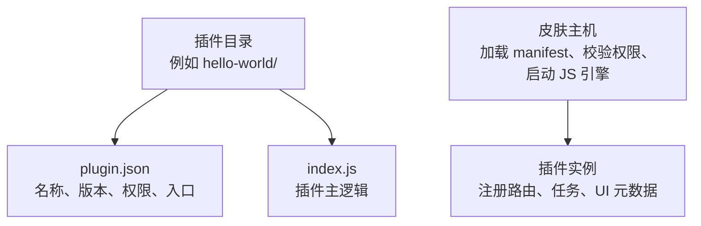
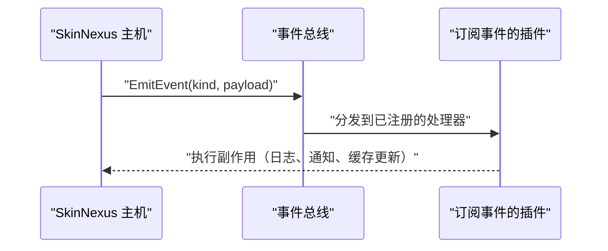
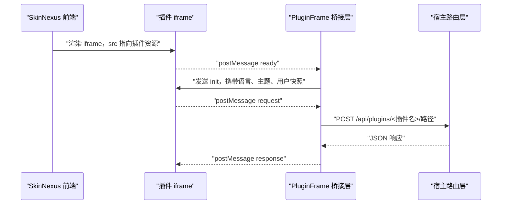
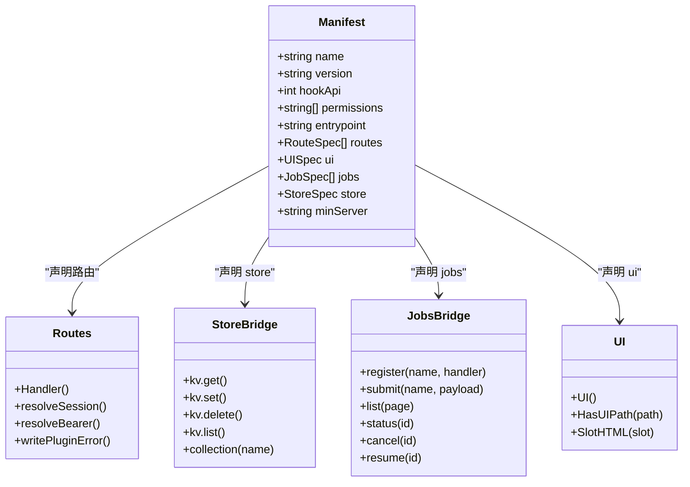

# 插件开发指南

**本文引用的文件**
- [plugin.json（hello-world）](https://github.com/YimingZhanshen/skin-nexus/blob/797ae1a/examples/plugins/hello-world/plugin.json)
- [index.js（hello-world）](https://github.com/YimingZhanshen/skin-nexus/blob/797ae1a/examples/plugins/hello-world/index.js)
- [plugin.json（hello-ui）](https://github.com/YimingZhanshen/skin-nexus/blob/797ae1a/examples/plugins/hello-ui/plugin.json)
- [hello.html（hello-ui）](https://github.com/YimingZhanshen/skin-nexus/blob/797ae1a/examples/plugins/hello-ui/ui/hello.html)
- [plugin.json（jobs-fixture）](https://github.com/YimingZhanshen/skin-nexus/blob/797ae1a/examples/plugins/jobs-fixture/plugin.json)
- [index.js（jobs-fixture）](https://github.com/YimingZhanshen/skin-nexus/blob/797ae1a/examples/plugins/jobs-fixture/index.js)
- [contract.go](https://github.com/YimingZhanshen/skin-nexus/blob/797ae1a/server/internal/plugin/contract.go)
- [spec.go](https://github.com/YimingZhanshen/skin-nexus/blob/797ae1a/server/internal/plugin/spec.go)
- [manifest.go](https://github.com/YimingZhanshen/skin-nexus/blob/797ae1a/server/internal/plugin/manifest.go)
- [routes.go](https://github.com/YimingZhanshen/skin-nexus/blob/797ae1a/server/internal/plugin/routes.go)
- [events.go](https://github.com/YimingZhanshen/skin-nexus/blob/797ae1a/server/internal/plugin/events.go)
- [store_bridge.go](https://github.com/YimingZhanshen/skin-nexus/blob/797ae1a/server/internal/plugin/store_bridge.go)
- [jobs_bridge.go](https://github.com/YimingZhanshen/skin-nexus/blob/797ae1a/server/internal/plugin/jobs_bridge.go)
- [ui.go](https://github.com/YimingZhanshen/skin-nexus/blob/797ae1a/server/internal/plugin/ui.go)
- [PluginFrame.vue](https://github.com/YimingZhanshen/skin-nexus/blob/797ae1a/web/src/components/plugin/PluginFrame.vue)
- [PluginSlot.vue](https://github.com/YimingZhanshen/skin-nexus/blob/797ae1a/web/src/components/plugin/PluginSlot.vue)

## 目录
1. [引言](#引言)
2. [项目结构与插件入口](#项目结构与插件入口)
3. [从零编写第一个插件](#从零编写第一个插件)
4. [三个示例对比](#三个示例对比)
5. [插件运行时能力总览](#插件运行时能力总览)
6. [本地开发与调试工作流](#本地开发与调试工作流)
7. [打包与发布检查清单](#打包与发布检查清单)
8. [常见问题排查](#常见问题排查)
9. [结论](#结论)

## 引言
本指南面向第一次为 SkinNexus 写插件的开发者。它不要求你理解整个后端实现，而是以 `examples/plugins` 下的三个最小示例为主线：一个只打印日志的路由示例、一个通过 iframe 注入 UI 的示例、一个注册后台任务并暴露管理接口的示例。读完之后，你应该能够独立写出包含路由、事件、KV 存储和 UI 插槽的插件，并在本地启动、调试、打包和提交到主题市场前完成自检。

SkinNexus 的插件运行在宿主 Go 进程的隔离 JavaScript 环境里，使用声明式的 `plugin.json` 描述权限、路由、UI、后台任务和依赖；宿主负责鉴权、限流、CSP、资源路径和错误封装，插件侧则专注业务逻辑。

## 项目结构与插件入口
每个插件是一个独立目录，至少包含两个文件：

| 文件 | 作用 | 关键约束 |
|---|---|---|
| `plugin.json` | 插件元数据、权限、路由、UI、任务等声明 | 名称必须等于目录名；`hookApi` 必须匹配宿主版本 |
| `index.js` | 默认入口脚本 | 文件名必须匹配正则；不能是符号链接；大小有上限 |

**图示来源**
- [manifest.go:1-80](https://github.com/YimingZhanshen/skin-nexus/blob/797ae1a/server/internal/plugin/manifest.go#L1-L80)
- [manifest.go:120-200](https://github.com/YimingZhanshen/skin-nexus/blob/797ae1a/server/internal/plugin/manifest.go#L120-L200)

### plugin.json 字段速览
| 字段 | 含义 | 是否必填 |
|---|---|---|
| `name` | 插件标识，必须与目录名一致 | 是 |
| `version` | 语义化版本字符串 | 是 |
| `hookApi` | 当前钩子接口主版本 | 是 |
| `entrypoint` | 入口脚本路径 | 是 |
| `title` / `description` / `author` | 元信息，用于管理面板与市场展示 | 否 |
| `permissions` | 声明式权限列表 | 否 |
| `routes` | HTTP 路由声明 | 否 |
| `ui` | UI 页面、插槽、国际化、静态资源根 | 否 |
| `jobs` | 持久化任务处理器声明 | 否 |
| `minServer` / `requires` | 最低服务器版本与依赖 | 否 |

**章节来源**
- [manifest.go:1-120](https://github.com/YimingZhanshen/skin-nexus/blob/797ae1a/server/internal/plugin/manifest.go#L1-L120)
- [spec.go:1-120](https://github.com/YimingZhanshen/skin-nexus/blob/797ae1a/server/internal/plugin/spec.go#L1-L120)

## 从零编写第一个插件

### 第一步：准备目录
在任意可被 SkinNexus 扫描到的插件目录下新建一个文件夹，例如 `my-first-plugin/`。注意：
- 目录名就是插件名，只能包含小写字母、数字、短横线、下划线，且必须以字母或数字开头。
- 不要使用符号链接作为入口文件。
- 不要引入过大的脚本；宿主会拒绝超大 manifest 和脚本。

### 第二步：填写 plugin.json
最简插件只需要名称、版本、钩子 API 版本和入口：

| 字段 | 推荐值 | 说明 |
|---|---|---|
| `name` | 与目录同名的小写标识 | 安装后唯一 |
| `version` | `1.0.0` | 首次发布建议从 1.0.0 开始 |
| `hookApi` | `2` | 当前仓库支持的插件接口主版本 |
| `entrypoint` | `"index.js"` | 宿主会从插件目录解析该相对路径 |
| `title` | 中文标题 | 显示在管理面板 |
| `description` | 一句话描述 | 适合市场列表 |

如果你不需要任何敏感能力，可以不写 `permissions`。示例 `hello-world` 就是一个零权限插件。

**章节来源**
- [plugin.json（hello-world）:1-8](https://github.com/YimingZhanshen/skin-nexus/blob/797ae1a/examples/plugins/hello-world/plugin.json#L1-L8)
- [manifest.go:80-160](https://github.com/YimingZhanshen/skin-nexus/blob/797ae1a/server/internal/plugin/manifest.go#L80-L160)

### 第三步：实现 index.js
最小可用插件可以只做一件事：在加载时输出一条日志。宿主会通过 `skin.log` 暴露日志接口，因此你的第一个 `index.js` 只需调用一次日志函数即可。

更常见的起步方式是注册一个路由：

| 步骤 | 操作 |
|---|---|
| 1 | 在 `plugin.json` 中声明 `routes` |
| 2 | 在 `index.js` 中调用 `skin.route(method, path, handler)` |
| 3 | 返回 `{ status, body }` 形式的 JSON 响应 |
| 4 | 如果路由需要登录或管理员权限，把 `tier` 设为 `session` 或 `admin` |

**章节来源**
- [index.js（hello-world）:1-1](https://github.com/YimingZhanshen/skin-nexus/blob/797ae1a/examples/plugins/hello-world/index.js#L1-L1)
- [routes.go:1-120](https://github.com/YimingZhanshen/skin-nexus/blob/797ae1a/server/internal/plugin/routes.go#L1-L120)

### 第四步：注册路由
宿主会在 `/api/plugins/<插件名>/<路径>` 下查找插件路由。你在 manifest 中声明的方法、路径、层级、CSRF、限流必须与实际运行时一致。

常见层级：

| 层级 | 含义 | 适用场景 |
|---|---|---|
| `public` | 无需登录 | 公开状态页、健康检查 |
| `session` | 已登录用户 | 用户私有数据 |
| `admin` | 管理员 | 管理工具、任务触发器 |
| `superadmin` | 超级管理员 | 高危操作 |
| `bearer` | 基于令牌的身份 | 外部系统调用 |

**章节来源**
- [routes.go:120-260](https://github.com/YimingZhanshen/skin-nexus/blob/797ae1a/server/internal/plugin/routes.go#L120-L260)
- [contract.go:120-200](https://github.com/YimingZhanshen/skin-nexus/blob/797ae1a/server/internal/plugin/contract.go#L120-L200)

### 第五步：订阅事件
插件可以通过宿主提供的通用事件机制订阅生命周期事件，例如纹理上传、用户注册、登录等。事件负载是安全裁剪后的结构，不会直接暴露密码、Cookie 或原始请求体。

典型流程：

**图示来源**
- [events.go:1-40](https://github.com/YimingZhanshen/skin-nexus/blob/797ae1a/server/internal/plugin/events.go#L1-L40)
- [contract.go:80-120](https://github.com/YimingZhanshen/skin-nexus/blob/797ae1a/server/internal/plugin/contract.go#L80-L120)

实际使用时，插件应在入口阶段注册事件处理器，并确保所需权限已声明。若事件未触发，优先检查：
1. 插件是否已启用。
2. `permissions` 中是否包含 `events:subscribe`。
3. 事件类型是否为宿主已知事件。
4. 处理器是否抛出异常导致宿主跳过。

**章节来源**
- [events.go:1-94](https://github.com/YimingZhanshen/skin-nexus/blob/797ae1a/server/internal/plugin/events.go#L1-L94)
- [contract.go:60-120](https://github.com/YimingZhanshen/skin-nexus/blob/797ae1a/server/internal/plugin/contract.go#L60-L120)

### 第六步：读写 KV 存储
KV 存储是插件自己的键值空间，不是数据库直连。你需要：

1. 在 `plugin.json` 中声明 `store.kv`，可选设置 `maxKeys`。
2. 在 `permissions` 中加入 `store:kv`。
3. 在 `index.js` 中使用 `skin.store.kv.get/set/delete/list`。

| 方法 | 行为 |
|---|---|
| `get(key, default?)` | 不存在时返回默认值或 `undefined` |
| `set(key, value, options?)` | 可传 `ttlMS` 设置过期时间 |
| `delete(key)` | 删除键 |
| `list(query?)` | 按前缀和限制列出键值对 |

注意事项：
- 未声明 `store:kv` 权限时调用 KV 方法会抛错。
- `list` 的 `limit` 最大为 1000，超出会被截断。
- KV 值是字符串，复杂对象需自行序列化。
- 查询应使用前缀，避免全表扫描。

**章节来源**
- [store_bridge.go:1-120](https://github.com/YimingZhanshen/skin-nexus/blob/797ae1a/server/internal/plugin/store_bridge.go#L1-L120)
- [spec.go:20-60](https://github.com/YimingZhanshen/skin-nexus/blob/797ae1a/server/internal/plugin/spec.go#L20-L60)

### 第七步：添加 UI 插槽
插件可以通过两种方式嵌入界面：

| 方式 | 适用场景 |
|---|---|
| `ui.pages` + iframe | 独立的完整页面 |
| `ui.slots` + iframe | 插入宿主已有页面的固定插槽 |

对于插槽，宿主维护一份白名单，例如“应用顶部栏之后”、“登录表单之后”、“仪表盘卡片区域”等。你不能随意指定任意 slot ID。

iframe 插槽的生命周期如下：

**图示来源**
- [ui.go:1-120](https://github.com/YimingZhanshen/skin-nexus/blob/797ae1a/server/internal/plugin/ui.go#L1-L120)
- [PluginFrame.vue:1-120](https://github.com/YimingZhanshen/skin-nexus/blob/797ae1a/web/src/components/plugin/PluginFrame.vue#L1-L120)
- [PluginFrame.vue:120-200](https://github.com/YimingZhanshen/skin-nexus/blob/797ae1a/web/src/components/plugin/PluginFrame.vue#L120-L200)

要点：
- iframe 是沙箱化的，没有 Cookie 和同源访问能力。
- 所有 API 调用都走宿主桥接层，自动处理 CSRF、身份和限流。
- 插件不应在 iframe 内直接读取父页面 Cookie。
- CSP 限制会影响 `<script>`、样式和外域资源，请尽量使用站内资源。

**章节来源**
- [ui.go:1-138](https://github.com/YimingZhanshen/skin-nexus/blob/797ae1a/server/internal/plugin/ui.go#L1-L138)
- [PluginFrame.vue:1-200](https://github.com/YimingZhanshen/skin-nexus/blob/797ae1a/web/src/components/plugin/PluginFrame.vue#L1-L200)
- [PluginSlot.vue:1-24](https://github.com/YimingZhanshen/skin-nexus/blob/797ae1a/web/src/components/plugin/PluginSlot.vue#L1-L24)

## 三个示例对比

### hello-world：最小路由与日志
这是最简单的起点：
- 没有权限声明。
- 没有路由。
- 只在加载时调用一次日志输出。

适用场景：
- 验证插件能否被宿主加载。
- 快速测试 manifest 和目录结构是否正确。
- 观察插件加载日志是否出现。

差异点：
- 不涉及路由、事件、KV、UI。
- 不需要额外权限。
- 不适合作为对外服务插件，但适合作为开发基线。

**章节来源**
- [plugin.json（hello-world）:1-8](https://github.com/YimingZhanshen/skin-nexus/blob/797ae1a/examples/plugins/hello-world/plugin.json#L1-L8)
- [index.js（hello-world）:1-1](https://github.com/YimingZhanshen/skin-nexus/blob/797ae1a/examples/plugins/hello-world/index.js#L1-L1)

### hello-ui：iframe 页面与插槽
这个示例展示了完整的 UI 插件形态：
- 声明 `ui:page`、`ui:slot`、`ui:assets` 权限。
- 定义一个用户区页面，使用 iframe 渲染 `hello.html`。
- 定义一个固定插槽 `app.topbar.after`，高度 120。
- 提供中英文国际化标题。
- 页面通过 `postMessage` 与宿主通信，等待 `init` 消息后标记就绪。

适用场景：
- 需要给用户提供可视化配置、状态查看或辅助工具。
- 希望插件出现在导航栏或某个固定位置。
- 需要多语言标题。

风险点：
- iframe 内容受 CSP 限制。
- 不要在 iframe 内假设能直接访问父窗口 Cookie。
- 静态资源路径必须与 `ui.assets` 对应。

**章节来源**
- [plugin.json（hello-ui）:1-29](https://github.com/YimingZhanshen/skin-nexus/blob/797ae1a/examples/plugins/hello-ui/plugin.json#L1-L29)
- [hello.html（hello-ui）:1-20](https://github.com/YimingZhanshen/skin-nexus/blob/797ae1a/examples/plugins/hello-ui/ui/hello.html#L1-L20)
- [ui.go:1-138](https://github.com/YimingZhanshen/skin-nexus/blob/797ae1a/server/internal/plugin/ui.go#L1-L138)
- [PluginFrame.vue:1-200](https://github.com/YimingZhanshen/skin-nexus/blob/797ae1a/web/src/components/plugin/PluginFrame.vue#L1-L200)

### jobs-fixture：事件与后台任务
这个示例不是普通业务插件，而是专门用于测试宿主的“任务队列”功能：
- 声明 `http:routes:admin` 和 `schedule:jobs` 权限。
- 暴露两个管理员路由：触发任务和列出任务。
- 声明一个名为 `tick` 的持久化任务，带超时和重试次数。
- 任务内部用轮询模拟耗时步骤，支持取消。
- 不读写真实数据，只在虚拟机中消耗 CPU 时间，便于本地观察运行态。

适用场景：
- 测试任务面板的取消、恢复按钮。
- 学习如何在插件中提交、查询、取消、恢复任务。
- 学习如何在长任务中检测取消信号。

**章节来源**
- [plugin.json（jobs-fixture）:1-40](https://github.com/YimingZhanshen/skin-nexus/blob/797ae1a/examples/plugins/jobs-fixture/plugin.json#L1-L40)
- [index.js（jobs-fixture）:1-89](https://github.com/YimingZhanshen/skin-nexus/blob/797ae1a/examples/plugins/jobs-fixture/index.js#L1-L89)
- [jobs_bridge.go:1-120](https://github.com/YimingZhanshen/skin-nexus/blob/797ae1a/server/internal/plugin/jobs_bridge.go#L1-L120)

### 三者对比总结

| 维度 | hello-world | hello-ui | jobs-fixture |
|---|---|---|---|
| 核心目标 | 加载即日志 | iframe 页面 + 插槽 | 后台任务 + 管理路由 |
| 权限 | 无 | `ui:*` | `http:routes:admin`、`schedule:jobs` |
| 路由 | 无 | 由宿主生成页面 URL | 自定义管理员路由 |
| UI | 无 | 独立 iframe | 通常无 UI，配合管理面板 |
| 事件 | 无 | 无 | 无（但演示任务回调） |
| KV | 无 | 无 | 无 |
| 适合阶段 | 插件加载验证 | 交互式插件 | 异步任务与运维工具 |

**章节来源**
- [plugin.json（hello-world）:1-8](https://github.com/YimingZhanshen/skin-nexus/blob/797ae1a/examples/plugins/hello-world/plugin.json#L1-L8)
- [plugin.json（hello-ui）:1-29](https://github.com/YimingZhanshen/skin-nexus/blob/797ae1a/examples/plugins/hello-ui/plugin.json#L1-L29)
- [plugin.json（jobs-fixture）:1-40](https://github.com/YimingZhanshen/skin-nexus/blob/797ae1a/examples/plugins/jobs-fixture/plugin.json#L1-L40)

## 插件运行时能力总览

**图示来源**
- [manifest.go:1-120](https://github.com/YimingZhanshen/skin-nexus/blob/797ae1a/server/internal/plugin/manifest.go#L1-L120)
- [routes.go:1-120](https://github.com/YimingZhanshen/skin-nexus/blob/797ae1a/server/internal/plugin/routes.go#L1-L120)
- [store_bridge.go:1-120](https://github.com/YimingZhanshen/skin-nexus/blob/797ae1a/server/internal/plugin/store_bridge.go#L1-L120)
- [jobs_bridge.go:1-120](https://github.com/YimingZhanshen/skin-nexus/blob/797ae1a/server/internal/plugin/jobs_bridge.go#L1-L120)
- [ui.go:1-60](https://github.com/YimingZhanshen/skin-nexus/blob/797ae1a/server/internal/plugin/ui.go#L1-L60)

## 本地开发与调试工作流

### 在 SkinNexus 中启用本地插件
1. 将插件目录放到 SkinNexus 扫描到的插件目录中。
2. 确保 `plugin.json` 的 `name` 与目录名完全一致。
3. 重启 SkinNexus 或在管理面板中刷新插件列表。
4. 启用你的插件。
5. 打开管理面板的“插件”视图，确认插件状态为已启用。

如果插件未出现，优先检查：
- 目录名是否与 `plugin.json.name` 一致。
- `hookApi` 是否等于宿主当前版本。
- `entrypoint` 是否存在且是普通文件。
- 插件目录是否被宿主允许扫描。

**章节来源**
- [manifest.go:120-200](https://github.com/YimingZhanshen/skin-nexus/blob/797ae1a/server/internal/plugin/manifest.go#L120-L200)

### 查看插件状态
管理面板会显示插件的启用状态、版本、权限和 UI 元数据。你可以：
- 检查权限是否满足路由、KV、任务或 UI 的需要。
- 检查是否有加载错误。
- 查看插件是否启用了 UI 页面或插槽。

### 调试 JavaScript 控制台
由于插件 iframe 是沙箱化的，大多数情况下你无法直接打开浏览器开发者工具的插件脚本上下文。推荐调试方式：

1. 在 `index.js` 中通过 `skin.log` 输出关键路径。
2. 在 iframe 页面中通过 `postMessage` 向宿主发送调试消息。
3. 在宿主端观察日志输出。
4. 对路由调用使用浏览器网络面板查看 `/api/plugins/<插件名>/...` 的响应。
5. 对任务使用管理面板的任务队列页面观察状态。

**章节来源**
- [PluginFrame.vue:1-120](https://github.com/YimingZhanshen/skin-nexus/blob/797ae1a/web/src/components/plugin/PluginFrame.vue#L1-L120)
- [jobs_bridge.go:120-200](https://github.com/YimingZhanshen/skin-nexus/blob/797ae1a/server/internal/plugin/jobs_bridge.go#L120-L200)

### 模拟认证上下文
不同路由层级需要不同的认证：

| 场景 | 如何模拟 |
|---|---|
| 公开路由 | 直接访问，无需登录 |
| 会话级路由 | 先登录 SkinNexus，再发起请求 |
| 管理员路由 | 使用管理员账号登录 |
| 超级管理员路由 | 使用权限为 2 的超级管理员账号 |
| Bearer 路由 | 携带合法的 `Authorization: Bearer` 令牌 |

路由层会自动处理：
- 未登录时的 401。
- 非管理员访问管理员路由时的 403。
- CSRF 保护：非 GET/HEAD 请求需要正确 CSRF token。
- 邮箱验证门控：某些站点可能要求邮箱验证后才能访问。

**章节来源**
- [routes.go:120-260](https://github.com/YimingZhanshen/skin-nexus/blob/797ae1a/server/internal/plugin/routes.go#L120-L260)

## 打包与发布检查清单

### manifest 校验
- [ ] `name` 与目录名一致。
- [ ] `version` 非空且不超过长度限制。
- [ ] `hookApi` 等于宿主当前版本。
- [ ] `entrypoint` 是合法 JS 文件名。
- [ ] 所有 `permissions` 都是已知权限。
- [ ] 没有在 manifest 中声明却使用的能力。
- [ ] `homepage` 如果是 URL，必须是 http 或 https。
- [ ] `title`、`author`、`homepage`、`description` 不超过长度限制。

**章节来源**
- [manifest.go:1-120](https://github.com/YimingZhanshen/skin-nexus/blob/797ae1a/server/internal/plugin/manifest.go#L1-L120)
- [manifest.go:120-200](https://github.com/YimingZhanshen/skin-nexus/blob/797ae1a/server/internal/plugin/manifest.go#L120-L200)

### 资源路径
- [ ] `ui.assets` 指向插件目录下的静态资源根。
- [ ] `render.src` 中的 HTML 路径相对于 `ui.assets`。
- [ ] iframe 页面能通过 `/plugin-assets/<插件名>/<资源>` 访问。
- [ ] 所有外链资源符合 CSP 策略。
- [ ] 图片、字体、脚本尽量放在插件目录内。
- [ ] 版本变化后通过 `v=版本号` 清理旧缓存。

**章节来源**
- [ui.go:60-138](https://github.com/YimingZhanshen/skin-nexus/blob/797ae1a/server/internal/plugin/ui.go#L60-L138)
- [hello.html（hello-ui）:1-20](https://github.com/YimingZhanshen/skin-nexus/blob/797ae1a/examples/plugins/hello-ui/ui/hello.html#L1-L20)

### CSP 兼容
- [ ] iframe 内不使用不允许的内联脚本策略。
- [ ] 不引用未允许的域名。
- [ ] 不在 iframe 中直接跨域请求受限 API。
- [ ] 如需外部资源，先在 manifest 中声明允许的主机。
- [ ] 使用宿主桥接层发起 API 请求，而不是绕过 CSP。

**章节来源**
- [spec.go:60-120](https://github.com/YimingZhanshen/skin-nexus/blob/797ae1a/server/internal/plugin/spec.go#L60-L120)
- [PluginFrame.vue:1-120](https://github.com/YimingZhanshen/skin-nexus/blob/797ae1a/web/src/components/plugin/PluginFrame.vue#L1-L120)

### 错误处理与日志输出
- [ ] 路由 handler 返回明确的 `status` 和 `body`。
- [ ] 对非法输入做参数校验，而不是信任客户端。
- [ ] 对 KV 空值提供默认值。
- [ ] 对任务失败记录错误信息。
- [ ] 使用 `skin.log` 输出可追踪日志。
- [ ] 不在日志中泄露密钥、用户凭证或敏感隐私。
- [ ] 对长时间任务支持取消或超时。

**章节来源**
- [routes.go:1-120](https://github.com/YimingZhanshen/skin-nexus/blob/797ae1a/server/internal/plugin/routes.go#L1-L120)
- [index.js（jobs-fixture）:1-89](https://github.com/YimingZhanshen/skin-nexus/blob/797ae1a/examples/plugins/jobs-fixture/index.js#L1-L89)

## 常见问题排查

### 路由未命中
定位步骤：
1. 检查请求路径是否为 `/api/plugins/<插件名>/<declared path>`。
2. 检查 `plugin.json` 中的 `method` 和 `path` 是否与调用一致。
3. 检查插件是否已启用。
4. 检查浏览器网络面板返回的错误码：
   - 404：路由未找到或插件未找到。
   - 405：方法不被允许。
   - 401：需要登录。
   - 403：权限不足或 CSRF 失败。
   - 429：超过限流。
5. 如果路径匹配但方法不对，宿主会返回 `Allow` 头提示允许的方法。

**章节来源**
- [routes.go:1-120](https://github.com/YimingZhanshen/skin-nexus/blob/797ae1a/server/internal/plugin/routes.go#L1-L120)

### 事件未触发
定位步骤：
1. 确认插件已启用。
2. 确认已声明 `events:subscribe` 权限。
3. 确认事件类型是宿主已知事件。
4. 确认事件处理器在插件加载时注册。
5. 检查处理器是否抛出异常。
6. 检查是否误以为事件会阻塞请求；宿主事件是异步队列，饱和时会丢弃。

**章节来源**
- [events.go:1-94](https://github.com/YimingZhanshen/skin-nexus/blob/797ae1a/server/internal/plugin/events.go#L1-L94)
- [contract.go:60-120](https://github.com/YimingZhanshen/skin-nexus/blob/797ae1a/server/internal/plugin/contract.go#L60-L120)

### KV 空值
定位步骤：
1. 确认 `plugin.json` 中声明了 `store.kv`。
2. 确认 `permissions` 包含 `store:kv`。
3. 确认写入时使用字符串值。
4. 确认读取时对 `undefined` 做了默认值处理。
5. 确认没有拼写错误或命名空间冲突。
6. 如果使用 `list`，检查前缀和 limit。

**章节来源**
- [store_bridge.go:1-120](https://github.com/YimingZhanshen/skin-nexus/blob/797ae1a/server/internal/plugin/store_bridge.go#L1-L120)
- [spec.go:20-60](https://github.com/YimingZhanshen/skin-nexus/blob/797ae1a/server/internal/plugin/spec.go#L20-L60)

### UI 空白
定位步骤：
1. 确认插件启用了 `ui:page` 或 `ui:slot`。
2. 确认 `ui.assets` 存在且路径正确。
3. 确认 iframe src 能访问到 HTML 文件。
4. 检查 CSP 是否阻止了脚本或样式。
5. 检查 `PluginFrame` 是否收到 `ready` 消息。
6. 检查 iframe 是否等待 `init` 消息后才渲染。
7. 如果插槽为空，检查 slot ID 是否在宿主白名单中。

**章节来源**
- [ui.go:1-138](https://github.com/YimingZhanshen/skin-nexus/blob/797ae1a/server/internal/plugin/ui.go#L1-L138)
- [PluginFrame.vue:1-200](https://github.com/YimingZhanshen/skin-nexus/blob/797ae1a/web/src/components/plugin/PluginFrame.vue#L1-L200)
- [PluginSlot.vue:1-24](https://github.com/YimingZhanshen/skin-nexus/blob/797ae1a/web/src/components/plugin/PluginSlot.vue#L1-L24)

### 权限不足
定位步骤：
1. 对照你要调用的能力，检查 `permissions`。
2. 管理员路由需要 `http:routes:admin` 和管理员身份。
3. KV 需要 `store:kv`。
4. 任务需要 `schedule:jobs`。
5. UI 页面需要 `ui:page`，插槽需要 `ui:slot`，静态资源需要 `ui:assets`。
6. 检查当前用户权限是否满足 tier 要求。
7. 检查邮箱验证门控是否拦截。

**章节来源**
- [contract.go:20-80](https://github.com/YimingZhanshen/skin-nexus/blob/797ae1a/server/internal/plugin/contract.go#L20-L80)
- [routes.go:120-260](https://github.com/YimingZhanshen/skin-nexus/blob/797ae1a/server/internal/plugin/routes.go#L120-L260)

### 任务无法取消
定位步骤：
1. 确认任务处于运行或排队状态。
2. 确认调用方具有管理员身份。
3. 确认任务处理器在步骤之间检查取消信号。
4. 确认宿主任务调度器正在运行。
5. 参考 `jobs-fixture` 的取消轮询模式。

**章节来源**
- [index.js（jobs-fixture）:1-89](https://github.com/YimingZhanshen/skin-nexus/blob/797ae1a/examples/plugins/jobs-fixture/index.js#L1-L89)
- [jobs_bridge.go:120-200](https://github.com/YimingZhanshen/skin-nexus/blob/797ae1a/server/internal/plugin/jobs_bridge.go#L120-L200)

## 结论
编写 SkinNexus 插件的核心思路是：**声明先行，实现后置**。先用 `plugin.json` 明确告诉宿主你能做什么，再用 `index.js` 实现具体逻辑。新手应从 `hello-world` 开始验证加载链路，再进入 `hello-ui` 学习 iframe 与插槽，最后用 `jobs-fixture` 理解后台任务与管理员路由。

发布前务必完成 manifest 校验、资源路径检查、CSP 兼容检查、错误处理和日志输出检查。遇到问题时，优先从权限、认证层级、路径匹配、KV 初始化、UI 白名单五个方向定位。这样即使你是第一次写插件，也能快速定位问题并迭代出可用的功能。
