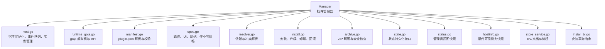
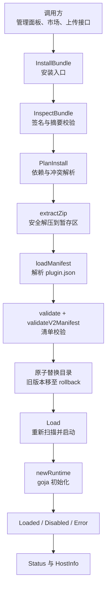
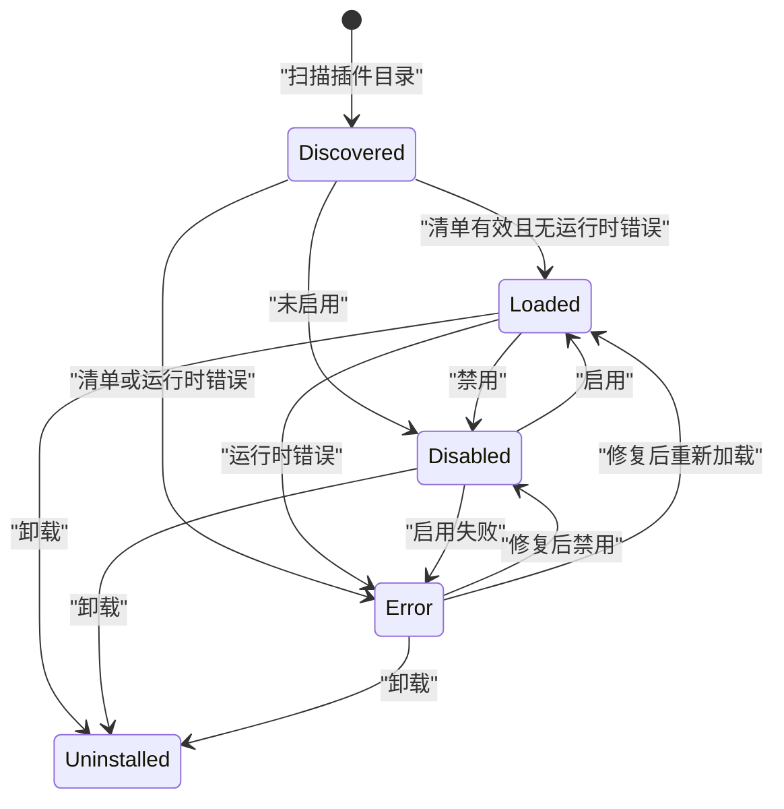
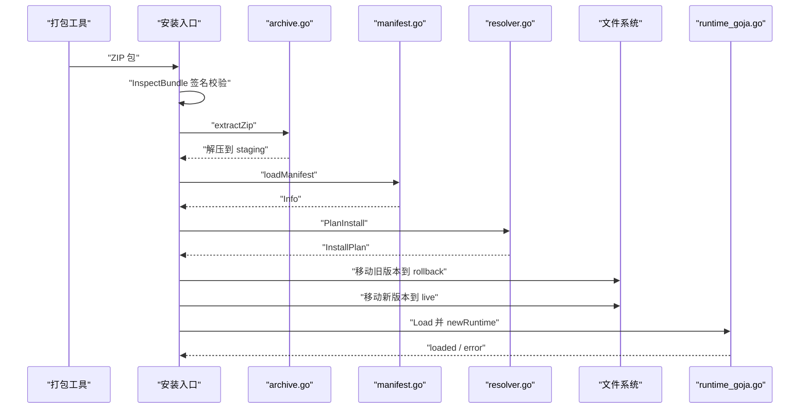
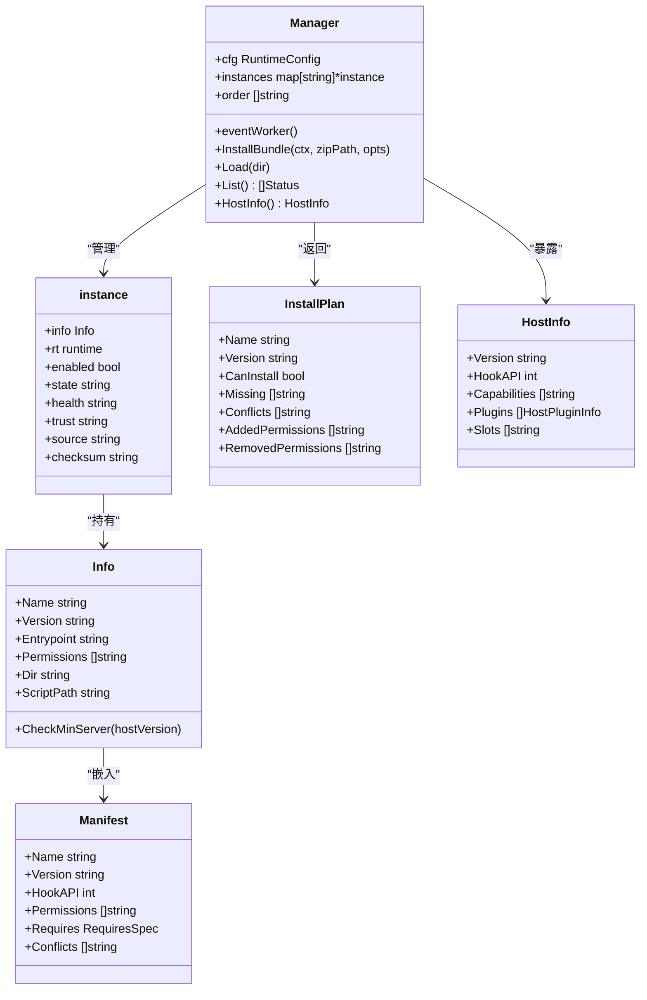

# 插件架构与生命周期

**本文引用的文件**
- [host.go](https://github.com/YimingZhanshen/skin-nexus/blob/797ae1a/server/internal/plugin/host.go)
- [install.go](https://github.com/YimingZhanshen/skin-nexus/blob/797ae1a/server/internal/plugin/install.go)
- [archive.go](https://github.com/YimingZhanshen/skin-nexus/blob/797ae1a/server/internal/plugin/archive.go)
- [resolver.go](https://github.com/YimingZhanshen/skin-nexus/blob/797ae1a/server/internal/plugin/resolver.go)
- [manifest.go](https://github.com/YimingZhanshen/skin-nexus/blob/797ae1a/server/internal/plugin/manifest.go)
- [spec.go](https://github.com/YimingZhanshen/skin-nexus/blob/797ae1a/server/internal/plugin/spec.go)
- [contract.go](https://github.com/YimingZhanshen/skin-nexus/blob/797ae1a/server/internal/plugin/contract.go)
- [runtime_goja.go](https://github.com/YimingZhanshen/skin-nexus/blob/797ae1a/server/internal/plugin/runtime_goja.go)
- [state.go](https://github.com/YimingZhanshen/skin-nexus/blob/797ae1a/server/internal/plugin/state.go)
- [status.go](https://github.com/YimingZhanshen/skin-nexus/blob/797ae1a/server/internal/plugin/status.go)
- [hostinfo.go](https://github.com/YimingZhanshen/skin-nexus/blob/797ae1a/server/internal/plugin/hostinfo.go)
- [install_tx.go](https://github.com/YimingZhanshen/skin-nexus/blob/797ae1a/server/internal/plugin/install_tx.go)
- [store_service.go](https://github.com/YimingZhanshen/skin-nexus/blob/797ae1a/server/internal/plugin/store_service.go)
- [0012_plugin_platform.sql](https://github.com/YimingZhanshen/skin-nexus/blob/797ae1a/server/migrations/mysql/0012_plugin_platform.sql)
- [0013_plugin_install_tx.sql](https://github.com/YimingZhanshen/skin-nexus/blob/797ae1a/server/migrations/mysql/0013_plugin_install_tx.sql)
- [0014_plugin_trust.sql](https://github.com/YimingZhanshen/skin-nexus/blob/797ae1a/server/migrations/mysql/0014_plugin_trust.sql)

## 目录

1. [简介](#简介)
2. [项目结构](#项目结构)
3. [核心概念](#核心概念)
4. [架构总览](#架构总览)
5. [关键组件分析](#关键组件分析)
6. [插件完整生命周期](#插件完整生命周期)
7. [依赖解析与版本约束](#依赖解析与版本约束)
8. [信任、安装事务与回滚](#信任安装事务与回滚)
9. [数据模型与存储接口](#数据模型与存储接口)
10. [性能与安全边界](#性能与安全边界)
11. [故障诊断指南](#故障诊断指南)
12. [结论](#结论)

## 简介

本仓库的插件系统以 Go 语言实现，使用 `goja` 作为 JavaScript 插件运行时。每个插件是一个包含 `plugin.json` 和入口脚本的目录或 ZIP 包；宿主在启动时扫描插件目录，校验清单、权限、路由、资源配额，并创建受隔离的 JS 执行环境。

对于用户关心的“从打包到卸载”的全过程，宿主的职责可以概括为：

| 阶段 | 主要责任 | 关键文件 |
|---|---|---|
| 打包 | 生成带清单、脚本、静态资源的 ZIP 包 | [manifest.go](https://github.com/YimingZhanshen/skin-nexus/blob/797ae1a/server/internal/plugin/manifest.go)、[archive.go](https://github.com/YimingZhanshen/skin-nexus/blob/797ae1a/server/internal/plugin/archive.go) |
| 上传 | 接收字节流或 ZIP 路径，写入暂存区 | [install.go](https://github.com/YimingZhanshen/skin-nexus/blob/797ae1a/server/internal/plugin/install.go) |
| 校验 | 签名检查、ZIP 安全解压、清单验证、版本匹配 | [archive.go](https://github.com/YimingZhanshen/skin-nexus/blob/797ae1a/server/internal/plugin/archive.go)、[manifest.go](https://github.com/YimingZhanshen/skin-nexus/blob/797ae1a/server/internal/plugin/manifest.go) |
| 规划 | 检查主机版本、依赖、冲突、权限变化、插件数量上限 | [resolver.go](https://github.com/YimingZhanshen/skin-nexus/blob/797ae1a/server/internal/plugin/resolver.go) |
| 安装 | 写安装事务、备份旧版本、移动新目录、重启运行期 | [install.go](https://github.com/YimingZhanshen/skin-nexus/blob/797ae1a/server/internal/plugin/install.go) |
| 启动 | 初始化 goja VM、加载脚本、注册钩子与路由 | [runtime_goja.go](https://github.com/YimingZhanshen/skin-nexus/blob/797ae1a/server/internal/plugin/runtime_goja.go)、[host.go](https://github.com/YimingZhanshen/skin-nexus/blob/797ae1a/server/internal/plugin/host.go) |
| 运行 | 调用钩子、处理路由、执行任务、记录指标 | [runtime_goja.go](https://github.com/YimingZhanshen/skin-nexus/blob/797ae1a/server/internal/plugin/runtime_goja.go)、[status.go](https://github.com/YimingZhanshen/skin-nexus/blob/797ae1a/server/internal/plugin/status.go) |
| 卸载/更新 | 停用、移动到隔离目录、可选清理数据、可回滚 | [install.go](https://github.com/YimingZhanshen/skin-nexus/blob/797ae1a/server/internal/plugin/install.go) |

## 项目结构

插件相关代码集中在 `server/internal/plugin` 下，按职责拆分：

**图表来源**
- [host.go:1-200](https://github.com/YimingZhanshen/skin-nexus/blob/797ae1a/server/internal/plugin/host.go#L1-L200)
- [runtime_goja.go:1-200](https://github.com/YimingZhanshen/skin-nexus/blob/797ae1a/server/internal/plugin/runtime_goja.go#L1-L200)
- [manifest.go:1-120](https://github.com/YimingZhanshen/skin-nexus/blob/797ae1a/server/internal/plugin/manifest.go#L1-L120)
- [resolver.go:1-108](https://github.com/YimingZhanshen/skin-nexus/blob/797ae1a/server/internal/plugin/resolver.go#L1-L108)
- [install.go:1-120](https://github.com/YimingZhanshen/skin-nexus/blob/797ae1a/server/internal/plugin/install.go#L1-L120)
- [archive.go:1-137](https://github.com/YimingZhanshen/skin-nexus/blob/797ae1a/server/internal/plugin/archive.go#L1-L137)
- [state.go:1-108](https://github.com/YimingZhanshen/skin-nexus/blob/797ae1a/server/internal/plugin/state.go#L1-L108)
- [status.go:1-117](https://github.com/YimingZhanshen/skin-nexus/blob/797ae1a/server/internal/plugin/status.go#L1-L117)
- [hostinfo.go:1-66](https://github.com/YimingZhanshen/skin-nexus/blob/797ae1a/server/internal/plugin/hostinfo.go#L1-L66)
- [store_service.go:1-200](https://github.com/YimingZhanshen/skin-nexus/blob/797ae1a/server/internal/plugin/store_service.go#L1-L200)
- [install_tx.go:1-20](https://github.com/YimingZhanshen/skin-nexus/blob/797ae1a/server/internal/plugin/install_tx.go#L1-L20)

**章节来源**
- [host.go:1-200](https://github.com/YimingZhanshen/skin-nexus/blob/797ae1a/server/internal/plugin/host.go#L1-L200)
- [install.go:1-120](https://github.com/YimingZhanshen/skin-nexus/blob/797ae1a/server/internal/plugin/install.go#L1-L120)
- [archive.go:1-137](https://github.com/YimingZhanshen/skin-nexus/blob/797ae1a/server/internal/plugin/archive.go#L1-L137)
- [resolver.go:1-108](https://github.com/YimingZhanshen/skin-nexus/blob/797ae1a/server/internal/plugin/resolver.go#L1-L108)

## 核心概念

### 插件清单与契约

插件清单即 `plugin.json`，当前契约版本是 HookAPI v2。清单中最重要的字段包括：

| 字段 | 含义 | 约束 |
|---|---|---|
| `name` | 插件名，必须与目录名一致 | 小写字母、数字、下划线、连字符 |
| `version` | 插件版本 | 非空且不超过 64 字符 |
| `hookApi` | 声明的钩子接口版本 | 必须等于宿主支持的 `HookAPIVersion` |
| `entrypoint` | JS 入口文件 | 必须以 `.js` 结尾，不能逃逸插件目录 |
| `permissions` | 声明式权限集合 | 必须是已知的权限字符串 |
| `requires` | 最低主机版本与插件依赖 | 由解析器校验 |
| `conflicts` | 冲突插件名 | 只要存在已安装同名插件即冲突 |
| `minServer` | 最低宿主版本 | 安装前检查 |
| `runtime` | 运行时类型 | 当前仅支持 `goja` |

清单被解析为 `Manifest`，并进一步封装为 `Info`，后者还包含磁盘位置、脚本大小等运行时元信息。

**章节来源**
- [contract.go:1-120](https://github.com/YimingZhanshen/skin-nexus/blob/797ae1a/server/internal/plugin/contract.go#L1-L120)
- [manifest.go:1-120](https://github.com/YimingZhanshen/skin-nexus/blob/797ae1a/server/internal/plugin/manifest.go#L1-L120)
- [manifest.go:201-263](https://github.com/YimingZhanshen/skin-nexus/blob/797ae1a/server/internal/plugin/manifest.go#L201-L263)

### 插件实例状态

每个已扫描插件对应一个 `instance`，其核心状态字段如下：

| 字段 | 含义 |
|---|---|
| `enabled` | 是否启用 |
| `state` | 生命周期状态：`loaded`、`disabled`、`error` |
| `health` | 健康状态：`ok`、`degraded`、`error`、`disabled` |
| `lastErr` | 最近错误消息 |
| `trust` | 信任结果：`verified`、`unknown-key`、`unsigned`、`invalid` |
| `source` | 来源：`market`、`upload`、`manual` |
| `checksum` | ZIP SHA-256 |
| `signer` | 签名密钥 ID |

这些字段最终会投影到面向管理员的 `Status` 对象中。

**章节来源**
- [host.go:1-200](https://github.com/YimingZhanshen/skin-nexus/blob/797ae1a/server/internal/plugin/host.go#L1-L200)
- [status.go:1-117](https://github.com/YimingZhanshen/skin-nexus/blob/797ae1a/server/internal/plugin/status.go#L1-L117)

### 宿主能力快照

`HostInfo` 是插件通过 `skin.host.info()` 看到的只读能力快照，也暴露给前端 `/api/v1/plugins/ui`。它不包含配置值、密钥或具体错误消息，字段包括：

| 字段 | 含义 |
|---|---|
| `version` | 宿主版本 |
| `hookApi` | 当前钩子接口版本 |
| `capabilities` | 宿主能力列表 |
| `plugins` | 已安装插件的安全视图 |
| `slots` | 固定 UI 插槽列表 |

**章节来源**
- [hostinfo.go:1-66](https://github.com/YimingZhanshen/skin-nexus/blob/797ae1a/server/internal/plugin/hostinfo.go#L1-L66)

## 架构总览

**图表来源**
- [install.go:120-240](https://github.com/YimingZhanshen/skin-nexus/blob/797ae1a/server/internal/plugin/install.go#L120-L240)
- [archive.go:1-137](https://github.com/YimingZhanshen/skin-nexus/blob/797ae1a/server/internal/plugin/archive.go#L1-L137)
- [manifest.go:120-263](https://github.com/YimingZhanshen/skin-nexus/blob/797ae1a/server/internal/plugin/manifest.go#L120-L263)
- [runtime_goja.go:1-200](https://github.com/YimingZhanshen/skin-nexus/blob/797ae1a/server/internal/plugin/runtime_goja.go#L1-L200)

## 关键组件分析

### 宿主初始化与 goja 运行时

`NewHost` 创建 `Manager`，设置默认超时、上传上限、会话 Cookie 名称、状态目录，并启动事件工作协程。如果启用了作业队列，还会启动两个作业工作协程。

`Manager` 维护以下关键结构：

| 字段 | 作用 |
|---|---|
| `cfg` | 运行时配置，包括目录、宿主版本、审计函数、键值存储、市场 URL、上传上限、作业队列等 |
| `instances` | 按插件名索引的实例映射 |
| `order` | 插件加载顺序 |
| `events` | 带缓冲的事件队列 |
| `limits` | 路由限流限制 |
| `hostInfo` | 原子指针保存的能力快照 |
| `marketCache` | 市场注册表缓存 |

goja 运行时由 `runtime` 表示，每个插件一个 VM。VM 不是 goroutine 安全的，因此所有交互都通过互斥锁保护。运行时负责：

- 读取入口脚本
- 创建 `skin` 全局对象
- 注册钩子、路由、日志、配置、存储、网络、作业等 API
- 设置最大调用栈深度
- 用 load timeout 中断长时间运行的入口脚本
- 校验声明的路由和作业是否真实注册

**章节来源**
- [host.go:1-200](https://github.com/YimingZhanshen/skin-nexus/blob/797ae1a/server/internal/plugin/host.go#L1-L200)
- [runtime_goja.go:1-200](https://github.com/YimingZhanshen/skin-nexus/blob/797ae1a/server/internal/plugin/runtime_goja.go#L1-L200)

### manifest v2 解析与校验

`loadManifest` 打开 `<dir>/plugin.json`，先检查文件大小，再解码为 `manifestFile`，最后调用 `validate`。`validate` 执行以下校验：

1. 清单中的 `name` 必须与目录名一致。
2. `name` 必须符合正则表达式。
3. `version` 非空且长度受限。
4. `hookApi` 必须等于宿主的 `HookAPIVersion`。
5. `entrypoint` 必须是合法 JS 文件名。
6. `permissions` 必须是已知权限，且去重。
7. 元数据字段有长度上限。
8. `homepage` 必须是空值或 http(s) URL。
9. 未声明 `runtime` 时默认为 `goja`。
10. 入口脚本必须位于插件目录内，不能是符号链接，必须是普通文件，且有大小上限。
11. 进一步调用 `validateV2Manifest` 校验 v2 清单中的路由、UI、网络、作业、存储等规范。

**章节来源**
- [manifest.go:1-200](https://github.com/YimingZhanshen/skin-nexus/blob/797ae1a/server/internal/plugin/manifest.go#L1-L200)
- [manifest.go:201-263](https://github.com/YimingZhanshen/skin-nexus/blob/797ae1a/server/internal/plugin/manifest.go#L201-L263)
- [spec.go:1-200](https://github.com/YimingZhanshen/skin-nexus/blob/797ae1a/server/internal/plugin/spec.go#L1-L200)

### 安装事务与目录交换

`InstallBytes` 把传入字节写入 `staging` 下的临时文件，然后委托给 `InstallBundle`。`InstallBundle` 是安装主流程：

1. 确保 `staging`、`rollback`、`quarantine`、`cache` 目录存在。
2. 调用 `InspectBundle` 进行签名与摘要校验。
3. 如果传入了期望的 ZIP SHA-256，则与检查结果比较，不一致返回 `stale`。
4. 未通过信任检查且不允许接受未验证包时，返回 `unverified`。
5. 写入安装事务记录。
6. 创建命名事务目录 `staging/<tx>`。
7. 解压 ZIP。
8. 查找插件根目录。
9. 加载清单并与 inspected version 比较。
10. 检查 `minServer`。
11. 调用 `PlanInstall`。
12. 如果需要新增权限但未获得同意，返回 `consent`。
13. 停止旧运行时。
14. 将旧版本移动到 `rollback`。
15. 将新版本移动到活目录。
16. 调用 `Load` 重新加载。
17. 如果激活失败，尝试恢复回滚版本。
18. 成功后记录来源、信任、签名者、摘要，并写入审计日志。

**章节来源**
- [install.go:1-200](https://github.com/YimingZhanshen/skin-nexus/blob/797ae1a/server/internal/plugin/install.go#L1-L200)
- [install.go:201-342](https://github.com/YimingZhanshen/skin-nexus/blob/797ae1a/server/internal/plugin/install.go#L201-L342)

### ZIP 解压与安全检查

`extractZip` 是插件包解压的核心函数，防护点包括：

| 风险 | 防护措施 |
|---|---|
| ZIP 条目过多 | 最多 4096 个条目 |
| 单条过大 | 最多 32 MiB |
| 总解压大小过大 | 最多 64 MiB |
| Zip bomb | 压缩比超过 200 倍时报错 |
| 路径穿越 | 拒绝 `..`、绝对路径、符号链接、Windows 保留名 |
| 目标逃逸 | 实际目标路径必须位于解压目录内 |
| 重复条目 | 忽略大小写的重复文件名报错 |
| 非法文件类型 | 只允许普通文件和目录 |
| 解压后大小异常 | 再次 stat 校验 |

`findPluginRoot` 接受两种布局：

- ZIP 根直接包含 `plugin.json`
- ZIP 根只有一个顶级目录，该目录下包含 `plugin.json`

**章节来源**
- [archive.go:1-137](https://github.com/YimingZhanshen/skin-nexus/blob/797ae1a/server/internal/plugin/archive.go#L1-L137)

### 依赖解析过程

`PlanInstall` 输入是 `PlanInput`，输出是 `InstallPlan`。它不访问外部 P2 生态，因此只做正向依赖和冲突检查。

解析逻辑：

1. 复制当前实例集合。
2. 如果安装插件自身不存在且已达插件总数上限，禁止安装。
3. 如果声明了 `requires.server`，用宿主版本检查最低版本。
4. 遍历 `requires.plugins`：
   - 插件不能依赖自身。
   - 缺失依赖标记为 missing。
   - 已安装但不满足语义化版本约束标记为 missing。
   - 依赖已安装但禁用时加入 warning。
5. 遍历 `conflicts`：只要存在已安装同名插件就标记冲突。
6. 对比新旧权限，记录新增和移除权限。
7. 若任一条件失败，`CanInstall` 为 false。

**章节来源**
- [resolver.go:1-108](https://github.com/YimingZhanshen/skin-nexus/blob/797ae1a/server/internal/plugin/resolver.go#L1-L108)

## 插件完整生命周期

### 状态机

这个状态机描述的是单个插件实例的生命周期，而不是数据库行状态。`state` 取值为 `loaded`、`disabled`、`error`；`health` 则由状态推导为 `ok`、`disabled`、`error`。

**图表来源**
- [host.go:1-200](https://github.com/YimingZhanshen/skin-nexus/blob/797ae1a/server/internal/plugin/host.go#L1-L200)
- [status.go:1-117](https://github.com/YimingZhanshen/skin-nexus/blob/797ae1a/server/internal/plugin/status.go#L1-L117)

### 从打包到运行

**图表来源**
- [install.go:120-240](https://github.com/YimingZhanshen/skin-nexus/blob/797ae1a/server/internal/plugin/install.go#L120-L240)
- [archive.go:1-137](https://github.com/YimingZhanshen/skin-nexus/blob/797ae1a/server/internal/plugin/archive.go#L1-L137)
- [manifest.go:120-263](https://github.com/YimingZhanshen/skin-nexus/blob/797ae1a/server/internal/plugin/manifest.go#L120-L263)
- [resolver.go:1-108](https://github.com/YimingZhanshen/skin-nexus/blob/797ae1a/server/internal/plugin/resolver.go#L1-L108)
- [runtime_goja.go:1-200](https://github.com/YimingZhanshen/skin-nexus/blob/797ae1a/server/internal/plugin/runtime_goja.go#L1-L200)

### 卸载与更新

卸载流程：

1. 确认插件存在。
2. 调用 Disable。
3. 将活目录移动到 `quarantine/trash`。
4. 从内存中移除实例。
5. 如果请求 purge，则调用 `DeletePluginData` 删除插件数据。
6. 记录卸载审计日志。

更新流程：

1. 如果是升级，旧版本先移到 `rollback`。
2. 新目录激活后调用 `Load`。
3. 激活失败时尝试恢复回滚目录。
4. 管理员可显式调用 Rollback，把 `rollback` 移回活目录并重新加载。

**章节来源**
- [install.go:201-342](https://github.com/YimingZhanshen/skin-nexus/blob/797ae1a/server/internal/plugin/install.go#L201-L342)

## 依赖解析与版本约束

### 依赖类型

| 依赖类型 | 说明 | 失败后果 |
|---|---|---|
| `requires.server` | 最低宿主版本 | 阻止安装，并在 `missing` 中提示 |
| `requires.plugins.<name>` | 指定插件的版本约束 | 缺失或不匹配阻止安装 |
| `conflicts` | 冲突插件名 | 只要已安装同名插件即阻止安装 |

### 解析复杂度

`PlanInstall` 对当前已扫描实例做线性扫描：

- 时间复杂度：O(n)，其中 n 是当前插件数量。
- 空间复杂度：O(n)，用于复制实例映射。
- 依赖检查：对每个 `requires.plugins` 做一次常量时间的版本判断。
- 冲突检查：对每个冲突名做一次线性查找。

由于当前插件上限是 64，冲突上限是 32，解析成本很低，不需要复杂图算法。

### 语义化版本

依赖版本通过 `satisfiesVersion` 和 `checkMinServer` 处理。`RequiresSpec` 复用市场格式定义，使 CLI 打包器与市场注册表共享同一依赖语法。

**章节来源**
- [resolver.go:1-108](https://github.com/YimingZhanshen/skin-nexus/blob/797ae1a/server/internal/plugin/resolver.go#L1-L108)
- [manifest.go:1-120](https://github.com/YimingZhanshen/skin-nexus/blob/797ae1a/server/internal/plugin/manifest.go#L1-L120)
- [spec.go:1-200](https://github.com/YimingZhanshen/skin-nexus/blob/797ae1a/server/internal/plugin/spec.go#L1-L200)

## 信任、安装事务与回滚

### 信任表的作用

当前迁移文件中定义了 `plugin_meta`、`plugin_secrets`、`plugin_kv`、`plugin_docs`、`plugin_migrations`。`plugin_meta` 记录插件的来源、校验和、状态、最后错误、安装时间和更新时间。`plugin_secrets` 存储加密配置密钥。

`trust` 字段来自 `InspectBundle` 的结果，常见值包括：

| trust 值 | 含义 |
|---|---|
| `verified` | 由可信密钥签名并通过校验 |
| `unknown-key` | 签名有效但密钥不受信 |
| `unsigned` | 未签名 |
| `invalid` | 签名无效 |

在安装过程中，如果没有启用接受未验证插件，`unverified` 会被拒绝；如果启用了，则允许继续，但信任信息仍会记录。

**章节来源**
- [install.go:1-120](https://github.com/YimingZhanshen/skin-nexus/blob/797ae1a/server/internal/plugin/install.go#L1-L120)
- [0012_plugin_platform.sql:1-64](https://github.com/YimingZhanshen/skin-nexus/blob/797ae1a/server/migrations/mysql/0012_plugin_platform.sql#L1-L64)

### install_tx 事务保证

`InstallTxRecord` 不是数据库事务，而是安装过程的可观测事务记录：

| 字段 | 含义 |
|---|---|
| `ID` | 随机生成的事务 ID |
| `Plugin` | 插件名 |
| `Kind` | `install` 或 `upgrade` |
| `FromVersion` | 升级时的旧版本 |
| `ToVersion` | 新版本 |
| `Source` | `market`、`upload`、`manual` |
| `State` | 安装过程状态 |
| `Error` | 错误消息 |
| `ActorUID` | 操作者用户 ID |

安装开始时写入 `verifying`；安装成功或失败后，defer 块会更新最终状态。如果平台存储实现了 `InstallTxStore`，就能追踪安装过程；否则该层是可插拔的，不会阻塞安装。

**章节来源**
- [install_tx.go:1-20](https://github.com/YimingZhanshen/skin-nexus/blob/797ae1a/server/internal/plugin/install_tx.go#L1-L20)
- [install.go:120-240](https://github.com/YimingZhanshen/skin-nexus/blob/797ae1a/server/internal/plugin/install.go#L120-L240)

### 错误回滚机制

回滚分为三层：

1. **事务层**：安装事务记录失败状态和错误消息。
2. **目录层**：旧版本移动到 `rollback`；激活失败时尝试恢复。
3. **运行时层**：`stopRuntime` 关闭旧 VM，`removeInstance` 清理内存实例。

`Rollback` 会把当前活目录移动到 `quarantine/trash`，再把 `rollback` 移回活目录，并重新加载。如果回滚失败，会尝试把 quarantined 目录移回原处。

`Uninstall` 会把插件目录移动到 quarantine，并从内存中移除实例。

**章节来源**
- [install.go:201-342](https://github.com/YimingZhanshen/skin-nexus/blob/797ae1a/server/internal/plugin/install.go#L201-L342)

## 数据模型与存储接口

### 核心数据结构关系

**图表来源**
- [host.go:1-200](https://github.com/YimingZhanshen/skin-nexus/blob/797ae1a/server/internal/plugin/host.go#L1-L200)
- [manifest.go:1-120](https://github.com/YimingZhanshen/skin-nexus/blob/797ae1a/server/internal/plugin/manifest.go#L1-L120)
- [resolver.go:1-108](https://github.com/YimingZhanshen/skin-nexus/blob/797ae1a/server/internal/plugin/resolver.go#L1-L108)
- [hostinfo.go:1-66](https://github.com/YimingZhanshen/skin-nexus/blob/797ae1a/server/internal/plugin/hostinfo.go#L1-L66)

### 平台存储接口

`PlatformStore` 是插件系统与后端存储之间的抽象。插件代码不应直接访问 SQL、表名或宿主业务表。接口提供：

| 能力 | 接口方法 |
|---|---|
| 启用状态 | `GetOption` / `SetOption` |
| 插件元数据 | `UpsertPluginMeta` / `GetPluginMeta` |
| 插件状态 | `UpdatePluginState` |
| 插件配置 | `GetPluginConfig` / `SetPluginConfig` |
| 插件密钥 | `GetPluginSecret` / `SetPluginSecret` / `DeletePluginSecret` |
| KV 存储 | `GetPluginKV` / `SetPluginKV` / `DeletePluginKV` / `ListPluginKV` / `CountPluginKV` |
| 文档存储 | `GetPluginDoc` / `PutPluginDoc` / `DeletePluginDoc` / `ListPluginDocs` / `CountPluginDocs` |
| 迁移记录 | `PluginMigrationLatest` / `RecordPluginMigration` |

`PluginMetaRecord` 对应 `plugin_meta` 表，包含名称、版本、钩子接口、运行时、清单 JSON、配置、schema 版本、来源、信任、签名者、校验和、状态、最后错误和时间戳。

**章节来源**
- [state.go:1-108](https://github.com/YimingZhanshen/skin-nexus/blob/797ae1a/server/internal/plugin/state.go#L1-L108)
- [0012_plugin_platform.sql:1-64](https://github.com/YimingZhanshen/skin-nexus/blob/797ae1a/server/migrations/mysql/0012_plugin_platform.sql#L1-L64)

### 插件数据存储边界

`storeService` 强制插件只能访问自己声明的 KV 和文档集合，并施加配额：

| 资源 | 默认上限 | 硬上限 |
|---|---:|---:|
| KV 键数 | 1000 | 50000 |
| KV 值大小 | 64 KiB | — |
| 文档大小 | 256 KiB | — |
| 每集合文档数 | 10000 | — |
| 存储查询超时 | 800 ms | — |

这保证了插件即使恶意也不会轻易拖垮宿主存储。

**章节来源**
- [store_service.go:1-200](https://github.com/YimingZhanshen/skin-nexus/blob/797ae1a/server/internal/plugin/store_service.go#L1-L200)

## 性能与安全边界

### 负载边界

| 组件 | 边界 |
|---|---|
| 清单大小 | 最大 64 KiB |
| 入口脚本大小 | 最大 1 MiB |
| 插件数量上限 | 64 |
| 每个插件路由数 | 最多 32 |
| 所有插件路由总数 | 最多 64 |
| ZIP 条目数 | 最多 4096 |
| ZIP 单条目大小 | 最多 32 MiB |
| ZIP 解压总量 | 最多 64 MiB |
| ZIP 压缩比 | 最多 200 |
| 上传上限 | 默认 64 MiB |
| 钩子超时 | 默认 100 ms |
| 认证超时 | 默认 50 ms |
| 路由超时 | 默认 1 s |
| 加载超时 | 默认 2 s |
| 存储查询超时 | 默认 800 ms |

### 安全设计要点

- 清单权限是声明式的，不是运行时沙箱隔离；信任模型基于审查和审计。
- 入口脚本不能是符号链接，也不能逃逸插件目录。
- ZIP 解压拒绝路径穿越、符号链接、绝对路径和异常压缩比。
- goja VM 使用最大调用栈和超时中断。
- 网络出站由 `NetSpec` 白名单控制。
- 插件不能直接访问宿主 SQL 表。
- 配置密钥通过 `plugin_secrets` 加密存储。
- 所有安装、升级、卸载、回滚操作都会记录审计日志。

**章节来源**
- [manifest.go:1-120](https://github.com/YimingZhanshen/skin-nexus/blob/797ae1a/server/internal/plugin/manifest.go#L1-L120)
- [archive.go:1-137](https://github.com/YimingZhanshen/skin-nexus/blob/797ae1a/server/internal/plugin/archive.go#L1-L137)
- [runtime_goja.go:1-200](https://github.com/YimingZhanshen/skin-nexus/blob/797ae1a/server/internal/plugin/runtime_goja.go#L1-L200)
- [store_service.go:1-200](https://github.com/YimingZhanshen/skin-nexus/blob/797ae1a/server/internal/plugin/store_service.go#L1-L200)

## 故障诊断指南

### 清单无效

**常见现象：**

- 插件目录无法加载
- 管理员界面显示 `error` 状态
- 最后错误包含 `plugin.json`、`hookApi`、`entrypoint`、`permissions` 等关键词

**排查步骤：**

1. 检查 `name` 是否与目录名完全一致。
2. 检查 `hookApi` 是否为 2。
3. 检查 `entrypoint` 是否是合法的 `.js` 文件名。
4. 检查 `permissions` 是否都是已知权限。
5. 检查 `homepage` 是否为空或 http(s) URL。
6. 检查入口脚本是否在插件目录内且不是符号链接。
7. 使用 `InspectDir` 复现 CLI 打包器的校验逻辑。

**相关路径：**
- [manifest.go:120-263](https://github.com/YimingZhanshen/skin-nexus/blob/797ae1a/server/internal/plugin/manifest.go#L120-L263)
- [spec.go:1-200](https://github.com/YimingZhanshen/skin-nexus/blob/797ae1a/server/internal/plugin/spec.go#L1-L200)

### 依赖不匹配

**常见现象：**

- 安装计划返回 `canInstall: false`
- `missing` 中包含插件名和版本约束
- `conflicts` 列出已安装插件
- 提示宿主版本不满足 `minServer`

**排查步骤：**

1. 查看 `PlanInstall` 返回的 `InstallPlan`。
2. 检查 `requires.server` 是否低于当前宿主版本。
3. 检查 `requires.plugins` 是否缺少依赖或版本不对。
4. 检查 `conflicts` 是否与其他已安装插件冲突。
5. 注意依赖插件可能已安装但被禁用，此时会有 warning。

**相关路径：**
- [resolver.go:1-108](https://github.com/YimingZhanshen/skin-nexus/blob/797ae1a/server/internal/plugin/resolver.go#L1-L108)
- [manifest.go:1-120](https://github.com/YimingZhanshen/skin-nexus/blob/797ae1a/server/internal/plugin/manifest.go#L1-L120)

### 解压失败

**常见现象：**

- 安装报 ZIP 打开失败
- 报条目过多、大小超限、压缩比异常
- 报路径逃逸、符号链接、重复条目

**排查步骤：**

1. 确认 ZIP 是否可正常打开。
2. 检查条目数量是否超过 4096。
3. 检查单个文件是否超过 32 MiB。
4. 检查解压总量是否超过 64 MiB。
5. 检查是否有 `..`、绝对路径或符号链接。
6. 检查是否存在大小写无关的重复文件名。
7. 确认 ZIP 根或唯一顶级目录包含 `plugin.json`。

**相关路径：**
- [archive.go:1-137](https://github.com/YimingZhanshen/skin-nexus/blob/797ae1a/server/internal/plugin/archive.go#L1-L137)

### 安装中断

**常见现象：**

- 安装事务状态为 `failed`
- 插件处于 `error` 或 `disabled`
- 回滚目录中存在旧版本
- quarantine 中出现被隔离的目录

**排查步骤：**

1. 查看安装事务记录的状态和错误消息。
2. 检查 `staging` 中是否残留未完成的事务目录。
3. 检查 `rollback` 中是否仍有旧版本。
4. 检查 `quarantine/trash` 中是否有被隔离的目录。
5. 如果激活失败，宿主会尝试恢复回滚版本。
6. 手动调用 Rollback 可恢复上一版本。
7. 如果确定不再需要，可使用 Uninstall 并选择 purge 清理数据。

**相关路径：**
- [install.go:120-342](https://github.com/YimingZhanshen/skin-nexus/blob/797ae1a/server/internal/plugin/install.go#L120-L342)
- [install_tx.go:1-20](https://github.com/YimingZhanshen/skin-nexus/blob/797ae1a/server/internal/plugin/install_tx.go#L1-L20)

### 信任失败

**常见现象：**

- 安装返回 `unverified`
- `trust` 为 `unknown-key`、`unsigned` 或 `invalid`
- 市场路径拒绝安装，本地上传需启用 `AcceptUnverified`

**排查步骤：**

1. 检查 ZIP 是否经过可信密钥签名。
2. 检查 `InspectBundle` 的签名校验结果。
3. 确认市场路径不接受未验证插件。
4. 本地上传场景可设置 `AcceptUnverified`，但仍应记录审计日志。
5. 检查 `ExpectedZipSHA` 是否与 inspected 结果一致，避免中间人篡改。

**相关路径：**
- [install.go:1-120](https://github.com/YimingZhanshen/skin-nexus/blob/797ae1a/server/internal/plugin/install.go#L1-L120)
- [0012_plugin_platform.sql:1-64](https://github.com/YimingZhanshen/skin-nexus/blob/797ae1a/server/migrations/mysql/0012_plugin_platform.sql#L1-L64)

### 运行时加载失败

**常见现象：**

- 插件状态为 `error`
- 最后错误包含 `run entrypoint`、`declared route ... was not registered`、`declared job ... was not registered`
- 指标中 timeouts 或 errors 上升

**排查步骤：**

1. 检查入口脚本是否能被读取。
2. 检查脚本是否超出 1 MiB。
3. 检查是否在加载超时时间内完成注册。
4. 检查声明的 `routes` 是否在脚本中真实注册。
5. 检查声明的 `jobs` 是否在脚本中真实注册。
6. 检查权限是否足够调用配置的 KV、文档、网络、作业等 API。
7. 查看 `Status.Hooks`、`Status.Routes`、`Status.Calls`、`Status.Errors`、`Status.Timeouts`、`Status.Logs`。

**相关路径：**
- [runtime_goja.go:1-200](https://github.com/YimingZhanshen/skin-nexus/blob/797ae1a/server/internal/plugin/runtime_goja.go#L1-L200)
- [status.go:1-117](https://github.com/YimingZhanshen/skin-nexus/blob/797ae1a/server/internal/plugin/status.go#L1-L117)

## 结论

该插件架构围绕五个核心原则构建：

1. **清单优先**：所有能力、依赖、路由、资源都必须通过 `plugin.json` 声明。
2. **最小权限**：插件只能访问声明的权限和命名空间。
3. **有限资源**：清单、脚本、ZIP、插件数、路由数、KV 键数都有硬上限。
4. **可观测安装**：通过 `InstallTxRecord` 记录安装过程，便于审计和排障。
5. **可回滚部署**：旧版本保存在 `rollback`，激活失败自动尝试恢复，管理员也可手动回滚。

对于初学者，建议先从 `plugin.json` 和 `index.js` 开始，理解清单字段如何驱动宿主行为；再阅读 `InstallBundle` 的安装流程，理解暂存、校验、规划、交换、重载的顺序；最后通过 `Status`、`HostInfo`、安装事务和审计日志观察插件的真实状态。
