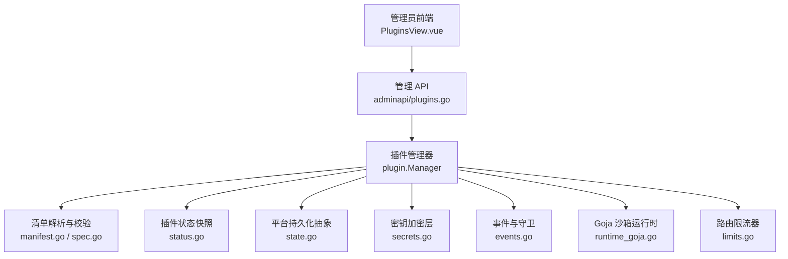
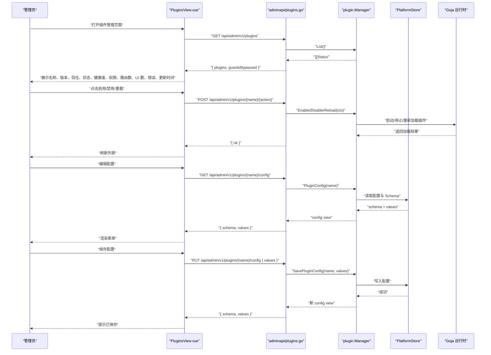
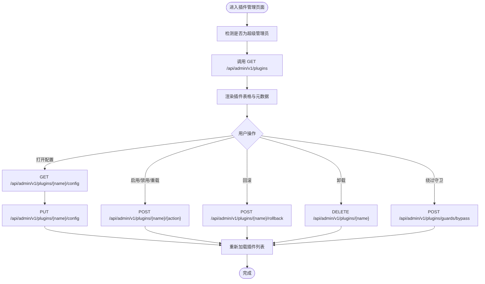
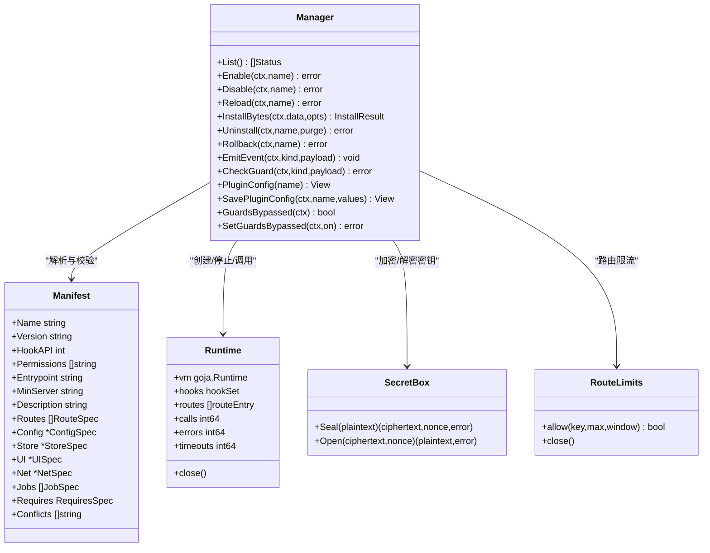
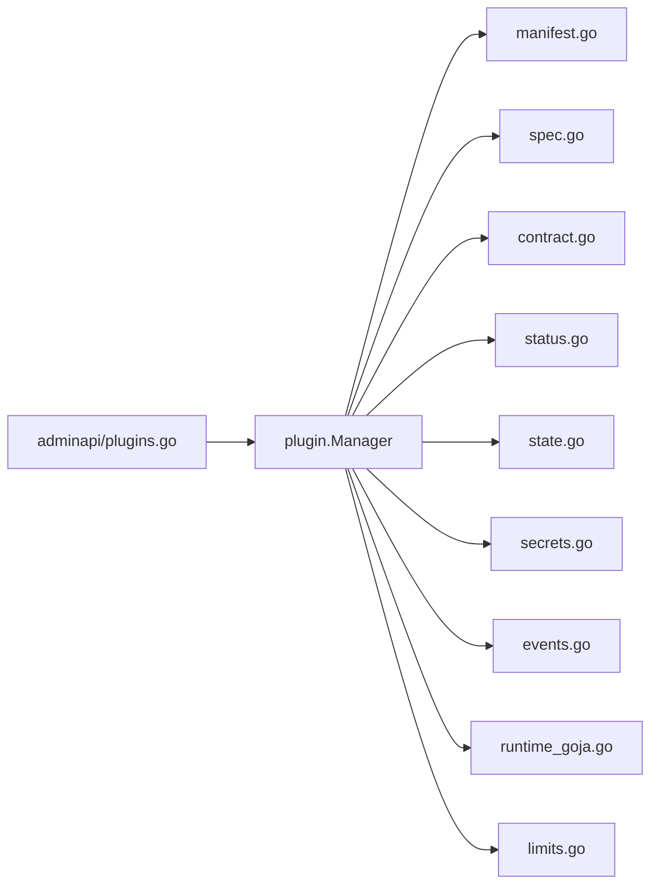
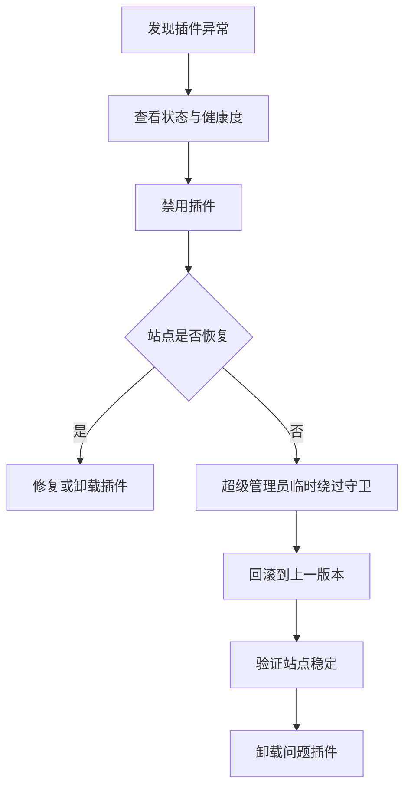

# 插件管理

**本文引用的文件**
- [PluginsView.vue](https://github.com/YimingZhanshen/skin-nexus/blob/797ae1a/web/src/components/admin/PluginsView.vue)
- [plugins.go](https://github.com/YimingZhanshen/skin-nexus/blob/797ae1a/server/internal/adminapi/plugins.go)
- [manifest.go](https://github.com/YimingZhanshen/skin-nexus/blob/797ae1a/server/internal/plugin/manifest.go)
- [spec.go](https://github.com/YimingZhanshen/skin-nexus/blob/797ae1a/server/internal/plugin/spec.go)
- [contract.go](https://github.com/YimingZhanshen/skin-nexus/blob/797ae1a/server/internal/plugin/contract.go)
- [status.go](https://github.com/YimingZhanshen/skin-nexus/blob/797ae1a/server/internal/plugin/status.go)
- [state.go](https://github.com/YimingZhanshen/skin-nexus/blob/797ae1a/server/internal/plugin/state.go)
- [install.go](https://github.com/YimingZhanshen/skin-nexus/blob/797ae1a/server/internal/plugin/install.go)
- [secrets.go](https://github.com/YimingZhanshen/skin-nexus/blob/797ae1a/server/internal/plugin/secrets.go)
- [events.go](https://github.com/YimingZhanshen/skin-nexus/blob/797ae1a/server/internal/plugin/events.go)
- [runtime_goja.go](https://github.com/YimingZhanshen/skin-nexus/blob/797ae1a/server/internal/plugin/runtime_goja.go)
- [limits.go](https://github.com/YimingZhanshen/skin-nexus/blob/797ae1a/server/internal/plugin/limits.go)

## 目录
1. [简介](#简介)
2. [项目结构](#项目结构)
3. [核心组件](#核心组件)
4. [架构总览](#架构总览)
5. [详细组件分析](#详细组件分析)
6. [依赖关系分析](#依赖关系分析)
7. [性能与资源限制](#性能与资源限制)
8. [故障排查指南](#故障排查指南)
9. [开发者与站长协作示例](#开发者与站长协作示例)
10. [结论](#结论)

## 简介
本文说明本仓库的插件管理体系，包括前端管理页面如何展示已安装插件、版本、状态、健康度、权限、路由、UI 数量、最后更新时间等；如何实现启用、禁用、重载、回滚、卸载和编辑配置。同时梳理插件清单 manifest v2 的关键字段、后端管理 API、安全模型（Ed25519 签名校验、命名空间隔离、限流、沙箱执行），并给出安装失败、版本冲突、依赖缺失、运行时错误的排查步骤，以及从主题市场安装插件、配置 SMTP 密钥、禁用问题插件的协作流程。

## 项目结构
插件功能横跨前端管理页面、后端管理接口、插件宿主、清单校验、存储与加密、事件与守卫、Goja 沙箱等模块：

**图表来源**
- [PluginsView.vue:1-120](https://github.com/YimingZhanshen/skin-nexus/blob/797ae1a/web/src/components/admin/PluginsView.vue#L1-L120)
- [plugins.go:1-166](https://github.com/YimingZhanshen/skin-nexus/blob/797ae1a/server/internal/adminapi/plugins.go#L1-L166)
- [manifest.go:1-120](https://github.com/YimingZhanshen/skin-nexus/blob/797ae1a/server/internal/plugin/manifest.go#L1-L120)
- [spec.go:1-120](https://github.com/YimingZhanshen/skin-nexus/blob/797ae1a/server/internal/plugin/spec.go#L1-L120)
- [status.go:1-117](https://github.com/YimingZhanshen/skin-nexus/blob/797ae1a/server/internal/plugin/status.go#L1-L117)
- [state.go:1-108](https://github.com/YimingZhanshen/skin-nexus/blob/797ae1a/server/internal/plugin/state.go#L1-L108)
- [secrets.go:1-113](https://github.com/YimingZhanshen/skin-nexus/blob/797ae1a/server/internal/plugin/secrets.go#L1-L113)
- [events.go:1-94](https://github.com/YimingZhanshen/skin-nexus/blob/797ae1a/server/internal/plugin/events.go#L1-L94)
- [runtime_goja.go:1-120](https://github.com/YimingZhanshen/skin-nexus/blob/797ae1a/server/internal/plugin/runtime_goja.go#L1-L120)
- [limits.go:1-103](https://github.com/YimingZhanshen/skin-nexus/blob/797ae1a/server/internal/plugin/limits.go#L1-L103)

**章节来源**
- [PluginsView.vue:1-294](https://github.com/YimingZhanshen/skin-nexus/blob/797ae1a/web/src/components/admin/PluginsView.vue#L1-L294)
- [plugins.go:1-166](https://github.com/YimingZhanshen/skin-nexus/blob/797ae1a/server/internal/adminapi/plugins.go#L1-L166)

## 核心组件
- **PluginsView.vue**：管理员查看插件列表、信任来源、权限、状态、健康度、错误信息、路由与 UI 数量，并提供打开配置、启用、禁用、重载、回滚、卸载等操作。
- **adminapi/plugins.go**：注册 `/api/admin/v1/plugins` 系列管理接口，对启用/禁用/重载/更新配置/绕过守卫等写操作强制要求超级管理员 Web 会话。
- **plugin.Manifest / plugin.Info**：描述插件清单与加载后的元数据，包含名称、版本、入口脚本、权限、最小服务器版本、配置、存储、路由、UI、网络、任务、依赖与冲突等。
- **plugin.Status**：面向管理界面的插件快照，暴露运行状态、健康度、调用计数、日志片段、时间戳等。
- **plugin.Manager**：插件生命周期中枢，负责扫描、加载、启用、禁用、重载、安装、卸载、回滚、事件广播、守卫检查、配置与密钥访问。
- **plugin.runtime（Goja）**：基于 Goja 的 JavaScript 沙箱，绑定 `skin` API，执行钩子、路由回调、事件订阅和守卫逻辑，提供超时中断与调用统计。
- **plugin.secrets.SecretBox**：使用 AES-256-GCM 对插件密钥进行静态加密，密钥来自环境变量或本地文件。
- **plugin.limits.routeLimits**：按路由维度的滑动窗口限流器，避免为每个路由创建额外协程。

**章节来源**
- [PluginsView.vue:1-294](https://github.com/YimingZhanshen/skin-nexus/blob/797ae1a/web/src/components/admin/PluginsView.vue#L1-L294)
- [plugins.go:1-166](https://github.com/YimingZhanshen/skin-nexus/blob/797ae1a/server/internal/adminapi/plugins.go#L1-L166)
- [manifest.go:1-263](https://github.com/YimingZhanshen/skin-nexus/blob/797ae1a/server/internal/plugin/manifest.go#L1-L263)
- [status.go:1-117](https://github.com/YimingZhanshen/skin-nexus/blob/797ae1a/server/internal/plugin/status.go#L1-L117)
- [runtime_goja.go:1-120](https://github.com/YimingZhanshen/skin-nexus/blob/797ae1a/server/internal/plugin/runtime_goja.go#L1-L120)
- [secrets.go:1-113](https://github.com/YimingZhanshen/skin-nexus/blob/797ae1a/server/internal/plugin/secrets.go#L1-L113)
- [limits.go:1-103](https://github.com/YimingZhanshen/skin-nexus/blob/797ae1a/server/internal/plugin/limits.go#L1-L103)

## 架构总览
插件管理的端到端流程如下：

**图表来源**
- [PluginsView.vue:20-120](https://github.com/YimingZhanshen/skin-nexus/blob/797ae1a/web/src/components/admin/PluginsView.vue#L20-L120)
- [plugins.go:33-166](https://github.com/YimingZhanshen/skin-nexus/blob/797ae1a/server/internal/adminapi/plugins.go#L33-L166)
- [status.go:1-117](https://github.com/YimingZhanshen/skin-nexus/blob/797ae1a/server/internal/plugin/status.go#L1-L117)
- [state.go:1-108](https://github.com/YimingZhanshen/skin-nexus/blob/797ae1a/server/internal/plugin/state.go#L1-L108)
- [runtime_goja.go:120-200](https://github.com/YimingZhanshen/skin-nexus/blob/797ae1a/server/internal/plugin/runtime_goja.go#L120-L200)

**章节来源**
- [PluginsView.vue:1-294](https://github.com/YimingZhanshen/skin-nexus/blob/797ae1a/web/src/components/admin/PluginsView.vue#L1-L294)
- [plugins.go:1-166](https://github.com/YimingZhanshen/skin-nexus/blob/797ae1a/server/internal/adminapi/plugins.go#L1-L166)
- [status.go:1-117](https://github.com/YimingZhanshen/skin-nexus/blob/797ae1a/server/internal/plugin/status.go#L1-L117)
- [state.go:1-108](https://github.com/YimingZhanshen/skin-nexus/blob/797ae1a/server/internal/plugin/state.go#L1-L108)

## 详细组件分析

### 插件管理页面 PluginsView.vue
该组件是站长的主要交互入口，承担以下职责：
- 通过 `/api/admin/v1/plugins` 获取插件列表与守卫绕过状态。
- 根据当前会话判断是否只读：普通管理员只能查看；超级管理员可启用、禁用、重载、回滚、卸载。
- 显示插件标题、版本、信任状态、来源、描述、作者、状态、健康度、路由数、UI 页数、权限标签、最近错误。
- 打开插件配置面板，请求 `/api/admin/v1/plugins/{name}/config`，使用 JSON Schema 表单渲染，并由超级管理员提交更新。
- 对危险操作提供二次确认，并使用行级忙碌集合防止重复提交。
- 支持“绕过守卫”开关，调用 `/api/admin/v1/plugins/guards/bypass` 切换全局 break-glass 选项。

**图表来源**
- [PluginsView.vue:20-120](https://github.com/YimingZhanshen/skin-nexus/blob/797ae1a/web/src/components/admin/PluginsView.vue#L20-L120)
- [PluginsView.vue:201-294](https://github.com/YimingZhanshen/skin-nexus/blob/797ae1a/web/src/components/admin/PluginsView.vue#L201-L294)

**章节来源**
- [PluginsView.vue:1-294](https://github.com/YimingZhanshen/skin-nexus/blob/797ae1a/web/src/components/admin/PluginsView.vue#L1-L294)

### 插件清单 manifest v2 关键字段
插件清单由 `plugin.json` 定义，并通过 `loadManifest` 与 `validateV2Manifest` 校验。关键语义如下：

| 字段 | 类型 | 含义 | 约束与行为 |
|---|---|---|---|
| `name` | 字符串 | 插件标识符 | 必须与目录名一致，仅允许小写字母、数字、下划线、连字符，长度受正则限制 |
| `version` | 字符串 | 插件版本 | 非空且不超过最大长度；升级时用于保留旧版本回滚快照 |
| `description` | 字符串 | 插件描述 | 在清单中作为描述字段，同时在加载后映射到 Info 的描述属性 |
| `routes` | 数组 | 声明式路由 | 每个条目含方法、路径、层级、CSRF、限速、请求体大小与超时；运行时注册的 route 必须与清单完全匹配 |
| `events` | 概念字段 | 事件订阅能力 | 通过 `permissions` 中的 `events:subscribe` 和 `auth:guards` 表达；运行时以 `hooks.events` 和 `hooks.guards` 管理 |
| `secrets` | 概念字段 | 密钥能力 | 清单不直接列出 secrets 块，但需要 `store` 与 `secrets` 能力才能读写加密密钥；无 store 或 secrets 时会返回“无配置/无密钥”域错误 |
| `config` | 对象 | 配置 Schema | 包含 JSON Schema，供管理界面生成表单并验证值 |
| `hookApi` | 整数 | 钩子契约版本 | 当前固定为 2；不支持其他版本 |
| `entrypoint` | 字符串 | 入口脚本 | 必须是常规 JS 文件，不能是符号链接，不能逃逸插件目录，文件大小受限 |
| `permissions` | 字符串数组 | 声明式权限 | 白名单校验，重复项去重；加载时审计 |
| `minServer` | 字符串 | 最小服务器版本 | 安装时校验主机版本，不满足则返回 blocked |
| `requires` | 对象 | 依赖 | 参与 PlanInstall，缺失时导致安装被阻止 |
| `conflicts` | 字符串数组 | 冲突插件 | 参与 PlanInstall，冲突时导致安装被阻止 |
| `ui.pages` / `ui.slots` / `ui.assets` | 对象数组 | 管理面与用户面 UI | 路径、区域、渲染方式、国际化等需通过 v2 清单校验 |
| `store.schemaVersion` | 整数 | 数据存储版本 | 用于配置 Schema 版本与文档存储 |

**章节来源**
- [manifest.go:1-263](https://github.com/YimingZhanshen/skin-nexus/blob/797ae1a/server/internal/plugin/manifest.go#L1-L263)
- [spec.go:1-200](https://github.com/YimingZhanshen/skin-nexus/blob/797ae1a/server/internal/plugin/spec.go#L1-L200)
- [contract.go:1-200](https://github.com/YimingZhanshen/skin-nexus/blob/797ae1a/server/internal/plugin/contract.go#L1-L200)

### 后端管理 API
管理接口集中在 `adminapi/plugins.go`，所有写操作都要求 Web 会话且 permission=2 的超级管理员：

| 接口 | 方法 | 用途 | 权限要求 | 响应要点 |
|---|---|---|---|---|
| `/api/admin/v1/plugins` | GET | 列出插件 | 管理员会话即可 | `{ plugins, guardsBypassed }` |
| `/api/admin/v1/plugins/{name}/{action}` | POST | 启用、禁用、重载 | 超级管理员 Web 会话 | `{ ok }` 或具体错误码 |
| `/api/admin/v1/plugins/{name}/config` | GET | 读取插件配置 Schema 与值 | 管理员会话 | `{ schema, values }` |
| `/api/admin/v1/plugins/{name}/config` | PUT | 更新插件配置 | 超级管理员 Web 会话 | `{ schema, values }` 或验证错误 |
| `/api/admin/v1/plugins/{name}/rollback` | POST | 回滚到上一个版本 | 超级管理员 Web 会话 | 成功或错误 |
| `/api/admin/v1/plugins/{name}` | DELETE | 卸载插件 | 超级管理员 Web 会话 | 成功或错误 |
| `/api/admin/v1/plugins/guards/bypass` | POST | 切换守卫绕过 | 超级管理员 Web 会话 | `{ guardsBypassed }` |

需要注意：
- 安装签名包没有直接暴露在前端插件列表中；安装通常通过主题市场或管理市场的安装流程，最终落到 `Manager.InstallBytes` / `Manager.InstallBundle`。
- 触发事件不是通过通用管理 API 直接调用，而是通过 `Manager.EmitEvent` 在内部事件总线中广播，由插件订阅者处理。
- 读取日志可通过 `Status.logs` 字段获取最近日志片段；更完整的访问日志属于独立子系统，不在插件管理 API 内。

**章节来源**
- [plugins.go:1-166](https://github.com/YimingZhanshen/skin-nexus/blob/797ae1a/server/internal/adminapi/plugins.go#L1-L166)
- [install.go:1-200](https://github.com/YimingZhanshen/skin-nexus/blob/797ae1a/server/internal/plugin/install.go#L1-L200)
- [events.go:1-94](https://github.com/YimingZhanshen/skin-nexus/blob/797ae1a/server/internal/plugin/events.go#L1-L94)

### 插件安全模型
插件安全模型围绕签名、权限、命名空间、限流与沙箱展开：

**图表来源**
- [status.go:1-117](https://github.com/YimingZhanshen/skin-nexus/blob/797ae1a/server/internal/plugin/status.go#L1-L117)
- [manifest.go:1-263](https://github.com/YimingZhanshen/skin-nexus/blob/797ae1a/server/internal/plugin/manifest.go#L1-L263)
- [runtime_goja.go:1-200](https://github.com/YimingZhanshen/skin-nexus/blob/797ae1a/server/internal/plugin/runtime_goja.go#L1-L200)
- [secrets.go:1-113](https://github.com/YimingZhanshen/skin-nexus/blob/797ae1a/server/internal/plugin/secrets.go#L1-L113)
- [limits.go:1-103](https://github.com/YimingZhanshen/skin-nexus/blob/797ae1a/server/internal/plugin/limits.go#L1-L103)

安全要点：
- **Ed25519 验签**：安装过程通过 `InspectBundle` 检查签名状态；可信状态为 `TrustVerified`，否则拒绝或要求显式接受未验证包。签名相关信息包括 `signer`、`digest`、`trust`，并在安装成功后记录到来源与审计。
- **命名空间隔离**：`PlatformStore` 的 KV、文档、配置、密钥等方法都以插件名为前缀，禁止插件直接访问宿主表或任意 SQL。
- **限流**：路由声明中的 `rateLimit` 使用 `parseRateLimit` 解析，例如 `60/m`、`10/s`、`100/h`；`routeLimits` 以单协程定时清理一小时前的命中记录，避免每路由一个 goroutine。
- **沙箱执行**：Goja 运行时设置最大调用栈、为加载和执行设置超时，通过 `vm.Interrupt(errTimeout)` 中断长时间运行的脚本；钩子、路由回调、事件与守卫均受超时与统计控制。
- **权限模型**：清单中的 `permissions` 是声明式权限，加载时校验白名单；运行时再按需检查能力，例如访问配置、网络、邮件、调度任务、事件订阅、守卫等。

**章节来源**
- [install.go:1-200](https://github.com/YimingZhanshen/skin-nexus/blob/797ae1a/server/internal/plugin/install.go#L1-L200)
- [state.go:1-108](https://github.com/YimingZhanshen/skin-nexus/blob/797ae1a/server/internal/plugin/state.go#L1-L108)
- [limits.go:1-103](https://github.com/YimingZhanshen/skin-nexus/blob/797ae1a/server/internal/plugin/limits.go#L1-L103)
- [runtime_goja.go:1-200](https://github.com/YimingZhanshen/skin-nexus/blob/797ae1a/server/internal/plugin/runtime_goja.go#L1-L200)
- [contract.go:1-200](https://github.com/YimingZhanshen/skin-nexus/blob/797ae1a/server/internal/plugin/contract.go#L1-L200)

### 插件状态与健康度
`plugin.Status` 是管理页面的核心数据结构，包含：
- 基本信息：`name`、`version`、`title`、`author`、`homepage`、`description`、`hookApi`、`runtime`。
- 运行信息：`enabled`、`state`、`health`、`lastError`、`loadedAt`、`installedAt`、`updatedAt`。
- 扩展信息：`permissions`、`routes`、`uiPages`、`configSchemaVersion`、`source`、`trust`、`signer`、`digest`。
- 运行时指标：`hooks`、`calls`、`errors`、`timeouts`、`routeCalls`、`logs`。

前端将 `health` 或 `state` 映射为健康徽章，并将 `lastError` 作为错误文本展示。

**章节来源**
- [status.go:1-117](https://github.com/YimingZhanshen/skin-nexus/blob/797ae1a/server/internal/plugin/status.go#L1-L117)
- [PluginsView.vue:201-294](https://github.com/YimingZhanshen/skin-nexus/blob/797ae1a/web/src/components/admin/PluginsView.vue#L201-L294)

## 依赖关系分析
插件系统内部依赖如下：

**图表来源**
- [plugins.go:1-166](https://github.com/YimingZhanshen/skin-nexus/blob/797ae1a/server/internal/adminapi/plugins.go#L1-L166)
- [manifest.go:1-263](https://github.com/YimingZhanshen/skin-nexus/blob/797ae1a/server/internal/plugin/manifest.go#L1-L263)
- [spec.go:1-200](https://github.com/YimingZhanshen/skin-nexus/blob/797ae1a/server/internal/plugin/spec.go#L1-L200)
- [contract.go:1-200](https://github.com/YimingZhanshen/skin-nexus/blob/797ae1a/server/internal/plugin/contract.go#L1-L200)
- [status.go:1-117](https://github.com/YimingZhanshen/skin-nexus/blob/797ae1a/server/internal/plugin/status.go#L1-L117)
- [state.go:1-108](https://github.com/YimingZhanshen/skin-nexus/blob/797ae1a/server/internal/plugin/state.go#L1-L108)
- [secrets.go:1-113](https://github.com/YimingZhanshen/skin-nexus/blob/797ae1a/server/internal/plugin/secrets.go#L1-L113)
- [events.go:1-94](https://github.com/YimingZhanshen/skin-nexus/blob/797ae1a/server/internal/plugin/events.go#L1-L94)
- [runtime_goja.go:1-200](https://github.com/YimingZhanshen/skin-nexus/blob/797ae1a/server/internal/plugin/runtime_goja.go#L1-L200)
- [limits.go:1-103](https://github.com/YimingZhanshen/skin-nexus/blob/797ae1a/server/internal/plugin/limits.go#L1-L103)

耦合与内聚特点：
- 管理 API 与插件宿主通过 `PluginsDeps.Host` 松耦合接入，便于测试替换。
- 插件宿主通过 `PlatformStore` 抽象访问配置、密钥、KV、文档、迁移等，避免直接依赖数据库实现。
- 运行时与宿主通过 `runtime` 结构体暴露钩子、路由、日志、调用统计，保持沙箱边界。
- 限流器独立维护，避免 O(n) goroutine 增长。

**章节来源**
- [plugins.go:1-166](https://github.com/YimingZhanshen/skin-nexus/blob/797ae1a/server/internal/adminapi/plugins.go#L1-L166)
- [state.go:1-108](https://github.com/YimingZhanshen/skin-nexus/blob/797ae1a/server/internal/plugin/state.go#L1-L108)
- [limits.go:1-103](https://github.com/YimingZhanshen/skin-nexus/blob/797ae1a/server/internal/plugin/limits.go#L1-L103)

## 性能与资源限制
插件系统在加载与运行阶段设置了多项硬上限与软限制：

| 维度 | 限制 | 目的 |
|---|---|---|
| 清单大小 | 最大约 64KB | 防止恶意清单耗尽内存 |
| 入口脚本大小 | 最大约 1MB | 防止大脚本拖慢加载 |
| 插件总数 | 最多 64 个 | 控制宿主负载 |
| 每个插件路由数 | 最多 32 条 | 控制路由表规模 |
| 全部路由数 | 最多 64 条 | 控制全局路由表规模 |
| 标题/作者/主页/描述长度 | 分别有最大长度 | 控制元数据体积 |
| 加载超时 | 默认约 2 秒 | 防止入口脚本卡住进程 |
| 钩子/路由/认证超时 | 由运行时与配置决定 | 防止单个调用长期占用 |
| 路由限流 | `N/s`、`N/m`、`N/h` | 防止热点路由被滥用 |
| 外部 HTTP | 主机白名单、路径白名单、最大字节、超时 | 限制出站攻击面 |
| 密钥密钥长度 | 32 字节 | AES-256-GCM 要求 |

这些限制使插件即使出现错误或恶意行为，也更容易被宿主快速终止或隔离。

**章节来源**
- [manifest.go:1-60](https://github.com/YimingZhanshen/skin-nexus/blob/797ae1a/server/internal/plugin/manifest.go#L1-L60)
- [runtime_goja.go:120-200](https://github.com/YimingZhanshen/skin-nexus/blob/797ae1a/server/internal/plugin/runtime_goja.go#L120-L200)
- [limits.go:1-103](https://github.com/YimingZhanshen/skin-nexus/blob/797ae1a/server/internal/plugin/limits.go#L1-L103)
- [secrets.go:1-113](https://github.com/YimingZhanshen/skin-nexus/blob/797ae1a/server/internal/plugin/secrets.go#L1-L113)

## 故障排查指南

### 安装失败
常见原因与排查步骤：
1. **未通过签名校验**
   - 现象：安装返回未验证状态或错误。
   - 原因：打包签名不可信、签名键不受信任、或签名无效。
   - 排查：检查主题市场提供的签名包是否完整，确认服务端信任链；如果是本地上传，可使用显式接受未验证选项，但生产环境应谨慎。
   - 参考实现：安装流程在验签失败时返回 `ErrUnverifiedPlugin`。

2. **摘要不一致**
   - 现象：安装状态为 `stale`。
   - 原因：确认用的 ZIP 摘要与 inspected 摘要不同。
   - 排查：重新下载签名包，确保 ExpectedZipSHA 与实际包一致。

3. **清单版本与入口不符**
   - 现象：安装时报清单与目录不匹配、入口脚本非法或超出大小。
   - 排查：核对 `plugin.json` 的 `name` 是否与目录一致，`entrypoint` 是否指向有效 JS 文件，且不包含符号链接或路径逃逸。

4. **主机版本不满足**
   - 现象：安装计划 `CanInstall=false`，状态 `blocked`。
   - 原因：`minServer` 要求的最低版本高于当前主机版本。
   - 排查：升级主机或调整插件清单的 `minServer`。

5. **新增权限未同意**
   - 现象：安装状态为 `consent`。
   - 原因：插件声明了新的权限，但未携带 `Consent=true`。
   - 排查：在主题市场安装流程中明确同意新增权限后再安装。

6. **依赖缺失或存在冲突**
   - 现象：安装计划无法安装。
   - 原因：`requires` 依赖未安装，或 `conflicts` 与其他插件冲突。
   - 排查：先安装依赖插件，或卸载冲突插件。

**章节来源**
- [install.go:1-200](https://github.com/YimingZhanshen/skin-nexus/blob/797ae1a/server/internal/plugin/install.go#L1-L200)
- [manifest.go:120-263](https://github.com/YimingZhanshen/skin-nexus/blob/797ae1a/server/internal/plugin/manifest.go#L120-L263)
- [spec.go:1-200](https://github.com/YimingZhanshen/skin-nexus/blob/797ae1a/server/internal/plugin/spec.go#L1-L200)

### 版本冲突
- 新版本安装会保留旧版本到 `.state/rollback/<name>`，以便回滚。
- 如果激活失败，安装流程尝试恢复旧版本；若仍失败，应检查 `lastError` 与运行时日志。
- 手动回滚通过 `/api/admin/v1/plugins/{name}/rollback` 触发，失败时可能返回 `ErrNoRollback`。

**章节来源**
- [install.go:201-342](https://github.com/YimingZhanshen/skin-nexus/blob/797ae1a/server/internal/plugin/install.go#L201-L342)
- [status.go:1-117](https://github.com/YimingZhanshen/skin-nexus/blob/797ae1a/server/internal/plugin/status.go#L1-L117)

### 依赖缺失
- 依赖通过 `requires` 声明，安装计划会检查依赖是否满足。
- 若依赖不存在，应先安装依赖插件；若依赖版本不兼容，应升级或降级对应插件。
- 对于主题市场场景，市场侧应在安装前聚合依赖并提示用户。

**章节来源**
- [manifest.go:1-120](https://github.com/YimingZhanshen/skin-nexus/blob/797ae1a/server/internal/plugin/manifest.go#L1-L120)
- [spec.go:1-200](https://github.com/YimingZhanshen/skin-nexus/blob/797ae1a/server/internal/plugin/spec.go#L1-L200)
- [install.go:120-200](https://github.com/YimingZhanshen/skin-nexus/blob/797ae1a/server/internal/plugin/install.go#L120-L200)

### 运行时错误
常见症状：
- 插件状态为 `error`。
- `lastError` 显示加载失败、入口脚本执行失败、声明路由未注册、声明任务未注册。
- `timeouts` 增加，表示钩子或路由超过预算。
- `errors` 增加，表示运行时抛出异常。

排查建议：
1. 查看插件 `lastError` 与 `logs`。
2. 检查入口脚本是否能正常执行并注册所有声明的 `routes` 和 `jobs`。
3. 检查权限是否足够：例如访问配置需要 `config`，外部 HTTP 需要 `net:http`。
4. 检查路由超时与限流：过大请求体或过长处理时间会触发超时；高频请求可能触发限流。
5. 如果是守卫导致拦截，检查 `auth:guards` 插件是否 deny，或通过超级管理员临时开启守卫绕过。

**章节来源**
- [runtime_goja.go:120-200](https://github.com/YimingZhanshen/skin-nexus/blob/797ae1a/server/internal/plugin/runtime_goja.go#L120-L200)
- [status.go:1-117](https://github.com/YimingZhanshen/skin-nexus/blob/797ae1a/server/internal/plugin/status.go#L1-L117)
- [events.go:1-94](https://github.com/YimingZhanshen/skin-nexus/blob/797ae1a/server/internal/plugin/events.go#L1-L94)
- [limits.go:1-103](https://github.com/YimingZhanshen/skin-nexus/blob/797ae1a/server/internal/plugin/limits.go#L1-L103)

## 开发者与站长协作示例

### 从主题市场安装插件
推荐流程：
1. 开发者发布带 Ed25519 签名的插件包，并确保 `plugin.json` 中 `hookApi` 为 2、`entrypoint` 合法、`permissions` 准确。
2. 站长在主题市场选择插件，市场侧下载签名包并调用安装流程。
3. 如果插件声明新权限，市场侧应提示站长并获得同意。
4. 安装完成后，站长在插件管理页面查看状态、信任来源、权限、路由与 UI 数量。
5. 如插件需要外部服务，站长继续配置密钥与配置项。

**章节来源**
- [install.go:1-200](https://github.com/YimingZhanshen/skin-nexus/blob/797ae1a/server/internal/plugin/install.go#L1-L200)
- [PluginsView.vue:1-120](https://github.com/YimingZhanshen/skin-nexus/blob/797ae1a/web/src/components/admin/PluginsView.vue#L1-L120)

### 为插件配置 SMTP 密钥
虽然仓库中没有 SMTP 专用字段，但插件可以通过配置与密钥机制组合实现 SMTP 设置：
1. 插件在清单中声明 `config` 与 `store`，并提供 JSON Schema。
2. 站长在插件管理页面打开配置，填写 SMTP 主机、端口、用户名等普通配置。
3. 对于密码、令牌等敏感信息，插件应通过密钥接口写入加密存储；密钥由 `SecretBox` 使用 AES-256-GCM 保护。
4. 插件在运行时读取配置与密钥，连接 SMTP 服务发送邮件。
5. 如果配置格式错误，管理 API 会返回验证错误；如果缺少 store 或 secrets 能力，会返回明确的领域错误。

**章节来源**
- [plugins.go:90-166](https://github.com/YimingZhanshen/skin-nexus/blob/797ae1a/server/internal/adminapi/plugins.go#L90-L166)
- [secrets.go:1-113](https://github.com/YimingZhanshen/skin-nexus/blob/797ae1a/server/internal/plugin/secrets.go#L1-L113)
- [state.go:1-108](https://github.com/YimingZhanshen/skin-nexus/blob/797ae1a/server/internal/plugin/state.go#L1-L108)

### 禁用有问题的插件
当插件导致错误、超时或守卫误判时：
1. 在插件管理页面找到该插件，查看 `state`、`health`、`lastError`、`timeouts`、`errors`。
2. 先尝试禁用插件，观察站点行为是否恢复。
3. 如需暂时绕过守卫拦截，超级管理员可开启“绕过守卫”，但应记录审计并尽快修复插件。
4. 如果新版本有问题，使用回滚恢复到上一个稳定版本。
5. 若插件不再可信，使用卸载将其移出活跃目录；可选清除插件数据。

**图表来源**
- [PluginsView.vue:60-120](https://github.com/YimingZhanshen/skin-nexus/blob/797ae1a/web/src/components/admin/PluginsView.vue#L60-L120)
- [events.go:30-94](https://github.com/YimingZhanshen/skin-nexus/blob/797ae1a/server/internal/plugin/events.go#L30-L94)
- [install.go:201-342](https://github.com/YimingZhanshen/skin-nexus/blob/797ae1a/server/internal/plugin/install.go#L201-L342)

**章节来源**
- [PluginsView.vue:1-294](https://github.com/YimingZhanshen/skin-nexus/blob/797ae1a/web/src/components/admin/PluginsView.vue#L1-L294)
- [events.go:1-94](https://github.com/YimingZhanshen/skin-nexus/blob/797ae1a/server/internal/plugin/events.go#L1-L94)
- [install.go:201-342](https://github.com/YimingZhanshen/skin-nexus/blob/797ae1a/server/internal/plugin/install.go#L201-L342)

## 结论
本插件体系通过清单声明、签名校验、权限白名单、命名空间隔离、限流与 Goja 沙箱，构建了相对严格的插件运行环境。前端管理页面提供了清晰的插件视图与必要的运维操作；后端管理 API 对危险操作施加超级管理员与会话校验；安装流程支持回滚、审计与来源追踪。开发者和站长可以借助这套机制协作：开发者保证清单与代码正确性，站长负责安装审批、权限确认、密钥配置与问题插件处置。
