# 插件系统

**本文引用的文件**
- [manifest.go](https://github.com/YimingZhanshen/skin-nexus/blob/797ae1a/server/internal/plugin/manifest.go)
- [contract.go](https://github.com/YimingZhanshen/skin-nexus/blob/797ae1a/server/internal/plugin/contract.go)
- [host.go](https://github.com/YimingZhanshen/skin-nexus/blob/797ae1a/server/internal/plugin/host.go)
- [runtime_goja.go](https://github.com/YimingZhanshen/skin-nexus/blob/797ae1a/server/internal/plugin/runtime_goja.go)
- [routes.go](https://github.com/YimingZhanshen/skin-nexus/blob/797ae1a/server/internal/plugin/routes.go)
- [events.go](https://github.com/YimingZhanshen/skin-nexus/blob/797ae1a/server/internal/plugin/events.go)
- [config.go](https://github.com/YimingZhanshen/skin-nexus/blob/797ae1a/server/internal/plugin/config.go)
- [secrets.go](https://github.com/YimingZhanshen/skin-nexus/blob/797ae1a/server/internal/plugin/secrets.go)
- [ui.go](https://github.com/YimingZhanshen/skin-nexus/blob/797ae1a/server/internal/plugin/ui.go)
- [store_service.go](https://github.com/YimingZhanshen/skin-nexus/blob/797ae1a/server/internal/plugin/store_service.go)
- [jobs_bridge.go](https://github.com/YimingZhanshen/skin-nexus/blob/797ae1a/server/internal/plugin/jobs_bridge.go)
- [install.go](https://github.com/YimingZhanshen/skin-nexus/blob/797ae1a/server/internal/plugin/install.go)
- [index.js](https://github.com/YimingZhanshen/skin-nexus/blob/797ae1a/examples/plugins/hello-world/index.js)
- [plugin.json](https://github.com/YimingZhanshen/skin-nexus/blob/797ae1a/examples/plugins/hello-world/plugin.json)
- [plugin.json](https://github.com/YimingZhanshen/skin-nexus/blob/797ae1a/examples/plugins/hello-ui/plugin.json)
- [hello.html](https://github.com/YimingZhanshen/skin-nexus/blob/797ae1a/examples/plugins/hello-ui/ui/hello.html)
- [index.js](https://github.com/YimingZhanshen/skin-nexus/blob/797ae1a/examples/plugins/jobs-fixture/index.js)
- [plugin.json](https://github.com/YimingZhanshen/skin-nexus/blob/797ae1a/examples/plugins/jobs-fixture/plugin.json)

## 目录

1. [引言](#引言)
2. [项目结构与定位](#项目结构与定位)
3. [核心组件总览](#核心组件总览)
4. [架构概览](#架构概览)
5. [插件清单与能力声明](#插件清单与能力声明)
6. **Goja 宿主与运行时隔离**
7. [HTTP 路由与认证层级](#http-路由与认证层级)
8. [事件总线与钩子](#事件总线与钩子)
9. [插件配置、KV 存储与加密密钥](#插件配置kv-存储与加密密钥)
10. [UI 页面与 iframe 插槽](#ui-页面与-iframe-插槽)
11. [示例插件分析](#示例插件分析)
12. [插件生命周期：打包、安装、信任、卸载、更新](#插件生命周期打包安装信任卸载更新)
13. [安全模型与沙箱边界](#安全模型与沙箱边界)
14. [性能特征与优化建议](#性能特征与优化建议)
15. [开发调试与故障定位指南](#开发调试与故障定位指南)
16. [结论](#结论)

## 引言

本仓库的插件系统是一个基于 Goja JavaScript 引擎的沙箱扩展机制。它允许第三方 JavaScript 插件以声明式方式注册 HTTP 路由、订阅宿主事件、嵌入前端 UI、读写受限的 KV 或文档存储，并通过持久化任务队列执行后台作业。

从代码组织看，插件基础设施集中在 `server/internal/plugin`；示例插件位于 `examples/plugins`；管理面板与前端插槽渲染分别由后端 SSR 和 Vue SPA 消费。插件加载入口是 `Manager.Load`，运行期通过 `/api/plugins/<name>/...` 暴露路由，通过 `Manager.EmitEvent` 投递通用事件，通过 `Manager.CheckGuard` 执行守卫校验。

该系统的目标读者包括：

- 需要编写插件的前端或全栈开发者。
- 需要部署、审计、监控插件的管理员。
- 需要了解插件安全边界和性能特征的运维人员。

## 项目结构与定位

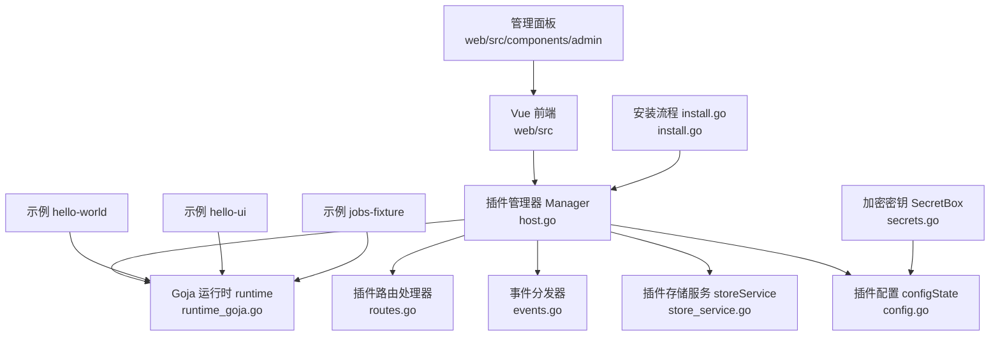

**图表来源**
- [host.go:1-200](https://github.com/YimingZhanshen/skin-nexus/blob/797ae1a/server/internal/plugin/host.go#L1-L200)
- [runtime_goja.go:1-200](https://github.com/YimingZhanshen/skin-nexus/blob/797ae1a/server/internal/plugin/runtime_goja.go#L1-L200)
- [routes.go:1-200](https://github.com/YimingZhanshen/skin-nexus/blob/797ae1a/server/internal/plugin/routes.go#L1-L200)
- [events.go:1-94](https://github.com/YimingZhanshen/skin-nexus/blob/797ae1a/server/internal/plugin/events.go#L1-L94)
- [store_service.go:1-200](https://github.com/YimingZhanshen/skin-nexus/blob/797ae1a/server/internal/plugin/store_service.go#L1-L200)
- [config.go:1-200](https://github.com/YimingZhanshen/skin-nexus/blob/797ae1a/server/internal/plugin/config.go#L1-L200)
- [secrets.go:1-113](https://github.com/YimingZhanshen/skin-nexus/blob/797ae1a/server/internal/plugin/secrets.go#L1-L113)
- [install.go:1-200](https://github.com/YimingZhanshen/skin-nexus/blob/797ae1a/server/internal/plugin/install.go#L1-L200)

**章节来源**
- [host.go:1-200](https://github.com/YimingZhanshen/skin-nexus/blob/797ae1a/server/internal/plugin/host.go#L1-L200)
- [runtime_goja.go:1-200](https://github.com/YimingZhanshen/skin-nexus/blob/797ae1a/server/internal/plugin/runtime_goja.go#L1-L200)

## 核心组件总览

| 组件 | 职责 | 关键行为 |
|---|---|---|
| `Manifest` / `Info` | 描述插件元数据、权限、清单、资源路径 | 解析 `plugin.json`，校验名称、版本、入口脚本、最小服务器版本 |
| `Manager` | 插件扫描、实例管理、事件派发、路由分发、状态持久化 | 启动事件工作协程、按名称排序实例、启用/禁用/重载插件 |
| `runtime` | 单个插件的 Goja VM、钩子、路由、日志、统计 | 设置最大调用栈、注入 `skin` API、限制超时、记录错误 |
| `routeEntry` | 一条已注册的插件路由 | 保存方法、路径、层级、规格、JS 回调、超时 |
| `hookSet` | 按钩子类型和事件名保存回调 | 区分 profile、texture、upload、lifecycle、auth、avatar、通用事件、守卫 |
| `storeService` | 插件专属 KV 和集合文档访问层 | 按插件名隔离键空间、校验配额、序列化文档、限制超时 |
| `configState` | 插件配置的内存快照 | 原子替换值、深拷贝返回、支持必填与默认值 |
| `SecretBox` | AES-256-GCM 加密插件配置机密 | 从环境变量或文件加载 32 字节密钥，自动生成并保护私钥文件 |
| `InstallOptions` / `InstallBundle` | 打包验证、阶段解压、原子激活、回滚 | 检查签名、生成事务、保留旧版本、失败时恢复 |

**章节来源**
- [manifest.go:1-200](https://github.com/YimingZhanshen/skin-nexus/blob/797ae1a/server/internal/plugin/manifest.go#L1-L200)
- [host.go:1-200](https://github.com/YimingZhanshen/skin-nexus/blob/797ae1a/server/internal/plugin/host.go#L1-L200)
- [runtime_goja.go:1-200](https://github.com/YimingZhanshen/skin-nexus/blob/797ae1a/server/internal/plugin/runtime_goja.go#L1-L200)
- [store_service.go:1-200](https://github.com/YimingZhanshen/skin-nexus/blob/797ae1a/server/internal/plugin/store_service.go#L1-L200)
- [config.go:1-200](https://github.com/YimingZhanshen/skin-nexus/blob/797ae1a/server/internal/plugin/config.go#L1-L200)
- [secrets.go:1-113](https://github.com/YimingZhanshen/skin-nexus/blob/797ae1a/server/internal/plugin/secrets.go#L1-L113)
- [install.go:1-200](https://github.com/YimingZhanshen/skin-nexus/blob/797ae1a/server/internal/plugin/install.go#L1-L200)

## 架构概览

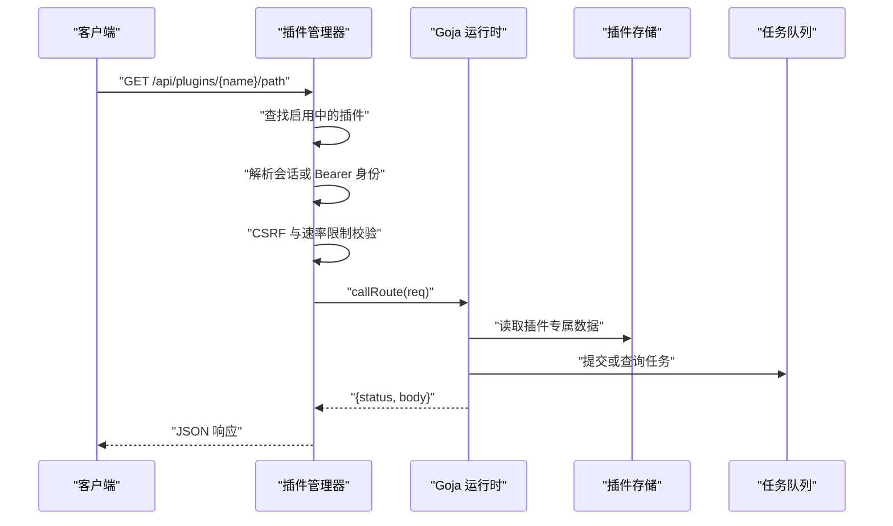

**图表来源**
- [routes.go:1-200](https://github.com/YimingZhanshen/skin-nexus/blob/797ae1a/server/internal/plugin/routes.go#L1-L200)
- [runtime_goja.go:200-724](https://github.com/YimingZhanshen/skin-nexus/blob/797ae1a/server/internal/plugin/runtime_goja.go#L200-L724)
- [store_service.go:1-200](https://github.com/YimingZhanshen/skin-nexus/blob/797ae1a/server/internal/plugin/store_service.go#L1-L200)
- [jobs_bridge.go:1-200](https://github.com/YimingZhanshen/skin-nexus/blob/797ae1a/server/internal/plugin/jobs_bridge.go#L1-L200)

## 插件清单与能力声明

插件清单即 `<plugin-dir>/plugin.json`。主机在加载时会读取该文件，并严格校验以下字段：

| 字段 | 含义 | 约束 |
|---|---|---|
| `name` | 插件目录名与唯一标识 | 小写字母数字开头，最多 64 字符，必须等于父目录名 |
| `version` | 语义化版本字符串 | 非空且不超过 64 字符 |
| `hookApi` | 当前固定为 `2` | 不匹配则拒绝加载 |
| `entrypoint` | JS 入口文件名 | 必须是普通 `.js` 文件，不能是符号链接，必须在插件目录内 |
| `permissions` | 声明式能力列表 | 只能使用已知权限字符串 |
| `minServer` | 最低服务器版本要求 | 安装时检查，不满足则阻止安装 |
| `title` / `author` / `homepage` / `description` | 可选展示元数据 | 有长度限制，`homepage` 必须是 `http(s)` URL 或空 |
| `runtime` | 运行时类型 | 默认为 `goja`，其他值保留给未来原生或 sidecar 实现 |
| `config` | JSON Schema 风格的配置结构 | 仅支持有限子集，由 admin 表单渲染并验证 |
| `store` | KV 与文档集合配额 | 可声明最大键数、文档大小、每集合行数 |
| `routes` | 声明式路由白名单 | 必须与运行时 `skin.route` 注册完全一致 |
| `ui` | UI 页面、插槽、表单、国际化 | 用于 SPA 导航和 SSR iframe 插槽 |
| `net` | 出站 HTTP 策略 | 可声明允许主机、用户路径、超时和最大字节数 |
| `jobs` | 持久化任务定义 | 必须与运行时 `skin.jobs.register` 注册一致 |
| `media` | 媒体相关扩展点 | 预留扩展 |
| `requires` / `conflicts` | 依赖与冲突声明 | 参与安装计划判断 |

清单验证分为两个阶段：

1. **磁盘级校验**：读取 `plugin.json`，检查文件大小、字段正则、入口脚本路径、是否逃逸目录、是否为符号链接、脚本大小上限。
2. **V2 清单校验**：调用 `validateV2Manifest`，进一步校验 `routes`、`jobs`、`ui`、`net`、`store`、`config` 等结构化字段。

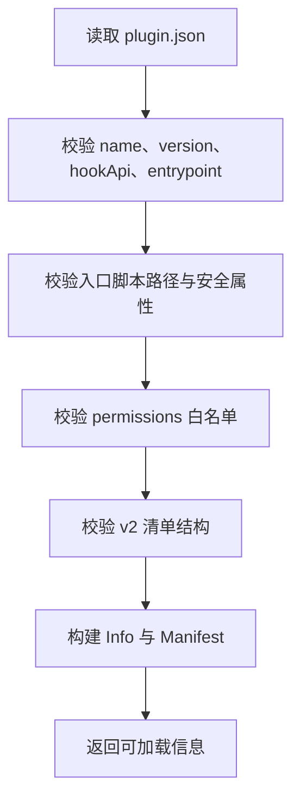

**图表来源**
- [manifest.go:1-200](https://github.com/YimingZhanshen/skin-nexus/blob/797ae1a/server/internal/plugin/manifest.go#L1-L200)
- [manifest.go:201-263](https://github.com/YimingZhanshen/skin-nexus/blob/797ae1a/server/internal/plugin/manifest.go#L201-L263)

**章节来源**
- [manifest.go:1-200](https://github.com/YimingZhanshen/skin-nexus/blob/797ae1a/server/internal/plugin/manifest.go#L1-L200)
- [manifest.go:201-263](https://github.com/YimingZhanshen/skin-nexus/blob/797ae1a/server/internal/plugin/manifest.go#L201-L263)
- [contract.go:1-120](https://github.com/YimingZhanshen/skin-nexus/blob/797ae1a/server/internal/plugin/contract.go#L1-L120)

## Goja 宿主与运行时隔离

### 宿主如何加载插件

`Manager.NewHost` 创建管理器，启动一个容量为 256 的事件队列工作协程，并在配置了任务队列时启动两个 job worker。`Manager.Load(dir)` 扫描目录，逐个加载插件：

1. 跳过隐藏目录和非目录条目。
2. 每个插件最多只加载一次，超过 `maxPlugins=64` 会忽略后续插件。
3. 对每个插件调用 `loadManifest` 解析清单。
4. 如果清单有效，调用 `prepareInstance` 解析配置和最小服务器版本。
5. 如果之前处于启用状态，再调用 `startInstance` 启动 VM。
6. 所有加载结果写入审计日志并持久化元数据。

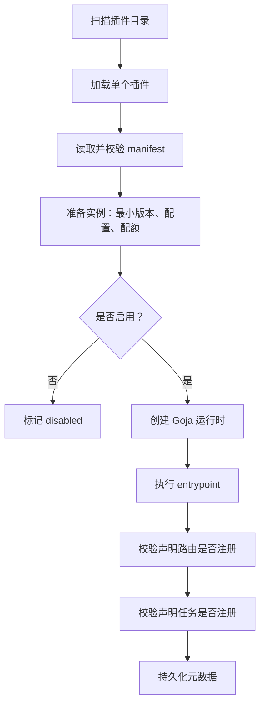

**图表来源**
- [host.go:200-730](https://github.com/YimingZhanshen/skin-nexus/blob/797ae1a/server/internal/plugin/host.go#L200-L730)
- [runtime_goja.go:1-200](https://github.com/YimingZhanshen/skin-nexus/blob/797ae1a/server/internal/plugin/runtime_goja.go#L1-L200)

### 隔离机制

每个插件拥有独立的 `runtime`，其中包含：

- 一个 `goja.Runtime`。
- 同步锁 `mu`，因为 Goja 不是 goroutine-safe。
- 每插件的路由表、钩子表、日志、调用计数、错误计数、超时计数。
- 对配置、存储、出站网络、任务队列、账户、玩家、纹理、库的受限引用。

关键隔离措施包括：

| 维度 | 实现 |
|---|---|
| 执行超时 | 每个 hook、route、load 都使用 `time.AfterFunc` 触发 `vm.Interrupt(errTimeout)` |
| 调用栈限制 | 初始化时设置 `SetMaxCallStackSize(1024)` |
| 日志上限 | 最近 64 条日志，错误消息截断到 512 字节 |
| 路由响应上限 | 插件路由响应体最大 1 MiB |
| 请求体上限 | JSON 默认 64 KiB，base64 二进制默认 4 MiB，上限 1 MiB |
| 网络出站 | 仅在声明 `net.http` 且清单允许时构造 `outbound.Scoped` |
| KV 键空间 | 按插件名隔离，键长度 1-191，禁止空值和 NUL |
| 文档集合 | 只能访问清单中声明的集合 |
| 配置访问 | 通过 `skin.config.get` / `all`，仅当声明 `config` 权限时可用 |
| 全局对象 | 只暴露 `skin` 及其子对象，不暴露 Node.js 原生模块 |

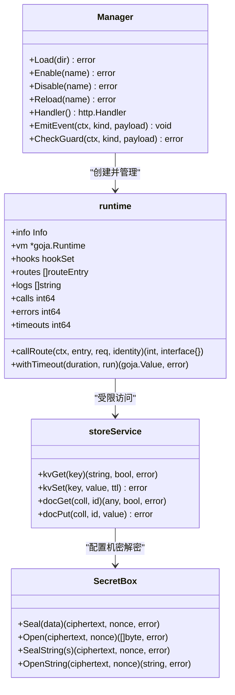

**图表来源**
- [host.go:1-200](https://github.com/YimingZhanshen/skin-nexus/blob/797ae1a/server/internal/plugin/host.go#L1-L200)
- [runtime_goja.go:1-200](https://github.com/YimingZhanshen/skin-nexus/blob/797ae1a/server/internal/plugin/runtime_goja.go#L1-L200)
- [store_service.go:1-200](https://github.com/YimingZhanshen/skin-nexus/blob/797ae1a/server/internal/plugin/store_service.go#L1-L200)
- [secrets.go:1-113](https://github.com/YimingZhanshen/skin-nexus/blob/797ae1a/server/internal/plugin/secrets.go#L1-L113)

**章节来源**
- [host.go:1-200](https://github.com/YimingZhanshen/skin-nexus/blob/797ae1a/server/internal/plugin/host.go#L1-L200)
- [host.go:200-730](https://github.com/YimingZhanshen/skin-nexus/blob/797ae1a/server/internal/plugin/host.go#L200-L730)
- [runtime_goja.go:1-200](https://github.com/YimingZhanshen/skin-nexus/blob/797ae1a/server/internal/plugin/runtime_goja.go#L1-L200)
- [runtime_goja.go:200-724](https://github.com/YimingZhanshen/skin-nexus/blob/797ae1a/server/internal/plugin/runtime_goja.go#L200-L724)

## HTTP 路由与认证层级

插件通过 `skin.route(method, path, handler)` 注册路由。主机在启动时会校验：

- 清单中声明的方法与路径必须全部被运行时注册。
- 路径不能是根路径，不能包含 `..`。
- 同一插件内不能有重复路由。
- 路由层级必须由清单权限控制。

路由层级如下：

| 层级 | 权限 | 认证 | CSRF | 说明 |
|---|---|---|---:|---|
| `public` | `http:routes` | 无需登录 | 不需要 | 公开内容，例如静态皮肤接口 |
| `session` | `http:routes:session` | 会话 Cookie | 写操作需要 | 用户态插件接口 |
| `admin` | `http:routes:admin` | 管理员权限 | 写操作需要 | 管理用途 |
| `superadmin` | `http:routes:superadmin` | 超级管理员 | 写操作需要 | 高风险管理接口 |
| `bearer` | `http:routes:bearer` | `Authorization: Bearer` | 不需要 | 机器客户端或外部服务 |

请求处理流程：

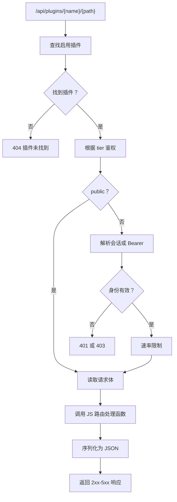

**图表来源**
- [routes.go:1-200](https://github.com/YimingZhanshen/skin-nexus/blob/797ae1a/server/internal/plugin/routes.go#L1-L200)
- [routes.go:200-497](https://github.com/YimingZhanshen/skin-nexus/blob/797ae1a/server/internal/plugin/routes.go#L200-L497)
- [runtime_goja.go:200-724](https://github.com/YimingZhanshen/skin-nexus/blob/797ae1a/server/internal/plugin/runtime_goja.go#L200-L724)

CSRF 通过 `/api/plugins/{name}/_csrf` 获取 token，并使用 `X-CSRF-Token` 头与 `skin_csrf` Cookie 配对。非 GET/HEAD 写操作必须携带正确 CSRF 令牌。

**章节来源**
- [routes.go:1-200](https://github.com/YimingZhanshen/skin-nexus/blob/797ae1a/server/internal/plugin/routes.go#L1-L200)
- [routes.go:200-497](https://github.com/YimingZhanshen/skin-nexus/blob/797ae1a/server/internal/plugin/routes.go#L200-L497)
- [runtime_goja.go:200-724](https://github.com/YimingZhanshen/skin-nexus/blob/797ae1a/server/internal/plugin/runtime_goja.go#L200-L724)

## 事件总线与钩子

插件可以订阅两类事件：

1. **宿主钩子**：由系统触发，例如头像过滤、纹理上传、用户生命周期、Yggdrasil 认证阶段。
2. **通用事件**：插件之间通过 `skin.events.on(kind, handler)` 订阅，通过 `Manager.EmitEvent` 发布。

### 宿主钩子

| 钩子 | 触发时机 | 典型用途 |
|---|---|---|
| `onUserProfileFilter` | 返回玩家资料前 | 改写 SKIN/CAPE 贴图 URL |
| `onTextureURLFilter` | 纹理 URL 返回前 | CDN 重写、镜像代理 |
| `onTextureUploaded` | 纹理提交成功后 | 异步审核、索引、通知 |
| `onUserLifecycle` | 注册、登录、删除 | 审计、统计、跨服务同步 |
| `onAuthPhase` | Yggdrasil 会话发放前后 | 自定义登录校验、风控 |
| `onAvatarFilter` | 头像渲染前 | 将头像 URL 委托给外部 HTTPS 主机 |

每个钩子都有默认超时：

- 认证和头像钩子使用更短的 `AuthTimeout`。
- 其他钩子使用 `HookTimeout`。
- 插件可以通过第二个参数传入 `timeoutMS`，但只能缩短，不能放宽宿主默认值。

### 通用事件

通用事件的负载是统一的 `EventPayload`：

| 字段 | 类型 | 含义 |
|---|---|---|
| `kind` | 字符串 | 事件名 |
| `userId` | 整数 | 站点用户 ID |
| `playerId` | 整数 | Minecraft 玩家 ID |
| `playerName` | 字符串 | 玩家昵称 |
| `uuid` | 字符串 | 玩家 UUID |
| `hash` | 字符串 | 纹理哈希 |
| `type` | 字符串 | 纹理类型 |
| `ip` | 字符串 | 客户端 IP |
| `data` | 任意对象 | 插件自定义附加数据 |

事件分发是异步的，使用容量为 256 的通道。通道饱和时直接丢弃，不会阻塞业务请求。

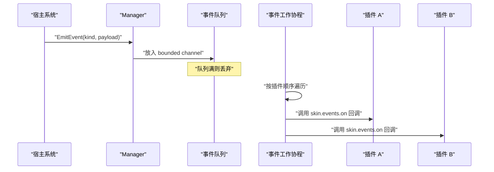

**图表来源**
- [events.go:1-94](https://github.com/YimingZhanshen/skin-nexus/blob/797ae1a/server/internal/plugin/events.go#L1-L94)
- [host.go:730-813](https://github.com/YimingZhanshen/skin-nexus/blob/797ae1a/server/internal/plugin/host.go#L730-L813)
- [runtime_goja.go:200-724](https://github.com/YimingZhanshen/skin-nexus/blob/797ae1a/server/internal/plugin/runtime_goja.go#L200-L724)

### 守卫 Guard

守卫用于在敏感操作前进行插件侧审批。守卫有两种模式：

- **fail-closed**：守卫出错时直接拒绝。
- **fail-open**：守卫出错时跳过，继续放行。

超管 break-glass 开关可临时绕过所有守卫，但变更会被审计。

**章节来源**
- [contract.go:120-235](https://github.com/YimingZhanshen/skin-nexus/blob/797ae1a/server/internal/plugin/contract.go#L120-L235)
- [events.go:1-94](https://github.com/YimingZhanshen/skin-nexus/blob/797ae1a/server/internal/plugin/events.go#L1-L94)
- [runtime_goja.go:200-724](https://github.com/YimingZhanshen/skin-nexus/blob/797ae1a/server/internal/plugin/runtime_goja.go#L200-L724)

## 插件配置、KV 存储与加密密钥

### 插件配置

插件可以在清单中声明 `config`，其格式是受限 JSON Schema：

- 顶层必须是 `object`。
- 支持 `string`、`integer`、`number`、`boolean`、`array`、`object`。
- 支持 `required`、`default`、`enum`、`minimum`、`maximum`、`properties`。
- `format: secret` 或 `x-ui: password` 表示机密字段。
- 未知键会被拒绝。
- 机密字段不得声明默认值。

运行时通过 `skin.config.get(key)` 和 `skin.config.all()` 读取配置。配置值经过 `normalizeJSONNumber` 转换，避免 JSON number 类型差异导致的不稳定行为。

### KV 存储

KV 存储按插件名隔离，键空间形如 `(plugin, "", key)`。

| 限制 | 默认值 | 硬上限 |
|---|---:|---:|
| 单值大小 | 64 KiB | 64 KiB |
| 键长度 | 1-191 字节 | 191 字节 |
| 默认最大键数 | 1000 | 50000 |
| 存储超时 | 800 ms | 800 ms |
| 文档大小 | 256 KiB | 256 KiB |
| 每集合文档数 | 10000 | 10000 |

插件只能通过 `skin.store.*` 访问，不能直接访问数据库表名、SQL 或宿主模型。

### 加密密钥

`SecretBox` 使用 AES-256-GCM 加密插件配置机密。密钥来源优先级：

1. 环境变量 `SKIN_PLUGIN_SECRET_KEY`（十六进制或 base64，必须正好 32 字节）。
2. 指定密钥文件路径。
3. 首次启动时自动生成 32 字节密钥，并写入受保护目录。

丢失密钥只会丢失插件机密配置，不会影响用户数据或纹理。

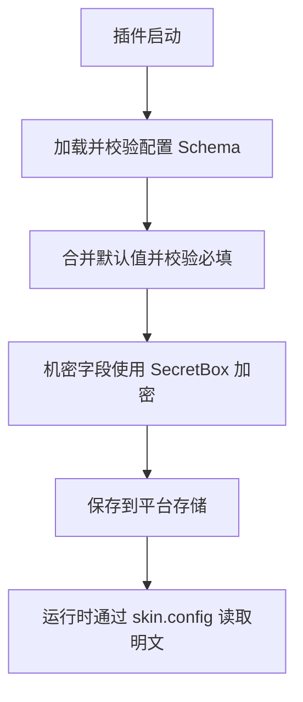

**图表来源**
- [config.go:1-200](https://github.com/YimingZhanshen/skin-nexus/blob/797ae1a/server/internal/plugin/config.go#L1-L200)
- [config.go:200-552](https://github.com/YimingZhanshen/skin-nexus/blob/797ae1a/server/internal/plugin/config.go#L200-L552)
- [secrets.go:1-113](https://github.com/YimingZhanshen/skin-nexus/blob/797ae1a/server/internal/plugin/secrets.go#L1-L113)
- [store_service.go:1-200](https://github.com/YimingZhanshen/skin-nexus/blob/797ae1a/server/internal/plugin/store_service.go#L1-L200)

**章节来源**
- [config.go:1-200](https://github.com/YimingZhanshen/skin-nexus/blob/797ae1a/server/internal/plugin/config.go#L1-L200)
- [config.go:200-552](https://github.com/YimingZhanshen/skin-nexus/blob/797ae1a/server/internal/plugin/config.go#L200-L552)
- [secrets.go:1-113](https://github.com/YimingZhanshen/skin-nexus/blob/797ae1a/server/internal/plugin/secrets.go#L1-L113)
- [store_service.go:1-200](https://github.com/YimingZhanshen/skin-nexus/blob/797ae1a/server/internal/plugin/store_service.go#L1-L200)

## UI 页面与 iframe 插槽

插件可通过 `ui.pages` 声明独立页面，通过 `ui.slots` 声明宿主页面插槽。

SPA 前端消费 `Manager.UI()` 返回的元数据，决定导航、页面挂载和插槽区域。SSR 仅渲染 iframe 插槽，不渲染复杂表单插槽。

iframe 插槽的安全属性：

- 使用 `sandbox="allow-scripts allow-forms"`。
- 高度在 80 到 600 之间裁剪。
- 自动附加插件版本号作为缓存破坏参数。
- 可附加宿主变量，例如当前纹理哈希。

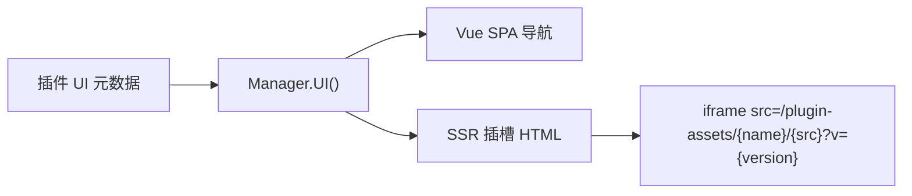

**图表来源**
- [ui.go:1-138](https://github.com/YimingZhanshen/skin-nexus/blob/797ae1a/server/internal/plugin/ui.go#L1-L138)

**章节来源**
- [ui.go:1-138](https://github.com/YimingZhanshen/skin-nexus/blob/797ae1a/server/internal/plugin/ui.go#L1-L138)

## 示例插件分析

### hello-world：零权限最小插件

`hello-world` 展示了最简插件形态：

- 清单声明 `hookApi: 2`。
- 入口为 `index.js`。
- 没有声明任何权限。
- 加载时只调用 `skin.log` 输出一行日志。

它适合用来验证插件目录结构、清单校验和基础加载流程。

**章节来源**
- [plugin.json](https://github.com/YimingZhanshen/skin-nexus/blob/797ae1a/examples/plugins/hello-world/plugin.json#L1-L8)
- [index.js](https://github.com/YimingZhanshen/skin-nexus/blob/797ae1a/examples/plugins/hello-world/index.js#L1-L1)

### hello-ui：iframe 页面与插槽

`hello-ui` 演示如何在宿主界面中嵌入插件 UI：

- 声明 `ui:page`、`ui:slot`、`ui:assets` 权限。
- `ui.assets` 指向 `ui/` 目录。
- 声明一个 `/ext/hello-ui/hello` 页面，渲染类型为 `iframe`。
- 声明一个 `app.topbar.after` 插槽，高度 120。
- 提供中英文标题国际化。
- 页面 HTML 通过 `postMessage` 与宿主通信。

注意：`plugin.json` 中声明了 `index.js` 作为入口，但示例仓库中未提供该文件。实际加载时会因找不到入口脚本而进入加载失败状态。

**章节来源**
- [plugin.json](https://github.com/YimingZhanshen/skin-nexus/blob/797ae1a/examples/plugins/hello-ui/plugin.json#L1-L29)
- [hello.html](https://github.com/YimingZhanshen/skin-nexus/blob/797ae1a/examples/plugins/hello-ui/ui/hello.html#L1-L20)

### jobs-fixture：持久化任务示例

`jobs-fixture` 是测试夹具，用于在无网络环境下验证任务队列的取消与恢复路径：

- 声明 `http:routes:admin` 和 `schedule:jobs` 权限。
- 注册 `tick` 任务处理器。
- 提供 `/admin/start` 和 `/admin/jobs` 管理路由。
- 任务内部轮询 `Date.now()`，模拟多步长时间执行。
- 通过 `skin.jobs.cancelRequested(jobId)` 检测取消信号。
- 返回 `{ done, cursor, progress, message }` 控制任务进度。

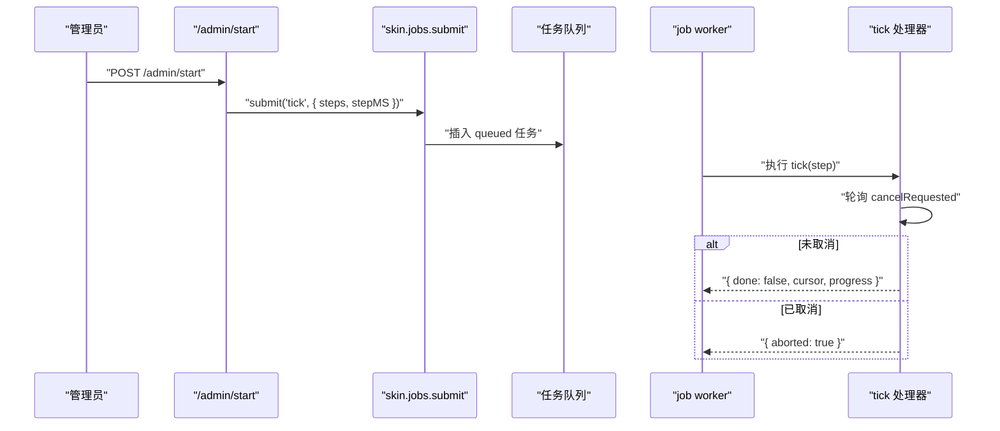

**图表来源**
- [index.js](https://github.com/YimingZhanshen/skin-nexus/blob/797ae1a/examples/plugins/jobs-fixture/index.js#L1-L89)
- [plugin.json](https://github.com/YimingZhanshen/skin-nexus/blob/797ae1a/examples/plugins/jobs-fixture/plugin.json#L1-L40)
- [jobs_bridge.go:1-200](https://github.com/YimingZhanshen/skin-nexus/blob/797ae1a/server/internal/plugin/jobs_bridge.go#L1-L200)

**章节来源**
- [index.js](https://github.com/YimingZhanshen/skin-nexus/blob/797ae1a/examples/plugins/jobs-fixture/index.js#L1-L89)
- [plugin.json](https://github.com/YimingZhanshen/skin-nexus/blob/797ae1a/examples/plugins/jobs-fixture/plugin.json#L1-L40)
- [jobs_bridge.go:1-200](https://github.com/YimingZhanshen/skin-nexus/blob/797ae1a/server/internal/plugin/jobs_bridge.go#L1-L200)

## 插件生命周期：打包、安装、信任、卸载、更新

### 打包与清单校验

CLI 工具 `skin-plugin` 负责打包主题和插件。打包后应包含：

- `plugin.json`。
- `entrypoint` 指定的 JS 文件。
- 可选 `ui/`、`assets/`、`migrations/` 等资源。
- 可选签名包。

打包器可使用清单检查逻辑，确保主机不会拒绝已打包插件。

### 安装流程

`InstallBundle` 的主要步骤：

1. 创建 staging 临时目录。
2. 写入 ZIP 字节流。
3. 调用 `InspectBundle` 检查签名和摘要。
4. 提取 ZIP 到 staging。
5. 查找插件根目录并解析清单。
6. 校验清单版本与包版本一致。
7. 检查 `minServer`。
8. 计算安装计划，判断依赖和冲突。
9. 如果有新增权限，需要管理员同意。
10. 停止旧运行时。
11. 将旧版本移动到 rollback 目录。
12. 原子移动新版本到 live 目录。
13. 重新 `Load` 插件。
14. 如果激活失败，尝试回滚旧版本。

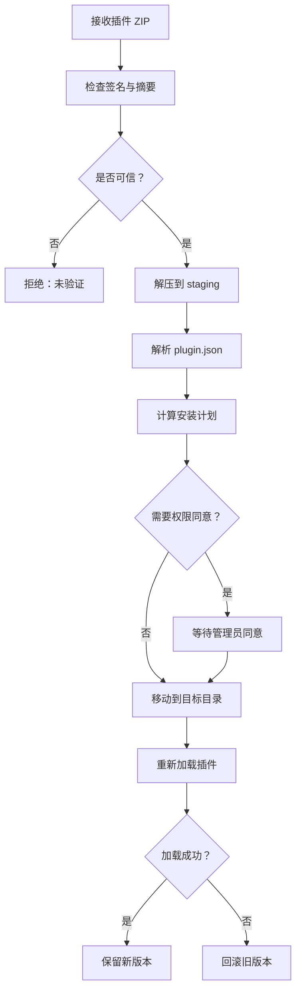

**图表来源**
- [install.go:1-200](https://github.com/YimingZhanshen/skin-nexus/blob/797ae1a/server/internal/plugin/install.go#L1-L200)
- [manifest.go:201-263](https://github.com/YimingZhanshen/skin-nexus/blob/797ae1a/server/internal/plugin/manifest.go#L201-L263)

### 信任模型

信任状态包括：

- `verified`：由受信任密钥签名。
- `unknown-key`：签名有效但密钥不受信。
- `unsigned`：无签名。
- `invalid`：签名无效。

市场渠道不允许接受未验证插件；本地上传可选择 `AcceptUnverified`，但仍需管理员同意新增权限。

### 启用、禁用、重载

| 操作 | 行为 |
|---|---|
| `Enable` | 解析清单、准备实例、启动 VM、持久化启用状态、恢复暂停任务 |
| `Disable` | 关闭 VM、暂停任务、持久化禁用状态 |
| `Reload` | 先构建新 VM，失败时保留旧实例并标记 degraded |
| `Close` | 关闭事件队列、释放所有 VM |

**章节来源**
- [install.go:1-200](https://github.com/YimingZhanshen/skin-nexus/blob/797ae1a/server/internal/plugin/install.go#L1-L200)
- [host.go:200-730](https://github.com/YimingZhanshen/skin-nexus/blob/797ae1a/server/internal/plugin/host.go#L200-L730)
- [manifest.go:201-263](https://github.com/YimingZhanshen/skin-nexus/blob/797ae1a/server/internal/plugin/manifest.go#L201-L263)

## 安全模型与沙箱边界

### 当前信任模型

代码注释明确说明：**phase-1 trust model is reviewed plugins**。权限清单是声明式且带审计的，但不是完整隔离模型。因此，生产环境应优先使用受信任签名的插件包，并结合管理员审批流程。

### 运行时限制

| 限制 | 值或行为 |
|---|---|
| 最大插件数 | 64 |
| 每插件最大路由数 | 32 |
| 总路由上限 | 64 |
| 最大清单大小 | 64 KiB |
| 最大脚本大小 | 1 MiB |
| 最大调用栈深度 | 1024 |
| 钩子默认超时 | 100 ms |
| 认证钩子默认超时 | 50 ms |
| 路由默认超时 | 1 s |
| 入口加载超时 | 2 s |
| 路由响应上限 | 1 MiB |
| KV 单值上限 | 64 KiB |
| KV 默认键数上限 | 1000 |
| KV 硬上限 | 50000 |
| 文档单条上限 | 256 KiB |
| 每集合文档上限 | 10000 |
| 存储操作超时 | 800 ms |
| 事件队列容量 | 256 |
| 日志保留 | 最近 64 条 |

### 文件系统与原生模块

- 入口脚本必须是普通文件，不能是符号链接。
- 入口路径必须在插件目录内，防止路径穿越。
- 插件不能直接访问 Node.js 原生模块。
- 文件系统访问仅限于宿主显式暴露的能力。
- 出站网络必须声明 `net:http` 并配置允许主机策略。

### 输入输出安全

- 请求体按类型限制大小。
- JSON body 使用宽松数字解码，再标准化为整数或浮点数。
- Base64 二进制体有更高上限但仍受控。
- 插件返回的响应最终序列化为 JSON，超限则拒绝。
- 通用事件负载不包含密码、Cookie 或原始请求体。

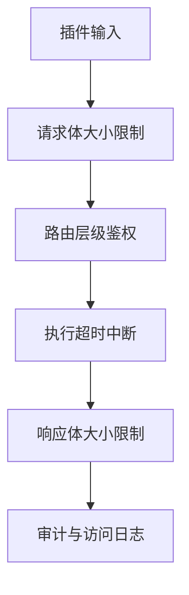

**图表来源**
- [manifest.go:1-200](https://github.com/YimingZhanshen/skin-nexus/blob/797ae1a/server/internal/plugin/manifest.go#L1-L200)
- [runtime_goja.go:1-200](https://github.com/YimingZhanshen/skin-nexus/blob/797ae1a/server/internal/plugin/runtime_goja.go#L1-L200)
- [routes.go:1-200](https://github.com/YimingZhanshen/skin-nexus/blob/797ae1a/server/internal/plugin/routes.go#L1-L200)
- [store_service.go:1-200](https://github.com/YimingZhanshen/skin-nexus/blob/797ae1a/server/internal/plugin/store_service.go#L1-L200)

**章节来源**
- [contract.go:1-120](https://github.com/YimingZhanshen/skin-nexus/blob/797ae1a/server/internal/plugin/contract.go#L1-L120)
- [manifest.go:1-200](https://github.com/YimingZhanshen/skin-nexus/blob/797ae1a/server/internal/plugin/manifest.go#L1-L200)
- [runtime_goja.go:1-200](https://github.com/YimingZhanshen/skin-nexus/blob/797ae1a/server/internal/plugin/runtime_goja.go#L1-L200)
- [routes.go:1-200](https://github.com/YimingZhanshen/skin-nexus/blob/797ae1a/server/internal/plugin/routes.go#L1-L200)
- [store_service.go:1-200](https://github.com/YimingZhanshen/skin-nexus/blob/797ae1a/server/internal/plugin/store_service.go#L1-L200)

## 性能特征与优化建议

### 关键性能瓶颈

1. **Goja 解释执行**：JavaScript 钩子和路由在每次调用时都可能触发 VM 切换。
2. **每插件同步锁**：`runtime.mu` 保证 goja 调用串行化，可能成为热点。
3. **事件队列溢出**：256 容量不足时会丢事件。
4. **KV 存储超时**：每个 KV/文档操作最多 800 ms。
5. **入口加载超时**：2 秒超时过长，容易掩盖慢启动插件。
6. **路由超时**：默认 1 秒，对 IO 型插件可能偏短。

### 优化建议

- 将重计算逻辑放在宿主侧，插件只做轻量协调。
- 使用持久化任务队列处理长耗时操作。
- 避免在高频钩子中做网络请求。
- 合理使用 `timeoutMS`，让关键钩子更快失败。
- 对大体积响应使用分页或流式宿主接口。
- 监控 `timeouts`、`errors`、`calls`、`routeCalls` 指标。
- 对频繁读的配置使用宿主缓存，避免重复解密和反序列化。

[本节为通用性能指导，不直接分析具体代码片段]

## 开发调试与故障定位指南

### 常见加载错误

| 现象 | 可能原因 | 排查方式 |
|---|---|---|
| 清单名称不等于目录名 | `name` 与文件夹不一致 | 检查 `plugin.json.name` |
| 不支持的 `hookApi` | 使用了不兼容版本 | 保持 `hookApi: 2` |
| 入口脚本逃逸目录 | `entrypoint` 指向上级目录 | 使用相对路径 |
| 入口是符号链接 | 安全策略拒绝 | 改为普通文件 |
| 路由未注册 | 清单声明但未调用 `skin.route` | 检查运行时注册 |
| 任务未注册 | 清单声明但未调用 `skin.jobs.register` | 检查任务处理器 |
| 缺少权限 | 未声明对应 `permissions` | 添加最小必要权限 |
| 配置必填缺失 | Schema 必填字段为空 | 通过 admin 表单填写 |
| KV 配额耗尽 | 键数超过限制 | 清理无用键或提升配额 |
| 事件丢失 | 事件队列饱和 | 减少高频事件或降低频率 |

### 调试步骤

1. 查看插件加载审计日志，确认是否进入 `plugin_loaded` 或 `plugin_load_failed`。
2. 查看插件最近日志，使用 `skin.log` 输出关键路径。
3. 检查 `/api/plugins/{name}/_csrf` 是否能拿到 token。
4. 确认路由层级与权限匹配。
5. 检查 KV 配额和键数量。
6. 检查任务队列状态，确认任务是否被暂停或取消。
7. 使用 `Reload` 热重载，观察是否从 degraded 恢复。

### 错误定位最佳实践

- 为每个插件命名清晰的 `title` 和 `description`。
- 为敏感路由添加速率限制。
- 为长任务提供 `cursor` 和 `progress`。
- 对钩子异常保持 fail-open，避免影响宿主主流程。
- 对守卫异常明确选择 fail-closed 还是 fail-open。
- 对所有外部调用增加超时和重试边界。
- 将插件错误分类为 `code` + `message`，便于前端展示。

**章节来源**
- [host.go:200-730](https://github.com/YimingZhanshen/skin-nexus/blob/797ae1a/server/internal/plugin/host.go#L200-L730)
- [runtime_goja.go:200-724](https://github.com/YimingZhanshen/skin-nexus/blob/797ae1a/server/internal/plugin/runtime_goja.go#L200-L724)
- [routes.go:200-497](https://github.com/YimingZhanshen/skin-nexus/blob/797ae1a/server/internal/plugin/routes.go#L200-L497)
- [store_service.go:1-200](https://github.com/YimingZhanshen/skin-nexus/blob/797ae1a/server/internal/plugin/store_service.go#L1-L200)
- [jobs_bridge.go:1-200](https://github.com/YimingZhanshen/skin-nexus/blob/797ae1a/server/internal/plugin/jobs_bridge.go#L1-L200)

## 结论

该插件系统以 Goja 为执行基座，以 `Manager` 为中心调度器，围绕“声明式清单 + 权限审计 + 运行时超时 + 资源限额”构建了 Phase-1 插件生态。它提供了：

- 安全的 JavaScript 执行环境。
- 清晰的 HTTP 路由分层与认证机制。
- 可扩展的事件钩子和守卫体系。
- 隔离的插件配置、KV 存储与文档集合。
- 面向管理面板和 SSR 的 UI 插槽。
- 持久化任务队列和安装回滚。
- 打包、签名、信任和管理生命周期。

对于插件开发者，最重要的原则是：**最小权限、明确超时、不阻塞宿主路径、使用任务队列处理长耗时操作、把副作用放在可控边界内**。

对于平台运营者，最重要的是：**启用受信任签名、审查新增权限、监控超时与错误、定期清理 KV 和任务、谨慎使用 break-glass 守卫绕过**。
