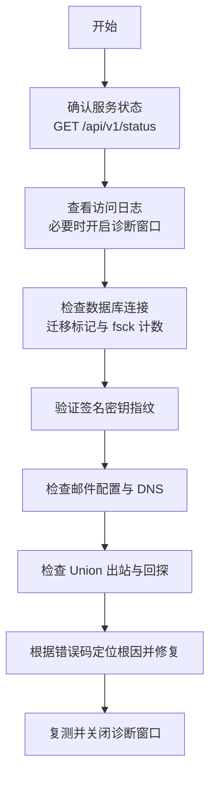

# 故障排除与常见问题

**本文引用的文件**
- [README.md](https://github.com/YimingZhanshen/skin-nexus/blob/797ae1a/README.md)
- [compat-matrix.md](https://github.com/YimingZhanshen/skin-nexus/blob/797ae1a/docs/compat-matrix.md)
- [main.go](https://github.com/YimingZhanshen/skin-nexus/blob/797ae1a/server/cmd/skin-nexus/main.go)
- [fsck.go](https://github.com/YimingZhanshen/skin-nexus/blob/797ae1a/server/cmd/skin-nexus/fsck.go)
- [env.go](https://github.com/YimingZhanshen/skin-nexus/blob/797ae1a/server/internal/config/env.go)
- [diagnostics.go](https://github.com/YimingZhanshen/skin-nexus/blob/797ae1a/server/internal/adminapi/diagnostics.go)
- [status_mail_test.go](https://github.com/YimingZhanshen/skin-nexus/blob/797ae1a/server/internal/adminapi/status_mail_test.go)
- [diagnostic.go](https://github.com/YimingZhanshen/skin-nexus/blob/797ae1a/server/internal/accesslog/diagnostic.go)
- [http.go](https://github.com/YimingZhanshen/skin-nexus/blob/797ae1a/server/internal/ygg/http.go)
- [outbound.go](https://github.com/YimingZhanshen/skin-nexus/blob/797ae1a/server/internal/outbound/outbound.go)
- [diagnose_probe.go](https://github.com/YimingZhanshen/skin-nexus/blob/797ae1a/server/internal/union/diagnose_probe.go)

## 目录
1. [简介](#简介)
2. [快速排查流程](#快速排查流程)
3. [站长常见问题](#站长常见问题)
4. [玩家常见问题](#玩家常见问题)
5. [开发者常见问题](#开发者常见问题)
6. [诊断工具输出说明](#诊断工具输出说明)
7. [兼容性矩阵与变通方案](#兼容性矩阵与变通方案)
8. [错误码、日志关键词与修复命令对照](#错误码日志关键词与修复命令对照)
9. [社区支持与反馈模板](#社区支持与反馈模板)
10. [结论](#结论)

## 简介
本文件面向三类用户：运营站点的站长、通过启动器或浏览器访问的玩家，以及开发插件和主题的开发者。内容基于 SkinNexus v0.6.0 的代码实现与兼容基线整理，目标是把“服务看起来正常但功能异常”的问题收敛到可复现、可定位、可修复的条目中。

SkinNexus 是 Go 单二进制 + Vue 3 的前后端系统，提供 Yggdrasil 皮肤协议、OIDC 免密登录、纹理上传与管理、Union 成员站集成、主题与插件平台等功能；数据库支持 MySQL/MariaDB、PostgreSQL、SQLite。

**章节来源**
- [README.md:1-114](https://github.com/YimingZhanshen/skin-nexus/blob/797ae1a/README.md#L1-L114)

## 快速排查流程
遇到任何异常时，按以下顺序排查，避免先改配置再查原因：

| 步骤 | 动作 | 判断标准 | 下一步 |
|---|---|---|---|
| 1 | 确认服务状态 | `GET /api/v1/status` 返回 200，含版本、引擎、构建信息；管理面板「运行状态」无红色项 | 失败则检查进程、端口、反向代理、数据库连接 |
| 2 | 查看访问日志 | 使用管理面板「访问日志」，必要时开启诊断模式记录一次请求详情 | 未命中则检查反代是否透传真实 IP、UA、请求头 |
| 3 | 检查数据库连接 | 迁移标记已应用，存储打开无报错；`fsck` 能列出行数和文件数 | 失败则核对 DSN、权限、数据卷挂载 |
| 4 | 验证签名密钥 | `/api/v1/status` 显示 `signKeyFingerprint`；丢失会导致已下发皮肤签名失效 | 失败则恢复 `skin-data` 卷中的 `sign-key.pem` |
| 5 | 检查邮件连通性 | 管理面板「自助诊断」中 `mail` 为 ok，`mail_dns` 有 SPF/DMARC | 失败则检查 SMTP 配置、发件人域名、DNS 解析 |
| 6 | 检查 Union 连通性 | 管理面板「联盟」诊断分腿展示 TLS、证书、时钟差与回探状态 | 失败则检查 hub 地址、出站白名单、证书有效期、服务器时间 |



[本图为概念流程图，不直接映射具体源码文件]

## 站长常见问题

### 无法登录
常见现象：管理员或玩家提交账号密码后页面没有跳转，或提示认证失败。

可能原因与处理：

| 现象 | 可能根因 | 排查要点 | 修复建议 |
|---|---|---|---|
| 新站无法创建管理员 | 未初始化站点，需要安装令牌 | 启动日志中出现一次性安装令牌；`POST /api/v1/setup` 被拒绝 | 使用 `SKIN_SETUP_TOKEN` 或通过容器日志获取随机令牌后完成初始化 |
| 迁移来的账号无法登录 | 老站 `password` 列为空 | 代码对空摘要一律拒绝，不再沿用“空密码等于任意密码”的行为 | 由超管重置密码或走找回密码流程 |
| 邮箱验证门开启后大量用户无法访问网页 | `require_verification` 开启且宽限期已过 | 管理面板「运行状态」中未验证账号数量多，自助诊断显示 verify_gate 警告或失败 | 先配好 SMTP，再设置宽限期，最后启用验证门禁 |
| 认证限流触发 | 短时间内重复登录失败 | 访问日志出现 429 TooManyRequests | 检查是否被脚本撞库；调高阈值前先看日志来源 IP |

关键行为依据：
- 安装令牌机制在空库时生成一次性 token，装好后端点永久 404。
- 空密码列不再被视为可登录态。
- 邮箱验证门在宽限期后同时拦截网页和管理面板。
- 认证限流返回 429，但错误体形状保持兼容。

**章节来源**
- [README.md:24-40](https://github.com/YimingZhanshen/skin-nexus/blob/797ae1a/README.md#L24-L40)
- [main.go:100-180](https://github.com/YimingZhanshen/skin-nexus/blob/797ae1a/server/cmd/skin-nexus/main.go#L100-L180)
- [diagnostics.go:60-110](https://github.com/YimingZhanshen/skin-nexus/blob/797ae1a/server/internal/adminapi/diagnostics.go#L60-L110)
- [compat-matrix.md:50-68](https://github.com/YimingZhanshen/skin-nexus/blob/797ae1a/docs/compat-matrix.md#L50-L68)

### 邮箱收不到验证码或找回密码信
常见现象：注册验证、密码重置、通知邮件发送失败或进入垃圾箱。

可能原因与处理：

| 现象 | 可能根因 | 排查要点 | 修复建议 |
|---|---|---|---|
| 完全收不到信 | SMTP 主机、端口、用户名、密码或发件人缺失 | 自助诊断 `mail` 为 skip/fail；`mailConfig` 返回 nil | 填写 SMTP 配置；确保发件人地址有效 |
| 发到垃圾箱 | 缺少 SPF 或 DMARC | 自助诊断 `mail_dns` 显示 SPF/DMARC 缺失 | 在域名 DNS 中添加 SPF 与 DMARC 记录 |
| 偶尔失败 | 网络抖动触发自动重试一次 | 审计日志出现 `mail_test_failed`、`password_reset_mail_failed`、`email_verify_mail_failed` | 观察是否仍持续失败；检查防火墙与出站限制 |
| 运行状态数字异常 | 诊断接口本身不能因为统计失败而 500 | 测试要求 24 小时内失败的审计记录能被计入 | 无需修改；若状态页非 200，优先看 HTTP 响应码 |

注意：发信失败会写入审计事件，并在运行状态的 24 小时发信失败计数中体现，但统计失败本身不应让状态页崩溃。

**章节来源**
- [diagnostics.go:230-330](https://github.com/YimingZhanshen/skin-nexus/blob/797ae1a/server/internal/adminapi/diagnostics.go#L230-L330)
- [status_mail_test.go:1-41](https://github.com/YimingZhanshen/skin-nexus/blob/797ae1a/server/internal/adminapi/status_mail_test.go#L1-L41)

### 皮肤上传失败
常见现象：上传按钮不可用、预览失败、上传后材质列表为空，或磁盘占用异常。

可能原因与处理：

| 现象 | 可能根因 | 排查要点 | 修复建议 |
|---|---|---|---|
| 上传后文件不在磁盘 | 纹理目录路径错误或卷未挂载 | `fsck` 报告 missing files、stored files 为 0 | 核对 `SKIN_TEXTURES_DIR` 与数据卷挂载 |
| 存在孤立文件 | 删除失败或导入不完整 | `fsck` 报告 orphan files | 先用 dry-run 查看，确认后再执行 fix |
| 纹理渲染失败 | 纹理尺寸过大或元数据异常 | 预览诊断失败；`overRenderCeiling` 会识别超出渲染上限的文件 | 重新上传正确分辨率的皮肤；不要依赖工具重采样 |
| SPA 页面空白 | web/dist 资源缺失 | 自助诊断 `assets` 为 fail，值为 index.html 路径 | 部署前端构建产物，或检查容器镜像是否包含 dist |

重要：`fsck -fix` 默认只报告，不会删除文件；只有明确指定 `-fix` 才会 unlink 既不被行引用也不被墓碑引用的孤儿文件。

**章节来源**
- [fsck.go:1-200](https://github.com/YimingZhanshen/skin-nexus/blob/797ae1a/server/cmd/skin-nexus/fsck.go#L1-L200)
- [diagnostics.go:330-420](https://github.com/YimingZhanshen/skin-nexus/blob/797ae1a/server/internal/adminapi/diagnostics.go#L330-L420)

### 管理面板空白
常见现象：API 能访问，但管理界面只显示占位文本或加载失败。

可能原因与处理：

| 现象 | 可能根因 | 排查要点 | 修复建议 |
|---|---|---|---|
| 页面空白 | 静态资源目录不存在 | 自助诊断 `assets` 为 fail | 部署 web/dist 或使用 Docker 镜像自带的静态资源 |
| 仅管理路由异常 | 路由或鉴权失败 | 访问日志中对应路径返回 401/403 | 检查管理员权限、会话、反代透传 |
| 诊断结果全是 skip | 某些探针未被注入 | 自检项 ID 对应 preview/keyring/web assets | 通常不影响 API，但影响诊断准确性 |

**章节来源**
- [diagnostics.go:420-501](https://github.com/YimingZhanshen/skin-nexus/blob/797ae1a/server/internal/adminapi/diagnostics.go#L420-L501)

## 玩家常见问题

### 启动器进服报错
常见现象：使用 authlib-injector 或 yggc/OIDC 启动器时报认证失败、角色绑定失败或服务器拒绝加入。

可能原因与处理：

| 现象 | 可能根因 | 排查要点 | 修复建议 |
|---|---|---|---|
| 发现文档找不到 | `/api/yggdrasil` 裸 URL 被反代 307 且不带 CORS | 兼容矩阵指出该 307 原本不带跨域头 | 确保规范地址直接返回 200；检查反代是否重复注入 CORS |
| 选择角色后 403 | session join 的 selectedProfile 格式或 token 绑定不符 | 服务端双形态容错字符串/对象、32hex/连字符 UUID | 检查启动器版本；查看访问日志中的 join 请求 |
| OIDC 免密登录不出现 | discovery 未暴露或 shared_client_id 为空 | meta.feature.openid_configuration_url 缺失 | 检查 OIDC 配置与发现端点挂载 |
| 登录后皮肤不显示 | skinDomains 不包含当前皮肤主机 | metadata.skinDomains 与客户端 getHost() 比对不含端口 | 确认站点皮肤域名配置；注意带端口条目会发布去端口孪生 |

关键行为：
- Yggdrasil 面点与 legacy 契约基本对齐，包括 authenticate、validate、invalidate、signout、hasJoined、profile、profiles/minecraft 等。
- sessionserver/join 强制 token 与角色绑定；403 中文错误体用于标识绑定失败。
- OIDC 设备码流程、refresh 轮换、RS256 id_token、userinfo Bearer 均已在兼容矩阵中标为通过。

**章节来源**
- [compat-matrix.md:1-49](https://github.com/YimingZhanshen/skin-nexus/blob/797ae1a/docs/compat-matrix.md#L1-L49)
- [http.go:1-120](https://github.com/YimingZhanshen/skin-nexus/blob/797ae1a/server/internal/ygg/http.go#L1-L120)

### 皮肤不显示
常见现象：能登录，但浏览器看不到皮肤，或在联盟成员站看到“✕ 代号”。

可能原因与处理：

| 现象 | 可能根因 | 排查要点 | 修复建议 |
|---|---|---|---|
| 本地浏览器能看到，玩家看不到 | site_url/base_url 解析为内网地址 | 自助诊断 `site` 为 warn，值中包含 localhost、127、192.168、172.16-31 | 设置公网 SKIN_BASE_URL 或 site_url，重启生效 |
| 联盟成员站名称消失 | 反代重复注入 Access-Control-Allow-Origin | 控制台报 multiple values '*, *' | 关闭宝塔等 WAF 的跨域设置，避免重复头 |
| 私有头像或渲染链接 404 | 私有材质渲染现在按作者或管理员放行 | 匿名访问私有渲染面 | 公开材质或调整可见性；注意 CDN 旧缓存可能仍存活 |
| 带端口域名无法匹配 | 客户端 getHost() 不含端口 | skinDomains 含 `host:port` 条目 | 使用无端口域名；系统会为带端口条目追加去端口孪生 |

**章节来源**
- [diagnostics.go:200-230](https://github.com/YimingZhanshen/skin-nexus/blob/797ae1a/server/internal/adminapi/diagnostics.go#L200-L230)
- [compat-matrix.md:19-49](https://github.com/YimingZhanshen/skin-nexus/blob/797ae1a/docs/compat-matrix.md#L19-L49)
- [compat-matrix.md:50-68](https://github.com/YimingZhanshen/skin-nexus/blob/797ae1a/docs/compat-matrix.md#L50-L68)

### 角色丢失
常见现象：改名后旧 UUID 无法找到，或联盟站角色不同步。

可能原因与处理：

| 现象 | 可能根因 | 排查要点 | 修复建议 |
|---|---|---|---|
| 改名后 UUID 变化 | 违反 UUID 零漂移契约 | 应始终不变 | 检查迁移流程与外部系统是否误算 OfflinePlayer UUID |
| 联盟站角色未更新 | create/rename/delete 通告失败 | 审计日志出现 union_sync_*_failed | 在面板「同步角色数据」手动收敛 |
| 自删账号不同步 | 自删也走 PlayerWillBeDeleted | 审计日志应有删除事件 | 检查 hub 回探连通性与签名密钥 |

核心规则：改名零漂移，UUID 不重算；角色生命周期由 account.Service 统一通告建号、改名、删除三条路径。

**章节来源**
- [compat-matrix.md:31-49](https://github.com/YimingZhanshen/skin-nexus/blob/797ae1a/docs/compat-matrix.md#L31-L49)
- [README.md:60-90](https://github.com/YimingZhanshen/skin-nexus/blob/797ae1a/README.md#L60-L90)

## 开发者常见问题

### 插件加载失败
常见现象：插件包安装成功但路由不生效，或 UI 页面空白。

可能原因与处理：

| 现象 | 可能根因 | 排查要点 | 修复建议 |
|---|---|---|---|
| 安装失败 | 主题市场信任密钥为空 | 自助诊断 keyring 为 fail，value 指向 market URL | 配置 SKIN_PLUGIN_TRUST_KEYS 或本地可信键 |
| 热更新无效 | 插件目录或状态目录未挂载 | 插件状态写于 SKIN_PLUGIN_STATE_DIR | 检查 Docker 卷与路径 |
| UI 被 CSP 拦截 | 自定义 JS/CSS 被内容安全策略阻止 | 浏览器控制台 CSP 报错 | 利用允许 unsafe-inline 的主题与插件能力，但不要盲目放宽全局 CSP |
| 插件脚本被 iframe 隔离 | 插件 HTML 落在不透明源，拿不到 cookie | 插件 UI 框架自带 Sandbox | 通过插件桥接接口读写账号数据，而不是依赖同源 cookie |

**章节来源**
- [diagnostics.go:460-501](https://github.com/YimingZhanshen/skin-nexus/blob/797ae1a/server/internal/adminapi/diagnostics.go#L460-L501)
- [README.md:60-90](https://github.com/YimingZhanshen/skin-nexus/blob/797ae1a/README.md#L60-L90)

### 主题 token 不生效
常见现象：自定义 CSS/JS 变量或主题样式未生效。

可能原因与处理：

| 现象 | 可能根因 | 排查要点 | 修复建议 |
|---|---|---|---|
| 主题变量未渲染 | 主题包结构不符合 theme.json 约定 | 检查主题打包与签名 | 使用 skin-plugin 工具校验主题包 |
| 样式被 CSP 阻断 | 非受控注入被拦截 | 控制台 CSP 错误 | 使用主题包能力而非直接插入全局脚本 |
| 主题市场下载失败 | 出站白名单、超时、响应体超限 | outbound client 返回 status 或 bytes exceeded | 检查主题市场 URL、网络可达性与响应大小 |

注意：outbound 客户端禁止重定向、禁止非标准端口、只允许公共 IP，并且限制最大响应字节。

**章节来源**
- [outbound.go:1-167](https://github.com/YimingZhanshen/skin-nexus/blob/797ae1a/server/internal/outbound/outbound.go#L1-L167)

### API 401/403
常见现象：调用管理接口或公开 API 时返回未授权或禁止。

可能原因与处理：

| 现象 | 可能根因 | 排查要点 | 修复建议 |
|---|---|---|---|
| 管理接口 401 | 缺少 Bearer token 或 token 过期 | 访问日志显示 401，realm 通常为 openid 或 admin | 检查会话、PAT、OIDC token |
| 管理接口 403 | 权限不足或邮箱验证门拦截 | 超管权限为 2；普通账号未验证可能被拦 | 提升权限或关闭验证门前的宽限期 |
| Yggdrasil 接口 403 | session join 角色绑定失败或 token 无效 | 查看 join 请求的 selectedProfile | 修正启动器角色配置 |
| 404 | 安装向导已完成、未知端点、或旧站别名 | setup 完成后端点永久 404 | 使用新 API 路径 |

**章节来源**
- [compat-matrix.md:1-49](https://github.com/YimingZhanshen/skin-nexus/blob/797ae1a/docs/compat-matrix.md#L1-L49)
- [README.md:60-90](https://github.com/YimingZhanshen/skin-nexus/blob/797ae1a/README.md#L60-L90)

## 诊断工具输出说明

### 运行状态与自助诊断
管理面板「运行状态」提供缓存型快照，包含版本、Go 版本、数据库版本与引擎、迁移标记、构建信息、模块、签名密钥指纹，以及 24 小时发信失败计数。

「自助诊断」是实时检查集合，固定七项左右，包括：

| 检查项 ID | 含义 | ok/warn/fail/skip 含义 |
|---|---|---|
| site | 站点基础地址 | ok=公网；warn=内网、legacy base 残留、需重启；fail=地址为空 |
| migrations | 数据库迁移水位 | ok=已到位；warn/pending=落后；fail=不可读或未完成 |
| mail | SMTP 配置 | ok=有主机与发件人；fail=只配了 host 没 sender；skip=未启用 |
| mail_dns | SPF/DMARC | ok=两者都有；warn=缺一个或解析失败；skip=无发件域名 |
| verify_gate | 邮箱验证门 | ok=已启用且有发信；fail=启用但无发信；skip=未启用 |
| preview | 纹理渲染预览 | ok=有可渲染纹理；fail=渲染失败；skip=无可测数据 |
| assets | 前端静态资源 | ok=index.html 存在；fail=缺失；skip=未配置 web_dist |
| keyring | 插件/主题信任密钥 | ok=至少有一个密钥；fail=有市场但无密钥；skip=仅本地 |

**章节来源**
- [diagnostics.go:1-110](https://github.com/YimingZhanshen/skin-nexus/blob/797ae1a/server/internal/adminapi/diagnostics.go#L1-L110)
- [diagnostics.go:200-501](https://github.com/YimingZhanshen/skin-nexus/blob/797ae1a/server/internal/adminapi/diagnostics.go#L200-L501)
- [status_mail_test.go:1-41](https://github.com/YimingZhanshen/skin-nexus/blob/797ae1a/server/internal/adminapi/status_mail_test.go#L1-L41)

### fsck 文件系统一致性检查
`fsck` 对比数据库行与纹理目录，输出结构化统计与问题清单：

| 输出字段 | 含义 |
|---|---|
| engine | 数据库引擎名 |
| rows | 纹理/玩家相关行数 |
| addresses | 数据库中引用的内容地址数量 |
| tombstones | 墓碑数量 |
| open_reports | 未关闭的报告数量 |
| files | 纹理目录文件数 |
| orphans | 孤儿文件：没有被行引用也没有墓碑引用 |
| struck_only | 被墓碑引用但仍在磁盘的文件（删除失败的最后证据） |
| missing | 数据库引用但磁盘缺失的文件 |
| unknown_names | 不是内容地址命名的文件 |
| recycled_slots | 回收槽，包含 texture id、tombstone hash、live hash |
| closet_duplicate_pairs | 衣柜重复点赞对数 |
| closet_extra_rows | 衣柜多余行 |
| closet_rows_without_texture | 衣柜行缺少纹理 |
| sitemap public/listed/omitted | 站点地图覆盖情况 |
| credentials_at_rest/digest_migrated | 凭据摘要迁移状态 |

常用参数：
- `-fix`：unlink 孤儿文件；默认只报告。
- `-deep`：对所有存储文件重新计算哈希并与文件名比较。

典型修复命令：
```bash
# 只查看不一致
./skin-nexus fsck

# 删除孤儿文件前先再次确认
./skin-nexus fsck -fix

# 深度校验内容地址
./skin-nexus fsck -deep
```

**章节来源**
- [fsck.go:1-200](https://github.com/YimingZhanshen/skin-nexus/blob/797ae1a/server/cmd/skin-nexus/fsck.go#L1-L200)

### diagnose_probe Union 诊断探针
Union 诊断探针描述 member → hub 出站的单向观测：

| 字段 | 含义 |
|---|---|
| tls.version | TLS 版本 |
| tls.cipher | 协商套件 |
| tls.cert_subject | 证书主体 |
| tls.cert_issuer | 证书颁发者 |
| tls.cert_not_after | 证书到期时间（RFC3339 UTC） |
| tls.cert_days_left | 证书剩余天数 |
| clock.hub_clock | hub 的 Date 头 |
| clock.offset_seconds | hub 时钟减本地时钟秒数 |
| clock.within_window | 是否在允许的未来/过去偏移窗口内 |

如果连接失败，TLS 与 Clock 都可为 nil；此时应由 cause token 解释失败原因，例如 http_key、dns、握手失败等。

**章节来源**
- [diagnose_probe.go:1-99](https://github.com/YimingZhanshen/skin-nexus/blob/797ae1a/server/internal/union/diagnose_probe.go#L1-L99)

### 访问日志诊断模式
访问日志默认只写轻量汇总；超管可通过选项开启诊断模式，写入每条请求的 DETAIL 明细。

关键选项：
- `access_detail_until`：UTC RFC3339 时间戳，未来时间表示诊断窗口开启。
- `access_detail_retention_days`：明细保留天数，默认 90，最大 3650。

诊断模式判定逻辑：
- 选项不存在、为空、解析失败、或已过期 → 关闭。
- 保留窗口基于 Go 的 `time.Now().UTC()`，不依赖 SQL now()。
- 凭证材料不跟随普通日志保留期，而是按固定短时钟抹除。

**章节来源**
- [diagnostic.go:1-140](https://github.com/YimingZhanshen/skin-nexus/blob/797ae1a/server/internal/accesslog/diagnostic.go#L1-L140)

## 兼容性矩阵与变通方案

### Minecraft 与启动器
| 组件 | 现状 | 已知问题 | 变通方案 |
|---|---|---|---|
| authlib-injector | Yggdrasil 全端点兼容 | 裸 `/api/yggdrasil` 307 重定向前端 CORS 失败 | 使用规范地址；确保反代不重复注入 CORS |
| yggc / SJMCL 等 | OIDC 设备码、discovery、refresh、userinfo 已验收 | discovery 挂载位置需双路径 | 使用仓库提供的 discovery 挂载方式 |
| Mojang 正版兜底 | 可选开关，出站受限 | 官方服务不可达时回退失败 | 按需关闭 fallback，或检查出站网络 |

**章节来源**
- [compat-matrix.md:1-30](https://github.com/YimingZhanshen/skin-nexus/blob/797ae1a/docs/compat-matrix.md#L1-L30)
- [http.go:1-120](https://github.com/YimingZhanshen/skin-nexus/blob/797ae1a/server/internal/ygg/http.go#L1-L120)

### 浏览器与联盟 Hub
| 场景 | 现状 | 已知问题 | 变通方案 |
|---|---|---|---|
| 联盟成员站名称回填 | 浏览器跨源读取 `/api/yggdrasil` | 反代重复 `Access-Control-Allow-Origin` 导致 200 也被丢弃 | 关闭 WAF 跨域注入，避免重复头 |
| 成员站安全级别徽章 | 两跳查询 hub security level | 上游失败返回 502，前端不显式 ok | 等待 10 分钟缓存重试；失败时页面显示暂时不可读 |
| 名称解析 | 后台可控出站解析成员站 serverName | 首次可能只显地址，二次补名 | 可关闭 `SKIN_UNION_RESOLVE_NAMES=false` |

**章节来源**
- [compat-matrix.md:19-49](https://github.com/YimingZhanshen/skin-nexus/blob/797ae1a/docs/compat-matrix.md#L19-L49)

### 行为偏差与取舍
| 项目 | 状态 | 影响 |
|---|---|---|
| 邮箱验证门 | 已落地 | 宽限期后未验证账号无法访问网页与管理面板 |
| 私有材质渲染 | 更安全 | 匿名访客私有渲染 404，CDN 旧副本可能仍存活 |
| 删除纹理后旧 URL | 性能取舍 | 不保证中间缓存失效 |
| 认证限流 429 | 新增 | legacy 契约未定义，但错误体形状兼容 |
| 空密码列 | 安全修复 | 不再能用任意密码登录 |
| skinDomains 端口 | 兼容增强 | 带端口条目会追加去端口孪生 |

**章节来源**
- [compat-matrix.md:50-68](https://github.com/YimingZhanshen/skin-nexus/blob/797ae1a/docs/compat-matrix.md#L50-L68)

## 错误码、日志关键词与修复命令对照

### 常见错误码与含义
| 状态码或关键字 | 含义 | 常见位置 | 修复方向 |
|---|---|---|---|
| 401 | 未认证 | OIDC userinfo、管理 API、会话 | 检查 token、会话、PAT |
| 403 | 禁止访问 | session join 角色绑定、邮箱验证门、权限不足 | 检查 selectedProfile、verify_gate、permission |
| 429 | 认证限流 | 登录、刷新 | 检查撞库或频繁重试 |
| 502 | Union 上游不可用 | 安全级别查询、hub 回探 | 检查 hub 连通性与证书 |
| UnsupportedMediaType | Content-Type 不是 application/json | Yggdrasil POST | 检查启动器或插件请求 |
| outbound: redirects are not allowed | 禁止重定向 | 主题市场、Union 出站 | 检查目标 URL 是否被 3xx |
| outbound: no public address | 目标解析为私网地址 | 出站请求 | 检查 DNS 与出站白名单 |
| config | 环境变量或配置加载失败 | 启动阶段 | 核对 `SKIN_*` 拼写与必填项 |
| store | 数据库连接失败 | 启动或 fsck | 核对 DSN、权限、数据卷 |
| textures | 纹理目录不可读 | fsck | 核对 `SKIN_TEXTURES_DIR` |
| mail_test_failed | 发信测试失败 | 审计日志 | 检查 SMTP |
| password_reset_mail_failed | 找回密码信失败 | 审计日志 | 检查 SMTP 与发件人 |
| email_verify_mail_failed | 邮箱验证信失败 | 审计日志 | 检查 SMTP 与 DNS |

### 日志关键词速查
| 关键词 | 用途 |
|---|---|
| `config:` | 环境变量或配置文件加载失败 |
| `store:` | 数据库打开失败 |
| `schema:` | 迁移失败 |
| `auth:` | 令牌摘要迁移、超管升级、密码校验 |
| `dedupe:` | 公开纹理哈希回填 |
| `fsck:` | 文件系统一致性检查结果 |
| `WARNING.*SKIN_.*variable` | 设置了无人读取的环境变量 |
| `mail_test_sent` | 发信测试成功 |
| `mail_test_failed` | 发信测试失败 |
| `union_sync_*_failed` | Union 角色同步失败 |
| `outbound:` | 主题市场或 Union 出站失败 |
| `access_detail_until` | 访问日志诊断窗口开关 |

### 常用修复命令
| 任务 | 命令 | 说明 |
|---|---|---|
| 查看版本 | `./skin-nexus version` | 输出版本号 |
| 执行迁移 | `./skin-nexus migrate` | 按 tracked migration 树应用 SQL |
| 检测模型 | `./skin-nexus redetect-models` | 重建纹理模型元数据 |
| 检查一致性 | `./skin-nexus fsck` | 只报告 |
| 修复孤儿文件 | `./skin-nexus fsck -fix` | 谨慎执行 |
| 深度校验 | `./skin-nexus fsck -deep` | 重新哈希所有文件 |

**章节来源**
- [main.go:60-120](https://github.com/YimingZhanshen/skin-nexus/blob/797ae1a/server/cmd/skin-nexus/main.go#L60-L120)
- [env.go:1-104](https://github.com/YimingZhanshen/skin-nexus/blob/797ae1a/server/internal/config/env.go#L1-L104)
- [outbound.go:1-167](https://github.com/YimingZhanshen/skin-nexus/blob/797ae1a/server/internal/outbound/outbound.go#L1-L167)
- [diagnostic.go:1-140](https://github.com/YimingZhanshen/skin-nexus/blob/797ae1a/server/internal/accesslog/diagnostic.go#L1-L140)

## 社区支持与反馈模板

### 支持渠道
- GitHub Issues：提交运行时错误、兼容性问题、部署问题。
- 在线 Wiki：仓库内生成的对外镜像，包含架构与协议详解。
- 贡献指南与治理文档：适用于想参与修复或扩展的用户。
- 安全漏洞：见 SECURITY.md，敏感安全问题优先走安全通道。

### 反馈模板
提交问题时请尽量附带以下信息：

| 字段 | 必填 | 示例 |
|---|---:|---|
| 版本 | 是 | v0.6.0 |
| 部署方式 | 是 | Docker compose / 裸二进制 |
| 操作系统与内核 | 否 | Ubuntu 22.04 / Linux 5.x |
| 数据库类型与版本 | 是 | MySQL 8.0 / PostgreSQL 15 / SQLite |
| 启动器与版本 | 条件必填 | authlib-injector / SJMCL |
| 浏览器与版本 | 条件必填 | Chrome 130 |
| 问题分类 | 是 | 站长 / 玩家 / 开发者 |
| 复现步骤 | 是 | 1. 2. 3. |
| 期望行为 | 是 | 应该返回什么 |
| 实际行为 | 是 | 实际返回什么 |
| 访问日志片段 | 条件必填 | 脱敏后的请求路径、状态码、耗时 |
| 自助诊断结果 | 条件必填 | site、migrations、mail、mail_dns、verify_gate、preview、assets、keyring |
| fsck 输出 | 条件必填 | orphans、missing、struck_only |
| Union 诊断 | 条件必填 | tls、clock、status_code、headers |
| 环境差异 | 否 | 开发环境与生产环境的配置差异 |

提交前请确认：
- 已检查服务状态与访问日志。
- 已核对 `SKIN_*` 环境变量拼写。
- 已备份签名密钥与数据库。
- 已尝试最小复现，排除个人浏览器缓存或代理干扰。

**章节来源**
- [README.md:90-114](https://github.com/YimingZhanshen/skin-nexus/blob/797ae1a/README.md#L90-L114)

## 结论
SkinNexus 的故障面主要集中在五类：站点基础地址、数据库迁移、邮件与 DNS、纹理存储与渲染、Union 出站与证书。排查时应优先区分“服务可用但外观异常”和“协议层不可用”，再逐步缩小到配置、网络、权限、证书、时间同步等具体原因。

建议站长养成三个习惯：
1. 上线前检查自助诊断全部 ok。
2. 遇到问题先开短期访问日志诊断窗口，复现后关闭。
3. 定期跑 `fsck`，尤其在进行数据卷迁移、导入、批量删除后。

对于玩家与开发者，最重要的是确认启用的协议面是否稳定：Yggdrasil 元数据、OIDC discovery、session join、主题/插件市场出站、以及 Union 回探链路。只要这些链路的 TLS、证书、时钟、签名密钥和网络可达性正常，大多数“表面正常但功能异常”的问题都能收敛到单一配置项。
